# 11.DPO - документация реализации

`11.DPO` - это инфраструктура Direct Preference Optimization: она учит policy-модель предпочитать хороший ответ `chosen` плохому ответу `rejected` относительно frozen/reference модели. По-человечески это похоже на тренировку редактора по парам: "вот такой ответ лучше, вот такой хуже", но сам факт одной пары или одного JSONL-файла еще не доказывает, что редактор стал хорошо работать для реальных пользователей.

Входные данные проекта - пары предпочтений, тензоры токенов и маски. Обучающий шаг возвращает `DpoMetrics` и публикует связанную пару: веса policy-модели `dpo_policy_step_000001.bin`, затем метрики `dpo_step_000001.json`. Изменяющий путь доступен только с разрешением, выданным серверной границей. Важно: `11.DPO` не является готовой продуктовой моделью, источником решений о том, какие ответы считать хорошими или плохими, или `ILearningMachine`; это низкоуровневая обучающая инфраструктура. Вызывающая сторона по-прежнему отвечает за допустимость данных, манифест, реестр версий, продвижение, повторную загрузку и отдельную оценку.

## Точный материал CodeDocumentation: RP01.01A

`DpoBatch` по умолчанию сохраняет профиль `legacy-full-sequence-mean-v1`: средний next-token log-prob по полной последовательности. Серверный CodeDocumentation producer явно выбирает `segmented-byte-BPE-v2` и передаёт `DpoExactPairMaterial`, обе маски реальных токенов и обе маски response targets. Публичный `EvaluateAverageNextTokenLogProbability` сохраняет прежнее среднее.

Для неотрицательной дробной legacy-маски score — взвешенное среднее: `sum(mask * logP) / sum(mask)`. `BackwardLogProbs` использует те же веса и знаменатель: вклад target равен `mask / sum(mask)`. Нулевые targets не дают вклада; при нулевой сумме обратный проход остаётся пустым. Бинарные legacy-маски и бинарные response-маски точного профиля сохраняют прежние производные. Это согласование производной; само по себе оно не доказывает прирост качества модели.

Для точного профиля исходные `x`, `y+`, `y−` проходят строгий UTF-8 roundtrip. Каждый непустой сегмент кодируется отдельно: `p=Encode(x)`, `a+=Encode(y+)`, `a−=Encode(y−)`; последовательности равны `concat(p,a)`. Никаких `Compact`, добавленного пробела, EOS или обрезки. Маска ответа отмечает позиции `promptLength ≤ j < realLength`; `logits[j−1]` предсказывают `ids[j]`. Первый и последний токены ответа входят в SUM log-prob, prompt и правое padding исключены из непосредственных targets. Prompt остаётся контекстом и участником градиентной цепочки. Backward для этого профиля также использует сумму, без деления на число ответных токенов.

Неизменный carrier связывает raw строки, fingerprint существующего admission, состояние tokenizer, версии material/framing/objective, длины, IDs и маски одним digest. Сам digest не выдаёт права на обучение. `Step`, `StepMany`, `StepVector` и `EvaluateMany` отделяют тензоры от изменяемого caller и проверяют профиль, binding, целые IDs и ёмкость обеих моделей до forward; изменяющие входы делают это до trainer permit. Неизвестная/отсутствующая версия, неполный carrier, неверная маска, чужой admission или изменённые IDs дают `DPO_EXACT_MATERIAL_INVALID`; превышение context — `DPO_EXACT_MATERIAL_CAPACITY_EXCEEDED`. Эти отказы не обрезают материал и не подставляют `[0]`.

Проверки `DpoExactPairMaterialTests` используют синтетические модели и временные каталоги: контраст после 480 символов, Unicode/CRLF/пробелы, BPE-граница сегментов, маски, независимые finite differences, ранние отказы и мутации caller внутри permit callbacks. Они проверяют инженерный контракт, а не улучшение Student. RP01.01B по-прежнему владеет полным контрактом получателя LoRA, состоянием и отчётностью objective; RP01.01C — ordinary generation. Научный результат остаётся `NOT_MEASURED`.

### RP01.01B/A: стабильный objective и сохранённая версия

Точный профиль использует objective `response-sum-softplus-signal-weighted-v3`. Для margin `m` loss равен `max(0,-m)+log1p(exp(-abs(m)))`; log1p считается с компенсацией округления в double, а очень малый хвост сохраняется непосредственно. Производная вычисляется без вычитания единицы из округлённой sigmoid: при `m≥0` это `-exp(-m)/(1+exp(-m))`, при `m<0` — `-1/(1+exp(m))`. Поэтому отрицательный margin `-100` даёт loss около 100, а положительные `20` и `100` сохраняют представимый положительный loss и отрицательный gradient.

`StepVector` для каждой точной пары применяет **один и тот же** множитель `normalizedWeight × VectorSignal` к reported `Loss` и derivative. `Step`, `StepMany` и `EvaluateMany` используют тот же стабильный scalar objective без teaching-vector множителя, сохраняя прежнее усреднение по batch. Legacy-профиль сохраняет прежние loss, average и vector reporting. Material/framing остаются v2; новая objective identity входит в digest carrier.

`DpoMetrics.ObjectiveVersion` записывается существующим trainer serializer для однородного exact-набора и читается из обычного JSON метрик. Legacy и смешанный набор получают null; поле при null отсутствует, поэтому legacy JSON сохраняет прежнюю форму. Это identity метрики, не проверка совместимости objective с восстановленным optimizer/RNG. `DpoObjectiveConsistencyTests` проверяет tails, finite differences, реальные entrypoints, JSON readback и множитель по actual AdamW moments. Изолированный project-LoRA fixture проверяет направление предпочтения, изменение только допустимых adapter keys и неизменность base/reference. Полный production allowlist/state/journal/reopen контракт RP01.01B и ordinary RP01.01C остаются открыты; научный результат `NOT_MEASURED`.

### RP01.01B/B-C: реальный получатель LoRA и продолжение состояния

В exact-пути CodeDocumentation `DpoProjectLoraRecipient` строит bindings из `AdapterParameters` фактически установленных `LoraLinear`, затем находит их canonical keys через `GetCheckpointParameterEntries`. Проверяются slots/config, уникальные A/B, полный состав base + allowed adapters, точное совпадение активных policy-параметров с allowed objects и независимая замороженная reference. Проверка повторяется вокруг permit, перед optimizer и перед публикацией. AdamW получает именно эти объекты. Generic constructor и legacy trainer сохраняют прежнее поведение.

Импорт и экспорт допускают только allowed moment keys с совпадающей формой; sparse moments остаются sparse. Проверка проходит до первого RNG restore. `DpoExecutionProfile` связывает фактически проверенный exact batch с tuple material/framing/objective и полной allowed map; bundle передаёт эту identity существующему writer. `DpoContinuationProof` выдаёт канонический manifest owner после disk/address/hash/readback и связывает profile, optimizer bytes, RNG и source identity. Подмена labels caller'ом не создаёт proof. Внешнее продолжение и локально захваченный preparation rollback используют разные существующие входы восстановления; последний не требует внешнего source proof.

Используются прежние step snapshot, AdamW/RNG rollback и publication transaction. Изолированные узкие проверки подтверждают allowed-only update, frozen base/reference, ранний отказ flags/base moments, sparse state, publication failure rollback и реальную v5 continuation. Они не измеряют полезность обучения. Полный crash/power-loss опыт и ordinary RP01.01C не выполнены; Student `NOT_MEASURED`, Astra `NOT_PERFORMED`. Поле версии в metrics само по себе по-прежнему не доказывает совместимость состояния.

## 1. UML и поток данных

```mermaid
classDiagram
    class DpoPair {
        +string Prompt
        +string Chosen
        +string Rejected
    }
    class DpoTrainerPairAdmission {
        +DpoPairSideAuthorKind ChosenAuthor
        +DpoPairSideAuthorKind RejectedAuthor
        +bool HasPaidExternalModelSide
        +string ContentFingerprintSha256
        +string IssuerName
    }
    class AdmittedDpoPair {
        +DpoPair Pair
        +DpoTrainerPairAdmission Admission
    }
    class DpoTrainerPairCustoms {
        +CreateAdmitted(...) AdmittedDpoPair
    }
    class DpoDatasetRow {
        +DpoPair Pair
        +DpoTrainerPairAdmission? Admission
    }
    class DpoDataset {
        -ReadOnlyCollection~DpoDatasetRow~ _rows
        +int Count
        +IReadOnlyList~DpoDatasetRow~ Rows
        +Load(string path) DpoDataset
        +Shuffle(int? seed) IEnumerable~DpoPair~
        +this[int i] DpoPair
        +GetRow(int i) DpoDatasetRow
    }
    class DpoBatch {
        +Tensor ChosenIds
        +Tensor RejectedIds
        +Tensor ChosenMask
        +Tensor RejectedMask
        +DpoTrainerPairAdmission? Admission
    }
    class DpoTrainer {
        -LlmModel _policy
        -LlmModel _reference
        -AdamW _optimizer
        -string _checkpointDir
        +Step(DpoBatch batch, int step) DpoMetrics
        +StepMany(IReadOnlyList~DpoBatch~ batches, int step) DpoMetrics
        +EvaluateMany(IReadOnlyList~DpoBatch~ batches, int step) DpoMetrics
        +StepVector(IReadOnlyList~DpoVectorBatch~ batches, int step) DpoMetrics
    }
    class DpoMetrics {
        +int Step
        +float Loss
        +float ChosenReward
        +float RejectedReward
        +float RewardMargin
        +float Accuracy
    }
    class DpoVectorBatch {
        +DpoBatch Batch
        +float[] TeachingVector
        +float Weight
    }
    class LlmModel {
        +Forward(Tensor ids) Tensor
        +Parameters()
        +ZeroGrad()
    }
    class AdamW {
        +Step(parameters, lr)
    }
    class Tensor {
        +Data
        +Shape
        +Grad
    }

    DpoDataset --> DpoDatasetRow : stores JSONL rows
    DpoDatasetRow --> DpoPair : preserves legacy pair surface
    DpoDatasetRow --> DpoTrainerPairAdmission : optional sidecar admission
    DpoTrainerPairCustoms --> AdmittedDpoPair : issues admitted pair
    AdmittedDpoPair --> DpoPair : preserves raw strings
    AdmittedDpoPair --> DpoTrainerPairAdmission : carries provenance admission
    DpoPair ..> DpoBatch : external tokenization creates tensors
    DpoBatch --> DpoTrainerPairAdmission : optional phase-1 transport slot
    DpoBatch --> DpoTrainer : chosen/rejected ids and masks
    DpoTrainer --> LlmModel : compares policy and reference log-probs
    DpoTrainer --> AdamW : updates policy parameters
    DpoTrainer --> DpoMetrics : returns metrics and publishes artifact pair
    DpoVectorBatch --> DpoBatch : wraps batch with teaching vector weight
    DpoTrainer ..> Tensor : reads ids/masks and writes logits gradients

    note for DpoPair "ПОЛНОСТЬЮ РЕАЛИЗОВАНА\nJSONL shape: Prompt, Chosen, Rejected.\nSource metadata сейчас нет."
    note for DpoTrainerPairAdmission "ФАЗА 1 + TRAINER DOOR ГОТОВЫ\nАвторы сторон, paid-side flag,\nissuer и SHA-256 raw text.\nMutating trainer entrances защищены 3/3."
    note for AdmittedDpoPair "ФАЗА 1 ГОТОВА\nНесет бедную пару и matching admission\nиз DpoTrainerPairCustoms."
    note for DpoTrainerPairCustoms "ФАЗА 1 ГОТОВА\nЕдинственная фабрика допуска в 11.DPO.\nНе принимает отдельный paid bool."
    note for DpoDatasetRow "ФАЗА DATASET ГОТОВА\nПара + nullable admission.\nНе заявляет trainable."
    note for DpoDataset "ПОЛНОСТЬЮ РЕАЛИЗОВАНА + ADMISSION\nLegacy rows admission null;\nexact-case authors/issuer mint customs admission;\nRows is read-only snapshot."
    note for DpoBatch "ПОЛНОСТЬЮ РЕАЛИЗОВАНА + SLOT\nDTO с chosen/rejected token ids,\nmasks формы [1,T] и nullable admission.\nMutation требует admission."
    note for DpoTrainer "ЧАСТИЧНО КАК TRAINING INFRA\nAdmission door + permit перед weights.\nМанифест, реестр и оценка остаются снаружи."
    note for DpoMetrics "ПОЛНОСТЬЮ РЕАЛИЗОВАНА\nХранит loss/rewards/margin/accuracy\nодного шага или среднего batch-набора."
    note for DpoVectorBatch "ПОЛНОСТЬЮ РЕАЛИЗОВАНА\nОборачивает DpoBatch teaching vector\nи весом для StepVector."
    note for LlmModel "ВНЕШНЯЯ ЗАВИСИМОСТЬ\nPolicy обновляется, reference сравнивает."
    note for AdamW "ВНЕШНЯЯ ЗАВИСИМОСТЬ\nДелает optimizer step по policy parameters."
    note for Tensor "ВНЕШНЯЯ ЗАВИСИМОСТЬ\nНесет ids/masks/logits gradients."
```



| Класс | Что делает | Статус |
|---|---|---|
| `DpoPair` | Описывает одну preference-пару: prompt, chosen, rejected. | Полная DTO, без metadata |
| `DpoPairSideAuthorKind` | Типизирует автора каждой стороны пары: пользователь, локальная модель, открытый учитель, детерминированный генератор или платная внешняя модель. | Контракт фазы 1 |
| `DpoTrainerPairAdmission` | Хранит авторство chosen/rejected, derived paid-side flag, issuer и SHA-256 fingerprint точных UTF-8 байтов трех строк; trainer использует stable error codes для fail-closed двери. | Контракт фазы 1 + enforcement на mutating trainer entrances |
| `AdmittedDpoPair` | Несет `DpoPair` вместе с matching admission, выданным таможней. | Контракт фазы 1 |
| `DpoTrainerPairCustoms` | Создает admitted pair из трех raw strings, двух author enum и issuer; сам выводит paid-side presence. | Фабрика фазы 1 |
| `DpoDatasetRow` | Несет legacy `DpoPair` рядом с nullable `DpoTrainerPairAdmission`, если строка JSONL содержит полный паспорт. | Dataset prerequisite, не trainability claim |
| `DpoDataset` | Загружает legacy JSONL как пары с `Admission=null`; exact-case полный `chosenAuthor`/`rejectedAuthor`/`admissionIssuerName` мапит через `DpoTrainerPairCustoms`; public `Rows` отдает read-only snapshot. | Полная утилита загрузки + admission-aware sidecar |
| `DpoBatch` | Хранит token ids и masks для chosen/rejected sequences; nullable `Admission` переносит passport, но null допустим только для read/evaluation/legacy transport. | Полная DTO + транспортный slot |
| `DpoTrainer` | Перед mutation требует non-paid pair admission и server mutation permit, затем считает loss/градиенты, делает optimizer step и публикует пару «веса + метрики». | Рабочая обучающая инфраструктура с trainer admission door, не полный жизненный цикл продуктовой модели |
| `DpoMetrics` | Передает loss, reward margin и accuracy. | Полная DTO метрик |
| `DpoVectorBatch` | Добавляет teaching vector и вес к `DpoBatch` для weighted path. | Полная вспомогательная DTO |
| `LlmModel` | Policy/reference модель из `03.TransformerModel`. | Внешний проект |
| `AdamW` | Optimizer из `04.TrainingLoop`. | Внешний проект |
| `Tensor` | TensorCore ids, masks, logits gradients. | Внешний проект |

### Симуляции соединений UML

| Соединение | Пример входа | Что происходит | Ожидаемый результат | Что нельзя заявлять |
|---|---|---|---|---|
| `DpoDataset -> DpoDatasetRow` | Legacy JSONL: `{"Prompt":"p1","Chosen":"c1","Rejected":"r1"}` | `Load(path)` читает непустую строку, хранит `DpoPair` и выставляет `Admission=null`. | `Count=1`, `ds[0].Prompt="p1"`, `ds.GetRow(0).Admission=null`. | Нельзя заявлять, что JSONL уже обучил модель. |
| `DpoDataset -> DpoTrainerPairCustoms` | JSONL с `Prompt`, `Chosen`, `Rejected`, `chosenAuthor`, `rejectedAuthor`, `admissionIssuerName` | Только exact-case полный trio author/issuer запускает customs; duplicate и wrong-case core/admission поля, partial, unknown enum, numeric author и corrupted JSON падают закрыто. | `DpoDatasetRow.Admission` несет authors, issuer, paid-side flag и fingerprint тех же raw strings. | Нельзя заявлять trainable для paid side: loader читает паспорт, а trainer door откажет до мутации. |
| `DpoTrainerPairCustoms -> AdmittedDpoPair` | `question`, `chosen`, `rejected`, два `DpoPairSideAuthorKind`, `issuerName` | Factory проверяет null, blank issuer и unknown enum, сохраняет raw строки в `DpoPair`, вычисляет length-framed SHA-256 и выводит paid-side flag из сторон. | `AdmittedDpoPair.Pair` и `Admission` соответствуют одному payload. | Нельзя заявлять, что passport сам заменяет server mutation permit. |
| `DpoPair -> DpoBatch` | `Prompt="p"`, `Chosen="4"`, `Rejected="5"` | В текущем проекте tokenization/batching делает внешний код; `DpoDataset` сам не строит tensors. | Получается `DpoBatch` с `ChosenIds`, `RejectedIds`, masks. | Нельзя приписывать `DpoDataset` batching, которого в нем нет. |
| `DpoBatch -> DpoTrainerPairAdmission` | `Admission=null` или паспорт из `AdmittedDpoPair` | Slot переносит passport рядом с tensors и остается nullable для legacy/evaluation paths. | Missing passport на mutating trainer entrance дает `DPO_PAIR_ADMISSION_MISSING`; paid side дает `DPO_PAIR_ADMISSION_PAID_MODEL_SIDE`. | Нельзя считать `EvaluateMany` admission enforcement: это read-only path. |
| `DpoBatch -> DpoTrainer` | `ChosenIds=[1,2,3]`, `RejectedIds=[4,5,6]`, masks all 1, legal non-paid `Admission` | `Step` сначала проверяет pair admission, потом server mutation permit, затем считает policy/reference log-probs. | Возвращает `DpoMetrics` и публикует artifacts только после обеих дверей. | Нельзя считать один batch доказательством пользовательского качества или lifecycle версии. |
| `DpoTrainer -> LlmModel` | Обучаемая и эталонная `LlmModel` | Эталонная модель дает неизменную исходную оценку; обучаемая получает обратное распространение ошибки. | Параметры обучаемой модели проходят шаг оптимизатора и сохраняются в двоичный файл. | Нельзя заявлять готовность реестра, продвижения или повторной загрузки: это ответственность вызывающей стороны. |
| `DpoTrainer -> AdamW` | Градиенты после `BackwardLogProbs` | `_optimizer.Step(_policy.Parameters().Where(parameter => parameter.Value.RequiresGrad), lr: _learningRate);` передаёт оптимизатору только параметры обучаемой модели, которым разрешён градиент. | Обновляются только эти параметры; затем `_policy.ZeroGrad()` очищает их градиенты. | Замороженные параметры обучаемой модели и вся эталонная модель не обновляются. |
| `DpoTrainer -> DpoMetrics` | `margin=0.3` | Функция потерь считается как `-log(sigmoid(margin))`, accuracy = `1`. | Метрики возвращаются и публикуются после файла весов как вторая часть результата шага. | Метрики обучающего набора не доказывают улучшение на отложенных данных. |
| `DpoVectorBatch -> DpoBatch` | `Weight=2`, teaching vector с active slots | `StepVector` нормализует вес и усиливает gradient через `VectorSignal`. | Weighted metrics и optimizer step. | Нельзя заявлять, что teaching vector является semantic oracle. |
| `DpoTrainer -> Tensor` | ids/mask shape `[1,T]` | `LogProbs` читает logits, mask пропускает padding; `BackwardLogProbs` пишет logits grad. | Учитываются только unmasked positions. | Нельзя игнорировать masks при описании loss. |

## 2. Алгоритмы без кода на русском

### Алгоритм A: JSONL shape через `DpoPair`

Представь карточку для тренировки: на одной стороне вопрос, на другой два ответа - хороший и плохой. `DpoPair` хранит только эти три строки.

**Сигнатуры и типы данных:**

```csharp
public record DpoPair
// Поля: Prompt:string, Chosen:string, Rejected:string
// Пример: Prompt="What is 2+2?", Chosen="4", Rejected="5"
```

Текущий алгоритм:
1. DTO принимает `Prompt`, `Chosen`, `Rejected`.
2. Значение по умолчанию для каждого поля - пустая строка.
3. В DTO нет `source`, `metadata`, `near_miss_reason`, `domain`, `quality_label` или другого provenance-поля.

Ветки и ограничения:
- Если JSONL содержит только три поля, все три сохраняются.
- Если проекту нужна source metadata, ее нужно добавлять отдельным будущим work order; текущий код ее не хранит.

Что НЕ делает:
- Не проверяет качество пары.
- Не доказывает, что rejected является настоящим near-miss negative.
- Не содержит tokenizer output.

Статус: полная DTO текущей минимальной JSONL формы.

### Алгоритм A0.1: карантин старых трехполевых DPO-наборов

Старые файлы `experiments-v2/INTERNAL-TRAIN-READY-V191/results/**/dpo-pairs-normalized.jsonl`
содержат только `Prompt`, `Chosen` и `Rejected`. Они остаются полезной
исторической базой: по ним можно понять, какие пары уже строились и сколько
строк было в прежних опытах. Но после появления `DpoTrainerPairAdmission` эти
файлы нельзя молча подавать в mutating trainer: у них нет авторства сторон,
issuer-а и лицензионного решения источника.

Живой карантин лежит в
`training-data/legacy-dpo-artifact-quarantine/2026-08-30/`. Главный manifest
имеет статус `BASELINE_ONLY_COLD_START_FOREST`; поля `training_allowed` и
`semantic_publication_allowed` равны `false`. Реестр
`legacy-three-field-datasets.jsonl` перечисляет 61 такой файл, 37 647 непустых
строк, SHA-256 каждого файла и человеческую причину: это историческая база
холодного старта, а не обучающий материал.

Путь обратно в обучение только один: пересобрать строки через
`DpoTrainerPairAdmission`, явное `side authorship` и `licensing gate`. Старый
JSONL не повышается задним числом, даже если его можно прочитать через
`DpoDataset.Load`.

### Алгоритм A1: допуск пары и дверь тренера

`DpoTrainerPairAdmission` - это паспорт происхождения пары, а не само решение
обучать модель. Он фиксирует две стороны авторства, issuer и fingerprint
содержимого. Fingerprint считается SHA-256 по versioned domain separator
`DPO_TRAINER_PAIR_ADMISSION_CONTENT_SHA256_V1` и трем length-framed UTF-8
полям `prompt`, `chosen`, `rejected`. Строки не trim-ятся и не нормализуются:
один пробел, перевод строки или перестановка роли меняют hash.

**Сигнатуры и типы данных:**

```csharp
public enum DpoPairSideAuthorKind
public sealed record DpoTrainerPairAdmission
public sealed record AdmittedDpoPair
public static class DpoTrainerPairCustoms
public static AdmittedDpoPair CreateAdmitted(
    string question,
    string chosen,
    string rejected,
    DpoPairSideAuthorKind chosenAuthor,
    DpoPairSideAuthorKind rejectedAuthor,
    string issuerName)
```

Текущий алгоритм:
1. Public factory принимает три raw строки, авторов chosen/rejected и имя issuer.
2. `null` в любой text string отклоняется до fingerprint.
3. Пустой или whitespace-only `issuerName` отклоняется, потому что такой паспорт
   нельзя связать с ответственной границей.
4. Unknown enum value отклоняется на каждой стороне отдельно.
5. `HasPaidExternalModelSide` выводится только из двух enum-значений; caller не
   передает отдельный boolean.
6. `AdmittedDpoPair` возвращает бедную `DpoPair` с raw строками и matching
   `DpoTrainerPairAdmission`.

Фазовая граница на 28.08.2026:
- контракт, optional slot и admission-aware dataset loader готовы;
- protected trainer entrances: `3/3` (`Step`, `StepMany`, `StepVector`);
- filled product bridges: `5/5`;
- старые `DpoBatch` с `Admission = null` остаются валидными для legacy read и
  `EvaluateMany`, но mutating trainer entrances отказывают до permit;
- `DpoDatasetRow` может хранить паспорт рядом с legacy `DpoPair`, но это не
  делает строку разрешенной для обучения;
- stable refusal codes enforced in trainer door:
  `DPO_PAIR_ADMISSION_MISSING` и `DPO_PAIR_ADMISSION_PAID_MODEL_SIDE`.

Что НЕ делает:
- Не превращает `DpoDatasetRow.Admission` в trainability flag.
- Не мигрирует legacy JSONL в admission автоматически.
- Не объявляет пару train-allowed только потому, что admission создан.
- Не заменяет server mutation permit: valid passport без
  `DpoMutationAdmissionCapability` всё равно получает старый mutation-denied
  отказ.

Статус: контракт происхождения пары + dataset prerequisite + trainer admission
door готовы для mutating entrances; полный lifecycle обученной продуктовой
модели всё ещё вне `11.DPO`.

### Алгоритм B: `DpoDataset.Load(string path)` и `Shuffle(int? seed)`

`DpoDataset` похож на папку с карточками предпочтений: он читает карточки из файла, хранит порядок и может дать перемешанную копию для обучения.

**Сигнатуры и типы данных:**

```csharp
public static DpoDataset Load(string path)
public IEnumerable<DpoPair> Shuffle(int? seed = null)
public DpoPair this[int i] => _rows[i].Pair
public IReadOnlyList<DpoDatasetRow> Rows { get; }
public DpoDatasetRow GetRow(int i)
// Вход Load: path к JSONL
// Выход Load: DpoDataset с Count, legacy индексатором и sidecar rows
```

Текущий алгоритм `Load`:
1. Читает все строки файла через `File.ReadAllLines(path)`.
2. Отбрасывает blank/whitespace строки.
3. Каждую оставшуюся строку сначала парсит как JSON object.
4. Перечисляет свойства объекта вручную: duplicate `Prompt`/`Chosen`/
   `Rejected`/`chosenAuthor`/`rejectedAuthor`/`admissionIssuerName` и
   case-insensitive совпадения с неправильным регистром падают закрыто.
   Неродственные extension поля остаются допустимыми.
5. Если нет ни одного поля `chosenAuthor`, `rejectedAuthor`,
   `admissionIssuerName`, строка остается legacy: десериализуется в `DpoPair`,
   а `DpoDatasetRow.Admission` равен `null`.
6. Если присутствует часть trio admission metadata, loader падает закрыто:
   partial авторство не дополняется догадками.
7. Если присутствуют все три поля, loader требует string author names, string
   issuer и exact-case raw `Prompt`/`Chosen`/`Rejected`.
8. Unknown enum, numeric author, blank issuer, conflicting core text casing или
   corrupted JSON падают закрыто.
9. Полный admitted row создается через `DpoTrainerPairCustoms.CreateAdmitted`;
   loader не создает training admission вручную.
10. Сохраняет private snapshot в одноразовый `ReadOnlyCollection`: `Rows`,
    `Count`, индексатор и `Shuffle` читают одну когерентную коллекцию, но caller
    не может downcast-ом поменять список.

Текущий алгоритм `Shuffle`:
1. Создает `Random(seed)` при заданном seed или обычный `Random()`.
2. Копирует из `_rows` только legacy-compatible `DpoPair`.
3. Делает Fisher-Yates shuffle с конца списка к началу.
4. Возвращает копию, не мутируя исходный `_rows`.

Ветки и ограничения:
- Пустой файл дает `Count=0`.
- Blank lines игнорируются.
- Seed делает shuffle воспроизводимым.
- Out-of-range индексатор не перехватывается вручную; работает стандартный exception списка.
- Paid external side можно загрузить и исследовать через `Admission`, но loader
  не имеет свойства `IsTrainable` и не заменяет future trainer refusal.
- Batching/tokenization в `DpoDataset` не реализованы.

Что НЕ делает:
- Не превращает строки в tensors.
- Не валидирует semantic качество chosen/rejected.
- Не создает train/eval split.

Статус: полная утилита загрузки и shuffle, но не batching pipeline.

### Алгоритм C: `DpoBatch` задает роль tensors и masks

`DpoBatch` - это уже не текстовые карточки, а подготовленный пакет чисел: отдельно токены хорошего ответа и плохого ответа, плюс маски, чтобы padding не влиял на loss.

**Сигнатуры и типы данных:**

```csharp
public record DpoBatch
// Входные поля:
// ChosenIds: Tensor [1,T], RejectedIds: Tensor [1,T]
// ChosenMask: Tensor [1,T], RejectedMask: Tensor [1,T]
// Выход: DTO для DpoTrainer.Step/StepMany/EvaluateMany
```

Текущий алгоритм:
1. `ChosenIds` содержит token IDs предпочтительного ответа как `Tensor`.
2. `RejectedIds` содержит token IDs отклоненного ответа как `Tensor`.
3. `ChosenMask` и `RejectedMask` ставят `1` для реальных токенов и `0` для padding.
4. `DpoTrainer.LogProbs` использует mask со сдвигом на 1: позиция `i+1` определяет, учитывать ли target token.

Ветки и ограничения:
- Если mask position равен `0`, token не добавляется в log-prob average.
- Если все mask positions после shift равны `0`, `LogProbs` возвращает `0`.
- Код не хранит raw prompt text внутри `DpoBatch`.

Что НЕ делает:
- Не токенизирует сам.
- Не гарантирует одинаковую длину chosen/rejected; это ответственность создающего кода.
- Не является checkpoint или training report.

Статус: полная DTO для tensor path.

### Алгоритм D: `DpoTrainer.Step(DpoBatch batch, int step)`

Это сердце DPO: trainer сравнивает, насколько policy предпочитает chosen перед rejected, но делает это относительно reference, чтобы не считать любое изменение автоматически хорошим.

**Сигнатуры и типы данных:**

```csharp
public DpoMetrics Step(DpoBatch batch, int step)
// Вход: DpoBatch batch, int step
// Выход: DpoMetrics { Step, Loss, ChosenReward, RejectedReward, RewardMargin, Accuracy }
```

Текущий алгоритм:
1. Проверяет `batch.Admission`: missing admission бросает
   `DPO_PAIR_ADMISSION_MISSING`, paid chosen/rejected side бросает
   `DPO_PAIR_ADMISSION_PAID_MODEL_SIDE`.
2. Запрашивает server mutation permit (`DpoMutationAdmissionCapability`).
3. Считает `refChosenLogP` и `refRejectedLogP` через frozen/reference model.
4. Считает `polChosenLogP` и `polRejectedLogP` через обучаемую policy model.
5. Считает `chosenReward = Beta * (polChosenLogP - refChosenLogP)`.
6. Считает `rejectedReward = Beta * (polRejectedLogP - refRejectedLogP)`.
7. Считает `margin = chosenReward - rejectedReward`.
8. Для legacy считает `loss = -log(sigmoid(margin) + 1e-8)`; для exact — стабильный `softplus(-margin)` из RP01.01B/A выше.
9. Gradient margin математически равен `sigmoid(margin)-1`; exact-ветка вычисляет его стабильными формулами без cancellation. В `StepVector` loss и gradient точного профиля получают одинаковый `normalizedWeight × VectorSignal`.
10. Делает backward с `chosen_upstream = Beta × gradMargin` и противоположным `rejected_upstream = -Beta × gradMargin`.
11. Вызывает `_optimizer.Step(_policy.Parameters().Where(parameter => parameter.Value.RequiresGrad), lr: _learningRate);`: в шаг попадают только параметры обучаемой модели, которым разрешён градиент. Замороженные параметры и эталонная модель не обновляются; после шага `_policy.ZeroGrad()` очищает накопленные градиенты обучаемой модели.
12. Если после этой мутации операция падает до завершённой публикации пары
    файлов контрольной точки, тренер возвращает состояние обучаемой модели в
    памяти и состояние `AdamW` к снимку перед попыткой. Снимок покрывает базовые
    параметры, параметры прикреплённых адаптеров LoRA, признак `RequiresGrad`,
    градиенты и накопленные оценки градиентов со счётчиком шага AdamW. Эталонная
    модель не меняется.
13. Создает `DpoMetrics`.
14. Полностью записывает временные файлы весов и метрик, затем публикует сначала `dpo_policy_step_*.bin`, а последним `dpo_step_*.json`.

Ветки и ограничения:
- `Accuracy=1`, если `margin > 0`; иначе `0`.
- `Beta` фиксирован как `0.1f`.
- Эталонная модель не передаётся оптимизатору и не обновляется.
- Оба окончательных файла образуют результат одного шага; одинокий файл весов или метрик считается незавершённой публикацией.
- Допуск пары проверяется до серверного разрешения на изменение модели, до
  изменения оптимизатора или генератора случайности и до публикации файлов.
- Одна и та же живая обучаемая модель `LlmModel` не может выполнять два
  изменяющих DPO-шага одновременно даже с разными номерами публикации: локальная
  для процесса защита отвергает пересечение до снимка и файлового резервирования.
- Откат живого состояния выполняется только пока публикация не завершена. Если
  оба финальных файла уже записаны, а затем падает освобождение резервирования,
  веса не откатываются: опубликованная контрольная точка уже является
  авторитетным результатом.
- Снимок этого среза не хранит состояние случайного генератора внутри
  LoRA/Dropout; точный численный повтор доказан для детерминированного пути
  обучения, включая LoRA с `Dropout=0`.

Что НЕ делает:
- Не создает DPO pairs.
- Не создаёт манифест и не регистрирует опубликованную версию.
- Не продвигает версию, не загружает её заново и не запускает оценку на отложенной выборке.
- Не восстанавливает процесс после выключения и не сохраняет состояние
  оптимизатора или генераторов случайности в долговечную контрольную точку.
- Не доказывает user-facing improvement без отдельной evaluation.

Статус: рабочий один training step, но без полного lifecycle обученной продуктовой модели.

### Алгоритм E: `StepMany`, `EvaluateMany` и `StepVector`

Эти методы расширяют один шаг: `StepMany` усредняет несколько batches, `EvaluateMany` считает метрики без update, `StepVector` добавляет вес и teaching vector signal.

**Сигнатуры и типы данных:**

```csharp
public DpoMetrics StepMany(IReadOnlyList<DpoBatch> batches, int step)
public DpoMetrics EvaluateMany(IReadOnlyList<DpoBatch> batches, int step)
public DpoMetrics StepVector(IReadOnlyList<DpoVectorBatch> batches, int step)
public sealed record DpoVectorBatch(DpoBatch Batch, float[] TeachingVector, float Weight = 1f)
```

Текущий алгоритм `StepMany`:
1. Если список пустой, бросает `ArgumentException`.
2. Перед любым permit/mutation/artifact проходом проверяет admission всех
   batches; valid-first/bad-later не меняет веса и не публикует artifacts.
3. Если batch один, делегирует в `Step`, который повторно держит ту же дверь.
4. Для нескольких batches считает rewards/loss/margin по каждому.
5. Масштабирует gradient через `1 / batches.Count`.
6. Делает один optimizer step и возвращает средние метрики.

Текущий алгоритм `EvaluateMany`:
1. Пустой список запрещен.
2. Считает те же rewards/loss/margin.
3. Возвращает средние метрики.
4. Не требует pair admission, потому что не вызывает обратное распространение
   ошибки, шаг оптимизатора и публикацию файлов.

Текущий алгоритм `StepVector`:
1. Пустой vector batch list запрещен.
2. Перед любым permit/mutation/artifact проходом проверяет
   `vectorBatch.Batch.Admission` для всей коллекции.
3. Нормализует веса через сумму `Math.Max(0.01f, Weight)`.
4. Считает `VectorSignal`: пустой vector дает `1`, active slots усиливают signal до clamp `[1,2]`.
5. Умножает gradient на weighted vector signal.
6. Делает один шаг оптимизатора и публикует связанную пару файлов весов и метрик.

Ветки и ограничения:
- Пустые списки являются ошибкой.
- Missing или paid admission на `Step`/`StepMany`/`StepVector` падает до permit
  request и до изменения weights.
- `EvaluateMany` не сохраняет JSON metrics и не проверяет admission.
- `StepVector` не доказывает, что teaching vector семантически правильный; он только меняет weighting.

Что НЕ делает:
- Не проводит полноценную training run orchestration.
- Не выбирает held-out validation set.
- Не выполняет fresh-load/continue-training probe.

Статус: рабочие вспомогательные training/evaluation paths с честными lifecycle gaps.

### Алгоритм F: `DpoMetrics` - что доказывают и не доказывают поля

Метрики - это термометр одного шага, а не сертификат здоровья всей системы. Они показывают loss/reward/margin в конкретном прогоне.

**Сигнатуры и типы данных:**

```csharp
public record DpoMetrics
// Step:int, Loss:float, ChosenReward:float, RejectedReward:float,
// RewardMargin:float, Accuracy:float
```

Текущий алгоритм:
1. `Step` переносит номер шага, который передал caller.
2. `Loss` показывает DPO loss для пары или среднего набора.
3. `RewardMargin` равен `ChosenReward - RejectedReward`.
4. `Accuracy` равен `1`/`0` для single step или average fraction для many/vector paths.
5. `CheckpointPublication` сериализует DTO во временный JSON-файл и публикует его после файла весов.

Ветки и ограничения:
- В `Step` accuracy binary.
- В `StepMany`/`StepVector` accuracy может быть средней долей.
- Метрики не содержат CPU/RAM, dataset hash, checkpoint path или model manifest.

Что НЕ делает:
- Не доказывает, что пользовательский сценарий стал лучше.
- Не является файлом весов и не доказывает, что связанный контрольный файл успешно прошёл повторную загрузку.
- Не заменяет evaluation report.

Статус: полная DTO метрик текущего trainer path.

## 3. Короткие ссылки на код с объяснением

### `DpoPair`: минимальная JSONL форма без metadata

`11.DPO/Models/DpoPair.cs:3-8`

```csharp
public record DpoPair
{
    public string Prompt   { get; init; } = "";
    public string Chosen   { get; init; } = "";
    public string Rejected { get; init; } = "";
}
```

> Почему важно: это текущий контракт DPO row. Он подтверждает наличие prompt/chosen/rejected, но также доказывает отсутствие source metadata в текущей DTO.

### `DpoDataset.Load`: JSONL loading, admission sidecar и blank-line filter

Текущий источник: `11.DPO/DpoDataset.cs`.

```csharp
var rows = File.ReadAllLines(path)
    .Where(l => !string.IsNullOrWhiteSpace(l))
    .Select(ParseRow)
    .ToList();
```

> Как это работает: legacy строка остается `DpoPair` с `Admission=null`. Строка
> с полным `chosenAuthor`/`rejectedAuthor`/`admissionIssuerName` получает
> `DpoDatasetRow.Admission` только через `DpoTrainerPairCustoms`. `Prompt`,
> `Chosen`, `Rejected` и admission trio принимаются только в exact-case:
> duplicate или wrong-case known fields падают закрыто, unrelated extension
> fields игнорируются ради совместимости. Это не batching: tensors появляются
> позже, вне `DpoDataset`.

### `DpoDataset.Shuffle`: воспроизводимое перемешивание

Текущий источник: `11.DPO/DpoDataset.cs`.

```csharp
var rng  = seed.HasValue ? new Random(seed.Value) : new Random();
var copy = _rows.Select(row => row.Pair).ToList();
for (int i = copy.Count - 1; i > 0; i--)
{
    int j = rng.Next(i + 1);
    (copy[i], copy[j]) = (copy[j], copy[i]);
}
```

> Почему важно: shuffle работает на копии, поэтому исходный dataset не мутируется. Seed дает repeatable order для тестов, но не является доказательством качества данных.

### `DpoTrainer.Step`: policy/reference сравнение и reward margin

Текущий источник: `11.DPO/DpoTrainer.cs`, методы `Step`, `LogProbs` и
`ForwardPolicyLogProbs`. Эталонная модель оценивает оба ответа без графа
градиентов. Обучаемая модель создаёт отдельные графы для предпочтительного и
отклонённого ответов. Награда каждой стороны измеряет отклонение обучаемой
модели от эталонной, а разница наград становится аргументом функции потерь.

> Почему важно: прямая оптимизация предпочтений сравнивает не только два ответа,
> но и изменение относительно замороженной исходной модели. Это подтверждает
> формулу одного шага, но не качество на отложенной выборке.

### `DpoTrainer.Step`: градиенты, оптимизатор и публикация результата

Текущий источник: `11.DPO/DpoTrainer.cs`, методы `Step`,
`BackwardLogProbs`, `ExecuteWithPublication` и
`CheckpointPublication.Publish`. Противоположные знаки градиента усиливают
предпочтительный ответ и ослабляют отклонённый. Оптимизатор получает только
параметры обучаемой модели с разрешённым градиентом. После изменения весов
тренер публикует двоичный файл policy-модели, а затем JSON-файл метрик.

> Что это доказывает: успешный изменяющий шаг оставляет связанную пару весов и
> метрик. Чего не доказывает: вызывающая сторона ещё должна создать манифест,
> зарегистрировать и продвинуть версию, повторно загрузить её и проверить на
> отложенных данных.

### `LogProbs`: masks и shift на следующий токен

Метод `DpoTrainer.ComputeLogProbs` в `11.DPO/DpoTrainer.cs`.

```csharp
for (int i = 0; i < t - 1; i++)
{
    float maskVal = mask.Data[i + 1];
    if (maskVal == 0f) continue;

    int targetId = (int)ids.Data[i + 1];

    // LogSoftmax строки i
    float maxVal = float.NegativeInfinity;
    for (int j = 0; j < v; j++)
        if (logits.Data[i * v + j] > maxVal)
            maxVal = logits.Data[i * v + j];

    float logSumExp = 0f;
    for (int j = 0; j < v; j++)
        logSumExp += MathF.Exp(logits.Data[i * v + j] - maxVal);
    logSumExp = MathF.Log(logSumExp);

    float logP = logits.Data[i * v + targetId] - maxVal - logSumExp;
    sum += logP * maskVal;
    cnt += maskVal;
}
```

> Почему важно: loss считается по следующему токену и пропускает padding через mask. Если забыть эту ветку, документ будет ложно описывать DPO как сравнение всей последовательности без masking.

### `CheckpointPublication`: согласованная пара весов и метрик

Текущий источник: `11.DPO/DpoTrainer.cs`, вложенный класс
`CheckpointPublication`. Метод сначала полностью записывает и сбрасывает на
диск оба временных файла. Доказательство владения связывает очистку с конкретным
файловым объектом. Затем файл весов перемещается в окончательное место первым,
а файл метрик — последним; наличие обеих окончательных частей означает
завершённую публикацию шага.

> Что это доказывает: низкоуровневый тренер сохраняет не только метрики, но и
> веса policy-модели. Чего не доказывает: манифест, реестр, продвижение,
> повторную загрузку, продолжение обучения и качество на отложенной выборке.

## 4. QA, тесты и честные пробелы

Для этого обновления 23 августа 2026 года проект `11.DPO` собран без ошибок и
предупреждений, а все 30 целевых тестов `DpoTrainerTests` прошли. Это узкая
проверка тренера; она не заменяет полный прогон всей системы.

| Файл теста | Что покрывает | Что это доказывает | Чего не доказывает |
|---|---|---|---|
| `Tests/DpoDatasetTests.cs:20-47` | `Load` count и сохранение fields. | JSONL строки превращаются в `DpoPair`, поля не теряются. | Не доказывает качество preference data. |
| `Tests/DpoDatasetTests.cs:49-75` | Пустой файл и blank lines. | `Count=0` для empty file, blank lines ignored. | Не доказывает batching/tokenization. |
| `Tests/DpoDatasetTests.cs:77-117` | Seeded shuffle и indexer out-of-range. | Shuffle repeatable with seed, содержит все items; индексатор бросает standard exception. | Не доказывает train/eval split. |
| `Tests/DpoTrainerPairAdmissionTests.cs`, dataset loader admission tests | Legacy rows expose `Admission=null`; complete exact-case author/issuer rows mint customs admission; duplicate/wrong-case known fields и partial/unknown/corrupt rows fail closed; paid side stays readable; legacy trainer mutation fails missing admission. | Dataset prerequisite готов, public `Rows` read-only и не ломает Count/indexer/Shuffle; trainer door не позволяет legacy row учить модель без passport. | Не доказывает полный suite или качество данных. |
| `Tests/PoorDpoPairConstructionGuardTests.cs` | Roslyn semantic census прямых `DPO.Models.DpoPair` construction sites: unqualified, qualified, `global::`, type alias, namespace alias, cross-file global alias, target-typed return/local/property initializer. | Новые product training sites outside customs падают guard-ом; translation held-out обязан быть non-training с `Admission=null`; external experiment counted как historical prohibited/non-product, но не legal training allowance; actual repo census компилирует все scanned source trees, а DPO-like unresolved/null/error type падает fail-fast, чтобы diagnostics не стали false negative. | Не доказывает качество данных или полный suite. |
| `Tests/DpoTrainerTests.cs`, тесты основных метрик шага | Контракты номера шага, функции потерь, accuracy и разницы наград. | Один шаг возвращает согласованные метрики. | Не доказывает улучшение пользовательского поведения. |
| `Tests/DpoTrainerTests.cs`, тесты публикации | JSON метрик читается, двоичный файл весов загружается, временные файлы не остаются после успеха. | Тренер публикует связанную пару файлов и контрольный файл весов пригоден для загрузки. | Не доказывает регистрацию, продвижение или качество после загрузки. |
| `Tests/DpoTrainerTests.cs`, тесты повторов и конфликтов | Существующая или неполная пара, параллельная попытка и занятое резервирование останавливаются до нежелательной мутации. | Повтор не перезаписывает опубликованный результат и освобождает собственное резервирование. | Не доказывает весь жизненный цикл версии за пределами тренера. |
| `Tests/DpoTrainerTests.cs`, тест повторяющегося предпочтения | Несколько шагов и изменение разницы наград в синтетическом примере. | Обучаемая модель действительно меняется в контролируемой проверке. | Не доказывает качество на независимой отложенной выборке. |
| `Tests/DpoTrainerTests.cs`, trainer pair-admission door tests | Missing admission для `Step`/`StepMany`/`StepVector`, paid chosen/rejected, legal success, `StepMany`/`StepVector` valid-then-bad atomicity, null nested vector batch before permit, failure before observable permit, valid admission without/revoked permit, read-only `EvaluateMany`, external historical experiment authorless stop. | Protected mutating trainer entrances закрыты `3/3` до permit/optimizer/RNG/artifacts; valid passport не заменяет server mutation permit. | Не доказывает full suite, bridge correctness beyond focused manifests или user-facing improvement. |
| `Tests/CapabilityResultTranslatorAndDeeperModelTests.cs`, интеграционный однократный шаг | Токенизатор, модель и пакет данных проходят через один обучающий шаг. | Интеграционный путь возвращает разумные метрики и публикует результат шага. | Не доказывает готовность пользовательской функции от начала до конца. |

Честные gaps:
- Полный прогон всей системы не выполнялся в этой узкой проверке тренера.
- `DpoDataset` не делает tokenization/batching.
- `DpoPair` не хранит source metadata.
- `DpoDatasetRow.Admission` не является trainability flag; mutating trainer
  entrances дополнительно требуют non-paid passport и server mutation permit.
- `DpoTrainer` сохраняет веса и метрики, но не создаёт манифест, не регистрирует и не продвигает версию.
- Нет доказательства user-facing improvement без downstream evaluation.

## 5. Связи с соседними проектами

| Соседний проект | Связь | Честная граница |
|---|---|---|
| `00.TensorCore` | Дает `Tensor`, gradients и tensor operations. | Tensor math не является DPO quality evidence. |
| `03.TransformerModel` | Дает `LlmModel` policy/reference и logits. | Наличие модели не доказывает обученную продуктовую способность. |
| `04.TrainingLoop` | Дает `AdamW` optimizer. | Optimizer step не заменяет evaluation report. |
| `10.LoRA` | Подключен как проектная dependency. | Сам `DpoTrainer` в текущем коде работает с `LlmModel`; LoRA wiring не является обязательной частью `Step`. |
| Верхний контур обучения и `25.ModelServer` | Проверяет данные и выдаёт действующее разрешение на изменение модели. | Низкоуровневый тренер принимает разрешение, но не решает сам вопросы лицензии, происхождения и разделения выборок. |
| Вызывающий жизненный цикл модели | Создаёт манифест, регистрирует и продвигает версию, повторно загружает её и проводит оценку. | Пара файлов тренера является входом этого контура, а не доказательством его завершения. |

### Как пачечное утверждение кандидатов связано с DPO

Пачечное утверждение runtime-кандидатов живёт выше `11.DPO`: оно не меняет
`DpoTrainer`, не добавляет новые тензоры и не делает обучающий шаг. Его роль —
подготовить безопасный вход для будущего training intake. Каждый кандидат
сначала остаётся review-only строкой в локальном журнале Design-to-Code; затем
серверно-разрешённая граница утверждает список кандидатов атомарно. Только
после этого approved handoff может стать источником `chosen/rejected` данных
для низкоуровневого DPO-тренера.

Граница важна для честности: если один запрос в пачке плохой, ни один кандидат
не становится обучающим; если пачка успешна, порядок результатов совпадает с
порядком запросов, а хранилище оставляет evidence о количестве утверждений и
одной переписи журнала. До мутации оно проверяет всю пачку и использует один
снимок реального post-evaluation state-store. Пределы — 256 запросов и 256 КиБ
суммарных сериализованных UTF-8 метаданных. Отмена действует до атомарной замены
authority-файла; после неё commit считается состоявшимся, а восстановимый сбой
индекса или custody-хвоста отмечается как отложенный ремонт, не как ложный отказ.
Для журнала это означает один начальный scan до мутации и не более одного
согласующего scan после commit; внешний post-evaluation state-store при этом
читается одним общим снимком, а журнал переписывается ровно один раз.
Это ускоряет подготовку данных, но всё ещё не является
доказательством улучшения policy-модели — такую претензию может дать только
последующий train/fresh-load/continue/evaluation lifecycle.

На Linux/WSL этот DPO intake теперь может пройти через тот же durable storage
слой, что и Windows. Нижняя граница `DesignConversionHandleBoundDirectory`
больше не останавливает выполнение сообщением “только Windows”: она закрепляет
корневую папку через дескриптор каталога, открывает файлы относительно него, не
следует символическим ссылкам, проверяет `device+inode`, публикует без
перезаписи чужого конечного имени и сбрасывает каталог на диск после изменения
пространства имён.
Это не делает DPO-модель обученной; это только убирает платформенную пробку,
из-за которой Linux/WSL не доходил до реальных проверок post-evaluation и
local-promotion хранилищ.

Хранение материала кандидата — это такой же подготовительный слой выше
`DpoTrainer`, а не сам обучающий шаг. Оно держит приватный служебный конверт,
который связывает JSONL-запись полномочий с материалом кандидата до продвижения.
На Windows этот конверт по-прежнему проходит через существующую
`SecureLocalFileBoundary`: ACL, запрет reparse-переходов и проверка
личности открытого дескриптора остаются прежними. На Linux/WSL строковый путь теперь не
считается доказательством владения: корень служебного хранилища, `stage` и `committed`
удерживаются открытыми, подготовленный файл читается как обычное имя с правами
только владельца, без символической ссылки и без дополнительных жёстких ссылок,
а `Commit` публикует его в `committed` через межкаталожное переименование без
перезаписи и сброс обоих каталогов на диск. Когда WSL `/mnt/c` возвращает
`EINVAL` на `renameat2(RENAME_NOREPLACE)`, код использует доказанный probe-ом
запасной путь `linkat` + `unlinkat`: конечное имя создаётся без перезаписи,
столкновение возвращает `EEXIST`, после удаления исходного имени остаётся один
готовый файл с той же файловой личностью. На v9fs-монтаже Windows-диска
POSIX-права не считаются отдельным доказательством владения «только владельцу»,
поэтому код не притворяется, что
`0777 uid=0` от WSL является приватной Linux-моделью; там защиту продолжают
давать удержанные каталоги, запрет следования ссылкам, личность файла и
единственная жёсткая ссылка. Поэтому символическая ссылка,
каталог вместо файла, лишняя жёсткая ссылка, подмена корня и столкновение на
конечном имени падают закрыто и сохраняют чужой объект как доказательство. Это
меняет только способ защиты служебного конверта на Linux/WSL; hash квитанции,
схема, JSONL-журнал полномочий и договорённости о личности материала кандидата не
становятся другими.

Для DPO local-promotion журнала это особенно важно: Windows проверяет, что у
файла журнала нет чужих NTFS alternate data streams, а Linux/WSL не вызывает
эту Windows DLL вообще. Это не отключение общей защиты. На Linux уже
проверены обычный leaf-файл без symlink-follow, стабильный `device+inode` и
единственная жёсткая ссылка; NTFS-потоки просто не являются тем Linux-риском,
который должен блокировать обучение.

Важная граница честности: Linux не обещает Windows-style запрет чужого rename.
Если несоблюдающий процесс кладёт чужой файл на destination во время
публикации, старый проверенный state уже сохранён в `.publication-backup`, новый
temp удаляется, чужой destination остаётся нетронутым, а DPO storage возвращает
ошибку доверия. Следующая инвентаризация больше не поднимает такой backup в
живой state автоматически: после перезапуска имя backup-файла само по себе не
доказывает, что его создала наша транзакция. Код сохраняет destination и backup
как evidence и требует ручной сверки. В обычной успешной публикации cleanup
может удалить только тот backup, который ещё привязан к открытому,
identity-проверенному handle этой же операции и только после durable flush
нового destination.

Post-evaluation state-store получил такой же честный `/mnt/c` путь без смены
Windows-семантики. На v9fs `renameat2(RENAME_NOREPLACE)` может возвращать
`EINVAL`, поэтому same-directory publication падает не в “Linux unsupported”, а
переходит на строгий `linkat` + `unlinkat` fallback внутри удержанного каталога:
он не перезаписывает занятое имя, проверяет тот же `device+inode`, ожидает
link-count `2` до unlink и `1` после него, и сбрасывает оба directory metadata
изменения. Recovery после crash window разрешена только для exact same identity
и валидного state payload; чужой temp, другой inode, другой размер или backup
без живой связи остаются fail-closed evidence. На `/mnt/c` POSIX owner-only
privacy не заявляется, потому что v9fs может показывать `0777 uid=0`; там
границу дают retained handles, no-follow open, identity и link-count.

Inventory теперь имеет name-only preflight: перед открытием leaf handles и
перед recovery он считает только persisted state/backup имена. Если quota уже
превышена, store возвращает bounded failure без открытия третьего state leaf и
без запуска cleanup. Это важно для DPO intake: storage failure остаётся
детерминированной границей безопасности, а не побочной мутацией при чтении
каталога.

Проверка этого изменения не является full DPO green. На current diff isolated
WSL evidence показал точечную проверку Linux UTF-8 validation 1 из 1 и весь
класс post-evaluation state-store 122 из 122. Следующий pair-store slice убрал
позднее WSL-падение на training-intake pair-store/corpus stage: финальный
combined WSL-прогон через live source-isolated after-core harness прошёл 11 из
11 — resolver 7 из 7, host integration 3 из 3 и тот же exact concurrent corpus
replay 1 из 1. Это всё ещё не полный corpus/DPO suite green и не доказательство
качества обученной модели.

Training-intake DPO pair-store на WSL `/mnt/c` имеет отдельное, намеренно узкое
правило. Общий `FileDpoPairStore` продолжает падать закрыто на v9fs, если
файловая система не доказывает Linux owner-only boundary для lock/state. Только
product-путь DesignConversion training-intake переносит pair-store из
artifact-root в нативное Linux state-хранилище: явный
`NativeStateRootOverride` из host/live-local options имеет приоритет, иначе
используются `XDG_STATE_HOME` и затем `$HOME/.local/state`. `/tmp` не является
production default; он допустим только как явно переданный корень тестового
процесса. В artifact-root остаётся детерминированный manifest с binding
artifact-root identity/fingerprint к native pair-store root, device/inode,
effective user, filesystem type и WSL machine/distro identity, но без pair
records. Если legacy in-artifact pair directory уже содержит байты, код считает
это split-brain/migration debt и падает закрыто до записи native store.
Native root отдельно запрещён на `9p`, `drvfs` и `v9fs` даже при нестандартной
точке монтирования; первая гонка manifest после создания native root принимает
только exact binding.

Evidence и долг на этом срезе разделены намеренно. WSL Ubuntu 24.04 net9
подтвердил native state root под `/tmp/pair-store-final-xdg.6PFkPB`: каталоги
pair-store были `0700`, служебные файлы `0600`, cleanup подтвердил отсутствие
этого временного root после run. Windows after-core run выполнил 4 из 11
обнаруженных строк: 3 прошли, exact concurrent corpus replay упал, 7 WSL-only
строк были skipped. Отдельный regression harness по пяти DPO/pair-store
семействам выполнил 155 строк, прошли 142, упали 13; три точечных отказа
повторились на base control commit
(`4aecdeabc2ab660b3905a03374a72ea68b84b17d`). Поэтому эта запись закрывает
только узкий WSL relocation/integration slice и сохраняет Windows/concurrency и
старый regression debt как отдельную работу.

### Блокировка публикации контрольной точки DPO на Linux/WSL

`DpoTrainer` использует маленький служебный файл перед публикацией пары
«контрольная точка политики + метрики». Windows сохраняет прежний контракт:
новый файл, удержанный дескриптор, блокировка диапазона байтов и удаление через
тот же дескриптор.
Linux/WSL x64 использует другой контракт: служебный файл постоянный и повторно
используется следующим запуском. Само наличие имени не означает активную работу.

Linux-тренер открывает удержанный родительский каталог без перехода по ссылке,
затем вызывает `openat` для служебного файла с `O_RDWR|O_CREAT|O_NOFOLLOW|
O_CLOEXEC` и правами `0600`. `fstat` обязан подтвердить обычный файл, одну
жёсткую ссылку и размер не более 4 КиБ. После этого независимый файловый
дескриптор получает системную блокировку `flock(LOCK_EX|LOCK_NB)` и остаётся
открытым до окончания
публикации и внутренней очистки шага. Освобождение делает только `LOCK_UN` и
закрытие; тренер никогда не удаляет Linux-служебный файл по имени.

Мост с проверкой качества удерживает собственные дескрипторы принятых временных и
финальных файлов до успеха или отката. Перед удалением он повторно открывает имя
через удержанный дескриптор родителя, сравнивает устройство и номер файлового
объекта (`device+inode`), число ссылок и контрольную сумму с давно удерживаемым
файлом и только затем вызывает `unlinkat` и `fsync`. Чужая подмена,
символическая ссылка, дополнительная жёсткая ссылка или перемещённый каталог
сохраняются, а операция падает закрыто. Поддержка доказана только для Linux/WSL
x64. Если у lease нет живого удержанного файлового дескриптора, Linux сохраняет
файл и каталог как понятный долг очистки, потому что один путь, прежний
`device+inode` и тот же hash больше не доказывают владение после возможной
подмены. Linux arm64, macOS и неизвестные системы не используют эту раскладку `stat`.
Это исправляет безопасную публикацию и уборку, но не доказывает качество или
готовность обученной модели.

## 6. Проверки против ложной готовности

- JSONL presence - это только наличие preference rows, не evidence обучения.
- `dpo_policy_step_000001.bin` и `dpo_step_000001.json` вместе являются результатом шага; один файл без второго означает незавершённую публикацию.
- Наличие пары файлов ещё не доказывает создание манифеста, регистрацию, продвижение, повторную загрузку или качество на отложенной выборке.
- Один успешный `Step` не доказывает, что пользовательское поведение улучшилось.
- DPO utility становится trainable infrastructure только когда есть реальные chosen/rejected данные, policy/reference модели, checkpoint/export/import path, manifest/locator и evaluation.
- Нельзя выдавать deterministic или synthetic test setup за продуктовую DPO-authoring authority.
- `11.DPO` не является `ILearningMachine`; training boundary здесь на `DpoTrainer`, а не на logical hierarchy.

## 7. Таблица статуса реализации

| Компонент | Файл | Статус | Что реально работает сейчас |
|---|---|---|---|
| `DpoPair` | `11.DPO/Models/DpoPair.cs` | Полная DTO | Хранит `Prompt`, `Chosen`, `Rejected`; metadata/source fields отсутствуют. |
| `DpoDatasetRow` | `11.DPO/Models/DpoDatasetRow.cs` | Dataset prerequisite | Хранит `DpoPair` и nullable `DpoTrainerPairAdmission`; не содержит trainability flag. |
| `DpoDataset.Load` | `11.DPO/DpoDataset.cs` | Полная утилита + admission sidecar | Legacy JSONL получает `Admission=null`; exact-case полный author/issuer trio создает admission через customs; duplicate/wrong-case/partial/unknown/corrupt rows падают закрыто; unrelated extension fields игнорируются. |
| `DpoDataset.Shuffle` | `11.DPO/DpoDataset.cs` | Полная утилита | Делает Fisher-Yates shuffle копии `DpoPair`; seed дает repeatable order и не мутирует `_rows`. |
| `DpoBatch` | `11.DPO/Models/DpoBatch.cs` | Полная DTO + nullable admission transport | Хранит `ChosenIds`, `RejectedIds`, `ChosenMask`, `RejectedMask` как `Tensor`; `Admission=null` допустим для legacy/evaluation, но не для mutating trainer step. |
| `DpoTrainer.Step` | `11.DPO/DpoTrainer.cs` | Полная для одного низкоуровневого шага + admission door | До permit/optimizer/artifacts требует non-paid admission, затем считает оценки обучаемой и эталонной моделей, функцию потерь и градиенты, делает шаг оптимизатора и публикует веса с метриками. |
| `DpoTrainer.StepMany` | `11.DPO/DpoTrainer.cs` | Полная для шага по списку пакетов + atomic admission prevalidation | До permit/mutation проверяет admission всей коллекции, затем усредняет несколько пакетов, масштабирует градиенты, делает один шаг оптимизатора и публикует связанную пару файлов. |
| `DpoTrainer.EvaluateMany` | `11.DPO/DpoTrainer.cs` | Полная evaluation utility | Считает средние metrics без backward/update/save и не требует admission. |
| `DpoTrainer.StepVector` | `11.DPO/DpoTrainer.cs` | Weighted training utility + admission door | До permit/mutation проверяет nested `DpoVectorBatch.Batch.Admission` всей коллекции, затем добавляет vector-based weighting; semantic correctness teaching vectors не доказывает. |
| `DpoMetrics` | `11.DPO/Models/DpoMetrics.cs` | Полная DTO | Хранит `Step`, `Loss`, `ChosenReward`, `RejectedReward`, `RewardMargin`, `Accuracy`. |
| `DpoVectorBatch` | `11.DPO/DpoTrainer.cs` | Полная DTO | Хранит `DpoBatch`, `TeachingVector`, `Weight` для `StepVector`. |

## 8. Итог для Luba

`11.DPO` уже содержит реальный низкоуровневый механизм обучающего шага: пары предпочтений, admission-aware загрузчик строк JSON, тензорный пакет, fail-closed trainer admission door, сравнение обучаемой и эталонной моделей, разницу наград, функцию потерь, обратное распространение ошибки, шаг оптимизатора и публикацию пары «веса + метрики». Dataset prerequisite готов: legacy строки остаются без admission и читаются/evaluate-only, complete author/issuer строки получают passport sidecar, а guard удерживает product training construction за `DpoTrainerPairCustoms`. Честный статус: product bridges с admission сейчас `5/5`, protected trainer entrances `3/3`, но это всё ещё инфраструктура предпочтительного обучения, а не завершённая обученная продуктовая модель. Чтобы утверждать, что поведение реально улучшилось, вызывающая сторона должна дополнить эту пару манифестом и записью в реестре, продвинуть версию, заново загрузить её, проверить продолжение обучения и провести независимую оценку на отложенных данных.

## 9. Где должны жить пары предпочтений для обучения

`11.DPO` остается математическим и файловым потребителем допущенных пар: он обучает на том, что уже прошло внешний admission, но не выбирает сам домен, учителя и канонический адрес набора. Для доменных наборов канонический адрес теперь задает `14.ContinuousLearning`: `training-data/dpo/<domain>/<design-pattern>/<version>/pairs` внутри репозитория.

Это важно для правила «эталон платной модели не становится стороной пары сам по себе». Эталон может быть измерительной целью, а DPO-пары должны быть сгенерированы и сохранены как отдельный набор, который можно перечитать, проверить, повторно использовать и улучшать. Текущий срез добавляет безопасный адрес и подключает существующий `FileDpoPairStore` к этому адресу; он не создает сами пары, не пишет manifest и не доказывает качество обучения.

Следующий срез должен записывать manifest и реальные DPO-байты по этому адресу, а срез checkpoint/weights должен сохранить веса модели рядом с явным паспортом версии, чтобы обучение продолжалось с диска, а не начиналось каждый раз заново.

## 10. Монитор сходимости: что он на самом деле считает

> **Пометка 01.11.2026 (исполнитель переносов), добавлено дописыванием; текст
> выше не менялся.** В разделах выше монитора сходимости
> (`11.DPO/DpoConvergenceMonitor.cs`) не было вовсе, а его объявление называло
> свой параметр окном скользящего среднего. Это неточность, и она исправлена в
> комментариях без изменения поведения: в типе нет ни буфера потерь, ни
> усреднения.

**Что он делает.** Каждый вызов «пора ли останавливаться» — это одно сравнение
текущей потери с потерей предыдущего вызова. Параметр `windowSteps` — это
**интервал наблюдения**, то есть сколько шагов оптимизатора вызывающая сторона
проходит между двумя вопросами; внутри он используется ровно в одном месте —
прибавляется к счётчику `StepsTaken`, то есть служит учётом пройденных шагов, а
не окном усреднения. Порог сравнивается с абсолютной разницей двух соседних
наблюдений.

**Главное следствие для вызывающей стороны.** Первый вызов только запоминает
исходную потерю, а для ответа «да» нужны два подряд устойчивых сравнения, поэтому
самый ранний возможный «да» — **третий** вызов. Если вызывающий спрашивает монитор
раз в интервал наблюдения, то «да» впервые возможно на шаге «три интервала», и
бюджет шагов меньше трёх интервалов выключает проверку полностью. При бюджете
ровно в три интервала «да» приходит на последнем шаге и не экономит ни одного
шага, поэтому настоящее сокращение прогона начинается с бюджета «три интервала
плюс один шаг». Измерено исполнением на интервалах 1, 2, 7, 25 и 331: первые
сокращающие бюджеты — 4, 7, 22, 76 и 994.

**Кто его зовёт.** Два боевых потребителя: тонкая обёртка
`DefaultLogicalCapabilityTrainer.ConvergenceMonitor`
(`18.CapabilityTraining/DefaultLogicalCapabilityTrainer.cs:264`), которую
использует цикл обучения в
`18.CapabilityTraining/LlmIngredientLogicalUnits.cs:1461`, и мост контрольных
точек политики домена преобразования макетов
(`44.DesignConversionDomain/DesignConversionDpoPolicyCheckpointBridge.cs:6194`).
Мост с 1 ноября 2026 перед первым шагом **сообщает в журнал диагностики**, когда
его настройка делает обнаружение сходимости недостижимым, вместо того чтобы молчать
(`ConvergenceDetectionIsUnreachable` и `TraceUnreachableConvergenceDetection` в том
же файле). Цикл обучения в проекте 18 такого признака не отдавал — **исторически,
до 01.11.2026; текущее состояние описано во второй пометке ниже**. Порог 0 в мосте
означает намеренное отключение проверки и предупреждения не вызывает; в цикле
проекта 18 порог 0, наоборот, делает остановку невозможной, потому что сравнение
«изменение меньше нуля» не выполняется никогда.

### Пометка 01.11.2026, вторая запись (исполнитель переносов): второй потребитель вылечен, и у него было две болезни

> Добавлено дописыванием; текст выше не менялся, кроме пометки «исторически» на
> одной фразе, которая этой правкой перестала быть верной.

**Что изменилось в коде.** Цикл обучения в проекте обучения способностей
(`18.CapabilityTraining/LlmIngredientLogicalUnits.cs`) теперь перед первым шагом
отдаёт ровно один человекочитаемый признак, если его настройка выглядит
настроенной на раннюю остановку, но остановиться не может. Болезней там было
две, и у каждой свой признак:

1. **Недостижимость при коротком бюджете.** Признак
   `ConvergenceDetectionIsUnreachable` (строки 797–803) считается только из
   настройки — порог не ноль, интервал не меньше одного, бюджет не больше трёх
   интервалов — и намеренно не смотрит, создан ли объект монитора. Иначе он
   молча исчез бы вместе с монитором при нулевом пороге.
2. **Мёртвая проверка при нулевом пороге.** Признак
   `ConvergenceDetectionIsDisabledByZeroThreshold` (строки 810–812) — отдельный
   случай, а не частный вид первого: сравнение «изменение меньше нуля» ложно для
   любой пары наблюдений, включая две равные потери, потому что ноль меньше нуля
   не бывает. При нулевом пороге монитор больше не создаётся вовсе (строка 1563),
   как и у соседнего потребителя, чтобы два потребителя одного механизма говорили
   о нуле одно и то же.

Порядок жёсткий: при нулевом пороге говорит только признак нуля (строки 829 и
846), потому что сообщать про недостижимость там, где сходимость вообще
выключена, значит шуметь о двух разных вещах по одной настройке.

**Почему здесь это сильнее, чем в мосте.** Бюджет шагов этой единицы жёстко
ограничен контрактом: от 1 до 5 (`MinimumSupportedMaxStepCount` и
`MaximumSupportedMaxStepCount`, строки 697 и 699). Поэтому **при интервале
наблюдения от двух и выше проверка сходимости мертва при любом допустимом
бюджете** — не «может быть недостижима», а мертва всегда, по арифметике.
Измерено исполнением по всему допустимому пространству (бюджеты 1..5 ×
интервалы 1..30, 150 настроек): прогон сокращают ровно **две** настройки —
интервал 1 с бюджетом 4 и интервал 1 с бюджетом 5; настроек с интервалом от двух
и выше, сокращающих прогон, — **ноль**.

**Нынешнее боевое поведение, а не краевой случай.** Запись запроса обучения
предпочтениями имеет свои значения по умолчанию: бюджет 1, интервал 25, порог
0.002 (строки 576–578). Боевых вызывающих три, и **интервал передаёт только
один** (`18.CapabilityTraining/DefaultLogicalCapabilityTrainer.cs:2298` — берёт
его из ключа настроек `dpo.convergence_window_steps`, по умолчанию 1). Два других
(`14.ContinuousLearning/Training/DpoTrainingExecution.cs:446` и
`25.ModelServer/DesignConversion/DesignConversionDpoTrainingHandoff.cs:405`)
интервал не передают вовсе, значит берут 25, значит их проверка сходимости
**мертва навсегда**. Настройка по умолчанию самой записи тоже мертва.

**Независимое подтверждение правила трёх вопросов со стороны продукта.** Это не
вывод оракула: собственный тест продукта
`LogicalDpoTrainingUnit_ConvergenceStopsBeforeConfiguredMaximum`
(`Tests/LlmIngredientLogicalUnitTests.cs:775`) при интервале 1 и бюджете 5
утверждает ровно `DpoStepCount == 3` (строка 803). Продукт сам документирует
правило, из которого следует дефект.

**Нулевой порог в дереве.** Ключа настроек для порога не существует вовсе —
есть только ключ интервала, поэтому порог может прийти только из кода. Ни один
боевой вызывающий порог не передаёт, ни один тест не подаёт здесь ноль. Нулевой
порог в дереве встречается только у настроек моста и только в тестах, и там он
обработан осознанно. При этом проверка настроек этой единицы ноль пропускает
намеренно: она отвергает лишь нечисловое значение, отрицательное и интервал
меньше одного (строки 897–899). Поэтому ноль оставлен законным значением, а не
превращён в отказ: отказ сломал бы принимаемый контракт и противоречил бы
соседнему потребителю.

**Правка наблюдаемо нейтральна.** Доказано исполнением: прежний цикл (монитор
создавался всегда) и нынешний при нулевом пороге выполняют одинаковое число
шагов на всех 150 настройках; расходящихся — ноль. Исчезают только заведомо
мёртвые вопросы: по всему пространству их было 27, и ни один из них ни разу не
ответил «да». Сообщаемое число шагов берётся из локальной переменной (строка
1655), а собственный учёт монитора в этом файле не читается нигде.

**Чего эта запись не доказывает.** Измеренного опыта обучения именно по этому
потребителю нет. Основание правки — то же свидетельство семьдесят восьмого опыта
плюс устранение явной логической ошибки обнаружения. Ускорения или улучшения
обучения здесь не обещано.

### Пометка 01.11.2026, третья запись (исполнитель переносов): отдельное поле немасштабированной потери — читателя у него пока нет

> Добавлено дописыванием; текст выше не менялся ни в одной строке.

**Что было не так, и это измерено по живому коду.** В векторном пути вклад каждой
пары умножается на нормированный вес. На ветви **точных** пар потеря
дополнительно умножается на плотность обучающего вектора
(`11.DPO/DpoTrainer.cs:1006`, ветвление `IsExact(batch) ? scaledWeight :
vectorWeight`; нормированный вес на строке 940, домноженный на плотность — на
944). При этом награда предпочтительного, награда отклонённого, запас и доля
верных (строки 1007–1010) копятся на **чистом нормированном весе**. Значит потеря
масштабирована иначе, чем каждая величина, рядом с которой её печатают, и иначе,
чем она же на соседнем пути. А сторож остановки сравнивает с **неподвижным**
порогом именно потерю — поэтому порог оказывался зависящим от плотности вектора,
то есть от свойства данных, а не от хода обучения.

**Что добавлено.** Поле `DpoMetrics.UnscaledLoss` — та же целевая функция шага,
накопленная **без** множителя плотности: вклад каждой строки умножается только на
её нормированный вес. Существующее поле `Loss` **не менялось** ни именем, ни
значением.

**Почему накопление построчно, а не делением готовой суммы.** Получить
немасштабированную потерю делением взвешенной суммы на среднюю плотность
**нельзя**: при разных значениях плотности в одном пакете такое деление даёт
другое число. Контрпример договора, проверенный числом
(`Tests/ExperimentFixes/oracle-dpo-unscaled-loss.ps1`, панель 1): веса строк по
половине, плотности один и два, потери две десятых и восемь десятых дают
взвешенную потерю **0,9**, правильную немасштабированную **0,5**, а деление на
среднюю плотность — **0,6**. Ошибка — одна десятая, то есть двадцать процентов правильной величины.
Поправка аудита 02.11.2026: прежние40% были ошибкой словесного расчёта;
числа0,9/0,5/0,6 и построчная формула UnscaledLoss сохраняются.
Поэтому сумма копится построчно, **до** индивидуального масштабирования строки
(`11.DPO/DpoTrainer.cs`, вторая сумма рядом с первой), и **не ветвится** по
точности пары: обе ветви считаются одинаково, поэтому ветвь точных пар и обычная
ветвь становятся сравнимы между собой.

**Честная граница, объясняющая, почему дефект дожил до аудита.** На **однородном**
пакете запрещённое деление даёт **верный** ответ (панель 2 той же программы).
Поэтому ошибку не видно вовсе: она появляется только при разной плотности в одном
пакете. Прочитав «раздели на среднюю плотность», можно годами не заметить, что
приём работает лишь на однородных данных.

**Пустое значение против нуля — разные вещи.** Поле объявлено необязательным и
пропускается при записи, когда его нет, — тем же приёмом, что `ObjectiveVersion`.
**Пусто** означает «не считалось»: например, квитанция, записанная до этой
правки. **Ноль** означает «посчитано и равно нулю». Записать неизвестную величину
нулём значит соврать в сторону «потратили ноль», и такое число читается как
измеренный факт. Это тот же урок, что в правке происхождения чисел фактического
расхода.

**Поле заполняется на всех четырёх производящих путях, и это не формальность.**
Одиночный шаг, групповой шаг, оценивание и векторный путь. На первых трёх
множителя плотности нет вовсе, поэтому немасштабированная величина там **равна**
обычной. Заполнять её всё равно обязательно: оставь поле пустым там, где
плотности нет, и сторож остановки, читающий новое поле, **перестал бы
останавливать обучение** на этих путях вовсе. Именно поэтому четвёрка путей, а не
две ветви одного пути.

**Совместимость записанных квитанций сохранена, и это проверено.** Квитанция
пишется обычным `JsonSerializer.Serialize` (`11.DPO/DpoTrainer.cs`, запись
временного файла метрик). Прежняя квитанция без поля читается, даёт пустое
значение и записывается обратно **теми же байтами**; новая содержит поле и тоже
проходит круг. Ни одна существующая проверка не закрепляет ни байты, ни состав
полей квитанции: тело с одиннадцатью полями в проверках конечной точки обучения
— это ответ конечной точки с терминальным исходом, а `metrics.json` в проверке
упреждающего чтения — замороженный артефакт опыта с разделом обучения.

**Граница отличимости чувствительности.** Испорченный вариант — тот, где новая
сумма тоже ветвится по точности пары и потому совпадает с прежней, — отличим
**ровно на двух строках из четырёх**: только когда в наборе есть точная пара с
плотностью, отличной от единицы. Плотность равна единице при пустом обучающем
векторе (`VectorSignal`: единица плюс доля значимых слотов от шестидесяти, с
потолком двойкой). Значит на обычных парах и на точных парах с пустыми векторами
порча **неотличима**.

**Главная оговорка этой записи: читателя у поля пока НЕТ.** Оба сторожа остановки
— `18.CapabilityTraining/LlmIngredientLogicalUnits.cs:1620` и
`44.DesignConversionDomain/DesignConversionDpoPolicyCheckpointBridge.cs:6221` —
**не переключены** и по-прежнему читают прежнее поле `Loss`. Поэтому
**устранение зависимости порога остановки от плотности обучающего вектора этой
записью НЕ заявляется**: поле есть, читателя нет. Заявление станет возможным
только после переключения обоих сторожей вместе с новой проверкой, наблюдающей,
какое поле подаёт сторожу настоящий цикл.

**Чего эта запись не доказывает.** Выигрыш по остановке **не заявляется вовсе**:
на пороге две тысячных экономия шагов ноль, и фактор переворачивает решение только
внутри полосы от 0,0002091527 до 0,00022655725. Для настроек внутри этой полосы и
для пути точных пар будущее переключение сторожей — **изменение поведения**, и это
названо заранее. Родная приёмка платформы не исполнялась: `NOT_EXECUTED`, а не
`PASS` — лане сборки и тестов закрыта правами сессии. Измеренного опыта обучения
по этой правке нет; обучения, проходов модели и прогонов площадки — ноль.

### Запись от 2026-11-02 — оба сторожа остановки переключены на немасштабированную потерю

**Что изменилось для продукта.** Порог остановки обучения больше не зависит от
плотности обучающего вектора. Прежде оба сторожа сравнивали с неподвижным
порогом поле `Loss`, которое на векторном пути домножается на плотность вектора
на ветви точных пар, а награды, запас и доля верных — нет. Поэтому решение
«обучение сошлось» зависело от свойства данных, а не от хода обучения. Теперь
оба сторожа читают поле немасштабированной потери, добавленное предыдущей
записью, и сравнивают с порогом величину, посчитанную до индивидуального
домножения. Оговорка предыдущей записи — «читателя у поля пока нет» — этой
записью закрыта.

**Переключены оба потребителя вместе, и это было единственным правильным
решением.** Обучение способностей
(`18.CapabilityTraining/LlmIngredientLogicalUnits.cs`): чтение нового поля на
строке 1637, вопрос сторожу на 1659. Мост контрольных точек
(`44.DesignConversionDomain/DesignConversionDpoPolicyCheckpointBridge.cs`):
чтение на 6237, вопрос на 6257. Переключить один без другого значило бы оставить
двух потребителей одного механизма с **разным** пониманием сходимости — хуже
исходного состояния, в котором они хотя бы были неправы одинаково.

**Разный порядок условий у двух потребителей сохранён намеренно.** Обучение
способностей спрашивает сначала про интервал наблюдения, затем про наличие
монитора, затем задаёт вопрос; мост спрашивает сначала про наличие монитора,
затем про интервал. Выравнивать их этот наряд **не стал**: порядок условий — это
отдельный фактор, а правило наряда — один фактор за перенос. Оба порядка дают
одинаковое решение, и это измерено дословным переносом обоих циклов.

**Пустое поле не останавливает обучение, и решение названо вслух.** Если
квитанция шага пришла без немасштабированной величины, вопрос о сходимости не
задаётся вовсе, а в журнал один раз за прогон уходит предупреждение
(`unscaledLossUnavailableReported` на строках 1583 и 6209). Почему именно так, а
не ноль: ноль был бы неизменным от шага к шагу, два подряд спокойных сравнения
наступили бы сразу, и обучение остановилось бы на третьем шаге **по величине,
которой никто не считал**. Разница измерена: пять шагов против трёх.

**Решение об остановке переворачивается в обе стороны — это и есть
доказательство, что новое поле другое, а не мягче.** На различающем наборе
квитанций, где немасштабированная величина успокоилась (меняется на 0,0001 за
шаг), а обычная шумит (0,02 за шаг, потому что плотность её растягивает), прежний
вариант не останавливается вовсе за пять шагов, а новый останавливается на
третьем. На обратном наборе, где обычная выглядит успокоившейся, а
немасштабированная ещё меняется, прежний останавливается на третьем шаге, а
новый проходит весь бюджет из пяти. Односторонний сдвиг можно было бы списать на
смещение порога; двусторонний переворот — нельзя.

**Граница отличимости, названная прямо.** Прежнее и новое поведение различимы
**только** когда выполнены три условия сразу: порог не ноль; два поля квитанции
различаются, то есть в наборе есть точная пара с плотностью, отличной от
единицы; и бюджет шагов превышает три интервала наблюдения, иначе вопрос о
сходимости не задаётся трижды и монитор не успевает ответить «да» ни в одном
варианте. При равных полях разница ноль — ожидаемо, потому что на обычных путях
без плотности поля совпадают по построению. При нулевом пороге монитор не
создаётся вовсе, и новое поле не меняет ничего.

**Граница постоянной проверки — отдельная дыра, и она названа здесь, а не
спрятана.** Новая приёмка
(`Tests/ExperimentFixes/DpoConvergenceGuardReadsUnscaledLossTests.cs`) держит
выбор поля двумя разными способами. Для двух известных потребителей —
структурным утверждением: аргумент сторожа обязан быть проверенным значением
локальной переменной, а эта переменная обязана получать значение из
немасштабированного поля. Для всего остального боевого кода — сплошным свипом,
который ищет среди аргументов вызова обращение к члену с именем `Loss`. Свип
держит **прямую** подачу поля и **не держит** подачу через промежуточную
переменную: напиши будущий потребитель `var x = metrics.Loss;` и подай сторожу
`x` — свип промолчит. Это тот же класс ошибки, что трижды встречен за этот день:
идиома законна, разбор молчит, ответ неверен. Свип намеренно не переписан под
цепочки присваиваний — отследить произвольную цепочку без семантической модели
нельзя, а попытка сделать это по тексту даёт ложные падения, которые хуже
отсутствующей проверки. **Для нового потребителя приёмкой является структурное
утверждение, и его надо на этого потребителя распространить**, добавив его путь
к перечню вверху файла проверки.

**Почему эта проверка не могла быть поведенческой.** Оба существующих файла
проверок достижимости остановки — `CapabilityTrainingDpoConvergenceReachabilityTests`
и `DesignConversionDpoConvergenceReachabilityTests` — **сами** моделируют цикл со
своим параметром плоской потери и зовут сторожа напрямую; через квитанцию они не
идут вовсе. Значит какое поле передаёт настоящий цикл, не наблюдает ни одна
существующая проверка: они проверяют поведение сторожа на подставленном числе, а
не выбор поля на месте вызова. Новая проверка читает фактический текст обоих
боевых циклов и закрывает именно выбор поля.

**Область текстовых утверждений сужена по измеренной причине, а не ради
удобства.** Утверждения ограничены ветвью наблюдения — тем условным оператором,
внутри которого стоит вызов сторожа, — а не объемлющим методом. Причина
измерена: в методе обучения способностей рядом живёт **отчётный** читатель
`lastMetrics?.Loss ?? 0f` (строка 1699), который этот наряд намеренно не трогал.
Запрет на чтение обычного поля в области метода дал бы **ложное падение**.

**Что осталось незакрытым, названо отдельной работой.** Отчётный читатель на
строке 1699 приводит отсутствие квитанции к нулю и показывает в отчёте
масштабированную величину. Это **отдельная строка работ**: отчёт и решение об
остановке — разные потребители, и смешивать их в одном переносе значило бы
нарушить правило одного фактора. Также не тронута взвешенная по парам сумма в
`ProjectWikiDpoMetricRunner.cs` — это третий потребитель того же числа и
отдельная работа.

**Чем это НЕ доказано.** Родная приёмка платформы **не исполнялась**:
`NOT_EXECUTED`, а не `PASS`. Точные команды и точные отказы: сборка площадки
проверок (`dotnet build` по файлу проекта `Tests/Tests.csproj`) — отказ прав
сессии, «Permission to use Bash with command … has been denied»; прогон новой
проверки по её полному имени (`dotnet test` с фильтром
`FullyQualifiedName~DpoConvergenceGuardReadsUnscaledLoss`) — отказ политики,
«Blocked by security policy: matches deny pattern». Прогонялись только
проверяемые программы на разборщике Roslyn и дословном переносе логики: сторож
(`Tests/ExperimentFixes/oracle-dpo-guard-reads-unscaled-loss.ps1`, 14 сверок) и
различающая сила самой приёмки
(`Tests/ExperimentFixes/oracle-dpo-guard-test-discriminates.ps1`, 9 сверок, в
которых ветвь наблюдения подставляется обратно на прежнюю однострочную, и приёмка
**падает** у обоих потребителей). Обучения, проходов модели и прогонов площадки —
ноль. **Выигрыш по остановке не заявляется вовсе.** Заявляется ровно одно:
устранение зависимости порога остановки от плотности обучающего вектора.
