# 12.SearchEngine - implementation documentation

`12.SearchEngine` is deterministic text-search infrastructure: it parses text into normalized terms, builds an inverted index, computes BM25 relevance and can save/load the index state. This is not a trained semantic model, not an `ILearningMachine` and not proof of product search quality by itself. A good everyday analogy: a librarian keeps cards "word -> in which documents and at which positions it appeared", and then ranks documents by matches, frequency and text length.

## 1. Simple UML diagram for draw.io

```mermaid
classDiagram
    class IAnalyzer {
        <<interface>>
        +Analyze(string text) IReadOnlyList~AnalyzedToken~
    }
    class StandardAnalyzer {
        -PorterStemmer _stemmer
        +Analyze(string text) IReadOnlyList~AnalyzedToken~
    }
    class PorterStemmer {
        +Stem(string word) string
    }
    class PostingsList {
        +Add(int docId, int position) void
        +ToPostings() IReadOnlyList~Posting~
    }
    class InvertedIndex {
        +Add(string externalId, IReadOnlyList~AnalyzedToken~ tokens) int
        +GetPostings(string term) IReadOnlyList~Posting~
        +ToSnapshot() IndexSnapshot
        +FromSnapshot(IndexSnapshot snap) InvertedIndex
    }
    class BM25Scorer {
        +Score(IReadOnlyList~AnalyzedToken~ queryTokens, int topK) IReadOnlyList~SearchResult~
    }
    class ISearchEngine {
        <<interface>>
        +Add(string externalId, string text) OperationResult~bool~
        +Search(string query, int topK) OperationResult~IReadOnlyList~SearchResult~~
    }
    class SearchEngineFacade {
        +Add(string externalId, string text) OperationResult~bool~
        +Search(string query, int topK) OperationResult~IReadOnlyList~SearchResult~~
        +Snapshot() IndexSnapshot
        +FromSnapshot(IndexSnapshot snap, IAnalyzer analyzer) SearchEngineFacade
    }
    class IIndexStorage {
        <<interface>>
        +Save(string path, IndexSnapshot snapshot) OperationResult~bool~
        +Load(string path) OperationResult~IndexSnapshot~
    }
    class IndexStorage {
        +Save(string path, IndexSnapshot snapshot) OperationResult~bool~
        +Load(string path) OperationResult~IndexSnapshot~
    }
    class IndexSnapshot
    class AnalyzedToken
    class Posting
    class DocumentInfo
    class SearchResult

    IAnalyzer <|.. StandardAnalyzer
    StandardAnalyzer --> PorterStemmer
    InvertedIndex --> PostingsList
    BM25Scorer --> InvertedIndex
    ISearchEngine <|.. SearchEngineFacade
    SearchEngineFacade --> IAnalyzer
    SearchEngineFacade --> InvertedIndex
    SearchEngineFacade --> BM25Scorer
    SearchEngineFacade --> IndexSnapshot
    IIndexStorage <|.. IndexStorage
    IndexStorage --> IndexSnapshot
    InvertedIndex --> IndexSnapshot

    note for StandardAnalyzer "FULLY IMPLEMENTED\nSplits text into tokens, removes stop words,\nreduces to stem terms."
    note for PorterStemmer "FULLY IMPLEMENTED\nPure C# Porter stemming,\nwithout training or external engines."
    note for PostingsList "FULLY IMPLEMENTED\nAccumulates the frequency and positions of one term\nacross documents."
    note for InvertedIndex "FULLY IMPLEMENTED\nThread-safe in-memory index:\nterm -> postings, documents, avg length."
    note for BM25Scorer "FULLY IMPLEMENTED\nComputes Okapi BM25 over the current index\nand returns topK."
    note for SearchEngineFacade "FULLY IMPLEMENTED\nCombines analyzer, index and scorer\nbehind the ISearchEngine API."
    note for IndexStorage "FULLY IMPLEMENTED\nJSON save/load of a snapshot,\nwrite through .tmp and rename."
```



| Class | What it does | Status |
|---|---|---|
| `StandardAnalyzer` | Turns a string into `AnalyzedToken(term, position)`: regex tokens, lowercase, stop words, Porter stem. | Fully implemented |
| `PorterStemmer` | Normalizes English words by the Porter 1980 algorithm. | Fully implemented |
| `PostingsList` | For one term stores `docId`, frequency and positions. | Fully implemented |
| `InvertedIndex` | Stores documents, average length and a term dictionary in postings. | Fully implemented |
| `BM25Scorer` | Computes the BM25 score over query tokens and the current index. | Fully implemented |
| `SearchEngineFacade` | Public entry: `Add`, `Search`, `Snapshot`, `FromSnapshot`. | Fully implemented |
| `IndexStorage` | Saves and loads an `IndexSnapshot` as JSON. | Fully implemented |

### UML connection simulations

| Connection | Example input | What happens | Expected result | What this must not prove |
|---|---|---|---|---|
| `SearchEngineFacade -> IAnalyzer` | `Add("ai-doc", "The machine is learning")` | The facade calls `Analyze(text ?? "")`. | Stop words are removed, terms like `machin`, `learn` go into the index. | You cannot claim the system understood the meaning of the text. |
| `StandardAnalyzer -> PorterStemmer` | The word `running` | The analyzer lowercases and passes the word to `Stem`. | `running` becomes `run`. | You cannot treat stemming as training or semantic parsing. |
| `SearchEngineFacade -> InvertedIndex` | `externalId="doc1"`, tokens `[machin@0, learn@1]` | The index assigns an internal `docId`, stores `DocumentInfo`, adds postings. | `DocCount=1`, the postings for `machin` point to `doc1`. | You cannot treat the presence of a document as proof of ranking quality. |
| `InvertedIndex -> PostingsList` | Terms `fox@0`, `fox@2` in one document | A postings list is created/updated for the term. | The posting for the docId has frequency `2`, positions `[0,2]`. | You cannot use this to prove the completeness of the search coverage of the corpus. |
| `SearchEngineFacade -> BM25Scorer` | `Search("machine learning", topK: 3)` | The query goes through the analyzer, then the scorer reads the postings and computes the score. | No more than 3 `SearchResult` are returned, the best document higher. | You cannot claim that BM25 relevance equals product usefulness. |
| `BM25Scorer -> InvertedIndex` | Query token `machine` | The scorer reads `DocCount`, `AvgDocLen`, `GetPostings(term)`, `Documents`. | If the term is found, the score accumulates by docId; if not, the term is skipped. | You cannot treat an empty result as proof of the absence of the topic in the real world. |
| `SearchEngineFacade -> IndexSnapshot` | `Snapshot()` after two documents | The facade asks the index to serialize the documents/postings. | The snapshot contains `Documents`, `Postings`, `AvgDocLen`. | A snapshot is index state, not a model checkpoint. |
| `IndexStorage -> IndexSnapshot` | `Save(path, snapshot)` and `Load(path)` | JSON is written to `path.tmp`, then renamed; load reads the JSON. | On success `OperationResult.Ok`, on error `Fail(error)`. | A JSON file does not prove search quality or product readiness. |

## 2. No-code algorithms, in the operator's language

### Algorithm A: parsing text in `StandardAnalyzer.Analyze`

Imagine a sieve for words: a raw string goes in, and only useful search terms with ordinal positions come out.

**Where the logic lives:** `12.SearchEngine/StandardAnalyzer.cs:19`.

**Signatures and data types:**

```csharp
IReadOnlyList<AnalyzedToken> Analyze(string text)
// input: text = "The quick brown foxes are running fast"
// output: [AnalyzedToken("quick", 0), AnalyzedToken("brown", 1), ...]
```

Current steps:

1. If `text` is empty or whitespace, an empty list is returned.
2. The regex `[a-zA-Z0-9]+` extracts alphanumeric tokens.
3. Each token is converted to lowercase.
4. Stop words like `the`, `and`, `are` are skipped.
5. The remaining words go through `PorterStemmer.Stem`.
6. An empty stem is skipped; otherwise an `AnalyzedToken(term, position++)` is created.

Branches and limitations:

- An empty string -> `[]`.
- A string of only stop words -> `[]`.
- The position is counted only by the remaining terms, not by the original words.
- The algorithm does not understand language, intent, synonyms or meaning; this is deterministic text normalization.

Status: fully implemented and covered by unit tests for stop words, empty input and increasing positions.

### Algorithm B: stemming in `PorterStemmer.Stem`

This is like reducing words to a rough card form: `running`, `runs`, `runner` should become closer for literal search, but this is not a dictionary of meanings.

**Where the logic lives:** `12.SearchEngine/PorterStemmer.cs:11`.

**Signatures and data types:**

```csharp
string Stem(string word)
// input: "running"
// output: "run"
```

Current steps:

1. Words of length 2 or less are returned unchanged.
2. The word is copied into an internal char buffer.
3. The Porter steps are executed in sequence: `Step1ab`, `Step1c`, `Step2`, `Step3`, `Step4`, `Step5`.
4. Helper functions check consonants/vowels, endings, double consonant, CVC and the measure `M()`.
5. The string from the buffer up to the current boundary `_k` is returned.

Branches and limitations:

- `go` and `be` stay as is.
- `running` -> `run`, `flies` -> `fli`, `generalization` -> `gener` per the current tests.
- This is English stemming, not lemmatization, translation or semantic equivalence.

Status: fully implemented; the tests fix several expected outputs.

### Algorithm C: accumulating postings in `PostingsList.Add` and `ToPostings`

Imagine the card of one word. It records: in which document the word appeared, how many times and at which positions.

**Where the logic lives:** `12.SearchEngine/PostingsList.cs:8`, `12.SearchEngine/PostingsList.cs:20`.

**Signatures and data types:**

```csharp
void Add(int docId, int position)
IReadOnlyList<Posting> ToPostings()
// input: Add(0, 0), Add(0, 3), Add(1, 1)
// output: Posting(0, Frequency: 2, Positions: [0, 3]), Posting(1, Frequency: 1, Positions: [1])
```

Current steps:

1. For a new `docId` an entry `(0, [])` is created.
2. The position is added to that document's list of positions.
3. The frequency is incremented by 1.
4. `ToPostings` turns the internal dictionary into a `Posting` list sorted by `DocId`.

Branches and limitations:

- The frequency grows only from repeated `Add` for the same `docId`.
- The order of the output postings is sorted by `DocId`, not by score.
- Postings do not train and do not assess relevance; they only store occurrence facts.

Status: fully implemented; the tests check frequency and positions.

### Algorithm D: building the index in `InvertedIndex.Add`

The index is the card file of the whole corpus: each new document gets an internal number, and each word gets a reference to that number.

**Where the logic lives:** `12.SearchEngine/InvertedIndex.cs:19`.

**Signatures and data types:**

```csharp
int Add(string externalId, IReadOnlyList<AnalyzedToken> tokens)
// input: externalId="doc1", tokens=[AnalyzedToken("fox", 0), AnalyzedToken("fox", 1)]
// output: docId=0; the index stores DocumentInfo(0, "doc1", 2)
```

Current steps:

1. Inside a lock the next `docId = _docs.Count` is computed.
2. `DocumentInfo(docId, externalId, tokens.Count)` is added to `_docs`.
3. `_totalTerms` is increased by the number of tokens.
4. For each token a `PostingsList` is looked up; if there is none, a new one is created.
5. The `docId` and the token position are added to the postings.
6. The internal `docId` is returned.

Branches and limitations:

- An empty `tokens` still adds a document with `TermCount=0`.
- `GetPostings(term)` returns `[]` if the term is not found.
- `AvgDocLen` is `0` if there are no documents.
- The index is in-memory; durability appears only through snapshot/storage.

Status: fully implemented; the tests check `DocumentInfo`, frequency and `AvgDocLen`.

### Algorithm E: ranking in `BM25Scorer.Score`

BM25 is weights: rare matching words give more weight, words frequent in a document raise the score, but a very long document is normalized.

**Where the logic lives:** `12.SearchEngine/BM25Scorer.cs:15`.

**Signatures and data types:**

```csharp
IReadOnlyList<SearchResult> Score(IReadOnlyList<AnalyzedToken> queryTokens, int topK)
// input: queryTokens=[AnalyzedToken("machin", 0)], topK=5
// output: [SearchResult("doc1", 0.78f), SearchResult("doc2", 0.47f)]
```

Current steps:

1. Reads `N = _index.DocCount` and `avgdl = _index.AvgDocLen`.
2. If there are no documents or the query is empty, returns `[]`.
3. For each query term takes the postings.
4. If `df == 0`, the term is skipped.
5. Computes `idf = log((N - df + 0.5) / (df + 0.5) + 1)`.
6. For each posting takes `tf`, the document length `dl`, the normalization `K1=1.2`, `B=0.75`, then adds BM25 to the document's score.
7. Sorts documents by score descending, takes `topK`, returns `SearchResult(externalId, score)`.

Branches and limitations:

- Empty index/query -> empty results.
- Unknown term -> simply does not affect the score.
- `topK` limits the output, but does not do semantic reranking.
- BM25 does not train and does not prove the user usefulness of a result.

Status: fully implemented; the tests check the order for a more frequent match, an empty query and positive scores.

### Algorithm F: the public API in `SearchEngineFacade.Add` and `Search`

The facade is a service counter: the user does not pull cards and formulas directly, but says "add a document" or "find documents".

**Where the logic lives:** `12.SearchEngine/SearchEngineFacade.cs:17`, `12.SearchEngine/SearchEngineFacade.cs:27`.

**Signatures and data types:**

```csharp
OperationResult<bool> Add(string externalId, string text)
OperationResult<IReadOnlyList<SearchResult>> Search(string query, int topK = 10)
// Add("", "text") -> Fail("externalId must not be empty")
// Search("", 5) -> Ok([])
```

Current steps:

1. The constructor creates a `StandardAnalyzer`, `InvertedIndex`, `BM25Scorer` if no analyzer is passed.
2. `Add` rejects an empty `externalId`.
3. `Add` analyzes `text ?? ""`, adds the tokens to the index and returns `Ok(true)`.
4. `Search` for an empty query returns `Ok([])`.
5. For a non-empty query it analyzes the query, calls the scorer and returns `Ok(results)`.
6. `Snapshot` returns the serializable index state.
7. `FromSnapshot` restores the index and scorer from a snapshot.

Branches and limitations:

- `text == null` is turned into an empty string and adds a document without terms.
- An empty query is a successful empty result, not an error.
- `FromSnapshot` restores the search infrastructure, but is not a model import/export lifecycle.

Status: fully implemented; integration tests check add/search/topK/ranking/restore.

### Algorithm G: saving and loading in `IndexStorage`

Storage is packing the card file into a file: it first writes a temporary file, then atomically replaces the target path.

**Where the logic lives:** `12.SearchEngine/IndexStorage.cs:10`, `12.SearchEngine/IndexStorage.cs:26`.

**Signatures and data types:**

```csharp
OperationResult<bool> Save(string path, IndexSnapshot snapshot)
OperationResult<IndexSnapshot> Load(string path)
// Save("index.json", snapshot) -> Ok(true) or Fail(error)
// Load("missing.json") -> Fail("File not found: missing.json")
```

Current steps:

1. `Save` serializes the `IndexSnapshot` into indented JSON.
2. Writes the JSON to `path + ".tmp"`.
3. Does `File.Move(tmp, path, overwrite: true)`.
4. Errors are caught and returned as `OperationResult.Fail`.
5. `Load` first checks `File.Exists(path)`.
6. If the file exists, it reads the JSON and deserializes an `IndexSnapshot`.
7. A null snapshot or an exception are turned into `Fail(error)`.

Branches and limitations:

- Missing file -> `Fail`.
- Malformed JSON -> `Fail`.
- A successful JSON round-trip does not prove runtime search quality.

Status: fully implemented; the tests check save/load, a missing file and restored search.

## 3. Short important code quotations

### Text normalization before indexing

> Why it matters: search in this project depends on the same normalization of the document and the query. Here you can see that stop words are removed, and the remaining words go through stemming. This proves deterministic preprocessing, but does not prove semantic reasoning.

`12.SearchEngine/StandardAnalyzer.cs:19`

```csharp
public IReadOnlyList<AnalyzedToken> Analyze(string text)
{
    if (string.IsNullOrWhiteSpace(text)) return [];
```

`12.SearchEngine/StandardAnalyzer.cs:26`

```csharp
foreach (Match m in TokenPattern.Matches(text))
{
    string lower = m.Value.ToLowerInvariant();
    if (StopWords.Contains(lower)) continue;
    string term = _stemmer.Stem(lower);
```

### The index stores documents, terms and positions

> Why it matters: this is the central place where an inverted index is built from tokens. The "new term" branch creates a `PostingsList`; a repeated term writes into an already-existing card. This is not ranking and not training, but storing facts.

`12.SearchEngine/InvertedIndex.cs:19`

```csharp
public int Add(string externalId, IReadOnlyList<AnalyzedToken> tokens)
{
    lock (_lock)
    {
        int docId = _docs.Count;
        _docs.Add(new DocumentInfo(docId, externalId, tokens.Count));
```

`12.SearchEngine/InvertedIndex.cs:27`

```csharp
foreach (var tok in tokens)
{
    if (!_terms.TryGetValue(tok.Term, out var pl))
    {
        pl = new PostingsList();
```

### BM25 uses frequency, document length and document frequency

> Why it matters: the ranking is explainable and deterministic. `K1=1.2` and `B=0.75` are fixed BM25 parameters, they are not trained in this project. The `df == 0` branch shows that an unknown term simply does not affect the score.

`12.SearchEngine/BM25Scorer.cs:15`

```csharp
public IReadOnlyList<SearchResult> Score(IReadOnlyList<AnalyzedToken> queryTokens, int topK)
{
    int   N      = _index.DocCount;
    float avgdl  = _index.AvgDocLen;
    if (N == 0 || queryTokens.Count == 0) return [];
```

`12.SearchEngine/BM25Scorer.cs:25`

```csharp
var postings = _index.GetPostings(qt.Term);
int df       = postings.Count;
if (df == 0) continue;
```

`12.SearchEngine/BM25Scorer.cs:36`

```csharp
float norm  = K1 * (1f - B + B * dl / (avgdl == 0 ? 1f : avgdl));
float bm25  = idf * (tf * (K1 + 1f)) / (tf + norm);
```

### The facade explicitly separates API errors from a successful empty output

> Why it matters: an empty `externalId` is an add error, while an empty query is a valid empty result. This is an important contract branch for calling components.

`12.SearchEngine/SearchEngineFacade.cs:17`

```csharp
public OperationResult<bool> Add(string externalId, string text)
{
    if (string.IsNullOrWhiteSpace(externalId))
        return OperationResult<bool>.Fail("externalId must not be empty");
```

`12.SearchEngine/SearchEngineFacade.cs:27`

```csharp
public OperationResult<IReadOnlyList<SearchResult>> Search(string query, int topK = 10)
{
    if (string.IsNullOrWhiteSpace(query))
        return OperationResult<IReadOnlyList<SearchResult>>.Ok([]);
```

### Snapshot persistence is an index, not a model

> Why it matters: `IndexStorage` saves the state of the inverted index as JSON. This is useful for restoring search state, but is not a training checkpoint, proof of learning or a model asset lifecycle.

`12.SearchEngine/IndexStorage.cs:10`

```csharp
public OperationResult<bool> Save(string path, IndexSnapshot snapshot)
{
    try
    {
        string tmp = path + ".tmp";
```

`12.SearchEngine/IndexStorage.cs:16`

```csharp
File.WriteAllText(tmp, json);
File.Move(tmp, path, overwrite: true);
```

## 4. Where the logic sits

| Behavior | File | Main methods |
|---|---|---|
| Contracts and DTOs | `12.SearchEngine/Fabric.cs` | `OperationResult<T>`, `AnalyzedToken`, `Posting`, `DocumentInfo`, `SearchResult`, `IndexSnapshot`, `PostingData`, `IAnalyzer`, `IIndexStorage`, `ISearchEngine` |
| Text analysis | `12.SearchEngine/StandardAnalyzer.cs` | `Analyze(string text)` |
| Stemming | `12.SearchEngine/PorterStemmer.cs` | `Stem(string word)`, internal `Step1ab`-`Step5` |
| Postings for one term | `12.SearchEngine/PostingsList.cs` | `Add(int docId, int position)`, `ToPostings()` |
| Inverted index | `12.SearchEngine/InvertedIndex.cs` | `Add`, `GetPostings`, `Terms`, `ToSnapshot`, `FromSnapshot` |
| BM25 ranking | `12.SearchEngine/BM25Scorer.cs` | `Score(IReadOnlyList<AnalyzedToken> queryTokens, int topK)` |
| Public search API | `12.SearchEngine/SearchEngineFacade.cs` | `Add`, `Search`, `Snapshot`, `FromSnapshot` |
| JSON persistence | `12.SearchEngine/IndexStorage.cs` | `Save`, `Load` |

## 5. QA / test mapping

| Behavior checked | Tests | What is covered | Honest gap |
|---|---|---|---|
| Porter stemming | `Tests/SearchEngineTests.cs:14` | 10 theory cases and short words unchanged. | Does not prove full compatibility with all Porter reference cases. |
| Analyzer | `Tests/SearchEngineTests.cs:43` | Non-empty tokens, stop words removed, positions increasing, empty input. | No property-based tests for unicode/non-English text. |
| Postings | `Tests/SearchEngineTests.cs:83` | Frequency accumulation and positions. | No stress/concurrency test. |
| InvertedIndex | `Tests/SearchEngineTests.cs:113` | DocumentInfo, frequency lookup, AvgDocLen. | No large-corpus benchmark. |
| BM25Scorer | `Tests/SearchEngineTests.cs:156` | More relevant doc higher, empty query, positive scores. | No golden BM25 parity suite and no product relevance evaluation. |
| SearchEngineFacade | `Tests/SearchEngineTests.cs:200` | Add success/fail, search relevant doc, topK, empty query, ranked relevance. | No e2e with a real user corpus. |
| IndexStorage | `Tests/SearchEngineTests.cs:273` | Save/load roundtrip, missing file fail, restored engine can search. | In this work order the tests were not run; this is only a source evidence mapping. |

`12.SearchEngine/state.json` reports `32` passing tests and a list of categories, but in D2D I did not run the tests. Therefore this file can be used as a historical note about the subproject's state, not as fresh runtime evidence.

## 6. Anti-false-done checks

- `12.SearchEngine` is not an `ILearningMachine`: there is no training boundary, checkpoint learning state, import/export of a trainable asset or a learned semantic authority here.
- `StandardAnalyzer`, `PorterStemmer`, `PostingsList`, `InvertedIndex` and `BM25Scorer` are deterministic search infrastructure. They must not be hidden as trainable semantic reasoning.
- `state.json`, a JSON snapshot, a smoke/static report or the presence of an index file do not prove product search quality.
- BM25 relevance is not model training evidence. It speaks only of formulaic relevance by tokens in the current index.
- Save/load of the index is persistence for search state, not the lifecycle of a trained model.
- For claims at the level of "the search is of product quality" you need separate runtime/e2e metrics on a real corpus and queries; this document makes no such claims.

## 7. Implementation status table

| Component | File | Status | What actually works now |
|---|---|---|---|
| `OperationResult<T>` | `12.SearchEngine/Fabric.cs` | ✅ Complete | Returns `Ok(value)` or `Fail(error)` for API/storage operations. |
| `IAnalyzer` | `12.SearchEngine/Fabric.cs` | ✅ Complete | The `Analyze(string text)` contract is implemented by `StandardAnalyzer`. |
| `IIndexStorage` | `12.SearchEngine/Fabric.cs` | ✅ Complete | The `Save`/`Load` contract is implemented by `IndexStorage`. |
| `ISearchEngine` | `12.SearchEngine/Fabric.cs` | ✅ Complete | The `Add`/`Search` contract is implemented by `SearchEngineFacade`. |
| `StandardAnalyzer` | `12.SearchEngine/StandardAnalyzer.cs` | ✅ Complete | Regex tokenization, lowercase, stop words, Porter stemming, token positions. |
| `PorterStemmer` | `12.SearchEngine/PorterStemmer.cs` | ✅ Complete | Porter steps `Step1ab`-`Step5`, short-word passthrough. |
| `PostingsList` | `12.SearchEngine/PostingsList.cs` | ✅ Complete | `Add` accumulates frequency/positions; `ToPostings` returns sorted postings. |
| `InvertedIndex` | `12.SearchEngine/InvertedIndex.cs` | ✅ Complete | Thread-safe add/get postings/terms/snapshot/restore; stores docs and avg doc length. |
| `BM25Scorer` | `12.SearchEngine/BM25Scorer.cs` | ✅ Complete | BM25 score over query tokens, `K1=1.2`, `B=0.75`, `topK` output. |
| `SearchEngineFacade` | `12.SearchEngine/SearchEngineFacade.cs` | ✅ Complete | `Add`, `Search`, `Snapshot`, `FromSnapshot`; error for empty externalId, empty result for empty query. |
| `IndexStorage` | `12.SearchEngine/IndexStorage.cs` | ✅ Complete | JSON save/load via `OperationResult`; save writes `.tmp` and renames. |

D2D documentation status: the material is prepared as sub-agent evidence for parent review/commit. Fresh build/test/dotnet checks were not run per the work order conditions.
