# 12.SearchEngine - документация реализации

`12.SearchEngine` - это детерминированная инфраструктура текстового поиска: она разбирает текст на нормализованные термины, строит обратный индекс, считает BM25-релевантность и умеет сохранить/загрузить состояние индекса. Это не обученная семантическая модель, не `ILearningMachine` и не доказательство качества продуктового поиска само по себе. Хорошая бытовая аналогия: библиотекарь заводит карточки "слово -> в каких документах и на каких местах встретилось", а потом ранжирует документы по совпадениям, частоте и длине текста.

## 1. Простая UML-схема для draw.io

```mermaid
classDiagram
    class IAnalyzer {
        <<interface>>
        +Analyze(string text) IReadOnlyList~AnalyzedToken~
    }
    class StandardAnalyzer {
        -PorterStemmer _stemmer
        +Analyze(string text) IReadOnlyList~AnalyzedToken~
    }
    class PorterStemmer {
        +Stem(string word) string
    }
    class PostingsList {
        +Add(int docId, int position) void
        +ToPostings() IReadOnlyList~Posting~
    }
    class InvertedIndex {
        +Add(string externalId, IReadOnlyList~AnalyzedToken~ tokens) int
        +GetPostings(string term) IReadOnlyList~Posting~
        +ToSnapshot() IndexSnapshot
        +FromSnapshot(IndexSnapshot snap) InvertedIndex
    }
    class BM25Scorer {
        +Score(IReadOnlyList~AnalyzedToken~ queryTokens, int topK) IReadOnlyList~SearchResult~
    }
    class ISearchEngine {
        <<interface>>
        +Add(string externalId, string text) OperationResult~bool~
        +Search(string query, int topK) OperationResult~IReadOnlyList~SearchResult~~
    }
    class SearchEngineFacade {
        +Add(string externalId, string text) OperationResult~bool~
        +Search(string query, int topK) OperationResult~IReadOnlyList~SearchResult~~
        +Snapshot() IndexSnapshot
        +FromSnapshot(IndexSnapshot snap, IAnalyzer analyzer) SearchEngineFacade
    }
    class IIndexStorage {
        <<interface>>
        +Save(string path, IndexSnapshot snapshot) OperationResult~bool~
        +Load(string path) OperationResult~IndexSnapshot~
    }
    class IndexStorage {
        +Save(string path, IndexSnapshot snapshot) OperationResult~bool~
        +Load(string path) OperationResult~IndexSnapshot~
    }
    class IndexSnapshot
    class AnalyzedToken
    class Posting
    class DocumentInfo
    class SearchResult

    IAnalyzer <|.. StandardAnalyzer
    StandardAnalyzer --> PorterStemmer
    InvertedIndex --> PostingsList
    BM25Scorer --> InvertedIndex
    ISearchEngine <|.. SearchEngineFacade
    SearchEngineFacade --> IAnalyzer
    SearchEngineFacade --> InvertedIndex
    SearchEngineFacade --> BM25Scorer
    SearchEngineFacade --> IndexSnapshot
    IIndexStorage <|.. IndexStorage
    IndexStorage --> IndexSnapshot
    InvertedIndex --> IndexSnapshot

    note for StandardAnalyzer "ПОЛНОСТЬЮ РЕАЛИЗОВАНА\nДелит текст на токены, убирает stop words,\nприводит к stem-термам."
    note for PorterStemmer "ПОЛНОСТЬЮ РЕАЛИЗОВАНА\nЧистый C# Porter stemming,\nбез обучения и внешних движков."
    note for PostingsList "ПОЛНОСТЬЮ РЕАЛИЗОВАНА\nКопит частоту и позиции одного терма\nпо документам."
    note for InvertedIndex "ПОЛНОСТЬЮ РЕАЛИЗОВАНА\nThread-safe in-memory index:\nтерм -> postings, документы, avg length."
    note for BM25Scorer "ПОЛНОСТЬЮ РЕАЛИЗОВАНА\nСчитает Okapi BM25 по текущему индексу\nи возвращает topK."
    note for SearchEngineFacade "ПОЛНОСТЬЮ РЕАЛИЗОВАНА\nОбъединяет analyzer, index и scorer\nза ISearchEngine API."
    note for IndexStorage "ПОЛНОСТЬЮ РЕАЛИЗОВАНА\nJSON save/load snapshot,\nзапись через .tmp и rename."
```



| Класс | Что делает | Статус |
|---|---|---|
| `StandardAnalyzer` | Превращает строку в `AnalyzedToken(term, position)`: regex токены, lowercase, stop words, Porter stem. | Полностью реализован |
| `PorterStemmer` | Нормализует английские слова по алгоритму Porter 1980. | Полностью реализован |
| `PostingsList` | Для одного терма хранит `docId`, частоту и позиции. | Полностью реализован |
| `InvertedIndex` | Хранит документы, среднюю длину и словарь термов в postings. | Полностью реализован |
| `BM25Scorer` | Считает BM25 score по query tokens и текущему индексу. | Полностью реализован |
| `SearchEngineFacade` | Публичный вход: `Add`, `Search`, `Snapshot`, `FromSnapshot`. | Полностью реализован |
| `IndexStorage` | Сохраняет и загружает `IndexSnapshot` в JSON. | Полностью реализован |

### Симуляции соединений UML

| Соединение | Пример входа | Что происходит | Ожидаемый результат | Что нельзя этим доказывать |
|---|---|---|---|---|
| `SearchEngineFacade -> IAnalyzer` | `Add("ai-doc", "The machine is learning")` | Facade вызывает `Analyze(text ?? "")`. | Stop words убраны, термы вроде `machin`, `learn` идут в индекс. | Нельзя утверждать, что система поняла смысл текста. |
| `StandardAnalyzer -> PorterStemmer` | Слово `running` | Analyzer lowercase-ит и передает слово в `Stem`. | `running` становится `run`. | Нельзя считать stemming обучением или семантическим разбором. |
| `SearchEngineFacade -> InvertedIndex` | `externalId="doc1"`, tokens `[machin@0, learn@1]` | Индекс назначает внутренний `docId`, сохраняет `DocumentInfo`, добавляет postings. | `DocCount=1`, postings для `machin` указывают на `doc1`. | Нельзя считать наличие документа доказательством качества ранжирования. |
| `InvertedIndex -> PostingsList` | Термы `fox@0`, `fox@2` в одном документе | Для терма создается/обновляется postings list. | У posting для docId частота `2`, позиции `[0,2]`. | Нельзя доказывать этим полноту поискового покрытия корпуса. |
| `SearchEngineFacade -> BM25Scorer` | `Search("machine learning", topK: 3)` | Query проходит analyzer, затем scorer читает postings и считает score. | Возвращается не больше 3 `SearchResult`, лучший документ выше. | Нельзя утверждать, что BM25 релевантность равна продуктовой полезности. |
| `BM25Scorer -> InvertedIndex` | Query token `machine` | Scorer читает `DocCount`, `AvgDocLen`, `GetPostings(term)`, `Documents`. | Если term найден, score копится по docId; если нет, term пропускается. | Нельзя считать пустой результат доказательством отсутствия темы в реальном мире. |
| `SearchEngineFacade -> IndexSnapshot` | `Snapshot()` после двух документов | Facade просит индекс сериализовать документы/postings. | Snapshot содержит `Documents`, `Postings`, `AvgDocLen`. | Snapshot - это состояние индекса, не модельный checkpoint. |
| `IndexStorage -> IndexSnapshot` | `Save(path, snapshot)` и `Load(path)` | JSON пишется в `path.tmp`, затем переименовывается; load читает JSON. | При успехе `OperationResult.Ok`, при ошибке `Fail(error)`. | JSON-файл не доказывает качество поиска или готовность продукта. |

## 2. Алгоритмы без кода на русском

### Алгоритм A: разбор текста в `StandardAnalyzer.Analyze`

Представь сито для слов: в него попадает сырая строка, а наружу выходят только полезные поисковые термины с порядковыми позициями.

**Где находится логика:** `12.SearchEngine/StandardAnalyzer.cs:19`.

**Сигнатуры и типы данных:**

```csharp
IReadOnlyList<AnalyzedToken> Analyze(string text)
// вход: text = "The quick brown foxes are running fast"
// выход: [AnalyzedToken("quick", 0), AnalyzedToken("brown", 1), ...]
```

Текущие шаги:

1. Если `text` пустой или whitespace, возвращается пустой список.
2. Regex `[a-zA-Z0-9]+` выделяет буквенно-цифровые токены.
3. Каждый токен переводится в lowercase.
4. Stop words вроде `the`, `and`, `are` пропускаются.
5. Остальные слова проходят через `PorterStemmer.Stem`.
6. Пустой stem пропускается; иначе создается `AnalyzedToken(term, position++)`.

Ветви и ограничения:

- Пустая строка -> `[]`.
- Строка только из stop words -> `[]`.
- Позиция считается только по оставшимся термам, а не по исходным словам.
- Алгоритм не понимает язык, намерение, синонимы или смысл; это deterministic text normalization.

Статус: полностью реализован и покрыт unit tests для stop words, пустого входа и возрастающих позиций.

### Алгоритм B: stemming в `PorterStemmer.Stem`

Это как приведение слов к грубой карточной форме: `running`, `runs`, `runner` должны стать ближе для буквенного поиска, но это не словарь смыслов.

**Где находится логика:** `12.SearchEngine/PorterStemmer.cs:11`.

**Сигнатуры и типы данных:**

```csharp
string Stem(string word)
// вход: "running"
// выход: "run"
```

Текущие шаги:

1. Слова длиной 2 или меньше возвращаются без изменений.
2. Слово копируется во внутренний char buffer.
3. Последовательно выполняются шаги Porter: `Step1ab`, `Step1c`, `Step2`, `Step3`, `Step4`, `Step5`.
4. Вспомогательные функции проверяют согласные/гласные, окончания, double consonant, CVC и меру `M()`.
5. Возвращается строка из buffer до текущей границы `_k`.

Ветви и ограничения:

- `go` и `be` остаются как есть.
- `running` -> `run`, `flies` -> `fli`, `generalization` -> `gener` по текущим тестам.
- Это английский stemming, а не lemmatization, перевод или semantic equivalence.

Статус: полностью реализован; тесты фиксируют несколько ожидаемых выходов.

### Алгоритм C: накопление postings в `PostingsList.Add` и `ToPostings`

Представь карточку одного слова. На ней записано: в каком документе слово встретилось, сколько раз и на каких местах.

**Где находится логика:** `12.SearchEngine/PostingsList.cs:8`, `12.SearchEngine/PostingsList.cs:20`.

**Сигнатуры и типы данных:**

```csharp
void Add(int docId, int position)
IReadOnlyList<Posting> ToPostings()
// вход: Add(0, 0), Add(0, 3), Add(1, 1)
// выход: Posting(0, Frequency: 2, Positions: [0, 3]), Posting(1, Frequency: 1, Positions: [1])
```

Текущие шаги:

1. Для нового `docId` создается entry `(0, [])`.
2. Позиция добавляется в список позиций этого документа.
3. Частота увеличивается на 1.
4. `ToPostings` превращает внутренний dictionary в отсортированный по `DocId` список `Posting`.

Ветви и ограничения:

- Частота растет только от повторных `Add` для того же `docId`.
- Порядок выходных postings сортируется по `DocId`, не по score.
- Postings не обучаются и не оценивают релевантность; они только хранят факты вхождений.

Статус: полностью реализован; tests проверяют частоту и позиции.

### Алгоритм D: построение индекса в `InvertedIndex.Add`

Индекс - это картотека всего корпуса: каждый новый документ получает внутренний номер, а каждое слово получает ссылку на этот номер.

**Где находится логика:** `12.SearchEngine/InvertedIndex.cs:19`.

**Сигнатуры и типы данных:**

```csharp
int Add(string externalId, IReadOnlyList<AnalyzedToken> tokens)
// вход: externalId="doc1", tokens=[AnalyzedToken("fox", 0), AnalyzedToken("fox", 1)]
// выход: docId=0; индекс хранит DocumentInfo(0, "doc1", 2)
```

Текущие шаги:

1. Внутри lock вычисляется следующий `docId = _docs.Count`.
2. В `_docs` добавляется `DocumentInfo(docId, externalId, tokens.Count)`.
3. `_totalTerms` увеличивается на количество токенов.
4. Для каждого токена ищется `PostingsList`; если ее нет, создается новая.
5. В postings добавляется `docId` и позиция токена.
6. Возвращается внутренний `docId`.

Ветви и ограничения:

- Пустой `tokens` все равно добавит документ с `TermCount=0`.
- `GetPostings(term)` возвращает `[]`, если term не найден.
- `AvgDocLen` равен `0`, если документов нет.
- Индекс in-memory; долговечность появляется только через snapshot/storage.

Статус: полностью реализован; tests проверяют `DocumentInfo`, frequency и `AvgDocLen`.

### Алгоритм E: ранжирование в `BM25Scorer.Score`

BM25 - это весы: редкие совпадающие слова дают больше веса, частые в документе слова повышают score, но очень длинный документ нормализуется.

**Где находится логика:** `12.SearchEngine/BM25Scorer.cs:15`.

**Сигнатуры и типы данных:**

```csharp
IReadOnlyList<SearchResult> Score(IReadOnlyList<AnalyzedToken> queryTokens, int topK)
// вход: queryTokens=[AnalyzedToken("machin", 0)], topK=5
// выход: [SearchResult("doc1", 0.78f), SearchResult("doc2", 0.47f)]
```

Текущие шаги:

1. Читает `N = _index.DocCount` и `avgdl = _index.AvgDocLen`.
2. Если документов нет или query пустой, возвращает `[]`.
3. Для каждого query term берет postings.
4. Если `df == 0`, term пропускается.
5. Считает `idf = log((N - df + 0.5) / (df + 0.5) + 1)`.
6. Для каждого posting берет `tf`, длину документа `dl`, нормализацию `K1=1.2`, `B=0.75`, затем добавляет BM25 к score документа.
7. Сортирует документы по score descending, берет `topK`, возвращает `SearchResult(externalId, score)`.

Ветви и ограничения:

- Empty index/query -> empty results.
- Unknown term -> просто не влияет на score.
- `topK` ограничивает выдачу, но не делает semantic reranking.
- BM25 не обучается и не доказывает пользовательскую полезность результата.

Статус: полностью реализован; tests проверяют порядок для более частого совпадения, пустой query и положительные scores.

### Алгоритм F: публичный API в `SearchEngineFacade.Add` и `Search`

Facade - это стойка обслуживания: пользователь не дергает карточки и формулы напрямую, а говорит "добавь документ" или "найди документы".

**Где находится логика:** `12.SearchEngine/SearchEngineFacade.cs:17`, `12.SearchEngine/SearchEngineFacade.cs:27`.

**Сигнатуры и типы данных:**

```csharp
OperationResult<bool> Add(string externalId, string text)
OperationResult<IReadOnlyList<SearchResult>> Search(string query, int topK = 10)
// Add("", "text") -> Fail("externalId must not be empty")
// Search("", 5) -> Ok([])
```

Текущие шаги:

1. Constructor создает `StandardAnalyzer`, `InvertedIndex`, `BM25Scorer`, если analyzer не передан.
2. `Add` отклоняет пустой `externalId`.
3. `Add` анализирует `text ?? ""`, добавляет tokens в индекс и возвращает `Ok(true)`.
4. `Search` для пустого query возвращает `Ok([])`.
5. Для непустого query анализирует запрос, вызывает scorer и возвращает `Ok(results)`.
6. `Snapshot` возвращает сериализуемое состояние индекса.
7. `FromSnapshot` восстанавливает индекс и scorer из snapshot.

Ветви и ограничения:

- `text == null` превращается в пустую строку и добавляет документ без terms.
- Пустой query - успешный пустой результат, не ошибка.
- `FromSnapshot` восстанавливает поисковую инфраструктуру, но не является model import/export lifecycle.

Статус: полностью реализован; integration tests проверяют add/search/topK/ranking/restore.

### Алгоритм G: сохранение и загрузка в `IndexStorage`

Storage - это упаковка картотеки в файл: сначала пишет временный файл, потом атомарно заменяет целевой путь.

**Где находится логика:** `12.SearchEngine/IndexStorage.cs:10`, `12.SearchEngine/IndexStorage.cs:26`.

**Сигнатуры и типы данных:**

```csharp
OperationResult<bool> Save(string path, IndexSnapshot snapshot)
OperationResult<IndexSnapshot> Load(string path)
// Save("index.json", snapshot) -> Ok(true) или Fail(error)
// Load("missing.json") -> Fail("File not found: missing.json")
```

Текущие шаги:

1. `Save` сериализует `IndexSnapshot` в indented JSON.
2. Пишет JSON в `path + ".tmp"`.
3. Делает `File.Move(tmp, path, overwrite: true)`.
4. Ошибки ловятся и возвращаются как `OperationResult.Fail`.
5. `Load` сначала проверяет `File.Exists(path)`.
6. Если файл есть, читает JSON и десериализует `IndexSnapshot`.
7. Null snapshot или exception превращаются в `Fail(error)`.

Ветви и ограничения:

- Missing file -> `Fail`.
- Некорректный JSON -> `Fail`.
- Успешный JSON round-trip не доказывает runtime search quality.

Статус: полностью реализован; tests проверяют save/load, missing file и restored search.

## 3. Короткие важные цитаты кода

### Нормализация текста перед индексированием

> Почему важно: поиск в этом проекте зависит от одинаковой нормализации документа и запроса. Здесь видно, что stop words удаляются, а оставшиеся слова проходят stemming. Это доказывает deterministic preprocessing, но не доказывает semantic reasoning.

`12.SearchEngine/StandardAnalyzer.cs:19`

```csharp
public IReadOnlyList<AnalyzedToken> Analyze(string text)
{
    if (string.IsNullOrWhiteSpace(text)) return [];
```

`12.SearchEngine/StandardAnalyzer.cs:26`

```csharp
foreach (Match m in TokenPattern.Matches(text))
{
    string lower = m.Value.ToLowerInvariant();
    if (StopWords.Contains(lower)) continue;
    string term = _stemmer.Stem(lower);
```

### Индекс хранит документы, термы и позиции

> Почему важно: это центральное место, где из токенов строится обратный индекс. Ветка "новый term" создает `PostingsList`; повторный term пишет в уже существующую карточку. Это не ранжирование и не обучение, а хранение фактов.

`12.SearchEngine/InvertedIndex.cs:19`

```csharp
public int Add(string externalId, IReadOnlyList<AnalyzedToken> tokens)
{
    lock (_lock)
    {
        int docId = _docs.Count;
        _docs.Add(new DocumentInfo(docId, externalId, tokens.Count));
```

`12.SearchEngine/InvertedIndex.cs:27`

```csharp
foreach (var tok in tokens)
{
    if (!_terms.TryGetValue(tok.Term, out var pl))
    {
        pl = new PostingsList();
```

### BM25 использует частоту, длину документа и document frequency

> Почему важно: ранжирование объяснимое и детерминированное. `K1=1.2` и `B=0.75` - фиксированные параметры BM25, они не обучаются в этом проекте. Ветка `df == 0` показывает, что неизвестный term просто не влияет на score.

`12.SearchEngine/BM25Scorer.cs:15`

```csharp
public IReadOnlyList<SearchResult> Score(IReadOnlyList<AnalyzedToken> queryTokens, int topK)
{
    int   N      = _index.DocCount;
    float avgdl  = _index.AvgDocLen;
    if (N == 0 || queryTokens.Count == 0) return [];
```

`12.SearchEngine/BM25Scorer.cs:25`

```csharp
var postings = _index.GetPostings(qt.Term);
int df       = postings.Count;
if (df == 0) continue;
```

`12.SearchEngine/BM25Scorer.cs:36`

```csharp
float norm  = K1 * (1f - B + B * dl / (avgdl == 0 ? 1f : avgdl));
float bm25  = idf * (tf * (K1 + 1f)) / (tf + norm);
```

### Facade явно отделяет ошибки API от успешной пустой выдачи

> Почему важно: пустой `externalId` - ошибка добавления, а пустой query - валидный пустой результат. Это важная контрактная ветка для вызывающих компонентов.

`12.SearchEngine/SearchEngineFacade.cs:17`

```csharp
public OperationResult<bool> Add(string externalId, string text)
{
    if (string.IsNullOrWhiteSpace(externalId))
        return OperationResult<bool>.Fail("externalId must not be empty");
```

`12.SearchEngine/SearchEngineFacade.cs:27`

```csharp
public OperationResult<IReadOnlyList<SearchResult>> Search(string query, int topK = 10)
{
    if (string.IsNullOrWhiteSpace(query))
        return OperationResult<IReadOnlyList<SearchResult>>.Ok([]);
```

### Snapshot persistence - это индекс, не модель

> Почему важно: `IndexStorage` сохраняет состояние обратного индекса как JSON. Это полезно для восстановления search state, но не является training checkpoint, proof of learning или model asset lifecycle.

`12.SearchEngine/IndexStorage.cs:10`

```csharp
public OperationResult<bool> Save(string path, IndexSnapshot snapshot)
{
    try
    {
        string tmp = path + ".tmp";
```

`12.SearchEngine/IndexStorage.cs:16`

```csharp
File.WriteAllText(tmp, json);
File.Move(tmp, path, overwrite: true);
```

## 4. Где сидит логика

| Поведение | Файл | Основные методы |
|---|---|---|
| Контракты и DTO | `12.SearchEngine/Fabric.cs` | `OperationResult<T>`, `AnalyzedToken`, `Posting`, `DocumentInfo`, `SearchResult`, `IndexSnapshot`, `PostingData`, `IAnalyzer`, `IIndexStorage`, `ISearchEngine` |
| Анализ текста | `12.SearchEngine/StandardAnalyzer.cs` | `Analyze(string text)` |
| Stemming | `12.SearchEngine/PorterStemmer.cs` | `Stem(string word)`, внутренние `Step1ab`-`Step5` |
| Postings для одного term | `12.SearchEngine/PostingsList.cs` | `Add(int docId, int position)`, `ToPostings()` |
| Обратный индекс | `12.SearchEngine/InvertedIndex.cs` | `Add`, `GetPostings`, `Terms`, `ToSnapshot`, `FromSnapshot` |
| BM25 ranking | `12.SearchEngine/BM25Scorer.cs` | `Score(IReadOnlyList<AnalyzedToken> queryTokens, int topK)` |
| Публичный search API | `12.SearchEngine/SearchEngineFacade.cs` | `Add`, `Search`, `Snapshot`, `FromSnapshot` |
| JSON persistence | `12.SearchEngine/IndexStorage.cs` | `Save`, `Load` |

## 5. QA / test mapping

| Проверяемое поведение | Тесты | Что покрыто | Честный пробел |
|---|---|---|---|
| Porter stemming | `Tests/SearchEngineTests.cs:14` | 10 theory cases и short words unchanged. | Не доказывает полную совместимость со всеми Porter reference cases. |
| Analyzer | `Tests/SearchEngineTests.cs:43` | Непустые tokens, stop words removed, positions increasing, empty input. | Нет property-based тестов для unicode/non-English текста. |
| Postings | `Tests/SearchEngineTests.cs:83` | Frequency accumulation и positions. | Нет stress/concurrency теста. |
| InvertedIndex | `Tests/SearchEngineTests.cs:113` | DocumentInfo, frequency lookup, AvgDocLen. | Нет large-corpus benchmark. |
| BM25Scorer | `Tests/SearchEngineTests.cs:156` | More relevant doc higher, empty query, positive scores. | Нет golden BM25 parity suite и нет product relevance evaluation. |
| SearchEngineFacade | `Tests/SearchEngineTests.cs:200` | Add success/fail, search relevant doc, topK, empty query, ranked relevance. | Нет e2e с реальным пользовательским корпусом. |
| IndexStorage | `Tests/SearchEngineTests.cs:273` | Save/load roundtrip, missing file fail, restored engine can search. | В этом work order тесты не запускались; это только source evidence mapping. |

`12.SearchEngine/state.json` сообщает `32` passing tests и список категорий, но в D2D я не запускал тесты. Поэтому этот файл можно использовать как историческую заметку о состоянии подпроекта, а не как свежую runtime evidence.

## 6. Проверки против ложной готовности

- `12.SearchEngine` не является `ILearningMachine`: здесь нет training boundary, checkpoint learning state, import/export trainable asset или learned semantic authority.
- `StandardAnalyzer`, `PorterStemmer`, `PostingsList`, `InvertedIndex` и `BM25Scorer` - deterministic search infrastructure. Их нельзя скрывать как trainable semantic reasoning.
- `state.json`, JSON snapshot, smoke/static report или наличие файла индекса не доказывают product search quality.
- BM25 relevance не является model training evidence. Она говорит только о формульной релевантности по токенам в текущем индексе.
- Save/load индекса - это persistence для search state, а не lifecycle обученной модели.
- Для claims уровня "поиск качественный для продукта" нужны отдельные runtime/e2e метрики на реальном корпусе и запросах; этот документ таких claims не делает.

## 7. Таблица статуса реализации

| Компонент | Файл | Статус | Что реально работает сейчас |
|---|---|---|---|
| `OperationResult<T>` | `12.SearchEngine/Fabric.cs` | ✅ Полная | Возвращает `Ok(value)` или `Fail(error)` для API/storage операций. |
| `IAnalyzer` | `12.SearchEngine/Fabric.cs` | ✅ Полная | Контракт `Analyze(string text)` реализован `StandardAnalyzer`. |
| `IIndexStorage` | `12.SearchEngine/Fabric.cs` | ✅ Полная | Контракт `Save`/`Load` реализован `IndexStorage`. |
| `ISearchEngine` | `12.SearchEngine/Fabric.cs` | ✅ Полная | Контракт `Add`/`Search` реализован `SearchEngineFacade`. |
| `StandardAnalyzer` | `12.SearchEngine/StandardAnalyzer.cs` | ✅ Полная | Regex tokenization, lowercase, stop words, Porter stemming, token positions. |
| `PorterStemmer` | `12.SearchEngine/PorterStemmer.cs` | ✅ Полная | Porter steps `Step1ab`-`Step5`, short-word passthrough. |
| `PostingsList` | `12.SearchEngine/PostingsList.cs` | ✅ Полная | `Add` копит frequency/positions; `ToPostings` возвращает sorted postings. |
| `InvertedIndex` | `12.SearchEngine/InvertedIndex.cs` | ✅ Полная | Thread-safe add/get postings/terms/snapshot/restore; хранит docs и avg doc length. |
| `BM25Scorer` | `12.SearchEngine/BM25Scorer.cs` | ✅ Полная | BM25 score по query tokens, `K1=1.2`, `B=0.75`, `topK` выдача. |
| `SearchEngineFacade` | `12.SearchEngine/SearchEngineFacade.cs` | ✅ Полная | `Add`, `Search`, `Snapshot`, `FromSnapshot`; error для пустого externalId, empty result для пустого query. |
| `IndexStorage` | `12.SearchEngine/IndexStorage.cs` | ✅ Полная | JSON save/load через `OperationResult`; save пишет `.tmp` и переименовывает. |

Документационный статус D2D: материал подготовлен как sub-agent evidence для parent review/commit. Свежие build/test/dotnet проверки не запускались по условиям work order.
