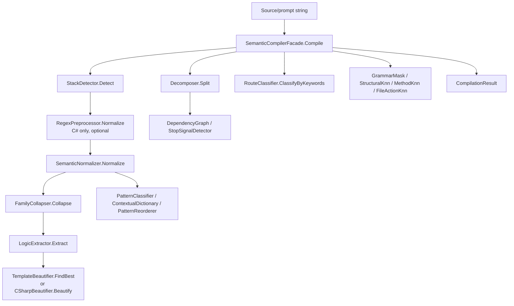

# 12.SemanticCompiler legacy

Documentation status: D12B documented - parent review passed.

## 1. Quick map for Luba

`12.SemanticCompiler` is an old, historical semantic compiler pipeline. It takes text or C# source, detects the stack, normalizes words, collapses them into semantic operations, extracts logical predicates, splits the prompt into segments, classifies route/domain, adds K-NN (K-Nearest Neighbours) and n-gram hints, and then does readable beautification. This is useful laboratory and legacy infrastructure, but not the active product path `29.SemanticCompiler`.

The main honest boundary: there are many deterministic/heuristic pieces here - regex preprocessing, marker voting, keyword routing, rule tables, static templates, in-memory K-NN predictors. They can help analysis and experiments, but they are not an `ILearningMachine`, have no export/import/checkpoint/locator lifecycle and do not prove trained semantic reasoning.

## 2. UML for draw.io



| Node | What it does | Status |
|---|---|---|
| `SemanticCompilerFacade` | assembles the old pipeline and optional predictors | legacy facade |
| `StackDetector` | detects CSharp/TypeScript/Python/Generic before normalization | deterministic/K-NN fallback |
| `RegexPreprocessor` | cleans C# comments/strings before normalization | deterministic helper |
| `SemanticNormalizer` / `FamilyCollapser` | turn text into stemmed words and op families | deterministic compression |
| `LogicExtractor` | extracts integer predicates from AST and text patterns | deterministic/Roslyn helper |
| `Decomposer` / `DependencyGraph` / `StopSignalDetector` | split the prompt, sort roles and decide stop/continue | heuristic planning |
| `Prediction/*Knn` / `GrammarMaskFilter` | optional in-memory predictors | local predictor infrastructure, not asset lifecycle |
| `Translation/*` | POS pattern, contextual dictionary, reorder rules | heuristic translation helpers |
| `Beautification/*` | template retrieval or readable comment block | deterministic/template output |

### Connection simulations

| Connection | Example input | Expected result | What this does NOT prove |
|---|---|---|---|
| `Input -> Facade` | `public async Task Run(){...}` | `Compile` runs the legacy pipeline and returns a `CompilationResult` | does not prove the readiness of the active `29.SemanticCompiler` |
| `Facade -> StackDetector` | source contains `Task`, `namespace`, `IEnumerable` | stack `CSharp` before regex/normalization | marker voting is not a semantic model |
| `StackDetector -> RegexPreprocessor` | a C# file with XML docs/comments | comments/strings may be removed only for C# | regex cleanup does not prove understanding of the code |
| `Normalize -> Collapse -> LogicExtractor` | `if (x is null) return Fail(...)` | words are normalized, ops are collapsed, predicates get `NULL_GUARD`/`FAIL` | deterministic predicates are not trained reasoning |
| `Facade -> Decomposer` | "read config then update code" | the prompt is split into segments by a change threshold | the segmentation heuristic does not prove task planning |
| `Facade -> Predict` | after several C# compilations | optional predictions can appear if the predictor was trained in-memory | this is not a checkpoint/export/import trained asset |
| `Logic -> Beautify` | predicates `[NULL_GUARD, FAIL]` | a template or comment block describes the method structure | template output is not applied code generation |
| `Normalize -> Translation` | POS sequence `[7,7,8]` | the classifier/reorderer can turn SOV into SVO | a rule table is not neural translation |

## 3. No-code algorithms

### Algorithm A: the full legacy compile pipeline

- Class: `SemanticCompilerFacade`.
- Method: `Compile(string source)`.
- Input: `source`, for example C# text.
- Output: `OperationResult<CompilationResult>`.
- Steps: checks for empty source; detects the stack on raw text; for C# with the flag enabled applies `RegexPreprocessor`; normalizes words; collapses them into op families; extracts predicates; splits the input into prompt segments; classifies the domain via keyword route; remembers the C# source for lazy predictors; adds optional prediction fields; returns a `CompilationResult`.
- Does not do: does not save a trained model, does not export a checkpoint, does not prove an active product semantic compiler.

### Algorithm B: stack detection

- Class: `StackDetector`.
- Method: `Detect(string source)`.
- Input: raw source text.
- Output: `OperationResult<StackLabel>`.
- Steps: empty input -> `Generic`; if the training set is empty -> marker voting; if there is training -> builds a frequency vector, takes the nearest examples by cosine distance and the majority stack.
- Does not do: does not perform language parser validation and is not a trained project asset.

### Algorithm C: compression/tokenization

- Classes: `SemanticTokenizerPipeline`, `SemanticNormalizer`, `FamilyCollapser`, `LogicExtractor`.
- Methods: `Level0Tokens(string)`, `Level1Tokens(string)`, `Level2Tokens(string)`, `Level3Tokens(string)`, `Normalize(string)`, `Extract(string)`.
- Input: C# source or prompt text.
- Output: a list of tokens/ops or `OperationResult<IReadOnlyList<int>>`.
- Steps: identifiers split by camel/snake; stopwords removed; words stemmed; synonyms collapsed to op families; AST roles and text-level checks converted to integer predicates.
- Does not do: does not understand meaning as a model; this is deterministic compression.

### Algorithm D: planning helpers

- Classes: `Decomposer`, `DependencyGraph`, `StopSignalDetector`.
- Methods: `Split(string prompt)`, `Sort(IReadOnlyList<PromptSegment> segments)`, `Detect(string taskDescription, bool hasIterations, bool hasTechTerms)`.
- Input: prompt/segments/flags.
- Output: segments, BFS (Breadth-First Search) levels or a stop signal id.
- Steps: `Decomposer` normalizes the prompt, compares op profiles on the left/right and sets boundaries; `DependencyGraph` groups segments by inferred role and topologically sorts the roles; `StopSignalDetector` applies priority rules.
- Does not do: does not run agent orchestration and does not prove a trainable planner.

### Algorithm E: prediction helpers

- Classes: `GrammarMaskFilter`, `StructuralKnnPredictor`, `MethodKnnPredictor`, `FileActionKnnPredictor`, `MethodFrequencyTable`.
- Methods: `Train(...)`, `Predict(...)`, `BuildVocabulary(...)`, `RankMethods(...)`.
- Input: in-memory C# sources, AST kind tokens, method examples or syntax feature vectors.
- Output: next kind ids, next token ids, canonical method type, file action label, ranked candidates.
- Steps: predictors train only from the currently provided sources/session memory; untrained or disabled predictors return empty/null/default fallback.
- Does not do: no persisted lifecycle: no manifest, locator, fresh-load, continue-training evidence.

### Algorithm F: routing and translation helpers

- Classes: `RouteClassifier`, `PatternClassifier`, `ContextualDictionary`, `PatternReorderer`.
- Methods: `Classify(int[] predicates)`, `ClassifyByKeywords(string prompt)`, `Predict(int[] posSequence)`, `TranslateWithContext(string,int[],int[])`, `Reorder(List<TaggedWord>, int)`.
- Input: predicates, prompt string, POS (Part-Of-Speech) sequences, tagged words.
- Output: domain enum, pattern id, translated word, reordered words.
- Steps: the route wrapper can call the canonical `29.SemanticCompiler` K-NN classifier, but the facade fast-path uses keyword classification; the pattern classifier uses K-NN when trained else rules; the dictionary ranks candidates by context distance; the reorderer uses static transformations.
- Does not do: translation/routing helpers are not a trained product model.

### Algorithm G: beautification

- Classes: `TemplateBeautifier`, `CSharpBeautifier`, `MergeAssembler`.
- Methods: `FindBest(...)`, `Beautify(IReadOnlyList<int>, StackLabel)`, `Assemble(...)`.
- Input: predicates, stack, segment responses.
- Output: template code string, readable comment block, merged text.
- Steps: tries static templates by predicate set/stack; fallback renders predicate phrases; merge joins segment responses in order.
- Does not do: does not apply changes to files and does not prove generated code quality.

## 4. Short code quotes

`12.SemanticCompiler/SemanticCompilerFacade.cs:111-170`

```csharp
    public OperationResult<CompilationResult> Compile(string source)
    {
        if (string.IsNullOrWhiteSpace(source))
            return OperationResult<CompilationResult>.Fail(
                "Source cannot be empty", "EMPTY_SOURCE");

        // E20 CRITICAL: StackDetector BEFORE SemanticNormalizer
        var stackResult = _stackDetector.Detect(source);
        if (!stackResult.IsSuccess)
            return OperationResult<CompilationResult>.Fail(
                stackResult.ErrorMessage, stackResult.ErrorCode);

        // E10: strip XML docs, block/line comments, string literals, and extra blanks.
        // C# source only; natural language prompts must keep literal documentation markers.
        if (_options.UseRegexPreprocessor && stackResult.Value == StackLabel.CSharp)
            source = RegexPreprocessor.Normalize(source);

        var normalizedResult = NormalizeSource(source);
        if (!normalizedResult.IsSuccess)
            return OperationResult<CompilationResult>.Fail(
                normalizedResult.ErrorMessage, normalizedResult.ErrorCode);

        var opsResult = CollapseToOps(normalizedResult.Value!);
        if (!opsResult.IsSuccess)
            return OperationResult<CompilationResult>.Fail(
                opsResult.ErrorMessage, opsResult.ErrorCode);

        var predicatesResult = LogicExtractor.Extract(source);
        if (!predicatesResult.IsSuccess)
            return OperationResult<CompilationResult>.Fail(
                predicatesResult.ErrorMessage, predicatesResult.ErrorCode);

        var segmentsResult = _decomposer.Split(source);
        if (!segmentsResult.IsSuccess)
            return OperationResult<CompilationResult>.Fail(
                segmentsResult.ErrorMessage, segmentsResult.ErrorCode);

        var domain = RouteClassifier.ClassifyByKeywords(source);

        RememberCompiledSource(source, stackResult.Value);
        var predictedNextKinds = PredictNextKinds(source, stackResult.Value);
        var predictedNextTokens = PredictStructuralNextTokens(source, stackResult.Value);
        var predictedNextMethodType = PredictNextMethodType(source, stackResult.Value);
        var predictedFileAction = PredictFileAction(source, stackResult.Value);

        var result = new CompilationResult(
            Stack:           stackResult.Value,
            Domain:          domain,
            Predicates:      predicatesResult.Value!,
            Ops:             opsResult.Value!,
            NormalizedWords: normalizedResult.Value!,
            Segments:        segmentsResult.Value!)
        {
            PredictedNextKinds = predictedNextKinds,
            PredictedNextTokens = predictedNextTokens,
            PredictedNextMethodType = predictedNextMethodType,
            PredictedFileAction = predictedFileAction
        };

        return OperationResult<CompilationResult>.Ok(result);
```

Why it matters: this shows the real pipeline order. Stack detection goes before normalization; regex is applied only for C#. It does not prove a trained semantic model.

`12.SemanticCompiler/Compression/LogicExtractor.cs:53-82`

```csharp
    // Extract integer predicate sequence from C# source.
    public static OperationResult<IReadOnlyList<int>> Extract(string csharpSource)
    {
        if (string.IsNullOrWhiteSpace(csharpSource))
            return OperationResult<IReadOnlyList<int>>.Fail("Empty source");

        var level3   = SemanticTokenizerPipeline.Level3Tokens(csharpSource);
        var level2ops = SemanticTokenizerPipeline.Level2Tokens(csharpSource)
            .Where(t => t.EndsWith("_OP", StringComparison.Ordinal));

        var result = level3.Concat(level2ops)
            .Select(s => Map.TryGetValue(s, out int id) ? id : UNKNOWN)
            .Where(id => id >= 0)
            .ToList();

        // Text-level FAIL: OperationResult.Fail() and throw not always caught by Level3
        if (!result.Contains(FAIL) &&
            (csharpSource.Contains(".Fail(") || csharpSource.Contains("throw new ")))
            result.Add(FAIL);

        // Text-level NULL_GUARD: explicit null comparisons
        if (!result.Contains(NULL_GUARD) &&
            (csharpSource.Contains("== null") || csharpSource.Contains("!= null") ||
             csharpSource.Contains("is null")))
            result.Add(NULL_GUARD);

        if (result.Count == 0)
            return OperationResult<IReadOnlyList<int>>.Fail("No predicates extracted");

        return OperationResult<IReadOnlyList<int>>.Ok(result.AsReadOnly());
```

Why it matters: predicates are built from deterministic AST/text rules. This is useful, but not equal to trained reasoning.

`12.SemanticCompiler/Routing/StackDetector.cs:45-65`

```csharp
    public OperationResult<StackLabel> Detect(string source)
    {
        if (string.IsNullOrWhiteSpace(source))
            return OperationResult<StackLabel>.Ok(StackLabel.Generic);

        if (_train.Count == 0)
            return OperationResult<StackLabel>.Ok(PredictByMarkers(source));

        var q = BuildFeatureVector(source);
        if (q.All(x => x == 0f))
            return OperationResult<StackLabel>.Ok(StackLabel.Generic);

        var best = _train
            .Where(t => t.Features.Any(x => x > 0f))
            .OrderBy(t => CosineDistance(q, t.Features))
            .Take(_k)
            .GroupBy(t => t.Stack)
            .OrderByDescending(g => g.Count())
            .FirstOrDefault();

        return OperationResult<StackLabel>.Ok(best?.Key ?? StackLabel.Generic);
```

Why it matters: there is a K-NN path, but in the absence of training data the code falls back to marker voting. This is not a persisted trained asset.

`12.SemanticCompiler/Routing/RouteClassifier.cs:23-39`

```csharp
    // Compatibility wrapper over the canonical project 29 E18 KNN classifier.
    public OperationResult<SemanticCompiler29.Domain> Classify(int[] predicates)
    {
        var result = _canonical.Classify(predicates);
        return result.IsSuccess
            ? OperationResult<SemanticCompiler29.Domain>.Ok(result.Value!)
            : OperationResult<SemanticCompiler29.Domain>.Fail(result.ErrorMessage, result.ErrorCode);
    }

    // Baseline: keyword matching (fast, no training required)
    public static SemanticCompiler29.Domain ClassifyByKeywords(string prompt)
    {
        return SemanticCompiler29.RouteClassifier.ClassifyByKeywords(prompt);
    }

    // Auto-label a prompt for training data generation
    public static SemanticCompiler29.Domain AutoLabel(string prompt) => ClassifyByKeywords(prompt);
```

Why it matters: the legacy project already wraps the canonical `29.SemanticCompiler`, but the facade uses the keyword fast-path. This is a relationship to the active path, not standalone readiness of a legacy model.

`12.SemanticCompiler/Planning/Decomposer.cs:20-57`

```csharp
        if (string.IsNullOrWhiteSpace(prompt))
            return OperationResult<IReadOnlyList<PromptSegment>>.Ok(
                new[] { new PromptSegment(prompt, 0, 0) });

        var words = SemanticNormalizer.Normalize(prompt);
        if (words.Count < _windowSize * 2 + 1)
            return OperationResult<IReadOnlyList<PromptSegment>>.Ok(
                new[] { new PromptSegment(prompt, 0, Math.Max(0, words.Count - 1)) });

        var ops        = FamilyCollapser.Collapse(words);
        var boundaries = new List<int>();

        for (int i = _windowSize; i < ops.Count - _windowSize; i++)
        {
            var left  = OpProfile(ops, Math.Max(0, i - _windowSize), i);
            var right = OpProfile(ops, i, Math.Min(ops.Count, i + _windowSize));
            if (left.Count == 0 || right.Count == 0) continue;
            if (CosineDist(left, right) > _changeThreshold)
                boundaries.Add(i);
        }

        var clean    = MergeClose(boundaries, minGap: 2);
        var rawWords = prompt.Split(' ', StringSplitOptions.RemoveEmptyEntries);
        var allBounds = new[] { 0 }.Concat(clean).Append(rawWords.Length).ToArray();
        var segments  = new List<PromptSegment>();

        for (int i = 0; i < allBounds.Length - 1; i++)
        {
            int wStart = allBounds[i];
            int wEnd   = Math.Min(allBounds[i + 1], rawWords.Length);
            if (wStart >= wEnd) continue;
            segments.Add(new PromptSegment(
                string.Join(" ", rawWords[wStart..wEnd]), wStart, wEnd - 1));
        }

        if (segments.Count == 0)
            segments.Add(new PromptSegment(prompt, 0, rawWords.Length - 1));

```

Why it matters: segmentation is built by profile distance, not by a trained planner.

`12.SemanticCompiler/Translation/PatternClassifier.cs:40-60`

```csharp
    // Enhanced: K-NN on POS bigrams (Jaccard distance)
    public int Predict(int[] posSequence)
    {
        if (_train.Count == 0) return PredictByRules(posSequence);
        return _train
            .OrderBy(t => SequenceDistance(posSequence, t.PosSeq))
            .Take(_k)
            .GroupBy(t => t.Pattern)
            .OrderByDescending(g => g.Count())
            .First().Key;
    }

    // Baseline: rules based on first-verb position
    public static int PredictByRules(int[] posSeq)
    {
        if (posSeq.Length == 0) return IMPERATIVE_V;

        int firstVerb = Array.IndexOf(posSeq, VERB_ID);
        int firstNoun = posSeq.ToList().FindIndex(p => p == NOUN_ID || p == PRON_ID);

        if (firstVerb == -1) return SVO;
```

Why it matters: the translation helper either uses in-memory K-NN or a rule fallback. It is not neural translation.

`12.SemanticCompiler/Beautification/TemplateBeautifier.cs:17-36`

```csharp
    public static readonly IReadOnlyList<Template> All = new[]
    {
        // ── C# patterns ────────────────────────────────────────────────────────
        new Template(
            new[] { LogicExtractor.NULL_GUARD, LogicExtractor.FAIL },
            CSHARP,
            "if ({VAR} == null)\n    return OperationResult<{TYPE}>.Fail(\"{VAR} cannot be null\");",
            "Null guard → Fail"),

        new Template(
            new[] { LogicExtractor.NULL_GUARD, LogicExtractor.FAIL, LogicExtractor.SUCCESS },
            CSHARP,
            "if ({VAR} == null)\n    return OperationResult<{TYPE}>.Fail(\"not found\");\n// ...\nreturn OperationResult<{TYPE}>.Ok(result);",
            "Null guard → Fail | Success"),

        new Template(
            new[] { LogicExtractor.VALIDATE_OP, LogicExtractor.FAIL },
            CSHARP,
            "var valid = _validator.Validate({VAR});\nif (!valid.IsSuccess)\n    return OperationResult<{TYPE}>.Fail(valid.ErrorMessage);",
            "Validate → Fail"),
```

Why it matters: beautification relies on static templates. It does not apply edits or prove generated code quality.

## 5. QA / test mapping

The tests were not run in this documentation subphase.

| Anchor | What it covers | What it does not prove |
|---|---|---|
| `Tests/SemanticCompilerTests.cs` | StackDetector marker voting, RouteClassifier keywords, Decomposer, StopSignalDetector, DependencyGraph, PatternClassifier/Reorderer/Dictionary, beautifiers, facade compile | does not prove active `29.SemanticCompiler` readiness |
| `Tests/E09E10FeatureFlagTests.cs` | regex feature flag, structural K-NN enabled/disabled behavior | does not prove a persisted K-NN model lifecycle |
| `Tests/E13E14FeatureFlagTests.cs` | method/file-action K-NN training gates and opt-in predictors | does not prove model asset export/import |
| `Tests/E02E03E05E11IntegrationTests.cs` | grammar mask filter and facade completion ranking | is not runtime product evidence |
| `Tests/ExperimentsV2Tests.cs` | experiment-level coverage for tokenizer, normalizer, K-NN, translation helpers | experiment evidence, not the current active product path |

## 6. Component status

| Component | File | Status | What actually works now |
|---|---|---|---|
| `SemanticCompilerFacade` | `12.SemanticCompiler/SemanticCompilerFacade.cs` | Legacy/partial | `Compile`, feature flags, optional in-memory predictors |
| `SemanticCompilerOptions` | `12.SemanticCompiler/SemanticCompilerOptions.cs` | Legacy helper | enables/disables regex, structural K-NN, method K-NN, file action K-NN |
| `SemanticTokenizerPipeline` | `12.SemanticCompiler/Compression/SemanticTokenizerPipeline.cs` | deterministic infrastructure | Level0-Level3 tokens and encode |
| `SemanticNormalizer` / `FamilyCollapser` | `12.SemanticCompiler/Compression/*` | deterministic infrastructure | stopword/stem/collapse |
| `LogicExtractor` | `12.SemanticCompiler/Compression/LogicExtractor.cs` | deterministic infrastructure | predicates from AST/text checks |
| `StackDetector` | `12.SemanticCompiler/Routing/StackDetector.cs` | heuristic/K-NN infrastructure | marker fallback or in-memory nearest neighbours |
| `RouteClassifier` | `12.SemanticCompiler/Routing/RouteClassifier.cs` | compatibility/legacy | wraps canonical 29 classifier, has keyword baseline |
| `Decomposer` / `DependencyGraph` / `StopSignalDetector` | `12.SemanticCompiler/Planning/*` | heuristic planning | segmentation, dependency levels, stop signals |
| `GrammarMaskFilter`, `MethodKnnPredictor`, `FileActionKnnPredictor`, `StructuralKnnPredictor` | `12.SemanticCompiler/Prediction/*` | in-memory predictor infrastructure | optional predictions; no persistent trained asset |
| `PatternClassifier`, `ContextualDictionary`, `PatternReorderer` | `12.SemanticCompiler/Translation/*` | heuristic translation helpers | rules/K-NN/context distance/reorder |
| `TemplateBeautifier`, `CSharpBeautifier`, `MergeAssembler` | `12.SemanticCompiler/Beautification/*` | deterministic/template output | readable templates/comments/merge |

## 7. Anti-false-done

- `12.SemanticCompiler` is legacy/superseded documentation, not proof that active `29.SemanticCompiler` is ready.
- Regex, keyword routing, marker voting, rule tables, static templates, K-NN and n-gram predictors are deterministic/heuristic infrastructure unless a separate trainable lifecycle exists.
- No `ILearningMachine`, manifest, checkpoint, locator, fresh-load, continue-training, held-out metric or export/import path is documented here for D12-B.
- JSON/report/smoke/static helper evidence must not be accepted as trained semantic reasoning.
- K-NN in this project is mostly in-memory/session training; it must not be hidden as persisted project model readiness.

Known gaps: no fresh tests were run; direct test mapping is source/read-only. D12B parent review should confirm whether any D6 final index/state wording needs later parent update.
