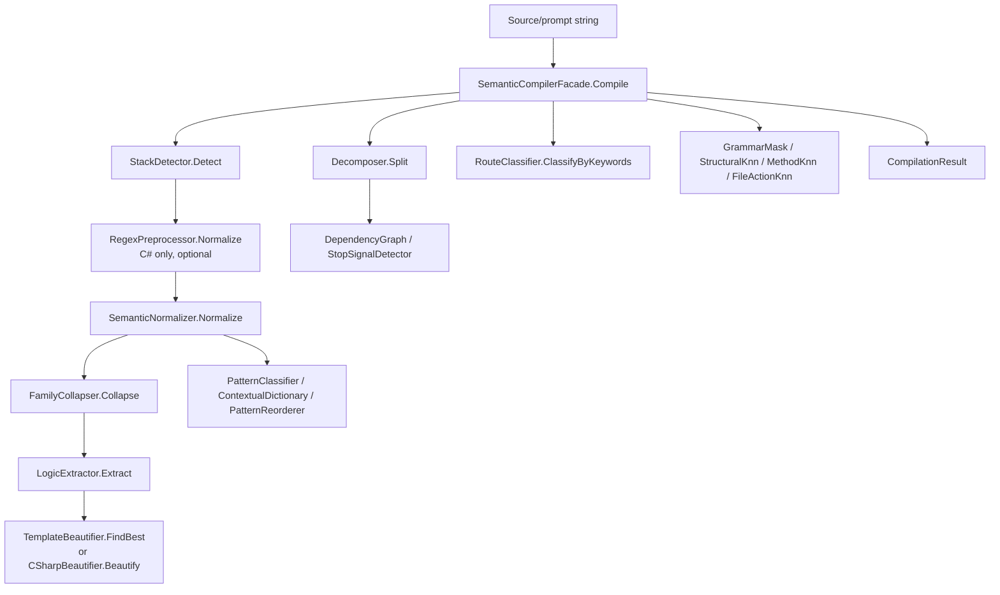

# 12.SemanticCompiler legacy

Documentation status: D12B documented - parent review passed.

## 1. Краткая карта для Лубы

`12.SemanticCompiler` - это старый, исторический semantic compiler pipeline. Он берет текст или C# source, определяет стек, нормализует слова, сворачивает их в смысловые операции, извлекает логические predicates, режет prompt на сегменты, классифицирует route/domain, добавляет K-NN (K-Nearest Neighbours) и n-gram подсказки, а затем делает readable beautification. Это полезная лабораторная и legacy-инфраструктура, но не активный продуктовый путь `29.SemanticCompiler`.

Главная честная граница: здесь много deterministic/heuristic pieces - regex preprocessing, marker voting, keyword routing, rule tables, static templates, in-memory K-NN predictors. Они могут помогать анализу и экспериментам, но не являются `ILearningMachine`, не имеют export/import/checkpoint/locator lifecycle и не доказывают trained semantic reasoning.

## 2. UML для draw.io



| Узел | Что делает | Статус |
|---|---|---|
| `SemanticCompilerFacade` | собирает старый pipeline и optional predictors | legacy фасад |
| `StackDetector` | определяет CSharp/TypeScript/Python/Generic до нормализации | deterministic/K-NN fallback |
| `RegexPreprocessor` | чистит C# comments/strings перед нормализацией | deterministic helper |
| `SemanticNormalizer` / `FamilyCollapser` | превращают текст в stemmed words и op families | deterministic compression |
| `LogicExtractor` | извлекает integer predicates из AST и text patterns | deterministic/Roslyn helper |
| `Decomposer` / `DependencyGraph` / `StopSignalDetector` | делят prompt, сортируют роли и решают stop/continue | heuristic planning |
| `Prediction/*Knn` / `GrammarMaskFilter` | optional in-memory predictors | local predictor infrastructure, not asset lifecycle |
| `Translation/*` | POS pattern, contextual dictionary, reorder rules | heuristic translation helpers |
| `Beautification/*` | template retrieval или readable comment block | deterministic/template output |

### Симуляции связей

| Связь | Пример входа | Ожидаемый результат | Что это НЕ доказывает |
|---|---|---|---|
| `Input -> Facade` | `public async Task Run(){...}` | `Compile` запускает legacy pipeline и возвращает `CompilationResult` | не доказывает готовность активного `29.SemanticCompiler` |
| `Facade -> StackDetector` | source содержит `Task`, `namespace`, `IEnumerable` | stack `CSharp` до regex/normalization | marker voting не является semantic model |
| `StackDetector -> RegexPreprocessor` | C# файл с XML docs/comments | comments/strings могут быть удалены только для C# | regex cleanup не доказывает понимание кода |
| `Normalize -> Collapse -> LogicExtractor` | `if (x is null) return Fail(...)` | слова нормализуются, ops сворачиваются, predicates получают `NULL_GUARD`/`FAIL` | deterministic predicates не являются обученным reasoning |
| `Facade -> Decomposer` | "read config then update code" | prompt делится на segments по change threshold | segmentation heuristic не доказывает планирование задачи |
| `Facade -> Predict` | после нескольких C# compilations | optional predictions могут появиться, если predictor обучен in-memory | это не checkpoint/export/import trained asset |
| `Logic -> Beautify` | predicates `[NULL_GUARD, FAIL]` | template или comment block описывает структуру метода | template output не является примененным code generation |
| `Normalize -> Translation` | POS sequence `[7,7,8]` | classifier/reorderer может привести SOV к SVO | rule table не является neural translation |

## 3. Алгоритмы без кода

### Алгоритм A: полный legacy compile pipeline

- Класс: `SemanticCompilerFacade`.
- Метод: `Compile(string source)`.
- Вход: `source`, например C# text.
- Выход: `OperationResult<CompilationResult>`.
- Шаги: проверяет пустой source; определяет stack на raw text; для C# при включенном флаге применяет `RegexPreprocessor`; нормализует слова; сворачивает их в op families; извлекает predicates; режет input на prompt segments; классифицирует domain через keyword route; запоминает C# source для lazy predictors; добавляет optional prediction fields; возвращает `CompilationResult`.
- Не делает: не сохраняет trained model, не экспортирует checkpoint, не доказывает активный product semantic compiler.

### Алгоритм B: stack detection

- Класс: `StackDetector`.
- Метод: `Detect(string source)`.
- Вход: raw source text.
- Выход: `OperationResult<StackLabel>`.
- Шаги: пустой input -> `Generic`; если training set пустой -> marker voting; если training есть -> строит frequency vector, берет nearest examples by cosine distance и majority stack.
- Не делает: не выполняет language parser validation и не является обученным проектным asset.

### Алгоритм C: compression/tokenization

- Классы: `SemanticTokenizerPipeline`, `SemanticNormalizer`, `FamilyCollapser`, `LogicExtractor`.
- Методы: `Level0Tokens(string)`, `Level1Tokens(string)`, `Level2Tokens(string)`, `Level3Tokens(string)`, `Normalize(string)`, `Extract(string)`.
- Вход: C# source или prompt text.
- Выход: list of tokens/ops или `OperationResult<IReadOnlyList<int>>`.
- Шаги: identifiers split by camel/snake; stopwords removed; words stemmed; synonyms collapsed to op families; AST roles and text-level checks converted to integer predicates.
- Не делает: не понимает смысл как model; это deterministic compression.

### Алгоритм D: planning helpers

- Классы: `Decomposer`, `DependencyGraph`, `StopSignalDetector`.
- Методы: `Split(string prompt)`, `Sort(IReadOnlyList<PromptSegment> segments)`, `Detect(string taskDescription, bool hasIterations, bool hasTechTerms)`.
- Вход: prompt/segments/flags.
- Выход: segments, BFS (Breadth-First Search) levels или stop signal id.
- Шаги: `Decomposer` нормализует prompt, сравнивает op profiles слева/справа и ставит boundaries; `DependencyGraph` группирует segments by inferred role и topologically sorts roles; `StopSignalDetector` применяет priority rules.
- Не делает: не запускает agent orchestration и не доказывает trainable planner.

### Алгоритм E: prediction helpers

- Классы: `GrammarMaskFilter`, `StructuralKnnPredictor`, `MethodKnnPredictor`, `FileActionKnnPredictor`, `MethodFrequencyTable`.
- Методы: `Train(...)`, `Predict(...)`, `BuildVocabulary(...)`, `RankMethods(...)`.
- Вход: in-memory C# sources, AST kind tokens, method examples или syntax feature vectors.
- Выход: next kind ids, next token ids, canonical method type, file action label, ranked candidates.
- Шаги: predictors train only from current provided sources/session memory; untrained or disabled predictors return empty/null/default fallback.
- Не делает: no persisted lifecycle: no manifest, locator, fresh-load, continue-training evidence.

> Пометка 01.11.2026 (исполнитель переноса), предсказатель вида следующего
> метода `MethodKnnPredictor`. Набор признаков метода теперь читает выражение-тело.
> **Что было.** Признаки брались только из блочного тела в фигурных скобках, а
> метод, написанный одной строкой через стрелку, не имел ни одного признака.
> Пустой набор давал две ошибки распознавания сразу: такой метод оказывался
> идеально похожим (расстояние ноль) на любое объявление вообще без тела —
> абстрактное, в интерфейсе, внешнее — и максимально далёким (расстояние один) от
> своего же блочного смыслового двойника; вид метода при пустом наборе
> объявлялся «простым».
> **Что стало.** Когда блочного тела нет, но есть выражение-тело, читается его
> поддерево вместе с самим выражением. Когда нет ни блока, ни выражения, набор
> по-прежнему пуст: у настоящего объявления без тела признаков действительно нет.
> **Несущая деталь для будущих правок.** У блочного тела читается поддерево БЕЗ
> самого узла, у выражения-тела — ВМЕСТЕ с самим выражением. Эти две строки
> нельзя выравнивать между собой: иначе асинхронный однострочник схлопывается в
> тот же набор, что обычный, а обычный возвращается к пустому набору, и правка
> теряет смысл целиком. Предупреждение продублировано комментарием рядом с кодом.
> **Измерено** оракулом с дословным переносом прежней, новой и выровненной логики
> (`Tests/ExperimentFixes/oracle-method-knn-expression-body.ps1`, показания рядом
> в файле с тем же именем и окончанием `-output.txt`), на фактических учебных
> данных опыта о методе-однострочнике (восемьдесят третий опыт). При продуктовом
> числе соседей пять и объёме двадцать четыре пары: ответы на учебных вопросах с
> 18 из 24 до 24 из 24, экзамен с 3 из 4 до 4 из 4, пустых наборов признаков из
> двенадцати методов с 4 до 0, потерянных случаев 0.
> **Границы.** Обучение этого предсказателя не вызывает ни одна продуктовая
> строка — только проверки, поэтому измеренный выигрыш относится к границе самого
> узла, а не к работающему продукту. Правило «оба набора пусты — расстояние ноль»
> переносом не тронуто, поэтому настоящие объявления без тела по-прежнему лежат
> друг к другу на нулевом расстоянии. Соседняя упаковка подписи для человека и
> соседняя проекция внешнего тела отдельного входа обучения сохраняют прежнее
> чтение. Время и память не измерены. Подробности и остаток — в реестре
> необходимых изменений (`docs/plans/replanning-possible-diffs/required-changes.md`,
> раздел о переносе чтения выражения-тела).

### Алгоритм F: routing and translation helpers

- Классы: `RouteClassifier`, `PatternClassifier`, `ContextualDictionary`, `PatternReorderer`.
- Методы: `Classify(int[] predicates)`, `ClassifyByKeywords(string prompt)`, `Predict(int[] posSequence)`, `TranslateWithContext(string,int[],int[])`, `Reorder(List<TaggedWord>, int)`.
- Вход: predicates, prompt string, POS (Part-Of-Speech) sequences, tagged words.
- Выход: domain enum, pattern id, translated word, reordered words.
- Шаги: route wrapper can call canonical `29.SemanticCompiler` K-NN classifier, but facade fast-path uses keyword classification; pattern classifier uses K-NN when trained else rules; dictionary ranks candidates by context distance; reorderer uses static transformations.
- Не делает: translation/routing helpers are not a trained product model.

### Алгоритм G: beautification

- Классы: `TemplateBeautifier`, `CSharpBeautifier`, `MergeAssembler`.
- Методы: `FindBest(...)`, `Beautify(IReadOnlyList<int>, StackLabel)`, `Assemble(...)`.
- Вход: predicates, stack, segment responses.
- Выход: template code string, readable comment block, merged text.
- Шаги: tries static templates by predicate set/stack; fallback renders predicate phrases; merge joins segment responses in order.
- Не делает: не применяет изменения к файлам и не доказывает generated code quality.

## 4. Короткие цитаты кода

`12.SemanticCompiler/SemanticCompilerFacade.cs:111-170`

```csharp
    public OperationResult<CompilationResult> Compile(string source)
    {
        if (string.IsNullOrWhiteSpace(source))
            return OperationResult<CompilationResult>.Fail(
                "Source cannot be empty", "EMPTY_SOURCE");

        // E20 CRITICAL: StackDetector BEFORE SemanticNormalizer
        var stackResult = _stackDetector.Detect(source);
        if (!stackResult.IsSuccess)
            return OperationResult<CompilationResult>.Fail(
                stackResult.ErrorMessage, stackResult.ErrorCode);

        // E10: strip XML docs, block/line comments, string literals, and extra blanks.
        // C# source only; natural language prompts must keep literal documentation markers.
        if (_options.UseRegexPreprocessor && stackResult.Value == StackLabel.CSharp)
            source = RegexPreprocessor.Normalize(source);

        var normalizedResult = NormalizeSource(source);
        if (!normalizedResult.IsSuccess)
            return OperationResult<CompilationResult>.Fail(
                normalizedResult.ErrorMessage, normalizedResult.ErrorCode);

        var opsResult = CollapseToOps(normalizedResult.Value!);
        if (!opsResult.IsSuccess)
            return OperationResult<CompilationResult>.Fail(
                opsResult.ErrorMessage, opsResult.ErrorCode);

        var predicatesResult = LogicExtractor.Extract(source);
        if (!predicatesResult.IsSuccess)
            return OperationResult<CompilationResult>.Fail(
                predicatesResult.ErrorMessage, predicatesResult.ErrorCode);

        var segmentsResult = _decomposer.Split(source);
        if (!segmentsResult.IsSuccess)
            return OperationResult<CompilationResult>.Fail(
                segmentsResult.ErrorMessage, segmentsResult.ErrorCode);

        var domain = RouteClassifier.ClassifyByKeywords(source);

        RememberCompiledSource(source, stackResult.Value);
        var predictedNextKinds = PredictNextKinds(source, stackResult.Value);
        var predictedNextTokens = PredictStructuralNextTokens(source, stackResult.Value);
        var predictedNextMethodType = PredictNextMethodType(source, stackResult.Value);
        var predictedFileAction = PredictFileAction(source, stackResult.Value);

        var result = new CompilationResult(
            Stack:           stackResult.Value,
            Domain:          domain,
            Predicates:      predicatesResult.Value!,
            Ops:             opsResult.Value!,
            NormalizedWords: normalizedResult.Value!,
            Segments:        segmentsResult.Value!)
        {
            PredictedNextKinds = predictedNextKinds,
            PredictedNextTokens = predictedNextTokens,
            PredictedNextMethodType = predictedNextMethodType,
            PredictedFileAction = predictedFileAction
        };

        return OperationResult<CompilationResult>.Ok(result);
```

Почему важно: это показывает реальный порядок pipeline. Stack detection идет до normalization; regex применяется только для C#. Не доказывает trained semantic model.

`12.SemanticCompiler/Compression/LogicExtractor.cs:53-82`

```csharp
    // Extract integer predicate sequence from C# source.
    public static OperationResult<IReadOnlyList<int>> Extract(string csharpSource)
    {
        if (string.IsNullOrWhiteSpace(csharpSource))
            return OperationResult<IReadOnlyList<int>>.Fail("Empty source");

        var level3   = SemanticTokenizerPipeline.Level3Tokens(csharpSource);
        var level2ops = SemanticTokenizerPipeline.Level2Tokens(csharpSource)
            .Where(t => t.EndsWith("_OP", StringComparison.Ordinal));

        var result = level3.Concat(level2ops)
            .Select(s => Map.TryGetValue(s, out int id) ? id : UNKNOWN)
            .Where(id => id >= 0)
            .ToList();

        // Text-level FAIL: OperationResult.Fail() and throw not always caught by Level3
        if (!result.Contains(FAIL) &&
            (csharpSource.Contains(".Fail(") || csharpSource.Contains("throw new ")))
            result.Add(FAIL);

        // Text-level NULL_GUARD: explicit null comparisons
        if (!result.Contains(NULL_GUARD) &&
            (csharpSource.Contains("== null") || csharpSource.Contains("!= null") ||
             csharpSource.Contains("is null")))
            result.Add(NULL_GUARD);

        if (result.Count == 0)
            return OperationResult<IReadOnlyList<int>>.Fail("No predicates extracted");

        return OperationResult<IReadOnlyList<int>>.Ok(result.AsReadOnly());
```

Почему важно: predicates строятся из deterministic AST/text rules. Это полезно, но не равно обученному reasoning.

`12.SemanticCompiler/Routing/StackDetector.cs:45-65`

```csharp
    public OperationResult<StackLabel> Detect(string source)
    {
        if (string.IsNullOrWhiteSpace(source))
            return OperationResult<StackLabel>.Ok(StackLabel.Generic);

        if (_train.Count == 0)
            return OperationResult<StackLabel>.Ok(PredictByMarkers(source));

        var q = BuildFeatureVector(source);
        if (q.All(x => x == 0f))
            return OperationResult<StackLabel>.Ok(StackLabel.Generic);

        var best = _train
            .Where(t => t.Features.Any(x => x > 0f))
            .OrderBy(t => CosineDistance(q, t.Features))
            .Take(_k)
            .GroupBy(t => t.Stack)
            .OrderByDescending(g => g.Count())
            .FirstOrDefault();

        return OperationResult<StackLabel>.Ok(best?.Key ?? StackLabel.Generic);
```

Почему важно: есть K-NN path, но при отсутствии training data код откатывается к marker voting. Это не persisted trained asset.

`12.SemanticCompiler/Routing/RouteClassifier.cs:23-39`

```csharp
    // Compatibility wrapper over the canonical project 29 E18 KNN classifier.
    public OperationResult<SemanticCompiler29.Domain> Classify(int[] predicates)
    {
        var result = _canonical.Classify(predicates);
        return result.IsSuccess
            ? OperationResult<SemanticCompiler29.Domain>.Ok(result.Value!)
            : OperationResult<SemanticCompiler29.Domain>.Fail(result.ErrorMessage, result.ErrorCode);
    }

    // Baseline: keyword matching (fast, no training required)
    public static SemanticCompiler29.Domain ClassifyByKeywords(string prompt)
    {
        return SemanticCompiler29.RouteClassifier.ClassifyByKeywords(prompt);
    }

    // Auto-label a prompt for training data generation
    public static SemanticCompiler29.Domain AutoLabel(string prompt) => ClassifyByKeywords(prompt);
```

Почему важно: legacy project уже оборачивает canonical `29.SemanticCompiler`, но facade использует keyword fast-path. Это relationship к active path, а не самостоятельная готовность legacy model.

`12.SemanticCompiler/Planning/Decomposer.cs:20-57`

```csharp
        if (string.IsNullOrWhiteSpace(prompt))
            return OperationResult<IReadOnlyList<PromptSegment>>.Ok(
                new[] { new PromptSegment(prompt, 0, 0) });

        var words = SemanticNormalizer.Normalize(prompt);
        if (words.Count < _windowSize * 2 + 1)
            return OperationResult<IReadOnlyList<PromptSegment>>.Ok(
                new[] { new PromptSegment(prompt, 0, Math.Max(0, words.Count - 1)) });

        var ops        = FamilyCollapser.Collapse(words);
        var boundaries = new List<int>();

        for (int i = _windowSize; i < ops.Count - _windowSize; i++)
        {
            var left  = OpProfile(ops, Math.Max(0, i - _windowSize), i);
            var right = OpProfile(ops, i, Math.Min(ops.Count, i + _windowSize));
            if (left.Count == 0 || right.Count == 0) continue;
            if (CosineDist(left, right) > _changeThreshold)
                boundaries.Add(i);
        }

        var clean    = MergeClose(boundaries, minGap: 2);
        var rawWords = prompt.Split(' ', StringSplitOptions.RemoveEmptyEntries);
        var allBounds = new[] { 0 }.Concat(clean).Append(rawWords.Length).ToArray();
        var segments  = new List<PromptSegment>();

        for (int i = 0; i < allBounds.Length - 1; i++)
        {
            int wStart = allBounds[i];
            int wEnd   = Math.Min(allBounds[i + 1], rawWords.Length);
            if (wStart >= wEnd) continue;
            segments.Add(new PromptSegment(
                string.Join(" ", rawWords[wStart..wEnd]), wStart, wEnd - 1));
        }

        if (segments.Count == 0)
            segments.Add(new PromptSegment(prompt, 0, rawWords.Length - 1));

```

Почему важно: segmentation строится по profile distance, не по обученному планировщику.

`12.SemanticCompiler/Translation/PatternClassifier.cs:40-60`

```csharp
    // Enhanced: K-NN on POS bigrams (Jaccard distance)
    public int Predict(int[] posSequence)
    {
        if (_train.Count == 0) return PredictByRules(posSequence);
        return _train
            .OrderBy(t => SequenceDistance(posSequence, t.PosSeq))
            .Take(_k)
            .GroupBy(t => t.Pattern)
            .OrderByDescending(g => g.Count())
            .First().Key;
    }

    // Baseline: rules based on first-verb position
    public static int PredictByRules(int[] posSeq)
    {
        if (posSeq.Length == 0) return IMPERATIVE_V;

        int firstVerb = Array.IndexOf(posSeq, VERB_ID);
        int firstNoun = posSeq.ToList().FindIndex(p => p == NOUN_ID || p == PRON_ID);

        if (firstVerb == -1) return SVO;
```

Почему важно: translation helper either uses in-memory K-NN or rule fallback. It is not neural translation.

`12.SemanticCompiler/Beautification/TemplateBeautifier.cs:17-36`

```csharp
    public static readonly IReadOnlyList<Template> All = new[]
    {
        // ── C# patterns ────────────────────────────────────────────────────────
        new Template(
            new[] { LogicExtractor.NULL_GUARD, LogicExtractor.FAIL },
            CSHARP,
            "if ({VAR} == null)\n    return OperationResult<{TYPE}>.Fail(\"{VAR} cannot be null\");",
            "Null guard → Fail"),

        new Template(
            new[] { LogicExtractor.NULL_GUARD, LogicExtractor.FAIL, LogicExtractor.SUCCESS },
            CSHARP,
            "if ({VAR} == null)\n    return OperationResult<{TYPE}>.Fail(\"not found\");\n// ...\nreturn OperationResult<{TYPE}>.Ok(result);",
            "Null guard → Fail | Success"),

        new Template(
            new[] { LogicExtractor.VALIDATE_OP, LogicExtractor.FAIL },
            CSHARP,
            "var valid = _validator.Validate({VAR});\nif (!valid.IsSuccess)\n    return OperationResult<{TYPE}>.Fail(valid.ErrorMessage);",
            "Validate → Fail"),
```

Почему важно: beautification relies on static templates. It does not apply edits or prove generated code quality.

## 5. QA / test mapping

Тесты в этом documentation subphase не запускались.

| Якорь | Что покрывает | Чего не доказывает |
|---|---|---|
| `Tests/SemanticCompilerTests.cs` | StackDetector marker voting, RouteClassifier keywords, Decomposer, StopSignalDetector, DependencyGraph, PatternClassifier/Reorderer/Dictionary, beautifiers, facade compile | не доказывает active `29.SemanticCompiler` readiness |
| `Tests/E09E10FeatureFlagTests.cs` | regex feature flag, structural K-NN enabled/disabled behavior | не доказывает persisted K-NN model lifecycle |
| `Tests/E13E14FeatureFlagTests.cs` | method/file-action K-NN training gates and opt-in predictors | не доказывает model asset export/import |
| `Tests/E02E03E05E11IntegrationTests.cs` | grammar mask filter and facade completion ranking | не является runtime product evidence |
| `Tests/ExperimentsV2Tests.cs` | experiment-level coverage for tokenizer, normalizer, K-NN, translation helpers | experiment evidence, not current active product path |

## 6. Статус компонентов

| Компонент | Файл | Статус | Что реально работает сейчас |
|---|---|---|---|
| `SemanticCompilerFacade` | `12.SemanticCompiler/SemanticCompilerFacade.cs` | Legacy/частичная | `Compile`, feature flags, optional in-memory predictors |
| `SemanticCompilerOptions` | `12.SemanticCompiler/SemanticCompilerOptions.cs` | Legacy helper | включает/выключает regex, structural K-NN, method K-NN, file action K-NN |
| `SemanticTokenizerPipeline` | `12.SemanticCompiler/Compression/SemanticTokenizerPipeline.cs` | deterministic infrastructure | Level0-Level3 tokens and encode |
| `SemanticNormalizer` / `FamilyCollapser` | `12.SemanticCompiler/Compression/*` | deterministic infrastructure | stopword/stem/collapse |
| `LogicExtractor` | `12.SemanticCompiler/Compression/LogicExtractor.cs` | deterministic infrastructure | predicates from AST/text checks |
| `StackDetector` | `12.SemanticCompiler/Routing/StackDetector.cs` | heuristic/K-NN infrastructure | marker fallback or in-memory nearest neighbours |
| `RouteClassifier` | `12.SemanticCompiler/Routing/RouteClassifier.cs` | compatibility/legacy | wraps canonical 29 classifier, has keyword baseline; `Train` передаёт партию канону как есть и не гасит его отказ, поэтому владение копиями массивов признаков и сохранность принятой памяти при отказе новой партии действуют и через эту оболочку |
| `Decomposer` / `DependencyGraph` / `StopSignalDetector` | `12.SemanticCompiler/Planning/*` | heuristic planning | segmentation, dependency levels, stop signals |
| `GrammarMaskFilter`, `MethodKnnPredictor`, `FileActionKnnPredictor`, `StructuralKnnPredictor` | `12.SemanticCompiler/Prediction/*` | in-memory predictor infrastructure | optional predictions; no persistent trained asset |
| `PatternClassifier`, `ContextualDictionary`, `PatternReorderer` | `12.SemanticCompiler/Translation/*` | heuristic translation helpers | rules/K-NN/context distance/reorder |
| `TemplateBeautifier`, `CSharpBeautifier`, `MergeAssembler` | `12.SemanticCompiler/Beautification/*` | deterministic/template output | readable templates/comments/merge |

## 7. Anti-false-done

- `12.SemanticCompiler` is legacy/superseded documentation, not proof that active `29.SemanticCompiler` is ready.
- Regex, keyword routing, marker voting, rule tables, static templates, K-NN and n-gram predictors are deterministic/heuristic infrastructure unless a separate trainable lifecycle exists.
- No `ILearningMachine`, manifest, checkpoint, locator, fresh-load, continue-training, held-out metric or export/import path is documented here for D12-B.
- JSON/report/smoke/static helper evidence must not be accepted as trained semantic reasoning.
- K-NN in this project is mostly in-memory/session training; it must not be hidden as persisted project model readiness.

Known gaps: no fresh tests were run; direct test mapping is source/read-only. D12B parent review should confirm whether any D6 final index/state wording needs later parent update.

## 8. Запись от 2026-11-02 — ровный голос методного предсказателя разрешается расстоянием, а не написанием метки

**Что изменилось для продукта.** Предсказатель вида следующего метода при равном
числе голосов соседей теперь предпочитает ту метку, у которой есть сосед БЛИЖЕ к
запросу. Прежде при равенстве голосов решало порядковое сравнение имени метки, и
побеждала первая по алфавиту.

**Что было неверно.** Боевой маршрут создаёт предсказатель с пятью соседями
(`SemanticCompilerFacade.cs`, строка 46) и отвечает начиная с четырёх обученных
пар (строка 370). На наборе «по одной паре на метку» голос выходит **ровным** —
по одному голосу на каждую из меток, — и выигрывала всегда `ErrorHandling`,
потому что «E» идёт первой среди `ErrorHandling`, `Guard`, `Loop`, `Mixed`.
Измерено восемьдесят пятым опытом на боевой настройке: все четыре
экзаменационных запроса получили одну и ту же метку, старая точность метки упала
с **4 из 4** при одном соседе до **0 из 4** при пяти, и у плеча без правки
появились четыре лишние обязанности.

**Почему это логическая ошибка, а не настройка.** По сырым показаниям опыта у
всех четырёх запросов ближайшая пара совпадала с запросом **полностью** —
расстояние ноль, — и голос всё равно отдавал ответ чужой метке. Написание метки
к запросу отношения не имеет: если бы ближайшая метка стояла последней по
алфавиту, ответ сменился бы, не меняя ни одного расстояния. Расстояние — это та
самая мера, на которой механизм построен, и при равенстве голосов она
выбрасывалась.

**Что стало.** Расстояние считается один раз и несётся дальше рядом с парой.
Порядок решения: больше голосов; при равенстве — меньшее расстояние до
ближайшего соседа внутри группы; и только при равенстве обоих — прежнее
порядковое сравнение имени как последнее средство, чтобы ответ остался
определённым.

**Чего правка НЕ делает, названо заранее.** Она не вводит вес голоса по
расстоянию: это отдельная непроверенная гипотеза, записанная в реестре
предложением карточки опыта. Она не меняет состав соседей и не трогает
разрешение равных расстояний при отборе — это отдельный фактор того же класса,
что измеренная сотым опытом структурная недостижимость. Она не касается двух
соседних предсказателей в этой же папке с тем же дефектом разрешения
(`StructuralKnn.cs`, строки 220–221, и `FileActionKnn.cs`, строки 138–139): их
боевая достижимость не измерена, а правка неизмеренного запрещена.

**Чем это доказано.** Настоящий продуктовый код проекта 12 собран в памяти
процесса в трёх версиях — нынешней с диска, прежней (убрана ровно одна
поведенческая строка) и порченой (вместо ближайшего предпочитается дальний), —
правленый и порченый текст существовали только в памяти. Оснастка взята дословно
из замороженного хозяина восемьдесят пятого опыта. Измерено: прежняя версия
отдаёт одну метку на все четыре запроса (0 из 4), нынешняя отдаёт метки
ближайших пар (4 из 4), при одном соседе обе версии совпадают с измеренным
опытом, на объёмном наборе из 24 пар **обе** версии держат 24 из 24 — значит
там, где голос не ровный, правка не меняет ничего, — а порча «дальний вместо
ближайшего» поймана на всех четырёх строках. Программа:
`Tests/ExperimentFixes/oracle-method-knn-tie-by-distance.ps1`, 35 сверок, выход 0.

**Приёмка.** `Tests/ExperimentFixes/MethodKnnTieIsResolvedByDistanceTests.cs`,
пять проверок. Три из них падали до правки и падают на порче; две держатся и до,
и после — это сторона «не ломает законное», и инвариант «24 пары отвечают своим
же продолжением» взят из существующей постоянной проверки площадки, а не
придуман.

**Чем это НЕ доказано.** Качество на отложенной выборке не измерено: четыре
запроса и четыре обучающие пары — это панель опыта, а не отложенный набор.
Обученной способности здесь не заявляется: ни контрольной точки, ни абляции, ни
свежей загрузки, ни продолжения обучения у этой единицы нет, поэтому принятое
называется честной необученной заготовкой с исправленной логической ошибкой.
Родная приёмка платформы не исполнялась: `NOT_EXECUTED`, а не `PASS` — лане
сборки проекта и прогона проверок закрыта правами сессии.
