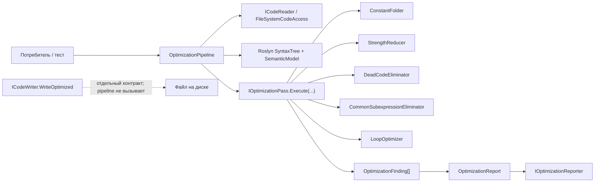

# 13.CodeOptimizer — документация реализации

Статус D4A: parent review passed. Тесты, сборка и runtime smoke не запускались в этой documentation subphase.

## 1. Что это такое человеческим языком

`13.CodeOptimizer` сейчас является статическим анализатором C#-кода на базе Roslyn. Он читает исходный текст, строит `SyntaxTree` и `SemanticModel`, запускает набор детерминированных проходов и возвращает список предложений: свернуть константу, заменить умножение на степень двойки сдвигом, отметить недостижимый код, подсказать общий подвыраженный фрагмент или оптимизацию цикла.

Важно: это не обученная модель, не `ILearningMachine`, не семантический интеллект по коду и не автоматический переписыватель проекта. Текущий `OptimizationPipeline` анализирует и репортит предложения. Путь записи есть отдельно в `FileSystemCodeAccess.WriteOptimized`, но сам pipeline его не вызывает, поэтому наличие предложения не доказывает, что оптимизация была применена к файлу.

В рабочем заказе упомянуты DTO `CodeIssue`, `OptimizationSuggestion` и поля severity/category/status. В текущем коде таких типов и отдельных полей нет: фактическая модель данных называется `OptimizationFinding`, `OptimizationReport`, `OptimizationContext`. Поэтому ниже документируется именно реализованный контракт, а не плановое имя.

## 2. UML для draw.io



## 3. Симуляции соединений

| Соединение | Пример входа | Что происходит | Ожидаемый результат | Что нельзя утверждать |
|---|---|---|---|---|
| `OptimizationPipeline` -> `ICodeReader` | `AnalyzeFile("a.cs", context)` | Pipeline вызывает `ReadSource`; при ошибке чтения возвращает `MapError<OptimizationReport>()`. | Для отсутствующего файла результат неуспешный с сообщением об ошибке. | Это не проверка качества оптимизаций и не runtime-прогон проекта. |
| `OptimizationPipeline` -> Roslyn | `class C { void M(){ int x = 2 + 2; } }` | Pipeline парсит текст, создает compilation и semantic model. | Проходы получают единый `SyntaxTree` и `SemanticModel`. | Успешный parse не доказывает, что код компилируется во всем проектном контексте. |
| `IOptimizationPass.Execute` -> `OptimizationFinding` | `int x = 2 + 2;` | `ConstantFolder` проверяет литеральное бинарное выражение и получает constant value. | Finding с replacement `4` и confidence `0.95`. | Это предложение, а не измененный исходный файл. |
| `LoopOptimizer` -> `OptimizationReport` | `for (... i < items.Count; ...)` | Проход добавляет finding о кэшировании `Count`. | В отчете есть строка с `Loop Invariant`. | Это не доказательство ускорения без benchmark/runtime evidence. |
| `OptimizationReport` -> `IOptimizationReporter` | собранные findings | Pipeline вызывает `ReportFileSummary(report)`. | Репортер получает файл, findings, parse status и duration. | Репорт не равен примененной оптимизации и не заменяет QA. |
| `ICodeWriter` -> диск | `WriteOptimized(path, code, overwrite:false)` | Контракт может записать текст, если файл не существует или разрешен overwrite. | Файл может быть записан отдельным вызовом. | Pipeline `AnalyzeSource/AnalyzeFile/AnalyzeDirectory` сам не вызывает writer. |

## 4. Алгоритмы без кода на русском

### Алгоритм A: модель результата и DTO

- Где логика: `13.CodeOptimizer/Core/Types.cs`.
- Классы и параметры: `OperationResult<T>` хранит `IsSuccess`, `Value`, `ErrorMessage`; `OptimizationFinding` хранит тип предложения, путь, строку, исходный код, replacement, объяснение и confidence; `OptimizationReport` хранит путь файла, список findings, время анализа, parse status и parse errors; `OptimizationContext` включает/выключает проходы и задает `MinimumConfidenceThreshold`.
- Вход: результат операции, finding от прохода или контекст анализа.
- Выход: типизированный envelope или DTO отчета.
- Текущее поведение: ошибки передаются через `OperationResult.Failure` и `MapError`; findings фильтруются проходами по confidence; report сортирует findings по строке в pipeline.
- Чего не делает: нет `CodeIssue`, нет `OptimizationSuggestion`, нет отдельных `severity`, `category`, `status` полей.

`13.CodeOptimizer/Core/Types.cs:23-32`

```csharp
public sealed record OptimizationFinding
{
    public required string OptimizationType          { get; init; }
    public required string FilePath                  { get; init; }
    public required int    LineNumber                { get; init; }
    public required string OriginalCode              { get; init; }
    public          string? SuggestedReplacement     { get; init; }
    public required string HumanReadableExplanation  { get; init; }
    public required double ConfidenceScore           { get; init; }
}
```

Почему важно: это фактический DTO предложения оптимизации. Он объясняет, что есть confidence и replacement, но нет severity/category/status.

### Алгоритм B: Fabric-контракты чтения, записи и репорта

- Где логика: `13.CodeOptimizer/Fabric/Interfaces.cs` и `13.CodeOptimizer/Fabric/FileSystemCodeAccess.cs`.
- Методы и параметры: `ICodeReader.ReadSource(string path)`, `ICodeReader.ListSourceFiles(string directoryPath)`, `ICodeWriter.WriteOptimized(string path, string optimizedCode, bool overwrite)`, `IOptimizationReporter.ReportFinding(OptimizationFinding finding)`, `ReportFileSummary(OptimizationReport report)`.
- Вход: путь файла/папки, оптимизированный текст, finding/report.
- Выход: `OperationResult<string>`, `OperationResult<IReadOnlyList<string>>`, `OperationResult<bool>` или side-effect у reporter.
- Текущее поведение: файловая реализация читает UTF-8, рекурсивно ищет `*.cs`, исключает `bin/obj`, умеет записать файл с guard на overwrite.
- Чего не делает: reporter-интерфейс сам ничего не сохраняет; writer не вызывается pipeline автоматически.

`13.CodeOptimizer/Fabric/Interfaces.cs:3-18`

```csharp
public interface ICodeReader
{
    OperationResult<string>                  ReadSource(string path);
    OperationResult<IReadOnlyList<string>>   ListSourceFiles(string directoryPath);
}

public interface ICodeWriter
{
    OperationResult<bool> WriteOptimized(string path, string optimizedCode, bool overwrite);
}

public interface IOptimizationReporter
{
    void ReportFinding(OptimizationFinding finding);
    void ReportFileSummary(OptimizationReport report);
}
```

Почему важно: это граница ввода/вывода. Она показывает, что анализ и запись разделены.

### Алгоритм C: контракт прохода оптимизации

- Где логика: `13.CodeOptimizer/Passes/IOptimizationPass.cs`.
- Фактический метод: `Execute(SyntaxTree syntaxTree, SemanticModel semanticModel, string filePath, OptimizationContext context)`.
- Вход: Roslyn tree/model, путь файла и контекст флагов.
- Выход: `OperationResult<IReadOnlyList<OptimizationFinding>>`.
- Текущее поведение: каждый проход сам решает, включен ли он флагом контекста, собирает findings и фильтрует по `MinimumConfidenceThreshold`.
- Чего не делает: в текущем коде нет `Analyze(string sourceCode, OptimizationContext context)` на `IOptimizationPass`; source text превращается в Roslyn-объекты в `OptimizationPipeline`.

`13.CodeOptimizer/Passes/IOptimizationPass.cs:5-14`

```csharp
public interface IOptimizationPass
{
    string PassName { get; }

    OperationResult<IReadOnlyList<OptimizationFinding>> Execute(
        SyntaxTree         syntaxTree,
        SemanticModel      semanticModel,
        string             filePath,
        OptimizationContext context);
}
```

Почему важно: это точная сигнатура, по которой все проходы подключаются к pipeline.

### Алгоритм D: `ConstantFolder.Execute`

- Где логика: `13.CodeOptimizer/Passes/ConstantFolder.cs`.
- Метод: `Execute(SyntaxTree syntaxTree, SemanticModel semanticModel, string filePath, OptimizationContext context)`.
- Вход: C# syntax tree/model, file path, context.
- Выход: список `OptimizationFinding`.
- Шаги: если `EnableConstantFolding=false`, вернуть пустой список; пройти по `BinaryExpressionSyntax`; принять только выражения, где обе стороны литералы; спросить Roslyn `GetConstantValue`; если replacement отличается от исходника, добавить finding с confidence `0.95`; в конце отфильтровать по threshold.
- Чего не делает: не вычисляет выражения с переменными, не переписывает файл.

`13.CodeOptimizer/Passes/ConstantFolder.cs:24-40`

```csharp
foreach (var binary in root.DescendantNodes().OfType<BinaryExpressionSyntax>())
{
    // Only flag expressions where both sides are literals (not variables)
    if (binary.Left  is not LiteralExpressionSyntax) continue;
    if (binary.Right is not LiteralExpressionSyntax) continue;

    var cv = semanticModel.GetConstantValue(binary);
    if (!cv.HasValue) continue;

    int    line        = binary.GetLocation().GetLineSpan().StartLinePosition.Line + 1;
    string original    = binary.ToString().Trim();
    string resultStr   = cv.Value?.ToString() ?? "null";
    string suggestion  = cv.Value is string ? $"\"{resultStr}\"" : resultStr;

    if (suggestion == original) continue;
```

Почему важно: цитата показывает фактическую границу алгоритма: только литералы и Roslyn constant value.

### Алгоритм E: `StrengthReducer.Execute`

- Где логика: `13.CodeOptimizer/Passes/StrengthReducer.cs`.
- Метод: `Execute(SyntaxTree syntaxTree, SemanticModel semanticModel, string filePath, OptimizationContext context)`.
- Вход/выход: тот же контракт `IOptimizationPass`.
- Шаги: если проход выключен, вернуть пусто; найти умножения; взять constant value правой части; принять только `int/long` из словаря степеней двойки `2..1024`; предложить `(left << shift)` с confidence `0.80`; фильтровать по threshold.
- Чего не делает: не проверяет переполнение, signed/unsigned нюансы и не доказывает ускорение на конкретном runtime.

`13.CodeOptimizer/Passes/StrengthReducer.cs:33-48`

```csharp
var rcv = semanticModel.GetConstantValue(mult.Right);
if (!rcv.HasValue) continue;

long? multiplier = rcv.Value switch
{
    int  i => i,
    long l => l,
    _      => null
};
if (multiplier is null || !PowTwoShift.TryGetValue(multiplier.Value, out int shift))
    continue;

int    line       = mult.GetLocation().GetLineSpan().StartLinePosition.Line + 1;
string left       = mult.Left.ToString().Trim();
string original   = mult.ToString().Trim();
string suggestion = $"({left} << {shift})";
```

Почему важно: это доказывает детерминированный math-паттерн, а не обученную оптимизацию.

### Алгоритм F: `DeadCodeEliminator.Execute`

- Где логика: `13.CodeOptimizer/Passes/DeadCodeEliminator.cs`.
- Метод: `Execute(SyntaxTree syntaxTree, SemanticModel semanticModel, string filePath, OptimizationContext context)`.
- Вход/выход: Roslyn tree/model -> findings.
- Шаги: если выключено, вернуть пусто; в каждом block помечать statement после `return/throw/break/continue` как unreachable, кроме local function; затем попробовать Roslyn DataFlow и найти assignments, которые written inside, но не read inside/outside; сложные control-flow случаи silently skipped через `catch`.
- Чего не делает: не является полноценным компиляторным DCE и не удаляет код.

`13.CodeOptimizer/Passes/DeadCodeEliminator.cs:29-52`

```csharp
foreach (var block in root.DescendantNodes().OfType<BlockSyntax>())
{
    bool afterJump = false;
    foreach (var stmt in block.Statements)
    {
        if (afterJump && stmt is not LocalFunctionStatementSyntax)
        {
            int line = stmt.GetLocation().GetLineSpan().StartLinePosition.Line + 1;
            findings.Add(new OptimizationFinding
            {
                OptimizationType         = "Dead Code — unreachable after jump",
                FilePath                 = filePath,
                LineNumber               = line,
                OriginalCode             = Truncate(stmt.ToString().Trim()),
                SuggestedReplacement     = null,
                HumanReadableExplanation = $"Line {line} is unreachable (follows return/throw/break/continue).",
                ConfidenceScore          = 0.92
            });
        }

        afterJump = stmt is ReturnStatementSyntax
                 || stmt is ThrowStatementSyntax
                 || stmt is BreakStatementSyntax
                 || stmt is ContinueStatementSyntax;
```

Почему важно: здесь видно, что первая ветка dead-code простая и синтаксическая.

### Алгоритм G: `CommonSubexpressionEliminator.Execute`

- Где логика: `13.CodeOptimizer/Passes/CommonSubexpressionEliminator.cs`.
- Метод: `Execute(SyntaxTree syntaxTree, SemanticModel semanticModel, string filePath, OptimizationContext context)`.
- Вход/выход: Roslyn tree/model -> findings.
- Шаги: если выключено, вернуть пусто; внутри каждого метода собрать candidate expressions типов invocation/binary/member access; исключить literals и identifiers; нормализовать текст; если одинаковый key встречается два и более раза, предложить локальную переменную; confidence `0.65`.
- Важная ветка: при default threshold `0.7` CSE обычно отфильтровывается; тест опускает threshold до `0.5`.
- Чего не делает: не выполняет настоящий глобальный value numbering с alias/effect анализом.

`13.CodeOptimizer/Passes/CommonSubexpressionEliminator.cs:23-47`

```csharp
foreach (var method in root.DescendantNodes().OfType<MethodDeclarationSyntax>())
{
    var seen = new Dictionary<string, List<int>>();

    var candidates = method.DescendantNodes().OfType<ExpressionSyntax>()
        .Where(e => e is InvocationExpressionSyntax
                  || e is BinaryExpressionSyntax
                  || e is MemberAccessExpressionSyntax)
        .Where(e => e is not LiteralExpressionSyntax)
        .Where(e => e is not IdentifierNameSyntax);

    foreach (var expr in candidates)
    {
        string key  = Normalize(expr.ToString());
        int    line = expr.GetLocation().GetLineSpan().StartLinePosition.Line + 1;
        if (!seen.ContainsKey(key)) seen[key] = [];
        seen[key].Add(line);
    }

    foreach (var (key, lines) in seen)
    {
        if (lines.Count < 2) continue;
        string varName = MakeVarName(key);
        findings.Add(new OptimizationFinding
```

Почему важно: алгоритм текстово-нормализованный и упрощенный; это надо не прятать.

### Алгоритм H: `LoopOptimizer.Execute`

- Где логика: `13.CodeOptimizer/Passes/LoopOptimizer.cs`.
- Метод: `Execute(SyntaxTree syntaxTree, SemanticModel semanticModel, string filePath, OptimizationContext context)`.
- Вход/выход: Roslyn tree/model -> findings.
- Шаги: если выключено, вернуть пусто; для `for` искать `.Count`/`.Length` в condition; для `for/while/foreach` искать no-arg invocation в теле, который не использует loop vars; добавить предложения с confidence `0.85` или `0.70`.
- Чего не делает: не доказывает, что вызов без аргументов чистый; это подсказка для ревью, не автоматическое LICM.

`13.CodeOptimizer/Passes/LoopOptimizer.cs:41-63`

```csharp
private static void FindCountInCondition(
    ForStatementSyntax forLoop, string filePath,
    List<OptimizationFinding> findings)
{
    if (forLoop.Condition is null) return;

    foreach (var ma in forLoop.Condition.DescendantNodesAndSelf()
        .OfType<MemberAccessExpressionSyntax>()
        .Where(m => m.Name.Identifier.Text is "Count" or "Length"))
    {
        int    line     = forLoop.GetLocation().GetLineSpan().StartLinePosition.Line + 1;
        string original = ma.ToString().Trim();
        findings.Add(new OptimizationFinding
        {
            OptimizationType         = "Loop Invariant — Count/Length in loop condition",
            FilePath                 = filePath,
            LineNumber               = line,
            OriginalCode             = $"i < {original}",
            SuggestedReplacement     = $"int count = {original};\n// use 'count' in for condition",
            HumanReadableExplanation =
                $"'{original}' is re-evaluated on every iteration. Cache it before the loop.",
            ConfidenceScore          = 0.85
```

Почему важно: пример показывает конкретный паттерн `.Count/.Length` и то, что результатом является suggestion.

### Алгоритм I: `OptimizationPipeline.AnalyzeSource`, `AnalyzeFile`, `AnalyzeDirectory`

- Где логика: `13.CodeOptimizer/Pipeline/OptimizationPipeline.cs`.
- Методы:
  - `AnalyzeSource(string sourceCode, string filePath, OptimizationContext context)` -> `OperationResult<OptimizationReport>`.
  - `AnalyzeFile(string filePath, OptimizationContext context)` -> `OperationResult<OptimizationReport>`.
  - `AnalyzeDirectory(string directoryPath, OptimizationContext context)` -> `OperationResult<IReadOnlyList<OptimizationReport>>`.
- Шаги `AnalyzeSource`: запустить stopwatch; распарсить source; создать compilation с базовыми references; взять semantic model; собрать parse errors; вызвать каждый pass через `Execute`; успешные findings добавить; построить report, отсортировав findings по line; отправить summary reporter.
- Ветки ошибок: `AnalyzeFile` возвращает ошибку чтения через `MapError`; `AnalyzeDirectory` возвращает ошибку списка файлов, а ошибки отдельных файлов просто не добавляет в reports; ошибки отдельных проходов не агрегируются, если `result.IsSuccess=false`.
- Чего не делает: не запускает `dotnet build`, не применяет writer, не меряет реальное ускорение.

`13.CodeOptimizer/Pipeline/OptimizationPipeline.cs:24-62`

```csharp
public OperationResult<OptimizationReport> AnalyzeSource(
    string sourceCode, string filePath, OptimizationContext context)
{
    var sw = Stopwatch.StartNew();

    var syntaxTree  = CSharpSyntaxTree.ParseText(sourceCode);
    var compilation = CSharpCompilation.Create(
        "Analysis",
        [syntaxTree],
        [MetadataReference.CreateFromFile(typeof(object).Assembly.Location),
         MetadataReference.CreateFromFile(typeof(Console).Assembly.Location)]);

    var semanticModel = compilation.GetSemanticModel(syntaxTree);

    var parseErrors = syntaxTree.GetDiagnostics()
        .Where(d => d.Severity == DiagnosticSeverity.Error)
        .Select(d => d.GetMessage())
        .ToList();

    var allFindings = new List<OptimizationFinding>();

    foreach (var pass in _passes)
    {
        var result = pass.Execute(syntaxTree, semanticModel, filePath, context);
        if (result.IsSuccess)
            allFindings.AddRange(result.Value!);
    }

    var report = new OptimizationReport
    {
        FilePath                     = filePath,
        Findings                     = allFindings.OrderBy(f => f.LineNumber).ToList(),
        AnalysisDurationMilliseconds = sw.ElapsedMilliseconds,
        ParsedSuccessfully           = parseErrors.Count == 0,
        ParseErrors                  = parseErrors
    };

    _reporter.ReportFileSummary(report);
    return OperationResult<OptimizationReport>.Success(report);
}
```

Почему важно: цитата доказывает реальный read/pass/reporter flow и границы: это анализ, не rewrite.

## 5. QA / test mapping

Тесты прочитаны, но не запускались в этой documentation subphase.

| Поведение | Тестовое покрытие | Что доказывает | Что не доказывает |
|---|---|---|---|
| `OperationResult` success/failure/map error | `Tests/CodeOptimizerTests.cs:31-58` | Envelope работает как ожидается. | Не доказывает качество оптимизации. |
| `ConstantFolder` | `Tests/CodeOptimizerTests.cs:64-95` | `2 + 2` находится, `x + 2` не находится, context flag выключает проход. | Не доказывает все C# constant expression cases. |
| `StrengthReducer` | `Tests/CodeOptimizerTests.cs:101-142` | `x * 4` и `count * 8` дают shift, `* 3` игнорируется, flag выключает проход. | Не доказывает runtime performance и безопасность для всех числовых типов. |
| `DeadCodeEliminator` | `Tests/CodeOptimizerTests.cs:148-187` | Unreachable after return находится, normal flow не помечается, flag выключает проход. | Не доказывает полноценный compiler DCE. |
| `CommonSubexpressionEliminator` | `Tests/CodeOptimizerTests.cs:193-220` | Повтор `items.Length` находится при threshold `0.5`, одиночный случай игнорируется. | Не доказывает настоящий semantic GVN. |
| `LoopOptimizer` | `Tests/CodeOptimizerTests.cs:226-266` | `.Count` в for-condition находится, pre-cached `n` игнорируется, flag выключает проход. | Не доказывает purity/no-side-effects для hoist-кандидатов. |
| Pipeline integration | `Tests/CodeOptimizerTests.cs:272-316` | Несколько проходов собираются, parse success для валидного кода, findings сортируются по строке. | Не доказывает build/test всего проекта и не применяет изменения. |
| File system failures | `Tests/CodeOptimizerTests.cs:322-337` | Missing file/dir возвращают failure. | Не доказывает запись оптимизированного файла через pipeline. |

## 6. Статус реализации и ограничения

| Область | Статус | Честное ограничение |
|---|---|---|
| DTO/контекст | Реализовано как `OptimizationFinding`, `OptimizationReport`, `OptimizationContext`. | Нет `CodeIssue`, `OptimizationSuggestion`, severity/category/status. |
| Fabric чтения/записи | Реализованы интерфейсы и `FileSystemCodeAccess`. | Запись отделена от анализа; pipeline не применяет изменения. |
| Pass contract | Реализован `IOptimizationPass.Execute(...)`. | Нет `Analyze(string sourceCode, OptimizationContext context)` на pass-level. |
| Оптимизационные проходы | Реализованы пять статических проходов. | Это эвристические предложения, не доказанные оптимизации. |
| Pipeline | Реализован анализ source/file/directory. | Не запускает build/test, не измеряет speedup, не делает runtime rewrite. |
| Trainable/model status | Не trainable unit. | Нельзя выдавать за обученную модель или semantic code intelligence. |

## 7. Anti-false-done checks

- Наличие `OptimizationReport` или `state.json`/report/smoke evidence не доказывает качество кода или ускорение.
- Наличие finding не означает, что файл переписан; для этого нужен отдельный apply/write path и проверка результата.
- Детерминированные проходы `ConstantFolder`, `StrengthReducer`, `DeadCodeEliminator`, `CommonSubexpressionEliminator`, `LoopOptimizer` не должны прятаться как обученный оптимизатор.
- Parse success в Roslyn не равен `dotnet build`.
- Static suggestion не равен product-quality proof; нужны реальные QA, benchmark или review gates, если утверждается улучшение качества/производительности.
