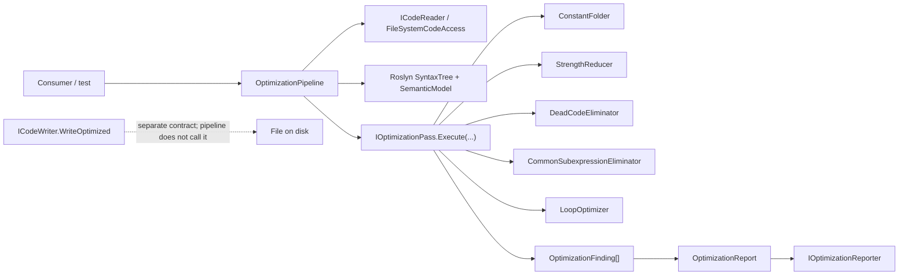

# 13.CodeOptimizer — implementation documentation

D4A status: parent review passed. Tests, build and runtime smoke were not run in this documentation subphase.

## 1. What this is in plain language

`13.CodeOptimizer` is currently a Roslyn-based static analyzer of C# code. It reads the source text, builds a `SyntaxTree` and a `SemanticModel`, runs a set of deterministic passes and returns a list of suggestions: fold a constant, replace a multiplication by a power of two with a shift, mark unreachable code, hint at a common subexpression fragment or a loop optimization.

Important: this is not a trained model, not an `ILearningMachine`, not semantic intelligence about code and not an automatic project rewriter. The current `OptimizationPipeline` analyzes and reports suggestions. A write path exists separately in `FileSystemCodeAccess.WriteOptimized`, but the pipeline itself does not call it, so the presence of a suggestion does not prove that the optimization was applied to the file.

The work order mentions the DTOs `CodeIssue`, `OptimizationSuggestion` and severity/category/status fields. In the current code there are no such types and no separate fields: the actual data model is called `OptimizationFinding`, `OptimizationReport`, `OptimizationContext`. Therefore, below the implemented contract is documented, not the planned name.

## 2. UML for draw.io



## 3. Connection simulations

| Connection | Example input | What happens | Expected result | What must not be claimed |
|---|---|---|---|---|
| `OptimizationPipeline` -> `ICodeReader` | `AnalyzeFile("a.cs", context)` | The pipeline calls `ReadSource`; on a read error it returns `MapError<OptimizationReport>()`. | For a missing file the result is unsuccessful with an error message. | This is not a check of optimization quality and not a runtime run of the project. |
| `OptimizationPipeline` -> Roslyn | `class C { void M(){ int x = 2 + 2; } }` | The pipeline parses the text, creates a compilation and a semantic model. | The passes get a single `SyntaxTree` and `SemanticModel`. | A successful parse does not prove that the code compiles in the whole project context. |
| `IOptimizationPass.Execute` -> `OptimizationFinding` | `int x = 2 + 2;` | `ConstantFolder` checks the literal binary expression and gets a constant value. | A finding with replacement `4` and confidence `0.95`. | This is a suggestion, not a changed source file. |
| `LoopOptimizer` -> `OptimizationReport` | `for (... i < items.Count; ...)` | The pass adds a finding about caching `Count`. | The report has a line with `Loop Invariant`. | This is not proof of a speedup without benchmark/runtime evidence. |
| `OptimizationReport` -> `IOptimizationReporter` | collected findings | The pipeline calls `ReportFileSummary(report)`. | The reporter gets the file, findings, parse status and duration. | The report is not equal to an applied optimization and does not replace QA. |
| `ICodeWriter` -> disk | `WriteOptimized(path, code, overwrite:false)` | The contract can write the text if the file does not exist or overwrite is allowed. | The file may be written by a separate call. | The pipeline `AnalyzeSource/AnalyzeFile/AnalyzeDirectory` itself does not call the writer. |

## 4. No-code algorithms, in the operator's language

### Algorithm A: the result model and DTOs

- Where the logic is: `13.CodeOptimizer/Core/Types.cs`.
- Classes and parameters: `OperationResult<T>` stores `IsSuccess`, `Value`, `ErrorMessage`; `OptimizationFinding` stores the suggestion type, path, line, original code, replacement, explanation and confidence; `OptimizationReport` stores the file path, list of findings, analysis time, parse status and parse errors; `OptimizationContext` enables/disables passes and sets `MinimumConfidenceThreshold`.
- Input: the result of an operation, a finding from a pass or an analysis context.
- Output: a typed envelope or a report DTO.
- Current behavior: errors are passed via `OperationResult.Failure` and `MapError`; findings are filtered by the passes by confidence; the report sorts findings by line in the pipeline.
- What it does not do: there is no `CodeIssue`, no `OptimizationSuggestion`, no separate `severity`, `category`, `status` fields.

`13.CodeOptimizer/Core/Types.cs:23-32`

```csharp
public sealed record OptimizationFinding
{
    public required string OptimizationType          { get; init; }
    public required string FilePath                  { get; init; }
    public required int    LineNumber                { get; init; }
    public required string OriginalCode              { get; init; }
    public          string? SuggestedReplacement     { get; init; }
    public required string HumanReadableExplanation  { get; init; }
    public required double ConfidenceScore           { get; init; }
}
```

Why it matters: this is the actual optimization-suggestion DTO. It explains that there is confidence and replacement, but no severity/category/status.

### Algorithm B: the Fabric contracts for reading, writing and reporting

- Where the logic is: `13.CodeOptimizer/Fabric/Interfaces.cs` and `13.CodeOptimizer/Fabric/FileSystemCodeAccess.cs`.
- Methods and parameters: `ICodeReader.ReadSource(string path)`, `ICodeReader.ListSourceFiles(string directoryPath)`, `ICodeWriter.WriteOptimized(string path, string optimizedCode, bool overwrite)`, `IOptimizationReporter.ReportFinding(OptimizationFinding finding)`, `ReportFileSummary(OptimizationReport report)`.
- Input: a file/folder path, optimized text, a finding/report.
- Output: `OperationResult<string>`, `OperationResult<IReadOnlyList<string>>`, `OperationResult<bool>` or a side-effect on the reporter.
- Current behavior: the file implementation reads UTF-8, recursively searches for `*.cs`, excludes `bin/obj`, and can write a file with a guard on overwrite.
- What it does not do: the reporter interface itself saves nothing; the writer is not called by the pipeline automatically.

`13.CodeOptimizer/Fabric/Interfaces.cs:3-18`

```csharp
public interface ICodeReader
{
    OperationResult<string>                  ReadSource(string path);
    OperationResult<IReadOnlyList<string>>   ListSourceFiles(string directoryPath);
}

public interface ICodeWriter
{
    OperationResult<bool> WriteOptimized(string path, string optimizedCode, bool overwrite);
}

public interface IOptimizationReporter
{
    void ReportFinding(OptimizationFinding finding);
    void ReportFileSummary(OptimizationReport report);
}
```

Why it matters: this is the input/output boundary. It shows that analysis and writing are separated.

### Algorithm C: the optimization pass contract

- Where the logic is: `13.CodeOptimizer/Passes/IOptimizationPass.cs`.
- The actual method: `Execute(SyntaxTree syntaxTree, SemanticModel semanticModel, string filePath, OptimizationContext context)`.
- Input: the Roslyn tree/model, file path and the flag context.
- Output: `OperationResult<IReadOnlyList<OptimizationFinding>>`.
- Current behavior: each pass itself decides whether it is enabled by a context flag, collects findings and filters by `MinimumConfidenceThreshold`.
- What it does not do: in the current code there is no `Analyze(string sourceCode, OptimizationContext context)` on `IOptimizationPass`; source text is turned into Roslyn objects in `OptimizationPipeline`.

`13.CodeOptimizer/Passes/IOptimizationPass.cs:5-14`

```csharp
public interface IOptimizationPass
{
    string PassName { get; }

    OperationResult<IReadOnlyList<OptimizationFinding>> Execute(
        SyntaxTree         syntaxTree,
        SemanticModel      semanticModel,
        string             filePath,
        OptimizationContext context);
}
```

Why it matters: this is the exact signature by which all passes connect to the pipeline.

### Algorithm D: `ConstantFolder.Execute`

- Where the logic is: `13.CodeOptimizer/Passes/ConstantFolder.cs`.
- Method: `Execute(SyntaxTree syntaxTree, SemanticModel semanticModel, string filePath, OptimizationContext context)`.
- Input: the C# syntax tree/model, file path, context.
- Output: a list of `OptimizationFinding`.
- Steps: if `EnableConstantFolding=false`, return an empty list; walk `BinaryExpressionSyntax`; accept only expressions where both sides are literals; ask Roslyn `GetConstantValue`; if the replacement differs from the source, add a finding with confidence `0.95`; at the end filter by threshold.
- What it does not do: does not compute expressions with variables, does not rewrite the file.

`13.CodeOptimizer/Passes/ConstantFolder.cs:24-40`

```csharp
foreach (var binary in root.DescendantNodes().OfType<BinaryExpressionSyntax>())
{
    // Only flag expressions where both sides are literals (not variables)
    if (binary.Left  is not LiteralExpressionSyntax) continue;
    if (binary.Right is not LiteralExpressionSyntax) continue;

    var cv = semanticModel.GetConstantValue(binary);
    if (!cv.HasValue) continue;

    int    line        = binary.GetLocation().GetLineSpan().StartLinePosition.Line + 1;
    string original    = binary.ToString().Trim();
    string resultStr   = cv.Value?.ToString() ?? "null";
    string suggestion  = cv.Value is string ? $"\"{resultStr}\"" : resultStr;

    if (suggestion == original) continue;
```

Why it matters: the quote shows the actual boundary of the algorithm: only literals and a Roslyn constant value.

### Algorithm E: `StrengthReducer.Execute`

- Where the logic is: `13.CodeOptimizer/Passes/StrengthReducer.cs`.
- Method: `Execute(SyntaxTree syntaxTree, SemanticModel semanticModel, string filePath, OptimizationContext context)`.
- Input/output: the same `IOptimizationPass` contract.
- Steps: if the pass is disabled, return empty; find multiplications; take the constant value of the right side; accept only `int/long` from the powers-of-two dictionary `2..1024`; suggest `(left << shift)` with confidence `0.80`; filter by threshold.
- What it does not do: does not check overflow, signed/unsigned nuances and does not prove a speedup on a specific runtime.

`13.CodeOptimizer/Passes/StrengthReducer.cs:33-48`

```csharp
var rcv = semanticModel.GetConstantValue(mult.Right);
if (!rcv.HasValue) continue;

long? multiplier = rcv.Value switch
{
    int  i => i,
    long l => l,
    _      => null
};
if (multiplier is null || !PowTwoShift.TryGetValue(multiplier.Value, out int shift))
    continue;

int    line       = mult.GetLocation().GetLineSpan().StartLinePosition.Line + 1;
string left       = mult.Left.ToString().Trim();
string original   = mult.ToString().Trim();
string suggestion = $"({left} << {shift})";
```

Why it matters: this proves a deterministic math pattern, not a trained optimization.

### Algorithm F: `DeadCodeEliminator.Execute`

- Where the logic is: `13.CodeOptimizer/Passes/DeadCodeEliminator.cs`.
- Method: `Execute(SyntaxTree syntaxTree, SemanticModel semanticModel, string filePath, OptimizationContext context)`.
- Input/output: Roslyn tree/model -> findings.
- Steps: if disabled, return empty; in each block mark a statement after `return/throw/break/continue` as unreachable, except for a local function; then try Roslyn DataFlow and find assignments that are written inside but not read inside/outside; complex control-flow cases are silently skipped via `catch`.
- What it does not do: is not a full compiler DCE and does not remove code.

`13.CodeOptimizer/Passes/DeadCodeEliminator.cs:29-52`

```csharp
foreach (var block in root.DescendantNodes().OfType<BlockSyntax>())
{
    bool afterJump = false;
    foreach (var stmt in block.Statements)
    {
        if (afterJump && stmt is not LocalFunctionStatementSyntax)
        {
            int line = stmt.GetLocation().GetLineSpan().StartLinePosition.Line + 1;
            findings.Add(new OptimizationFinding
            {
                OptimizationType         = "Dead Code — unreachable after jump",
                FilePath                 = filePath,
                LineNumber               = line,
                OriginalCode             = Truncate(stmt.ToString().Trim()),
                SuggestedReplacement     = null,
                HumanReadableExplanation = $"Line {line} is unreachable (follows return/throw/break/continue).",
                ConfidenceScore          = 0.92
            });
        }

        afterJump = stmt is ReturnStatementSyntax
                 || stmt is ThrowStatementSyntax
                 || stmt is BreakStatementSyntax
                 || stmt is ContinueStatementSyntax;
```

Why it matters: here you can see that the first dead-code branch is simple and syntactic.

### Algorithm G: `CommonSubexpressionEliminator.Execute`

- Where the logic is: `13.CodeOptimizer/Passes/CommonSubexpressionEliminator.cs`.
- Method: `Execute(SyntaxTree syntaxTree, SemanticModel semanticModel, string filePath, OptimizationContext context)`.
- Input/output: Roslyn tree/model -> findings.
- Steps: if disabled, return empty; within each method collect candidate expressions of the types invocation/binary/member access; exclude literals and identifiers; normalize the text; if the same key appears two or more times, suggest a local variable; confidence `0.65`.
- Important branch: with the default threshold `0.7` CSE is usually filtered out; the test lowers the threshold to `0.5`.
- What it does not do: does not perform real global value numbering with alias/effect analysis.

`13.CodeOptimizer/Passes/CommonSubexpressionEliminator.cs:23-47`

```csharp
foreach (var method in root.DescendantNodes().OfType<MethodDeclarationSyntax>())
{
    var seen = new Dictionary<string, List<int>>();

    var candidates = method.DescendantNodes().OfType<ExpressionSyntax>()
        .Where(e => e is InvocationExpressionSyntax
                  || e is BinaryExpressionSyntax
                  || e is MemberAccessExpressionSyntax)
        .Where(e => e is not LiteralExpressionSyntax)
        .Where(e => e is not IdentifierNameSyntax);

    foreach (var expr in candidates)
    {
        string key  = Normalize(expr.ToString());
        int    line = expr.GetLocation().GetLineSpan().StartLinePosition.Line + 1;
        if (!seen.ContainsKey(key)) seen[key] = [];
        seen[key].Add(line);
    }

    foreach (var (key, lines) in seen)
    {
        if (lines.Count < 2) continue;
        string varName = MakeVarName(key);
        findings.Add(new OptimizationFinding
```

Why it matters: the algorithm is text-normalized and simplified; this must not be hidden.

### Algorithm H: `LoopOptimizer.Execute`

- Where the logic is: `13.CodeOptimizer/Passes/LoopOptimizer.cs`.
- Method: `Execute(SyntaxTree syntaxTree, SemanticModel semanticModel, string filePath, OptimizationContext context)`.
- Input/output: Roslyn tree/model -> findings.
- Steps: if disabled, return empty; for `for` look for `.Count`/`.Length` in the condition; for `for/while/foreach` look for a no-arg invocation in the body that does not use loop vars; add suggestions with confidence `0.85` or `0.70`.
- What it does not do: does not prove that the no-argument call is pure; this is a hint for review, not automatic LICM.

`13.CodeOptimizer/Passes/LoopOptimizer.cs:41-63`

```csharp
private static void FindCountInCondition(
    ForStatementSyntax forLoop, string filePath,
    List<OptimizationFinding> findings)
{
    if (forLoop.Condition is null) return;

    foreach (var ma in forLoop.Condition.DescendantNodesAndSelf()
        .OfType<MemberAccessExpressionSyntax>()
        .Where(m => m.Name.Identifier.Text is "Count" or "Length"))
    {
        int    line     = forLoop.GetLocation().GetLineSpan().StartLinePosition.Line + 1;
        string original = ma.ToString().Trim();
        findings.Add(new OptimizationFinding
        {
            OptimizationType         = "Loop Invariant — Count/Length in loop condition",
            FilePath                 = filePath,
            LineNumber               = line,
            OriginalCode             = $"i < {original}",
            SuggestedReplacement     = $"int count = {original};\n// use 'count' in for condition",
            HumanReadableExplanation =
                $"'{original}' is re-evaluated on every iteration. Cache it before the loop.",
            ConfidenceScore          = 0.85
```

Why it matters: the example shows a specific `.Count/.Length` pattern and that the result is a suggestion.

### Algorithm I: `OptimizationPipeline.AnalyzeSource`, `AnalyzeFile`, `AnalyzeDirectory`

- Where the logic is: `13.CodeOptimizer/Pipeline/OptimizationPipeline.cs`.
- Methods:
  - `AnalyzeSource(string sourceCode, string filePath, OptimizationContext context)` -> `OperationResult<OptimizationReport>`.
  - `AnalyzeFile(string filePath, OptimizationContext context)` -> `OperationResult<OptimizationReport>`.
  - `AnalyzeDirectory(string directoryPath, OptimizationContext context)` -> `OperationResult<IReadOnlyList<OptimizationReport>>`.
- `AnalyzeSource` steps: start a stopwatch; parse the source; create a compilation with base references; take the semantic model; collect parse errors; call each pass via `Execute`; add successful findings; build the report, sorting findings by line; send the summary to the reporter.
- Error branches: `AnalyzeFile` returns a read error via `MapError`; `AnalyzeDirectory` returns a file-list error, while errors of individual files are simply not added to the reports; errors of individual passes are not aggregated if `result.IsSuccess=false`.
- What it does not do: does not run `dotnet build`, does not apply the writer, does not measure real speedup.

`13.CodeOptimizer/Pipeline/OptimizationPipeline.cs:24-62`

```csharp
public OperationResult<OptimizationReport> AnalyzeSource(
    string sourceCode, string filePath, OptimizationContext context)
{
    var sw = Stopwatch.StartNew();

    var syntaxTree  = CSharpSyntaxTree.ParseText(sourceCode);
    var compilation = CSharpCompilation.Create(
        "Analysis",
        [syntaxTree],
        [MetadataReference.CreateFromFile(typeof(object).Assembly.Location),
         MetadataReference.CreateFromFile(typeof(Console).Assembly.Location)]);

    var semanticModel = compilation.GetSemanticModel(syntaxTree);

    var parseErrors = syntaxTree.GetDiagnostics()
        .Where(d => d.Severity == DiagnosticSeverity.Error)
        .Select(d => d.GetMessage())
        .ToList();

    var allFindings = new List<OptimizationFinding>();

    foreach (var pass in _passes)
    {
        var result = pass.Execute(syntaxTree, semanticModel, filePath, context);
        if (result.IsSuccess)
            allFindings.AddRange(result.Value!);
    }

    var report = new OptimizationReport
    {
        FilePath                     = filePath,
        Findings                     = allFindings.OrderBy(f => f.LineNumber).ToList(),
        AnalysisDurationMilliseconds = sw.ElapsedMilliseconds,
        ParsedSuccessfully           = parseErrors.Count == 0,
        ParseErrors                  = parseErrors
    };

    _reporter.ReportFileSummary(report);
    return OperationResult<OptimizationReport>.Success(report);
}
```

Why it matters: the quote proves the real read/pass/reporter flow and the boundaries: this is analysis, not rewrite.

## 5. QA / test mapping

The tests were read, but not run in this documentation subphase.

| Behavior | Test coverage | What it proves | What it does not prove |
|---|---|---|---|
| `OperationResult` success/failure/map error | `Tests/CodeOptimizerTests.cs:31-58` | The envelope works as expected. | Does not prove optimization quality. |
| `ConstantFolder` | `Tests/CodeOptimizerTests.cs:64-95` | `2 + 2` is found, `x + 2` is not found, the context flag disables the pass. | Does not prove all C# constant expression cases. |
| `StrengthReducer` | `Tests/CodeOptimizerTests.cs:101-142` | `x * 4` and `count * 8` give a shift, `* 3` is ignored, the flag disables the pass. | Does not prove runtime performance and safety for all numeric types. |
| `DeadCodeEliminator` | `Tests/CodeOptimizerTests.cs:148-187` | Unreachable after return is found, normal flow is not flagged, the flag disables the pass. | Does not prove a full compiler DCE. |
| `CommonSubexpressionEliminator` | `Tests/CodeOptimizerTests.cs:193-220` | A repeat of `items.Length` is found at threshold `0.5`, a single case is ignored. | Does not prove real semantic GVN. |
| `LoopOptimizer` | `Tests/CodeOptimizerTests.cs:226-266` | `.Count` in a for-condition is found, a pre-cached `n` is ignored, the flag disables the pass. | Does not prove purity/no-side-effects for hoist candidates. |
| Pipeline integration | `Tests/CodeOptimizerTests.cs:272-316` | Several passes are collected, parse success for valid code, findings are sorted by line. | Does not prove build/test of the whole project and does not apply changes. |
| File system failures | `Tests/CodeOptimizerTests.cs:322-337` | A missing file/dir returns a failure. | Does not prove writing of the optimized file via the pipeline. |

## 6. Implementation status and limitations

| Area | Status | Honest limitation |
|---|---|---|
| DTO/context | Implemented as `OptimizationFinding`, `OptimizationReport`, `OptimizationContext`. | No `CodeIssue`, `OptimizationSuggestion`, severity/category/status. |
| Read/write Fabric | The interfaces and `FileSystemCodeAccess` are implemented. | Writing is separated from analysis; the pipeline does not apply changes. |
| Pass contract | `IOptimizationPass.Execute(...)` is implemented. | No `Analyze(string sourceCode, OptimizationContext context)` at the pass level. |
| Optimization passes | Five static passes are implemented. | These are heuristic suggestions, not proven optimizations. |
| Pipeline | Analysis of source/file/directory is implemented. | Does not run build/test, does not measure speedup, does not do a runtime rewrite. |
| Trainable/model status | Not a trainable unit. | Must not be presented as a trained model or semantic code intelligence. |

## 7. Anti-false-done checks

- The presence of an `OptimizationReport` or `state.json`/report/smoke evidence does not prove code quality or a speedup.
- The presence of a finding does not mean the file was rewritten; that requires a separate apply/write path and a check of the result.
- The deterministic passes `ConstantFolder`, `StrengthReducer`, `DeadCodeEliminator`, `CommonSubexpressionEliminator`, `LoopOptimizer` must not be hidden as a trained optimizer.
- Parse success in Roslyn is not equal to `dotnet build`.
- A static suggestion is not equal to product-quality proof; you need real QA, benchmark or review gates if an improvement in quality/performance is claimed.
