# 14.ContinuousLearning - implementation documentation

D3D status: parent review passed. Tests and build were not run in this documentation subphase.

## 1. Simple explanation for Luba

`14.ContinuousLearning` is continuous-learning infrastructure around the project: it can take sources, turn them into `TrainingExample`, accept user feedback, store examples by domain, remember pairs for DPO and register a path to a LoRA adapter. Important: the current code does not prove that a model actually trained. Inside `IncrementalTrainer.TrainAsync` there is currently no gradient step, weight export, fresh-load probe or continue-training probe; the method validates the inputs and returns the intended path `adapters/{domain}.lora`.

Honesty boundary: this is real learning infrastructure/bootstrap for a future connection with `10.LoRA`, `11.DPO`, `16.AutonomousLearning`, `21.AgentInfrastructure` and `29.SemanticCompiler`, but not a project-level `ILearningMachine` and not a finished product trainable unit by itself. The current `IncrementalTrainer` does not perform training inside this project. Per the files read, `ILearningMachine`, `ILogicalOrchestrator`, `ILogicalFlow`, `ILogicalUnit` and `ILearningMachinePair` are not implemented in `14.ContinuousLearning`.

## 2. UML for draw.io

```mermaid
classDiagram
    class IContinuousLearningPipeline {
      +RunCycleAsync(string rootPath) Task~OperationResult~IReadOnlyList~ModelAdapter~~~~
    }
    class ProjectIndexer {
      +Index(string rootPath) OperationResult~IReadOnlyList~TrainingExample~~
    }
    class DomainDatasetCache {
      +Add(TrainingExample example) OperationResult~bool~
      +GetByDomain(string domain) OperationResult~IReadOnlyList~TrainingExample~~
      +TotalCount() OperationResult~int~
      +FlushAsync() Task~OperationResult~bool~~
    }
    class FeedbackRouter {
      +Route(FeedbackEvent feedback) OperationResult~bool~
      +GetDpoPairs() OperationResult~IReadOnlyList~DpoPair~~
      +ComputeMaxWeight(int totalExamples, int numDomains, int rareExamples) double
    }
    class IncrementalTrainer {
      +TrainAsync(string domain, IReadOnlyList~TrainingExample~ examples, IReadOnlyList~DpoPair~ dpoPairs) Task~OperationResult~string~~
    }
    class DomainModelRegistry {
      +Register(ModelAdapter adapter) OperationResult~bool~
      +GetAdapter(string domain) OperationResult~ModelAdapter?~
      +ListAll() OperationResult~IReadOnlyList~ModelAdapter~~
    }
    class ISemanticCompiler29
    class ICodeReader
    class ICodeWriter

    IContinuousLearningPipeline --> ProjectIndexer : index
    IContinuousLearningPipeline --> DomainDatasetCache : add and flush
    IContinuousLearningPipeline --> FeedbackRouter : get DPO pairs
    IContinuousLearningPipeline --> IncrementalTrainer : train per domain
    IContinuousLearningPipeline --> DomainModelRegistry : register adapter path
    ProjectIndexer --> ISemanticCompiler29 : compile source file
    ProjectIndexer --> ICodeReader : list/read .cs files
    DomainDatasetCache --> ICodeWriter : write domain JSON
    DomainModelRegistry --> ICodeWriter : constructor dependency, no save method now
```



### Connection simulations

| Connection | Example input | What the current code does | Expected result | What must not be taken as proof |
|---|---|---|---|---|
| `RunCycleAsync` -> `ProjectIndexer.Index` | `rootPath="/repo"` | Validates the path, calls the indexer, propagates `INDEX_FAILED` on error | `OperationResult<IReadOnlyList<ModelAdapter>>` continues the cycle only on a successful index | This does not prove model training |
| `ProjectIndexer` -> `ISemanticCompiler29` | file `UserService.cs` | Reads the `.cs`, calls `Compile(new PipelineInput(...))`, maps the domain | `TrainingExample` with `Prompt="// file: UserService.cs"`, `Response=code`, `Domain` from the compiler or `CODE_Q` | The semantic compiler must not be treated as a training model |
| `FeedbackRouter.Route` -> `DomainDatasetCache.Add` | `FeedbackSignal.Accepted` | Creates a positive `TrainingExample` with weight `1.0` | The cache gets one example | Accepted feedback by itself does not start DPO training |
| `FeedbackRouter.Route` -> DPO pairs | `Edited` with `UserCorrection` | Creates a `DpoPair(chosen=correction, rejected=model response)` and a positive example | `GetDpoPairs()` returns the pair | A JSON/pair does not prove that a DPO step was performed |
| `RunCycleAsync` -> `IncrementalTrainer.TrainAsync` | domain `BUG`, list of examples | Passes the examples and all DPO pairs; on a fail it skips the domain | On success it gets a string adapter path | The `.lora` path does not prove the existence of a file or weights |
| `RunCycleAsync` -> `DomainModelRegistry.Register` | `ModelAdapter("BUG", "adapters/BUG.lora", 3, now)` | Writes the adapter into an in-memory dictionary | `GetAdapter("BUG")` will return the adapter | A registry entry is not equal to an asset lifecycle/export/import |
| `DomainDatasetCache.FlushAsync` -> `ICodeWriter` | bucket `BUG` | Serializes the list and writes `{cacheDir}/BUG.json` | `OperationResult<bool>.Ok(true)` on a successful writer | A JSON on disk is not proof of a trained product model |

## 3. No-code algorithms

### Algorithm A: `ProjectIndexer.Index(string rootPath)`

- File: `14.ContinuousLearning/Indexer/ProjectIndexer.cs:31`.
- Input: `rootPath` - a string with the project root.
- Output: `OperationResult<IReadOnlyList<TrainingExample>>`.
- Current behavior:
  1. If `rootPath` is empty, returns fail `EMPTY_PATH`.
  2. Via `ICodeReader.ListFilesAsync(rootPath, "*.cs")` takes only `.cs` files, even though the interface comment is broader.
  3. If there are no files, returns a successful empty list.
  4. For each file reads the content; if reading is unsuccessful, the file is skipped.
  5. Calls `ISemanticCompiler29.Compile(new PipelineInput(source, file))`.
  6. If the compiler succeeds, the domain is mapped to `BUG`, `PLAN`, `ARCH`, `REFACTOR` or `CODE_Q`; if the compiler fails, the domain becomes `CODE_Q`.
  7. Adds a `TrainingExample` with `Weight=1.0`.
- What it does not do: does not train a model, does not index `.ts`/`.py` in the current implementation, does not save the result to disk.

### Algorithm B: `DomainDatasetCache.Add/GetByDomain/TotalCount/FlushAsync`

- File: `14.ContinuousLearning/Cache/DomainDatasetCache.cs`.
- Inputs: `TrainingExample example`, `string domain`; flush has no inputs, it uses the internal `_store`.
- Outputs: `OperationResult<bool>`, `OperationResult<IReadOnlyList<TrainingExample>>`, `OperationResult<int>`.
- Current behavior:
  1. `Add` rejects `null` and an empty `Domain`.
  2. Creates a bucket by `example.Domain` if the bucket does not yet exist.
  3. Adds the example to an ordered list.
  4. `GetByDomain` returns the bucket or an empty array for an unknown domain.
  5. `TotalCount` sums the number of examples across all buckets.
  6. `FlushAsync` serializes each bucket into JSON and writes a file `{cacheDir}/{domain}.json` via `ICodeWriter`.
- What it does not do: does not deduplicate examples, does not validate data quality, does not prove that this data was used in a training run.

### Algorithm C: `FeedbackRouter.Route(FeedbackEvent feedback)`

- File: `14.ContinuousLearning/Feedback/FeedbackRouter.cs:31`.
- Input: `FeedbackEvent(Prompt, ModelResponse, UserCorrection, Signal, Domain)`.
- Output: `OperationResult<bool>`.
- Current behavior:
  1. `null` feedback gives fail `NULL_FEEDBACK`.
  2. `Accepted` calls the private `RouteAccepted`: adds the model response as a positive `TrainingExample`.
  3. `Edited` calls the private `RouteEdited`: requires `UserCorrection`, creates a `DpoPair` and adds the correction as a positive example.
  4. `Rejected` calls the private `RouteRejected`: creates a `DpoPair` with `Chosen="[no preferred response]"`, but does not add a positive example to the cache.
  5. `GetDpoPairs` returns the accumulated read-only list; there is no explicit clear/reset in this class.
  6. `ComputeMaxWeight(totalExamples, numDomains, rareExamples)` returns `1.0` if the rare count is zero, otherwise `totalExamples / (numDomains * rareExamples)`.
- What it does not do: does not run a scheduler, does not call the trainer, does not clear the DPO pairs after training.

### Algorithm D: `IncrementalTrainer.TrainAsync(string domain, IReadOnlyList<TrainingExample> examples, IReadOnlyList<DpoPair> dpoPairs)`

- File: `14.ContinuousLearning/Training/IncrementalTrainer.cs:38`.
- Inputs: `domain`, examples, dpoPairs.
- Output: `Task<OperationResult<string>>`, where the string is the adapter path.
- Current behavior:
  1. An empty `domain` gives fail `EMPTY_DOMAIN`.
  2. An empty `examples` gives fail `EMPTY_EXAMPLES`.
  3. On valid inputs it builds `Path.Combine(_adapterDir, $"{domain}.lora")`.
  4. Executes `await Task.CompletedTask`.
  5. Returns success with the path.
- What it does not do: does not call `LoraApplicator.Apply`, does not call `DpoTrainer.Step`, does not write the `.lora` file, does not do a checkpoint, fresh-load or continue-training probe. The comment explicitly says the wiring is in `16.AutonomousLearning`, where there is a live `LlmModel`.

### Algorithm E: `ContinuousLearningPipeline.RunCycleAsync(string rootPath)`

- File: `14.ContinuousLearning/Pipeline/ContinuousLearningPipeline.cs:42`.
- Input: `rootPath`.
- Output: `Task<OperationResult<IReadOnlyList<ModelAdapter>>>`.
- Current behavior:
  1. An empty path gives fail `EMPTY_PATH`.
  2. Calls `_indexer.Index(rootPath)`, on a fail returns `INDEX_FAILED`.
  3. Adds all indexed examples to the cache.
  4. Takes DPO pairs from the router; if the router fails, uses an empty list.
  5. Finds the distinct domains among the new indexed examples.
  6. For each domain it takes only that domain's examples and calls `_trainer.TrainAsync(domain, domainExamples, dpoPairs)`.
  7. If the trainer fails, the domain is skipped.
  8. On success it creates a `ModelAdapter`, registers it and adds it to the result.
  9. At the end it calls `_cache.FlushAsync()`, but does not check the flush result.
- What it does not do: does not guarantee that the adapter file was actually created, does not validate the adapter quality, does not do an import/export lifecycle.

### Algorithm F: `DomainModelRegistry.Register/GetAdapter/ListAll`

- File: `14.ContinuousLearning/Registry/DomainModelRegistry.cs`.
- Inputs: `ModelAdapter adapter`, `string domain`.
- Outputs: `OperationResult<bool>`, `OperationResult<ModelAdapter?>`, `OperationResult<IReadOnlyList<ModelAdapter>>`.
- Current behavior:
  1. `Register(null)` gives fail `NULL_ADAPTER`.
  2. `Register(adapter)` puts the adapter into a dictionary by `adapter.Domain`; a new adapter overwrites the old one for the domain.
  3. `GetAdapter(domain)` returns the adapter or `null` inside a successful result.
  4. `ListAll()` returns the adapters sorted by domain.
- What it does not do: does not save `registry.json`, even though the constructor accepts an `ICodeWriter`; does not check the existence of the adapter file.

### The contract layer: `Fabric/Interfaces.cs`

`14.ContinuousLearning/Fabric/Interfaces.cs` is the layer of contracts between the continuous-learning orchestration and the concrete implementations. It defines what operations must exist on `IProjectIndexer`, `IDomainDatasetCache`, `IFeedbackRouter`, `IIncrementalTrainer`, `IDomainModelRegistry` and `IContinuousLearningPipeline`, but by itself it does not perform runtime training, LoRA/DPO steps, weight writing or an asset lifecycle. The interface comments may describe the desired breadth of the contract, and the actual behavior must be checked in the implementation classes: for example, the `IProjectIndexer` comment says `.cs / .ts / .py`, but the current `ProjectIndexer.Index` actually calls `ListFilesAsync(rootPath, "*.cs")`.

File `14.ContinuousLearning/Fabric/Interfaces.cs:8-13`:

```csharp
public interface IProjectIndexer
{
    // Scan all .cs / .ts / .py files under rootPath.
    // Returns one TrainingExample per file (prompt=symbol, response=body).
    OperationResult<IReadOnlyList<TrainingExample>> Index(string rootPath);
}
```

File `14.ContinuousLearning/Fabric/Interfaces.cs:17-27`:

```csharp
public interface IDomainDatasetCache
{
    // Add one example to the in-memory store for its domain.
    OperationResult<bool> Add(TrainingExample example);
    // Retrieve all examples for one canonical domain string.
    OperationResult<IReadOnlyList<TrainingExample>> GetByDomain(string domain);
    // Total example count across all domains.
    OperationResult<int> TotalCount();
    // Write one JSON file per domain to the configured cache directory.
    Task<OperationResult<bool>> FlushAsync();
}
```

File `14.ContinuousLearning/Fabric/Interfaces.cs:31-37`:

```csharp
public interface IFeedbackRouter
{
    // Process one event: route it to cache or create a DPO pair.
    OperationResult<bool> Route(FeedbackEvent feedback);
    // Return all DPO pairs accumulated since last IncrementalTrainer run.
    OperationResult<IReadOnlyList<DpoPair>> GetDpoPairs();
}
```

File `14.ContinuousLearning/Fabric/Interfaces.cs:41-49`:

```csharp
public interface IIncrementalTrainer
{
    // Run one LoRA training pass on examples for the given domain.
    // Returns the relative path to the saved adapter file.
    Task<OperationResult<string>> TrainAsync(
        string domain,
        IReadOnlyList<TrainingExample> examples,
        IReadOnlyList<DpoPair>         dpoPairs);
}
```

File `14.ContinuousLearning/Fabric/Interfaces.cs:52-60`:

```csharp
public interface IDomainModelRegistry
{
    // Register a newly-trained adapter.
    OperationResult<bool> Register(ModelAdapter adapter);
    // Get the adapter for a domain; Value is null when none trained yet (still IsSuccess).
    OperationResult<ModelAdapter?> GetAdapter(string domain);
    // List all registered adapters.
    OperationResult<IReadOnlyList<ModelAdapter>> ListAll();
}
```

File `14.ContinuousLearning/Fabric/Interfaces.cs:64-68`:

```csharp
public interface IContinuousLearningPipeline
{
    // Run one full learning cycle: index -> cache -> train -> register -> flush.
    Task<OperationResult<IReadOnlyList<ModelAdapter>>> RunCycleAsync(string rootPath);
}
```

Why it matters: this layer is useful for dependency injection and the boundary between projects, but the presence of an interface is not evidence that training, DPO, LoRA adapter save/load or product-quality evaluation are actually performed.

## 4. Short code quotes

`FeedbackEvent` defines the input DTO shape for routing user feedback.

File `14.ContinuousLearning/Core/Core.cs:29-34`:

```csharp
public sealed record FeedbackEvent(
    string         Prompt,
    string         ModelResponse,    // what the model produced
    string?        UserCorrection,   // non-null when Signal == Edited
    FeedbackSignal Signal,
    string         Domain);
```

Why it matters: this is not a trained model, but an input signal for the router. The input is a prompt, the model's response, an optional correction, the signal type and the domain; the output after processing depends on the `Route` branch.

`FeedbackRouter.Route` shows the real feedback branches.

File `14.ContinuousLearning/Feedback/FeedbackRouter.cs:31-43`:

```csharp
public OperationResult<bool> Route(FeedbackEvent feedback)
{
    if (feedback is null)
        return OperationResult<bool>.Fail("Feedback cannot be null.", "NULL_FEEDBACK");

    return feedback.Signal switch
    {
        FeedbackSignal.Accepted => RouteAccepted(feedback),
        FeedbackSignal.Edited   => RouteEdited(feedback),
        FeedbackSignal.Rejected => RouteRejected(feedback),
        _                       => OperationResult<bool>.Fail(
                                       "Unknown feedback signal.", "UNKNOWN_SIGNAL"),
    };
}
```

Why it matters: this is exactly where it is decided whether feedback becomes a positive example or a DPO pair. This does not prove a training run.

`ProjectIndexer` uses the injected semantic compiler and reads only `.cs`.

File `14.ContinuousLearning/Indexer/ProjectIndexer.cs:37-41`:

```csharp
// List all .cs source files under rootPath.
var listResult = _reader.ListFilesAsync(rootPath, "*.cs").GetAwaiter().GetResult();
if (!listResult.IsSuccess)
    return OperationResult<IReadOnlyList<TrainingExample>>.Fail(
        listResult.ErrorMessage, listResult.ErrorCode);
```

Why it matters: the document must not promise `.ts`/`.py` as the current implementation, even if the interface comment is broader.

`DomainDatasetCache.FlushAsync` writes JSON by domain.

File `14.ContinuousLearning/Cache/DomainDatasetCache.cs:59-69`:

```csharp
public async Task<OperationResult<bool>> FlushAsync()
{
    foreach (var (domain, bucket) in _store)
    {
        string json = JsonSerializer.Serialize(bucket);
        string path = Path.Combine(_cacheDir, $"{domain}.json");
        var writeResult = await _writer.WriteFileAsync(path, json);
        if (!writeResult.IsSuccess)
            return OperationResult<bool>.Fail(writeResult.ErrorMessage, writeResult.ErrorCode);
    }
    return OperationResult<bool>.Ok(true);
}
```

Why it matters: this is persistence for training examples, but a JSON file is not runtime evidence of training.

`ContinuousLearningPipeline` shows the overall cycle.

File `14.ContinuousLearning/Pipeline/ContinuousLearningPipeline.cs:64-78`:

```csharp
// Step 4: train one LoRA adapter per domain that has new examples.
var domains = indexResult.Value!
    .Select(e => e.Domain)
    .Distinct(StringComparer.Ordinal)
    .ToList();

var newAdapters = new List<ModelAdapter>();
foreach (var domain in domains)
{
    var domainExamples = indexResult.Value!
        .Where(e => e.Domain == domain)
        .ToList();

    var trainResult = await _trainer.TrainAsync(domain, domainExamples, dpoPairs);
    if (!trainResult.IsSuccess) continue;
```

Why it matters: the pipeline groups by domain and skips a domain on a trainer fail. This does not prove that `_trainer` actually trained weights.

`IncrementalTrainer.TrainAsync` records the bootstrap status.

File `14.ContinuousLearning/Training/IncrementalTrainer.cs:38-52`:

```csharp
public async Task<OperationResult<string>> TrainAsync(
    string domain,
    IReadOnlyList<TrainingExample> examples,
    IReadOnlyList<DpoPair>         dpoPairs)
{
    if (string.IsNullOrWhiteSpace(domain))
        return OperationResult<string>.Fail("Domain cannot be empty.", "EMPTY_DOMAIN");
    if (examples.Count == 0)
        return OperationResult<string>.Fail("No training examples.", "EMPTY_EXAMPLES");

    // LoraApplicator.Apply and DpoTrainer.Step are wired up in 16.AutonomousLearning
    // where a live LlmModel is available. Here we record the intended adapter path.
    string path = Path.Combine(_adapterDir, $"{domain}.lora");
    await Task.CompletedTask;
    return OperationResult<string>.Ok(path);
}
```

Why it matters: this is the main anti-false-done evidence. The method returns a path string, but does not create the adapter file and does not perform training in this project.

## 5. QA/test mapping

The tests were read: `Tests/ContinuousLearningTests.cs`. In this documentation subphase they were not run.

| Behavior | Tests | What it covers | Honest gap |
|---|---|---|---|
| DTO records | `ContinuousLearning_TrainingExample_StoresDomainAndWeight`, `ContinuousLearning_DpoPair_StoresChosenAndRejected`, `ContinuousLearning_FeedbackSignal_HasThreeValues` | Field storage and enum size | Does not check the training lifecycle |
| `ProjectIndexer` | `ProjectIndexer_EmptyDirectory_ReturnsEmpty`, `ProjectIndexer_CSharpFile_ProducesExampleWithCodeQDomain`, `ProjectIndexer_ISemanticCompilerInjected_NotCopied` | Empty list, one `.cs`, constructor dependency on `ISemanticCompiler29` | Does not check real project files or `.ts`/`.py` |
| `DomainDatasetCache` | `DomainDatasetCache_Add_IncrementsTotalCount`, `GetByDomain_ReturnsOnlyMatchingDomain`, `TotalCount_SumsAcrossDomains` | In-memory add/query/count | Flush JSON separately does not prove training data quality |
| `FeedbackRouter` | `Accepted_AddsPositiveExample`, `Edited_CreatesDpoPair_WithUserCorrectionAsChosen`, `Rejected_CreatesDpoPair_WithNoPreferredResponse`, accepted-only scheduler test, `ComputeMaxWeight` tests | Routing branches, DPO pair shape, dynamic weight formula | Does not run the trainer and does not check clearing of DPO pairs |
| `IncrementalTrainer` | `EmptyExamples_ReturnsFailure`, `DefaultConfig_RankIsEight`, `DefaultConfig_TargetModulesContainQProj`, `UsesLoraApplicator_NotCustomGradients` | Validation of empty examples, LoRA config, assembly reference | Does not check real gradients, checkpoint, `.lora` file, reload |
| `DomainModelRegistry` | `Register_StoresAdapter`, `GetAdapter_UnknownDomain_ReturnsNull`, `ListAll_ReturnsAllRegistered` | In-memory registry behavior | Does not check persistence, asset existence, import/export |
| Pipeline interface | `ContinuousLearning_IContinuousLearningPipeline_InterfaceExists` | Presence of the fabric interface | Does not check end-to-end `RunCycleAsync` on a real project |

## 6. Honest trainable status

| Component | Real status now |
|---|---|
| `ProjectIndexer` | Real infrastructure to prepare examples from `.cs` files via the injected `ISemanticCompiler29`. |
| `DomainDatasetCache` | Real in-memory cache plus JSON flush via `ICodeWriter`; not training evidence. |
| `FeedbackRouter` | Real routing of feedback into positive examples and DPO pairs; not a scheduler/trainer. |
| `IncrementalTrainer` | Bootstrap/skeleton adapter-path service: validates inputs and returns a path. There is no real LoRA/DPO training inside the current file. |
| `ContinuousLearningPipeline` | Real orchestration shell, but depends on the trainer implementation. With the current trainer, success means a path string, not a trained adapter asset. |
| `DomainModelRegistry` | Real in-memory registry. Persistence is stated in a comment/constructor dependency, but there are no registry save/load methods in the current code. |
| `ILearningMachine/ILogical*` | No implementation of this hierarchy was found in the project files read. |

## 7. Anti-false-done checks

- You cannot take `ModelAdapter.AdapterPath` as proof of the existence of a `.lora` file.
- You cannot take the JSON from `DomainDatasetCache.FlushAsync` as proof of model training.
- You cannot take the in-memory `DomainModelRegistry` as a full asset lifecycle: there is no source-backed export/import/fresh-load/continue-training probe in this project.
- You must not treat `FeedbackRouter.GetDpoPairs()` as performed DPO training: these are only accumulated pairs.
- You must not hide deterministic routing/cache/registry under the guise of a trainable product unit.
- You cannot take class names, comments, state, smoke/static checks or the presence of a report as proof of a common/adaptive lifecycle.
- If a future document claims "the model trained", you need runtime metrics, a created checkpoint/adapter, reload evidence, locator/manifest and downstream evaluation.
