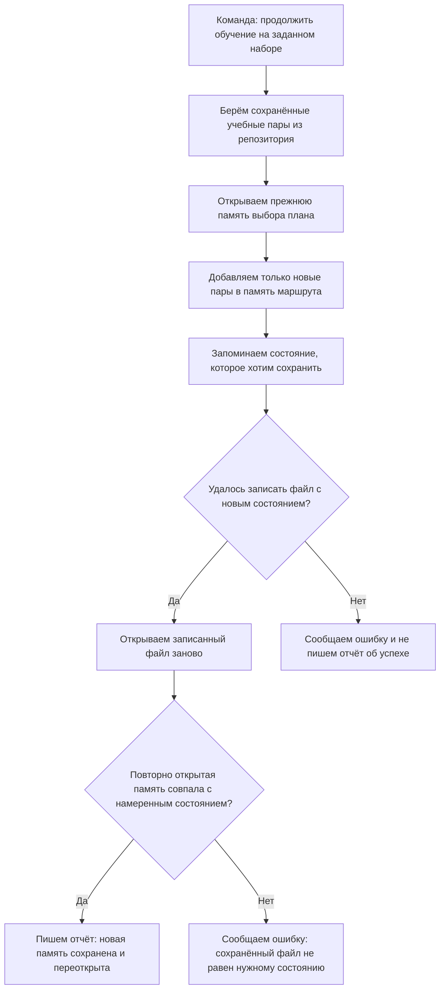
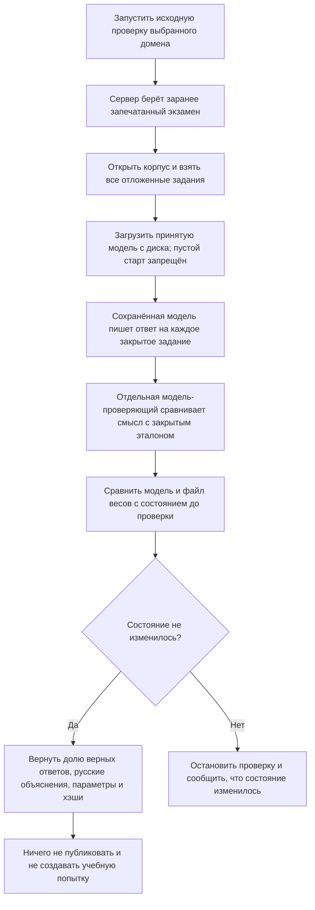
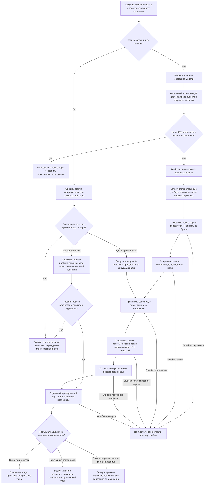
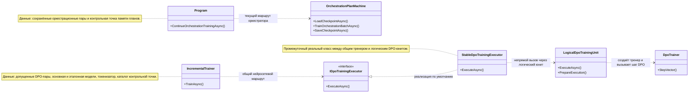

# 14.ContinuousLearning — живой план обучения и границы реализации

### RP01.03A: явный полный B0 с LoRA, 15.10.2026

Перед inactive materialization серверный owner первого обновления повторно проверяет существующий generation config, явный `ROOT_B0_FIRST_UPDATE`, canonical manifest исходного шага 1 и strict repository loader. `RepositoryOwnedFullLoraCheckpointDescriptor` связывает точные weights SHA256/length, model config, canonical LoRA topology и seed. Startup сверяет его с собственным deferred request; retained stream должен совпасть с sealed bytes и полной схемой codec03, включая GQA-размеры A/B. Отсутствие дескриптора сохраняет прежнюю проверку только базовых параметров.

Дескриптор передаёт фактический zero-dropout config в inactive trainer и последующий training context, не меняя `IncrementalTrainer.DefaultConfig`. Он также доходит до retained policy provider: policy, reference и fresh-load получают seeded adapter slots до существующего `LoadCheckpoint`, который загружает все базовые и LoRA tensors. Поздний `CodeDocumentationInitialTrainingConfiguration.Bind` по-прежнему проверяет legal context и выдаёт отдельную optimizer authority; дескриптор не является training или continuation grant. Native host, Student/Teacher и learning gain требуют отдельных runtime receipts.

Новые `MatchesModelConfig`, `ValidateArtifact` и `CreateModelForLoad` возвращают
канонический `OperationResult<T>`. Несовпадение shape является отказом, а не
успешным `false`; hash/size/schema и initialization failures не выходят как
business exceptions. Все потребители проверяют результат до materialization
или импорта модели. Cancellation сохраняет отдельный exception-путь, а поздние
legal/optimizer guards и права на continuation остаются прежними.

RP01.01C: `CodeDocumentationStudentGeneration` — общий read-only facade над существующим generator09. Exact OwnerInput сохраняется без trim/Compact/prefix/EOS insertion; UTF8 и tokenizer roundtrip проверяются. Closed handle выдаётся уже доверенными loaded-source owners и не создаёт model/teacher/optimizer authority. Assessment и private prepared-baseline one-shot используют тот же facade/settings; прежние consume-before-call, before/after-state checks, primary exceptions, cancellation и output bounds остаются у их owners. Facade не меняет weights, RequiresGrad или RNG. Ordinary result несёт contract/framing/input/settings/tokenizer identities и actual source; scientific P/C0/T parity/adoption остаётся открытым опытом.

Дата редакции: 2026-10-15.

### RP01.03A: sealed DPO-источник в retained owner

`ContinuousLearningModelServerConfigurationLoader` сохраняет прежний canonical `DPO_PAIR_ROOT`: адрес набора выводится через repository-owned resolver, затем существующий `OpenSealedForManifestIntegrity` проверяет sealed manifest. Успешный допуск выбирает типизированную роль `SealedRepositorySource`, которую deferred composition передаёт в `ServerOwnedContinuousLearningFileAccess.Acquire`. Без успешно открытого seal и у прежних прямых callers остаётся `MutablePairStore`; неизвестная роль отвергается до открытия путей.

Sealed источник имеет отдельные retained object/root роли. Windows открывает его handle-relative с read attributes/traverse/synchronize, без mutation/write access и без delete sharing. Read namespace `SealedDpoSource` допускает прежнюю проверку regular leaf; mutable `DpoPairs` к этому объекту не разрешается. POSIX сохраняет no-follow, owner boundary и независимую повторную проверку identity, а mutation flock остаётся у mutable store. Adapter/Cache/Registry capabilities, writer guards, sticky trust loss и disposal используют прежние owners.

Путь запуска остаётся прежним: ModelServer singleton → `AcquireRetainedFileAccess` → hosted activator → bind retained owner → inactive composition. Исправление допуска само по себе не доказывает readiness реального хоста, вызов Student/Teacher, optimizer update, полезность обучения или ordinary adoption. Эти результаты требуют отдельных runtime receipts.

### RP01.03A: private raw assessment retention и научное удержание Trial

Явный first-RP01 scientific route внедряет `ICodeDocumentationPrivateAnswerCapture` в прежний quality context. Assessment сохраняет полный точный decoded UTF8 сразу после генерации, до length refusal или обращения к evaluator. Legacy preview/hash/count остаются прежними. Без этой runtime dependency нет новых writes и null reference fields опускаются из JSON. Calibration сохраняет private artifact reference каждого case во всех пяти повторах обеих arms, а не только representative assessment.

`CodeDocumentationPrivateEvaluationStore` выводит owner-only путь из canonical model/run address вне checkpoint/attempt discovery: `training-artifacts/private-evaluation/<domain>/<pattern>/<model>/<version>/<SHA256(run-id)>/`. Create-only raw bytes и metadata связывают input/case/assessment-run/settings/model source/corpus, точные SHA256/UTF8 bytes/UTF16 char count. Пустые, длинные, Unicode, newline и control characters не нормализуются. Readback проверяет actual bytes, custody, namespace и hash; changed/partial artifacts не перезаписываются. Это только private EVALUATION_ONLY retention по существующему настоящему grant, не training data, public ответы или stdout.

Coordinator26 сохраняет hold intent до C0/optimizer и complete quality graphs после единственных C0/T; native negative тоже остаётся durable. Новая publish-only ветка использует прежние baseline/optimizer/RNG/Trial validators и чистый `CompareCompletedTrialDetailed`, затем требует настоящий независимый verdict с frozen criteria и точными supporting raw hashes. Прежний native gate необходим дополнительно к integer gain ≥2 из 12 семей и нулевым Trial/new critical. При `publish-held` никаких новых assessment/calibration/optimizer calls нет. Ordinary/direct resume held attempt отказывает. [Координатор и source→consumer](26-trainable-router.md), [точная private policy/verdict схема и запуск](../../tools/Rp01RawDpoLesson/README.md).

Явный `resume-baseline-and-hold` восстанавливает только тот же intent до canonical attempt. После source/legal/parent admission отдельный private run lease исключает одновременные fresh/recovery/publish; короткий existing pair-lock eligibility read завершается до обычного executor. Typed capability фиксирует исходные 60 C0 run/case/input/settings/corpus/model bindings. Весь inventory и все cached verdicts проходят custody/hash/strict UTF8/profile/authority/parser checks до новых effects. Orphan, лишний arm/case, drift или canonical attempt отказывают. Сохранённый raw никогда не перегенерируется: только отсутствующие слоты вызывают Student. Missing verdict оценивает те же bytes с настоящим current permit; complete evaluator result/provenance сохраняется create-only до следующего case. Cached result проходит тот же validator без фиктивного CallIssued. После complete C0 единственный existing executor и Trial loop возвращают HELD даже при native negative; publish требует отдельного T2.

`EvaluationAccounting` отдельно сообщает 120 logical results, новые dispatch intents/фактически issued permits и reused raw/verdict counts. Исторические evaluator calls при recovery — UNKNOWN; прежний dispatch без durable result не становится zero. Frozen MaxTeacherCalls/settings/criteria не увеличиваются. Кодовый administrative upgrade и пять ранее сохранённых raw имеют разную revision provenance; scientific continuity оценивает независимый владелец. [CLI и полный контракт восстановления](../../tools/Rp01RawDpoLesson/README.md).

Новые scientific HTTP операции выбирают caller lifetime явно; legacy bounded transport, evaluator profile, cancellation и прочие security gates сохраняются. Настоящий policy/capsule, independent grading, T1 и adoption в этом кодовом срезе не выполнялись.

### RP01: identity исходного C# TRAIN-урока

`RepositoryOwnedDpoDatasetManifestSealer.CreateRawRequestIdentity` добавляет схему `repository-owned-dpo-dataset-request-identity-raw-v2`. Полный `RepositoryOwnedDpoRawSourceIdentity` содержит тип оригинального синтетического TRAIN-источника, case/family, C#12, число источников, точные SHA256 owner input/specimen/question, платформенное происхождение выбора, selector id и закреплённые handoff/operator/intake. В raw-v2 нет `paidReferenceAnswers`; нулевой или фиктивный paid reference не создаётся. Прежний v1 writer сохраняет тот же порядок и байты; смешанные/неполные схемы отклоняются.

Существующий rich pair v5 resolver/sealer повторно открывает реальные файлы и проверяет raw prompt, domain/pattern, обе авторские стороны и привязку provenance к содержимому. Raw identity допустима только для одной пары `csharp-code-documentation/ilearning-unit`. Полный canonical preimage входит в historical context; legacy paid history сохраняет framing. Paid-only orchestration ingress в `27.TranslationDomain.Tools` отказывается от raw-v2 до разыменования paid set.

Производитель: `CodeDocumentationRawDpoLessonSource` → `CodeDocumentationRawDpoLessonAuthoring` → прежний `ContinuousLearningTp1AuthoringComposition.CreateClient` → `RepositoryOwnedDpoDatasetResolver` → sealer. Точный вызываемый intake описан в [Rp01RawDpoLesson](../../tools/Rp01RawDpoLesson/README.md). Обычный downstream остаётся `CodeDocumentationStudentGeneration` с raw owner input. Adapter не изменяет objective, маски, LoRA, journal, checkpoint или generator.

Сохранённая пара — кандидат для отдельного J, а не его вердикт. Команда не выдаёт training lease и не запускает Student; смысловой контраст, независимый judge, B0/T1 и измерение обычного потребителя остаются отдельными стадиями. Платформенный S origin не выдаётся за Native Codex attestation. Реальные manifest/layer/native-vocabulary и полный input fit проверяет прежний клиент при действительном author-вызове; записанные pins сами по себе этого не доказывают.

### RP01: явная отмена локального inference вызывающим кодом

Сервер может отдельно выбрать `ManualCpuAuthoring` и `ManualEvaluation` через `ContinuousLearningTp1DpoConfiguration.Create(..., authoringProfile: ..., evaluationProfile: ...)`. В startup используются пары `XIIGEN_CONTINUOUS_LEARNING_TP1_AUTHORING_PROFILE_ID` / `_SHA256` и `XIIGEN_CONTINUOUS_LEARNING_TP1_EVALUATION_PROFILE_ID` / `_SHA256`. Каждая пара проверяется целиком; отсутствие обеих переменных соответствующего назначения сохраняет прежний профиль. Неизвестный ID, неполная пара, чужой hash или смена назначения дают отказ до HTTP.

| Новый паспорт | SHA256 конфигурации |
|---|---|
| `qwen35-local-authoring-cpu-caller-cancel-v1` | `c3e56109f94eae51c9c5439e4be1477cbdf8578cbb42ff700ab165c9b7b26d77` |
| `qwen35-local-evaluation-caller-cancel-v1` | `05a98ca23c020836c7c14dc7ee26c02030783c88f4286eb869d6f1a5de884575` |

У этих паспортов нет автоматического срока генерации: клиент связывает только caller cancellation и собственный lifetime. Dispose отменяет активный запрос и освобождает транспорт после завершения его lease. Hash явно включает `request_cancellation_mode=caller_or_client_lifetime_only`; `request_timeout_seconds=-0.001` кодирует `Timeout.InfiniteTimeSpan`, а не отрицательный таймер. HTTP timeout остаётся Infinite, connect timeout 5 секунд и очистка idle pool сохраняют своё транспортное назначение.

Manual CPU сохраняет полный native-counted JSON prompt, контекст 2048 и резерв 512, CPU 2/16/0, запрет truncate/shift и прежние admission/manifest/layer проверки. Manual evaluation сохраняет 8192/256, `think=false` и отдельную nontraining provenance. Выбранный evaluation ID/hash проходит через клиент, проверку каждого ответа, assessment receipt, calibration comparison, scorer identity и certification conditions. Старый формат OneLesson явно отказывает manual evaluation до reopen; DesignConversion по-прежнему принимает только прежний legacy-паспорт автора.

Для всей calibration series `maximumDuration: null` при manual evaluator означает отсутствие таймера. Repository-owned training HTTP endpoint сам передаёт в quality-gate context `Timeout.InfiniteTimeSpan` при точном выбранном `ManualEvaluation`; legacy evaluator сохраняет прежний срок 5 минут. Прямые вызывающие quality-gate context должны передать `Timeout.InfiniteTimeSpan` явно; это значение допустимо только с точным manual evaluation паспортом. Положительный явно переданный срок в других API остаётся отдельным запросом вызывающего кода на ограниченную серию; ноль и остальные отрицательные значения запрещены. Legacy null сохраняет 5 минут. Планировщик по-прежнему ограничивает число вызовов: например, 12 заданий × 5 повторов × baseline/trial = 120 запланированных вызовов; hard maximum 10000, DPO step count и запрет повторного обучения не меняются.

Срез меняет управление отменой и точность паспортов. Синтетическая проверка транспорта не доказывает native-fit, вызов Qwen, обучение Student, качество или принятие модели. Настоящий scientific runtime остаётся отдельным этапом.

### RP01.01A/02A: закрытый native reference с неизвестным backend паспортом

Добавлен отдельный описательный native-capture origin: requested profile, фактический CLI/runtime/thread, raw capture hashes и usage сохраняются отдельно от наблюдаемых nullable provider/model/version/server request ID. Старые known-model v1/raw-v2 factories не ослаблены. Новый private intake → прежний corpus sealer → строгий reopen сохраняет исходные UTF-8 bytes и полный canonical metadata; console receipt содержит только IDs/hashes/counts. [Модульный алгоритм, границы и следующий научный владелец](14-native-reference-corpus.md), [исполняемая команда и private schema](../../tools/Rp01NativeReferenceCorpus/README.md).

Новый вариант применим к прежним закрытым assessment inputs и расчёту бюджета: 12 SEALED entries × 5 canonical repeats × baseline/trial = 120 evaluation calls по существующему planner, без выполненных вызовов в этом кодовом срезе. DEV не включается в SEALED; scientific owner сохраняет split-specific корпуса отдельно. Hashes/provenance не выдают rights, backend attestation или training grant. Legacy teaching/selection требует known-model origin и сохраняет отказ для native capture. Настоящий scientific capture seal/reopen, Student/Teacher calls, независимая оценка и learning gain остаются отдельной работой.

### RP01.02B/A1: отдельный ограниченный CPU-профиль автора

Существующий локальный автор Qwen теперь поддерживает явный профиль `qwen35-local-authoring-cpu-bounded-v1`. Его точный SHA256 конфигурации — `c1973891d1414f24b8625668446f5b33ffddeb433acb9b15daedc00d52d8aea5`. Выбор фиксируется в server-owned startup-конфигурации по обеим переменным `XIIGEN_CONTINUOUS_LEARNING_TP1_AUTHORING_PROFILE_ID` и `XIIGEN_CONTINUOUS_LEARNING_TP1_AUTHORING_PROFILE_SHA256`. Отсутствие обеих сохраняет legacy; неизвестный ID, неполная пара или чужой hash дают отказ. HTTP-клиент не задаёт произвольные runtime options.

| Поле нового профиля | Значение и смысл |
|---|---|
| Контекст / выход | `num_ctx=2048`, `num_predict=512`; полный отрендеренный prompt вместе с резервом ответа должен помещаться, максимум 1536 входных токенов. |
| CPU (центральный процессор) | `num_thread=2`, `num_batch=16`, `num_gpu=0`; те же ограниченные CPU настройки, что в измеренном A0. |
| Формат и ресурсы | `stream=false`, `format=json`, `think=false`, `temperature=0`, `seed=0`, `keep_alive=0`, `truncate=false`, `shift=false`. |
| Deadline | 600 секунд на последовательность HTTP-наблюдений и ответа; конечный протокольный бюджет, а не минимум модели. |

A0 получил один короткий ответ за 49.352 секунды, из них cold load — 39.6899527 секунды: один только load превышал legacy 30 секунд. Контекст 2048 и CPU настройки наблюдались на 28 входных/14 выходных токенах; достаточность для полного будущего урока не измерена. Резерв 512 выбран для ограниченного JSON с обеими сторонами и причиной, 600 секунд — для холодного запуска и конечной генерации. Это не гарантирует полезную пару или достаточность произвольного полного контекста и не вводит новый минимум RAM (оперативной памяти).

Один профиль проходит весь реальный путь: `ReadAuthoringProfile` → `ContinuousLearningTp1DpoConfiguration` → `PreparedAuthoringRequest` с существующим `ConfiguredQwenVocabularyLease` → точное подготовленное HTTP-тело и deadline → authoring-wrapper → `CreateProductionContext` policy/creator identity → проверка паспорта до вызова и provenance после ответа. Переполнение полного prompt и резерва отказывается до permit/HTTP, без обрезки задачи, эталона или истории. Native-владелец удерживается до финальной сверки; внутренний счётчик `CreateForTesting` остаётся исключительно синтетическим и не выдаёт права или native-fit. Ранее подготовленный контекст другого профиля не совпадает по binding.

Этот CPU-контракт требует полный JSON prompt. Реальный strict single-pair путь `ResolveOrAuthorSinglePairAsync` выбирает `includeApprovedTask=true`: `AuthorOnePairAsync` сериализует неизменённые `approved_task` и полный прежний `authoring_context` в один JSON. Именно этот producer→client→pair consumer проходит синтетический Fact. Legacy bulk `BuildTeacherPrompt` остаётся текстом с LF и при явном CPU выборе сохраняет ingress-отказ до HTTP; этот срез не делает его совместимым, не сокращает и не переписывает исходные данные.

CodeDocumentation читает объявленный паспорт фабрики ровно один раз до pair loop: любой непустой паспорт, отличный от ожидаемого контекста, отказывается в обоих направлениях, включая CPU-клиент при legacy-контексте. Для CPU паспорт обязателен; прежние legacy-адаптеры с `null` остаются совместимыми. Общая startup-конфигурация не выдаёт CPU права на DesignConversion: реальные `AuthorCandidateAsync` и `AttestAsync` перед inference проверяют только точный legacy-паспорт либо прежний `null`, поэтому CPU, evaluation и поддельные паспорта не расходуют reservation. Ответы по-прежнему проходят прежнюю отдельную legacy provenance/profile проверку; без явного выбора нового evaluation-паспорта EvaluationOnly остаётся на frozen Evaluation.

После действительно завершённого CPU chat `keep_alive=0` допускает ровно пустой список `/api/ps`, как наблюдалось в A0. Это исключение не применяется к preflight `/api/tags`: полные manifest/model-layer проверки до и после, identity ответа, строгий parser, loopback/proxy/redirect ограничения и одноразовый permit остаются. Непустой чужой список и несогласованный паспорт отклоняются. Пустой running list не объявляется наблюдением живого контекста модели.

Legacy `qwen35-local-authoring-v1` сохраняет прежние ID/hash, тело 8192/без `think` и `num_predict`, `keep_alive="5m"` и 30 секунд. Отдельная прежняя подготовка `qwen35-local-authoring-token-bound-v1` сохраняет 8192/2048/30 секунд. Frozen Evaluation сохраняет прежние ID/hash, 8192/256, `think=false`, `keep_alive="5m"` и 120 секунд. Legacy `IsCanonicalAuthoring` не расширен: CPU имеет отдельную точную проверку.

Граница среза — `IMPLEMENTED_NOT_OBSERVED`: настоящее применение CPU-автора к уроку, scientific P/C0/T, Teacher-пара, Student update и качество не измерены. До настоящего authoring остаются отдельно закрепляемые genuine parent/tokenizer/config/evaluator и scientific precommit. Opaque source/history права и protected OneLesson 503 не ослаблены; синтетическое происхождение не становится native, закрытый экзамен не раскрывается. Один asset-free deterministic Fact проверяет профиль/тело/deadline/consumer и отказные ветви; он не заменяет научное измерение или native/runtime доказательство.

### RP01: необученный исходный baseline перед первым уроком

Существующий checkpoint sealer отличает необученный исходный baseline от применённой DPO-истории. Внутренний publication owner сам получает clean-missing START и сохраняет свежую модель без caller Model; только этот путь выдаёт схему `repository-owned-model-checkpoint-manifest-v2-initial-baseline` и типизированную роль `InitialBaselineNoUpdate` (`dpoApplication: 1`). Команда не конструирует precheck Model: единственный initial START находится у владельца, который возвращает типизированные `Created`, `AlreadyPresent` либо `ReconciliationRequired`. Ранние ошибки до sealer остаются отказами; ошибка после возможной записи требует сверки диска без повторной публикации. Отдельный denied START после успешной записи остаётся проверкой reload. Роль участвует в canonical self hash; invalid, отсутствующая либо противоречивая роль, Step > 1 или parent дают отказ. Полные DPO bytes и веса по-прежнему повторно открываются и проверяются.

Для этой проверенной исходной роли DPO manifest означает provenance, поэтому первая законная пара ещё может пройти существующий coordinator. После настоящего применения обычный опубликованный child снова блокирует её PairId/SHA; изменённые bytes под тем же PairId дают конфликт. Legacy v1, включая parentless Step 1 с ColdStartReason, остаётся applied history; отсутствие роли не является основанием освободить пару. Старые canonical bytes и self hash сохраняются без добавленного null-поля. Bootstrap не пишет consumed-pair journal и не доказывает Student learning; P/C0/T и ordinary cold adoption остаются отдельными фактическими стадиями.

### RP01.01B/D: неизвестный результат нельзя повторять под новым именем запуска

Если один запуск уже оставил durable claim и baseline для запечатанной пары, другой `TrainingRunId` не получает право применить её снова. Существующий baseline journal просматривает только соседние attempts той же канонической модели и версии. Совпадение PairId и sealed SHA означает резервирование; совпавший PairId с другим SHA, повреждённый, частичный или неатрибутируемый attempt требует согласования состояния. Отказ возвращается как прежний `TrainingAttemptRecoveryRequiredErrorCode`. Журнал не переключается в чужой запуск и не создаёт второй учёт пар.

Coordinator проверяет соседей перед новым baseline, сохраняя прежний отказ для уже опубликованной пары и восстановление текущего запуска. Executor после законного lease держит общий файловый lock версии модели `attempts/.dpo-update.lock`, повторяет проверку, создаёт claim и пишет/повторно открывает baseline. Lock освобождается после этого durable резервирования и при любом раннем выходе. Два разных run ID проходят check→claim через одну границу резервирования. Полный crash/power-loss recovery и наблюдение конкурентного запуска этим описанием не заявлены; научная польза обучения остаётся `NOT_MEASURED`.

Сохранённый JSON попытки задаёт только ожидаемые значения. Новый внутренний read-only метод существующего DPO sealer заново связывает canonical dataset address, strict manifest/selfhash, одну OrderedPairs row, канонический путь pair-файла и его фактический raw SHA. Это атрибуция ранее оставленного резервирования, без разбора `DpoPair`, нового допуска к обучению, pair-store mutation, clone preparation или chmod. Обе версии baseline проходят эту проверку перед признанием отличающегося sibling. На Linux небезопасные существующие owner modes дают отказ; Windows сохраняет прежние stable path/handle/reparse checks, без заявления новой ACL-защиты исторических pair-файлов. Новый reservation lock по-прежнему использует отдельную strict custody границу. Конкурентный запуск, Linux runtime, Windows ACL и качество обучения этим срезом не измерены.

### RP01.01B/A: согласованный численный objective

Для выбранного CodeDocumentation exact-профиля `DpoTrainer` использует стабильный softplus, cancellation-resistant derivative и одинаковый `normalizedWeight × VectorSignal` в loss/gradient векторного шага. Версия objective `response-sum-softplus-signal-weighted-v3` связана digest carrier и сохранённым JSON метрик однородного exact-набора. Поле `ObjectiveVersion` отсутствует при null у legacy/смешанного набора, публичный average и production forward/dropout остаются прежними. Численные tails, JSON readback и actual LoRA/moment проверки относятся к изолированным инженерным fixtures. B/C ниже добавляет recipient allowlist и profile-bound optimizer/RNG continuation; полное consumed/crash/reopen, ordinary RP01.01C и научное улучшение `NOT_MEASURED` этим изменением не закрыты.

### RP01.01B/B-C: v5 manifest и proof источника состояния

CodeDocumentation execution artifact теперь получает закрытый `DpoExecutionProfile` из фактически исполненного constrained trainer bundle. Существующий optimizer manifest writer сохраняет format 5: `segmented-byte-BPE-v2`, `prompt-response-segments-no-separator-v2`, `response-sum-softplus-signal-weighted-v3` и полный canonical allowed parameter map. Карта moment entries может быть неполной; отсутствующие moments не создаются искусственно. Каждая сохранённая moment key должна принадлежать allowed map.

Канонический manifest owner после address/hash/readback, baseline binding и сверки actual optimizer/RNG bytes выдаёт закрытый `DpoContinuationProof`. Он повторно проверяет источник при использовании. Executor проверяет proof и actual policy recipient до lease и повторно после lease до attempt claim; logical unit проверяет до preparation permit, trainer проверяет allowed moments до RNG restore. Old v2/v3/v4 manifest, отсутствующая/неверная tuple/map, raw state без source proof или подменённые bytes дают отказ exact continuation, без silent fresh-optimizer fallback. Binary AdamW v2 и generic legacy API сохранены.

Explicit initial optimizer/RNG cold authorization остаётся отдельным существующим маршрутом. Прежние publication transaction и rollback сохраняют веса, moments и RNG при неуспешной публикации; coordinator использует прежние attempt/recovery owners. Узкий temporary-model disk check связывает source step/RNG с последующим update и проверяет replay без второго Step. Это инженерная проверка, не эксперимент качества Student или полного power-loss recovery; ordinary RP01.01C открыт.

### RP01.01A: точная пара для CodeDocumentation

`CodeDocumentationServerOwnedDpoTrainingExecutor` явно задаёт профиль `segmented-byte-BPE-v2` в существующем `DpoTrainingExecutionRequest`. `StableDpoTrainingExecutor.TryBuildLogicalRequest` разрешает этот профиль для домена `code-documentation` и передаёт его в `LogicalDpoTrainingUnit.PrepareExecution`, prepared execution и логический request. Обычный `IncrementalTrainer` и остальные callers сохраняют default `legacy-full-sequence-mean-v1`.

Точная пара сохраняет отдельное кодирование prompt/ответов, исходные пробелы/Unicode/CRLF, response-target masks и fingerprint admission; сведения carrier связаны digest с tokenizer и версиями framing/objective. Логическая единица проверяет material/profile/tokenizer и ограничения обеих моделей, копирует изменяемые arrays до первого preparation permit. Затем существующий `DpoTrainer.StepVector` потребляет response-only SUM и соответствующий backward. Compact 480, дополнительный разделитель, EOS, обрезка и `[0]` fallback в выбранном профиле не применяются. Неверный материал даёт `DPO_EXACT_MATERIAL_INVALID`, превышение context — `DPO_EXACT_MATERIAL_CAPACITY_EXCEEDED`.

Проверка в `CodeDocumentationServerOwnedDpoTrainingExecutorTests` наблюдает выбранную версию и исходные строки на настоящем logical optimizer sink изолированного endpoint-теста; `DpoExactPairMaterialTests` проверяет маски, точность, ранний отказ, SUM/gradient и snapshots. Это инженерные проверки синтетических моделей. Научное улучшение Student остаётся `NOT_MEASURED`; полная проверка получателя LoRA/состояния относится к RP01.01B, ordinary cold generation — к RP01.01C. Существующие admission, журнал попыток и coordinator переиспользуются.

Эта страница объясняет, как продукт учится лучше разбирать просьбу программиста на план действий. Для оркестратора сохранённые учебные пары сейчас работают как память выбора подходящего плана: они добавляют ближайшие примеры, меняют состояние выбора маршрута и затем должны сохраниться так, чтобы следующий запуск открыл именно это состояние.

Проверка сохранения не доказывает, что модель стала умнее. Она доказывает более узкую вещь: после обновления памяти команда не сообщает об успехе, пока не проверит, что новое состояние записалось на диск и снова загрузилось как то же состояние.

Кодовые источники фактов после объяснения: `ContinueOrchestrationTrainingAsync`, `TrainOrchestrationBatchAsync`, `SaveCheckpointAsync`, `LoadCheckpointAsync`, `SameOrchestrationCheckpointPersistentState`, `SerializeOrchestrationCheckpointPersistentState`.

## Текущая логика сохранения результата

1. Команда продолжения обучения на заданном наборе открывает сохранённый учебный набор из репозитория или создаёт новый набор только по правилам репозиторного хранилища.
2. Затем она загружает прежнее состояние оркестратора из контрольной точки.
3. Из учебного набора берутся только пары, которых ещё нет в обученной памяти; платный эталон не становится стороной пары.
4. Оркестратор применяет эти пары к памяти выбора плана: часть состояния попадает в ближайшие примеры и веса выбора маршрута.
5. Перед записью команда запоминает состояние, которое намеренно хочет сохранить.
6. После записи она сравнивает файл на диске с этим намеренным состоянием, потом открывает файл заново как новую машину и сравнивает ещё раз.
7. Отчёт об успехе появляется только после этих проверок; если запись не удалась или повторное открытие не совпало, команда сообщает ошибку.



| Ветка схемы | Пример ожидаемого поведения |
|---|---|
| Запись удалась, повторное открытие совпало | В памяти уже была старая пара, добавилась новая пара, и после повторного открытия обе пары видны в сохранённом состоянии. |
| Запись не удалась | Если служебный путь для временной записи занят, команда возвращает ошибку и не создаёт отчёт, который выглядел бы как успешное продолжение. |
| Повторное открытие не совпало | Если файл записался, но в нём не хватает намеренно сохранённого состояния, команда останавливается с ошибкой вместо заявления “готово”. |

## Что это не доказывает

Эта проверка — про сохранность результата. Она не является оценкой качества модели, не запускает реальную китайскую модель и не доказывает градиентное DPO-дообучение общей нейросетевой модели. Для оркестратора сейчас речь о памяти выбора плана и ближайших примерах, а не о доказанном росте качества на закрытых заданиях.

Целевой цикл качества ещё нужно соединить отдельно: текущее принятое состояние → отдельный проверяющий → китайская модель получает отдельную учебную задачу и старые пары как примеры → новая пара сохраняется до применения → сохраняется полное состояние до пары → текущая модель обновляется только этой новой парой → повторная проверка → сохранение доказанного улучшения либо возврат полного состояния до пары. Закрытые проверочные задания учителю не передаются. Платный эталон не становится стороной пары.

## Что продукт уже делает

| Область | Уже есть в коде | Честная граница |
|---|---|---|
| Хранилище учебных пар предпочтений | Набор лежит в `training-data/dpo/...`: есть манифест, файлы пар и повторное открытие точных байтов перед использованием. | Хранилище доказывает, что пара не потерялась и имеет происхождение; оно не доказывает, что качество модели выросло. |
| Запрет платного эталона как обучающей стороны | Богатая пара хранит авторство выбранной и отклонённой сторон, а создание оркестрационных пар отвергает дословное копирование платного эталона в обучающие стороны. | Платный эталон может быть ориентиром и источником контрольной суммы, но не становится ответом, на котором учится модель. |
| Текущее продолжение оркестратора | Команда продолжения берёт сохранённые пары, исключает уже применённые и применяет новые пары к `OrchestrationPlanMachine`. | Сейчас это обновляет память ближайших примеров и веса выбора маршрута. Это не тот же путь, что нейросетевое DPO-дообучение через общий тренер. |
| Общий нейросетевой тренер | `IncrementalTrainer` уже содержит реальный путь через `StableDpoTrainingExecutor` и `DpoTrainer`, а после принятой транзакции публикует репозиторную контрольную точку. | Этот общий путь существует, но текущая команда продолжения оркестратора пока не доказана как подключённая к нему. |
| Отдельный проверяющий | Есть транспорт для оценочной модели через `ContinuousLearningTp1EvaluationComposition.CreateClient`; Design-to-Code уже имеет пример отдельного оценщика. | Для оркестрации нужен отдельный договор оценки планов и промпт под выбор потоков, шагов и проверок; HTML/CSS-проверяющий не является готовым проверяющим оркестрации. |

## Целевой алгоритм одной новой пары

Нужный продуктовый смысл простой: не учить модель вслепую и не портить принятые веса из-за одной неудачной пары. Система открывает последнее принятое состояние, проверяет его отдельной моделью-проверяющим, просит китайского учителя написать один новый урок только под найденную слабость, сохраняет этот урок до применения, сохраняет полный дисковый снимок состояния до урока, применяет ровно эту пару, записывает полную пробную версию после пары, затем снова проверяет качество. Улучшение сохраняется только когда оно выше погрешности измерения; ухудшение откатывается; неясный результат не называется ни улучшением, ни ухудшением.

Самая важная ветка — восстановление после сбоя. В журнале должны различаться две опоры: полный дисковый снимок до пары как точка отката после перезапуска и полная пробная версия после уже применённой пары как предмет оценки. Если предыдущая попытка не закончена, новый запуск не должен идти к учителю и не должен создавать новый снимок “до пары”. Сначала он открывает старую исходную оценку и старый дисковый снимок до той пары. Если журнал показывает, что пара уже была применена, её нельзя применять второй раз: надо загрузить связанную с этой попыткой полную пробную версию после пары, оценить именно её и сравнить со старой исходной оценкой. Снимок до пары остаётся нетронутой точкой возврата; никакой новый файл не должен писаться поверх него. Если пробная версия повреждена, журнал противоречив или непонятно, применялась ли пара, нельзя повторять пару наугад; надо вернуть сохранённое состояние до пары и записать незавершённость или ошибку.

Текущий низкоуровневый срез закрывает только ближайшую опасность внутри
запущенного процесса: если `DpoTrainer` уже изменил веса и память `AdamW`, но
не успел завершить публикацию пары файлов контрольной точки, он возвращает
живую обучаемую модель и оптимизатор к состоянию перед попыткой. Это не тот
полный долговечный снимок из списка выше: пока не сохраняются на диск состояние
оптимизатора, счётчики происхождения версии, ожидающая пара, оценки качества и
случайные генераторы слоёв вроде LoRA/Dropout. Поэтому точный повтор после сбоя
честно доказуем для детерминированного пути, например LoRA с `Dropout=0`, а
полный откат случайного пути остаётся отдельной работой.

Цель 95% — это требование к будущей независимой проверке, а не текущий результат. Если уже открытое принятое состояние проходит эту цель с учётом погрешности, новая пара не создаётся ради активности. Если не проходит, проверяющий выбирает одну конкретную слабость: например, модель умеет составлять план задачи, но забывает добавить проверку результата. Китайский учитель получает отдельное учебное задание, слабый ответ ученика, платный эталон только как ориентир качества и прежние сохранённые хорошие/плохие пары как примеры формы урока. Закрытые проверочные задания и отложенные эталоны учителю не передаются.

Новая пара сначала сохраняется в репозитории и открывается обратно из файла. Только после этого модель получает эту пару в обучение. Старые пары в этой точке полезны учителю как примеры, но не означают обязательное повторное обучение на всей прошлой базе. Для сегодняшнего оркестратора “обучить” означает изменить память ближайших примеров и веса выбора маршрута в `OrchestrationPlanMachine`. Для будущей единой нейросетевой связки это должно означать запуск общего `IncrementalTrainer` от загруженной контрольной точки через `DpoTrainer`. Эти два пути нельзя называть одним и тем же.

### Уже реализованная опора: неизменяемая копия для сравнения

Для документации кода исправлен маленький технический шаг перед будущей проверкой качества. Перед новым уроком расчёту DPO нужна отдельная неизменяемая копия уже обученной модели: она нужна не для оценки качества, а для математического сравнения “до/после” внутри обучения. Копия должна содержать и основные веса, и обученные дополнительные матрицы. Раньше повторный запуск мог открыть принятую модель с LoRA-матрицами, но затем пытался сделать копию как пустую модель без этих матриц; второй урок останавливался до тренера. Теперь копия сначала пробует обычное сохранённое состояние, а если в нём есть LoRA — заранее создаёт такие же места под дополнительные матрицы и загружает те же веса. Это только чинит продолжение от уже обученного состояния; оно не доказывает, что новая пара улучшает качество.

Техническая справка: DPO — обучение по предпочтению “лучший ответ лучше худшего ответа”; LoRA — дополнительные обучаемые матрицы поверх основных весов; кодовый путь: `CloneModelBeforeMutation` повторяет порядок загрузки из `CodeDocumentationRepositoryOwnedModelCheckpointStartService`.

### Уже реализованная опора: попытка отдельно от принятой модели

Для документации кода реализован ещё один маленький шаг: черновики нового урока отделены от каталога принятых моделей. Пока тренер пишет свои файлы, они лежат в истории попытки внутри `training-artifacts/models/.../attempts/...`, а не в будущей папке принятой версии `checkpoints/...`. Если подготовка или обучение оборвутся до вызова службы публикации, последняя принятая модель с `manifest.json` и `weights.bin` должна по-прежнему открываться как рабочее состояние. В каталог принятых версий результат попадает только через отдельную публикацию контрольной точки; проверка качества урока и откат после каждой пары остаются следующим шагом.

Проверки этой правки говорят о более узком результате: тренер получает каталог попытки; повтор того же запуска не меняет веса и уже записанные файлы попытки; проверенный сбой после резервирования попытки, но до изменения весов и до вызова службы публикации, не мешает открыть прежнюю модель; действительно повреждённая принятая версия по-прежнему отвергается. Это не обещает восстановление при сбое внутри публикации.

Схема хода:

```text
последняя принятая модель
  -> новый урок пишет черновики в попытку
    -> если публикация успешна: появляется новая принятая версия
    -> если сбой подготовки или обучения случился до начала публикации:
       прежние файлы принятых версий остаются нетронутыми,
       следующая загрузка снова берёт прежнюю принятую модель
```

Техническая справка по путям:

```text
Попытка нового урока:
training-artifacts/models/<domain>/<pattern>/<model>/<version>/attempts/<sha256(TrainingRunId)>/
  attempt.claim
  dpo_policy_step_000001.bin
  dpo_step_000001.json

Принятая модель:
training-artifacts/models/<domain>/<pattern>/<model>/<version>/checkpoints/000002/
  weights.bin
  manifest.json
```

### Исходная оценка сохранённой модели документации

Выбранный учебный контекст в `CodeDocumentationRepositoryOwnedDpoDatasetAuthoring` теперь сверяет эталон по версии его неизменяемого provenance: v1 использует прежний normalized hash, raw-v2 — отдельный строгий UTF-8 hash. Перед проверкой истории полный `sha256:` digest проверяется и повторно связывается с известной factory; пустое legacy-поле raw-v2 больше не отклоняет всю историю. Полный текст эталона и его prefixed/bare hash по-прежнему запрещены в chosen/rejected истории. Исходные raw строки сохраняются до JSON для учителя, включая CRLF и decomposed Unicode.

Защищённое разрешение полного учебного контекста также различает два точных формата. `CodeDocumentationOneLessonTeachingDisclosureApproval` со `SchemaVersion=1` сохраняет прежнее поле `ReferenceAnswerSha256` для однородных legacy-v1 источников. `SchemaVersion=2` требует только `ReferenceAnswerRawUtf8Sha256` для однородных raw-v2 источников. Остальные поля, canonical JSON, полный список источников, порядок записей, входные задания и paid provenance сверяются с фактически переоткрытыми владельцами. Неизвестная версия, смешанные источники или raw digest в legacy-поле отклоняются до захвата контекста; нормализованный digest не заменяет raw commitment.

При фактическом protected capture используется прежняя проверка `TryGetSelectedReferenceHash`: она повторно связывает полный эталон с известной immutable factory и сохраняет его исходные UTF-8 bytes, включая CRLF и decomposed Unicode. Разрешение остаётся только для `ServerOwnedNativeCodexPedagogicalSelection` (`gpt-6-astra`/`ultra`): startup, catalog, Session, актуальная revision и opaque receipt сохраняют прежние границы жизни и отказов. Origin остаётся `ProtectedStartupOperatorApproval`, `FullTeacherContextReady=false`; закрытый экзамен и диагностика не раскрываются, paid reference не становится стороной DPO. Этот срез не выдаёт права Chinese teacher/history, не выполняет выбор урока, модельные вызовы или обучение. Настоящее ordinary teacher применение — `NOT_OBSERVED`, learning gain — `NOT_MEASURED`, отдельный Astra вызов — `NOT_PERFORMED`.

Один прежний `OrdinaryTeacherContent_FullTaskRawResponseAndAssessedHistoryReachRecipient` сохраняет обе v1 ветки и добавляет изолированный sealed raw-v2 fixture → selected material → Completed tiny Student → Synthetic history assessment → teacher JSON. Это инженерная совместимость контекста: `SyntheticTest`, `FullTeacherContextReady=false`, без вызова учителя и optimizer effects. Настоящие права раскрытия, выбор и оценка урока операторами, ordinary/genuine teacher route, Student learning и научная польза остаются открытыми: `NOT_MEASURED`, Astra `NOT_PERFORMED`.

Для документации кода добавлен следующий исполняемый шаг перед настоящим уроком: сохранённая модель документации загружается из принятой версии и отвечает на закрытые проверочные задания. Отдельный Qwen-проверяющий получает задание, ответ ученика и закрытый эталон, затем возвращает только решение “верно/неверно” и код причины из закрытого списка. Сервер сам переводит этот код в короткую русскую фразу. Проверка показывает исходное качество одного замера и не меняет модель, учебные пары, попытки или принятые версии. Эти же задания и параметры генерации понадобятся следующему слайсу, чтобы сравнить состояние после нового урока в тех же условиях.

Formatter checker prompt отделяет инструкцию от JSON обычным пробелом: literal LF вне JSON отклоняется существующим LocalQwen ingress до транспорта. Поля stored `FrozenReferenceEntry` и ответ Student сериализуются JSON, поэтому переносы строк, кавычки и braces остаются экранированными данными. Один existing LocalQwen Fact вызывает настоящий formatter и изолированный `ScriptedHandler`, проверяет decoded payload, прежний six-request protocol/evaluation profile/provenance и отказ literal LF без новых transport requests/permit issues. Это узкая проверка adapter ingress; raw-v2 сохранность, полный ordinary assessment, Student learning и cold adoption этим срезом не подтверждаются (`NOT_MEASURED`; Astra `NOT_PERFORMED`).

Для C# добавлен отдельный явный путь `CreateRawUtf8` → `CreateRawCodeDocumentation` → прежний `FrozenReferenceCorpus.Build`. Версия v2 сохраняет исходное задание и закрытый эталон без Unicode-нормализации, замены CRLF или обрезки пробелов. Отдельный `ReferenceAnswerRawUtf8Sha256` вычисляется из фактических строгих UTF-8 bytes; прежний normalized hash не получает нового смысла. Семейный fingerprint остаётся независимой идентичностью источника. Старые v1 factories, canonical field order и wire bytes сохраняются; смешанные версии корпуса отказываются.

Прежний sealer публикует согласованные v2 manifest/context/payload и строго переоткрывает весь корпус: сначала проверяет длину и SHA payload, затем восстанавливает raw provenance из сохранённого эталона и сравнивает полный canonical body, hashes и entry/corpus IDs. Неизвестные, смешанные или несогласованные версии и duplicate fields не допускаются. Закрытый эталон всегда остаётся нетренируемым и не может стать стороной DPO. Один прежний roundtrip Fact проверяет CRLF и decomposed Unicode после свежего reopen, настоящий Student input hash и JSON formatter; модель не генерирует ответ, учитель не вызывается. Полная оценка, научная польза и native certification v2 не подтверждены: старые certification routes продолжают принимать только v1. `OpenSealed` сохраняет прежнюю custody preparation; новый чисто read-only filesystem API и Linux runtime этим изменением не заявлены. Learning gain `NOT_MEASURED`, Astra `NOT_PERFORMED`.

Защита закрытого исходного корпуса ORIGINAL при открытии учебного графа теперь учитывает версию записи: для v1 сохраняет прежний хеш эталона, для raw-v2 защищает строгие UTF-8 хеши эталона и исходного задания. Сравнение нормализованных полных текстов также сохраняется, чтобы NFC и CRLF не обходили запрет утечки; сами сохранённые строки не меняются. Точечная проверка в одном прежнем тесте переоткрывает raw C# корпус, допускает независимый полный учебный граф и отклоняет раскрытый хеш закрытого эталона с `ONE_LESSON_TEACHING_ORIGINAL_OVERLAP`, сохраняя прежние проверки v1. Это проверка владельца исключения ORIGINAL на синтетических данных; полный маршрут одного урока, готовность настоящих операторов, обучение модели и научная польза ею не подтверждаются. Новых разрешений или признаков готовности этот срез не выдаёт; `NOT_MEASURED`, Astra `NOT_PERFORMED`.

Одиночный маршрут исходной оценки остаётся отдельным: один запуск даёт подробные ответы и одну долю верных решений, но сам по себе не доказывает, что качество достаточно надёжно измерено. Для оценки погрешности добавлен отдельный серверный маршрут калибровки. Он заранее считает все обращения к проверяющему, отказывается до первого вызова при превышении серверного бюджета, загружает ту же принятую модель, несколько раз даёт ей те же закрытые задания, каждый раз заново вызывает того же отдельного проверяющего, а затем передаёт настоящие повторные доли верных ответов в уже существующее правило погрешности. Серия также имеет общий ограниченный срок, чтобы проверка не растягивалась на часы. Сама калибровка не публикует модель: она только измеряет исходное качество. Уже подключённый маршрут одного сохранённого урока отдельно требует ясного улучшения по исходной и пробной погрешности перед публикацией. Полный дисковый перезапуск после сбоя остаётся следующей частью цикла; текущая запись исходного состояния не хранит оптимизатор и генераторы случайности.



Отдельная калибровка проходит так:

```text
Загрузить принятую модель
  -> несколько раз дать те же закрытые задания
  -> отдельный проверяющий оценивает новые ответы
  -> существующее правило считает среднюю оценку и порог погрешности
  -> вернуть первый подробный экзамен и паспорт серии

Если хотя бы один замер не завершился, условия изменились или проверяющий
повторил служебный идентификатор между повторами, общий паспорт не выдаётся.
```

Проверенные ветки этого среза ожидаемо разделены так: полная серия из пяти
повторов выдаёт первый подробный экзамен и паспорт погрешности; превышение
бюджета отказывается до первого вызова проверяющего; ошибка одного повтора,
отмена после уже начатой серии, повтор служебного идентификатора или изменение
байтов сохранённых весов между повторами возвращают отказ без поля оценки и без
паспорта калибровки. Хороший результат здесь — “серия завершилась целиком”,
а не “посчитали среднее по тому, что успели”.

Серверная настройка включается только явной переменной среды:

```json
[
  {
    "domainSlug": "csharp-code-documentation",
    "designPatternSlug": "ilearning-unit",
    "subjectSlug": "csharp-documentation-heldout",
    "corpusVersion": "v20260909-example",
    "expectedCorpusManifestSha256": "aaaaaaaaaaaaaaaaaaaaaaaaaaaaaaaaaaaaaaaaaaaaaaaaaaaaaaaaaaaaaaaa",
    "generation": {
      "maxNewTokens": 96,
      "temperature": 0.0,
      "topK": 1,
      "topP": 1.0,
      "seed": 17
    },
    "maxHeldOutCases": 25,
    "maxAnswerChars": 4096
  }
]
```

Это только синтаксический пример для `CONTINUOUS_LEARNING_CODE_DOCUMENTATION_MODEL_ASSESSMENT_PROFILES_JSON`, а не реальные данные корпуса. Сервер принимает максимум три профиля и только существующие домены документации. Клиент не может принести свой путь к весам, путь к корпусу, модель проверяющего, порт Qwen, число качества, число повторов, готовые оценки, паспорт погрешности или параметры генерации. Если настройки нет, хэш манифеста не совпал, отложенных заданий нет, их больше серверного предела, ответ проверяющего неполный, профиль проверяющего не тот или длина контекста модели заранее недостаточна, оценка отказывается целиком и не усредняет остаток.

Видимый отчёт одиночного маршрута возвращает количество проверенных заданий, долю правильных ответов, ограниченный текст ответа ученика и объяснение по каждому случаю, хэши корпуса/весов/параметров генерации, параметры генерации и служебные идентификаторы проверяющего. Закрытый эталон наружу не возвращается: он виден только проверяющему внутри серверного маршрута. Видимый отчёт калибровки дополнительно возвращает среднюю долю верных ответов по серии и порог действующего правила: изменение не больше этого числа процентных пунктов не подтверждает улучшения. Разные ответы неизменённой модели между повторами не считаются подменой условий; как условия сравниваются модельные байты, закрытый набор, параметры генерации, профиль проверяющего и порядок заданий.

Проверяющий не пишет произвольное объяснение для клиента. В поле `reason` он выбирает один код: ответ верен; пропущено существенное поведение; придумано поведение; неверно описано назначение или результат; ответ неясен или непроверяем. Сервер проверяет, что код согласован с `pass`, и показывает свою русскую фразу. Это защищает отчёт от прямой цитаты закрытого эталона в объяснении проверяющего. При этом сам ответ ученика в отчёте остаётся видимым и, если модель действительно дала правильную формулировку, может естественно совпасть с частью верного ответа; маршрут не обещает скрывать смысл правильного ответа, он не возвращает сам закрытый эталон и не пересылает свободный текст проверяющего.

Локальная проверка этого примера разделяется по платформам. В нативном
Windows-каталоге `C:\Projects\llm_mvp_core` применим такой ограниченный прогон
после сборки тестов:

```powershell
Remove-Item Env:PROJECT_WIKI_TRAINING_ARTIFACT_ROOT -ErrorAction SilentlyContinue
dotnet test Tests\bin\Debug\net9.0\LlmFromScratch.Tests.dll --filter "FullyQualifiedName~CodeDocumentationSavedModelAssessmentEndpointTests" -- RunConfiguration.TestSessionTimeout=150000
```

WSL-прогон в этом же каноническом `C:`-каталоге не является доказанным
положительным путём, если `/mnt/c` смонтирован как drvfs/9p без поддержки Unix
metadata: запечатывание корпуса и DPO-манифеста честно отказывается на
требовании owner-only-хранилища до оценки модели. Это не следует превращать в
пропуск тестов, перенос на другой диск или ослабление файловой защиты. Для
этого слайса канонический `C:\Projects\llm_mvp_core` остаётся обязательным;
подтверждённый положительный прогон — нативный Windows-каталог.

Важная текущая граница: новый маршрут пока использует существующую подготовку серверного контекста обучения `PrepareRepositoryOwnedTrainingExecutionContext`. Поэтому он доступен только там, где ModelServer уже прошёл этот строгий допуск; ради оценки этот допуск не ослаблялся. Цель 95% остаётся целевым порогом качества для будущего цикла, а не процентом unit-тестов и не автоматическим признаком “обучение завершено” после одного замера.

Техническая справка: одиночный маршрут `POST /internal/continuous-learning/code-documentation/repository-owned-model/assess-saved`; маршрут калибровки `POST /internal/continuous-learning/code-documentation/repository-owned-model/assess-saved/calibrate`; настройка `CONTINUOUS_LEARNING_CODE_DOCUMENTATION_MODEL_ASSESSMENT_PROFILES_JSON`; одиночный сервис `CodeDocumentationSavedModelAssessmentService`; сервис серии `CodeDocumentationSavedModelAssessmentCalibrationService`; расчёт погрешности `MeasurementNoisePolicy`; загрузка модели через `CodeDocumentationRepositoryOwnedModelCheckpointStartService` с `RepositoryOwnedIncrementalTrainingColdStartPolicy.Denied`; генерация через `TextGenerator.Generate`; корпус через `RepositoryOwnedReferenceCorpusManifestSealer.OpenSealed`; проверяющий через `ContinuousLearningTp1EvaluationComposition.CreateClient`.

### Уже реализованная опора: качество одного урока перед публикацией

Для документации C#/.NET, Angular и SQL уже сохранённый урок теперь не попадает в принятую модель сразу после DPO-обучения. Сервер открывает и проверяет, что из репозитория пришла ровно одна новая пара, затем загружает уже принятую модель и проверяет её историю: та же пара не должна быть уже применена раньше, а номер попытки должен быть свежим. Только после этого запускается закрытый экзамен до и после пробного урока. Старые пары в этом маршруте не передаются учителю как примеры; они нужны как история, чтобы не повторить уже принятый урок. Клиент не передаёт корпус, проверяющего, готовые числа качества или параметры генерации: для выбранного домена сервер берёт свой профиль, свой запечатанный корпус и своего отдельного проверяющего.

Алгоритм по факту:

```text
уже сохранённая пара
  -> открыть её из репозитория и убедиться, что она ровно одна и новая
  -> загрузить принятую модель
  -> проверить историю родителей и свежесть попытки
  -> пять исходных повторов того же экзамена
  -> если исходно уже достаточно хорошо с учётом погрешности: не трогать веса
  -> создать отдельную запись попытки, сохранить исходную оценку и прочитать её обратно
  -> реально обучить пробные веса на этой одной паре
  -> проверить, что состояние пробной модели совпадает с сохранёнными весами попытки
  -> пять пробных повторов того же экзамена, с тем же корпусом, проверяющим и настройками
  -> принять новую версию только если прирост выше погрешности исходной и пробной серий
  -> иначе оставить прежние принятые веса и не создавать новую принятую версию
```

Исходная оценка теперь сохраняется до изменения весов. Если сохранить и строго перечитать её не удалось, урок не начинается: программа не объявляет улучшение и не публикует модель. Эта запись связывает попытку с принятой моделью, одной запечатанной парой и условиями закрытого экзамена, но ещё не является полным восстановлением обучения после перезапуска.

Схема ветвей человеческими словами:

```text
Пришла ровно одна новая сохранённая пара?
  Нет -> отказ без обучения и без новой принятой версии
  Да  -> загрузить принятую модель и проверить историю

До урока уже хватает качества?
  Да  -> урок не применяется; успех обучения не объявляется
  Нет -> пробуем ровно одну новую пару
          Улучшение больше обеих границ шума -> публикуем следующую принятую модель
          Улучшение не доказано или стало хуже -> прежняя принятая модель остаётся рабочей
          Сбой/подмена/лишние HTTP-поля/не одна пара -> закрытый отказ без публикации
```

В видимом решении о качестве показывается действующая граница: максимум из погрешности исходной серии и погрешности пробной серии. Поэтому фраза “улучшилось” допустима только вместе с принятым `QualityDecision`: разница должна совпадать с “пробная средняя минус исходная средняя” и быть больше этой границы. Пробная модель после урока в этом срезе не загружается заново с диска как отдельный объект; живой объект, который обучался, сверяется по состоянию с сохранёнными пробными весами этой попытки.

Фактический родительский прогон на замороженных файлах: 83 проверки алгоритма прошли, ни одна не упала; группа заняла 32.1623 секунды. В этой группе проверялись первое принятие новой пары, второе LoRA-продолжение и сценарий, где пробные веса изменились, но прежняя принятая модель осталась рабочей. Это проверки на маленьких управляемых примерах, а не измерение качества настоящей Qwen.

Остаток точный: создание новой пары после исходной оценки ещё не подключено к этому маршруту; новая пара от настоящей Qwen и реальные метрики качества на реальном корпусе тоже остаются отдельной работой. Ещё не закрыт и полный перезапуск после сбоя: для него нужно долговременно сохранять и восстанавливать состояние оптимизатора, генераторы случайности, исходный экзамен и незавершённую попытку после пары. Этот срез доказывает правило приёма/отказа на маленьких управляемых примерах, а не заявляет 95% качества и не завершает весь производственный цикл.

### Следующий целевой цикл: качество и откат

После текущего среза целью остаётся долговечная версия цикла: создание новой пары после исходной оценки, полный снимок до применения пары и восстановление после сбоя между попытками. В этом целевом цикле после применения пары полная пробная версия записывается отдельно от снимка до пары и связывается с этой попыткой. Проверяющий снова смотрит на те же независимые задания в тех же условиях уже по пробной версии. Если было условно 82%, погрешность измерения — 1 процентный пункт, а стало 84%, разница 2 пункта выше погрешности: такую попытку можно принять как улучшение. Если стало 80%, это ухудшение за пределом погрешности: состояние возвращается к полному снимку до пары, а попытка остаётся в истории с причиной отказа. Если стало 81,5%, это внутри погрешности: ухудшение не доказано, но и улучшение не доказано; новая версия не продвигается как принятая, прежнее состояние возвращается без обвинения пары в доказанном ухудшении. Ровно на границе погрешности тоже нет доказанного направления.

Техническая ошибка не превращается в успех. Сбой записи пары, сбой сохранения снимка до пары, сбой записи пробной версии после пары, сбой обучения, сбой проверяющего или несовпадение после повторного открытия должны оставить диагностируемую историю и не должны писать отчёт “успешно”. Если состояние уже изменилось, нужен возврат к сохранённому состоянию до пары или честный статус “ожидает восстановления/оценки”, но не новый учебный цикл поверх сомнительного состояния.



### Примеры веток

| Ситуация | Что делает система | Что можно честно сказать |
|---|---|---|
| После перезапуска найдена незавершённая попытка, а её пара уже применена | Открывает исходную оценку и снимок до пары как точку отката; загружает полную пробную версию после пары, связанную с этой попыткой; повторно пару не применяет; проверяет именно пробную версию. | “Продолжаем старую попытку”; нельзя говорить “начинаем новую пару” или оценивать снимок до пары как результат после обучения. |
| После перезапуска журнал или пробная версия повреждены, либо непонятно, применялась ли пара | Не применяет пару наугад; возвращает сохранённый снимок до пары и пишет диагностируемую незавершённость или ошибку. | “Попытка не завершена безопасно”; нельзя объявлять успех или начинать новый цикл поверх сомнительного состояния. |
| Было условно 82%, погрешность 1 процентный пункт, стало 84% | Разница выше погрешности, новая контрольная точка принимается. | “Улучшение доказано на этой условной иллюстрации”. |
| Было условно 82%, погрешность 1 процентный пункт, стало 80% | Разница ниже минус погрешности, состояние возвращается к снимку до пары. | “Ухудшение доказано на этой условной иллюстрации”. |
| Было условно 82%, погрешность 1 процентный пункт, стало 81,5% | Разница внутри погрешности, новая версия не продвигается; прежнее состояние возвращается. | “Улучшение не доказано; ухудшение тоже не доказано”. |
| Было условно 82%, погрешность 1 процентный пункт, стало ровно 83% или ровно 81% | Равенство границе не доказывает направление. | “Результат на границе прибора, принимать как улучшение или ухудшение нельзя”. |
| Учитель, запись, обучение или проверяющий дали техническую ошибку | Отчёт об успехе не пишется; попытка остаётся диагностируемой; состояние возвращается к сохранённой точке, если оно уже менялось. | “Техническая ошибка, не успешное обучение”. |

## Техническая справка после человеческого слоя

| Кодовая точка | Текущий факт | Почему это важно для следующей реализации |
|---|---|---|
| `27.TranslationDomain.Tools/Program.cs` → `ContinueOrchestrationTrainingAsync` | Сейчас команда проверяет корпус, затем разрешает или создаёт репозиторный набор пар, затем загружает `OrchestrationPlanMachine`, применяет выбранные новые пары, сохраняет состояние, читает файл и заново открывает checkpoint. | Порядок надо изменить: сначала восстановление незавершённой попытки с исходной оценкой, снимком до пары и пробной версией после пары, затем исходная проверка текущего состояния, только потом создание новой пары. |
| `MaterializeRepositoryOwnedOrchestrationDpoPairsForContinuation` | Исключает уже применённые пары и проверочные строки, берёт ограниченное число новых пар. | Это полезная защита от повторного применения старых пар, но ещё не журнал одной попытки с оценкой “до/после”. |
| `OrchestrationRepositoryOwnedDpoDatasetAuthoring.BuildTeacherPrompt` | Сейчас видимые поля учителя: исходная задача, платный эталон, слабый ответ, адрес набора и контрольные идентичности. | Нужно добавить старые сохранённые пары как хорошие/плохие примеры для учителя; закрытые проверочные задания остаются вне промпта. |
| `42.ProjectWikiDomain/OrchestrationPlanMachine` | `TrainOrchestrationBatchAsync` меняет K-NN-память, веса выбора маршрута и списки применённых пар; `ExportCheckpoint`, `ImportCheckpoint`, `SaveCheckpointAsync`, `LoadCheckpointAsync` сохраняют и открывают это состояние. | Это текущий откатываемый state оркестратора. Его нельзя выдавать за нейросетевой DPO-тренер, но его можно использовать для полного отката текущего route-memory пути. |
| `14.ContinuousLearning/Training/IncrementalTrainer.cs` | Общий тренер уже выполняет DPO через `StableDpoTrainingExecutor` → `DpoTrainer`, требует допуск пары и публикует репозиторную дочернюю контрольную точку после принятой транзакции. | Это будущая цель для единой нейросетевой связки, но текущая orchestration-команда ещё не доказана как подключённая к этому пути. |
| `14.ContinuousLearning/Core/MeasurementNoise.cs` | Разница считается доказанной только при строгом `>` пола шума для улучшения и строгом `< -` пола шума для ухудшения; всё остальное неразличимо. | Документ не должен считать 81,5% ухудшением при базе 82% и шуме 1 пункт; равенство границе тоже не доказательство. |
| `ContinuousLearningTp1EvaluationComposition.CreateClient` | Возвращает оценочный, а не обучающий клиент. | Транспорт проверяющего уже есть, но нужен orchestration-specific проверяющий качества планов. |
| `DesignConversionLocalIndependentPreferenceEvaluator` | Пример отдельного оценщика для HTML/CSS Design-to-Code. | Можно переиспользовать дисциплину одноразового receipt и проверки профиля, но нельзя называть этот класс готовым проверяющим оркестрации. |

### Компактная схема реальных кодовых связей

Эта схема показывает не будущий идеал, а текущие реальные маршруты. В текущей команде продолжения оркестрации нет прямой стрелки к `IncrementalTrainer`; поэтому память планов и общий нейросетевой тренер пока нельзя описывать как один готовый путь.



| Связь | Пример данных на входе связи | Что связь не означает |
|---|---|---|
| `Program` → `OrchestrationPlanMachine` | `OrchestrationTrainingBatch("orchestration-v1-continue-001", newPairs)` и контрольная точка памяти планов. | Это не вызов `DpoTrainer` и не градиентное изменение общей нейросетевой модели. |
| `IncrementalTrainer` → `StableDpoTrainingExecutor` | `DpoTrainingExecutionRequest`: домен, допущенный DPO-снимок, основная и эталонная модели, токенизатор, каталог контрольной точки. | Это общий путь тренера; текущая orchestration-команда пока не доказана как его вызывающая. |
| `StableDpoTrainingExecutor` → `LogicalDpoTrainingUnit` → `DpoTrainer` | `LogicalDpoTrainingRequest`, подготовленные preference-входы и разрешение на мутацию DPO. | Вызов к `DpoTrainer` непрямой: промежуточный реальный класс — `LogicalDpoTrainingUnit`. |

## Что нужно сделать до первого настоящего цикла качества

1. В начале продолжения оркестрации читать журнал попыток и завершать незавершённую попытку до любого нового обращения к учителю.
2. Загружать текущее принятое состояние и проводить исходную проверку отдельным проверяющим до создания новой пары.
3. Добавить проверяющего оркестрации: он оценивает выбор потока, шаги, проверку результата и понятность плана на закрытых заданиях.
4. Расширить запрос к китайскому учителю: дать ему старые учебные пары как хорошие/плохие примеры, но не давать закрытый экзамен.
5. Сохранять новую пару и открывать её обратно до применения к модели.
6. Сохранять полный снимок состояния до пары и не перезаписывать его при повторном запуске незавершённой попытки.
7. После применения пары сохранять полную пробную версию после пары, связывать её с попыткой и открывать обратно перед оценкой.
8. При восстановлении незавершённой попытки оценивать полную пробную версию после пары, если она исправна; если журнал или пробная версия повреждены, возвращать снимок до пары без повторного применения пары наугад.
9. Применять одну новую пару за попытку: для текущего оркестратора — к памяти выбора маршрута, для будущей нейросетевой связки — через общий тренер после отдельного подключения.
10. После пары снова вызывать проверяющего, сравнивать с исходной оценкой через `MeasurementNoise`, затем принять улучшение, откатить ухудшение или вернуть прежнее состояние без заявления об ухудшении при неясном результате.
11. Технические тесты будущего среза должны проверять порядок, хранение, отсутствие утечки проверочных заданий, повторный запуск незавершённой попытки, равенство восстановленного состояния и запрет отчёта об успехе при ошибках. Модельное качество должен проверять отдельный проверяющий; обычный unit-тест с заранее заданным ответом не доказывает 95%.

## Что проверено и чего здесь не заявлено

В этом документе нет заявления, что 95% уже достигнуты, что китайская модель вызывалась, что новые пары или веса созданы, что отдельный проверяющий оркестрации уже работает, или что текущая команда оркестрации уже подключена к общему нейросетевому тренеру. Историческая проверка опубликованного сохранения маршрутов в коммите `12d5c8012a12dc565a160eb160f15fe40b3b5e7f` проходила узкой сборкой `dotnet build Tests/LlmFromScratch.Tests.csproj --no-restore -m:1 /nr:false -v:minimal` без ошибок и с 108 предупреждениями, затем WSL-группа `OrchestrationRepositoryOwnedContinuationOutputTests` прошла 19 проверок: 19 passed, 0 failed, 0 skipped. Для текущей серии оценок родитель отдельно проверил тот же build без ошибок и предупреждений, а выбранная группа тестов прошла 131 проверку: 131 passed, 0 failed, 0 skipped, 14.9009 секунды. Это проверки маленьких моделей и управляемого проверяющего; они доказывают проводку сохранения/повторного открытия, отказные ветки и серию оценки, но не реальный Qwen и не достижение 95% качества модели.

<details>
<summary>История прежнего большого документа: основные технические сведения возвращены как историческая справка, старые статусы не действуют</summary>

Этот раздел не является вторым каноном и не описывает текущий статус как “готово”. Это сжатая историческая справка, а не дословно восстановленная версия прежних 666 строк. Полный исходный файл зафиксирован в коммите [`bc3762f800df595710a46df1dfadb1ec94171f8f`](https://github.com/lubochka/llm_mvp_core/blob/bc3762f800df595710a46df1dfadb1ec94171f8f/docs/projects/14-continuous-learning.md). Справка возвращает полезные технические сведения из прежнего большого документа, который был в `HEAD` до текущей правки. Старые фразы вида “текущий код не обучает” внутри той версии считаются историческими: на актуальном срезе общий `IncrementalTrainer` уже содержит реальный путь LoRA/DPO через `DpoTrainer`, но orchestration continuation пока не доказан как подключённый к этому градиентному пути.

### Историческая карта паспорта шума прибора

Паспорт шума относится к `14.ContinuousLearning/Core/MeasurementNoise.cs`. Он был описан как свойство отложенной оценки, а не частная политика DesignConversion. В паспорте важны личность проверяющего, имя набора оценки, число строк, число повторов, сами повторные оценки, средняя оценка, выборочное стандартное отклонение, аналитическая биномиальная нижняя граница, итоговый пол шума и время калибровки.

Формула старого раздела остаётся полезной: пол шума берёт максимум из удвоенного выборочного отклонения и биномиальной нижней границы. Даже если повторные прогоны одинаковые, выборка случаев всё равно имеет измерительную неопределённость. Сравнение намеренно строгое: больше пола шума — доказанное улучшение, меньше минус пола шума — доказанное ухудшение, всё внутри и ровно на границе — неразличимо.

Старый раздел также сохранял важную границу: отсутствие калибровки не скрывается. Отчёт может сказать, что разность не доказана без калибровки; он не должен выдавать отсутствие паспорта за доказанное улучшение или ухудшение.

### Историческая карта авторства учебных пар

Rich `DpoPair` хранит авторство выбранной и отклонённой стороны. Для стороны, пришедшей от открытого учителя, требуется связанный паспорт вывода. Пользовательская правка, локальная модель, детерминированный генератор и открытый учитель различаются явно; платный внешний эталон не должен становиться ни выбранной, ни отклонённой стороной пары.

Старый документ фиксировал, что `FileDpoPairStore` пишет текущие пары как более богатую схему, где авторство входит в смысловую идентичность пары. Исторические записи старой схемы могут читаться для совместимости, но не дают полноценного допуска к текущей обучающей транзакции без нужного авторства и паспорта.

### Историческая карта двух профилей Qwen

Локальная Qwen/Ollama-модель имеет две разные роли. Роль автора создаёт стороны пары; роль оценщика сравнивает качество и не даёт права на обучение. Оценочный запрос имеет отдельный профиль, паспорт и одноразовое доказательство; authoring-ответ не может сам себя одобрить.

В прежней документации это было важно для Design-to-Code: `DesignConversionLocalIndependentPreferenceEvaluator` сверяет личность модели, манифест, слой модели, профиль, запрос и обе стороны, а ошибка транспорта или неканонический JSON не создаёт receipt. Для оркестрации этот подход остаётся примером дисциплины, но не готовым оценщиком планов.

### Историческая карта владения файловыми границами

Старый документ подробно объяснял, что владение кэшем и retained-фабрикой имеет родительский и дочерний уровни. Родительский `ServerOwnedContinuousLearningFileAccess` удерживает область разрешённых изменений; дочерние возможности удерживают конкретные корни кэша, реестра или адаптеров. Если открытие или привязка падает, дочерняя возможность должна закрыться, а родительский владелец остаётся ответственностью вызывающего кода.

Linux/WSL-ветка была описана отдельно: путь проверяется через удержанные файловые дескрипторы и identity `device+inode`, а не через доверие к строке пути. Подмена через delete/recreate, symlink или replacement root должна обнаруживаться и закрываться отказом. Для namespace-мутаций на POSIX старый документ отдельно предупреждал: безопасной точной операции удаления/замены там нет в этом контракте; публикация адаптера строится через create-only, hash/readback и проверку identity.

### Историческая карта служебных папок и неготовности сервера

Прежний документ сохранял правило для проверок исходников: `RepositorySourceScanner` должен читать настоящие исходники и пропускать служебные папки тестов, результаты прогонов, build output и защищённые временные lock-probe каталоги. Это не ослабляет владение файлами: если строка или тип появятся во втором настоящем исходном файле, проверка всё равно должна упасть.

Ещё одна сохранённая граница: ошибка создания артефактов и потеря доверия к удержанным файлам — разные причины неготовности. Если после ошибки materialization обнаружена потеря доверия к файлам, оператор должен видеть более точную причину; при этом сервер не становится готовым.

### Исторические алгоритмы инфраструктуры `14.ContinuousLearning`

| Старый раздел | Сохранённый технический смысл | Историческая граница |
|---|---|---|
| `ProjectIndexer.Index` | Проверяет путь, читает `.cs` через `ICodeReader`, вызывает `ISemanticCompiler29`, превращает файл в `TrainingExample`, пропускает нечитабельные файлы. | Не обучает модель, не доказывает индексирование `.ts`/`.py` в текущей реализации. |
| `DomainDatasetCache` | Кладёт примеры по доменам, возвращает выборку по домену, считает общее число и пишет JSON через `ICodeWriter`. | JSON-кэш не является доказательством обучения. |
| `FeedbackRouter.Route` | Принимает feedback, Accepted кладёт положительный пример, Edited создаёт пару “исправление лучше ответа модели”, Rejected создаёт пару без предпочтительного ответа. | Накопленная DPO-пара не означает, что trainer уже запущен. |
| `IncrementalTrainer.TrainAsync` в старом тексте | Исторически был описан как сервис, который валидирует вход и возвращает путь адаптера. | Эта формулировка больше не текущая правда для общего тренера; актуальный код содержит DPO/LoRA mutation и публикацию checkpoint-а. |
| `ContinuousLearningPipeline.RunCycleAsync` | Индексирует проект, складывает примеры в кэш, берёт пары из router, группирует по доменам, вызывает trainer и регистрирует адаптер. | Pipeline зависит от реальной реализации trainer-а и сам по себе не доказывает качество. |
| `DomainModelRegistry` | Держит адаптеры в памяти по домену и возвращает их списком. | In-memory запись не равна сохранённому asset lifecycle. |
| `Fabric/Interfaces.cs` | Описывает контракты `IProjectIndexer`, `IDomainDatasetCache`, `IFeedbackRouter`, `IIncrementalTrainer`, `IDomainModelRegistry`, `IContinuousLearningPipeline`. | Интерфейсный комментарий не доказывает фактическую реализацию. |

### Исторические короткие цитаты и зачем они были нужны

Старый документ ссылался на `FeedbackEvent` как входной сигнал: prompt, ответ модели, правка пользователя, сигнал и домен. Это важно как граница маршрутизатора, но не как обучение модели.

Он показывал `FeedbackRouter.Route`: ветки Accepted, Edited и Rejected. Это объясняло, где feedback становится положительным примером или DPO-парой.

Он показывал `ProjectIndexer`: текущая реализация читала только `*.cs`, хотя интерфейсный комментарий шире. Поэтому документация не должна обещать `.ts`/`.py` как уже реализованное поведение этого индексатора.

Он показывал `DomainDatasetCache.FlushAsync`: кэш сериализуется в JSON по доменам. Это persistence для примеров, но не evidence качества.

Он показывал `ContinuousLearningPipeline`: по доменам вызывается trainer, а при ошибке trainer-а домен пропускается. Это оркестрационная оболочка, не доказательство успешного изменения весов.

Он показывал старый фрагмент `IncrementalTrainer.TrainAsync` как anti-false-done доказательство того времени: путь адаптера не равнялся файлу адаптера. В текущем документе это сохранено только как историческая ошибка/граница прежнего состояния.

### Историческая QA-карта

| Поведение | Что старые тесты покрывали | Чего они не доказывали |
|---|---|---|
| DTO records | Сохранение полей и размер enum. | Полный жизненный цикл обучения. |
| `ProjectIndexer` | Пустой каталог, один C#-файл, зависимость от semantic compiler. | Реальный проект целиком и файлы других языков. |
| `DomainDatasetCache` | Добавление, выборка по домену, суммарный счётчик. | Качество training data и обучение. |
| `FeedbackRouter` | Ветки Accepted/Edited/Rejected, форма пары, формула веса. | Запуск trainer-а и очистка DPO-пар после обучения. |
| `IncrementalTrainer` в старом статусе | Валидация пустых примеров, конфигурация LoRA, ссылка на assembly. | Реальные градиенты, checkpoint, файл адаптера, повторная загрузка. |
| `DomainModelRegistry` | In-memory register/get/list. | Сохранение registry и существование asset-а. |
| Pipeline interface | Наличие интерфейса. | Сквозной `RunCycleAsync` на реальном проекте. |

### Исторические anti-false-done проверки

- Нельзя принимать строку пути адаптера как доказательство существования файла или весов.
- Нельзя принимать JSON-кэш как доказательство обучения.
- Нельзя принимать in-memory registry как полный жизненный цикл модели.
- Нельзя считать накопленные DPO-пары выполненным DPO-тренингом.
- Нельзя прятать детерминированную маршрутизацию, кэш или registry под видом готовой обучаемой модели.
- Если будущий документ заявляет “модель обучилась”, нужны runtime-метрики, созданный checkpoint или adapter, evidence повторной загрузки, manifest и независимая downstream-оценка.

### Историческая репозиторная раскладка DPO

Старый документ фиксировал канонический адрес набора предпочтений:

```text
training-data/dpo/<domain>/<design-pattern>/<version>/manifest.json
training-data/dpo/<domain>/<design-pattern>/<version>/pairs/<pair-id>.dpo-pair.json
```

Адрес строится только из явно переданного корня репозитория и безопасных частей пути. Старый bundle-local путь не является каноническим местом для новых DPO-наборов. Clean miss может вызвать создание набора, но mismatch, corrupt, partial или malformed состояние должно давать безопасный отказ без молчаливой перегенерации.

### Историческая репозиторная раскладка моделей

Прежняя документация связывала продолжение обучения с адресами:

```text
training-artifacts/models/<domain>/<design-pattern>/<model-id>/<version>/checkpoints/<step>/weights.bin
training-artifacts/models/<domain>/<design-pattern>/<model-id>/<version>/checkpoints/<step>/manifest.json
```

Смысл границы остаётся: совместимый checkpoint надо открывать из репозитория как байты с манифестом, а следующий checkpoint можно публиковать только после принятого обновления. Ничего под `training-artifacts` не должно исчезать из Git-видимости из-за ignore-правил. Это storage/lifecycle требование, не заявление, что реальные веса уже созданы в этом проходе.

</details>

## Запись от 2026-11-02 — ложная тревога по номеру шага состояния случайности, закрыта доказательством

**Что проверялось.** Строки 342 и 663 файла
`14.ContinuousLearning/Training/DpoTrainingExecution.cs` приводят отсутствующий
номер шага состояния случайности к нулю
(`preparedRandomState?.State.RandomStateStep ?? 0` и
`randomState?.State.RandomStateStep ?? 0`). Подозрение: ноль правдоподобен как
настоящий номер шага, поэтому отсутствие от нуля неотличимо, и разведение
необходимо. Боевой код по итогу **не изменён ни на байт**.

**Ответ: подозрение неверно, и сильнее, чем кажется. Приведение к нулю здесь не
безвредно — оно НЕСУЩЕЕ, и правка сломала бы правдивый путь.**

**Может ли шаг ноль быть настоящим: нет.** Для присутствующего состояния
случайности номер шага обязан быть строго положительным, и это требуют **семь**
мест боевого кода: запись и чтение файла состояния случайности (проверка
ожидаемого шага, чтение шага из потока, проверка снимка), единица обучения
способностей, серверный исполнитель и координатор публикации в двух местах.
Единственный более слабый охранник — восстановление состояния в модели, он
отвергает лишь отрицательное; но снимок с нулевым шагом не может прийти с пути
файла состояния, потому что тот отвергает «не больше нуля» в трёх местах.

**Ноль есть канонический код отсутствия, а не подмена измерения.** Серверный
исполнитель принимает отсутствие только как **конъюнкцию**: снимка нет, путь и
свёртка пусты, длина и шаг нулевые. Опись состояния оптимизатора проверяет
конъюнкцию шире: добавляются версия формата и обе свёртки — топологии и
настройки низкоранговых поправок. На каждом месте построения артефакта
приведённых полей **семь**, и широкая конъюнкция описи проверяет **ровно все
семь**. Группа когерентна: это не семь небрежностей, а один согласованный код.

**Почему правка была бы вредна.** Сделай номер шага необязательным — и
конъюнкция отсутствия перестанет выполняться: артефакт, в котором состояния
случайности действительно нет, будет отвергнут отказом о неожидаемом состоянии
(`DPO_RANDOM_STATE_UNEXPECTED`). То есть предлагаемое разведение не устранило бы
ложь, а сломало бы правдивый путь. Поэтому строка работ закрывается как ложная
тревога, а не откладывается.

**Поправка к прежней записи этого проекта.** Ранее было записано, что рядом с
приведёнными полями «стоит отдельный признак присутствия». Точная правда иная:
поле называется `RandomStateRequired` — «требуется», а не «присутствует», — и на
**первом** месте построения оно вычисляется от состояния **после шага**
(`output.PostStepRandomState is not null`), тогда как все семь приведённых полей
описывают **подготовленное** состояние. Это **два разных объекта**. На **втором**
месте построения признак и поля берутся от одного объекта.

**Отдельная строка работ, сформулированная точно.** Не «не проверено
направление», а: **два места построения связывают признак с данными по-разному, и
на одном из них это держится охранником.** Охранник на первом месте отвергает
возврат состояния после шага без подготовленного обратного чтения
(`DPO_EXECUTION_RANDOM_STATE_INCOMPLETE`), поэтому «требуется истинно при
нулевых полях» невозможно. Обратное направление — подготовленное состояние есть,
а состояния после шага нет — охранником не закрыто; оно не молчит, потому что
читатель отвергнет такой артефакт ни одной из двух ветвей, но держится это
отказом у читателя, а не охранником у производителя. Это фактор согласованности
артефакта, а не приведение к нулю, и он не починен этой записью.

**Чем это НЕ доказано.** Обучение не запускалось, настоящий артефакт прогона не
снимался: доказан **договор чтения** артефакта, а не поведение обученной модели.
Родная приёмка платформы не исполнялась: `NOT_EXECUTED`, а не `PASS`. Приёмочной
проверки эта запись не добавляет, и это не упущение: правки нет, а проверка,
которая проходила бы и до и после, приёмкой не является. Проверяемая программа
(`Tests/ExperimentFixes/oracle-random-state-step-zero-is-the-absent-code.ps1`,
36 сверок, выход 0) доказывает договор и свою чувствительность: четыре внесённые
порчи канонического кода она ловит обеими ветвями читателя.
