# 14.MachineLearning - классические ML-алгоритмы

Documentation status: d3c_documented_parent_review_passed  
Last verified against source: 2026-06-08  
Known gaps: тесты в этой documentation-subphase не запускались; `state.json` использован только как исторический/status-контекст, не как runtime-доказательство качества.

## 0. Краткая карта для Лубы

`14.MachineLearning` - это набор классических алгоритмов машинного обучения, написанных на C# без внешних ML-фреймворков. Через проект проходят простые числовые, текстовые и табличные данные: точки для кластеризации, пары `x/y` для регрессии, токены документа для Naive Bayes, транзакции для Apriori, состояния/действия для Q-Learning. Часть алгоритмов имеет service-обёртки с `IModelStateStorage`, `IPredictionLogger` и idempotency: `LinearRegressionService`, `NaiveBayesService`, `MultilayerPerceptronService`, `KMeansService`. `AprioriAlgorithm`, `PcaAlgorithm` и `QLearningAlgorithm` сейчас существуют как прямые algorithm-классы и не зарегистрированы в `MachineLearningDispatcher`. Это инфраструктура классических deterministic/algorithmic ML-методов, а не project-level `ILearningMachine`, не продуктовая semantic reasoning-модель и не доказательство обученного пользовательского поведения.

## 1. Простая UML для draw.io

```mermaid
classDiagram
    class MachineLearningDispatcher {
      +Dispatch(string algorithmName, Dictionary request)
      +AvailableAlgorithms
    }
    class LinearRegressionService {
      +Train(string operationId, List inputs, List outputs)
      +Predict(double input)
    }
    class NaiveBayesService {
      +Train(string operationId, List docs, List labels)
      +Classify(string[] document)
    }
    class MultilayerPerceptronService {
      +Train(string operationId, List X, List Y, int hiddenSize, double learningRate, int epochs)
      +Predict(double[] input)
    }
    class KMeansService {
      +Cluster(string operationId, List points, int k, int maxIter)
      +Predict(double[] point)
    }
    class AlgorithmClasses {
      LinearRegressionAlgorithm
      NaiveBayesAlgorithm
      MultilayerPerceptronAlgorithm
      KMeansAlgorithm
      AprioriAlgorithm
      PcaAlgorithm
      QLearningAlgorithm
    }
    class Fabric {
      IModelStateStorage
      IPredictionLogger
      InMemoryModelStateStorage
      InMemoryPredictionLogger
    }
    class Tests {
      MachineLearningTests
    }

    MachineLearningDispatcher --> LinearRegressionService : "linear_regression"
    MachineLearningDispatcher --> NaiveBayesService : "naive_bayes"
    MachineLearningDispatcher --> MultilayerPerceptronService : "multilayer_perceptron"
    MachineLearningDispatcher --> KMeansService : "kmeans"
    LinearRegressionService --> AlgorithmClasses : "Fit/Predict"
    NaiveBayesService --> AlgorithmClasses : "Fit/Classify"
    MultilayerPerceptronService --> AlgorithmClasses : "Fit/Predict"
    KMeansService --> AlgorithmClasses : "Fit/Predict"
    LinearRegressionService --> Fabric : "Save/Log"
    NaiveBayesService --> Fabric : "Save/Log"
    MultilayerPerceptronService --> Fabric : "Save"
    KMeansService --> Fabric : "Save"
    Tests --> AlgorithmClasses : "unit coverage"
    Tests --> MachineLearningDispatcher : "dispatcher coverage"

    note for MachineLearningDispatcher "ЧАСТИЧНО\nРоутит только четыре service-алгоритма:\nlinear_regression, naive_bayes, multilayer_perceptron, kmeans."
    note for AlgorithmClasses "ПОЛНАЯ/ЧАСТИЧНАЯ ПО КЛАССАМ\nСодержит 7 классических алгоритмов.\nApriori/PCA/Q-Learning не имеют service/dispatcher route."
    note for Fabric "ПОЛНАЯ ДЛЯ IN-MEMORY\nСохраняет параметры и логи в памяти процесса.\nЭто не project asset lifecycle."
    note for Tests "UNIT/INTEGRATION EVIDENCE\nПокрывает алгоритмы и dispatcher,\nно в этой subphase тесты не запускались."
```



| Узел | Что делает | Статус | Где живёт |
|---|---|---|---|
| `MachineLearningDispatcher` | Возвращает service по имени алгоритма | Частично: 4 из 7 алгоритмов | `14.MachineLearning/Dispatcher/MachineLearningDispatcher.cs` |
| `LinearRegressionService`, `NaiveBayesService`, `MultilayerPerceptronService`, `KMeansService` | Оборачивают алгоритмы, storage/logging/idempotency | Реализовано для своих алгоритмов | `14.MachineLearning/Algorithms/*.cs` |
| `AlgorithmClasses` | Реальные вычисления: OLS, Naive Bayes, SGD backprop, K-Means, Apriori, PCA, Q-Learning | Реализовано как локальные алгоритмы | `14.MachineLearning/Algorithms/*.cs` |
| `Fabric` | In-memory storage/logger/data provider contracts | Реализовано для тестовой/in-memory инфраструктуры | `14.MachineLearning/Fabric/*.cs` |
| `Tests` | Проверяют поведение алгоритмов и инфраструктуры | Есть source evidence; не запускались здесь | `Tests/MachineLearningTests.cs` |

### 1.1 Симуляции по связям UML

| Связь | Пример входа | Что происходит | Ожидаемый результат | Что запрещено принимать за результат |
|---|---|---|---|---|
| `MachineLearningDispatcher -> LinearRegressionService` | `algorithmName="linear_regression"` | Dispatcher ищет ключ в `_services` | Возвращает объект service в `OperationResult<object>.Ok` | Нельзя считать это обучением модели или проверкой качества регрессии |
| `MachineLearningDispatcher -> unknown` | `algorithmName="pca"` | В `_services` нет ключа `pca` | `OperationResult<object>.Fail("Unknown algorithm: pca")` | Нельзя писать, что PCA доступна через dispatcher |
| `LinearRegressionService -> AlgorithmClasses` | `Train("op1", [1,2,3], [2,4,6])` | Service проверяет idempotency, вызывает `Fit`, сохраняет slope/intercept | Возвращает `{"slope": 2, "intercept": 0}` примерно | Нельзя считать in-memory save полноценным model server/checkpoint lifecycle |
| `NaiveBayesService -> Fabric` | `Classify(["good","great"])` после train | Algorithm выбирает class, service пишет prediction log | Возвращает `"positive"` и добавляет log entry | Лог не доказывает semantic reasoning вне обучающих токенов |
| `KMeansService -> AlgorithmClasses` | точки двух кластеров, `k=2` | K-Means++ выбирает центроиды, итеративно назначает точки | labels разделяют две группы | Нельзя выдавать кластеризацию за trainable product model |
| `Tests -> AlgorithmClasses` | `MachineLearningTests.MLP_LearnXOR` | Тест задаёт XOR и проверяет границы выходов | После обучения `[0,0]` близко к 0, `[0,1]` близко к 1 | Этот тест не доказывает качество MLP на продуктовых задачах |

## 2. Алгоритмы без кода, по-русски

### 2.1 Линейная регрессия

Аналогия: есть линейка, которой мы проводим прямую через облако точек так, чтобы средняя ошибка была минимальной.

| Поле | Значение |
|---|---|
| Класс | `LinearRegressionAlgorithm` |
| Метод | `Fit(List<double> inputs, List<double> outputs)` |
| Вход | `inputs=[1,2,3]`, `outputs=[2,4,6]` |
| Выход | `OperationResult<Dictionary<string,double>>` со `slope`, `intercept` |
| Статус | Реализованный deterministic classic ML algorithm |

Шаги: проверяет, что точек минимум две; проверяет равную длину входов/выходов; считает средние `x` и `y`; считает числитель и знаменатель формулы ordinary least squares; если все `x` одинаковые, возвращает fail; иначе сохраняет `_slope`, `_intercept`, `_fitted=true`. `Predict(double input)` после fit возвращает `_slope * input + _intercept`, до fit возвращает fail.

Ветки: мало точек -> fail; разная длина списков -> fail; все `x` одинаковые -> fail; нормальный набор -> параметры прямой.

Что НЕ делает: не обучает нейросеть, не создаёт checkpoint/manifest, не доказывает способность продукта рассуждать.

### 2.2 Naive Bayes

Аналогия: сортировщик писем считает, какие слова чаще встречались в каждой папке, и выбирает папку с наибольшей суммой лог-вероятностей.

| Поле | Значение |
|---|---|
| Класс | `NaiveBayesAlgorithm` |
| Метод | `Fit(List<string[]> documents, List<string> labels)` и `Classify(string[] document)` |
| Вход | documents вроде `[["good","great"], ["bad","awful"]]`, labels `["positive","negative"]` |
| Выход | `OperationResult<bool>` для fit, `OperationResult<string>` для class |
| Статус | Реализованный multinomial Naive Bayes с Laplace smoothing |

Шаги: проверяет наличие документов и совпадение количества labels; строит список классов; для каждого класса считает log prior; собирает словарь по всем документам; для каждого слова считает log probability с Laplace smoothing; при классификации суммирует prior и известные word probabilities по каждому классу; выбирает класс с максимальным score.

Ветки: пустой train set -> fail; mismatch docs/labels -> fail; classify до fit -> fail; пустой document -> fail; неизвестные слова просто не добавляют score.

Что НЕ делает: не понимает смысл текста; это вероятностная классификация по токенам, а не semantic authority.

### 2.3 Multilayer Perceptron

Аналогия: маленькая регулируемая сеть ручек: вход двигает hidden-ручки, hidden двигает output, ошибка возвращается назад и подкручивает веса.

| Поле | Значение |
|---|---|
| Класс | `MultilayerPerceptronAlgorithm` |
| Метод | `Fit(List<double[]> X, List<double[]> Y, int hiddenSize=8, double learningRate=0.1, int epochs=500)` |
| Вход | `X=[[0,0],[0,1]]`, `Y=[[0],[1]]` |
| Выход | `OperationResult<bool>`; `Predict(double[] input)` возвращает `OperationResult<double[]>` |
| Статус | Реализованный toy neural algorithm, но не project asset model |

Шаги: проверяет непустой training set; инициализирует веса seed=42; для каждой эпохи и каждого sample делает forward через sigmoid hidden и sigmoid output; считает output error; считает hidden error; обновляет `_w2/_b2`, затем `_w1/_b1`; после fit ставит `_fitted=true`. `Predict` повторяет forward без обучения.

Ветки: пустой train set -> fail; predict до fit -> fail; нормальный train -> меняет in-memory weights.

Что НЕ делает: не сохраняет веса как переносимый checkpoint, не подключён к `ILearningMachine`, не доказывает качество на реальных продуктовых данных.

### 2.4 K-Means

Аналогия: раскладываем точки по ближайшим флажкам, потом переносим каждый флажок в центр своей группы, пока раскладка не перестанет меняться.

| Поле | Значение |
|---|---|
| Класс | `KMeansAlgorithm` |
| Метод | `Fit(List<double[]> points, int k, int maxIterations=100)` |
| Вход | `points=[[0,0],[1,0],[10,10]]`, `k=2` |
| Выход | `OperationResult<int[]>` с cluster id для каждой точки |
| Статус | Реализованный deterministic seeded clustering algorithm |

Шаги: проверяет непустые points и валидный `k`; выбирает центроиды K-Means++ с `Random(42)`; в цикле назначает каждую точку ближайшему центроиду; если assignments не менялись, выходит; иначе пересчитывает центроиды по среднему членов кластера; `Predict` после fit выбирает ближайший centroid.

Ветки: нет точек -> fail; `k<=0` или `k>points.Count` -> fail; пустой кластер при пересчёте пропускается; predict до fit -> fail.

Что НЕ делает: не является semantic retrieval или обученной reasoning-моделью; cluster id сам по себе не объясняет смысл группы.

### 2.5 Apriori

Аналогия: магазин ищет товары, которые часто покупают вместе, сначала по одному товару, потом парами, потом тройками, и строит правила вида “если A, то часто B”.

| Поле | Значение |
|---|---|
| Класс | `AprioriAlgorithm` |
| Метод | `Mine(List<List<string>> transactions, double minimumSupport=0.5, double minimumConfidence=0.7)` |
| Вход | `transactions=[["milk","bread"],["milk","butter"]]` |
| Выход | `OperationResult<(List<FrequentItemset>, List<AssociationRule>)>` |
| Статус | Реализованный deterministic association mining |

Шаги: проверяет непустые transactions; считает frequent 1-itemsets по support; level-wise join генерирует кандидаты большего размера; считает support каждого кандидата; сохраняет frequent sets; для frequent itemsets размера 2+ перебирает subsets как consequent, строит antecedent, считает confidence и добавляет rule, если confidence достаточна.

Ветки: пустой список transactions -> fail; candidate ниже minimumSupport отбрасывается; antecedent без known support пропускается; confidence ниже threshold не становится rule.

Что НЕ делает: не обучает модель смыслов; правила ассоциации не равны причинности.

### 2.6 PCA

Аналогия: мы поворачиваем линейку данных так, чтобы первая новая ось смотрела туда, где разброс точек самый большой, затем берём следующие оси.

| Поле | Значение |
|---|---|
| Класс | `PcaAlgorithm` |
| Метод | `Fit(List<double[]> data, int numComponents)` и `Transform(double[] point)` |
| Вход | `data` из 4D vectors, `numComponents=2` |
| Выход | `OperationResult<bool>` для fit, `OperationResult<double[]>` для projection |
| Статус | Реализованный PCA через covariance + power iteration deflation |

Шаги: проверяет непустые data; проверяет `numComponents <= dim`; считает mean; центрирует data; строит covariance matrix; для каждого компонента запускает power iteration; сохраняет eigenvalue и vector; deflate-ит covariance; `Transform` центрирует point и проецирует на components.

Ветки: empty dataset -> fail; слишком много components -> fail; transform до fit -> fail; нулевая norm в helper не нормализует vector дальше.

Что НЕ делает: не классифицирует и не объясняет предметную область; уменьшение размерности не является доказательством обученной модели.

### 2.7 Q-Learning

Аналогия: агент ходит по маленькой таблице состояний и действий, пробует случайные действия для разведки, а затем усиливает действия, которые дали награду.

| Поле | Значение |
|---|---|
| Класс | `QLearningAlgorithm` |
| Метод | `Train(Func<int,int,(int nextState,double reward,bool done)> environment, int numStates, int numActions, int episodes=1000, double learningRate=0.1, double discountFactor=0.9, double explorationRate=0.3)` |
| Вход | environment callback, `numStates=2`, `numActions=2` |
| Выход | `OperationResult<bool>`; `BestAction(int state)` -> `OperationResult<int>` |
| Статус | Реализованный tabular reinforcement learning helper |

Шаги: проверяет positive numStates/numActions; инициализирует Q-table нулями; для каждого episode выбирает random start; до 200 steps выбирает action epsilon-greedy; вызывает environment; считает max future Q; обновляет Q-value по Bellman formula; останавливает episode при `done`; `BestAction` берёт action с максимальным Q.

Ветки: invalid states/actions -> fail; exploration branch выбирает random action; exploitation branch выбирает best action; `done=true` завершает episode; `BestAction` до train -> fail.

Что НЕ делает: не управляет реальной средой без callback, не сохраняет policy asset, не доказывает продуктовую автономность.

### 2.8 Dispatcher и Fabric

`MachineLearningDispatcher.Dispatch(string algorithmName, Dictionary<string, object> request)` сейчас не исполняет train/predict сам: он возвращает service object для четырёх известных имён. `IModelStateStorage`, `IPredictionLogger`, `ITrainingDataProvider` задают границы storage/data/logging; `InMemory*` реализации хранят всё в памяти процесса.

Что НЕ делает: dispatcher не покрывает Apriori/PCA/Q-Learning, не является plugin-facing API и не превращает in-memory параметры в project model asset.

## 3. Где логика сидит в коде

| Логика | Файл | Почему это место важно | Что доказывает | Чего не доказывает |
|---|---|---|---|---|
| OLS regression | `14.MachineLearning/Algorithms/LinearRegression.cs:11` | Здесь считается slope/intercept | Есть текущая реализация fit/predict | Нет asset lifecycle |
| Naive Bayes | `14.MachineLearning/Algorithms/NaiveBayes.cs:12` | Здесь строятся priors/probabilities | Есть token-based classifier | Нет semantic reasoning |
| MLP | `14.MachineLearning/Algorithms/MultilayerPerceptron.cs:14` | Здесь forward/backprop loop | Есть обучаемые in-memory weights | Нет checkpoint/manifest |
| K-Means | `14.MachineLearning/Algorithms/KMeans.cs:10` | Здесь clustering loop | Есть кластеризация и predict | Нет смысловой интерпретации clusters |
| Apriori | `14.MachineLearning/Algorithms/Apriori.cs:15` | Здесь frequent itemsets + rules | Есть association mining | Нет causality/semantic model |
| PCA | `14.MachineLearning/Algorithms/PCA.cs:13` | Здесь covariance + power iteration | Есть dimensionality reduction | Нет classifier/trained product model |
| Q-Learning | `14.MachineLearning/Algorithms/QLearning.cs:11` | Здесь Q-table training loop | Есть tabular RL helper | Нет real environment/product policy |
| Dispatcher | `14.MachineLearning/Dispatcher/MachineLearningDispatcher.cs:15` | Здесь список доступных service routes | Видно 4 registered services | Нет маршрутов для Apriori/PCA/Q-Learning |
| In-memory storage/logger | `14.MachineLearning/Fabric/InMemoryStorage.cs:3` | Здесь сохраняются параметры и prediction logs | Есть тестовая инфраструктура | Не model server и не durable checkpoint |

## 4. Короткие важные цитаты кода

> **Почему важно:** эта ветка показывает честную защиту linear regression от математически невозможного slope: если все `x` одинаковые, знаменатель почти ноль.
>
> **Вход:** `inputs=[2,2,2]`, `outputs=[1,2,3]`.
>
> **Выход:** fail, а не фальшивый slope.
>
> **Чего не доказывает:** качество модели на реальных данных.

```csharp
// 14.MachineLearning/Algorithms/LinearRegression.cs:32-35
if (Math.Abs(denominator) < 1e-12)
    return OperationResult<Dictionary<string, double>>.Fail("All inputs identical; slope undefined");

_slope     = numerator / denominator;
```

> **Почему важно:** Naive Bayes использует Laplace smoothing, чтобы слово с нулевым count не обнуляло весь class score.
>
> **Вход:** word отсутствует в классе, но есть в vocabulary.
>
> **Выход:** маленькая log probability вместо zero-probability failure.
>
> **Чего не доказывает:** понимание текста или переносимость на новые домены.

```csharp
// 14.MachineLearning/Algorithms/NaiveBayes.cs:48-53
foreach (var word in vocab)
{
    int count = wordCounts.GetValueOrDefault(word);
    // Laplace smoothing: (count + 1) / (total + vocabSize)
    _wordProbs[cls][word] = Math.Log((count + 1.0) / (totalWords + vocab.Count));
}
```

> **Почему важно:** MLP действительно меняет веса через backprop, а не возвращает fixed answer.
>
> **Вход:** один training sample `X[s]` и ожидаемый `Y[s]`.
>
> **Выход:** обновлённые `_w2/_b2` и затем `_w1/_b1`.
>
> **Чего не доказывает:** что веса сохранены как проектный checkpoint или что это `ILearningMachine`.

```csharp
// 14.MachineLearning/Algorithms/MultilayerPerceptron.cs:53-64
for (int o = 0; o < outputSize; o++)
{
    for (int h = 0; h < hiddenSize; h++)
        _w2[o, h] += learningRate * outErr[o] * hidden[h];
    _b2[o] += learningRate * outErr[o];
}
for (int h = 0; h < hiddenSize; h++)
{
    for (int i = 0; i < inputSize; i++)
        _w1[h, i] += learningRate * hidErr[h] * X[s][i];
    _b1[h] += learningRate * hidErr[h];
}
```

> **Почему важно:** K-Means имеет явный fail для неправильного `k`, поэтому не делает вид, что кластеризация возможна при `k > points.Count`.
>
> **Вход:** одна точка и `k=5`.
>
> **Выход:** `OperationResult<int[]>.Fail`.
>
> **Чего не доказывает:** качество кластеров при валидном `k`.

```csharp
// 14.MachineLearning/Algorithms/KMeans.cs:10-14
public OperationResult<int[]> Fit(List<double[]> points, int k, int maxIterations = 100)
{
    if (points.Count == 0) return OperationResult<int[]>.Fail("No data points");
    if (k <= 0 || k > points.Count)
        return OperationResult<int[]>.Fail($"k={k} invalid for {points.Count} points");
```

> **Почему важно:** dispatcher registration честно ограничен четырьмя service names.
>
> **Вход:** `"linear_regression"` работает; `"pca"` не найдётся.
>
> **Выход:** service object или fail unknown algorithm.
>
> **Чего не доказывает:** что все семь algorithm-классов доступны через dispatcher.

```csharp
// 14.MachineLearning/Dispatcher/MachineLearningDispatcher.cs:15-22
_services = new()
{
    ["linear_regression"]     = linearRegression,
    ["naive_bayes"]           = naiveBayes,
    ["multilayer_perceptron"] = multilayerPerceptron,
    ["kmeans"]                = kMeans
};
```

> **Почему важно:** storage здесь in-memory: он копирует dictionary в локальный `_store`, но не пишет durable artifact.
>
> **Вход:** `Save("linear_regression", {"slope": 2.0})`.
>
> **Выход:** значение можно загрузить из того же объекта storage.
>
> **Чего не доказывает:** model repository, manifest, import/export или fresh-load между процессами.

```csharp
// 14.MachineLearning/Fabric/InMemoryStorage.cs:7-10
public OperationResult<bool> Save(string name, Dictionary<string, object> p)
{
    _store[name] = new Dictionary<string, object>(p);
    return OperationResult<bool>.Ok(true);
}
```

## 5. Test, e2e и QA mapping

Тесты в этой documentation subphase не запускались.

| Поведение | Уровень проверки | Текущий evidence | Статус | Следующий work order если gap |
|---|---|---|---|---|
| `OperationResult.Ok/Fail` | unit | `Tests/MachineLearningTests.cs` содержит `OperationResult_Ok_HasValue`, `OperationResult_Fail_HasError` | source-mapped, not run here | Запустить targeted test в отдельной разрешённой test phase |
| `LinearRegressionAlgorithm` fit/predict/fail/idempotency | unit/integration | tests для slope/intercept, predict, too few points, predict-before-fit, service idempotency | source-mapped, not run here | Targeted test run if authorized |
| `NaiveBayesAlgorithm` train/classify/fail | unit | tests для positive/negative, empty train, classify before fit | source-mapped, not run here | Targeted test run if authorized |
| `MultilayerPerceptronAlgorithm` XOR/backprop/fail | unit | tests для XOR, predict-before-fit, empty train set | source-mapped, not run here | Runtime metrics beyond XOR need future QA |
| `KMeansAlgorithm` clustering/predict/fail | unit | tests for two clusters, centroids count, invalid k, predict cluster range | source-mapped, not run here | Product clustering quality not covered |
| `AprioriAlgorithm` itemsets/rules/fail | unit | tests for frequent itemsets, rules, empty transactions | source-mapped, not run here | No causality/product-quality evidence |
| `PcaAlgorithm` projection/variance/fail | unit | tests for dimensionality reduction, variance ratio, too many components | source-mapped, not run here | No downstream model-quality evidence |
| `QLearningAlgorithm` Q-table/best action/fail | unit | tests for simple environment, Q update, invalid states | source-mapped, not run here | No real environment/e2e policy evidence |
| `MachineLearningDispatcher` | integration | tests for known/unknown/list algorithms | source-mapped, not run here | Does not cover Apriori/PCA/Q-Learning dispatcher routes because they do not exist |
| `InMemoryModelStateStorage` | unit | tests for save/load and missing load | source-mapped, not run here | Not durable asset lifecycle |

## 6. Anti-false-done checks

| Проверка | Честный вывод для `14.MachineLearning` |
|---|---|
| No JSON-only done | `14.MachineLearning/state.json` говорит `complete`, но это не runtime proof и не заменяет source/test evidence. |
| No hidden deterministic shortcut | OLS, Naive Bayes, K-Means, Apriori, PCA и Q-table описаны как классические алгоритмы/инфраструктура, не как semantic trainable authority. |
| No class-name-only proof | Наличие классов `AprioriAlgorithm`, `PcaAlgorithm`, `QLearningAlgorithm` не значит, что они зарегистрированы в dispatcher или доступны как project-level service. |
| No trained product claim | MLP и Q-Learning могут менять in-memory weights/Q-table, но без checkpoint/manifest/locator/fresh-load/continue-training evidence это не завершённая product model. |
| No smoke/static substitution | Source refs и tests mapping показывают narrow evidence; full build/test/runtime здесь не выполнялись и не заявлены. |

## 7. Статус компонентов

| Компонент | Файл | Статус | Что реально работает сейчас |
|---|---|---|---|
| `OperationResult<T>` | `14.MachineLearning/Core/Core.cs` | Полная для локального проекта | `Ok`, `Fail`, `MapError` envelope для алгоритмов |
| `LinearRegressionAlgorithm` | `14.MachineLearning/Algorithms/LinearRegression.cs` | Полная как classic algorithm | `Fit`, `Predict`, `LoadParameters`, fail branches |
| `LinearRegressionService` | `14.MachineLearning/Algorithms/LinearRegression.cs` | Частичная service infrastructure | `Train` сохраняет параметры in-memory, `Predict` логирует; нет durable asset lifecycle |
| `NaiveBayesAlgorithm` | `14.MachineLearning/Algorithms/NaiveBayes.cs` | Полная как classic algorithm | `Fit` строит priors/probs, `Classify` выбирает class |
| `NaiveBayesService` | `14.MachineLearning/Algorithms/NaiveBayes.cs` | Частичная service infrastructure | `Train` сохраняет fitted marker, `Classify` логирует |
| `MultilayerPerceptronAlgorithm` | `14.MachineLearning/Algorithms/MultilayerPerceptron.cs` | Полная как toy neural algorithm | `Fit` backprop, `Predict` forward |
| `MultilayerPerceptronService` | `14.MachineLearning/Algorithms/MultilayerPerceptron.cs` | Частичная service infrastructure | idempotent train + in-memory fitted marker; веса не экспортируются |
| `KMeansAlgorithm` | `14.MachineLearning/Algorithms/KMeans.cs` | Полная как clustering algorithm | `Fit`, `Predict`, `Centroids` |
| `KMeansService` | `14.MachineLearning/Algorithms/KMeans.cs` | Частичная service infrastructure | `Cluster` сохраняет `k`, `Predict` делегирует algorithm |
| `AprioriAlgorithm` | `14.MachineLearning/Algorithms/Apriori.cs` | Полная как direct algorithm | `Mine` возвращает frequent itemsets и association rules; service route отсутствует |
| `PcaAlgorithm` | `14.MachineLearning/Algorithms/PCA.cs` | Полная как direct algorithm | `Fit`, `Transform`, `ExplainedVarianceRatio`; service route отсутствует |
| `QLearningAlgorithm` | `14.MachineLearning/Algorithms/QLearning.cs` | Полная как direct algorithm | `Train`, `BestAction`, `QValue`; service route отсутствует |
| `MachineLearningDispatcher` | `14.MachineLearning/Dispatcher/MachineLearningDispatcher.cs` | Частичная | Регистрирует только `linear_regression`, `naive_bayes`, `multilayer_perceptron`, `kmeans` |
| `InMemoryModelStateStorage` | `14.MachineLearning/Fabric/InMemoryStorage.cs` | Полная для in-memory tests | `Save`, `Load`, `List`; не durable persistence |
| `InMemoryPredictionLogger` | `14.MachineLearning/Fabric/InMemoryStorage.cs` | Полная для in-memory tests | `Log` добавляет entries в список |

## 8. Иерархия `ILearningMachine`

В прочитанных файлах `14.MachineLearning` нет реализации `ILearningMachine`, `ILogicalOrchestrator`, `ILogicalFlow`, `ILogicalUnit` или `ILearningMachinePair`. Поэтому этот проект не должен описываться как пятиуровневая trainable product hierarchy. Его текущая граница - классические algorithm/service/fabric классы внутри namespace `MachineLearning`.
