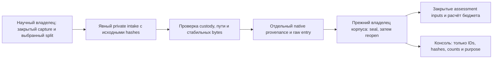

# Закрытый научный эталон из native capture

Дата: 2026-10-15. Кодовый срез RP01.01A/02A сохраняет уже полученный native reference без выдуманного backend паспорта. Результат native stream может содержать thread, runtime version, usage и raw artifacts, но не возвращать provider/model/version/server request ID. Прежний `PaidReferenceProvenance.CreateRawUtf8` требует все четыре known-model identity поля; его контракт не ослаблен. Новый `NativeCapturedReferenceProvenance` сохраняет неизвестные наблюдаемые поля как `null`, а requested alias/reasoning, CLI/runtime/capture boundary — отдельно.

Научный оператор подаёт split-specific private intake в [исполняемую команду и публичную схему](../../tools/Rp01NativeReferenceCorpus/README.md). `RepositoryOwnedNativeReferenceCorpusIntake.SealFromPrivateFile` проверяет trusted root, custody, no-reparse, стабильные bounded bytes и exact raw input hash. Затем `CreateNativeCapturedCodeDocumentation` связывает точные source/reference bytes с полным metadata preimage. Существующий corpus owner сохраняет payload и manifest без перезаписи; новое явное native schema ответвление строго восстанавливает и сравнивает все entries, canonical corpus, hashes и ordered IDs. Native ветка не вызывает общий `RepositoryOwnedTrainingArtifactCloneCustodyPreparer`: seal проверяет только свой native leaf и файлы, generic reopen определяет origin по bounded strict manifest/self hash до общей preparation. Полная native tuple/address и exact discovered manifest-file pin сверяются перед private handle read, чтобы смена origin не дала fallback. Небезопасные существующие native modes отказываются без исправления; другие artifact roots не обходятся. Valid legacy v1/v2 сохраняет прежнюю preparation, а missing/malformed manifest теперь отказывается до неё. После сохранения intake entry вызывает native-required `OpenSealedNativeCapture(address, expectedCorpusSha256, expectedPayloadSha256, expectedManifestSha256)` с фактическими seal pins. CLI `reopen` использует ту же операцию. Она проверяет полный native tuple/address и все ожидаемые pins по bounded strict manifest до core readback, передаёт exact discovered raw manifest-file hash и никогда не вызывает generic legacy preparation. Поэтому valid legacy replacement, unknown origin и pin mismatch отказываются до любых общих security effects. Отдельная команда `reopen` позволяет следующему процессу проверить те же pins.

Это детерминированная граница хранения, не обучаемый алгоритм. Capture metadata — утверждения доверенного оператора, а hashes — идентичность байтов. Они не создают backend attestation, права, admission, signed grant, Teacher passport или production approval. Factory фиксирует closed reference, never trainable и never DPO pair side; JSON не содержит переключателей этих ограничений.

Хороший путь: входной raw hash совпал, CRLF и decomposed Unicode пережили seal/reopen, requested Astra alias остаётся requested, отсутствующая backend version остаётся `null`. Плохой путь: известная CLI version выдана за model version, старый normalized hash выдан за raw commitment либо подменён capture member при старом inner canonical hash — отказ. Край: native origin смешан с known-model raw-v2, присутствуют два provenance members, испорчен UTF-8 или custody — отказ всего корпуса, без fallback и частичного принятия. Эти ограничения не подтверждают правдивость произвольных операторских assertions; falsifier этого среза — fake issuer identity или drift exact bytes/canonical metadata после owner reopen.

Живые consumers переиспользуются: `CodeDocumentationOneLessonCorpusSelection.OpenFresh` заново открывает весь корпус и сравнивает case IDs, `CodeDocumentationSavedModelAssessmentService.BuildCheckerPrompt` передаёт исходные task/reference strings, `CodeDocumentationSavedModelAssessmentCalibrationService.PlanCalibration` и `CodeDocumentationRepositoryOwnedDpoTrainingQualityGateService.PlanQualityGate` считают прежний бюджет. При 12 SEALED entries и canonical 5 repeats это 60 + 60 = 120 calls. Здесь они не выполняются. Legacy known-model teaching/selection и generic normalized calibration/pair контракты native origin не принимают; новые disclosure права этим срезом не выдаются.

Один синтетический owner check проверяет private intake/seal/reopen, raw content, missing identities, canonical metadata tampering и прежнюю v1/raw-v2 совместимость. Он не доказывает научное качество, native corpus execution, inference, DPO/LoRA update, публикацию или independent review. Следующий научный владелец приватно преобразует собственный capture в отдельный SEALED intake и запускает seal/new-process reopen; затем отдельно связывает protocol, actual scorer и бюджет. TRAIN/DEV остаются отдельными адресами и не попадают в SEALED. Teacher/Student algorithms, права и model admission этим изменением не меняются.
