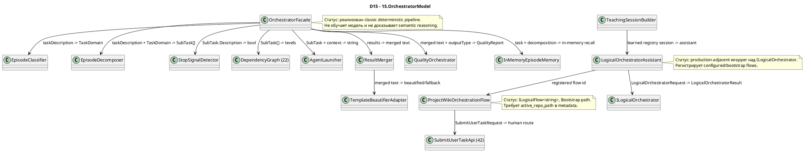

# 15.OrchestratorModel — документация реализации

Статус D4B: parent review passed. Тесты, сборка и runtime smoke не запускались в этой documentation subphase.

## 1. Что это такое человеческим языком

`15.OrchestratorModel` содержит две разные оркестрационные поверхности. Первая — классический deterministic pipeline `OrchestratorFacade`: он классифицирует пользовательскую задачу, режет ее на эпизоды, отбрасывает leaf-задачи, сортирует роли по зависимостям, запускает sub-agent через `22.AgentAlgorithms`, склеивает результат и делает простые quality checks. Вторая — logical surface `LogicalOrchestratorAssistant`: она подключает `ILogicalOrchestrator`, регистрирует flow-ы и маршрутизирует user request в T34, security verification, project wiki, translation routing или adaptive lifecycle flow.

Важно: текущий проект не является Level 5 `ILearningMachine` и не доказывает обученное orchestration reasoning сам по себе. В нем есть реальные runtime wrappers и deterministic/bootstrap/configured flows. `ProjectWikiOrchestrationFlow` честно оборачивает шесть Bootstrap units из `42.ProjectWikiDomain`; `LogicalOrchestratorAssistant.CreateDefault` регистрирует flows и trusted deterministic units, но сама регистрация topology или passing tests не равна обученной модели.

## 2. UML для draw.io



| Узел | Что делает | Статус | Где живет |
|---|---|---|---|
| `OrchestratorFacade` | Классический task pipeline от текста до merged answer. | Реализован deterministic pipeline | `15.OrchestratorModel/OrchestratorFacade.cs` |
| `EpisodeClassifier` | Вызывает `ISemanticCompiler29.Compile` и мапит domain/confidence. | Реализован | `15.OrchestratorModel/EpisodeClassifier.cs` |
| `EpisodeDecomposer` | Режет задачу по простым conjunction rules и ролям. | Реализован deterministic heuristic | `15.OrchestratorModel/EpisodeDecomposer.cs` |
| `StopSignalDetector` | Распознает четыре leaf/stop-сигнала. | Реализован deterministic heuristic | `15.OrchestratorModel/StopSignalDetector.cs` |
| `LogicalOrchestratorAssistant` | Оборачивает `ILogicalOrchestrator`, регистрирует flows, строит runtime result. | Реализован wrapper/configured flow boundary | `15.OrchestratorModel/Logical/LogicalOrchestratorAssistant.cs` |
| `ProjectWikiOrchestrationFlow` | Оборачивает Bootstrap project-wiki chain в `ILogicalFlow<string>`. | Bootstrap logical flow | `15.OrchestratorModel/Logical/ProjectWikiOrchestrationFlow.cs` |

## 3. Симуляции важных соединений

| Соединение | Пример входа | Что происходит | Ожидаемый результат | Что нельзя принимать за результат |
|---|---|---|---|---|
| `Facade -> Classifier` | `"Fix NullReference in UserService"` | `EpisodeClassifier.ClassifyWithConfidence` вызывает semantic compiler и мапит domain. | `TaskDomain.BUG` или safe fallback `CODE_Q`; confidence из compression ratio. | Не доказательство обученной domain model в D15. |
| `Facade -> Decomposer` | PLAN prompt: `"Design auth and implement and test and document"` | `EpisodeDecomposer.Decompose` split-ит по conjunctions и cap-ит count. | До 4 sub-tasks с ролями `planner/executor`. | Не полноценный планировщик задач. |
| `Facade -> StopSignalDetector` | `"First read requirements then decide approach"` | Stop detector видит phase-sequence и возвращает true. | Задача не дробится дальше; если все отфильтрованы, facade вернет все исходные sub-tasks. | Не semantic stop model. |
| `Facade -> AgentLauncher` | SubTask `implementer`, context from previous level | Launcher добавляет context и вызывает `AgentOrchestrator.RunAsync`. | Единый `AgentInfrastructure.OperationResult<string>`. | Не прямой IDE/host runtime proof. |
| `Merger -> TemplateBeautifierAdapter` | 2 results от разных ролей | Merger строит step headers, adapter пробует SC29 beautifier, fallback на raw text. | Beautified text или raw merged text. | Template match не равно обученная orchestration reasoning. |
| `Assistant -> ILogicalOrchestrator` | `RunAsync("Create design system tokens")` без explicit scenario | Assistant выбирает adaptive scenario, добавляет metadata и вызывает orchestrator. | `LogicalAssistantRunResult` с selected flow, verdict, metrics, evidence ids. | Нельзя считать это Level 5 model training. |
| `Assistant -> ProjectWikiOrchestrationFlow` | Flow id `project-wiki-orchestration-flow`, metadata `active_repo_path` | Flow строит `SubmitUserTaskRequest` и запускает Bootstrap units. | `LogicalFlowResult` с `ORCHESTRATED` или blocked missing root. | Bootstrap chain не доказывает trained project-wiki model. |
| `TeachingSessionBuilder -> Assistant` | `bundleId`, `checkpointRoot`, `snapshotPath` | Builder создает registries, грузит snapshot если есть, строит adaptive orchestrator. | `TeachingSession` с assistant/topology/flows/units. | Snapshot path не доказывает свежую загрузку обученного поведения без downstream evidence. |

## 4. Алгоритмы без кода на русском

### Алгоритм A: классический pipeline `OrchestratorFacade.ProcessAsync`

Аналогия: это диспетчер, который сначала определяет тип обращения, потом разбивает работу на карточки, расставляет карточки по порядку, отдает исполнителям и проверяет итог перед выдачей.

- Класс: `OrchestratorFacade`.
- Метод: `ProcessAsync(string taskDescription)`.
- Вход: строка task description, например `"Design deployment architecture and implement the service"`.
- Выход: `Task<OperationResult<string>>` с merged answer или error code: `EMPTY_TASK`, `CLASSIFY_FAILED`, `DECOMPOSE_FAILED`, `MERGE_FAILED`, `QUALITY_FAILED`.
- Шаги: validate non-empty; classify; decompose; filter stop tasks; fallback to all subtasks if filter removes everything; sort by `DependencyGraph`; launch each level with accumulated context; merge; infer output type; quality check; store episode in memory; return merged text.
- Ветки: classify/decompose/merge failure возвращают fail; dependency sort failure falls back to one level; failed sub-agent becomes `"[role failed]"`; quality fail blocks output.
- Не делает: не обучает маршрутизатор, не доказывает host runtime, не гарантирует semantic decomposition beyond deterministic heuristics.

`15.OrchestratorModel/OrchestratorFacade.cs:42-76`

```csharp
// Process a task end-to-end: classify → decompose → sort → launch → merge → quality check.
public async Task<OperationResult<string>> ProcessAsync(string taskDescription)
{
    if (string.IsNullOrWhiteSpace(taskDescription))
        return OperationResult<string>.Fail("Task description cannot be empty.", "EMPTY_TASK");

    // Step 1: classify the task domain.
    var classifyResult = _classifier.ClassifyWithConfidence(taskDescription);
    if (!classifyResult.IsSuccess)
        return OperationResult<string>.Fail(classifyResult.ErrorMessage, "CLASSIFY_FAILED");

    // Step 2: decompose into sub-episodes.
    var decompResult = _decomposer.Decompose(taskDescription, classifyResult.Value!.Domain);
    if (!decompResult.IsSuccess)
        return OperationResult<string>.Fail(decompResult.ErrorMessage, "DECOMPOSE_FAILED");

    // Step 3: filter out sub-tasks that should not be further decomposed.
    var subTasks = decompResult.Value!;
    // AgentInfrastructure.OperationResult<bool>.Value is T (not Nullable<T>) for value types —
    // cannot use ??. Check IsSuccess first; treat detection failure as "do not stop".
    var tasks    = subTasks
        .Where(t => {
            var stop = _stopDetector.ShouldStop(t.Description);
            return !(stop.IsSuccess && stop.Value!);
        })
        .ToList();

    // Fallback: if all tasks were filtered out, run all of them.
    if (tasks.Count == 0) tasks = subTasks.ToList();

    // Step 4: sort by dependency levels (E35 DependencyGraph).
    var sortResult    = _graph.Sort(tasks);
    var orderedLevels = sortResult.IsSuccess
```

Почему важно: эта цитата показывает реальные ветки pipeline, включая fail-fast и fallback после stop filtering.

### Алгоритм B: `EpisodeClassifier.ClassifyWithConfidence`

- Класс: `EpisodeClassifier`.
- Метод: `ClassifyWithConfidence(string taskDescription)`.
- Вход: строка task description.
- Выход: `OperationResult<(TaskDomain Domain, double Confidence)>`.
- Шаги: пустой input -> `EMPTY_TASK`; вызвать `ISemanticCompiler29.Compile(new PipelineInput(...))`; compile failure переносится как fail; `SemanticCompiler29.Domain` мапится в `TaskDomain`; unknown/default мапится в `CODE_Q`; confidence = `min(1.0, CompressionRatio / 20.0)`.
- Не делает: не вызывает low-level classifier напрямую и не обучает новую domain model.

`15.OrchestratorModel/EpisodeClassifier.cs:17-24`

```csharp
private static TaskDomain MapDomain(SC29.Domain d) => d switch
{
    SC29.Domain.BUG      => TaskDomain.BUG,
    SC29.Domain.PLAN     => TaskDomain.PLAN,
    SC29.Domain.ARCH     => TaskDomain.ARCH,
    SC29.Domain.REFACTOR => TaskDomain.REFACTOR,
    _                    => TaskDomain.CODE_Q, // CODE_Q + UNKNOWN → CODE_Q (safe default)
};
```

Почему важно: safe fallback в `CODE_Q` предотвращает наружный `UNKNOWN`, но это deterministic mapping, не learned routing.

### Алгоритм C: `EpisodeDecomposer.Decompose`

- Класс: `EpisodeDecomposer`.
- Метод: `Decompose(string taskDescription, TaskDomain domain)`.
- Вход: task text и `TaskDomain`.
- Выход: `OperationResult<IReadOnlyList<AgentAlgorithms.SubTask>>`.
- Шаги: пустой input -> `EMPTY_TASK`; выбрать target count по domain; split по `" and "`, `" then "`, `" after that "`; если правая часть начинается с false-conjunction verb (`find`, `check`, `read`, ...), оставить цель цельной; иначе создать `SubTask(description, role)` и обрезать до target count.
- Не делает: не понимает местоимения семантически; `log them` обработан списком verbs.

`15.OrchestratorModel/EpisodeDecomposer.cs:35-48`

```csharp
int targetCount = ExpectedSubEpisodes.GetValueOrDefault(domain, 2);
var parts       = SplitByConjunctions(taskDescription);

// Assign domain-appropriate roles and cap at target count.
var subTasks = parts
    .Take(targetCount)
    .Select((p, i) => new AgentAlgorithms.SubTask(p.Trim(), AssignRole(domain, i)))
    .ToList();

// Fallback: if split produced nothing, treat the whole description as one task.
if (subTasks.Count == 0)
    subTasks.Add(new AgentAlgorithms.SubTask(taskDescription, AssignRole(domain, 0)));

return OperationResult<IReadOnlyList<AgentAlgorithms.SubTask>>.Ok(subTasks);
```

Почему важно: показывает cap, role assignment и fallback как есть.

### Алгоритм D: `StopSignalDetector.ShouldStop`

- Класс: `StopSignalDetector`.
- Метод: `ShouldStop(string subTaskDescription)`.
- Вход: описание sub-task.
- Выход: `OperationResult<bool>`.
- Шаги: пустой input -> `EMPTY_TASK`; lowercase; проверить phase-sequence, technical context, single document/file, short no-loop leaf; если ни один сигнал не найден, вернуть false.
- Не делает: не определяет смысл задачи моделью; это набор rule checks.

`15.OrchestratorModel/StopSignalDetector.cs:21-50`

```csharp
// Signal 1 — PHASES: ordered steps that are not independent objectives.
bool isPhaseSequence =
    new[] { "then ", "next ", "after that", "first step", "step " }
    .Any(w => lower.Contains(w)) &&
    !lower.Contains("goal") && !lower.Contains("objective");
if (isPhaseSequence) return OperationResult<bool>.Ok(true);

// Signal 2 — TECH: sub-task requires technical stack context to resolve.
bool requiresTechContext =
    (lower.Contains("configure") && lower.Contains("service")) ||
    (lower.Contains("register") && lower.Contains("dependency")) ||
    (lower.Contains("inject")    && lower.Contains("interface"));
if (requiresTechContext) return OperationResult<bool>.Ok(true);

// Signal 3 — SINGLE_DOC: describes one atomic document or file.
bool isSingleDoc =
    lower.Contains("single ") ||
    lower.Contains("one document") ||
    lower.Contains("one file") ||
    lower.Contains("one-time");
if (isSingleDoc) return OperationResult<bool>.Ok(true);

// Signal 4 — NO_LOOP: short task with no iterative quality signal.
bool hasNoLoop =
    !lower.Contains("review")    && !lower.Contains("iterate") &&
    !lower.Contains("revise")    && !lower.Contains("feedback") &&
    !lower.Contains("correction");
// ≤ 4 words: short atomic leaf operation. 5+ words = substantive goal, keep it.
if (hasNoLoop && subTaskDescription.Split(' ').Length <= 4)
    return OperationResult<bool>.Ok(true);
```

Почему важно: это полный набор текущих stop branches; никакой скрытой semantic stop model здесь нет.

### Алгоритм E: `AgentLauncher.LaunchAsync`

- Класс: `AgentLauncher`.
- Метод: `LaunchAsync(AgentAlgorithms.SubTask task, string context)`.
- Вход: `SubTask(Description, RequiredRole)` и context из предыдущего уровня.
- Выход: `Task<OperationResult<string>>`.
- Шаги: пустое описание -> `EMPTY_TASK`; если context есть, добавить его к task description; вызвать `AgentAlgorithms.AgentOrchestrator.RunAsync`; сконвертировать `AgentAlgorithms.OperationResult<string>` в `AgentInfrastructure.OperationResult<string>`.
- Не делает: не создает remote agent и не доказывает IDE-host execution.

`15.OrchestratorModel/AgentLauncher.cs:21-35`

```csharp
if (string.IsNullOrWhiteSpace(task.Description))
    return OperationResult<string>.Fail(
        "Sub-task description cannot be empty.", "EMPTY_TASK");

// Append context from earlier pipeline levels so later agents benefit from prior work.
string enriched = string.IsNullOrWhiteSpace(context)
    ? task.Description
    : $"{task.Description}\n\nContext from earlier steps:\n{context}";

// AgentOrchestrator returns AgentAlgorithms.OperationResult<string> — convert to
// AgentInfrastructure.OperationResult<string> so the caller sees a uniform envelope.
var r = await _orchestrator.RunAsync(enriched);
return r.IsSuccess
    ? OperationResult<string>.Ok(r.Value!)
    : OperationResult<string>.Fail(r.ErrorMessage, r.ErrorCode);
```

Почему важно: цитата показывает context carry-forward и границу между assemblies.

### Алгоритм F: `ResultMerger.Merge` и `TemplateBeautifierAdapter.Beautify`

- Классы: `ResultMerger`, `TemplateBeautifierAdapter`.
- Методы: `Merge(IReadOnlyList<(SubTask Task, string Result)> results)`, `Beautify(string text)`.
- Вход: список task/result или merged text.
- Выход: `OperationResult<string>`.
- Шаги: пустой список -> `EMPTY_RESULTS`; один result возвращается без изменений; несколько results форматируются как `## Step N: role`; beautifier пробует template mapping; если mapping fail, merger возвращает raw merged text.
- Не делает: beautifier не является learned summarizer.

`15.OrchestratorModel/ResultMerger.cs:24-39`

```csharp
if (!results.Any())
    return OperationResult<string>.Fail("No results to merge.", "EMPTY_RESULTS");

// Single result — return without modification.
if (results.Count == 1)
    return OperationResult<string>.Ok(results[0].Result);

// Join results with step headers for readability.
var merged = string.Join("\n\n", results.Select((r, i) =>
    $"## Step {i + 1}: {r.Task.RequiredRole}\n{r.Result}"));

// Try template beautification; fall back to raw merged on no-match.
var beautifyResult = _beautifier.Beautify(merged);
return beautifyResult.IsSuccess
    ? beautifyResult
    : OperationResult<string>.Ok(merged);
```

Почему важно: fallback на raw text явно сохраняет deterministic/template boundary.

### Алгоритм G: `QualityOrchestrator.Check`

- Класс: `QualityOrchestrator`.
- Метод: `Check(string taskDescription, string result, string outputType)`.
- Вход: исходная задача, merged result, output type.
- Выход: `OperationResult<QualityReport>`.
- Шаги: пустой result -> `EMPTY_RESULT`; если длина меньше 10, fail `OUTPUT_CONTRACT`; если `CODE_SERVICE` и нет `"return"`, fail `TEST_GATE`; вернуть `QualityReport(Passed, FailedChecks)`.
- Не делает: несмотря на комментарии про 16 checks, текущая реализация реально исполняет только эти два checks.

`15.OrchestratorModel/QualityOrchestrator.cs:28-45`

```csharp
// Run checks and return a report. Passes when zero checks fail.
public OperationResult<QualityReport> Check(
    string taskDescription, string result, string outputType)
{
    if (string.IsNullOrWhiteSpace(result))
        return OperationResult<QualityReport>.Fail("Result cannot be empty.", "EMPTY_RESULT");

    var failed = new List<string>();

    // OUTPUT_CONTRACT: result must be substantive (> 10 characters).
    if (result.Length < 10)
        failed.Add("OUTPUT_CONTRACT");

    // TEST_GATE: code output must contain at least one return statement.
    if (outputType == "CODE_SERVICE" && !result.Contains("return"))
        failed.Add("TEST_GATE");

    return OperationResult<QualityReport>.Ok(new QualityReport(failed.Count == 0, failed));
}
```

Почему важно: это честно ограничивает quality claim; static check не доказывает product-quality.

### Алгоритм H: `LogicalOrchestratorAssistant.CreateDefault`

- Класс: `LogicalOrchestratorAssistant`.
- Метод: `CreateDefault(ISessionStorage storage)`.
- Вход: `ISessionStorage`.
- Выход: `OperationResult<LogicalOrchestratorAssistant>`.
- Шаги: validate storage; создать in-memory flow registry; зарегистрировать T34 и CB4 security flow; seed lifecycle topology; зарегистрировать project documentation, project wiki training, project wiki orchestration, translation routing; зарегистрировать trusted deterministic baseline units; создать `AdaptiveLogicalOrchestrator`; создать topology mutation flow; вернуть assistant.
- Ветки: любая registration/seed failure возвращает fail code.
- Не делает: не обучает эти flows при регистрации; `isLearned:false` для baseline units прямо показывает deterministic trust state.

`15.OrchestratorModel/Logical/LogicalOrchestratorAssistant.cs:149-186`

```csharp
// Create the prompt compiler and router used by the adaptive orchestrator.
var promptCompiler = new PromptRoutingInputCompilerUnit();
var router = new SubPhaseRouterUnit(topologyRegistry);
var multiRouter = new MultiSubPhaseRouterUnit(topologyRegistry, router);
var unitRegistry = new InMemoryLogicalUnitRegistry();

// Register deterministic prompt compiler and domain classifier as trusted baseline units.
var compilerUnitRegistration = unitRegistry.Register(
    PromptRoutingInputCompilerUnit.Id,
    PromptRoutingInputCompilerUnit.Role,
    PromptRoutingInputCompilerUnit.DomainTag,
    DefaultFlowVersion,
    LogicalUnitTrustState.Trusted,
    isLearned: false,
    promptCompiler);
if (!compilerUnitRegistration.IsSuccess)
    return OperationResult<LogicalOrchestratorAssistant>.Fail(compilerUnitRegistration.ErrorMessage, "UNIT_REGISTRATION_FAILED");

var domainClassifierRegistration = unitRegistry.Register(
    DomainClassifierUnit.Id,
    DomainClassifierUnit.Role,
    DomainClassifierUnit.DomainTag,
    DefaultFlowVersion,
    LogicalUnitTrustState.Trusted,
    isLearned: false,
    new DomainClassifierUnit());
if (!domainClassifierRegistration.IsSuccess)
    return OperationResult<LogicalOrchestratorAssistant>.Fail(domainClassifierRegistration.ErrorMessage, "UNIT_REGISTRATION_FAILED");

// Create the adaptive orchestrator from runtime registries, route units, and the default capability trainer.
var orchestrator = new AdaptiveLogicalOrchestrator(
    topologyRegistry,
    promptCompiler,
    router,
    registry,
    unitRegistry,
    multiRouter,
    capabilityTrainer: new DefaultLogicalCapabilityTrainer());
```

Почему важно: это источник hierarchy boundary: assistant wraps Level 4 orchestrator, but registered baseline units are deterministic, not learned.

### Алгоритм I: `LogicalOrchestratorAssistant.RunAsync`

- Класс: `LogicalOrchestratorAssistant`.
- Метод: `RunAsync(string userRequest, string? scenarioId = null, LogicalExecutionFlags? flags = null, IReadOnlyDictionary<string, object>? metadata = null, CancellationToken cancellationToken = default)`.
- Вход: user request, optional explicit scenario, flags, metadata.
- Выход: `OperationResult<LogicalAssistantRunResult>`.
- Шаги: cancellation/empty/orchestrator guards; если scenario explicit, использовать его; если нет, pre-route project-wiki request; для training/documentation routes проставить scenario; добавить metadata `source`, `default_scenario_id`, `scenario_selection_mode`; построить `LogicalOrchestratorRequest`; вызвать `_orchestrator.RunAsync`; переложить result в `LogicalAssistantRunResult`.
- Не делает: не отвечает сам без orchestrator; при `_orchestrator is null` честно возвращает `ORCHESTRATOR_NOT_CONFIGURED`.

`15.OrchestratorModel/Logical/LogicalOrchestratorAssistant.cs:207-241`

```csharp
// Run a user request through the logical orchestrator surface.
public async Task<OperationResult<LogicalAssistantRunResult>> RunAsync(
    string userRequest,
    string? scenarioId = null,
    LogicalExecutionFlags? flags = null,
    IReadOnlyDictionary<string, object>? metadata = null,
    CancellationToken cancellationToken = default)
{
    // Return cancellation through the project result envelope.
    if (cancellationToken.IsCancellationRequested)
        return OperationResult<LogicalAssistantRunResult>.Fail("Cancelled.", "CANCELLED");

    // Reject empty user requests before creating a logical run.
    if (string.IsNullOrWhiteSpace(userRequest))
        return OperationResult<LogicalAssistantRunResult>.Fail("User request cannot be empty.", "EMPTY_REQUEST");

    // Reject invalid construction before trying to execute a flow.
    if (_orchestrator is null)
        return OperationResult<LogicalAssistantRunResult>.Fail("Logical orchestrator is not configured.", "ORCHESTRATOR_NOT_CONFIGURED");

    // Use adaptive routing unless the caller supplies an explicit scenario id.
    var hasExplicitScenario = !string.IsNullOrWhiteSpace(scenarioId);
    var selectedScenarioId = hasExplicitScenario ? scenarioId! : AdaptiveLogicalOrchestrator.ScenarioId;
    ProjectWikiRequestRoutingDecision? projectWikiPreRoute = null;
    if (!hasExplicitScenario)
```

Почему важно: здесь видны guard branches и adaptive/explicit boundary.

### Алгоритм J: `ProjectWikiOrchestrationFlow.ExecuteAsync`

- Класс: `ProjectWikiOrchestrationFlow`.
- Интерфейс: `ILogicalFlow<string>`.
- Метод: `ExecuteAsync(LogicalFlowRequest<string> request, CancellationToken cancellationToken = default)`.
- Вход: `LogicalFlowRequest<string>`; prompt в `Input`, project roots в `Metadata`.
- Выход: `OperationResult<LogicalFlowResult>`.
- Шаги: cancellation/null/wrong flow id guards; прочитать `active_repo_path`; если missing, вернуть successful envelope с blocked `LogicalFlowResult`; собрать `SubmitUserTaskRequest`; вызвать `SubmitUserTaskApi.SubmitAsync`; failure map; собрать summary, metrics, evidence ids и final human route.
- Не делает: default path запускает Bootstrap units; trained unit replacement возможен архитектурно, но не доказан этим flow alone.

`15.OrchestratorModel/Logical/ProjectWikiOrchestrationFlow.cs:71-83`

```csharp
// Build the SubmitUserTaskRequest from the prompt string and project root metadata.
var taskRequest = new SubmitUserTaskRequest(
    UserPrompt: request.Input,
    ActiveProjectRoot: activeRepoPath,
    LinkedProjectRoots: linkedRepoPaths,
    UserFacingEntrypoint: entrypoint ?? "xiigen.orchestratePrompt");

// Run the six Bootstrap units through SubmitUserTaskApi.
var taskResult = await _submitUserTaskApi.SubmitAsync(taskRequest, cancellationToken);

// Return the unit-chain failure if any step failed.
if (!taskResult.IsSuccess)
    return taskResult.MapError<LogicalFlowResult>();
```

Почему важно: цитата доказывает реальную связь с `42.ProjectWikiDomain` и Bootstrap unit chain.

### Алгоритм K: `TeachingSessionBuilder.Open` и `TeachingSession.SaveSnapshot`

- Классы: `TeachingSessionBuilder`, `TeachingSession`.
- Методы: `Open(ISessionStorage storage, string bundleId, string checkpointRoot, string snapshotPath)`, `SaveSnapshot(int rowIndex)`.
- Вход: storage, bundle id, checkpoint root, snapshot path; row index for save.
- Выход: `OperationResult<TeachingSession>` или `OperationResult<string>` path/result save.
- Шаги: validate required strings; создать in-memory topology/flows/units; register base flows; seed lifecycle; load snapshot if present; load into registries; build adaptive orchestrator with `DefaultLogicalCapabilityTrainer(checkpointRoot)`; create topology mutation flow; return session. Save captures and persists registry snapshot.
- Не делает: не доказывает, что checkpoint quality улучшилась; snapshot/load path is registry state evidence, not full trained model evidence.

`15.OrchestratorModel/Logical/TeachingSessionBuilder.cs:73-86`

```csharp
var seed = DevelopmentLifecycleTopologySeeder.Seed(topology, flows, LogicalOrchestratorAssistant.DefaultFlowVersion);
if (!seed.IsSuccess)
    return OperationResult<TeachingSession>.Fail(seed.ErrorMessage, seed.ErrorCode);

var snapshot = TeachingRegistryPersistence.Load(snapshotPath);
if (!snapshot.IsSuccess)
    return OperationResult<TeachingSession>.Fail(snapshot.ErrorMessage, snapshot.ErrorCode);

if (snapshot.Value is not null)
{
    var load = TeachingRegistryPersistence.LoadIntoRegistries(snapshot.Value, topology, units, flows);
    if (!load.IsSuccess)
        return OperationResult<TeachingSession>.Fail(load.ErrorMessage, load.ErrorCode);
}
```

Почему важно: показывает actual bootstrap/load path и честную границу: это registries, не proof of product model.

### Алгоритм L: контрактный слой `Core`/`Fabric` и `NullSessionStorage`

- Классы/интерфейсы: `IEpisodeClassifier`, `IEpisodeDecomposer`, `IStopSignalDetector`, `IAgentLauncher`, `IResultMerger`, `IQualityOrchestrator`, `ITemplateBeautifier`, `NullSessionStorage`.
- Где живет логика: контракты в `15.OrchestratorModel/Core/Interfaces.cs` и `15.OrchestratorModel/Fabric/Interfaces.cs`; no-op storage в `15.OrchestratorModel/Core/NullSessionStorage.cs`.
- Вход: строки задач, `TaskDomain`, `AgentAlgorithms.SubTask`, context, merged result, output type, session id/state для storage.
- Выход: `OperationResult<T>` для классификации, декомпозиции, stop decision, agent launch result, merge/beautify, quality report и session storage.
- Шаги: core interfaces фиксируют форму классического pipeline; `IStopSignalDetector` принимает описание sub-task и возвращает deterministic `bool`; `IAgentLauncher` принимает `SubTask` и context и возвращает текстовый result; `IQualityOrchestrator` принимает task/result/output type и возвращает `QualityReport`; fabric interface отделяет `ResultMerger` от конкретного beautifier; `NullSessionStorage` сохраняет nothing, load всегда возвращает `NULL_STORAGE`, list возвращает пустой список.
- Не делает: интерфейс не доказывает реализацию сам по себе; `NullSessionStorage` не является persistence, runtime asset lifecycle, memory training или доказательством learned behavior.

`15.OrchestratorModel/Core/Interfaces.cs:12-25`

```csharp
public interface IEpisodeClassifier
{
    OperationResult<TaskDomain> Classify(string taskDescription);
    OperationResult<(TaskDomain Domain, double Confidence)> ClassifyWithConfidence(
        string taskDescription);
}

// Breaks a task into ordered sub-episodes.
// E32 +11%: PLAN → 4, ARCH → 3, REFACTOR → 3, BUG → 2, CODE_Q → 1.
public interface IEpisodeDecomposer
{
    OperationResult<IReadOnlyList<AgentAlgorithms.SubTask>> Decompose(
        string taskDescription, TaskDomain domain);
}
```

Почему важно: quote показывает реальные параметры и output DTO для двух первых contract boundaries, но не доказывает качество classifier/decomposer без implementing classes и tests.

`15.OrchestratorModel/Core/Interfaces.cs:27-37`

```csharp
// Four stop signals for decomposition (E33).
public interface IStopSignalDetector
{
    OperationResult<bool> ShouldStop(string subTaskDescription);
}

// Launches a sub-agent for one episode.
public interface IAgentLauncher
{
    Task<OperationResult<string>> LaunchAsync(AgentAlgorithms.SubTask task, string context);
}
```

Почему важно: `IStopSignalDetector` и `IAgentLauncher` показывают две service boundaries классического pipeline: rule-based остановку дальнейшего дробления и запуск sub-agent с накопленным контекстом. Это контракт deterministic orchestration service, не trained routing model.

`15.OrchestratorModel/Core/Interfaces.cs:56-65`

```csharp
// Runs 16 quality checks before delivering a result (E39 +20.2%).
public interface IQualityOrchestrator
{
    OperationResult<QualityReport> Check(
        string taskDescription, string result, string outputType);
}

// Quality report returned by IQualityOrchestrator.
// Passed=false when any check fails; FailedChecks lists the check codes.
public sealed record QualityReport(bool Passed, IReadOnlyList<string> FailedChecks);
```

Почему важно: `IQualityOrchestrator.Check` фиксирует параметры проверки перед выдачей результата и DTO `QualityReport`. Это quality gate contract, но не доказательство product quality, trained model quality или полного набора runtime проверок без реализации и executed evidence.

`15.OrchestratorModel/Fabric/Interfaces.cs:8-13`

```csharp
public interface ITemplateBeautifier
{
    // Beautify a merged result string. Returns TEMPLATE_NOT_FOUND when no mapping exists —
    // callers fall back to the raw text in that case.
    OperationResult<string> Beautify(string text);
}
```

Почему важно: fabric boundary делает beautifier заменяемым и явно разрешает fallback, но не превращает template beautification в semantic summarization.

`15.OrchestratorModel/Core/NullSessionStorage.cs:15-26`

```csharp
// No-op save — null storage discards all writes.
public Task<OperationResult<bool>> SaveAsync(string sessionId, AgentState state)
    => Task.FromResult(OperationResult<bool>.Ok(true));

// Always returns Fail — null storage never holds anything.
public Task<OperationResult<AgentState>> LoadAsync(string sessionId)
    => Task.FromResult(OperationResult<AgentState>.Fail("Not persisted.", "NULL_STORAGE"));

// Always returns an empty session list.
public Task<OperationResult<IReadOnlyList<string>>> ListSessionsAsync()
    => Task.FromResult(OperationResult<IReadOnlyList<string>>.Ok(
           (IReadOnlyList<string>)Array.Empty<string>()));
```

Почему важно: это честный null-object для тестов/классов без I/O. Он доказывает отсутствие persistence, а не наличие session lifecycle.

## 5. Иерархия `ILearningMachine` / `ILogical*`

```text
Уровень 5: ILearningMachine<TDomain>
  В D15 не реализован.
  Training/export/import живут за пределами `15.OrchestratorModel`.

Уровень 4: ILogicalOrchestrator
  Принимает: LogicalOrchestratorRequest(RunId, ScenarioId, UserRequest, Flags, Metadata)
  Возвращает: LogicalOrchestratorResult(ScenarioId, SelectedFlowId, OverallVerdict, FlowResult)
  Роль в D15: `LogicalOrchestratorAssistant` держит ссылку на orchestrator и вызывает `RunAsync`.

Уровень 3: ILogicalFlow<string>
  Принимает: LogicalFlowRequest<string> с prompt и metadata.
  Возвращает: LogicalFlowResult с FinalHumanResult, Metrics, EvidenceIds.
  Роль в D15: `ProjectWikiOrchestrationFlow` реализует этот уровень.

Уровень 2: ILogicalUnit<TInput,TOutput>
  В D15 напрямую не реализуется, но assistant регистрирует baseline units из соседних проектов.
  Важно: `PromptRoutingInputCompilerUnit` и `DomainClassifierUnit` регистрируются как `isLearned:false`.

Уровень 1: ILearningMachinePair<TPersonal,TGlobal>
  В D15 не реализован.
```

Execution chain:

```text
Host/test caller
  -> LogicalOrchestratorAssistant.RunAsync(...)
  -> LogicalOrchestratorRequest
  -> ILogicalOrchestrator.RunAsync(...)
  -> selected ILogicalFlow
  -> LogicalFlowResult
  -> LogicalAssistantRunResult
```

Граница обучения: D15 может подключать `DefaultLogicalCapabilityTrainer` через adaptive orchestrator/teaching session, но документируемый D15 сам не становится обученной машиной. Тренировочные claims требуют evidence из `18.CapabilityTraining`, `10.LoRA`/`11.DPO`, `25.ModelServer` и runner metrics, если такие claims делаются.

## 6. QA / test mapping

Тесты были прочитаны и замаплены, но не запускались в этой documentation subphase.

| Поведение | Evidence | Что доказывает | Что не доказывает |
|---|---|---|---|
| Episode memory store/recall/eviction | `Tests/OrchestratorModelTests.cs:17-54` | In-memory buffer stores, recalls by substring, evicts oldest. | Не persistent memory и не continuous learning. |
| Classifier fallback/confidence | `Tests/OrchestratorModelTests.cs:58-81` | UNKNOWN -> `CODE_Q`; low compression ratio gives low confidence. | Не доказывает trained classifier в D15. |
| Decomposer branches | `Tests/OrchestratorModelTests.cs:85-120` | PLAN cap 4; false conjunction stays one task; BUG first role debugger. | Не semantic decomposition. |
| Stop signals | `Tests/OrchestratorModelTests.cs:125-144` | phase sequence true; substantive goal false. | Не generalized stop reasoning. |
| DependencyGraph reuse and classic integration | `Tests/OrchestratorModelTests.cs:149-253` | dependency sorting and PLAN decomposition shape. | Full `ProcessAsync` with real agents is not run here. |
| Launcher/Merger/Quality | `Tests/OrchestratorModelTests.cs:170-235` | empty launcher fail, single merge unchanged, empty merge fail, quality short fail/code return pass. | Static checks only, not product quality. |
| Assistant default and T34 route | `Tests/LogicalOrchestratorAssistantTests.cs:10-41` | default assistant builds; explicit T34 flow returns expected verdict/metrics. | Not proof of trained orchestration model. |
| Adaptive security route | `Tests/LogicalOrchestratorAssistantTests.cs:236-248` | security prompt without scenario routes to 3.4 flow. | Route selection still configured/deterministic evidence. |
| Project wiki flow id/direct execute | `Tests/ProjectWikiOrchestrationFlowTests.cs:23-49` | flow id stable; direct flow can run with active project metadata. | Bootstrap flow quality depends on 42.ProjectWikiDomain behavior. |
| Lifecycle seeding/adaptive design prompt | `Tests/DevelopmentLifecycleTopologySeederTests.cs:135-148` | default assistant can route design prompt to universal nine-node flow. | Topology registration is not learned reasoning. |
| Project wiki assistant routing | `Tests/ProjectWikiDomainTests.cs:139-180` | explicit/adaptive documentation request route to project pipeline. | Not full trained local wiki model evidence. |

## 7. Статус реализации

| Компонент | Файл | Статус | Что реально работает сейчас |
|---|---|---|---|
| `OrchestratorFacade` | `15.OrchestratorModel/OrchestratorFacade.cs` | Реализован deterministic pipeline | `ProcessAsync` выполняет classify/decompose/stop/sort/launch/merge/quality/store. |
| `EpisodeClassifier` | `15.OrchestratorModel/EpisodeClassifier.cs` | Реализован | Использует `ISemanticCompiler29.Compile`, мапит domains и confidence. |
| `EpisodeDecomposer` | `15.OrchestratorModel/EpisodeDecomposer.cs` | Реализован heuristic | Split по conjunctions, target counts, role assignment. |
| `StopSignalDetector` | `15.OrchestratorModel/StopSignalDetector.cs` | Реализован heuristic | 4 rule-сигнала: phases, tech context, single doc, no-loop short leaf. |
| `AgentLauncher` | `15.OrchestratorModel/AgentLauncher.cs` | Реализован boundary | Добавляет context и вызывает `AgentOrchestrator.RunAsync`. |
| `ResultMerger` / `TemplateBeautifierAdapter` | `15.OrchestratorModel/ResultMerger.cs`, `15.OrchestratorModel/Adapters/TemplateBeautifierAdapter.cs` | Реализован with fallback | Single result raw, multi result formatted, template fallback raw. |
| `QualityOrchestrator` | `15.OrchestratorModel/QualityOrchestrator.cs` | Частичная проверка | Реально проверяет length и `return` для `CODE_SERVICE`, не все заявленные 16 checks. |
| `InMemoryEpisodeMemory` | `15.OrchestratorModel/Core/InMemoryEpisodeMemory.cs` | In-memory stub | Store/recall/evict only; no persistence. |
| `LogicalOrchestratorAssistant` | `15.OrchestratorModel/Logical/LogicalOrchestratorAssistant.cs` | Реализован wrapper | Builds default registries/flows, calls `ILogicalOrchestrator`, returns runtime-facing DTO. |
| `ProjectWikiOrchestrationFlow` | `15.OrchestratorModel/Logical/ProjectWikiOrchestrationFlow.cs` | Bootstrap `ILogicalFlow<string>` | Converts metadata + prompt to `SubmitUserTaskRequest`, returns `LogicalFlowResult`. |
| `TeachingSessionBuilder` | `15.OrchestratorModel/Logical/TeachingSessionBuilder.cs` | Registry/session infrastructure | Opens registries, loads snapshot, builds assistant, can save snapshot. |

## 8. Anti-false-done checks

- Нельзя называть `OrchestratorFacade` обученным reasoning: это deterministic pipeline плюс dependencies.
- `EpisodeDecomposer`, `StopSignalDetector`, `QualityOrchestrator` не должны прятаться как trainable decisions; это rules/checks.
- `TemplateBeautifierAdapter` и template fallback не являются semantic summarizer.
- `LogicalOrchestratorAssistant.CreateDefault` регистрирует topology/flows; регистрация сама по себе не доказывает learned reasoning.
- `ProjectWikiOrchestrationFlow` использует Bootstrap units через `SubmitUserTaskApi`; наличие `ORCHESTRATED` не является доказательством trained project-wiki model.
- Tests/static routing evidence не заменяют runtime trained model quality, checkpoint, manifest, locator, fresh-load или continue-training evidence.

Documentation status: draft pending parent review. Last verified against source: 2026-06-08. Known gaps: broad tests not run by this documentation subphase; trained-model claims intentionally not made.
