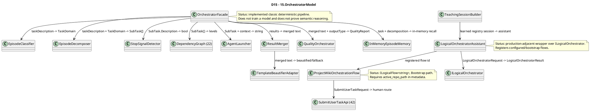

# 15.OrchestratorModel — implementation documentation

D4B status: parent review passed. Tests, build and runtime smoke were not run in this documentation subphase.

## 1. What this is in plain language

`15.OrchestratorModel` contains two different orchestration surfaces. The first is the classic deterministic pipeline `OrchestratorFacade`: it classifies the user task, splits it into episodes, discards leaf tasks, sorts roles by dependencies, launches a sub-agent via `22.AgentAlgorithms`, glues the result together and does simple quality checks. The second is the logical surface `LogicalOrchestratorAssistant`: it connects `ILogicalOrchestrator`, registers flows and routes a user request into T34, security verification, project wiki, translation routing or an adaptive lifecycle flow.

Important: the current project is not a Level 5 `ILearningMachine` and does not prove trained orchestration reasoning by itself. It has real runtime wrappers and deterministic/bootstrap/configured flows. `ProjectWikiOrchestrationFlow` honestly wraps six Bootstrap units from `42.ProjectWikiDomain`; `LogicalOrchestratorAssistant.CreateDefault` registers flows and trusted deterministic units, but the registration of topology or passing tests is not equal to a trained model.

## 2. UML for draw.io



| Node | What it does | Status | Where it lives |
|---|---|---|---|
| `OrchestratorFacade` | Classic task pipeline from text to merged answer. | Implemented deterministic pipeline | `15.OrchestratorModel/OrchestratorFacade.cs` |
| `EpisodeClassifier` | Calls `ISemanticCompiler29.Compile` and maps domain/confidence. | Implemented | `15.OrchestratorModel/EpisodeClassifier.cs` |
| `EpisodeDecomposer` | Splits the task by simple conjunction rules and roles. | Implemented deterministic heuristic | `15.OrchestratorModel/EpisodeDecomposer.cs` |
| `StopSignalDetector` | Recognizes four leaf/stop signals. | Implemented deterministic heuristic | `15.OrchestratorModel/StopSignalDetector.cs` |
| `LogicalOrchestratorAssistant` | Wraps `ILogicalOrchestrator`, registers flows, builds a runtime result. | Implemented wrapper/configured flow boundary | `15.OrchestratorModel/Logical/LogicalOrchestratorAssistant.cs` |
| `ProjectWikiOrchestrationFlow` | Wraps the Bootstrap project-wiki chain into `ILogicalFlow<string>`. | Bootstrap logical flow | `15.OrchestratorModel/Logical/ProjectWikiOrchestrationFlow.cs` |

## 3. Simulations of important connections

| Connection | Example input | What happens | Expected result | What must not be taken as a result |
|---|---|---|---|---|
| `Facade -> Classifier` | `"Fix NullReference in UserService"` | `EpisodeClassifier.ClassifyWithConfidence` calls the semantic compiler and maps the domain. | `TaskDomain.BUG` or the safe fallback `CODE_Q`; confidence from the compression ratio. | Not proof of a trained domain model in D15. |
| `Facade -> Decomposer` | PLAN prompt: `"Design auth and implement and test and document"` | `EpisodeDecomposer.Decompose` splits by conjunctions and caps the count. | Up to 4 sub-tasks with roles `planner/executor`. | Not a full task planner. |
| `Facade -> StopSignalDetector` | `"First read requirements then decide approach"` | The stop detector sees a phase-sequence and returns true. | The task is not split further; if all are filtered, the facade returns all the original sub-tasks. | Not a semantic stop model. |
| `Facade -> AgentLauncher` | SubTask `implementer`, context from the previous level | The launcher adds context and calls `AgentOrchestrator.RunAsync`. | A single `AgentInfrastructure.OperationResult<string>`. | Not a direct IDE/host runtime proof. |
| `Merger -> TemplateBeautifierAdapter` | 2 results from different roles | The merger builds step headers, the adapter tries the SC29 beautifier, falls back to raw text. | Beautified text or raw merged text. | A template match is not equal to trained orchestration reasoning. |
| `Assistant -> ILogicalOrchestrator` | `RunAsync("Create design system tokens")` without an explicit scenario | The assistant chooses an adaptive scenario, adds metadata and calls the orchestrator. | `LogicalAssistantRunResult` with the selected flow, verdict, metrics, evidence ids. | This must not be treated as Level 5 model training. |
| `Assistant -> ProjectWikiOrchestrationFlow` | Flow id `project-wiki-orchestration-flow`, metadata `active_repo_path` | The flow builds a `SubmitUserTaskRequest` and launches the Bootstrap units. | `LogicalFlowResult` with `ORCHESTRATED` or blocked missing root. | The Bootstrap chain does not prove a trained project-wiki model. |
| `TeachingSessionBuilder -> Assistant` | `bundleId`, `checkpointRoot`, `snapshotPath` | The builder creates registries, loads a snapshot if present, builds an adaptive orchestrator. | `TeachingSession` with assistant/topology/flows/units. | The snapshot path does not prove a fresh load of trained behavior without downstream evidence. |

## 4. No-code algorithms, in the operator's language

### Algorithm A: the classic pipeline `OrchestratorFacade.ProcessAsync`

Analogy: this is a dispatcher that first determines the type of request, then breaks the work into cards, orders the cards, hands them to executors and checks the result before delivery.

- Class: `OrchestratorFacade`.
- Method: `ProcessAsync(string taskDescription)`.
- Input: a task description string, for example `"Design deployment architecture and implement the service"`.
- Output: `Task<OperationResult<string>>` with a merged answer or an error code: `EMPTY_TASK`, `CLASSIFY_FAILED`, `DECOMPOSE_FAILED`, `MERGE_FAILED`, `QUALITY_FAILED`.
- Steps: validate non-empty; classify; decompose; filter stop tasks; fallback to all subtasks if filter removes everything; sort by `DependencyGraph`; launch each level with accumulated context; merge; infer output type; quality check; store episode in memory; return merged text.
- Branches: classify/decompose/merge failure returns fail; dependency sort failure falls back to one level; a failed sub-agent becomes `"[role failed]"`; a quality fail blocks output.
- Does not do: does not train the router, does not prove host runtime, does not guarantee semantic decomposition beyond deterministic heuristics.

`15.OrchestratorModel/OrchestratorFacade.cs:42-76`

```csharp
// Process a task end-to-end: classify → decompose → sort → launch → merge → quality check.
public async Task<OperationResult<string>> ProcessAsync(string taskDescription)
{
    if (string.IsNullOrWhiteSpace(taskDescription))
        return OperationResult<string>.Fail("Task description cannot be empty.", "EMPTY_TASK");

    // Step 1: classify the task domain.
    var classifyResult = _classifier.ClassifyWithConfidence(taskDescription);
    if (!classifyResult.IsSuccess)
        return OperationResult<string>.Fail(classifyResult.ErrorMessage, "CLASSIFY_FAILED");

    // Step 2: decompose into sub-episodes.
    var decompResult = _decomposer.Decompose(taskDescription, classifyResult.Value!.Domain);
    if (!decompResult.IsSuccess)
        return OperationResult<string>.Fail(decompResult.ErrorMessage, "DECOMPOSE_FAILED");

    // Step 3: filter out sub-tasks that should not be further decomposed.
    var subTasks = decompResult.Value!;
    // AgentInfrastructure.OperationResult<bool>.Value is T (not Nullable<T>) for value types —
    // cannot use ??. Check IsSuccess first; treat detection failure as "do not stop".
    var tasks    = subTasks
        .Where(t => {
            var stop = _stopDetector.ShouldStop(t.Description);
            return !(stop.IsSuccess && stop.Value!);
        })
        .ToList();

    // Fallback: if all tasks were filtered out, run all of them.
    if (tasks.Count == 0) tasks = subTasks.ToList();

    // Step 4: sort by dependency levels (E35 DependencyGraph).
    var sortResult    = _graph.Sort(tasks);
    var orderedLevels = sortResult.IsSuccess
```

Why it matters: this quote shows the real pipeline branches, including fail-fast and the fallback after stop filtering.

### Algorithm B: `EpisodeClassifier.ClassifyWithConfidence`

- Class: `EpisodeClassifier`.
- Method: `ClassifyWithConfidence(string taskDescription)`.
- Input: a task description string.
- Output: `OperationResult<(TaskDomain Domain, double Confidence)>`.
- Steps: empty input -> `EMPTY_TASK`; call `ISemanticCompiler29.Compile(new PipelineInput(...))`; a compile failure is propagated as a fail; `SemanticCompiler29.Domain` is mapped to `TaskDomain`; unknown/default is mapped to `CODE_Q`; confidence = `min(1.0, CompressionRatio / 20.0)`.
- Does not do: does not call the low-level classifier directly and does not train a new domain model.

`15.OrchestratorModel/EpisodeClassifier.cs:17-24`

```csharp
private static TaskDomain MapDomain(SC29.Domain d) => d switch
{
    SC29.Domain.BUG      => TaskDomain.BUG,
    SC29.Domain.PLAN     => TaskDomain.PLAN,
    SC29.Domain.ARCH     => TaskDomain.ARCH,
    SC29.Domain.REFACTOR => TaskDomain.REFACTOR,
    _                    => TaskDomain.CODE_Q, // CODE_Q + UNKNOWN → CODE_Q (safe default)
};
```

Why it matters: the safe fallback to `CODE_Q` prevents an outward `UNKNOWN`, but this is a deterministic mapping, not learned routing.

### Algorithm C: `EpisodeDecomposer.Decompose`

- Class: `EpisodeDecomposer`.
- Method: `Decompose(string taskDescription, TaskDomain domain)`.
- Input: task text and a `TaskDomain`.
- Output: `OperationResult<IReadOnlyList<AgentAlgorithms.SubTask>>`.
- Steps: empty input -> `EMPTY_TASK`; choose the target count by domain; split by `" and "`, `" then "`, `" after that "`; if the right part starts with a false-conjunction verb (`find`, `check`, `read`, ...), keep the goal whole; otherwise create a `SubTask(description, role)` and trim to the target count.
- Does not do: does not understand pronouns semantically; `log them` is handled by a list of verbs.

`15.OrchestratorModel/EpisodeDecomposer.cs:35-48`

```csharp
int targetCount = ExpectedSubEpisodes.GetValueOrDefault(domain, 2);
var parts       = SplitByConjunctions(taskDescription);

// Assign domain-appropriate roles and cap at target count.
var subTasks = parts
    .Take(targetCount)
    .Select((p, i) => new AgentAlgorithms.SubTask(p.Trim(), AssignRole(domain, i)))
    .ToList();

// Fallback: if split produced nothing, treat the whole description as one task.
if (subTasks.Count == 0)
    subTasks.Add(new AgentAlgorithms.SubTask(taskDescription, AssignRole(domain, 0)));

return OperationResult<IReadOnlyList<AgentAlgorithms.SubTask>>.Ok(subTasks);
```

Why it matters: shows the cap, role assignment and fallback as is.

### Algorithm D: `StopSignalDetector.ShouldStop`

- Class: `StopSignalDetector`.
- Method: `ShouldStop(string subTaskDescription)`.
- Input: a sub-task description.
- Output: `OperationResult<bool>`.
- Steps: empty input -> `EMPTY_TASK`; lowercase; check phase-sequence, technical context, single document/file, short no-loop leaf; if no signal is found, return false.
- Does not do: does not determine the meaning of the task with a model; this is a set of rule checks.

`15.OrchestratorModel/StopSignalDetector.cs:21-50`

```csharp
// Signal 1 — PHASES: ordered steps that are not independent objectives.
bool isPhaseSequence =
    new[] { "then ", "next ", "after that", "first step", "step " }
    .Any(w => lower.Contains(w)) &&
    !lower.Contains("goal") && !lower.Contains("objective");
if (isPhaseSequence) return OperationResult<bool>.Ok(true);

// Signal 2 — TECH: sub-task requires technical stack context to resolve.
bool requiresTechContext =
    (lower.Contains("configure") && lower.Contains("service")) ||
    (lower.Contains("register") && lower.Contains("dependency")) ||
    (lower.Contains("inject")    && lower.Contains("interface"));
if (requiresTechContext) return OperationResult<bool>.Ok(true);

// Signal 3 — SINGLE_DOC: describes one atomic document or file.
bool isSingleDoc =
    lower.Contains("single ") ||
    lower.Contains("one document") ||
    lower.Contains("one file") ||
    lower.Contains("one-time");
if (isSingleDoc) return OperationResult<bool>.Ok(true);

// Signal 4 — NO_LOOP: short task with no iterative quality signal.
bool hasNoLoop =
    !lower.Contains("review")    && !lower.Contains("iterate") &&
    !lower.Contains("revise")    && !lower.Contains("feedback") &&
    !lower.Contains("correction");
// ≤ 4 words: short atomic leaf operation. 5+ words = substantive goal, keep it.
if (hasNoLoop && subTaskDescription.Split(' ').Length <= 4)
    return OperationResult<bool>.Ok(true);
```

Why it matters: this is the full set of current stop branches; there is no hidden semantic stop model here.

### Algorithm E: `AgentLauncher.LaunchAsync`

- Class: `AgentLauncher`.
- Method: `LaunchAsync(AgentAlgorithms.SubTask task, string context)`.
- Input: `SubTask(Description, RequiredRole)` and context from the previous level.
- Output: `Task<OperationResult<string>>`.
- Steps: an empty description -> `EMPTY_TASK`; if there is context, append it to the task description; call `AgentAlgorithms.AgentOrchestrator.RunAsync`; convert `AgentAlgorithms.OperationResult<string>` into `AgentInfrastructure.OperationResult<string>`.
- Does not do: does not create a remote agent and does not prove IDE-host execution.

`15.OrchestratorModel/AgentLauncher.cs:21-35`

```csharp
if (string.IsNullOrWhiteSpace(task.Description))
    return OperationResult<string>.Fail(
        "Sub-task description cannot be empty.", "EMPTY_TASK");

// Append context from earlier pipeline levels so later agents benefit from prior work.
string enriched = string.IsNullOrWhiteSpace(context)
    ? task.Description
    : $"{task.Description}\n\nContext from earlier steps:\n{context}";

// AgentOrchestrator returns AgentAlgorithms.OperationResult<string> — convert to
// AgentInfrastructure.OperationResult<string> so the caller sees a uniform envelope.
var r = await _orchestrator.RunAsync(enriched);
return r.IsSuccess
    ? OperationResult<string>.Ok(r.Value!)
    : OperationResult<string>.Fail(r.ErrorMessage, r.ErrorCode);
```

Why it matters: the quote shows the context carry-forward and the boundary between assemblies.

### Algorithm F: `ResultMerger.Merge` and `TemplateBeautifierAdapter.Beautify`

- Classes: `ResultMerger`, `TemplateBeautifierAdapter`.
- Methods: `Merge(IReadOnlyList<(SubTask Task, string Result)> results)`, `Beautify(string text)`.
- Input: a list of task/result or merged text.
- Output: `OperationResult<string>`.
- Steps: an empty list -> `EMPTY_RESULTS`; a single result is returned unchanged; several results are formatted as `## Step N: role`; the beautifier tries a template mapping; if the mapping fails, the merger returns the raw merged text.
- Does not do: the beautifier is not a learned summarizer.

`15.OrchestratorModel/ResultMerger.cs:24-39`

```csharp
if (!results.Any())
    return OperationResult<string>.Fail("No results to merge.", "EMPTY_RESULTS");

// Single result — return without modification.
if (results.Count == 1)
    return OperationResult<string>.Ok(results[0].Result);

// Join results with step headers for readability.
var merged = string.Join("\n\n", results.Select((r, i) =>
    $"## Step {i + 1}: {r.Task.RequiredRole}\n{r.Result}"));

// Try template beautification; fall back to raw merged on no-match.
var beautifyResult = _beautifier.Beautify(merged);
return beautifyResult.IsSuccess
    ? beautifyResult
    : OperationResult<string>.Ok(merged);
```

Why it matters: the fallback to raw text explicitly preserves the deterministic/template boundary.

### Algorithm G: `QualityOrchestrator.Check`

- Class: `QualityOrchestrator`.
- Method: `Check(string taskDescription, string result, string outputType)`.
- Input: the original task, the merged result, the output type.
- Output: `OperationResult<QualityReport>`.
- Steps: an empty result -> `EMPTY_RESULT`; if the length is less than 10, fail `OUTPUT_CONTRACT`; if `CODE_SERVICE` and no `"return"`, fail `TEST_GATE`; return `QualityReport(Passed, FailedChecks)`.
- Does not do: despite comments about 16 checks, the current implementation actually executes only these two checks.

`15.OrchestratorModel/QualityOrchestrator.cs:28-45`

```csharp
// Run checks and return a report. Passes when zero checks fail.
public OperationResult<QualityReport> Check(
    string taskDescription, string result, string outputType)
{
    if (string.IsNullOrWhiteSpace(result))
        return OperationResult<QualityReport>.Fail("Result cannot be empty.", "EMPTY_RESULT");

    var failed = new List<string>();

    // OUTPUT_CONTRACT: result must be substantive (> 10 characters).
    if (result.Length < 10)
        failed.Add("OUTPUT_CONTRACT");

    // TEST_GATE: code output must contain at least one return statement.
    if (outputType == "CODE_SERVICE" && !result.Contains("return"))
        failed.Add("TEST_GATE");

    return OperationResult<QualityReport>.Ok(new QualityReport(failed.Count == 0, failed));
}
```

Why it matters: this honestly limits the quality claim; a static check does not prove product quality.

### Algorithm H: `LogicalOrchestratorAssistant.CreateDefault`

- Class: `LogicalOrchestratorAssistant`.
- Method: `CreateDefault(ISessionStorage storage)`.
- Input: `ISessionStorage`.
- Output: `OperationResult<LogicalOrchestratorAssistant>`.
- Steps: validate storage; create an in-memory flow registry; register the T34 and CB4 security flow; seed the lifecycle topology; register project documentation, project wiki training, project wiki orchestration, translation routing; register trusted deterministic baseline units; create an `AdaptiveLogicalOrchestrator`; create a topology mutation flow; return the assistant.
- Branches: any registration/seed failure returns a fail code.
- Does not do: does not train these flows at registration; `isLearned:false` for the baseline units directly shows a deterministic trust state.

`15.OrchestratorModel/Logical/LogicalOrchestratorAssistant.cs:149-186`

```csharp
// Create the prompt compiler and router used by the adaptive orchestrator.
var promptCompiler = new PromptRoutingInputCompilerUnit();
var router = new SubPhaseRouterUnit(topologyRegistry);
var multiRouter = new MultiSubPhaseRouterUnit(topologyRegistry, router);
var unitRegistry = new InMemoryLogicalUnitRegistry();

// Register deterministic prompt compiler and domain classifier as trusted baseline units.
var compilerUnitRegistration = unitRegistry.Register(
    PromptRoutingInputCompilerUnit.Id,
    PromptRoutingInputCompilerUnit.Role,
    PromptRoutingInputCompilerUnit.DomainTag,
    DefaultFlowVersion,
    LogicalUnitTrustState.Trusted,
    isLearned: false,
    promptCompiler);
if (!compilerUnitRegistration.IsSuccess)
    return OperationResult<LogicalOrchestratorAssistant>.Fail(compilerUnitRegistration.ErrorMessage, "UNIT_REGISTRATION_FAILED");

var domainClassifierRegistration = unitRegistry.Register(
    DomainClassifierUnit.Id,
    DomainClassifierUnit.Role,
    DomainClassifierUnit.DomainTag,
    DefaultFlowVersion,
    LogicalUnitTrustState.Trusted,
    isLearned: false,
    new DomainClassifierUnit());
if (!domainClassifierRegistration.IsSuccess)
    return OperationResult<LogicalOrchestratorAssistant>.Fail(domainClassifierRegistration.ErrorMessage, "UNIT_REGISTRATION_FAILED");

// Create the adaptive orchestrator from runtime registries, route units, and the default capability trainer.
var orchestrator = new AdaptiveLogicalOrchestrator(
    topologyRegistry,
    promptCompiler,
    router,
    registry,
    unitRegistry,
    multiRouter,
    capabilityTrainer: new DefaultLogicalCapabilityTrainer());
```

Why it matters: this is the source of the hierarchy boundary: the assistant wraps a Level 4 orchestrator, but the registered baseline units are deterministic, not learned.

### Algorithm I: `LogicalOrchestratorAssistant.RunAsync`

- Class: `LogicalOrchestratorAssistant`.
- Method: `RunAsync(string userRequest, string? scenarioId = null, LogicalExecutionFlags? flags = null, IReadOnlyDictionary<string, object>? metadata = null, CancellationToken cancellationToken = default)`.
- Input: user request, optional explicit scenario, flags, metadata.
- Output: `OperationResult<LogicalAssistantRunResult>`.
- Steps: cancellation/empty/orchestrator guards; if the scenario is explicit, use it; if not, pre-route a project-wiki request; for training/documentation routes set the scenario; add metadata `source`, `default_scenario_id`, `scenario_selection_mode`; build a `LogicalOrchestratorRequest`; call `_orchestrator.RunAsync`; translate the result into a `LogicalAssistantRunResult`.
- Does not do: does not answer itself without the orchestrator; when `_orchestrator is null` it honestly returns `ORCHESTRATOR_NOT_CONFIGURED`.

`15.OrchestratorModel/Logical/LogicalOrchestratorAssistant.cs:207-241`

```csharp
// Run a user request through the logical orchestrator surface.
public async Task<OperationResult<LogicalAssistantRunResult>> RunAsync(
    string userRequest,
    string? scenarioId = null,
    LogicalExecutionFlags? flags = null,
    IReadOnlyDictionary<string, object>? metadata = null,
    CancellationToken cancellationToken = default)
{
    // Return cancellation through the project result envelope.
    if (cancellationToken.IsCancellationRequested)
        return OperationResult<LogicalAssistantRunResult>.Fail("Cancelled.", "CANCELLED");

    // Reject empty user requests before creating a logical run.
    if (string.IsNullOrWhiteSpace(userRequest))
        return OperationResult<LogicalAssistantRunResult>.Fail("User request cannot be empty.", "EMPTY_REQUEST");

    // Reject invalid construction before trying to execute a flow.
    if (_orchestrator is null)
        return OperationResult<LogicalAssistantRunResult>.Fail("Logical orchestrator is not configured.", "ORCHESTRATOR_NOT_CONFIGURED");

    // Use adaptive routing unless the caller supplies an explicit scenario id.
    var hasExplicitScenario = !string.IsNullOrWhiteSpace(scenarioId);
    var selectedScenarioId = hasExplicitScenario ? scenarioId! : AdaptiveLogicalOrchestrator.ScenarioId;
    ProjectWikiRequestRoutingDecision? projectWikiPreRoute = null;
    if (!hasExplicitScenario)
```

Why it matters: here you can see the guard branches and the adaptive/explicit boundary.

### Algorithm J: `ProjectWikiOrchestrationFlow.ExecuteAsync`

- Class: `ProjectWikiOrchestrationFlow`.
- Interface: `ILogicalFlow<string>`.
- Method: `ExecuteAsync(LogicalFlowRequest<string> request, CancellationToken cancellationToken = default)`.
- Input: `LogicalFlowRequest<string>`; the prompt in `Input`, the project roots in `Metadata`.
- Output: `OperationResult<LogicalFlowResult>`.
- Steps: cancellation/null/wrong flow id guards; read `active_repo_path`; if missing, return a successful envelope with a blocked `LogicalFlowResult`; assemble a `SubmitUserTaskRequest`; call `SubmitUserTaskApi.SubmitAsync`; failure map; assemble summary, metrics, evidence ids and the final human route.
- Does not do: the default path launches the Bootstrap units; trained unit replacement is architecturally possible but not proven by this flow alone.

`15.OrchestratorModel/Logical/ProjectWikiOrchestrationFlow.cs:71-83`

```csharp
// Build the SubmitUserTaskRequest from the prompt string and project root metadata.
var taskRequest = new SubmitUserTaskRequest(
    UserPrompt: request.Input,
    ActiveProjectRoot: activeRepoPath,
    LinkedProjectRoots: linkedRepoPaths,
    UserFacingEntrypoint: entrypoint ?? "xiigen.orchestratePrompt");

// Run the six Bootstrap units through SubmitUserTaskApi.
var taskResult = await _submitUserTaskApi.SubmitAsync(taskRequest, cancellationToken);

// Return the unit-chain failure if any step failed.
if (!taskResult.IsSuccess)
    return taskResult.MapError<LogicalFlowResult>();
```

Why it matters: the quote proves the real connection to `42.ProjectWikiDomain` and the Bootstrap unit chain.

### Algorithm K: `TeachingSessionBuilder.Open` and `TeachingSession.SaveSnapshot`

- Classes: `TeachingSessionBuilder`, `TeachingSession`.
- Methods: `Open(ISessionStorage storage, string bundleId, string checkpointRoot, string snapshotPath)`, `SaveSnapshot(int rowIndex)`.
- Input: storage, bundle id, checkpoint root, snapshot path; row index for save.
- Output: `OperationResult<TeachingSession>` or `OperationResult<string>` path/result save.
- Steps: validate required strings; create in-memory topology/flows/units; register base flows; seed lifecycle; load snapshot if present; load into registries; build an adaptive orchestrator with `DefaultLogicalCapabilityTrainer(checkpointRoot)`; create a topology mutation flow; return the session. Save captures and persists the registry snapshot.
- Does not do: does not prove that the checkpoint quality improved; the snapshot/load path is registry state evidence, not full trained model evidence.

`15.OrchestratorModel/Logical/TeachingSessionBuilder.cs:73-86`

```csharp
var seed = DevelopmentLifecycleTopologySeeder.Seed(topology, flows, LogicalOrchestratorAssistant.DefaultFlowVersion);
if (!seed.IsSuccess)
    return OperationResult<TeachingSession>.Fail(seed.ErrorMessage, seed.ErrorCode);

var snapshot = TeachingRegistryPersistence.Load(snapshotPath);
if (!snapshot.IsSuccess)
    return OperationResult<TeachingSession>.Fail(snapshot.ErrorMessage, snapshot.ErrorCode);

if (snapshot.Value is not null)
{
    var load = TeachingRegistryPersistence.LoadIntoRegistries(snapshot.Value, topology, units, flows);
    if (!load.IsSuccess)
        return OperationResult<TeachingSession>.Fail(load.ErrorMessage, load.ErrorCode);
}
```

Why it matters: shows the actual bootstrap/load path and the honest boundary: this is registries, not proof of a product model.

### Algorithm L: the contract layer `Core`/`Fabric` and `NullSessionStorage`

- Classes/interfaces: `IEpisodeClassifier`, `IEpisodeDecomposer`, `IStopSignalDetector`, `IAgentLauncher`, `IResultMerger`, `IQualityOrchestrator`, `ITemplateBeautifier`, `NullSessionStorage`.
- Where the logic lives: the contracts in `15.OrchestratorModel/Core/Interfaces.cs` and `15.OrchestratorModel/Fabric/Interfaces.cs`; the no-op storage in `15.OrchestratorModel/Core/NullSessionStorage.cs`.
- Input: task strings, `TaskDomain`, `AgentAlgorithms.SubTask`, context, merged result, output type, session id/state for storage.
- Output: `OperationResult<T>` for classification, decomposition, stop decision, agent launch result, merge/beautify, quality report and session storage.
- Steps: the core interfaces fix the shape of the classic pipeline; `IStopSignalDetector` accepts a sub-task description and returns a deterministic `bool`; `IAgentLauncher` accepts a `SubTask` and context and returns a text result; `IQualityOrchestrator` accepts task/result/output type and returns a `QualityReport`; the fabric interface separates `ResultMerger` from a concrete beautifier; `NullSessionStorage` saves nothing, load always returns `NULL_STORAGE`, list returns an empty list.
- Does not do: an interface does not prove an implementation by itself; `NullSessionStorage` is not persistence, a runtime asset lifecycle, memory training or proof of learned behavior.

`15.OrchestratorModel/Core/Interfaces.cs:12-25`

```csharp
public interface IEpisodeClassifier
{
    OperationResult<TaskDomain> Classify(string taskDescription);
    OperationResult<(TaskDomain Domain, double Confidence)> ClassifyWithConfidence(
        string taskDescription);
}

// Breaks a task into ordered sub-episodes.
// E32 +11%: PLAN → 4, ARCH → 3, REFACTOR → 3, BUG → 2, CODE_Q → 1.
public interface IEpisodeDecomposer
{
    OperationResult<IReadOnlyList<AgentAlgorithms.SubTask>> Decompose(
        string taskDescription, TaskDomain domain);
}
```

Why it matters: the quote shows the real parameters and output DTO for the first two contract boundaries, but does not prove the quality of the classifier/decomposer without implementing classes and tests.

`15.OrchestratorModel/Core/Interfaces.cs:27-37`

```csharp
// Four stop signals for decomposition (E33).
public interface IStopSignalDetector
{
    OperationResult<bool> ShouldStop(string subTaskDescription);
}

// Launches a sub-agent for one episode.
public interface IAgentLauncher
{
    Task<OperationResult<string>> LaunchAsync(AgentAlgorithms.SubTask task, string context);
}
```

Why it matters: `IStopSignalDetector` and `IAgentLauncher` show two service boundaries of the classic pipeline: a rule-based stop to further splitting and the launch of a sub-agent with accumulated context. This is a contract for a deterministic orchestration service, not a trained routing model.

`15.OrchestratorModel/Core/Interfaces.cs:56-65`

```csharp
// Runs 16 quality checks before delivering a result (E39 +20.2%).
public interface IQualityOrchestrator
{
    OperationResult<QualityReport> Check(
        string taskDescription, string result, string outputType);
}

// Quality report returned by IQualityOrchestrator.
// Passed=false when any check fails; FailedChecks lists the check codes.
public sealed record QualityReport(bool Passed, IReadOnlyList<string> FailedChecks);
```

Why it matters: `IQualityOrchestrator.Check` fixes the check parameters before delivering the result and the `QualityReport` DTO. This is a quality gate contract, but not proof of product quality, trained model quality or a full set of runtime checks without an implementation and executed evidence.

`15.OrchestratorModel/Fabric/Interfaces.cs:8-13`

```csharp
public interface ITemplateBeautifier
{
    // Beautify a merged result string. Returns TEMPLATE_NOT_FOUND when no mapping exists —
    // callers fall back to the raw text in that case.
    OperationResult<string> Beautify(string text);
}
```

Why it matters: the fabric boundary makes the beautifier replaceable and explicitly allows a fallback, but does not turn template beautification into semantic summarization.

`15.OrchestratorModel/Core/NullSessionStorage.cs:15-26`

```csharp
// No-op save — null storage discards all writes.
public Task<OperationResult<bool>> SaveAsync(string sessionId, AgentState state)
    => Task.FromResult(OperationResult<bool>.Ok(true));

// Always returns Fail — null storage never holds anything.
public Task<OperationResult<AgentState>> LoadAsync(string sessionId)
    => Task.FromResult(OperationResult<AgentState>.Fail("Not persisted.", "NULL_STORAGE"));

// Always returns an empty session list.
public Task<OperationResult<IReadOnlyList<string>>> ListSessionsAsync()
    => Task.FromResult(OperationResult<IReadOnlyList<string>>.Ok(
           (IReadOnlyList<string>)Array.Empty<string>()));
```

Why it matters: this is an honest null-object for tests/classes without I/O. It proves the absence of persistence, not the presence of a session lifecycle.

## 5. `ILearningMachine` / `ILogical*` hierarchy

```text
Level 5: ILearningMachine<TDomain>
  Not implemented in D15.
  Training/export/import live outside `15.OrchestratorModel`.

Level 4: ILogicalOrchestrator
  Accepts: LogicalOrchestratorRequest(RunId, ScenarioId, UserRequest, Flags, Metadata)
  Returns: LogicalOrchestratorResult(ScenarioId, SelectedFlowId, OverallVerdict, FlowResult)
  Role in D15: `LogicalOrchestratorAssistant` holds a reference to the orchestrator and calls `RunAsync`.

Level 3: ILogicalFlow<string>
  Accepts: LogicalFlowRequest<string> with prompt and metadata.
  Returns: LogicalFlowResult with FinalHumanResult, Metrics, EvidenceIds.
  Role in D15: `ProjectWikiOrchestrationFlow` implements this level.

Level 2: ILogicalUnit<TInput,TOutput>
  Not implemented directly in D15, but the assistant registers baseline units from neighboring projects.
  Important: `PromptRoutingInputCompilerUnit` and `DomainClassifierUnit` are registered as `isLearned:false`.

Level 1: ILearningMachinePair<TPersonal,TGlobal>
  Not implemented in D15.
```

Execution chain:

```text
Host/test caller
  -> LogicalOrchestratorAssistant.RunAsync(...)
  -> LogicalOrchestratorRequest
  -> ILogicalOrchestrator.RunAsync(...)
  -> selected ILogicalFlow
  -> LogicalFlowResult
  -> LogicalAssistantRunResult
```

Training boundary: D15 can connect `DefaultLogicalCapabilityTrainer` via the adaptive orchestrator/teaching session, but the documented D15 itself does not become a trained machine. Training claims require evidence from `18.CapabilityTraining`, `10.LoRA`/`11.DPO`, `25.ModelServer` and runner metrics if such claims are made.

## 6. QA / test mapping

The tests were read and mapped, but not run in this documentation subphase.

| Behavior | Evidence | What it proves | What it does not prove |
|---|---|---|---|
| Episode memory store/recall/eviction | `Tests/OrchestratorModelTests.cs:17-54` | In-memory buffer stores, recalls by substring, evicts oldest. | Not persistent memory and not continuous learning. |
| Classifier fallback/confidence | `Tests/OrchestratorModelTests.cs:58-81` | UNKNOWN -> `CODE_Q`; low compression ratio gives low confidence. | Does not prove a trained classifier in D15. |
| Decomposer branches | `Tests/OrchestratorModelTests.cs:85-120` | PLAN cap 4; false conjunction stays one task; BUG first role debugger. | Not semantic decomposition. |
| Stop signals | `Tests/OrchestratorModelTests.cs:125-144` | phase sequence true; substantive goal false. | Not generalized stop reasoning. |
| DependencyGraph reuse and classic integration | `Tests/OrchestratorModelTests.cs:149-253` | dependency sorting and PLAN decomposition shape. | Full `ProcessAsync` with real agents is not run here. |
| Launcher/Merger/Quality | `Tests/OrchestratorModelTests.cs:170-235` | empty launcher fail, single merge unchanged, empty merge fail, quality short fail/code return pass. | Static checks only, not product quality. |
| Assistant default and T34 route | `Tests/LogicalOrchestratorAssistantTests.cs:10-41` | default assistant builds; explicit T34 flow returns expected verdict/metrics. | Not proof of a trained orchestration model. |
| Adaptive security route | `Tests/LogicalOrchestratorAssistantTests.cs:236-248` | security prompt without scenario routes to 3.4 flow. | Route selection is still configured/deterministic evidence. |
| Project wiki flow id/direct execute | `Tests/ProjectWikiOrchestrationFlowTests.cs:23-49` | flow id stable; direct flow can run with active project metadata. | Bootstrap flow quality depends on 42.ProjectWikiDomain behavior. |
| Lifecycle seeding/adaptive design prompt | `Tests/DevelopmentLifecycleTopologySeederTests.cs:135-148` | default assistant can route design prompt to universal nine-node flow. | Topology registration is not learned reasoning. |
| Project wiki assistant routing | `Tests/ProjectWikiDomainTests.cs:139-180` | explicit/adaptive documentation request route to project pipeline. | Not full trained local wiki model evidence. |

## 7. Implementation status

| Component | File | Status | What actually works now |
|---|---|---|---|
| `OrchestratorFacade` | `15.OrchestratorModel/OrchestratorFacade.cs` | Implemented deterministic pipeline | `ProcessAsync` performs classify/decompose/stop/sort/launch/merge/quality/store. |
| `EpisodeClassifier` | `15.OrchestratorModel/EpisodeClassifier.cs` | Implemented | Uses `ISemanticCompiler29.Compile`, maps domains and confidence. |
| `EpisodeDecomposer` | `15.OrchestratorModel/EpisodeDecomposer.cs` | Implemented heuristic | Split by conjunctions, target counts, role assignment. |
| `StopSignalDetector` | `15.OrchestratorModel/StopSignalDetector.cs` | Implemented heuristic | 4 rule signals: phases, tech context, single doc, no-loop short leaf. |
| `AgentLauncher` | `15.OrchestratorModel/AgentLauncher.cs` | Implemented boundary | Adds context and calls `AgentOrchestrator.RunAsync`. |
| `ResultMerger` / `TemplateBeautifierAdapter` | `15.OrchestratorModel/ResultMerger.cs`, `15.OrchestratorModel/Adapters/TemplateBeautifierAdapter.cs` | Implemented with fallback | Single result raw, multi result formatted, template fallback raw. |
| `QualityOrchestrator` | `15.OrchestratorModel/QualityOrchestrator.cs` | Partial check | Actually checks length and `return` for `CODE_SERVICE`, not all the claimed 16 checks. |
| `InMemoryEpisodeMemory` | `15.OrchestratorModel/Core/InMemoryEpisodeMemory.cs` | In-memory stub | Store/recall/evict only; no persistence. |
| `LogicalOrchestratorAssistant` | `15.OrchestratorModel/Logical/LogicalOrchestratorAssistant.cs` | Implemented wrapper | Builds default registries/flows, calls `ILogicalOrchestrator`, returns a runtime-facing DTO. |
| `ProjectWikiOrchestrationFlow` | `15.OrchestratorModel/Logical/ProjectWikiOrchestrationFlow.cs` | Bootstrap `ILogicalFlow<string>` | Converts metadata + prompt to `SubmitUserTaskRequest`, returns `LogicalFlowResult`. |
| `TeachingSessionBuilder` | `15.OrchestratorModel/Logical/TeachingSessionBuilder.cs` | Registry/session infrastructure | Opens registries, loads snapshot, builds assistant, can save snapshot. |

## 8. Anti-false-done checks

- You must not call `OrchestratorFacade` trained reasoning: it is a deterministic pipeline plus dependencies.
- `EpisodeDecomposer`, `StopSignalDetector`, `QualityOrchestrator` must not be hidden as trainable decisions; these are rules/checks.
- `TemplateBeautifierAdapter` and the template fallback are not a semantic summarizer.
- `LogicalOrchestratorAssistant.CreateDefault` registers topology/flows; registration by itself does not prove learned reasoning.
- `ProjectWikiOrchestrationFlow` uses Bootstrap units via `SubmitUserTaskApi`; the presence of `ORCHESTRATED` is not proof of a trained project-wiki model.
- Tests/static routing evidence do not replace runtime trained model quality, checkpoint, manifest, locator, fresh-load or continue-training evidence.

Documentation status: draft pending parent review. Last verified against source: 2026-06-08. Known gaps: broad tests not run by this documentation subphase; trained-model claims intentionally not made.
