# 16.AutonomousLearning - документация реализации

Статус D3E: parent review passed. Тесты и сборка не запускались в этой documentation subphase.

## 1. Короткая карта для Лубы

`16.AutonomousLearning` - это слой ночного/автоматического цикла обучения: он проверяет, можно ли тренироваться на машине, находит источники данных, оценивает доверие, подготавливает примеры, взвешивает классы, смешивает новые примеры со старым replay buffer и вызывает тренер. Это не самостоятельная обученная модель и не `ILearningMachine`: по прочитанным файлам в этом проекте нет реализации `ILearningMachine`, `ILogicalOrchestrator`, `ILogicalFlow`, `ILogicalUnit` или `ILearningMachinePair`.

Самая важная честная граница: `AutonomousLearningPipeline.RunAsync` действительно связывает шаги цикла и продвигает adapter только если enhanced accuracy выше baseline. Но реальное обучение зависит от внедрённого `AutonomousTrainer`, а тот делегирует в `IIncrementalTrainer` из `14.ContinuousLearning`. В текущих тестах pipeline использует stubs: `StubSystemMonitorAL`, `StubDataProviderAL`, `SequentialAccuracyAL`, `StubIncrementalTrainerAL`. Поэтому тесты доказывают проводку, ветки и anti-regression gate, но не доказывают реальный LoRA/DPO training, созданный checkpoint, fresh-load, continue-training или качество продуктовой модели.

## 2. UML для draw.io

```mermaid
classDiagram
    class AutonomousLearningPipeline {
      +RunAsync(string domain, CancellationToken ct) Task~OperationResult~CycleResult~~
    }
    class IdleDetector {
      +Check(SystemStatus status) OperationResult~IdleDetectorResult~
    }
    class ISystemMonitor {
      +Sample() OperationResult~SystemStatus~
    }
    class ITrainingDataProvider {
      +CollectAsync(string domain, CancellationToken ct) Task~OperationResult~IReadOnlyList~TrainingExample~~~~
    }
    class DataSourceFinder {
      +Find() OperationResult~IReadOnlyList~SourceEntry~~
    }
    class TrustScorer {
      +Score(SourceFeatures features) OperationResult~TrustScorerOutput~
      +Score(CoreSourceFeatures features) OperationResult~CoreTrustScorerOutput~
    }
    class DatasetPreprocessor {
      +Process(string rawText, SourceEntry source) OperationResult~TrainingExample~
    }
    class DatasetWeighter {
      +ComputeMaxWeight(int totalExamples, int numClasses, int rareExamples) double
      +Weight(IReadOnlyList~TrainingExample~ examples, int numClasses, int rareExamples) OperationResult~IReadOnlyList~TrainingExample~~
    }
    class AutonomousTrainer {
      +TrainAsync(string domain, IReadOnlyList~TrainingExample~ newExamples, IReadOnlyList~DpoPair~ dpoPairs) Task~OperationResult~string~~
    }
    class ReplayBuffer {
      +Add(TrainingExample example) void
      +Sample(IReadOnlyList~TrainingExample~ newExamples) IReadOnlyList~TrainingExample~
    }
    class IIncrementalTrainer
    class IDomainModelRegistry
    class IAccuracyEvaluator

    AutonomousLearningPipeline --> ISystemMonitor : sample SystemStatus
    AutonomousLearningPipeline --> IdleDetector : gate before training
    AutonomousLearningPipeline --> ITrainingDataProvider : collect examples
    ITrainingDataProvider ..> DataSourceFinder : intended source discovery
    ITrainingDataProvider ..> TrustScorer : intended trust score
    ITrainingDataProvider ..> DatasetPreprocessor : intended labeling
    AutonomousLearningPipeline --> DatasetWeighter : class weighting
    AutonomousLearningPipeline --> AutonomousTrainer : train attempt
    AutonomousTrainer --> ReplayBuffer : replay mix
    AutonomousTrainer --> IIncrementalTrainer : delegated adapter training
    AutonomousLearningPipeline --> IAccuracyEvaluator : before/after scoring
    AutonomousLearningPipeline --> IDomainModelRegistry : promote improved adapter

    note for AutonomousLearningPipeline "ЧАСТИЧНАЯ: связывает 8-step cycle, accuracy gate и registry promotion; real model evidence зависит от injected services"
    note for IdleDetector "ПОЛНАЯ deterministic guard: CPU, input idle, battery, disk"
    note for ITrainingDataProvider "КОНТРАКТ: в тестах stub; реальный fetch/label provider не доказан этим документом"
    note for AutonomousTrainer "ЧАСТИЧНАЯ: min examples, replay mix, delegation; сам не считает gradients"
    note for ReplayBuffer "ПОЛНАЯ deterministic replay memory: 70/30 sample и capacity cap"
```



### Легенда компонентов

| Компонент | Что делает | Статус |
|---|---|---|
| `AutonomousLearningPipeline` | Оркестрирует idle gate, collect, weighting, training, evaluation, promotion | Частичная orchestration |
| `IdleDetector` | Проверяет четыре условия безопасности перед обучением | Полная deterministic guard |
| `DataSourceFinder` | Возвращает configured/default .NET sources или `EMPTY_CONFIG` | Полная source-list utility |
| `TrustScorer` | Считает weighted trust score и переводит его в Low/Medium/High | Полная deterministic scorer |
| `DatasetPreprocessor` | Фильтрует empty/low trust, вызывает SemanticCompiler до normalize, кладёт example в cache | Частичная preprocessing infrastructure |
| `DatasetWeighter` | Применяет формулу D-09 для max weight | Полная deterministic math utility |
| `ReplayBuffer` | Хранит old examples, ограничивает capacity, добавляет replay к new examples | Полная deterministic/randomized utility |
| `AutonomousTrainer` | Проверяет min examples, смешивает replay, делегирует training в `IIncrementalTrainer` | Частичная trainer wrapper |

### Симуляции важных связей

| Связь | Пример входа | Что происходит | Ожидаемый результат | Что не доказывает |
|---|---|---|---|---|
| `ISystemMonitor -> IdleDetector` | `Cpu=80`, остальные поля safe | `IdleDetector.Check` первым видит high CPU | `SYSTEM_ACTIVE` в pipeline | Не доказывает training |
| `IdleDetector -> Pipeline` | `Cpu=10`, idle 20 min, charging, battery 80, disk 10 | Все guard проходят | Pipeline идёт к evaluator/data provider | Не доказывает, что машина реально была idle в production |
| `Pipeline -> ITrainingDataProvider` | `domain="CODE_Q"` | Вызывает `CollectAsync(domain, ct)` | Возвращает examples или `COLLECTION_FAILED` | Stub provider в тестах не доказывает network fetch |
| `Provider -> DatasetPreprocessor` | raw C# text + High trust source | `Process` вызывает compiler before normalize | `TrainingExample` с domain из compiler | Не доказывает качество разметки на большом корпусе |
| `Pipeline -> DatasetWeighter` | 10 examples, 1 domain, rare=10 | Weight formula применяется, если counts > 0 | weighted examples или fallback raw examples | Не доказывает accuracy gain |
| `Pipeline -> AutonomousTrainer` | 10 examples | Trainer проверяет минимум 5, mixed batch, вызывает `IIncrementalTrainer` | adapter path string | Path string не доказывает файл/checkpoint |
| `AutonomousTrainer -> ReplayBuffer` | 7 new + 10 old | `Sample` добавляет примерно 3 old | batch 10 total | Не доказывает semantic diversity |
| `Pipeline -> IAccuracyEvaluator` | baseline 0.50, enhanced 0.75 | Сравнивает after > before | adapter регистрируется | Stub evaluator не доказывает real LoRA scoring |
| `Pipeline -> IDomainModelRegistry` | enhanced <= baseline | Register не вызывается | fail `ACCURACY_NOT_IMPROVED` | Не доказывает asset lifecycle |

## 3. Алгоритмы без кода

### Алгоритм A: idle gate перед обучением

| Поле | Значение |
|---|---|
| Класс | `IdleDetector` |
| Метод | `Check(SystemStatus status)` |
| Файл | `16.AutonomousLearning/IdleDetector/IdleDetector.cs:41` |
| Вход | `SystemStatus(CpuPercent, InputIdleMinutes, IsCharging, BatteryPercent, DiskFreeGb)` |
| Выход | `OperationResult<IdleDetectorResult>` |

Шаги: CPU >= 20 сразу даёт `WaitHighCpu`; input idle меньше 10 минут даёт `WaitRecentInput`; battery ниже 50 и не charging даёт `WaitLowBattery`; disk ниже 2 GB даёт `WaitLowDisk`; только если все четыре условия прошли, возвращается `SafeToTrain`.

Не делает: не измеряет OS сам, не запускает обучение, не доказывает availability GPU/CPU/RAM beyond these fields.

### Алгоритм B: поиск источников данных

| Поле | Значение |
|---|---|
| Класс | `DataSourceFinder` |
| Метод | `Find()` |
| Файл | `16.AutonomousLearning/DataSourceFinder/DataSourceFinder.cs:43` |
| Вход | configured `IReadOnlyList<SourceEntry>?` из constructor |
| Выход | `OperationResult<IReadOnlyList<SourceEntry>>` |

Шаги: если constructor получил `null`, используется `DefaultSources`; если список пустой, `Find` возвращает fail `EMPTY_CONFIG`; иначе возвращает configured list как есть.

Не делает: не скачивает GitHub/docs content, не проверяет CI live, не валидирует freshness источника.

### Алгоритм C: trust scoring

| Поле | Значение |
|---|---|
| Класс | `TrustScorer` |
| Метод | `Score(SourceFeatures features)` и `Score(CoreSourceFeatures features)` |
| Файл | `16.AutonomousLearning/TrustScorer/TrustScorer.cs:37`, `16.AutonomousLearning/TrustScorer/TrustScorer.cs:59` |
| Вход | flags: internal, CI, tests, update days, popularity, official docs, domain match |
| Выход | score 0..1 + trust level |

Шаги: добавляет веса за internal/CI/tests/official docs/domain match, добавляет popularity contribution, вычитает stale-days penalty, clamped score переводит в High при >= 0.70, Medium при >= 0.30, иначе Low.

Не делает: это weighted deterministic score, не K-NN model training и не semantic truth authority.

### Алгоритм D: preprocessing одного raw source

| Поле | Значение |
|---|---|
| Класс | `DatasetPreprocessor` |
| Метод | `Process(string rawText, SourceEntry source)` |
| Файл | `16.AutonomousLearning/Preprocessing/DatasetPreprocessor.cs:40` |
| Вход | raw text и `SourceEntry(Url, Tier, Trust)` |
| Выход | `OperationResult<TrainingExample>` |

Шаги: empty text даёт `EMPTY_TEXT`; Low trust source даёт `LOW_TRUST_SOURCE`; затем `ISemanticCompiler29.Compile` вызывается до normalize; compiler fail даёт `COMPILER_FAILED`; domain берётся из compiler output; text trim/CRLF normalization делается после domain detection; `TrainingExample` добавляется в `IDomainDatasetCache`, но cache failure не блокирует success.

Не делает: не гарантирует balanced dataset, не скачивает source, не доказывает training.

### Алгоритм E: class imbalance weighting

| Поле | Значение |
|---|---|
| Класс | `DatasetWeighter` |
| Метод | `ComputeMaxWeight(int totalExamples, int numClasses, int rareExamples)` и `Weight(...)` |
| Файл | `16.AutonomousLearning/Preprocessing/DatasetWeighter.cs:21`, `16.AutonomousLearning/Preprocessing/DatasetWeighter.cs:37` |
| Вход | examples, class count, rare example count |
| Выход | weighted examples или fail `ZERO_RARE` |

Шаги: static formula возвращает `1.0` для zero rare/classes; иначе считает `totalExamples / (numClasses * rareExamples)`. Instance `Weight` строже: `rareExamples <= 0` возвращает `ZERO_RARE`; иначе умножает example weight и clamps to maxWeight.

Не делает: не доказывает, что weighted examples улучшили модель.

### Алгоритм F: replay buffer

| Поле | Значение |
|---|---|
| Класс | `ReplayBuffer` |
| Метод | `Add(TrainingExample example)`, `Sample(IReadOnlyList<TrainingExample> newExamples)` |
| Файл | `16.AutonomousLearning/Training/ReplayBuffer.cs:27`, `16.AutonomousLearning/Training/ReplayBuffer.cs:34` |
| Вход | new examples, old buffer examples |
| Выход | mixed list |

Шаги: `Add` кладёт example и обрезает старейшие элементы выше capacity. `Sample` при пустом buffer возвращает new examples; иначе считает replay count через ratio 0.3/(1-0.3), случайно переставляет indices и добавляет выбранные old examples после new examples.

Не делает: не проверяет semantic usefulness old examples, не гарантирует deterministic output без seed.

### Алгоритм G: autonomous trainer wrapper

| Поле | Значение |
|---|---|
| Класс | `AutonomousTrainer` |
| Метод | `TrainAsync(string domain, IReadOnlyList<TrainingExample> newExamples, IReadOnlyList<DpoPair> dpoPairs)` |
| Файл | `16.AutonomousLearning/Training/AutonomousTrainer.cs:44` |
| Вход | domain, new examples, DPO pairs |
| Выход | `Task<OperationResult<string>>` adapter path |

Шаги: меньше 5 examples возвращает `INSUFFICIENT_EXAMPLES`; затем берёт mixed batch из `ReplayBuffer.Sample`; вызывает injected `IIncrementalTrainer.TrainAsync`; при fail не обновляет replay buffer; при success добавляет только new examples в buffer и возвращает adapter path.

Не делает: сам не выполняет gradients, LoRA или DPO; это wrapper над `IIncrementalTrainer`.

### Алгоритм H: полный autonomous cycle

| Поле | Значение |
|---|---|
| Класс | `AutonomousLearningPipeline` |
| Метод | `RunAsync(string domain, CancellationToken ct = default)` |
| Файл | `16.AutonomousLearning/Pipeline/AutonomousLearningPipeline.cs:67` |
| Вход | domain + cancellation token |
| Выход | `Task<OperationResult<CycleResult>>` |

Шаги: sample system status; block if not idle; evaluate baseline; collect examples; compute domain/rare counts; weight examples when possible; train through `AutonomousTrainer`; build candidate `ModelAdapter`; evaluate enhanced accuracy; fail `ACCURACY_NOT_IMPROVED` if enhanced <= baseline; otherwise register adapter and return `CycleResult`.

Не делает: не создаёт manifest/locator/fresh-load/continue-training evidence; не проверяет existence of adapter file; tests use stubs for provider/evaluator/trainer.

### Контрактный слой `Core/Interfaces.cs`

`Core/Interfaces.cs` задает DTO и интерфейсы, через которые pipeline получает состояние машины, источники, данные для обучения и оценку качества. Это важный слой контракта: он показывает, какие данные должны входить и выходить из 16.AutonomousLearning, но сам по себе не выполняет обучение, не создает checkpoint, не подключает LoRA/DPO adapter, не доказывает fresh-load и не является доказательством продуктовой модели.

`16.AutonomousLearning/Core/Interfaces.cs:7-12`
```csharp
public sealed record SystemStatus(
    double CpuPercent,        // CPU utilisation percentage, 0-100
    double InputIdleMinutes,  // Minutes since the last keyboard or mouse event
    bool   IsCharging,        // true when AC power is connected
    double BatteryPercent,    // Battery level percentage, 0-100
    double DiskFreeGb);       // Free disk space in gigabytes on the training volume
```
`SystemStatus` доказывает форму снимка ресурсов для idle-gate. Он не доказывает, что snapshot был снят с реальной машины в конкретном прогоне.

`16.AutonomousLearning/Core/Interfaces.cs:20-24`
```csharp
public sealed record SourceEntry(
    string     Url,   // Full URL of the source (GitHub, docs.microsoft.com, etc.)
    int        Tier,  // Collection tier: 1=highest trust, 2=medium, 3=lower
    TrustLevel Trust  // E40V2 trust level assigned after K-NN scoring
);
```
`SourceEntry` фиксирует форму найденного источника: URL, tier и trust. Он не доказывает, что источник был реально скачан, очищен и превращен в обучающие примеры.

`16.AutonomousLearning/Core/Interfaces.cs:28-32`
```csharp
public interface ISystemMonitor
{
    // Return a single point-in-time snapshot of the machine state.
    OperationResult<SystemStatus> Sample();
}
```
`ISystemMonitor.Sample()` является границей для получения `SystemStatus`; реализация или тестовый stub должны поставлять фактическое значение.

`16.AutonomousLearning/Core/Interfaces.cs:55-61`
```csharp
public interface ITrainingDataProvider
{
    // Collect and label examples for the given domain from all configured sources.
    // Returns Fail when collection produces zero usable examples.
    Task<OperationResult<IReadOnlyList<ContinuousLearning.TrainingExample>>> CollectAsync(
        string domain, CancellationToken ct);
}
```
`ITrainingDataProvider.CollectAsync(domain, ct)` описывает контракт сбора примеров для домена. Этот интерфейс не является доказательством, что датасет действительно собран или пригоден для обучения.

`16.AutonomousLearning/Core/Interfaces.cs:66-71`
```csharp
public interface IAccuracyEvaluator
{
    // Score the current adapter for the given domain against the reference test set.
    // Returns a value in [0, 1] where 1.0 = perfect accuracy.
    OperationResult<double> Evaluate(string domain);
}
```
`IAccuracyEvaluator.Evaluate(domain)` возвращает числовую оценку, но контракт не доказывает качество модели без реального evaluator, набора проверки и сохраненного отчета прогона.

`16.AutonomousLearning/Core/Interfaces.cs:75-80`
```csharp
public sealed record CycleResult(
    double BaselineAccuracy,  // Model accuracy measured BEFORE this training cycle
    double EnhancedAccuracy,  // Model accuracy measured AFTER this training cycle
    string AdapterPath,       // Relative path to the saved LoRA adapter file
    int    ExamplesProcessed  // Count of examples used in the training batch
);
```
`CycleResult` описывает итог цикла: baseline, enhanced, путь adapter и количество примеров. Это формат результата, а не доказательство, что adapter существует на диске, свежо загружается, подключен к runtime или улучшает продуктовую модель.

**Честная граница:** contracts/stubs are not runtime training evidence. Наличие этих DTO и интерфейсов не заменяет runtime training, checkpoint, adapter artifact, fresh-load проверку или product model evidence.

## 4. Короткие цитаты из кода

Файл `16.AutonomousLearning/IdleDetector/IdleDetector.cs:44-45`:

```csharp
if (status.CpuPercent >= CpuThreshold)
    return OperationResult<IdleDetectorResult>.Ok(IdleDetectorResult.WaitHighCpu);
```

Почему важно: первая blocking branch не допускает training при active CPU. Это доказывает guard, но не training.

Файл `16.AutonomousLearning/DataSourceFinder/DataSourceFinder.cs:43-52`:

```csharp
public OperationResult<IReadOnlyList<SourceEntry>> Find()
{
    // Guard: a completely empty source list is a configuration error, not a valid result.
    if (_configured.Count == 0)
        return OperationResult<IReadOnlyList<SourceEntry>>.Fail(
            "No data sources configured. Provide at least one SourceEntry or use DefaultSources.",
            "EMPTY_CONFIG");

    // Return the full configured list — callers filter by Tier and TrustLevel as needed.
    return OperationResult<IReadOnlyList<SourceEntry>>.Ok(_configured);
```

Почему важно: цитата показывает обе ветки `Find()`: пустая конфигурация дает `EMPTY_CONFIG`, иначе возвращается configured/default list через `Ok(_configured)`. Это не доказывает live download, fetch или freshness источников.

Файл `16.AutonomousLearning/Training/ReplayBuffer.cs:34-40`:

```csharp
public IReadOnlyList<TrainingExample> Sample(IReadOnlyList<TrainingExample> newExamples)
{
    if (_buffer.Count == 0)
        return newExamples;

    var replayCount = (int)Math.Round(newExamples.Count * ReplayRatio / (1f - ReplayRatio));
    replayCount = Math.Min(replayCount, _buffer.Count);
```

Почему важно: это реальная replay formula. Она не доказывает, что replay examples полезны для качества.

Файл `16.AutonomousLearning/Training/AutonomousTrainer.cs:44-53`:

```csharp
public async Task<OperationResult<string>> TrainAsync(
    string                         domain,
    IReadOnlyList<TrainingExample>  newExamples,
    IReadOnlyList<DpoPair>          dpoPairs)
{
    if (newExamples.Count < MinExamples)
        return OperationResult<string>.Fail(
            $"At least {MinExamples} new examples required. Got {newExamples.Count}.",
            "INSUFFICIENT_EXAMPLES");
```

Файл `16.AutonomousLearning/Training/AutonomousTrainer.cs:57-65`:

```csharp
    var mixedBatch = _buffer.Sample(newExamples);

    var trainResult = await _trainer.TrainAsync(domain, mixedBatch, dpoPairs);

    if (!trainResult.IsSuccess)
        return trainResult;
```

Почему важно: trainer wrapper имеет min-example guard и delegation. Это не доказывает, что injected trainer реально обучает.

Файл `16.AutonomousLearning/Pipeline/AutonomousLearningPipeline.cs:73-81`:

```csharp
var statusResult = _systemMonitor.Sample();
if (!statusResult.IsSuccess)
    return OperationResult<CycleResult>.Fail(
        $"System monitor failed: {statusResult.ErrorMessage}", "MONITOR_FAILED");

var idleResult = _idleDetector.Check(statusResult.Value!);
if (!idleResult.IsSuccess || idleResult.Value != IdleDetectorResult.SafeToTrain)
    return OperationResult<CycleResult>.Fail(
        $"Machine not idle: {idleResult.Value}. Cycle deferred.", "SYSTEM_ACTIVE");
```

Почему важно: pipeline starts with safety gate. Это не evidence модели.

Файл `16.AutonomousLearning/Pipeline/AutonomousLearningPipeline.cs:137-146`:

```csharp
if (enhanced <= baseline)
    return OperationResult<CycleResult>.Fail(
        $"Candidate adapter was not promoted because enhanced accuracy {enhanced:0.###} did not exceed baseline {baseline:0.###}.",
        "ACCURACY_NOT_IMPROVED");

var registerResult = _registry.Register(adapter);
if (!registerResult.IsSuccess)
    return OperationResult<CycleResult>.Fail(
        $"Adapter registration failed: {registerResult.ErrorMessage}",
        registerResult.ErrorCode);
```

Почему важно: promotion blocked unless measured score improves. Но если evaluator stubbed, это только проверка ветки.

Файл `Tests/AutonomousLearningTests.cs:511-523`:

```csharp
// Stub system monitor: returns the configured CPU% with all other conditions idle.
var systemMonitor  = new StubSystemMonitorAL(new SystemStatus(
    CpuPercent: cpuPercent, InputIdleMinutes: 20.0,
    IsCharging: true, BatteryPercent: 80.0, DiskFreeGb: 10.0));

// Stub data provider: returns exampleCount pre-built CODE_Q examples.
var dataProvider   = new StubDataProviderAL(exampleCount);

// Stub accuracy evaluator: returns baselineScore first, then enhancedScore.
var evaluator      = new SequentialAccuracyAL(baselineScore, enhancedScore);

// Stub IncrementalTrainer: returns a fixed adapter path without gradient computation.
var stubTrainer    = new StubIncrementalTrainerAL("adapters/CODE_Q.lora");
```

Почему важно: это прямое доказательство, что pipeline tests используют stubs. Они полезны для wiring, но не являются runtime model evidence.

Файл `Tests/AutonomousLearningTests.cs:658-671`:

```csharp
file sealed class StubIncrementalTrainerAL : IIncrementalTrainer
{
    private readonly string _adapterPath;

    public StubIncrementalTrainerAL(string adapterPath) => _adapterPath = adapterPath;

    public Task<OperationResult<string>> TrainAsync(
        string domain,
        IReadOnlyList<TrainingExample> examples,
        IReadOnlyList<DpoPair> dpoPairs)
        => Task.FromResult(OperationResult<string>.Ok(_adapterPath));
```

Почему важно: fixed adapter path в тесте не является trained artifact.

## 5. QA/test mapping

Тесты прочитаны, но не запускались в D3E.

| Файл | Что покрывает | Честный предел |
|---|---|---|
| `Tests/AutonomousLearningTests.cs` | IdleDetector branches, TrustScorer, DataSourceFinder, DatasetPreprocessor guards, DatasetWeighter formula, ReplayBuffer, AutonomousTrainer wrapper, Pipeline success/block/regression branches | Pipeline строится на stubs; нет real LoRA gradients/checkpoint/runtime adapter evidence |
| `Tests/AutonomousLearningReplayMixerTests.cs` | CapabilityTraining replay mixer creates preference set with current + replay examples | Это соседний `CapabilityTraining` path, не `16.AutonomousLearning.ReplayBuffer` |
| `Tests/CapabilityTrainingSeparationTests.cs` | Capability training implementations live in `CapabilityTraining`, not `AgentInfrastructure` | Подтверждает разделение assemblies, не autonomous training quality |
| `Tests/E35E38V2E40V2E34V2IntegrationTests.cs` | Core trust scorer contract, trust promotion scorer, replay fusion, skill/dependency flags | Интеграционный соседний контекст; не доказывает D16 full training |
| `Tests/ReflectionWiringTests.cs` | Reflection gates for trust/idle wiring | Проверяет availability/wiring, не model training evidence |

## 6. Honest status и anti-false-done

| Компонент | Реальный статус |
|---|---|
| `IdleDetector` | Полностью реализован deterministic guard по четырём полям. |
| `DataSourceFinder` | Полностью реализован configured/default source list; no live fetch. |
| `TrustScorer` | Реализован deterministic weighted scorer и shared core contract. |
| `DatasetPreprocessor` | Реализованы guards, compiler-before-normalize, TrainingExample build, cache add non-blocking. |
| `DatasetWeighter` | Реализована D-09 formula и Weight guard. |
| `ReplayBuffer` | Реализованы add, capacity cap, 70/30 sample. |
| `AutonomousTrainer` | Частичный wrapper: min examples, replay, delegate to `IIncrementalTrainer`; no own gradients. |
| `AutonomousLearningPipeline` | Частичная orchestration: idle, collect, weight, train delegate, evaluate before/after, promote only if improved. |
| `ITrainingDataProvider`, `IAccuracyEvaluator`, `ISystemMonitor` | Контракты; tests use stubs. Real implementations/evidence outside this doc not proven. |
| `ILearningMachine/ILogical*` | В `16.AutonomousLearning` implementation не найдено. |

Anti-false-done:

- Нельзя принимать `AdapterPath` string как checkpoint или saved adapter.
- Нельзя принимать `StubIncrementalTrainerAL` как LoRA/DPO training evidence.
- Нельзя принимать `SequentialAccuracyAL` как real evaluator.
- Нельзя принимать successful pipeline stub test как доказательство product model quality.
- Нельзя считать deterministic trust score, idle detector, source list или replay mix trainable reasoning unit.
- Для trained feature нужны adapter file/checkpoint, manifest, locator, fresh-load, continue-training, runtime metrics and downstream evaluation; в этом D3E doc такие evidence не найдены.

Documentation status: parent review passed. Last verified against source: 2026-06-08. Known gaps: no real runtime training/checkpoint evidence in D16 source/tests read for this subphase.
