# 16.AutonomousLearning - implementation documentation

D3E status: parent review passed. Tests and build were not run in this documentation subphase.

## 1. Short map for Luba

`16.AutonomousLearning` is a nightly/automatic training-cycle layer: it checks whether it is safe to train on the machine, finds data sources, scores trust, prepares examples, weights classes, mixes new examples with the old replay buffer and calls the trainer. This is not a standalone trained model and not an `ILearningMachine`: per the files read, there is no implementation of `ILearningMachine`, `ILogicalOrchestrator`, `ILogicalFlow`, `ILogicalUnit` or `ILearningMachinePair` in this project.

The most important honest boundary: `AutonomousLearningPipeline.RunAsync` does connect the cycle steps and promotes an adapter only if the enhanced accuracy is above the baseline. But the real training depends on the injected `AutonomousTrainer`, which delegates to `IIncrementalTrainer` from `14.ContinuousLearning`. In the current tests the pipeline uses stubs: `StubSystemMonitorAL`, `StubDataProviderAL`, `SequentialAccuracyAL`, `StubIncrementalTrainerAL`. Therefore the tests prove the wiring, the branches and the anti-regression gate, but do not prove real LoRA/DPO training, a created checkpoint, fresh-load, continue-training or the quality of a product model.

## 2. UML for draw.io

```mermaid
classDiagram
    class AutonomousLearningPipeline {
      +RunAsync(string domain, CancellationToken ct) Task~OperationResult~CycleResult~~
    }
    class IdleDetector {
      +Check(SystemStatus status) OperationResult~IdleDetectorResult~
    }
    class ISystemMonitor {
      +Sample() OperationResult~SystemStatus~
    }
    class ITrainingDataProvider {
      +CollectAsync(string domain, CancellationToken ct) Task~OperationResult~IReadOnlyList~TrainingExample~~~~
    }
    class DataSourceFinder {
      +Find() OperationResult~IReadOnlyList~SourceEntry~~
    }
    class TrustScorer {
      +Score(SourceFeatures features) OperationResult~TrustScorerOutput~
      +Score(CoreSourceFeatures features) OperationResult~CoreTrustScorerOutput~
    }
    class DatasetPreprocessor {
      +Process(string rawText, SourceEntry source) OperationResult~TrainingExample~
    }
    class DatasetWeighter {
      +ComputeMaxWeight(int totalExamples, int numClasses, int rareExamples) double
      +Weight(IReadOnlyList~TrainingExample~ examples, int numClasses, int rareExamples) OperationResult~IReadOnlyList~TrainingExample~~
    }
    class AutonomousTrainer {
      +TrainAsync(string domain, IReadOnlyList~TrainingExample~ newExamples, IReadOnlyList~DpoPair~ dpoPairs) Task~OperationResult~string~~
    }
    class ReplayBuffer {
      +Add(TrainingExample example) void
      +Sample(IReadOnlyList~TrainingExample~ newExamples) IReadOnlyList~TrainingExample~
    }
    class IIncrementalTrainer
    class IDomainModelRegistry
    class IAccuracyEvaluator

    AutonomousLearningPipeline --> ISystemMonitor : sample SystemStatus
    AutonomousLearningPipeline --> IdleDetector : gate before training
    AutonomousLearningPipeline --> ITrainingDataProvider : collect examples
    ITrainingDataProvider ..> DataSourceFinder : intended source discovery
    ITrainingDataProvider ..> TrustScorer : intended trust score
    ITrainingDataProvider ..> DatasetPreprocessor : intended labeling
    AutonomousLearningPipeline --> DatasetWeighter : class weighting
    AutonomousLearningPipeline --> AutonomousTrainer : train attempt
    AutonomousTrainer --> ReplayBuffer : replay mix
    AutonomousTrainer --> IIncrementalTrainer : delegated adapter training
    AutonomousLearningPipeline --> IAccuracyEvaluator : before/after scoring
    AutonomousLearningPipeline --> IDomainModelRegistry : promote improved adapter

    note for AutonomousLearningPipeline "PARTIAL: connects the 8-step cycle, accuracy gate and registry promotion; real model evidence depends on the injected services"
    note for IdleDetector "COMPLETE deterministic guard: CPU, input idle, battery, disk"
    note for ITrainingDataProvider "CONTRACT: stubbed in tests; a real fetch/label provider is not proven by this document"
    note for AutonomousTrainer "PARTIAL: min examples, replay mix, delegation; does not compute gradients itself"
    note for ReplayBuffer "COMPLETE deterministic replay memory: 70/30 sample and capacity cap"
```



### Component legend

| Component | What it does | Status |
|---|---|---|
| `AutonomousLearningPipeline` | Orchestrates idle gate, collect, weighting, training, evaluation, promotion | Partial orchestration |
| `IdleDetector` | Checks four safety conditions before training | Complete deterministic guard |
| `DataSourceFinder` | Returns configured/default .NET sources or `EMPTY_CONFIG` | Complete source-list utility |
| `TrustScorer` | Computes a weighted trust score and translates it into Low/Medium/High | Complete deterministic scorer |
| `DatasetPreprocessor` | Filters empty/low trust, calls SemanticCompiler before normalize, puts an example into the cache | Partial preprocessing infrastructure |
| `DatasetWeighter` | Applies the D-09 formula for the max weight | Complete deterministic math utility |
| `ReplayBuffer` | Stores old examples, caps the capacity, adds replay to the new examples | Complete deterministic/randomized utility |
| `AutonomousTrainer` | Checks min examples, mixes in replay, delegates training to `IIncrementalTrainer` | Partial trainer wrapper |

### Simulations of important connections

| Connection | Example input | What happens | Expected result | What it does not prove |
|---|---|---|---|---|
| `ISystemMonitor -> IdleDetector` | `Cpu=80`, the rest of the fields safe | `IdleDetector.Check` first sees the high CPU | `SYSTEM_ACTIVE` in the pipeline | Does not prove training |
| `IdleDetector -> Pipeline` | `Cpu=10`, idle 20 min, charging, battery 80, disk 10 | All guards pass | The pipeline goes to the evaluator/data provider | Does not prove that the machine was actually idle in production |
| `Pipeline -> ITrainingDataProvider` | `domain="CODE_Q"` | Calls `CollectAsync(domain, ct)` | Returns examples or `COLLECTION_FAILED` | The stub provider in the tests does not prove a network fetch |
| `Provider -> DatasetPreprocessor` | raw C# text + High trust source | `Process` calls the compiler before normalize | A `TrainingExample` with the domain from the compiler | Does not prove labeling quality on a large corpus |
| `Pipeline -> DatasetWeighter` | 10 examples, 1 domain, rare=10 | The weight formula is applied if counts > 0 | weighted examples or fallback raw examples | Does not prove accuracy gain |
| `Pipeline -> AutonomousTrainer` | 10 examples | The trainer checks a minimum of 5, a mixed batch, calls `IIncrementalTrainer` | an adapter path string | The path string does not prove a file/checkpoint |
| `AutonomousTrainer -> ReplayBuffer` | 7 new + 10 old | `Sample` adds about 3 old | batch 10 total | Does not prove semantic diversity |
| `Pipeline -> IAccuracyEvaluator` | baseline 0.50, enhanced 0.75 | Compares after > before | the adapter is registered | The stub evaluator does not prove real LoRA scoring |
| `Pipeline -> IDomainModelRegistry` | enhanced <= baseline | Register is not called | fail `ACCURACY_NOT_IMPROVED` | Does not prove an asset lifecycle |

## 3. No-code algorithms

### Algorithm A: the idle gate before training

| Field | Value |
|---|---|
| Class | `IdleDetector` |
| Method | `Check(SystemStatus status)` |
| File | `16.AutonomousLearning/IdleDetector/IdleDetector.cs:41` |
| Input | `SystemStatus(CpuPercent, InputIdleMinutes, IsCharging, BatteryPercent, DiskFreeGb)` |
| Output | `OperationResult<IdleDetectorResult>` |

Steps: CPU >= 20 immediately gives `WaitHighCpu`; input idle less than 10 minutes gives `WaitRecentInput`; battery below 50 and not charging gives `WaitLowBattery`; disk below 2 GB gives `WaitLowDisk`; only if all four conditions passed, it returns `SafeToTrain`.

Does not do: does not measure the OS itself, does not run training, does not prove availability of GPU/CPU/RAM beyond these fields.

### Algorithm B: finding data sources

| Field | Value |
|---|---|
| Class | `DataSourceFinder` |
| Method | `Find()` |
| File | `16.AutonomousLearning/DataSourceFinder/DataSourceFinder.cs:43` |
| Input | configured `IReadOnlyList<SourceEntry>?` from the constructor |
| Output | `OperationResult<IReadOnlyList<SourceEntry>>` |

Steps: if the constructor received `null`, `DefaultSources` is used; if the list is empty, `Find` returns fail `EMPTY_CONFIG`; otherwise it returns the configured list as is.

Does not do: does not download GitHub/docs content, does not check CI live, does not validate the freshness of a source.

### Algorithm C: trust scoring

| Field | Value |
|---|---|
| Class | `TrustScorer` |
| Method | `Score(SourceFeatures features)` and `Score(CoreSourceFeatures features)` |
| File | `16.AutonomousLearning/TrustScorer/TrustScorer.cs:37`, `16.AutonomousLearning/TrustScorer/TrustScorer.cs:59` |
| Input | flags: internal, CI, tests, update days, popularity, official docs, domain match |
| Output | score 0..1 + trust level |

Steps: adds weights for internal/CI/tests/official docs/domain match, adds a popularity contribution, subtracts a stale-days penalty, converts the clamped score into High at >= 0.70, Medium at >= 0.30, otherwise Low.

Does not do: this is a weighted deterministic score, not K-NN model training and not a semantic truth authority.

### Algorithm D: preprocessing of one raw source

| Field | Value |
|---|---|
| Class | `DatasetPreprocessor` |
| Method | `Process(string rawText, SourceEntry source)` |
| File | `16.AutonomousLearning/Preprocessing/DatasetPreprocessor.cs:40` |
| Input | raw text and `SourceEntry(Url, Tier, Trust)` |
| Output | `OperationResult<TrainingExample>` |

Steps: empty text gives `EMPTY_TEXT`; a Low trust source gives `LOW_TRUST_SOURCE`; then `ISemanticCompiler29.Compile` is called before normalize; a compiler fail gives `COMPILER_FAILED`; the domain is taken from the compiler output; text trim/CRLF normalization is done after domain detection; a `TrainingExample` is added to the `IDomainDatasetCache`, but a cache failure does not block success.

Does not do: does not guarantee a balanced dataset, does not download the source, does not prove training.

### Algorithm E: class imbalance weighting

| Field | Value |
|---|---|
| Class | `DatasetWeighter` |
| Method | `ComputeMaxWeight(int totalExamples, int numClasses, int rareExamples)` and `Weight(...)` |
| File | `16.AutonomousLearning/Preprocessing/DatasetWeighter.cs:21`, `16.AutonomousLearning/Preprocessing/DatasetWeighter.cs:37` |
| Input | examples, class count, rare example count |
| Output | weighted examples or fail `ZERO_RARE` |

Steps: the static formula returns `1.0` for zero rare/classes; otherwise it computes `totalExamples / (numClasses * rareExamples)`. The instance `Weight` is stricter: `rareExamples <= 0` returns `ZERO_RARE`; otherwise it multiplies the example weight and clamps to maxWeight.

Does not do: does not prove that the weighted examples improved the model.

### Algorithm F: replay buffer

| Field | Value |
|---|---|
| Class | `ReplayBuffer` |
| Method | `Add(TrainingExample example)`, `Sample(IReadOnlyList<TrainingExample> newExamples)` |
| File | `16.AutonomousLearning/Training/ReplayBuffer.cs:27`, `16.AutonomousLearning/Training/ReplayBuffer.cs:34` |
| Input | new examples, old buffer examples |
| Output | mixed list |

Steps: `Add` puts an example and trims the oldest elements above capacity. `Sample`, with an empty buffer, returns the new examples; otherwise it computes the replay count via the ratio 0.3/(1-0.3), randomly permutes the indices and adds the selected old examples after the new examples.

Does not do: does not check the semantic usefulness of old examples, does not guarantee deterministic output without a seed.

### Algorithm G: the autonomous trainer wrapper

| Field | Value |
|---|---|
| Class | `AutonomousTrainer` |
| Method | `TrainAsync(string domain, IReadOnlyList<TrainingExample> newExamples, IReadOnlyList<DpoPair> dpoPairs)` |
| File | `16.AutonomousLearning/Training/AutonomousTrainer.cs:44` |
| Input | domain, new examples, DPO pairs |
| Output | `Task<OperationResult<string>>` adapter path |

Steps: fewer than 5 examples returns `INSUFFICIENT_EXAMPLES`; then it takes a mixed batch from `ReplayBuffer.Sample`; calls the injected `IIncrementalTrainer.TrainAsync`; on a fail it does not update the replay buffer; on success it adds only the new examples to the buffer and returns the adapter path.

Does not do: does not perform gradients, LoRA or DPO itself; this is a wrapper over `IIncrementalTrainer`.

### Algorithm H: the full autonomous cycle

| Field | Value |
|---|---|
| Class | `AutonomousLearningPipeline` |
| Method | `RunAsync(string domain, CancellationToken ct = default)` |
| File | `16.AutonomousLearning/Pipeline/AutonomousLearningPipeline.cs:67` |
| Input | domain + cancellation token |
| Output | `Task<OperationResult<CycleResult>>` |

Steps: sample system status; block if not idle; evaluate baseline; collect examples; compute domain/rare counts; weight examples when possible; train through `AutonomousTrainer`; build candidate `ModelAdapter`; evaluate enhanced accuracy; fail `ACCURACY_NOT_IMPROVED` if enhanced <= baseline; otherwise register the adapter and return `CycleResult`.

Does not do: does not create manifest/locator/fresh-load/continue-training evidence; does not check the existence of the adapter file; the tests use stubs for provider/evaluator/trainer.

### The contract layer `Core/Interfaces.cs`

`Core/Interfaces.cs` defines the DTOs and interfaces through which the pipeline gets the machine state, sources, training data and quality evaluation. This is an important contract layer: it shows what data must enter and leave 16.AutonomousLearning, but by itself it does not perform training, does not create a checkpoint, does not connect a LoRA/DPO adapter, does not prove fresh-load and is not proof of a product model.

`16.AutonomousLearning/Core/Interfaces.cs:7-12`
```csharp
public sealed record SystemStatus(
    double CpuPercent,        // CPU utilisation percentage, 0-100
    double InputIdleMinutes,  // Minutes since the last keyboard or mouse event
    bool   IsCharging,        // true when AC power is connected
    double BatteryPercent,    // Battery level percentage, 0-100
    double DiskFreeGb);       // Free disk space in gigabytes on the training volume
```
`SystemStatus` proves the shape of the resource snapshot for the idle gate. It does not prove that a snapshot was taken from a real machine in a specific run.

`16.AutonomousLearning/Core/Interfaces.cs:20-24`
```csharp
public sealed record SourceEntry(
    string     Url,   // Full URL of the source (GitHub, docs.microsoft.com, etc.)
    int        Tier,  // Collection tier: 1=highest trust, 2=medium, 3=lower
    TrustLevel Trust  // E40V2 trust level assigned after K-NN scoring
);
```
`SourceEntry` fixes the shape of a found source: URL, tier and trust. It does not prove that the source was actually downloaded, cleaned and turned into training examples.

`16.AutonomousLearning/Core/Interfaces.cs:28-32`
```csharp
public interface ISystemMonitor
{
    // Return a single point-in-time snapshot of the machine state.
    OperationResult<SystemStatus> Sample();
}
```
`ISystemMonitor.Sample()` is the boundary for getting a `SystemStatus`; an implementation or a test stub must supply the actual value.

`16.AutonomousLearning/Core/Interfaces.cs:55-61`
```csharp
public interface ITrainingDataProvider
{
    // Collect and label examples for the given domain from all configured sources.
    // Returns Fail when collection produces zero usable examples.
    Task<OperationResult<IReadOnlyList<ContinuousLearning.TrainingExample>>> CollectAsync(
        string domain, CancellationToken ct);
}
```
`ITrainingDataProvider.CollectAsync(domain, ct)` describes the contract for collecting examples for a domain. This interface is not proof that a dataset was actually collected or is suitable for training.

`16.AutonomousLearning/Core/Interfaces.cs:66-71`
```csharp
public interface IAccuracyEvaluator
{
    // Score the current adapter for the given domain against the reference test set.
    // Returns a value in [0, 1] where 1.0 = perfect accuracy.
    OperationResult<double> Evaluate(string domain);
}
```
`IAccuracyEvaluator.Evaluate(domain)` returns a numeric score, but the contract does not prove model quality without a real evaluator, a check set and a saved run report.

`16.AutonomousLearning/Core/Interfaces.cs:75-80`
```csharp
public sealed record CycleResult(
    double BaselineAccuracy,  // Model accuracy measured BEFORE this training cycle
    double EnhancedAccuracy,  // Model accuracy measured AFTER this training cycle
    string AdapterPath,       // Relative path to the saved LoRA adapter file
    int    ExamplesProcessed  // Count of examples used in the training batch
);
```
`CycleResult` describes the outcome of the cycle: baseline, enhanced, the adapter path and the number of examples. This is a result format, not proof that the adapter exists on disk, freshly loads, is connected to the runtime or improves the product model.

**Honest boundary:** contracts/stubs are not runtime training evidence. The presence of these DTOs and interfaces does not replace runtime training, a checkpoint, an adapter artifact, a fresh-load check or product model evidence.

## 4. Short code quotes

File `16.AutonomousLearning/IdleDetector/IdleDetector.cs:44-45`:

```csharp
if (status.CpuPercent >= CpuThreshold)
    return OperationResult<IdleDetectorResult>.Ok(IdleDetectorResult.WaitHighCpu);
```

Why it matters: the first blocking branch does not allow training while the CPU is active. This proves the guard, not training.

File `16.AutonomousLearning/DataSourceFinder/DataSourceFinder.cs:43-52`:

```csharp
public OperationResult<IReadOnlyList<SourceEntry>> Find()
{
    // Guard: a completely empty source list is a configuration error, not a valid result.
    if (_configured.Count == 0)
        return OperationResult<IReadOnlyList<SourceEntry>>.Fail(
            "No data sources configured. Provide at least one SourceEntry or use DefaultSources.",
            "EMPTY_CONFIG");

    // Return the full configured list — callers filter by Tier and TrustLevel as needed.
    return OperationResult<IReadOnlyList<SourceEntry>>.Ok(_configured);
```

Why it matters: the quote shows both branches of `Find()`: an empty configuration gives `EMPTY_CONFIG`, otherwise the configured/default list is returned via `Ok(_configured)`. This does not prove a live download, fetch or freshness of the sources.

File `16.AutonomousLearning/Training/ReplayBuffer.cs:34-40`:

```csharp
public IReadOnlyList<TrainingExample> Sample(IReadOnlyList<TrainingExample> newExamples)
{
    if (_buffer.Count == 0)
        return newExamples;

    var replayCount = (int)Math.Round(newExamples.Count * ReplayRatio / (1f - ReplayRatio));
    replayCount = Math.Min(replayCount, _buffer.Count);
```

Why it matters: this is the real replay formula. It does not prove that the replay examples are useful for quality.

File `16.AutonomousLearning/Training/AutonomousTrainer.cs:44-53`:

```csharp
public async Task<OperationResult<string>> TrainAsync(
    string                         domain,
    IReadOnlyList<TrainingExample>  newExamples,
    IReadOnlyList<DpoPair>          dpoPairs)
{
    if (newExamples.Count < MinExamples)
        return OperationResult<string>.Fail(
            $"At least {MinExamples} new examples required. Got {newExamples.Count}.",
            "INSUFFICIENT_EXAMPLES");
```

File `16.AutonomousLearning/Training/AutonomousTrainer.cs:57-65`:

```csharp
    var mixedBatch = _buffer.Sample(newExamples);

    var trainResult = await _trainer.TrainAsync(domain, mixedBatch, dpoPairs);

    if (!trainResult.IsSuccess)
        return trainResult;
```

Why it matters: the trainer wrapper has a min-example guard and delegation. This does not prove that the injected trainer actually trains.

File `16.AutonomousLearning/Pipeline/AutonomousLearningPipeline.cs:73-81`:

```csharp
var statusResult = _systemMonitor.Sample();
if (!statusResult.IsSuccess)
    return OperationResult<CycleResult>.Fail(
        $"System monitor failed: {statusResult.ErrorMessage}", "MONITOR_FAILED");

var idleResult = _idleDetector.Check(statusResult.Value!);
if (!idleResult.IsSuccess || idleResult.Value != IdleDetectorResult.SafeToTrain)
    return OperationResult<CycleResult>.Fail(
        $"Machine not idle: {idleResult.Value}. Cycle deferred.", "SYSTEM_ACTIVE");
```

Why it matters: the pipeline starts with a safety gate. This is not model evidence.

File `16.AutonomousLearning/Pipeline/AutonomousLearningPipeline.cs:137-146`:

```csharp
if (enhanced <= baseline)
    return OperationResult<CycleResult>.Fail(
        $"Candidate adapter was not promoted because enhanced accuracy {enhanced:0.###} did not exceed baseline {baseline:0.###}.",
        "ACCURACY_NOT_IMPROVED");

var registerResult = _registry.Register(adapter);
if (!registerResult.IsSuccess)
    return OperationResult<CycleResult>.Fail(
        $"Adapter registration failed: {registerResult.ErrorMessage}",
        registerResult.ErrorCode);
```

Why it matters: promotion is blocked unless the measured score improves. But if the evaluator is stubbed, this is only a branch check.

File `Tests/AutonomousLearningTests.cs:511-523`:

```csharp
// Stub system monitor: returns the configured CPU% with all other conditions idle.
var systemMonitor  = new StubSystemMonitorAL(new SystemStatus(
    CpuPercent: cpuPercent, InputIdleMinutes: 20.0,
    IsCharging: true, BatteryPercent: 80.0, DiskFreeGb: 10.0));

// Stub data provider: returns exampleCount pre-built CODE_Q examples.
var dataProvider   = new StubDataProviderAL(exampleCount);

// Stub accuracy evaluator: returns baselineScore first, then enhancedScore.
var evaluator      = new SequentialAccuracyAL(baselineScore, enhancedScore);

// Stub IncrementalTrainer: returns a fixed adapter path without gradient computation.
var stubTrainer    = new StubIncrementalTrainerAL("adapters/CODE_Q.lora");
```

Why it matters: this is direct proof that the pipeline tests use stubs. They are useful for wiring, but are not runtime model evidence.

File `Tests/AutonomousLearningTests.cs:658-671`:

```csharp
file sealed class StubIncrementalTrainerAL : IIncrementalTrainer
{
    private readonly string _adapterPath;

    public StubIncrementalTrainerAL(string adapterPath) => _adapterPath = adapterPath;

    public Task<OperationResult<string>> TrainAsync(
        string domain,
        IReadOnlyList<TrainingExample> examples,
        IReadOnlyList<DpoPair> dpoPairs)
        => Task.FromResult(OperationResult<string>.Ok(_adapterPath));
```

Why it matters: a fixed adapter path in the test is not a trained artifact.

## 5. QA/test mapping

The tests were read, but not run in D3E.

| File | What it covers | Honest limit |
|---|---|---|
| `Tests/AutonomousLearningTests.cs` | IdleDetector branches, TrustScorer, DataSourceFinder, DatasetPreprocessor guards, DatasetWeighter formula, ReplayBuffer, AutonomousTrainer wrapper, Pipeline success/block/regression branches | The pipeline is built on stubs; no real LoRA gradients/checkpoint/runtime adapter evidence |
| `Tests/AutonomousLearningReplayMixerTests.cs` | CapabilityTraining replay mixer creates a preference set with current + replay examples | This is the neighboring `CapabilityTraining` path, not `16.AutonomousLearning.ReplayBuffer` |
| `Tests/CapabilityTrainingSeparationTests.cs` | Capability training implementations live in `CapabilityTraining`, not `AgentInfrastructure` | Confirms the assembly separation, not autonomous training quality |
| `Tests/E35E38V2E40V2E34V2IntegrationTests.cs` | Core trust scorer contract, trust promotion scorer, replay fusion, skill/dependency flags | Integration neighboring context; does not prove D16 full training |
| `Tests/ReflectionWiringTests.cs` | Reflection gates for trust/idle wiring | Checks availability/wiring, not model training evidence |

## 6. Honest status and anti-false-done

| Component | Real status |
|---|---|
| `IdleDetector` | Fully implemented deterministic guard over four fields. |
| `DataSourceFinder` | Fully implemented configured/default source list; no live fetch. |
| `TrustScorer` | Implemented deterministic weighted scorer and a shared core contract. |
| `DatasetPreprocessor` | Implemented guards, compiler-before-normalize, TrainingExample build, non-blocking cache add. |
| `DatasetWeighter` | Implemented D-09 formula and Weight guard. |
| `ReplayBuffer` | Implemented add, capacity cap, 70/30 sample. |
| `AutonomousTrainer` | Partial wrapper: min examples, replay, delegate to `IIncrementalTrainer`; no own gradients. |
| `AutonomousLearningPipeline` | Partial orchestration: idle, collect, weight, train delegate, evaluate before/after, promote only if improved. |
| `ITrainingDataProvider`, `IAccuracyEvaluator`, `ISystemMonitor` | Contracts; tests use stubs. Real implementations/evidence outside this doc are not proven. |
| `ILearningMachine/ILogical*` | No implementation found in `16.AutonomousLearning`. |

Anti-false-done:

- You cannot take the `AdapterPath` string as a checkpoint or a saved adapter.
- You cannot take `StubIncrementalTrainerAL` as LoRA/DPO training evidence.
- You cannot take `SequentialAccuracyAL` as a real evaluator.
- You cannot take a successful pipeline stub test as proof of product model quality.
- You must not treat a deterministic trust score, idle detector, source list or replay mix as a trainable reasoning unit.
- For a trained feature you need an adapter file/checkpoint, manifest, locator, fresh-load, continue-training, runtime metrics and downstream evaluation; no such evidence was found in this D3E doc.

Documentation status: parent review passed. Last verified against source: 2026-06-08. Known gaps: no real runtime training/checkpoint evidence in the D16 source/tests read for this subphase.
