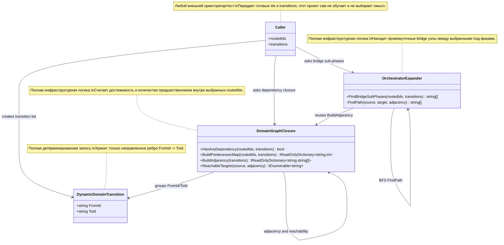

# 17.DynamicDomains - документация реализации

Documentation status: D17 documented - parent review passed.
Last verified against source: 2026-06-08.

## 0. Краткая карта для Лубы

`17.DynamicDomains` - маленький инфраструктурный проект про граф переходов между под-фазами. Он получает список уже выбранных под-фаз и список направленных переходов `from -> to`, а затем отвечает на два практических вопроса: есть ли между выбранными узлами зависимость, и какие промежуточные под-фазы надо добавить как мосты. Это не модель, не обучение и не адаптация под пользователя: код не хранит веса, не делает inference, не экспортирует checkpoint и не имеет manifest/locator/fresh-load/continue-training lifecycle. Текущая реализация полностью детерминированная: одинаковый список переходов всегда даст одинаковую карту достижимости и одинаковый отсортированный список мостов.

Поток данных простой: вызывающий слой передает `IReadOnlyCollection<string> routedIds` и `IReadOnlyCollection<DynamicDomainTransition> transitions`; `DomainGraphClosure` строит технические карты графа, а `OrchestratorExpander` ищет промежуточные узлы между уже выбранными под-фазами. Если переходов нет или выбрано меньше двух под-фаз, расширитель честно возвращает пустой список мостов.

## 1. UML для draw.io



| Узел | Что делает | Статус | Где живет |
|---|---|---|---|
| `DynamicDomainTransition` | Описывает одно направленное ребро графа: от какой под-фазы к какой можно перейти. | Полная детерминированная запись | `17.DynamicDomains/DynamicDomainGraph.cs:3` |
| `DomainGraphClosure` | Строит adjacency map, обходит достижимые цели и считает, есть ли зависимость между выбранными routed ids. | Полная инфраструктурная логика | `17.DynamicDomains/DynamicDomainGraph.cs:6-63` |
| `OrchestratorExpander` | Ищет промежуточные bridge под-фазы между выбранными routed ids. | Полная инфраструктурная логика | `17.DynamicDomains/DynamicDomainGraph.cs:66-115` |
| `Caller` | Внешний слой, который уже решил, какие ids и transitions передать. | Вне проекта D17 | Не реализован в `17.DynamicDomains` |

### 1.1 Симуляции по связям UML

| Связь | Пример входа | Что происходит | Ожидаемый результат | Что это НЕ доказывает |
|---|---|---|---|---|
| `Caller -> DynamicDomainTransition` | `new DynamicDomainTransition("plan", "implement")` | Создается ребро графа, без проверки доменной семантики. | В данных есть связь `plan -> implement`. | Не доказывает, что модель поняла планирование или что переход обучен. |
| `Caller -> DomainGraphClosure` | `routedIds=["plan","test"]`, transitions=`plan->implement`, `implement->test` | `HasAnyDependency` строит predecessor counts для выбранных ids. | Для `test` находится достижимость из `plan`, итог `true`. | Не доказывает качество оркестрации; это только graph closure. |
| `DomainGraphClosure -> DynamicDomainTransition` | transitions=`A->B`, `A->B`, `B->C` | `BuildAdjacency` группирует по `FromId` и убирает дубликаты targets. | `A: ["B"]`, `B: ["C"]`. | Не доказывает, что ребра правильные или пришли из runtime evidence. |
| `DomainGraphClosure -> DomainGraphClosure` | source=`A`, adjacency=`A->B`, `B->C` | `ReachableTargets` идет через stack и `seen`, чтобы не зациклиться. | Возвращает `A`, `B`, `C` как достижимые цели. | Не является shortest path и не ранжирует качество путей. |
| `Caller -> OrchestratorExpander` | `routedIds=["plan","test"]`, transitions=`plan->implement`, `implement->test` | `FindBridgeSubPhases` проверяет каждую пару routed ids и берет середину найденного пути. | Возвращает `["implement"]`. | Не доказывает, что `implement` надо реально запускать в продукте; это только топологическая вставка. |
| `OrchestratorExpander -> DomainGraphClosure` | transitions=`plan->implement`, `implement->test` | Расширитель переиспользует `BuildAdjacency`, не строит отдельную модель графа. | Получает карту `plan: ["implement"]`, `implement: ["test"]`. | Не добавляет обучение, память пользователя или checkpoint. |
| `OrchestratorExpander -> OrchestratorExpander` | source=`plan`, target=`test` | `FindPath` делает BFS по очереди путей. | Находит путь `["plan","implement","test"]`; bridge после обрезки endpoint = `implement`. | Не доказывает semantic reasoning; это детерминированный поиск пути. |

## 2. Алгоритмы без кода

### 2.1 Ребро перехода `DynamicDomainTransition`

Аналогия: это как стрелка на бумажной схеме этапов: "из планирования можно перейти к реализации". Стрелка не решает, что делать пользователю, а только хранит направление.

| Поле | Значение |
|---|---|
| Класс | `DynamicDomainTransition` |
| Конструктор/record | `DynamicDomainTransition(string FromId, string ToId)` |
| Вход | `FromId="plan"`, `ToId="implement"` |
| Выход | immutable record с двумя строковыми id |
| Статус | Полная детерминированная запись |

Шаги текущего поведения:

1. Внешний код передает две строки: начало и конец ребра.
2. Record сохраняет эти строки как `FromId` и `ToId`.
3. Никакой нормализации, проверки существования под-фазы или обучения здесь нет.

Что НЕ делает: не выбирает маршрут, не валидирует бизнес-смысл перехода, не является trained unit.

### 2.2 Проверка зависимости `DomainGraphClosure.HasAnyDependency`

Аналогия: есть список выбранных станций маршрута. Метод спрашивает: "есть ли среди этих станций такая, до которой можно добраться из другой выбранной станции по стрелкам?"

| Поле | Значение |
|---|---|
| Класс | `DomainGraphClosure` |
| Метод | `HasAnyDependency(IReadOnlyCollection<string> routedIds, IReadOnlyCollection<DynamicDomainTransition> transitions)` |
| Вход | `routedIds=["plan","test"]`, transitions=`plan->implement`, `implement->test` |
| Выход | `bool`: `true`, если хотя бы у одного routed id есть predecessor внутри closure |
| Статус | Полная детерминированная логика |

Шаги текущего поведения:

1. Метод получает уже выбранные `routedIds` и все известные `transitions`.
2. Делегирует подсчет в `BuildPredecessorMap`.
3. Смотрит, есть ли в значениях карты число больше нуля.
4. Возвращает `true` или `false`.

Ветки:

| Ветка | Пример входа | Почему выбирается | Ожидаемый результат | QA |
|---|---|---|---|---|
| Есть зависимость | `["plan","test"]`, `plan->implement`, `implement->test` | `test` достижим из `plan` и входит в `routedIds`. | `true` | Прямых D17 unit-тестов не найдено; нужен будущий тест на closure. |
| Нет зависимости | `["plan","review"]`, transitions=`plan->implement` | `review` недостижим и не получает predecessor count. | `false` | Прямой тест отсутствует. |

Что НЕ делает: не доказывает, что выбранные под-фазы правильные; не строит обучение; не использует ML/KNN/LLM.

### 2.3 Карта предшественников `BuildPredecessorMap`

Аналогия: это счетчик "сколько выбранных стартов может привести к каждой выбранной цели". Если до `test` можно дойти из `plan`, у `test` счетчик увеличивается.

| Поле | Значение |
|---|---|
| Класс | `DomainGraphClosure` |
| Метод | `BuildPredecessorMap(IReadOnlyCollection<string> routedIds, IReadOnlyCollection<DynamicDomainTransition> transitions)` |
| Вход | `routedIds=["plan","implement","test"]`, transitions=`plan->implement`, `implement->test` |
| Выход | `IReadOnlyDictionary<string,int>`, например `{ plan:0, implement:1, test:2 }` |
| Статус | Полная детерминированная логика |

Шаги:

1. Создает `predecessorCounts` со всеми `routedIds` и нулевыми счетчиками.
2. Строит adjacency map из transitions.
3. Для каждого source из `routedIds` обходит все достижимые targets.
4. Не считает сам source как своего предшественника.
5. Увеличивает счетчик только если target тоже находится среди `routedIds`.
6. Возвращает карту счетчиков.

Что НЕ делает: не возвращает сами пути, не проверяет качество графа, не делает topological sort.

### 2.4 Adjacency и достижимость `BuildAdjacency` / `ReachableTargets`

Аналогия: `BuildAdjacency` переписывает список стрелок в телефонную книгу "из A можно пойти в B и C"; `ReachableTargets` потом ходит по этой книге, пока не закончатся новые узлы.

| Поле | Значение |
|---|---|
| Класс | `DomainGraphClosure` |
| Методы | `BuildAdjacency(IReadOnlyCollection<DynamicDomainTransition> transitions)`, `ReachableTargets(string source, IReadOnlyDictionary<string,string[]> adjacency)` |
| Вход | transitions=`A->B`, `A->B`, `B->C`; source=`A` |
| Выход | adjacency=`A:["B"], B:["C"]`; reachable=`A,B,C` |
| Статус | Полная детерминированная внутренняя логика |

Ветки:

| Ветка | Пример входа | Почему выбирается | Ожидаемый результат | QA |
|---|---|---|---|---|
| Дубликаты ребер | `A->B`, `A->B` | `.Distinct(StringComparer.Ordinal)` убирает повтор target. | `A:["B"]` | Нужен прямой D17 тест. |
| Цикл | `A->B`, `B->A` | `seen` не дает обходить один узел бесконечно. | `ReachableTargets("A")` завершится после `A,B`. | Нужен прямой D17 тест на cycle safety. |
| Нет исходящих ребер | source=`Z`, adjacency без `Z` | `TryGetValue` возвращает false. | Возвращается только `Z`. | Нужен прямой D17 тест. |

Что НЕ делает: не сортирует по весам, не считает confidence, не ищет shortest path для публичного API.

### 2.5 Поиск мостов `OrchestratorExpander.FindBridgeSubPhases`

Аналогия: если человек выбрал "план" и "тест", но между ними на карте есть обязательная промежуточная станция "реализация", метод предлагает добавить эту станцию как мост.

| Поле | Значение |
|---|---|
| Класс | `OrchestratorExpander` |
| Метод | `FindBridgeSubPhases(IReadOnlyCollection<string> routedIds, IReadOnlyCollection<DynamicDomainTransition> transitions)` |
| Вход | `routedIds=["plan","test"]`, transitions=`plan->implement`, `implement->test` |
| Выход | `string[]`, например `["implement"]` |
| Статус | Полная детерминированная логика |

Шаги:

1. Если routed ids меньше двух или transitions пусты, метод сразу возвращает `[]`.
2. Превращает `routedIds` в set с `StringComparer.Ordinal`.
3. Строит adjacency через `DomainGraphClosure.BuildAdjacency`.
4. Для каждой пары разных routed ids вызывает внутренний `FindPath`.
5. Из найденного пути убирает первый и последний узел, оставляя только bridge sub-phases.
6. Собирает bridge ids без дублей и возвращает их в ordinal-sort порядке.

Ветки:

| Ветка | Пример входа | Почему выбирается | Ожидаемый результат | QA |
|---|---|---|---|---|
| Недостаточно данных | `routedIds=["plan"]`, transitions=`plan->test` | `routedIds.Count < 2`. | `[]` | Прямой тест отсутствует. |
| Есть мост | `["plan","test"]`, `plan->implement`, `implement->test` | `FindPath` находит путь из трех узлов. | `["implement"]` | Прямой тест отсутствует. |
| Прямое ребро без моста | `["plan","test"]`, `plan->test` | После `Skip(1).SkipLast(1)` середина пуста. | `[]` | Прямой тест отсутствует. |
| Пути нет | `["plan","test"]`, transitions=`plan->implement` | `FindPath` возвращает `[]`. | `[]` | Прямой тест отсутствует. |

Что НЕ делает: не запускает под-фазы, не вызывает оркестратор, не проверяет пользовательское намерение и не доказывает model readiness.

### 2.6 Внутренний BFS `FindPath`

Аналогия: метод кладет в очередь сначала путь `[source]`, потом постепенно расширяет его соседями, пока последний узел пути не станет `target`.

| Поле | Значение |
|---|---|
| Класс | `OrchestratorExpander` |
| Метод | `FindPath(string source, string target, IReadOnlyDictionary<string,string[]> adjacency)` |
| Вход | source=`plan`, target=`test`, adjacency=`plan:["implement"], implement:["test"]` |
| Выход | `["plan","implement","test"]` или `[]` |
| Статус | Полная внутренняя логика |

Что НЕ делает: метод приватный, поэтому не является внешним контрактом D17; он обслуживает только `FindBridgeSubPhases`.

## 3. Где логика сидит в коде

| Логика | Файл | Почему это место важно | Что доказывает | Чего не доказывает |
|---|---|---|---|---|
| Тип ребра | `17.DynamicDomains/DynamicDomainGraph.cs:3` | Вся модель данных проекта сведена к directed edge. | Есть конкретный DTO/record для перехода. | Нет доменной валидации и обучения. |
| Dependency closure | `17.DynamicDomains/DynamicDomainGraph.cs:8-31` | Публичный API для ответа "есть ли зависимость". | Счетчики predecessor строятся из текущего графа. | Не доказывает качество исходных transitions. |
| Adjacency/reachability | `17.DynamicDomains/DynamicDomainGraph.cs:33-62` | Внутренние строительные блоки для closure и bridge поиска. | Есть циклобезопасный обход с `seen`. | Не является trainable graph model. |
| Bridge expansion | `17.DynamicDomains/DynamicDomainGraph.cs:68-88` | Публичный API для добавления промежуточных под-фаз. | Метод возвращает только bridge nodes, не endpoints. | Не запускает runtime orchestration. |
| Path search | `17.DynamicDomains/DynamicDomainGraph.cs:90-114` | Внутренний BFS путь для пары source/target. | Возвращает путь или пустой массив. | Не доказывает semantic planning. |
| Проектная сборка | `17.DynamicDomains/DynamicDomains.csproj:1-8` | Показывает, что это отдельная `net9.0` библиотека без внешних зависимостей. | Код компилируется как библиотечный проект. | Не является тестом runtime поведения. |

## 4. Короткие важные цитаты кода

> Почему важно: это весь входной тип данных D17. Он показывает, что проект работает с направленными переходами, а не с обученными представлениями или весами.
>
> Что входит: две строки, например `FromId="plan"`, `ToId="implement"`.
>
> Что выходит: immutable transition record.
>
> Чего не доказывает: наличие trained domain model или asset lifecycle.

`17.DynamicDomains/DynamicDomainGraph.cs:3`

```csharp
public sealed record DynamicDomainTransition(string FromId, string ToId);
```

> Почему важно: `HasAnyDependency` не содержит скрытой эвристики; он сводит решение к числам из `BuildPredecessorMap`.
>
> Что входит: selected/routed ids и список transitions.
>
> Что выходит: `true`, если хотя бы один routed id достижим из другого routed id.
>
> Чего не доказывает: метод не знает, почему routed ids были выбраны.

`17.DynamicDomains/DynamicDomainGraph.cs:8-13`

```csharp
    public static bool HasAnyDependency(
        IReadOnlyCollection<string> routedIds,
        IReadOnlyCollection<DynamicDomainTransition> transitions)
    {
        return BuildPredecessorMap(routedIds, transitions).Values.Any(value => value > 0);
    }
```

> Почему важно: здесь видно, как считаются predecessor counts. Счетчик увеличивается только для target, который достижим из source и сам входит в routed ids.
>
> Что входит: `routedIds=["plan","implement","test"]`.
>
> Что выходит: словарь вида `{ plan:0, implement:1, test:2 }` для цепочки `plan->implement->test`.
>
> Чего не доказывает: это не topological sort и не runtime plan executor.

`17.DynamicDomains/DynamicDomainGraph.cs:15-31`

```csharp
    public static IReadOnlyDictionary<string, int> BuildPredecessorMap(
        IReadOnlyCollection<string> routedIds,
        IReadOnlyCollection<DynamicDomainTransition> transitions)
    {
        var predecessorCounts = routedIds.ToDictionary(id => id, _ => 0, StringComparer.Ordinal);
        var adjacency = BuildAdjacency(transitions);
        foreach (var source in routedIds)
        {
            foreach (var target in ReachableTargets(source, adjacency))
            {
                if (!string.Equals(source, target, StringComparison.Ordinal) && predecessorCounts.ContainsKey(target))
                    predecessorCounts[target]++;
            }
        }

        return predecessorCounts;
    }
```

> Почему важно: adjacency строится строго из `FromId` и `ToId`, а дубликаты targets убираются. Это делает граф предсказуемым.
>
> Что входит: transitions=`A->B`, `A->B`, `B->C`.
>
> Что выходит: `A:["B"]`, `B:["C"]`.
>
> Чего не доказывает: входные transitions могут быть плохими; метод их не валидирует как продуктовую истину.

`17.DynamicDomains/DynamicDomainGraph.cs:33-41`

```csharp
    internal static IReadOnlyDictionary<string, string[]> BuildAdjacency(IReadOnlyCollection<DynamicDomainTransition> transitions)
    {
        return transitions
            .GroupBy(transition => transition.FromId, StringComparer.Ordinal)
            .ToDictionary(
                group => group.Key,
                group => group.Select(transition => transition.ToId).Distinct(StringComparer.Ordinal).ToArray(),
                StringComparer.Ordinal);
    }
```

> Почему важно: `seen` защищает обход от циклов, поэтому граф `A->B`, `B->A` не превращается в бесконечный цикл.
>
> Что входит: source и adjacency map.
>
> Что выходит: перечисление достижимых ids, включая сам source.
>
> Чего не доказывает: метод не оценивает качество пути и не выбирает лучший смысловой маршрут.

`17.DynamicDomains/DynamicDomainGraph.cs:43-62`

```csharp
    internal static IEnumerable<string> ReachableTargets(string source, IReadOnlyDictionary<string, string[]> adjacency)
    {
        var seen = new HashSet<string>(StringComparer.Ordinal);
        var stack = new Stack<string>();
        stack.Push(source);

        while (stack.Count > 0)
        {
            var current = stack.Pop();
            if (!seen.Add(current))
                continue;

            yield return current;
            if (!adjacency.TryGetValue(current, out var next))
                continue;

            foreach (var target in next)
                stack.Push(target);
        }
    }
```

> Почему важно: эта ранняя ветка честно показывает ограничение: без двух routed ids или без transitions мостов быть не может.
>
> Что входит: `routedIds=["plan"]` или пустой transitions.
>
> Что выходит: пустой массив.
>
> Чего не доказывает: пустой результат не означает, что продуктовая оркестрация завершена.

`17.DynamicDomains/DynamicDomainGraph.cs:68-77`

```csharp
    public static string[] FindBridgeSubPhases(
        IReadOnlyCollection<string> routedIds,
        IReadOnlyCollection<DynamicDomainTransition> transitions)
    {
        if (routedIds.Count < 2 || transitions.Count == 0)
            return [];

        var routed = routedIds.ToHashSet(StringComparer.Ordinal);
        var adjacency = DomainGraphClosure.BuildAdjacency(transitions);
        var bridges = new HashSet<string>(StringComparer.Ordinal);
```

> Почему важно: bridge берется как середина найденного пути: source и target выкидываются, чтобы метод вернул только недостающие промежуточные под-фазы.
>
> Что входит: путь `["plan","implement","test"]`.
>
> Что выходит: `["implement"]`, отсортированный и без дублей на финальном возврате.
>
> Чего не доказывает: bridge id не является доказательством, что обученная модель выбрала правильную фазу.

`17.DynamicDomains/DynamicDomainGraph.cs:78-88`

```csharp
        foreach (var source in routed)
        {
            foreach (var target in routed.Where(id => !string.Equals(id, source, StringComparison.Ordinal)))
            {
                foreach (var bridge in FindPath(source, target, adjacency).Skip(1).SkipLast(1))
                    bridges.Add(bridge);
            }
        }

        return bridges.OrderBy(id => id, StringComparer.Ordinal).ToArray();
    }
```

> Почему важно: `FindPath` - обычный BFS по очереди путей. Он возвращает первый найденный путь до target или `[]`, если пути нет.
>
> Что входит: source=`plan`, target=`test`, adjacency=`plan:["implement"], implement:["test"]`.
>
> Что выходит: `["plan","implement","test"]`.
>
> Чего не доказывает: BFS path не является evidence обученного reasoning.

`17.DynamicDomains/DynamicDomainGraph.cs:90-114`

```csharp
    private static string[] FindPath(string source, string target, IReadOnlyDictionary<string, string[]> adjacency)
    {
        var queue = new Queue<string[]>();
        var seen = new HashSet<string>(StringComparer.Ordinal) { source };
        queue.Enqueue([source]);

        while (queue.Count > 0)
        {
            var path = queue.Dequeue();
            var current = path[^1];
            if (string.Equals(current, target, StringComparison.Ordinal))
                return path;
            if (!adjacency.TryGetValue(current, out var next))
                continue;

            foreach (var candidate in next)
            {
                if (!seen.Add(candidate))
                    continue;
                queue.Enqueue([.. path, candidate]);
            }
        }

        return [];
    }
```

## 5. Test/e2e/QA mapping

Тесты в этой документационной подфазе были только прочитаны/сопоставлены; `dotnet test` не запускался.

| Поведение | Уровень проверки | Текущий evidence | Статус | Следующий work order если gap |
|---|---|---|---|---|
| `DomainGraphClosure.HasAnyDependency` возвращает `true` для достижимой пары routed ids | Unit | Прямой тест по `rg "DomainGraphClosure"` не найден. | Gap | Добавить D17 unit tests для dependency closure. |
| `BuildAdjacency` убирает дубликаты targets | Unit | Прямой тест по `BuildAdjacency` не найден. | Gap | Добавить внутренний тест через публичные методы или InternalsVisibleTo, если нужно. |
| `ReachableTargets` безопасен при циклах | Unit | Прямой тест по `ReachableTargets` не найден. | Gap | Добавить тест с `A->B`, `B->A`. |
| `OrchestratorExpander.FindBridgeSubPhases` возвращает только intermediate nodes | Unit | Прямой тест по `OrchestratorExpander` не найден. | Gap | Добавить D17 unit tests для bridge path. |
| Связь с более широким оркестраторным контекстом | Indirect/comment evidence | `Tests/OrchestratorModelTests.cs:73` содержит комментарий про `DynamicDomains` confidence threshold, но тест не вызывает `17.DynamicDomains`. | Indirect only | Не считать прямым покрытием D17. |

## 6. Anti-false-done checks

| Gate | Проверка для D17 |
|---|---|
| Не `ILearningMachine` | `17.DynamicDomains` не является `ILearningMachine`: в проекте нет `ILearningMachine`, `ILogicalUnit`, обучения, метрик, checkpoint, manifest, locator, export/import, fresh-load или continue-training lifecycle. |
| Не trainable graph model | `17.DynamicDomains` не является trainable graph model: `DynamicDomainTransition` хранит строки `FromId`/`ToId`, а `DomainGraphClosure` и `OrchestratorExpander` делают deterministic graph algorithms без обученного/adaptive/user state. |
| JSON/report не evidence | Для D17 нет runtime/model readiness claim; любые будущие JSON/report/static checks не должны заменять unit-тесты графа. |
| Нет hidden deterministic shortcut | Детерминированность названа прямо: stack/queue/hash set/order by не являются обученной семантикой. |
| Пустой bridge не success proof | `[]` может означать "нет данных/пути/промежуточного узла", а не "оркестрация завершена". |

## 7. Статус реализации

| Компонент | Файл | Статус | Что реально работает сейчас |
|---|---|---|---|
| `DynamicDomainTransition` | `17.DynamicDomains/DynamicDomainGraph.cs` | Полная | Record хранит `FromId` и `ToId` для directed edge. |
| `DomainGraphClosure.HasAnyDependency` | `17.DynamicDomains/DynamicDomainGraph.cs` | Полная | Возвращает `true`, если в predecessor map есть routed id со счетчиком больше нуля. |
| `DomainGraphClosure.BuildPredecessorMap` | `17.DynamicDomains/DynamicDomainGraph.cs` | Полная | Считает, сколько других routed ids могут достигнуть каждого routed id. |
| `DomainGraphClosure.BuildAdjacency` | `17.DynamicDomains/DynamicDomainGraph.cs` | Полная | Группирует transitions по `FromId`, убирает дубли `ToId`. |
| `DomainGraphClosure.ReachableTargets` | `17.DynamicDomains/DynamicDomainGraph.cs` | Полная | Обходит reachable ids через stack и `seen`, избегая бесконечного цикла. |
| `OrchestratorExpander.FindBridgeSubPhases` | `17.DynamicDomains/DynamicDomainGraph.cs` | Полная | Возвращает отсортированный уникальный список промежуточных ids между routed ids. |
| `OrchestratorExpander.FindPath` | `17.DynamicDomains/DynamicDomainGraph.cs` | Полная внутренняя | BFS ищет путь между source и target или возвращает `[]`. |
| `DynamicDomains.csproj` | `17.DynamicDomains/DynamicDomains.csproj` | Полная проектная оболочка | `net9.0`, nullable/implicit usings, assembly/root namespace `DynamicDomains`. |

## 8. Источники и drift check

Прочитанные исходники для D17:

- `17.DynamicDomains/DynamicDomainGraph.cs`
- `17.DynamicDomains/DynamicDomains.csproj`
- `Tests/OrchestratorModelTests.cs` для честной QA mapping, без запуска тестов

Known gaps:

- Нет найденных прямых unit-тестов на `DomainGraphClosure` и `OrchestratorExpander`.
- Документ описывает только текущий deterministic helper; он не закрывает будущую продуктовую оркестрацию, обучение или asset lifecycle.

Documentation status: D17 documented - parent review passed.
