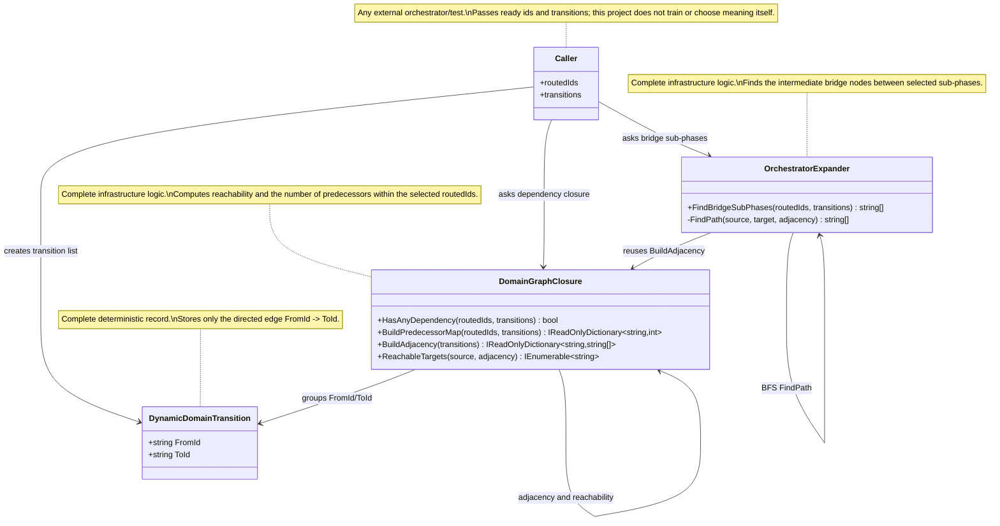

# 17.DynamicDomains - implementation documentation

Documentation status: D17 documented - parent review passed.
Last verified against source: 2026-06-08.

## 0. Quick map for Luba

`17.DynamicDomains` is a small infrastructure project about the transition graph between sub-phases. It receives a list of already-selected sub-phases and a list of directed transitions `from -> to`, and then answers two practical questions: is there a dependency between the selected nodes, and which intermediate sub-phases must be added as bridges. This is not a model, not training and not adaptation to the user: the code does not store weights, does not do inference, does not export a checkpoint and has no manifest/locator/fresh-load/continue-training lifecycle. The current implementation is fully deterministic: the same list of transitions will always give the same reachability map and the same sorted list of bridges.

The data flow is simple: the calling layer passes `IReadOnlyCollection<string> routedIds` and `IReadOnlyCollection<DynamicDomainTransition> transitions`; `DomainGraphClosure` builds technical graph maps, and `OrchestratorExpander` looks for intermediate nodes between already-selected sub-phases. If there are no transitions or fewer than two sub-phases are selected, the expander honestly returns an empty list of bridges.

## 1. UML for draw.io



| Node | What it does | Status | Where it lives |
|---|---|---|---|
| `DynamicDomainTransition` | Describes one directed graph edge: from which sub-phase to which one you can transition. | Complete deterministic record | `17.DynamicDomains/DynamicDomainGraph.cs:3` |
| `DomainGraphClosure` | Builds the adjacency map, walks the reachable targets and counts whether there is a dependency between the selected routed ids. | Complete infrastructure logic | `17.DynamicDomains/DynamicDomainGraph.cs:6-63` |
| `OrchestratorExpander` | Looks for intermediate bridge sub-phases between selected routed ids. | Complete infrastructure logic | `17.DynamicDomains/DynamicDomainGraph.cs:66-115` |
| `Caller` | The external layer that already decided which ids and transitions to pass. | Outside project D17 | Not implemented in `17.DynamicDomains` |

### 1.1 Simulations for each UML connection

| Connection | Example input | What happens | Expected result | What this does NOT prove |
|---|---|---|---|---|
| `Caller -> DynamicDomainTransition` | `new DynamicDomainTransition("plan", "implement")` | A graph edge is created, without checking domain semantics. | The data has the link `plan -> implement`. | Does not prove that the model understood planning or that the transition was trained. |
| `Caller -> DomainGraphClosure` | `routedIds=["plan","test"]`, transitions=`plan->implement`, `implement->test` | `HasAnyDependency` builds predecessor counts for the selected ids. | For `test` reachability from `plan` is found, result `true`. | Does not prove orchestration quality; this is only graph closure. |
| `DomainGraphClosure -> DynamicDomainTransition` | transitions=`A->B`, `A->B`, `B->C` | `BuildAdjacency` groups by `FromId` and removes duplicate targets. | `A: ["B"]`, `B: ["C"]`. | Does not prove that the edges are correct or came from runtime evidence. |
| `DomainGraphClosure -> DomainGraphClosure` | source=`A`, adjacency=`A->B`, `B->C` | `ReachableTargets` walks through a stack and `seen` so as not to loop. | Returns `A`, `B`, `C` as reachable targets. | Is not shortest path and does not rank the quality of paths. |
| `Caller -> OrchestratorExpander` | `routedIds=["plan","test"]`, transitions=`plan->implement`, `implement->test` | `FindBridgeSubPhases` checks each pair of routed ids and takes the middle of the found path. | Returns `["implement"]`. | Does not prove that `implement` must actually be launched in the product; this is only a topological insertion. |
| `OrchestratorExpander -> DomainGraphClosure` | transitions=`plan->implement`, `implement->test` | The expander reuses `BuildAdjacency`, does not build a separate graph model. | Gets the map `plan: ["implement"]`, `implement: ["test"]`. | Does not add training, user memory or a checkpoint. |
| `OrchestratorExpander -> OrchestratorExpander` | source=`plan`, target=`test` | `FindPath` does a BFS over a queue of paths. | Finds the path `["plan","implement","test"]`; the bridge after trimming the endpoints = `implement`. | Does not prove semantic reasoning; this is a deterministic path search. |

## 2. No-code algorithms

### 2.1 The transition edge `DynamicDomainTransition`

Analogy: it is like an arrow on a paper diagram of stages: "from planning you can move to implementation". The arrow does not decide what the user should do, it only stores the direction.

| Field | Value |
|---|---|
| Class | `DynamicDomainTransition` |
| Constructor/record | `DynamicDomainTransition(string FromId, string ToId)` |
| Input | `FromId="plan"`, `ToId="implement"` |
| Output | an immutable record with two string ids |
| Status | Complete deterministic record |

Steps of the current behavior:

1. External code passes two strings: the start and the end of the edge.
2. The record stores these strings as `FromId` and `ToId`.
3. There is no normalization, no check of the sub-phase's existence and no training here.

What it does NOT do: does not choose a route, does not validate the business meaning of the transition, is not a trained unit.

### 2.2 The dependency check `DomainGraphClosure.HasAnyDependency`

Analogy: there is a list of selected route stations. The method asks: "is there among these stations one that can be reached from another selected station by the arrows?"

| Field | Value |
|---|---|
| Class | `DomainGraphClosure` |
| Method | `HasAnyDependency(IReadOnlyCollection<string> routedIds, IReadOnlyCollection<DynamicDomainTransition> transitions)` |
| Input | `routedIds=["plan","test"]`, transitions=`plan->implement`, `implement->test` |
| Output | `bool`: `true` if at least one routed id has a predecessor within the closure |
| Status | Complete deterministic logic |

Steps of the current behavior:

1. The method receives the already-selected `routedIds` and all known `transitions`.
2. Delegates the counting to `BuildPredecessorMap`.
3. Looks at whether any value in the map is greater than zero.
4. Returns `true` or `false`.

Branches:

| Branch | Example input | Why it is chosen | Expected result | QA |
|---|---|---|---|---|
| Has dependency | `["plan","test"]`, `plan->implement`, `implement->test` | `test` is reachable from `plan` and is in `routedIds`. | `true` | No direct D17 unit tests found; a future closure test is needed. |
| No dependency | `["plan","review"]`, transitions=`plan->implement` | `review` is unreachable and gets no predecessor count. | `false` | A direct test is absent. |

What it does NOT do: does not prove that the selected sub-phases are correct; does not build training; does not use ML/KNN/LLM.

### 2.3 The predecessor map `BuildPredecessorMap`

Analogy: this is a counter of "how many selected starts can lead to each selected target". If `test` can be reached from `plan`, `test`'s counter increases.

| Field | Value |
|---|---|
| Class | `DomainGraphClosure` |
| Method | `BuildPredecessorMap(IReadOnlyCollection<string> routedIds, IReadOnlyCollection<DynamicDomainTransition> transitions)` |
| Input | `routedIds=["plan","implement","test"]`, transitions=`plan->implement`, `implement->test` |
| Output | `IReadOnlyDictionary<string,int>`, for example `{ plan:0, implement:1, test:2 }` |
| Status | Complete deterministic logic |

Steps:

1. Creates `predecessorCounts` with all `routedIds` and zero counters.
2. Builds the adjacency map from transitions.
3. For each source from `routedIds` it walks all reachable targets.
4. Does not count the source itself as its own predecessor.
5. Increments the counter only if the target is also among `routedIds`.
6. Returns the counter map.

What it does NOT do: does not return the paths themselves, does not check graph quality, does not do a topological sort.

### 2.4 Adjacency and reachability `BuildAdjacency` / `ReachableTargets`

Analogy: `BuildAdjacency` rewrites the list of arrows into a phone book "from A you can go to B and C"; `ReachableTargets` then walks this book until there are no new nodes left.

| Field | Value |
|---|---|
| Class | `DomainGraphClosure` |
| Methods | `BuildAdjacency(IReadOnlyCollection<DynamicDomainTransition> transitions)`, `ReachableTargets(string source, IReadOnlyDictionary<string,string[]> adjacency)` |
| Input | transitions=`A->B`, `A->B`, `B->C`; source=`A` |
| Output | adjacency=`A:["B"], B:["C"]`; reachable=`A,B,C` |
| Status | Complete deterministic internal logic |

Branches:

| Branch | Example input | Why it is chosen | Expected result | QA |
|---|---|---|---|---|
| Duplicate edges | `A->B`, `A->B` | `.Distinct(StringComparer.Ordinal)` removes the duplicate target. | `A:["B"]` | A direct D17 test is needed. |
| Cycle | `A->B`, `B->A` | `seen` prevents walking one node infinitely. | `ReachableTargets("A")` finishes after `A,B`. | A direct D17 cycle safety test is needed. |
| No outgoing edges | source=`Z`, adjacency without `Z` | `TryGetValue` returns false. | Only `Z` is returned. | A direct D17 test is needed. |

What it does NOT do: does not sort by weights, does not compute confidence, does not look for a shortest path for the public API.

### 2.5 Finding bridges `OrchestratorExpander.FindBridgeSubPhases`

Analogy: if a person selected "plan" and "test", but between them on the map there is a mandatory intermediate station "implement", the method proposes adding this station as a bridge.

| Field | Value |
|---|---|
| Class | `OrchestratorExpander` |
| Method | `FindBridgeSubPhases(IReadOnlyCollection<string> routedIds, IReadOnlyCollection<DynamicDomainTransition> transitions)` |
| Input | `routedIds=["plan","test"]`, transitions=`plan->implement`, `implement->test` |
| Output | `string[]`, for example `["implement"]` |
| Status | Complete deterministic logic |

Steps:

1. If routed ids are fewer than two or transitions are empty, the method immediately returns `[]`.
2. Turns `routedIds` into a set with `StringComparer.Ordinal`.
3. Builds adjacency via `DomainGraphClosure.BuildAdjacency`.
4. For each pair of different routed ids calls the internal `FindPath`.
5. From the found path removes the first and last node, leaving only the bridge sub-phases.
6. Collects the bridge ids without duplicates and returns them in ordinal-sort order.

Branches:

| Branch | Example input | Why it is chosen | Expected result | QA |
|---|---|---|---|---|
| Not enough data | `routedIds=["plan"]`, transitions=`plan->test` | `routedIds.Count < 2`. | `[]` | A direct test is absent. |
| Has a bridge | `["plan","test"]`, `plan->implement`, `implement->test` | `FindPath` finds a path of three nodes. | `["implement"]` | A direct test is absent. |
| Direct edge without a bridge | `["plan","test"]`, `plan->test` | After `Skip(1).SkipLast(1)` the middle is empty. | `[]` | A direct test is absent. |
| No path | `["plan","test"]`, transitions=`plan->implement` | `FindPath` returns `[]`. | `[]` | A direct test is absent. |

What it does NOT do: does not launch sub-phases, does not call the orchestrator, does not check user intent and does not prove model readiness.

### 2.6 The internal BFS `FindPath`

Analogy: the method puts the path `[source]` into the queue first, then gradually extends it with neighbours until the last node of the path becomes `target`.

| Field | Value |
|---|---|
| Class | `OrchestratorExpander` |
| Method | `FindPath(string source, string target, IReadOnlyDictionary<string,string[]> adjacency)` |
| Input | source=`plan`, target=`test`, adjacency=`plan:["implement"], implement:["test"]` |
| Output | `["plan","implement","test"]` or `[]` |
| Status | Complete internal logic |

What it does NOT do: the method is private, so it is not an external D17 contract; it serves only `FindBridgeSubPhases`.

## 3. Where the logic sits in the code

| Logic | File | Why this location matters | What it proves | What it does not prove |
|---|---|---|---|---|
| Edge type | `17.DynamicDomains/DynamicDomainGraph.cs:3` | The whole data model of the project is reduced to a directed edge. | There is a concrete DTO/record for a transition. | No domain validation and no training. |
| Dependency closure | `17.DynamicDomains/DynamicDomainGraph.cs:8-31` | The public API for answering "is there a dependency". | Predecessor counts are built from the current graph. | Does not prove the quality of the source transitions. |
| Adjacency/reachability | `17.DynamicDomains/DynamicDomainGraph.cs:33-62` | Internal building blocks for closure and bridge search. | There is a cycle-safe traversal with `seen`. | Is not a trainable graph model. |
| Bridge expansion | `17.DynamicDomains/DynamicDomainGraph.cs:68-88` | The public API for adding intermediate sub-phases. | The method returns only bridge nodes, not endpoints. | Does not launch runtime orchestration. |
| Path search | `17.DynamicDomains/DynamicDomainGraph.cs:90-114` | The internal BFS path for a source/target pair. | Returns a path or an empty array. | Does not prove semantic planning. |
| Project build | `17.DynamicDomains/DynamicDomains.csproj:1-8` | Shows that this is a separate `net9.0` library without external dependencies. | The code compiles as a library project. | Is not a test of runtime behavior. |

## 4. Short important code quotations

> Why it matters: this is the whole input data type of D17. It shows that the project works with directed transitions, not with trained representations or weights.
>
> What goes in: two strings, for example `FromId="plan"`, `ToId="implement"`.
>
> What comes out: an immutable transition record.
>
> What it does not prove: the presence of a trained domain model or an asset lifecycle.

`17.DynamicDomains/DynamicDomainGraph.cs:3`

```csharp
public sealed record DynamicDomainTransition(string FromId, string ToId);
```

> Why it matters: `HasAnyDependency` contains no hidden heuristic; it reduces the decision to numbers from `BuildPredecessorMap`.
>
> What goes in: selected/routed ids and a list of transitions.
>
> What comes out: `true` if at least one routed id is reachable from another routed id.
>
> What it does not prove: the method does not know why the routed ids were selected.

`17.DynamicDomains/DynamicDomainGraph.cs:8-13`

```csharp
    public static bool HasAnyDependency(
        IReadOnlyCollection<string> routedIds,
        IReadOnlyCollection<DynamicDomainTransition> transitions)
    {
        return BuildPredecessorMap(routedIds, transitions).Values.Any(value => value > 0);
    }
```

> Why it matters: here you can see how predecessor counts are computed. The counter increases only for a target that is reachable from a source and is itself in the routed ids.
>
> What goes in: `routedIds=["plan","implement","test"]`.
>
> What comes out: a dictionary like `{ plan:0, implement:1, test:2 }` for the chain `plan->implement->test`.
>
> What it does not prove: this is not a topological sort and not a runtime plan executor.

`17.DynamicDomains/DynamicDomainGraph.cs:15-31`

```csharp
    public static IReadOnlyDictionary<string, int> BuildPredecessorMap(
        IReadOnlyCollection<string> routedIds,
        IReadOnlyCollection<DynamicDomainTransition> transitions)
    {
        var predecessorCounts = routedIds.ToDictionary(id => id, _ => 0, StringComparer.Ordinal);
        var adjacency = BuildAdjacency(transitions);
        foreach (var source in routedIds)
        {
            foreach (var target in ReachableTargets(source, adjacency))
            {
                if (!string.Equals(source, target, StringComparison.Ordinal) && predecessorCounts.ContainsKey(target))
                    predecessorCounts[target]++;
            }
        }

        return predecessorCounts;
    }
```

> Why it matters: adjacency is built strictly from `FromId` and `ToId`, and duplicate targets are removed. This makes the graph predictable.
>
> What goes in: transitions=`A->B`, `A->B`, `B->C`.
>
> What comes out: `A:["B"]`, `B:["C"]`.
>
> What it does not prove: the input transitions may be bad; the method does not validate them as product truth.

`17.DynamicDomains/DynamicDomainGraph.cs:33-41`

```csharp
    internal static IReadOnlyDictionary<string, string[]> BuildAdjacency(IReadOnlyCollection<DynamicDomainTransition> transitions)
    {
        return transitions
            .GroupBy(transition => transition.FromId, StringComparer.Ordinal)
            .ToDictionary(
                group => group.Key,
                group => group.Select(transition => transition.ToId).Distinct(StringComparer.Ordinal).ToArray(),
                StringComparer.Ordinal);
    }
```

> Why it matters: `seen` protects the traversal from cycles, so the graph `A->B`, `B->A` does not turn into an infinite loop.
>
> What goes in: source and adjacency map.
>
> What comes out: an enumeration of reachable ids, including the source itself.
>
> What it does not prove: the method does not assess path quality and does not choose the best meaningful route.

`17.DynamicDomains/DynamicDomainGraph.cs:43-62`

```csharp
    internal static IEnumerable<string> ReachableTargets(string source, IReadOnlyDictionary<string, string[]> adjacency)
    {
        var seen = new HashSet<string>(StringComparer.Ordinal);
        var stack = new Stack<string>();
        stack.Push(source);

        while (stack.Count > 0)
        {
            var current = stack.Pop();
            if (!seen.Add(current))
                continue;

            yield return current;
            if (!adjacency.TryGetValue(current, out var next))
                continue;

            foreach (var target in next)
                stack.Push(target);
        }
    }
```

> Why it matters: this early branch honestly shows the limitation: without two routed ids or without transitions there can be no bridges.
>
> What goes in: `routedIds=["plan"]` or empty transitions.
>
> What comes out: an empty array.
>
> What it does not prove: an empty result does not mean product orchestration is complete.

`17.DynamicDomains/DynamicDomainGraph.cs:68-77`

```csharp
    public static string[] FindBridgeSubPhases(
        IReadOnlyCollection<string> routedIds,
        IReadOnlyCollection<DynamicDomainTransition> transitions)
    {
        if (routedIds.Count < 2 || transitions.Count == 0)
            return [];

        var routed = routedIds.ToHashSet(StringComparer.Ordinal);
        var adjacency = DomainGraphClosure.BuildAdjacency(transitions);
        var bridges = new HashSet<string>(StringComparer.Ordinal);
```

> Why it matters: the bridge is taken as the middle of the found path: source and target are dropped so the method returns only the missing intermediate sub-phases.
>
> What goes in: the path `["plan","implement","test"]`.
>
> What comes out: `["implement"]`, sorted and without duplicates on the final return.
>
> What it does not prove: the bridge id is not proof that a trained model chose the correct phase.

`17.DynamicDomains/DynamicDomainGraph.cs:78-88`

```csharp
        foreach (var source in routed)
        {
            foreach (var target in routed.Where(id => !string.Equals(id, source, StringComparison.Ordinal)))
            {
                foreach (var bridge in FindPath(source, target, adjacency).Skip(1).SkipLast(1))
                    bridges.Add(bridge);
            }
        }

        return bridges.OrderBy(id => id, StringComparer.Ordinal).ToArray();
    }
```

> Why it matters: `FindPath` is an ordinary BFS over a queue of paths. It returns the first found path to the target or `[]` if there is no path.
>
> What goes in: source=`plan`, target=`test`, adjacency=`plan:["implement"], implement:["test"]`.
>
> What comes out: `["plan","implement","test"]`.
>
> What it does not prove: a BFS path is not evidence of trained reasoning.

`17.DynamicDomains/DynamicDomainGraph.cs:90-114`

```csharp
    private static string[] FindPath(string source, string target, IReadOnlyDictionary<string, string[]> adjacency)
    {
        var queue = new Queue<string[]>();
        var seen = new HashSet<string>(StringComparer.Ordinal) { source };
        queue.Enqueue([source]);

        while (queue.Count > 0)
        {
            var path = queue.Dequeue();
            var current = path[^1];
            if (string.Equals(current, target, StringComparison.Ordinal))
                return path;
            if (!adjacency.TryGetValue(current, out var next))
                continue;

            foreach (var candidate in next)
            {
                if (!seen.Add(candidate))
                    continue;
                queue.Enqueue([.. path, candidate]);
            }
        }

        return [];
    }
```

## 5. Test/e2e/QA mapping

In this documentation subphase the tests were only read/mapped; `dotnet test` was not run.

| Behavior | Verification level | Current evidence | Status | Next work order if gap |
|---|---|---|---|---|
| `DomainGraphClosure.HasAnyDependency` returns `true` for a reachable pair of routed ids | Unit | A direct test via `rg "DomainGraphClosure"` was not found. | Gap | Add D17 unit tests for dependency closure. |
| `BuildAdjacency` removes duplicate targets | Unit | A direct test for `BuildAdjacency` was not found. | Gap | Add an internal test via public methods or InternalsVisibleTo if needed. |
| `ReachableTargets` is safe on cycles | Unit | A direct test for `ReachableTargets` was not found. | Gap | Add a test with `A->B`, `B->A`. |
| `OrchestratorExpander.FindBridgeSubPhases` returns only intermediate nodes | Unit | A direct test for `OrchestratorExpander` was not found. | Gap | Add D17 unit tests for the bridge path. |
| Link to the broader orchestrator context | Indirect/comment evidence | `Tests/OrchestratorModelTests.cs:73` contains a comment about the `DynamicDomains` confidence threshold, but the test does not call `17.DynamicDomains`. | Indirect only | Do not treat as direct D17 coverage. |

## 6. Anti-false-done checks

| Gate | Check for D17 |
|---|---|
| Not `ILearningMachine` | `17.DynamicDomains` is not an `ILearningMachine`: the project has no `ILearningMachine`, `ILogicalUnit`, training, metrics, checkpoint, manifest, locator, export/import, fresh-load or continue-training lifecycle. |
| Not a trainable graph model | `17.DynamicDomains` is not a trainable graph model: `DynamicDomainTransition` stores the strings `FromId`/`ToId`, while `DomainGraphClosure` and `OrchestratorExpander` do deterministic graph algorithms without trained/adaptive/user state. |
| JSON/report is not evidence | For D17 there is no runtime/model readiness claim; any future JSON/report/static checks must not replace graph unit tests. |
| No hidden deterministic shortcut | The determinism is named directly: stack/queue/hash set/order by are not trained semantics. |
| An empty bridge is not a success proof | `[]` may mean "no data/path/intermediate node", not "orchestration complete". |

## 7. Implementation status

| Component | File | Status | What actually works now |
|---|---|---|---|
| `DynamicDomainTransition` | `17.DynamicDomains/DynamicDomainGraph.cs` | Complete | The record stores `FromId` and `ToId` for a directed edge. |
| `DomainGraphClosure.HasAnyDependency` | `17.DynamicDomains/DynamicDomainGraph.cs` | Complete | Returns `true` if the predecessor map has a routed id with a counter greater than zero. |
| `DomainGraphClosure.BuildPredecessorMap` | `17.DynamicDomains/DynamicDomainGraph.cs` | Complete | Counts how many other routed ids can reach each routed id. |
| `DomainGraphClosure.BuildAdjacency` | `17.DynamicDomains/DynamicDomainGraph.cs` | Complete | Groups transitions by `FromId`, removes duplicate `ToId`. |
| `DomainGraphClosure.ReachableTargets` | `17.DynamicDomains/DynamicDomainGraph.cs` | Complete | Walks reachable ids via a stack and `seen`, avoiding an infinite loop. |
| `OrchestratorExpander.FindBridgeSubPhases` | `17.DynamicDomains/DynamicDomainGraph.cs` | Complete | Returns a sorted unique list of intermediate ids between routed ids. |
| `OrchestratorExpander.FindPath` | `17.DynamicDomains/DynamicDomainGraph.cs` | Complete internal | A BFS searches for a path between source and target or returns `[]`. |
| `DynamicDomains.csproj` | `17.DynamicDomains/DynamicDomains.csproj` | Complete project shell | `net9.0`, nullable/implicit usings, assembly/root namespace `DynamicDomains`. |

## 8. Sources and drift check

Source files read for D17:

- `17.DynamicDomains/DynamicDomainGraph.cs`
- `17.DynamicDomains/DynamicDomains.csproj`
- `Tests/OrchestratorModelTests.cs` for an honest QA mapping, without running the tests

Known gaps:

- No direct unit tests found for `DomainGraphClosure` and `OrchestratorExpander`.
- The document describes only the current deterministic helper; it does not close future product orchestration, training or an asset lifecycle.

Documentation status: D17 documented - parent review passed.
