# 18.CapabilityTraining - implementation documentation

D3F status: parent review passed. Tests and build were not run in this documentation subphase.

## 1. Short map for Luba

`18.CapabilityTraining` is the layer that takes a "knowledge edge" from the logical orchestrator, turns it into a training string, builds chosen/rejected pairs for Direct Preference Optimization (DPO), runs a small LoRA+DPO teaching pass, saves the tokenizer/checkpoint/manifest and registers a new learned logical unit plus a generated flow for retry. This is not just JSON: the code actually calls `DpoTrainer`, `LoraApplicator`, `LlmModel.SaveCheckpoint`, `BpeTokenizer.Save`, registry registration and snapshot/load. But this is still not proof of product quality: DPO metrics, manifest and descriptor prove the wiring and the artifacts, not held-out quality, e2e host quality or a user-facing semantic authority.

Honest boundary: the generated capability here is executed as an `ILogicalUnit<string,string>` via transformer embeddings + HNSW + BM25-like/pattern fusion. This is trained/retrieval hybrid infrastructure for the retry path, not a full `ILearningMachine` with an export/import/continue-training API at Level 5. The code has generic rejected text of the form `Do not generate a capability for sub-phase ...`; this is a useful negative for the branch, but it must not be presented as a high-quality DPO near-miss without a separate evaluation.

## 2. UML for draw.io

```mermaid
classDiagram
    class DefaultLogicalCapabilityTrainer {
      +TrainAndRegisterAsync(LogicalCapabilityTrainingRequest, CancellationToken) Task~OperationResult~LogicalCapabilityTrainingResult~~
      +ClearCache() void
    }
    class LogicalDpoTrainingUnit {
      +ExecuteAsync(LogicalUnitRequest~LogicalDpoTrainingRequest~, CancellationToken) Task~OperationResult~LogicalUnitResult~LogicalDpoTrainingResult~~~
    }
    class TransformerEmbeddingKnnLogicalUnit {
      +Train(unitId, unitRole, domainTag, LlmModel, BpeTokenizer, examples) OperationResult
      +ExecuteAsync(LogicalUnitRequest~string~, CancellationToken) Task~OperationResult~LogicalUnitResult~~
    }
    class GeneratedCapabilityFlowFactory {
      +Create(LogicalFlowFactoryRequest) OperationResult~ILogicalFlow~string~~
    }
    class GeneratedCapabilityFlow {
      +ExecuteAsync(LogicalFlowRequest~string~, CancellationToken) Task~OperationResult~LogicalFlowResult~~
    }
    class TeachingRegistryPersistence {
      +Capture(bundleId, rowIndex, units, flows, checkpointRoot) OperationResult~TeachingRegistrySnapshot~
      +LoadIntoRegistries(snapshot, topology, units, flows) OperationResult~int~
      +SaveGeneratedCapabilityManifest(manifest, manifestPath) OperationResult~string~
    }
    class ReplayFusionRanker {
      +Rank(manifests, compiledText, topK) IReadOnlyList~GeneratedCapabilityCheckpointManifest~
    }
    class CapabilityResultTranslator {
      +Translate(knnOutput, subPhase, originalPrompt) string
      +TranslateFromKnnOutput(knnOutput, originalPrompt) string
    }
    class LogicalTeachingTextCompressor
    class AutonomousLearningReplayMixer

    DefaultLogicalCapabilityTrainer --> LogicalDpoTrainingUnit : builds DPO request
    DefaultLogicalCapabilityTrainer --> TransformerEmbeddingKnnLogicalUnit : wraps learned unit
    DefaultLogicalCapabilityTrainer --> GeneratedCapabilityFlowFactory : registers retry flow
    DefaultLogicalCapabilityTrainer --> TeachingRegistryPersistence : saves manifest
    DefaultLogicalCapabilityTrainer --> ReplayFusionRanker : optional replay ranking
    DefaultLogicalCapabilityTrainer --> AutonomousLearningReplayMixer : current + replay preferences
    GeneratedCapabilityFlowFactory --> GeneratedCapabilityFlow : creates learned retry path
    GeneratedCapabilityFlow --> TransformerEmbeddingKnnLogicalUnit : executes learned unit
    GeneratedCapabilityFlow --> CapabilityResultTranslator : human-readable result
    TeachingRegistryPersistence --> TransformerEmbeddingKnnLogicalUnit : fresh-load rebuild
    LogicalDpoTrainingUnit --> LogicalTeachingTextCompressor : compact teaching text

    note for DefaultLogicalCapabilityTrainer "PARTIAL TRAINING INFRASTRUCTURE\nWrites checkpoint/manifest, registers a learned unit/flow.\nDoes not prove product quality without held-out/runtime evidence."
    note for LogicalDpoTrainingUnit "COMPLETE teaching unit\nLoRA adapters + DPO StepVector + metric files via ILogicalUnit."
    note for TransformerEmbeddingKnnLogicalUnit "PARTIAL learned unit\nTransformer embeddings + HNSW + BM25-like fusion; not an ILearningMachine."
    note for GeneratedCapabilityFlowFactory "COMPLETE factory\nIf the learned unit is available and the flag allows, creates a generated flow; otherwise fallback."
    note for GeneratedCapabilityFlow "COMPLETE retry flow\nCompiles the runtime prompt and calls the learned unit."
    note for TeachingRegistryPersistence "COMPLETE persistence utility\nSnapshot/save/load registries and rebuild learned units from checkpoint/tokenizer."
    note for ReplayFusionRanker "COMPLETE deterministic ranking\nBM25-like + predicate overlap for replay manifests."
    note for CapabilityResultTranslator "COMPLETE translator\nHides the machine label behind sub-phase metadata if a topology exists."
```



### Legend

| Node | What it does | Status |
|---|---|---|
| `DefaultLogicalCapabilityTrainer` | The main trainer: branch -> DPO -> checkpoint/manifest -> registry -> retry flow | Partial trainable infrastructure |
| `LogicalDpoTrainingUnit` | Wraps LoRA+DPO into an `ILogicalUnit` | Complete teaching unit |
| `TransformerEmbeddingKnnLogicalUnit` | Makes an executable learned unit out of transformer embeddings, HNSW and fusion scoring | Partial learned retrieval unit |
| `GeneratedCapabilityFlowFactory` | Chooses a generated flow or the fallback `UniversalNineNodeDevelopmentFlow` | Complete factory |
| `GeneratedCapabilityFlow` | Executes the learned unit on the retry path and translates the result | Complete flow |
| `TeachingRegistryPersistence` | Saves/reads a snapshot and rebuilds the learned unit/flow | Complete persistence |
| `ReplayFusionRanker` | Ranks replay manifests by deterministic fusion | Complete deterministic utility |
| `CapabilityResultTranslator` | Makes a readable result from topology/sub-phase metadata | Complete utility |

### Connection simulations

| Connection | Example input | What happens | Expected result | What must not be taken as proof |
|---|---|---|---|---|
| `DefaultLogicalCapabilityTrainer -> LogicalDpoTrainingUnit` | branch with `missing_sub_phase=4.4`, domain `BUG` | the trainer assembles a `LogicalDpoPreferenceExample` and calls batched DPO | metric file path and `DpoStepCount >= 1` | a DPO metric file does not prove product quality |
| `DefaultLogicalCapabilityTrainer -> TransformerEmbeddingKnnLogicalUnit` | a saved `policy.bin`, tokenizer, branch plans | the unit is trained on replay + current examples | learned unit `isLearned=true`, trust state probationary/trusted | KNN/fusion output is not equal to universal reasoning |
| `DefaultLogicalCapabilityTrainer -> GeneratedCapabilityFlowFactory` | subphase `4.4`, learned unit registered | the factory `generated-capability-flow-4-4` is registered | retry can choose the generated flow | a descriptor without a runtime execute does not prove the use path |
| `GeneratedCapabilityFlowFactory -> GeneratedCapabilityFlow` | `UseLearnedUnitWhenAvailable=true`, unit found | the factory returns a generated flow | the flow calls the learned unit | if the flag is false or the unit is missing, it goes to fallback |
| `GeneratedCapabilityFlow -> CapabilityResultTranslator` | unit output `Generated capability...`, topology contains `4.1` | the translator builds text from sub-phase metadata | a human result without a machine label | pretty text does not prove accuracy |
| `TeachingRegistryPersistence -> TransformerEmbeddingKnnLogicalUnit` | snapshot + manifest with checkpoint/tokenizer paths | the loader checks the files, loads tokenizer/model/checkpoint, rebuilds the unit | the registry gets the unit/flow without retraining | a snapshot JSON without checkpoint/tokenizer files is not enough |
| `ReplayFusionRanker -> trainer replay` | 5 manifests, compiled text `auth guard controller` | score = vector 0.45 + lexical 0.35 + pattern 0.20 | the relevant auth manifest enters topK | deterministic ranking is not a trained semantic authority |

## 3. No-code algorithms

### Algorithm A: training and registering a capability

| Field | Value |
|---|---|
| Class | `DefaultLogicalCapabilityTrainer` |
| Method | `TrainAndRegisterAsync(LogicalCapabilityTrainingRequest request, CancellationToken cancellationToken = default)` |
| File | `18.CapabilityTraining/DefaultLogicalCapabilityTrainer.cs:93` |
| Input | `LogicalCapabilityTrainingRequest`: run id, original request, `KnowledgeEdgeBranches`, topology, flow registry, unit registry, domain, optional compiled prompt/text |
| Output | `OperationResult<LogicalCapabilityTrainingResult>` |
| Status | Partial trainable infrastructure |

Steps: first the method validates the request, branches and registries. If idle scheduling is enabled, it asks `ILogicalTeachingIdleGate`; a busy state returns a successful deferred result without training. Then, for each knowledge-edge branch, it extracts the sub-phase id, checks it in the topology, builds the training text and the generic rejected text. After that it collects replay manifests, computes the repeat count, builds the teaching stack, runs batched DPO via `ExecuteDpoTeachingAsync`, saves the tokenizer/policy checkpoint, builds a `GeneratedCapabilityCheckpointManifest`, saves the manifest, trains a `TransformerEmbeddingKnnLogicalUnit`, registers the unit and the generated flow factory.

Branches: cancellation -> `CANCELLED`; empty branches -> `KNOWLEDGE_EDGE_BRANCH_REQUIRED`; busy idle gate -> deferred; a branch without a subphase -> skipped note; DPO failure -> note without registration; manifest/unit/flow failure -> note and skip of the current subphase. Does not do: does not prove held-out quality, host e2e quality or a marketplace lifecycle.

### Algorithm B: the LoRA+DPO teaching unit

| Field | Value |
|---|---|
| Class | `LogicalDpoTrainingUnit` |
| Method | `ExecuteAsync(LogicalUnitRequest<LogicalDpoTrainingRequest> request, CancellationToken cancellationToken = default)` |
| File | `18.CapabilityTraining/LlmIngredientLogicalUnits.cs:319` |
| Input | `LogicalDpoTrainingRequest`: policy model, reference model, tokenizer, checkpoint directory, preference examples, LoRA config, optional parent checkpoint |
| Output | `OperationResult<LogicalUnitResult<LogicalDpoTrainingResult>>` |
| Status | Complete teaching unit |

Steps: validates models/tokenizer/preferences, applies LoRA adapters, if a parent checkpoint is present tries to load it into the policy model, builds a `DpoVectorBatch` for each preference, calls `DpoTrainer.StepVector` up to `MaxStepCount` or a convergence stop, collects `dpo_step_*.json`, returns counts, loss, accuracy, metric paths and ingredient ids. Does not do: a metric JSON does not prove that the capability improves a real product scenario.

### Algorithm C: the generated learned unit lookup

| Field | Value |
|---|---|
| Class | `TransformerEmbeddingKnnLogicalUnit<TOutput>` |
| Methods | `Train(...)`, `ExecuteAsync(LogicalUnitRequest<string> request, CancellationToken cancellationToken = default)` |
| File | `18.CapabilityTraining/LlmIngredientLogicalUnits.cs:61`, `18.CapabilityTraining/LlmIngredientLogicalUnits.cs:129` |
| Input | tokenizer, tiny `LlmModel`, examples; runtime input string |
| Output | `LogicalUnitResult<TOutput>` with output, confidence, predicate ids, evidence ids |
| Status | Partial learned retrieval unit |

Steps: `Train` creates an `EmbeddingModel`, builds an `HnswIndex`, embeds each example, saves the ingredient manifest. `ExecuteAsync` compiles the query vector, searches for candidates, computes a fusion score from the vector score, a BM25-like lexical score and a pattern score, chooses the best example and returns its output. Does not do: this is not a Level 5 `ILearningMachine`; deterministic fusion participates in the selection and must be named honestly.

### Algorithm D: the generated retry flow and result translation

| Field | Value |
|---|---|
| Classes | `GeneratedCapabilityFlowFactory`, `GeneratedCapabilityFlow`, `CapabilityResultTranslator` |
| Methods | `Create(LogicalFlowFactoryRequest request)`, `ExecuteAsync(LogicalFlowRequest<string> request, CancellationToken cancellationToken = default)`, `Translate(...)` |
| Files | `18.CapabilityTraining/DefaultLogicalCapabilityTrainer.cs:721`, `18.CapabilityTraining/DefaultLogicalCapabilityTrainer.cs:776`, `18.CapabilityTraining/CapabilityResultTranslator.cs:6` |
| Input | flow factory request, runtime prompt, topology optional |
| Output | `LogicalFlowResult` with a final human result |
| Status | Complete retry path if the learned unit is registered |

Steps: the factory checks `UseLearnedUnitWhenAvailable`; if the flag is off or the learned unit is missing, it returns the fallback universal flow. If the unit is found, it builds a `GeneratedCapabilityFlow`. The flow compiles the runtime prompt via `SemanticTeachingPromptCompiler`, calls the learned unit and translates the output via a topology-aware translator; without a topology it uses fallback text. Does not do: fallback translation does not prove topology quality.

### Algorithm E: replay fusion and preference mixing

| Field | Value |
|---|---|
| Classes | `ReplayFusionRanker`, `AutonomousLearningReplayMixer`, `LogicalTeachingDatasetWeighter` |
| Methods | `Rank(manifests, compiledText, topK)`, `BuildPreferences(...)`, `ComputeCurrentRepeatCount(...)` |
| Files | `18.CapabilityTraining/ReplayFusionRanker.cs:5`, `18.CapabilityTraining/LogicalExperimentOptimizations.cs:120`, `18.CapabilityTraining/LogicalExperimentOptimizations.cs:145` |
| Input | prior manifests, current preferences, compiled prompt text, repeat count |
| Output | ranked manifests and a DPO preference array |
| Status | Complete deterministic helper |

Steps: the ranker either returns the first `topK`, or computes a lexical/predicate-overlap fusion. The mixer repeats the current rows, adds replay rows with generic rejected text, builds teaching vectors and shuffles with the deterministic RNG seed 42. Does not do: replay selection does not prove semantic diversity or DPO quality.

### Algorithm F: registry snapshot/save/load

| Field | Value |
|---|---|
| Classes | `TeachingRegistryPersistence`, `TeachingRegistrySnapshot`, `GeneratedCapabilityCheckpointManifest` |
| Methods | `Capture(...)`, `SaveGeneratedCapabilityManifest(...)`, `Save(...)`, `Load(...)`, `LoadIntoRegistries(...)` |
| Files | `18.CapabilityTraining/TeachingRegistryPersistence.cs:17`, `18.CapabilityTraining/TeachingRegistrySnapshot.cs:4` |
| Input | unit/flow registries, checkpoint root, snapshot path |
| Output | snapshot object, saved JSON path, number of loaded entries |
| Status | Complete persistence utility |

Steps: capture takes the registry descriptors, reads generated manifests under the checkpoint root and collects checkpoint paths. Save writes JSON. Load returns null for a missing snapshot. LoadIntoRegistries rebuilds generated units from manifest/checkpoint/tokenizer and generated flow factories into the registries. Does not do: a snapshot JSON alone does not replace real checkpoint/tokenizer files.

## 4. Where the logic sits in the code

| Logic | File | What it proves | What it does not prove |
|---|---|---|---|
| The main training pipeline | `18.CapabilityTraining/DefaultLogicalCapabilityTrainer.cs` | Real wiring from branch to DPO, checkpoint, manifest, registry | Does not prove held-out product accuracy |
| LoRA+DPO logical unit | `18.CapabilityTraining/LlmIngredientLogicalUnits.cs` | `LoraApplicator` + `DpoTrainer.StepVector` via `ILogicalUnit` | A metric file is not equal to user quality |
| The generated learned unit | `18.CapabilityTraining/LlmIngredientLogicalUnits.cs` | Transformer embedding + HNSW + fusion lookup | Not a pure neural reasoning model |
| Registry persistence | `18.CapabilityTraining/TeachingRegistryPersistence.cs` | Save/load/rebuild path | JSON without files is not enough |
| Result translation | `18.CapabilityTraining/CapabilityResultTranslator.cs` | Human text from topology metadata | Does not prove the correctness of the chosen capability |
| Replay/ranking optimization | `18.CapabilityTraining/ReplayFusionRanker.cs`, `LogicalExperimentOptimizations.cs` | deterministic replay selection/mixing | Not a trainable semantic authority |

## 5. Short important code quotations

`18.CapabilityTraining/DefaultLogicalCapabilityTrainer.cs:93-108`
```csharp
// Train from the observed knowledge-edge branches and register the generated capability.
public async Task<OperationResult<LogicalCapabilityTrainingResult>> TrainAndRegisterAsync(
    LogicalCapabilityTrainingRequest request,
    CancellationToken cancellationToken = default)
{
    // Return cancellation through the shared envelope.
    if (cancellationToken.IsCancellationRequested)
        return OperationResult<LogicalCapabilityTrainingResult>.Fail("Cancelled.", "CANCELLED");

    // Validate the request shape.
    if (request is null)
        return OperationResult<LogicalCapabilityTrainingResult>.Fail("Capability training request is required.", "CAPABILITY_TRAINING_REQUEST_REQUIRED");
    if (request.KnowledgeEdgeBranches is null || request.KnowledgeEdgeBranches.Length == 0)
        return OperationResult<LogicalCapabilityTrainingResult>.Fail("At least one knowledge-edge branch is required.", "KNOWLEDGE_EDGE_BRANCH_REQUIRED");
    if (request.Topology is null || request.Flows is null || request.Units is null)
        return OperationResult<LogicalCapabilityTrainingResult>.Fail("Topology, flow, and unit registries are required.", "CAPABILITY_REGISTRIES_REQUIRED");
```
Why it matters: the trainer does not start training without a typed request, branch and registries. This proves the guard layer, but does not prove successful training.

`18.CapabilityTraining/DefaultLogicalCapabilityTrainer.cs:167-175`
```csharp
var trainingText = BuildTrainingTextCore(compiledPrompt, compiledText, request.OriginalRequest.UserRequest, branch, subPhase.Value!.SubPhase);
branchPlans.Add(new TrainingBranchPlan(
    branch,
    subPhaseId,
    subPhase.Value.SubPhase,
    trainingText.Text,
    BuildChosenCapabilityText(subPhase.Value.SubPhase),
    $"Do not generate a capability for sub-phase {subPhase.Value.SubPhase.SubPhaseId}.",
    trainingText.TeachingVector));
```
Why it matters: here you can see the chosen text and the generic rejected text. This is a real DPO pair, but the rejected side is too general; it must not be treated as a high-quality near-miss without a separate evaluation.

`18.CapabilityTraining/DefaultLogicalCapabilityTrainer.cs:272-290`
```csharp
// Persist the taught model and tokenizer so later teaching rows can load the capability directly.
var saveArtifactsStopwatch = Stopwatch.StartNew();
Directory.CreateDirectory(checkpointDirectory);
tokenizer.Save(tokenizerPath);
policyModel.SaveCheckpoint(policyCheckpointPath);
saveArtifactsStopwatch.Stop();
saveArtifactsMs = saveArtifactsStopwatch.Elapsed.TotalMilliseconds;
evidenceIds.Add(tokenizerPath);
evidenceIds.Add(policyCheckpointPath);

// Wrap the taught model as an executable learned KNN unit.
var wrapUnitStopwatch = Stopwatch.StartNew();
var learnedUnit = TransformerEmbeddingKnnLogicalUnit<string>.Train(
    unitId,
    GeneratedCapabilityUnitRole,
    domainAdapterTag,
    policyModel,
    tokenizer,
    BuildKnnTrainingExamples(replayManifests, branchPlans));
```
Why it matters: this is not a JSON-only path: the tokenizer and model checkpoint are saved, then used for the learned unit. But this does not prove fresh-load by itself; fresh-load is covered separately by persistence tests.

`18.CapabilityTraining/DefaultLogicalCapabilityTrainer.cs:313-336`
```csharp
var saveManifestStopwatch = Stopwatch.StartNew();
var manifestSave = TeachingRegistryPersistence.SaveGeneratedCapabilityManifest(manifest, manifestPath);
saveManifestStopwatch.Stop();
saveManifestMs = saveManifestStopwatch.Elapsed.TotalMilliseconds;
if (!manifestSave.IsSuccess)
{
    notes.Add($"Capability manifest save failed for '{subPhaseId}': {manifestSave.ErrorMessage}");
    continue;
}

evidenceIds.Add(manifestSave.Value!);
_manifestCacheByUnitId[manifest.UnitId] = manifest;
_teachingCache[manifest.UnitFamilyId] = new CachedTeachingStack(policyModel, tokenizer, manifest);

// Register the learned unit at probationary trust so retry execution can evaluate it immediately.
var registerUnitStopwatch = Stopwatch.StartNew();
var unitRegistration = request.Units.Register<string, string>(
    unitId,
    GeneratedCapabilityUnitRole,
    domainAdapterTag,
    teachingStack.Value.Version,
    trustState,
    isLearned: true,
    learnedUnit.Value!);
```
Why it matters: the manifest save and the registry registration are separated; a manifest path alone does not mean the unit is registered.

`18.CapabilityTraining/LlmIngredientLogicalUnits.cs:352-381`
```csharp
// Execute one batched DPO optimizer update. Each preference stays short, while
// gradients are averaged and applied once for the whole same-domain row.
var started = DateTimeOffset.UtcNow;
var trainer = new DpoTrainer(request.Input.PolicyModel, request.Input.ReferenceModel, request.Input.CheckpointDirectory);
var batches = request.Input.Preferences
    .Select(preference => new DpoVectorBatch(
        BuildBatch(request.Input.Tokenizer, preference),
        preference.TeachingVector ?? TrainingVectorBuilder.Build(preference.Prompt),
        1f))
    .ToArray();
DPO.Models.DpoMetrics? lastMetrics = null;
var maxStepCount = Math.Max(1, request.Input.MaxStepCount);
var windowSteps = Math.Max(1, request.Input.ConvergenceWindowSteps);
var monitor = new DefaultLogicalCapabilityTrainer.ConvergenceMonitor(request.Input.ConvergenceThreshold, windowSteps);
var stepsTaken = 0;
for (var step = 1; step <= maxStepCount; step++)
{
    if (cancellationToken.IsCancellationRequested)
        return Task.FromResult(OperationResult<LogicalUnitResult<LogicalDpoTrainingResult>>.Fail("Cancelled.", "CANCELLED"));

    lastMetrics = trainer.StepVector(batches, step);
    stepsTaken = step;
    if (step % windowSteps == 0 && monitor.ShouldStop(lastMetrics.Loss))
        break;
}

// Collect generated metric files.
var metricFiles = Directory.Exists(request.Input.CheckpointDirectory)
    ? Directory.GetFiles(request.Input.CheckpointDirectory, "dpo_step_*.json").OrderBy(path => path, StringComparer.Ordinal).ToArray()
    : [];
```
Why it matters: the DPO update is actually called via `StepVector`, and the metric files are collected after that. But the metric JSON remains evidence of a training step, not full product quality.

`18.CapabilityTraining/LlmIngredientLogicalUnits.cs:141-170`
```csharp
// Embed the input with the transformer-backed embedding model.
var queryVector = _embeddingModel.Embed(request.Input);

// Retrieve a candidate set, then apply the locked E34V2 BM25+KNN fusion decision.
var candidates = _index.Search(queryVector, topK: Math.Max(1, _examples.Count))
    .Where(candidate => !string.IsNullOrWhiteSpace(candidate.id) && _examples.ContainsKey(candidate.id))
    .ToArray();
if (candidates.Length == 0)
    return Task.FromResult(OperationResult<LogicalUnitResult<TOutput>>.Fail("No nearest example was found.", "NO_NEAREST_EXAMPLE"));

var scored = ScoreCandidates(request.Input, candidates);
var selected = scored[0];
var example = _examples[selected.ExampleId];

// Convert the fused score into the logical confidence range.
var confidence = Math.Round(Math.Clamp(0.50 + (selected.FusedScore * 0.49), 0.0, 0.99), 2);

// Return the selected learned output.
var result = new LogicalUnitResult<TOutput>(
    _unitId,
    _unitRole,
    _domainTag,
    example.Output,
    confidence,
    example.PredicateIds,
    example.DomainTags,
    [example.ExampleId, "E34V2:BM25_KNN_FUSION"],
    []);

return Task.FromResult(OperationResult<LogicalUnitResult<TOutput>>.Ok(result));
```
Why it matters: the runtime learned unit path is executable, but the selection includes deterministic BM25-like/pattern fusion and must not be hidden as pure trainable reasoning.

`18.CapabilityTraining/TeachingRegistryPersistence.cs:64-86`
```csharp
// Save one generated capability manifest beside the checkpoint files that rebuild it.
public static OperationResult<string> SaveGeneratedCapabilityManifest(
    GeneratedCapabilityCheckpointManifest manifest,
    string manifestPath)
{
    if (manifest is null)
        return OperationResult<string>.Fail("Generated capability manifest is required.", "MANIFEST_REQUIRED");
    if (string.IsNullOrWhiteSpace(manifestPath))
        return OperationResult<string>.Fail("Manifest path is required.", "MANIFEST_PATH_REQUIRED");

    try
    {
        var directory = Path.GetDirectoryName(manifestPath);
        if (!string.IsNullOrWhiteSpace(directory))
            Directory.CreateDirectory(directory);

        File.WriteAllText(manifestPath, JsonSerializer.Serialize(manifest, JsonOptions));
        return OperationResult<string>.Ok(manifestPath);
    }
    catch (Exception ex)
    {
        return OperationResult<string>.Fail(ex.Message, "MANIFEST_WRITE_FAILED");
    }
}
```
Why it matters: the manifest write is real file IO, not a report-only placeholder. But a manifest without a checkpoint/tokenizer and a load/use path does not close the trained feature.

`18.CapabilityTraining/TeachingRegistryPersistence.cs:152-178`
```csharp
foreach (var manifest in snapshot.GeneratedCapabilities
    .Where(manifest => unitEntries.ContainsKey(manifest.UnitId))
    .OrderBy(manifest => manifest.CreatedAtUtc))
{
    var unitEntry = unitEntries.TryGetValue(manifest.UnitId, out var matchedUnit)
        ? matchedUnit
        : null;

    var unit = LoadGeneratedCapabilityUnit(manifest, snapshot.GeneratedCapabilities);
    if (!unit.IsSuccess)
        return OperationResult<int>.Fail(unit.ErrorMessage, unit.ErrorCode);

    var trustState = ParseTrustState(unitEntry?.TrustState ?? manifest.TrustState);
    var version = string.IsNullOrWhiteSpace(unitEntry?.Version) ? manifest.Version : unitEntry!.Version;
    var registrationOrder = unitEntry?.RegistrationOrder ?? 0;
    loadedUnits.Add(new LogicalUnitRegistryLoadedEntry(
        new LogicalUnitDescriptor(
        manifest.UnitId,
        manifest.UnitRole,
        manifest.DomainTag,
        version,
        trustState,
        true,
        typeof(string),
        typeof(string),
        registrationOrder),
        unit.Value!));
}
```
Why it matters: a fresh registry load rebuilds actual learned unit entries from the manifest, not only descriptors. If checkpoint files are missing, `LoadGeneratedCapabilityUnit` fails.

`18.CapabilityTraining/CapabilityResultTranslator.cs:6-20`
```csharp
public static string Translate(string knnOutput, LogicalSubPhase subPhase, string originalPrompt)
{
    var promptLine = string.IsNullOrWhiteSpace(originalPrompt)
        ? string.Empty
        : $"For your request: \"{originalPrompt.Trim()}\"";
    var subPhaseLine = $"Sub-phase {subPhase.SubPhaseId} ({subPhase.Name})";
    var scopeLine = string.IsNullOrWhiteSpace(subPhase.Purpose)
        ? string.Empty
        : $"Scope: {subPhase.Purpose}";
    var focusLine = subPhase.PredicateIds.Length == 0
        ? string.Empty
        : $"Focus areas: {string.Join(", ", subPhase.PredicateIds)}";

    return string.Join(Environment.NewLine, new[] { promptLine, subPhaseLine, scopeLine, focusLine }
        .Where(line => !string.IsNullOrWhiteSpace(line)));
}
```
Why it matters: topology metadata replaces the raw machine phrase for a Luba-readable output. It proves presentation cleanup, not decision correctness.

## 6. Test/e2e/QA mapping

The tests were read, but not run in D3F.

| Test file | What it covers | Honest limit |
|---|---|---|
| `Tests/DefaultLogicalCapabilityTrainerTests.cs` | registration of learned unit/flow, retry uses generated flow, DPO metric file exists, continuation from checkpoint/warm cache, same-domain batching, idle gate defer | Uses temp checkpoints and in-memory registries; not host e2e product quality |
| `Tests/DefaultLogicalCapabilityTrainerClearCacheTests.cs` | cache clear forces disk checkpoint path, fresh registry continues from persisted manifest | Proves continuation behavior in tests, not production asset governance |
| `Tests/LlmIngredientLogicalUnitTests.cs` | transformer embedding + HNSW path, BM25+KNN fusion, LoRA+DPO logical unit, batched preferences | Small local model; not held-out semantic benchmark |
| `Tests/TeachingRegistryPersistenceTests.cs` | loadable artifacts, snapshot load, generated flow execution after load, teaching session loads prior snapshot | Good fresh-load-ish evidence for registry path; still not marketplace/host runtime |
| `Tests/CapabilityResultTranslatorAndDeeperModelTests.cs` | translator topology behavior, model config, DPO step, LoRA adapter count, full roundtrip back-translation | Back-translation path in test, not broad user-facing evaluation |
| `Tests/CompiledPromptTrainingTests.cs` | compiled prompt/text feed training text and tokenizer | Proves semantic compiler integration, not final model quality |
| `Tests/DevelopmentPromptCompilerTeachingIntegrationTests.cs` | canonical prompt, teaching vector, runtime prompt compiled before lookup, manifest training text | Does not prove user-visible IDE plugin path |
| `Tests/AutonomousLearningReplayMixerTests.cs` | current + replay preference mixing and teaching vectors | Mixer does not instantiate project 16 ReplayBuffer; deterministic shuffle |
| `Tests/E35E38V2E40V2E34V2IntegrationTests.cs` | replay ranker, trust scorer promotion, optimization flags | Ranking/trust tests are deterministic/integration evidence, not trained quality |
| `Tests/DpcDomainClassifierLogicalUnitTests.cs` | trained predicate domain classifier registration/persistence context | Neighbor domain classifier, not the generated capability flow itself |

## 7. Hierarchy and data flow

`18.CapabilityTraining` touches Level 2 and Level 3 of the logical hierarchy, but does not implement Level 5 `ILearningMachine`.

```text
Level 5: ILearningMachine<TDomain>
  Not implemented in this project.
  A machine-level training API, ExportAsync/ImportAsync and a model asset lifecycle are not part of it.

Level 4: ILogicalOrchestrator
  The neighboring `AdaptiveLogicalOrchestrator` calls the trainer on a knowledge edge.
  18.CapabilityTraining is not an orchestrator, but returns a registered flow/unit for retry.

Level 3: ILogicalFlow<string>
  `GeneratedCapabilityFlow`
  Input: LogicalFlowRequest<string>(runtime prompt, flags, metadata)
  Output: LogicalFlowResult(PASS, translated result, metrics, evidence)

Level 2: ILogicalUnit<TInput,TOutput>
  `LogicalDpoTrainingUnit`: LogicalDpoTrainingRequest -> LogicalDpoTrainingResult
  `TransformerEmbeddingKnnLogicalUnit<string>`: string -> string selected output

Level 1: ILearningMachinePair<TPersonal,TGlobal>
  Not implemented in this project.
```

Execution chain:

```text
Knowledge edge branch
  -> DefaultLogicalCapabilityTrainer.TrainAndRegisterAsync
  -> LogicalDpoTrainingUnit.ExecuteAsync
  -> DpoTrainer.StepVector + metric files
  -> Save tokenizer/policy checkpoint + generated_capability_manifest.json
  -> TransformerEmbeddingKnnLogicalUnit.Train
  -> InMemoryLogicalUnitRegistry.Register(isLearned=true)
  -> InMemoryLogicalFlowRegistry.RegisterFactory
  -> GeneratedCapabilityFlow.ExecuteAsync on retry
```

## 8. Status and anti-false-done

| Component | File | Status | What actually works now |
|---|---|---|---|
| `DefaultLogicalCapabilityTrainer` | `18.CapabilityTraining/DefaultLogicalCapabilityTrainer.cs` | Partial trainable infrastructure | request guards, idle gate, DPO teaching, checkpoint/tokenizer save, manifest save, learned unit/flow registration, notes/timings |
| `LogicalDpoTrainingUnit` | `18.CapabilityTraining/LlmIngredientLogicalUnits.cs` | Complete teaching unit | LoRA apply, optional parent checkpoint load, DPO `StepVector`, metric files |
| `TransformerEmbeddingKnnLogicalUnit<TOutput>` | `18.CapabilityTraining/LlmIngredientLogicalUnits.cs` | Partial learned retrieval unit | transformer embeddings, HNSW, BM25-like/pattern fusion, confidence/evidence result |
| `GeneratedCapabilityFlowFactory` | `18.CapabilityTraining/DefaultLogicalCapabilityTrainer.cs` | Complete factory | learned flow when flag/unit available; fallback universal flow otherwise |
| `GeneratedCapabilityFlow` | `18.CapabilityTraining/DefaultLogicalCapabilityTrainer.cs` | Complete retry flow | compiles runtime prompt, calls unit, returns translated `LogicalFlowResult` |
| `TeachingRegistryPersistence` | `18.CapabilityTraining/TeachingRegistryPersistence.cs` | Complete persistence utility | save/load snapshot, manifest save, load into registries, rebuild unit from checkpoint/tokenizer |
| `ReplayFusionRanker` | `18.CapabilityTraining/ReplayFusionRanker.cs` | Complete deterministic utility | topK, lexical/predicate fusion, time tie-break |
| `AutonomousLearningReplayMixer` | `18.CapabilityTraining/LogicalExperimentOptimizations.cs` | Complete deterministic utility | current repeats, replay rows, teaching vectors, deterministic shuffle |
| `CapabilityResultTranslator` | `18.CapabilityTraining/CapabilityResultTranslator.cs` | Complete utility | topology-aware human result and fallback output |

Anti-false-done:

- `generated_capability_manifest.json` is evidence, not proof of trained product quality.
- `dpo_step_*.json` proves a DPO step was written, not that user-facing behavior improved.
- `GeneratedCapabilityManifestPath`, descriptor, `isLearned=true`, or a registry snapshot are insufficient unless a load/use path is shown.
- Generic rejected text `Do not generate a capability for sub-phase ...` must be treated as a simple negative, not a rich DPO near-miss.
- `ReplayFusionRanker`, the BM25-like lexical score, the pattern score and the registry lookup are deterministic infrastructure; they must not be hidden as a trainable semantic authority.
- Fresh-load evidence exists in tests for the registry/checkpoint path, but not as a full model server marketplace lifecycle or an IDE host e2e path.

Documentation status: parent review passed. Last verified against source: 2026-06-08. Known gaps: tests were read but not run; no held-out/product-quality benchmark was produced in this documentation subphase.
