# 18.CapabilityTraining - документация реализации

Статус WL-01B: generated transformer-KNN boundary исправлен как retrieval, а не learned inference; Debug/Release сборки прошли, targeted-набор трех затронутых test classes прошел 53/53 в обеих конфигурациях.

## 1. Короткая карта для Лубы

RP01.01B/A уточняет численную часть exact-профиля: `DpoTrainer` считает стабильный softplus и его derivative, а `StepVector` умножает loss и gradient на одинаковые normalized weight и существующий VectorSignal. Версия `response-sum-softplus-signal-weighted-v3` входит в material digest и сохраняется в `DpoMetrics` для однородного exact-набора. Legacy average, JSON при null-version, beta/LR/rank и production forward/dropout не меняются. Смешанный набор не получает ложную однородную v3 identity. B/C ниже добавляет actual recipient и source-bound state; identity метрики сама по себе их не доказывает. Полный crash/consumed/reopen опыт остаётся за пределами этой инженерной проверки.

`18.CapabilityTraining` - это слой, который берет "knowledge edge" из логического оркестратора, делает из него обучающую строку, строит chosen/rejected пары для Direct Preference Optimization (DPO), запускает маленький LoRA+DPO teaching pass, сохраняет tokenizer/checkpoint/manifest и регистрирует новый transformer-embedding retrieval unit плюс generated flow для retry. Это не просто JSON: код действительно вызывает `DpoTrainer`, `LoraApplicator`, `LlmModel.SaveCheckpoint`, `BpeTokenizer.Save`, registry registration и snapshot/load. Но это все еще не доказательство продуктового качества: DPO метрики, manifest и descriptor доказывают проводку и артефакты, а не held-out качество, e2e host качество или пользовательскую semantic authority.

Честная граница: generated capability здесь исполняется как `ILogicalUnit<string,string>` через transformer embeddings + HNSW + BM25-like/pattern fusion и возвращает `Output` выбранного сохраненного example без генерации нового ответа. Поэтому registry и snapshot маркируют этот unit как `IsLearned=false`; DPO действительно меняет checkpoint, но runtime KNN wrapper остается retrieval infrastructure для retry path, а не learned inference и не полноценная `ILearningMachine` с export/import/continue-training API на уровне Level 5. В коде есть generic rejected text вида `Do not generate a capability for sub-phase ...`; это полезный negative для ветки, но его нельзя выдавать за высококачественный DPO near-miss без отдельной оценки.

### RP01.01B/B-C: допуск actual LoRA recipient и continuation

Exact CodeDocumentation request переносит закрытый `DpoContinuationProof` через существующий `StableDpoTrainingExecutor` в `LogicalDpoTrainingUnit`. Material capture, tokenizer/context validation и проверка внешнего state/proof выполняются до первого preparation permit; проверки повторяются после callback permit. Уже установленные adapters должны иметь точный активный состав. После существующей подготовки и frozen-reference capture логическая единица передаёт actual adapters в constrained factory существующего `DpoTrainer`, где optimizer получает immutable canonical bindings реальных A/B objects.

Preparation rollback сохраняет прежние model/optimizer/RNG snapshots: локальный optimizer snapshot восстанавливается внутренним входом без требования внешнего manifest proof, с проверкой allowed moment keys. Это не разрешает raw continuation. Exact initial route с явным подходящим RNG cold grant может использовать topology, уже установленную START, только без optimizer/proof/parent provenance/path; warm route требует сохранённую пару optimizer/RNG. Legacy condition не меняется.

Profile возвращается в существующем publication bundle и execution artifact. V5 manifest и реальные continuation loaders описаны в `14-continuous-learning.md` и `26-trainable-router.md`. Узкие synthetic checks проверяют проводку и сохранение; full crash/reopen experiment, ordinary RP01.01C и научное обучение не заявляются (`NOT_MEASURED`).

## Capability DPO pair admission

Capability bridge теперь закрывает пятый product bridge Prompt 10. `LogicalDpoPreferenceExample` хранит typed author kind для chosen и rejected side рядом с raw `Prompt`/`Chosen`/`Rejected`. `LogicalDpoTrainingUnit.PrepareExecution` требует обе стороны и валидный enum до tokenization/optimizer; отсутствующее, одностороннее или undefined авторство возвращает `DPO_PREFERENCE_BOUNDS_INVALID`, не создаёт checkpoint и не вызывает mutation sink.

Fingerprint и issuer выдаются внутри `BuildBatch` через `DpoTrainerPairCustoms.CreateAdmitted` по raw строкам до токенизации. Issuer у этого bridge ровно `LogicalDpoTrainingUnit`. Профиль по умолчанию `legacy-full-sequence-mean-v1` сохраняет прежний `Compact(...)`; выбранный сервером CodeDocumentation профиль `segmented-byte-BPE-v2` передаёт точные непустые `Prompt`/`Chosen`/`Rejected` без нормализации пробелов и обрезки.

В точном профиле `PrepareExecution(preferences, tokenizer, materialVersion)` отдельно кодирует prompt и оба ответа, сохраняет detached carrier с digest, lengths, real-token masks и response-target masks. `LogicalDpoTrainingRequest.MaterialVersion` должен совпадать с prepared execution. Перед первым разрешением подготовки LoRA логическая единица отделяет IDs, маски и teaching vector от подготовленного caller, сверяет состояние tokenizer и ограничения vocabulary/context обеих моделей. Мутация caller внутри последующих callbacks разрешений не меняет потребляемую пару. Неизвестный профиль, downgrade, несовпадение tokenizer/материала или превышение context останавливают исполнение до подготовки, forward и весовых файлов.

`DpoTrainer.StepVector` действительно читает маски ответа этого профиля и считает SUM с согласованным backward: target `j` начинается с `promptLength`, его предсказание берётся из `logits[j−1]`. Prompt служит контекстом; padding не входит в loss. Остальные producers сохраняют старый профиль. Изолированные `DpoExactPairMaterialTests` проверяют эту проводку и отказы; улучшение Student не измерено (`NOT_MEASURED`), полный RP01.01B/RP01.01C этим изменением не закрыт.

`DefaultLogicalCapabilityTrainer` ставит current branch rows как `DeterministicGenerator`/`DeterministicGenerator` после уже выполненного `ValidateTrainingBranchProvenance`. Sealed replay rows получают те же deterministic author kinds из replay attestation/projector. Raw compatibility overload в `AutonomousLearningReplayMixer.BuildPreferences(string, ...)` намеренно остаётся authorless: такие rows читаемы как legacy helper output, но не проходят training admission.

В коде ровно пять продуктовых мест, где создаётся `LogicalDpoPreferenceExample`. Текущие строки `DefaultLogicalCapabilityTrainer` получают авторов `DeterministicGenerator`/`DeterministicGenerator` после проверки происхождения. Повторные строки `AutonomousLearningReplayMixer` получают тех же авторов из проверенного replay-паспорта. `StableDpoTrainingExecutor` проекта непрерывного обучения и `DesignConversionDpoTrainingHandoff` сервера моделей копируют уже выбранных авторов обеих сторон из богатой пары, не угадывая их заново. Пятое место — старый строковый перегруженный метод `AutonomousLearningReplayMixer.BuildPreferences(string, ...)`: он намеренно оставляет авторов пустыми для совместимости, поэтому `LogicalDpoTrainingUnit.PrepareExecution` отклоняет его результат до токенизации и оптимизатора.

Все допущенные строки проходят через единственную общую фабрику `DpoTrainerPairCustoms.CreateAdmitted` внутри `LogicalDpoTrainingUnit.BuildBatch`. Паспорт считается по исходным `Prompt`/`Chosen`/`Rejected` до `Compact(...)` и до токенизации; параллельной публичной фабрики допуска нет. Честная текущая граница: все пять продуктовых мест создания пары учтены, а три изменяющих входа тренера (`Step`, `StepMany`, `StepVector`) требуют допуска и запрещают платную внешнюю модель на любой стороне. Точечный пакет этой связки на вершине `c325d52a37c8faeb8923fb1d7d44f5f4215ef05c` прошёл 18 из 18 проверок; полный набор тестов не запускался и зелёным не объявляется.

## 2. UML для draw.io

```mermaid
classDiagram
    class DefaultLogicalCapabilityTrainer {
      +TrainAndRegisterAsync(LogicalCapabilityTrainingRequest, CancellationToken) Task~OperationResult~LogicalCapabilityTrainingResult~~
      +ClearCache() void
    }
    class LogicalDpoTrainingUnit {
      +ExecuteAsync(LogicalUnitRequest~LogicalDpoTrainingRequest~, CancellationToken) Task~OperationResult~LogicalUnitResult~LogicalDpoTrainingResult~~~
    }
    class TransformerEmbeddingKnnLogicalUnit {
      +Train(unitId, unitRole, domainTag, LlmModel, BpeTokenizer, examples) OperationResult
      +ExecuteAsync(LogicalUnitRequest~string~, CancellationToken) Task~OperationResult~LogicalUnitResult~~
    }
    class GeneratedCapabilityFlowFactory {
      +Create(LogicalFlowFactoryRequest) OperationResult~ILogicalFlow~string~~
    }
    class GeneratedCapabilityFlow {
      +ExecuteAsync(LogicalFlowRequest~string~, CancellationToken) Task~OperationResult~LogicalFlowResult~~
    }
    class TeachingRegistryPersistence {
      +Capture(bundleId, rowIndex, units, flows, checkpointRoot) OperationResult~TeachingRegistrySnapshot~
      +LoadIntoRegistries(snapshot, topology, units, flows) OperationResult~int~
      +SaveGeneratedCapabilityManifest(manifest, manifestPath) OperationResult~string~
    }
    class ReplayFusionRanker {
      +Rank(manifests, compiledText, topK) IReadOnlyList~GeneratedCapabilityCheckpointManifest~
    }
    class CapabilityResultTranslator {
      +Translate(knnOutput, subPhase, originalPrompt) string
      +TranslateFromKnnOutput(knnOutput, originalPrompt) string
    }
    class LogicalTeachingTextCompressor
    class AutonomousLearningReplayMixer

    DefaultLogicalCapabilityTrainer --> LogicalDpoTrainingUnit : builds DPO request
    DefaultLogicalCapabilityTrainer --> TransformerEmbeddingKnnLogicalUnit : wraps retrieval unit
    DefaultLogicalCapabilityTrainer --> GeneratedCapabilityFlowFactory : registers retry flow
    DefaultLogicalCapabilityTrainer --> TeachingRegistryPersistence : saves manifest
    DefaultLogicalCapabilityTrainer --> ReplayFusionRanker : optional replay ranking
    DefaultLogicalCapabilityTrainer --> AutonomousLearningReplayMixer : current + replay preferences
    GeneratedCapabilityFlowFactory --> GeneratedCapabilityFlow : creates retrieval retry path
    GeneratedCapabilityFlow --> TransformerEmbeddingKnnLogicalUnit : executes retrieval unit
    GeneratedCapabilityFlow --> CapabilityResultTranslator : human-readable result
    TeachingRegistryPersistence --> TransformerEmbeddingKnnLogicalUnit : fresh-load rebuild
    LogicalDpoTrainingUnit --> LogicalTeachingTextCompressor : compact teaching text

    note for DefaultLogicalCapabilityTrainer "ЧАСТИЧНАЯ TRAINING INFRASTRUCTURE\nПишет checkpoint/manifest, регистрирует retrieval unit/flow.\nНе доказывает product quality без held-out/runtime evidence."
    note for LogicalDpoTrainingUnit "ПОЛНАЯ teaching unit\nLoRA adapters + DPO StepVector + metric files через ILogicalUnit."
    note for TransformerEmbeddingKnnLogicalUnit "RETRIEVAL UNIT\nTransformer embeddings + HNSW + BM25-like fusion выбирают сохраненный output; не learned inference."
    note for GeneratedCapabilityFlowFactory "ПОЛНАЯ factory\nЕсли retrieval unit доступен и compatibility flag разрешает, создает generated flow; иначе fallback."
    note for GeneratedCapabilityFlow "ПОЛНАЯ retry flow\nКомпилирует runtime prompt и вызывает retrieval unit."
    note for TeachingRegistryPersistence "ПОЛНАЯ persistence utility\nSnapshot/save/load registries и fail-closed rebuild retrieval units из checkpoint/tokenizer."
    note for ReplayFusionRanker "ПОЛНАЯ deterministic ranking\nBM25-like + predicate overlap для replay manifests."
    note for CapabilityResultTranslator "ПОЛНАЯ translator\nПрячет machine label за sub-phase metadata, если topology есть."
```



### Легенда

| Узел | Что делает | Статус |
|---|---|---|
| `DefaultLogicalCapabilityTrainer` | Главный trainer: branch -> DPO -> checkpoint/manifest -> registry -> retry flow | Частичная trainable infrastructure |
| `LogicalDpoTrainingUnit` | Оборачивает LoRA+DPO в `ILogicalUnit` | Полная teaching unit |
| `TransformerEmbeddingKnnLogicalUnit` | Выбирает и возвращает сохраненный example output через transformer embeddings, HNSW и fusion scoring | Retrieval unit, не learned inference |
| `GeneratedCapabilityFlowFactory` | Выбирает generated flow или fallback `UniversalNineNodeDevelopmentFlow` | Полная factory |
| `GeneratedCapabilityFlow` | Исполняет retrieval unit на retry path и переводит результат | Полная flow |
| `TeachingRegistryPersistence` | Сохраняет/читает snapshot и fail-closed rebuild retrieval unit/flow | Полная persistence |
| `ReplayFusionRanker` | Ранжирует replay manifests по deterministic fusion | Полная deterministic utility |
| `CapabilityResultTranslator` | Делает readable result из topology/sub-phase metadata | Полная utility |

### Симуляции связей

| Связь | Пример входа | Что происходит | Ожидаемый результат | Что нельзя принимать за доказательство |
|---|---|---|---|---|
| `DefaultLogicalCapabilityTrainer -> LogicalDpoTrainingUnit` | branch с `missing_sub_phase=4.4`, domain `BUG` | trainer собирает `LogicalDpoPreferenceExample` и вызывает batched DPO | metric file path и `DpoStepCount >= 1` | DPO metric file не доказывает product quality |
| `DefaultLogicalCapabilityTrainer -> TransformerEmbeddingKnnLogicalUnit` | сохраненный `policy.bin`, tokenizer, branch plans | строятся embeddings/index по replay + текущим examples | retrieval unit `IsLearned=false`, trust state probationary/trusted | KNN/fusion output не равен learned inference или универсальному reasoning |
| `DefaultLogicalCapabilityTrainer -> GeneratedCapabilityFlowFactory` | subphase `4.4`, retrieval unit registered | регистрируется factory `generated-capability-flow-4-4` | retry может выбрать generated flow | descriptor без runtime execute не доказывает use path |
| `GeneratedCapabilityFlowFactory -> GeneratedCapabilityFlow` | compatibility flag `UseLearnedUnitWhenAvailable=true`, unit найден | factory возвращает generated flow | flow вызывает retrieval unit | если flag false или unit missing, идет fallback |
| `GeneratedCapabilityFlow -> CapabilityResultTranslator` | unit output `Generated capability...`, topology содержит `4.1` | translator строит текст из sub-phase metadata | human result без machine label | красивый текст не доказывает accuracy |
| `TeachingRegistryPersistence -> TransformerEmbeddingKnnLogicalUnit` | snapshot + manifest с checkpoint/tokenizer paths | loader проверяет файлы, грузит tokenizer/model/checkpoint, rebuild unit | registry получает unit/flow без retraining | snapshot JSON без файлов checkpoint/tokenizer не достаточен |
| `ReplayFusionRanker -> trainer replay` | 5 manifests, compiled text `auth guard controller` | score = vector 0.45 + lexical 0.35 + pattern 0.20 | relevant auth manifest входит в topK | deterministic ranking не является trained semantic authority |

## 3. Алгоритмы без кода

### Алгоритм A: обучение и регистрация capability

| Поле | Значение |
|---|---|
| Класс | `DefaultLogicalCapabilityTrainer` |
| Метод | `TrainAndRegisterAsync(LogicalCapabilityTrainingRequest request, CancellationToken cancellationToken = default)` |
| Файл | `18.CapabilityTraining/DefaultLogicalCapabilityTrainer.cs:93` |
| Вход | `LogicalCapabilityTrainingRequest`: run id, original request, `KnowledgeEdgeBranches`, topology, flow registry, unit registry, domain, optional compiled prompt/text |
| Выход | `OperationResult<LogicalCapabilityTrainingResult>` |
| Статус | Частичная trainable infrastructure |

Шаги: сначала метод валидирует request, branches и registries. Если включен idle scheduling, спрашивает `ILogicalTeachingIdleGate`; busy state возвращает успешный deferred result без обучения. Затем для каждой knowledge-edge branch вытаскивает sub-phase id, проверяет его в topology, строит training text и generic rejected text. После этого собирает replay manifests, вычисляет repeat count, строит teaching stack, запускает batched DPO через `ExecuteDpoTeachingAsync`, сохраняет tokenizer/policy checkpoint, строит `GeneratedCapabilityCheckpointManifest`, сохраняет manifest, обучает `TransformerEmbeddingKnnLogicalUnit`, регистрирует unit и generated flow factory.

Ветки: cancellation -> `CANCELLED`; пустые branches -> `KNOWLEDGE_EDGE_BRANCH_REQUIRED`; busy idle gate -> deferred; branch без subphase -> skipped note; DPO failure -> note без регистрации; manifest/unit/flow failure -> note и skip текущего subphase. Не делает: не доказывает held-out quality, host e2e quality или marketplace lifecycle.

### Алгоритм B: LoRA+DPO teaching unit

| Поле | Значение |
|---|---|
| Класс | `LogicalDpoTrainingUnit` |
| Метод | `ExecuteAsync(LogicalUnitRequest<LogicalDpoTrainingRequest> request, CancellationToken cancellationToken = default)` |
| Файл | `18.CapabilityTraining/LlmIngredientLogicalUnits.cs:319` |
| Вход | `LogicalDpoTrainingRequest`: policy model, reference model, tokenizer, checkpoint directory, preference examples, LoRA config, optional parent checkpoint |
| Выход | `OperationResult<LogicalUnitResult<LogicalDpoTrainingResult>>` |
| Статус | Полная teaching unit |

Шаги: валидирует models/tokenizer/preferences, применяет LoRA adapters, при наличии parent checkpoint пытается загрузить его в policy model, строит `DpoVectorBatch` для каждой preference, вызывает `DpoTrainer.StepVector` до `MaxStepCount` или convergence stop, собирает `dpo_step_*.json`, возвращает counts, loss, accuracy, metric paths и ingredient ids. Не делает: metric JSON не доказывает, что capability улучшает реальный продуктовый сценарий.

### Алгоритм C: generated retrieval unit lookup

| Поле | Значение |
|---|---|
| Класс | `TransformerEmbeddingKnnLogicalUnit<TOutput>` |
| Методы | `Train(...)`, `ExecuteAsync(LogicalUnitRequest<string> request, CancellationToken cancellationToken = default)` |
| Файл | `18.CapabilityTraining/LlmIngredientLogicalUnits.cs:61`, `18.CapabilityTraining/LlmIngredientLogicalUnits.cs:129` |
| Вход | tokenizer, tiny `LlmModel`, examples; runtime input string |
| Выход | `LogicalUnitResult<TOutput>` with output, confidence, predicate ids, evidence ids |
| Статус | Retrieval unit; learned inference не заявляется |

Шаги: `Train` создает `EmbeddingModel`, строит `HnswIndex`, embedding каждого example, сохраняет ingredient manifest. `ExecuteAsync` компилирует query vector, ищет candidates, считает fusion score из vector score (0.45), BM25-like lexical score (0.35) и pattern score (0.20), выбирает лучший example и возвращает его сохраненный `Output` verbatim. Не делает: не генерирует новый output, не является learned inference и не является Level 5 `ILearningMachine`.

### Алгоритм D: generated retry flow и перевод результата

| Поле | Значение |
|---|---|
| Классы | `GeneratedCapabilityFlowFactory`, `GeneratedCapabilityFlow`, `CapabilityResultTranslator` |
| Методы | `Create(LogicalFlowFactoryRequest request)`, `ExecuteAsync(LogicalFlowRequest<string> request, CancellationToken cancellationToken = default)`, `Translate(...)` |
| Файлы | `18.CapabilityTraining/DefaultLogicalCapabilityTrainer.cs:721`, `18.CapabilityTraining/DefaultLogicalCapabilityTrainer.cs:776`, `18.CapabilityTraining/CapabilityResultTranslator.cs:6` |
| Вход | flow factory request, runtime prompt, topology optional |
| Выход | `LogicalFlowResult` with final human result |
| Статус | Полная retry path, если retrieval unit зарегистрирован |

Шаги: factory сохраняет совместимое публичное имя flag `UseLearnedUnitWhenAvailable`; если flag off или retrieval unit missing, возвращает fallback universal flow. Если unit найден, строит `GeneratedCapabilityFlow`. Flow компилирует runtime prompt через `SemanticTeachingPromptCompiler`, вызывает retrieval unit и переводит output через topology-aware translator; metrics публикуют `retrieval_unit_selected=True`, фактические `retrieval_unit_id`/`retrieval_unit_confidence` и compatibility-сигнал `learned_unit_selected=False`, без `learned_unit_id`/`learned_unit_confidence`. Не делает: fallback translation не доказывает topology quality.

### Алгоритм E: replay fusion и preference mixing

| Поле | Значение |
|---|---|
| Классы | `ReplayFusionRanker`, `AutonomousLearningReplayMixer`, `LogicalTeachingDatasetWeighter` |
| Методы | `Rank(manifests, compiledText, topK)`, `BuildPreferences(...)`, `ComputeCurrentRepeatCount(...)` |
| Файлы | `18.CapabilityTraining/ReplayFusionRanker.cs:5`, `18.CapabilityTraining/LogicalExperimentOptimizations.cs:120`, `18.CapabilityTraining/LogicalExperimentOptimizations.cs:145` |
| Вход | prior manifests, current preferences, compiled prompt text, repeat count |
| Выход | ranked manifests and DPO preference array |
| Статус | Полная deterministic helper |

Шаги: ranker либо возвращает первые `topK`, либо считает lexical/predicate-overlap fusion. Mixer повторяет current rows, добавляет replay rows с generic rejected text, строит teaching vectors и перемешивает deterministic RNG seed 42. Не делает: replay selection не доказывает semantic diversity или DPO quality.

### Алгоритм F: registry snapshot/save/load

| Поле | Значение |
|---|---|
| Классы | `TeachingRegistryPersistence`, `TeachingRegistrySnapshot`, `GeneratedCapabilityCheckpointManifest` |
| Методы | `Capture(...)`, `SaveGeneratedCapabilityManifest(...)`, `Save(...)`, `Load(...)`, `LoadIntoRegistries(...)` |
| Файлы | `18.CapabilityTraining/TeachingRegistryPersistence.cs:17`, `18.CapabilityTraining/TeachingRegistrySnapshot.cs:4` |
| Вход | unit/flow registries, checkpoint root, snapshot path |
| Выход | snapshot object, saved JSON path, number of loaded entries |
| Статус | Полная persistence utility |

Шаги: capture берет registry descriptors, читает generated manifests под checkpoint root и собирает checkpoint paths. Save пишет JSON. Load возвращает null для missing snapshot. LoadIntoRegistries rebuilds generated units from manifest/checkpoint/tokenizer and generated flow factories into registries. Не делает: snapshot JSON alone не заменяет реальные checkpoint/tokenizer files.

## 4. Где логика сидит в коде

| Логика | Файл | Что доказывает | Чего не доказывает |
|---|---|---|---|
| Главный training pipeline | `18.CapabilityTraining/DefaultLogicalCapabilityTrainer.cs` | Реальная проводка от branch до DPO, checkpoint, manifest, registry | Не доказывает held-out product accuracy |
| LoRA+DPO logical unit | `18.CapabilityTraining/LlmIngredientLogicalUnits.cs` | `LoraApplicator` + `DpoTrainer.StepVector` через `ILogicalUnit` | Metric file не равно user quality |
| Generated retrieval unit | `18.CapabilityTraining/LlmIngredientLogicalUnits.cs` | Transformer embedding + HNSW + fusion выбирают сохраненный output | Не learned inference и не чистая neural reasoning модель |
| Registry persistence | `18.CapabilityTraining/TeachingRegistryPersistence.cs` | Save/load/rebuild path | JSON без файлов не достаточен |
| Result translation | `18.CapabilityTraining/CapabilityResultTranslator.cs` | Human text из topology metadata | Не доказывает правильность выбранной capability |
| Replay/ranking optimization | `18.CapabilityTraining/ReplayFusionRanker.cs`, `LogicalExperimentOptimizations.cs` | deterministic replay selection/mixing | Не trainable semantic authority |

## 5. Короткие важные цитаты кода

`18.CapabilityTraining/DefaultLogicalCapabilityTrainer.cs:93-108`
```csharp
// Train from the observed knowledge-edge branches and register the generated capability.
public async Task<OperationResult<LogicalCapabilityTrainingResult>> TrainAndRegisterAsync(
    LogicalCapabilityTrainingRequest request,
    CancellationToken cancellationToken = default)
{
    // Return cancellation through the shared envelope.
    if (cancellationToken.IsCancellationRequested)
        return OperationResult<LogicalCapabilityTrainingResult>.Fail("Cancelled.", "CANCELLED");

    // Validate the request shape.
    if (request is null)
        return OperationResult<LogicalCapabilityTrainingResult>.Fail("Capability training request is required.", "CAPABILITY_TRAINING_REQUEST_REQUIRED");
    if (request.KnowledgeEdgeBranches is null || request.KnowledgeEdgeBranches.Length == 0)
        return OperationResult<LogicalCapabilityTrainingResult>.Fail("At least one knowledge-edge branch is required.", "KNOWLEDGE_EDGE_BRANCH_REQUIRED");
    if (request.Topology is null || request.Flows is null || request.Units is null)
        return OperationResult<LogicalCapabilityTrainingResult>.Fail("Topology, flow, and unit registries are required.", "CAPABILITY_REGISTRIES_REQUIRED");
```
Почему важно: trainer не стартует обучение без typed request, branch и registries. Это доказывает guard layer, но не доказывает успешный training.

`18.CapabilityTraining/DefaultLogicalCapabilityTrainer.cs:167-175`
```csharp
var trainingText = BuildTrainingTextCore(compiledPrompt, compiledText, request.OriginalRequest.UserRequest, branch, subPhase.Value!.SubPhase);
branchPlans.Add(new TrainingBranchPlan(
    branch,
    subPhaseId,
    subPhase.Value.SubPhase,
    trainingText.Text,
    BuildChosenCapabilityText(subPhase.Value.SubPhase),
    $"Do not generate a capability for sub-phase {subPhase.Value.SubPhase.SubPhaseId}.",
    trainingText.TeachingVector));
```
Почему важно: здесь видно chosen text и generic rejected text. Это настоящая DPO пара, но rejected side слишком общий; его нельзя считать высококачественным near-miss без отдельной оценки.

`18.CapabilityTraining/DefaultLogicalCapabilityTrainer.cs:272-290`
```csharp
// Persist the taught model and tokenizer so later teaching rows can load the capability directly.
var saveArtifactsStopwatch = Stopwatch.StartNew();
Directory.CreateDirectory(checkpointDirectory);
tokenizer.Save(tokenizerPath);
policyModel.SaveCheckpoint(policyCheckpointPath);
saveArtifactsStopwatch.Stop();
saveArtifactsMs = saveArtifactsStopwatch.Elapsed.TotalMilliseconds;
evidenceIds.Add(tokenizerPath);
evidenceIds.Add(policyCheckpointPath);

// Wrap the taught model as an executable transformer-embedding retrieval unit.
var wrapUnitStopwatch = Stopwatch.StartNew();
var retrievalUnit = TransformerEmbeddingKnnLogicalUnit<string>.Train(
    unitId,
    GeneratedCapabilityUnitRole,
    domainAdapterTag,
    policyModel,
    tokenizer,
    BuildKnnTrainingExamples(replayManifests, branchPlans));
```
Почему важно: это не JSON-only path: tokenizer и model checkpoint сохраняются, затем используются для построения retrieval unit. Runtime output при этом остается выбранным сохраненным example output, а не новым neural generation. Fresh-load покрывается отдельно persistence tests.

`18.CapabilityTraining/DefaultLogicalCapabilityTrainer.cs:313-336`
```csharp
var saveManifestStopwatch = Stopwatch.StartNew();
var manifestSave = TeachingRegistryPersistence.SaveGeneratedCapabilityManifest(manifest, manifestPath);
saveManifestStopwatch.Stop();
saveManifestMs = saveManifestStopwatch.Elapsed.TotalMilliseconds;
if (!manifestSave.IsSuccess)
{
    notes.Add($"Capability manifest save failed for '{subPhaseId}': {manifestSave.ErrorMessage}");
    continue;
}

evidenceIds.Add(manifestSave.Value!);
_manifestCacheByUnitId[manifest.UnitId] = manifest;
_teachingCache[manifest.UnitFamilyId] = new CachedTeachingStack(policyModel, tokenizer, manifest);

// Register the retrieval unit at probationary trust so retry execution can evaluate it immediately.
var registerUnitStopwatch = Stopwatch.StartNew();
var unitRegistration = request.Units.Register<string, string>(
    unitId,
    GeneratedCapabilityUnitRole,
    domainAdapterTag,
    teachingStack.Value.Version,
    trustState,
    isLearned: false,
    retrievalUnit.Value!);
```
Почему важно: manifest save и registry registration разделены; manifest path alone не значит, что unit зарегистрирован.

`18.CapabilityTraining/LlmIngredientLogicalUnits.cs:352-381`
```csharp
// Execute one batched DPO optimizer update. Each preference stays short, while
// gradients are averaged and applied once for the whole same-domain row.
var started = DateTimeOffset.UtcNow;
var trainer = new DpoTrainer(request.Input.PolicyModel, request.Input.ReferenceModel, request.Input.CheckpointDirectory);
var batches = request.Input.Preferences
    .Select(preference => new DpoVectorBatch(
        BuildBatch(request.Input.Tokenizer, preference),
        preference.TeachingVector ?? TrainingVectorBuilder.Build(preference.Prompt),
        1f))
    .ToArray();
DPO.Models.DpoMetrics? lastMetrics = null;
var maxStepCount = Math.Max(1, request.Input.MaxStepCount);
var windowSteps = Math.Max(1, request.Input.ConvergenceWindowSteps);
var monitor = new DefaultLogicalCapabilityTrainer.ConvergenceMonitor(request.Input.ConvergenceThreshold, windowSteps);
var stepsTaken = 0;
for (var step = 1; step <= maxStepCount; step++)
{
    if (cancellationToken.IsCancellationRequested)
        return Task.FromResult(OperationResult<LogicalUnitResult<LogicalDpoTrainingResult>>.Fail("Cancelled.", "CANCELLED"));

    lastMetrics = trainer.StepVector(batches, step);
    stepsTaken = step;
    if (step % windowSteps == 0 && monitor.ShouldStop(lastMetrics.Loss))
        break;
}

// Collect generated metric files.
var metricFiles = Directory.Exists(request.Input.CheckpointDirectory)
    ? Directory.GetFiles(request.Input.CheckpointDirectory, "dpo_step_*.json").OrderBy(path => path, StringComparer.Ordinal).ToArray()
    : [];
```
Почему важно: DPO update реально вызывается через `StepVector`, а metric files собираются после этого. Но metric JSON остается evidence of training step, не full product quality.

`18.CapabilityTraining/LlmIngredientLogicalUnits.cs:141-170`
```csharp
// Embed the input with the transformer-backed embedding model.
var queryVector = _embeddingModel.Embed(request.Input);

// Retrieve a candidate set, then apply the locked E34V2 BM25+KNN fusion decision.
var candidates = _index.Search(queryVector, topK: Math.Max(1, _examples.Count))
    .Where(candidate => !string.IsNullOrWhiteSpace(candidate.id) && _examples.ContainsKey(candidate.id))
    .ToArray();
if (candidates.Length == 0)
    return Task.FromResult(OperationResult<LogicalUnitResult<TOutput>>.Fail("No nearest example was found.", "NO_NEAREST_EXAMPLE"));

var scored = ScoreCandidates(request.Input, candidates);
var selected = scored[0];
var example = _examples[selected.ExampleId];

// Convert the fused score into the logical confidence range.
var confidence = Math.Round(Math.Clamp(0.50 + (selected.FusedScore * 0.49), 0.0, 0.99), 2);

// Return the selected stored example output verbatim.
var result = new LogicalUnitResult<TOutput>(
    _unitId,
    _unitRole,
    _domainTag,
    example.Output,
    confidence,
    example.PredicateIds,
    example.DomainTags,
    [example.ExampleId, "E34V2:BM25_KNN_FUSION"],
    []);

return Task.FromResult(OperationResult<LogicalUnitResult<TOutput>>.Ok(result));
```
Почему важно: runtime retrieval path исполняем, но deterministic BM25-like/pattern fusion выбирает один сохраненный output и не должен скрываться как learned inference.

`18.CapabilityTraining/TeachingRegistryPersistence.cs:64-86`
```csharp
// Save one generated capability manifest beside the checkpoint files that rebuild it.
public static OperationResult<string> SaveGeneratedCapabilityManifest(
    GeneratedCapabilityCheckpointManifest manifest,
    string manifestPath)
{
    if (manifest is null)
        return OperationResult<string>.Fail("Generated capability manifest is required.", "MANIFEST_REQUIRED");
    if (string.IsNullOrWhiteSpace(manifestPath))
        return OperationResult<string>.Fail("Manifest path is required.", "MANIFEST_PATH_REQUIRED");

    try
    {
        var directory = Path.GetDirectoryName(manifestPath);
        if (!string.IsNullOrWhiteSpace(directory))
            Directory.CreateDirectory(directory);

        File.WriteAllText(manifestPath, JsonSerializer.Serialize(manifest, JsonOptions));
        return OperationResult<string>.Ok(manifestPath);
    }
    catch (Exception ex)
    {
        return OperationResult<string>.Fail(ex.Message, "MANIFEST_WRITE_FAILED");
    }
}
```
Почему важно: manifest write is real file IO, not a report-only placeholder. Но manifest без checkpoint/tokenizer и load/use path не закрывает trained feature.

`18.CapabilityTraining/TeachingRegistryPersistence.cs:152-178`
```csharp
foreach (var manifest in snapshot.GeneratedCapabilities
    .Where(manifest => unitEntries.ContainsKey(manifest.UnitId))
    .OrderBy(manifest => manifest.CreatedAtUtc))
{
    var unitEntry = unitEntries.TryGetValue(manifest.UnitId, out var matchedUnit)
        ? matchedUnit
        : null;

    var unit = LoadGeneratedCapabilityUnit(manifest, snapshot.GeneratedCapabilities);
    if (!unit.IsSuccess)
        return OperationResult<int>.Fail(unit.ErrorMessage, unit.ErrorCode);

    var trustState = ParseTrustState(unitEntry?.TrustState ?? manifest.TrustState);
    var version = string.IsNullOrWhiteSpace(unitEntry?.Version) ? manifest.Version : unitEntry!.Version;
    var registrationOrder = unitEntry?.RegistrationOrder ?? 0;
    loadedUnits.Add(new LogicalUnitRegistryLoadedEntry(
        new LogicalUnitDescriptor(
        manifest.UnitId,
        manifest.UnitRole,
        manifest.DomainTag,
        version,
        trustState,
            false,
        typeof(string),
        typeof(string),
        registrationOrder),
        unit.Value!));
}
```
Почему важно: fresh registry load fail-closed проверяет kind/id/role/domain/version/trust/string types и точную manifest binding, rebuilds конкретный `TransformerEmbeddingKnnLogicalUnit<string>` и нормализует legacy `IsLearned=true` в `false`. If checkpoint files are missing, `LoadGeneratedCapabilityUnit` fails до registry mutation.

`18.CapabilityTraining/CapabilityResultTranslator.cs:6-20`
```csharp
public static string Translate(string knnOutput, LogicalSubPhase subPhase, string originalPrompt)
{
    var promptLine = string.IsNullOrWhiteSpace(originalPrompt)
        ? string.Empty
        : $"For your request: \"{originalPrompt.Trim()}\"";
    var subPhaseLine = $"Sub-phase {subPhase.SubPhaseId} ({subPhase.Name})";
    var scopeLine = string.IsNullOrWhiteSpace(subPhase.Purpose)
        ? string.Empty
        : $"Scope: {subPhase.Purpose}";
    var focusLine = subPhase.PredicateIds.Length == 0
        ? string.Empty
        : $"Focus areas: {string.Join(", ", subPhase.PredicateIds)}";

    return string.Join(Environment.NewLine, new[] { promptLine, subPhaseLine, scopeLine, focusLine }
        .Where(line => !string.IsNullOrWhiteSpace(line)));
}
```
Почему важно: topology metadata replaces raw machine phrase for Luba-readable output. It proves presentation cleanup, not decision correctness.

## 6. Test/e2e/QA mapping

Три затронутых test classes прошли 53/53 в Debug и 53/53 в Release вместе с успешными сборками `18.CapabilityTraining` и общего Tests project.

| Тестовый файл | Что покрывает | Честный предел |
|---|---|---|
| `Tests/DefaultLogicalCapabilityTrainerTests.cs` | registration of retrieval unit/flow, honest retrieval metrics, retry uses generated flow, DPO metric file exists, continuation from checkpoint/warm cache, same-domain batching, idle gate defer | Uses temp checkpoints and in-memory registries; not host e2e product quality |
| `Tests/DefaultLogicalCapabilityTrainerClearCacheTests.cs` | cache clear forces disk checkpoint path, fresh registry continues from persisted manifest | Proves continuation behavior in tests, not production asset governance |
| `Tests/LlmIngredientLogicalUnitTests.cs` | transformer embedding + HNSW path, BM25+KNN fusion, LoRA+DPO logical unit, batched preferences | Small local model; not held-out semantic benchmark |
| `Tests/TeachingRegistryPersistenceTests.cs` | manifest-bound capture discriminator, deterministic lookalike boundary, legacy-flag normalization, exact fail-closed restore, snapshot load and generated flow execution | Good registry-boundary evidence; still not marketplace/host runtime |
| `Tests/CapabilityResultTranslatorAndDeeperModelTests.cs` | translator topology behavior, model config, DPO step, LoRA adapter count, full roundtrip back-translation | Back-translation path in test, not broad user-facing evaluation |
| `Tests/CompiledPromptTrainingTests.cs` | compiled prompt/text feed training text and tokenizer | Proves semantic compiler integration, not final model quality |
| `Tests/DevelopmentPromptCompilerTeachingIntegrationTests.cs` | canonical prompt, teaching vector, runtime prompt compiled before lookup, manifest training text | Does not prove user-visible IDE plugin path |
| `Tests/AutonomousLearningReplayMixerTests.cs` | current + replay preference mixing and teaching vectors | Mixer does not instantiate project 16 ReplayBuffer; deterministic shuffle |
| `Tests/E35E38V2E40V2E34V2IntegrationTests.cs` | replay ranker, trust scorer promotion, optimization flags | Ranking/trust tests are deterministic/integration evidence, not trained quality |
| `Tests/DpcDomainClassifierLogicalUnitTests.cs` | trained predicate domain classifier registration/persistence context | Neighbor domain classifier, not the generated capability flow itself |

## 7. Hierarchy и data flow

`18.CapabilityTraining` touches Level 2 and Level 3 of the logical hierarchy, but does not implement Level 5 `ILearningMachine`.

```text
Уровень 5: ILearningMachine<TDomain>
  В этом проекте не реализован.
  Training API уровня машины, ExportAsync/ImportAsync и model asset lifecycle сюда не входят.

Уровень 4: ILogicalOrchestrator
  Соседний `AdaptiveLogicalOrchestrator` вызывает trainer при knowledge edge.
  18.CapabilityTraining не является orchestrator, но возвращает registered flow/unit for retry.

Уровень 3: ILogicalFlow<string>
  `GeneratedCapabilityFlow`
  Вход: LogicalFlowRequest<string>(runtime prompt, flags, metadata)
  Выход: LogicalFlowResult(PASS, translated result, metrics, evidence)

Уровень 2: ILogicalUnit<TInput,TOutput>
  `LogicalDpoTrainingUnit`: LogicalDpoTrainingRequest -> LogicalDpoTrainingResult
  `TransformerEmbeddingKnnLogicalUnit<string>`: string -> string selected output

Уровень 1: ILearningMachinePair<TPersonal,TGlobal>
  В этом проекте не реализован.
```

Execution chain:

```text
Knowledge edge branch
  -> DefaultLogicalCapabilityTrainer.TrainAndRegisterAsync
  -> LogicalDpoTrainingUnit.ExecuteAsync
  -> DpoTrainer.StepVector + metric files
  -> Save tokenizer/policy checkpoint + generated_capability_manifest.json
  -> TransformerEmbeddingKnnLogicalUnit.Train
  -> InMemoryLogicalUnitRegistry.Register(isLearned=false)
  -> InMemoryLogicalFlowRegistry.RegisterFactory
  -> GeneratedCapabilityFlow.ExecuteAsync on retry
```

## 8. Статус и anti-false-done

| Компонент | Файл | Статус | Что реально работает сейчас |
|---|---|---|---|
| `DefaultLogicalCapabilityTrainer` | `18.CapabilityTraining/DefaultLogicalCapabilityTrainer.cs` | Частичная trainable infrastructure | request guards, idle gate, DPO teaching, checkpoint/tokenizer save, manifest save, retrieval unit/flow registration, notes/timings |
| `LogicalDpoTrainingUnit` | `18.CapabilityTraining/LlmIngredientLogicalUnits.cs` | Полная teaching unit | LoRA apply, optional parent checkpoint load, DPO `StepVector`, metric files |
| `TransformerEmbeddingKnnLogicalUnit<TOutput>` | `18.CapabilityTraining/LlmIngredientLogicalUnits.cs` | Retrieval unit, не learned inference | transformer embeddings, HNSW, BM25-like/pattern fusion, selected stored output, confidence/evidence result |
| `GeneratedCapabilityFlowFactory` | `18.CapabilityTraining/DefaultLogicalCapabilityTrainer.cs` | Полная factory | retrieval flow when compatibility flag/unit available; fallback universal flow otherwise |
| `GeneratedCapabilityFlow` | `18.CapabilityTraining/DefaultLogicalCapabilityTrainer.cs` | Полная retry flow | compiles runtime prompt, calls unit, returns translated `LogicalFlowResult` |
| `TeachingRegistryPersistence` | `18.CapabilityTraining/TeachingRegistryPersistence.cs` | Полная persistence utility | save/load snapshot, manifest save, load into registries, rebuild unit from checkpoint/tokenizer |
| `ReplayFusionRanker` | `18.CapabilityTraining/ReplayFusionRanker.cs` | Полная deterministic utility | topK, lexical/predicate fusion, time tie-break |
| `AutonomousLearningReplayMixer` | `18.CapabilityTraining/LogicalExperimentOptimizations.cs` | Полная deterministic utility | current repeats, replay rows, teaching vectors, deterministic shuffle |
| `CapabilityResultTranslator` | `18.CapabilityTraining/CapabilityResultTranslator.cs` | Полная utility | topology-aware human result and fallback output |

Anti-false-done:

- `generated_capability_manifest.json` is evidence, not proof of trained product quality.
- `dpo_step_*.json` proves a DPO step was written, not that user-facing behavior improved.
- `GeneratedCapabilityManifestPath`, descriptor или registry snapshot are insufficient unless exact manifest/descriptor/executable binding and load/use path are shown.
- Generic rejected text `Do not generate a capability for sub-phase ...` must be treated as a simple negative, not a rich DPO near-miss.
- `ReplayFusionRanker`, BM25-like lexical score, pattern score and registry lookup are deterministic infrastructure; they must not be hidden as trainable semantic authority.
- Fresh-load evidence exists in tests for registry/checkpoint path, but not as full model server marketplace lifecycle or IDE host e2e path.

Documentation status: WL-01B source and focused Debug/Release verification updated 2026-07-28. Known gap: no held-out/product-quality benchmark was produced; retrieval-boundary correctness must not be read as model-quality evidence.

## 9. Запись от 2026-11-02 — отчёт обучения не выдаёт неизмеренную величину за ноль

**Что изменилось для продукта.** Отчёт одного прогона обучения
(`LogicalDpoTrainingResult` в `18.CapabilityTraining/LlmIngredientLogicalUnits.cs`)
больше не превращает неизмеренную величину в ноль. Потеря и точность последнего
шага стали необязательными: отсутствие в этих полях теперь означает «величина не
измерена», а не «величина равна нулю».

**Что было неверно.** Поля объявлялись обязательными числами (`float`), а место
построения отчёта приводило отсутствие квитанции шага к нулю:
`lastMetrics?.Loss ?? 0f` и `lastMetrics?.Accuracy ?? 0f`. Ноль в поле измеренной
величины читается как измеренный факт. Для потери он врёт в **лестную** сторону:
нулевая потеря есть наилучший возможный исход обучения. Для точности — в
**обратную**: нулевая точность читается как полный провал. Обе величины при
отсутствии ложны, поэтому разведены вместе, одним решением; это одна работа, а
не две.

**Почему обязательное число вынуждало подставлять ноль, и это измерено.**
На прежнем договоре отсутствие нечем было выразить. Разбор со смыслом на
отрывке из пятнадцати строк даёт при обязательном `float` и передаче условного
чтения ровно одну ошибку: `CS1503: Argument 2: cannot convert from 'float?' to
'float'`. То есть автор прежнего кода не ленился — у него не было состояния
«не измерено», и подстановка нуля была единственным способом собрать отчёт.
Необязательное поле это состояние возвращает.

**Выбран наименьший безопасный путь; отклонённые названы.**

- **Принято: поля становятся необязательными.** Необязательное поле **само**
  служит признаком присутствия.
- **Отклонено: оставить обязательное число и добавить отдельный признак
  присутствия.** Это выразило бы то же самое двумя полями вместо одного и
  оставило бы обязательное число, которое всё равно надо чем-то заполнять, то
  есть дефект не устранило бы, а перенесло. У соседнего сборщика артефакта
  обучения (`14.ContinuousLearning/Training/DpoTrainingExecution.cs`, строка 346)
  отдельный признак присутствия нужен **по другой причине**: там поле — путь к
  файлу, а у строки нет значения «не измерено», отличимого от пустой строки. У
  числа такое значение есть, и в этом же коде оно уже применяется — полем
  немасштабированной потери квитанции шага, которое при отсутствии не
  записывается вовсе.
- **Отложено как продуктовый вопрос: сообщать ли в отчёте обе величины**,
  масштабированную и немасштабированную. Это вопрос о том, что отчёт должен
  нести, а не о том, как выразить отсутствие; на корректность он не влияет и
  записан предложением карточки в реестр остающейся работы.

**Достижимость отсутствия измерена и названа прямо: сегодня его нет.** Счёт
шагов проверяется диапазоном от одного до пяти
(`LogicalDpoTrainingUnit.ValidateMaxStepCount`) до входа в цикл; единственное
место вызова передаёт именно проверенное значение; цикл идёт от первого шага до
счёта включительно и потому делает хотя бы один шаг; тело шага либо присваивает
квитанцию, либо возвращает отказ и до построения отчёта не доходит. Значит
**ни одно сообщаемое сегодня число не изменилось**, и выигрыша в наблюдаемом
поведении эта правка не даёт. Её смысл в другом: круг читателей этих двух полей
измерен и равен нулю во всём боевом коде, отчёт нигде не сериализуется, поэтому
вред не в том, что отчёт врёт человеку сегодня, а в том, что **первый будущий
читатель унаследовал бы ложь** — например тот, кто разрешит нулевой бюджет шагов
или сложит отчёт из частично прочитанных квитанций. Договор обязан быть честным
до появления такого читателя, а не после.

**Приёмка состоит из двух утверждений, и ни одно не покрывает другое.** Это не
перестраховка, а измеренная необходимость.

- **Договорное**: оба поля объявлены необязательными, и отсутствие доходит до
  читателя отсутствием, причём отчёт без измерения отличим от отчёта с
  настоящим нулём. На прежнем договоре это утверждение падает, потому что
  обязательное число пустым быть не может никогда.
- **Структурное**: место построения читает квитанцию условным чтением и
  **не сливает** результат с числом. Это утверждение нужно потому, что измерено
  следующее: выражение `lastMetrics?.Loss ?? 0f` при поле `float?`
  компилируется **без единой ошибки**. То есть необязательный договор сам
  повторного введения приведения не запрещает, и договорного утверждения для
  приёмки недостаточно.
- Разделение проверено порчей в обе стороны: верни приведение, оставив
  необязательный договор — падает только структурное; верни обязательный
  договор, оставив чтение без слияния — падает только договорное.

Поведенческая приёмка через прогон обучения без шагов **невозможна** по
измеренной выше причине: такого прогона боевой путь не даёт, и проверка
проверяла бы недостижимое состояние.

**Что намеренно не тронуто и вынесено отдельной строкой работ.** Родственные
приведения отсутствия к нулю в соседнем сборщике артефакта обучения: два размера
файлов и один размер пробных весов (строки 341, 351, 662) и два номера шага
состояния случайности (строки 342, 663). Измеренная разница с целью этого
переноса: у тех трёх размеров **рядом стоит отдельный признак присутствия**
(строка 346), а у полей отчёта обучения признака не было вовсе. У номеров шага
ноль правдоподобен как настоящий номер, поэтому отсутствие там неотличимо от
шага ноль, и это отдельный разбор. Не в этом классе и правки не требует
вычитание восстановленного шага оптимизатора (строка 624): там ноль есть
настоящее «восстанавливать нечего», результат входит в решение с проверкой
диапазона, и подмены измерения нет.

**Чем это НЕ доказано.** Родная приёмка платформы **не исполнялась**:
`NOT_EXECUTED`, а не `PASS` — лане сборки и прогона проверок закрыта правами
сессии. Обучения, проходов модели и прогонов площадки — ноль. Прогонялась только
проверяемая программа
(`Tests/ExperimentFixes/oracle-dpo-report-absent-measurement.ps1`, 28 сверок,
выход 0), доказывающая, что приёмка падает на восстановленном прежнем коде по
обоим утверждениям, что ни одно из них не покрывает другое, и что прежний договор
отсутствие выразить не мог. Заявляется ровно одно: **отсутствие измерения больше
не выдаётся за измеренный ноль.** Выигрыш в наблюдаемом поведении не заявляется
вовсе.
