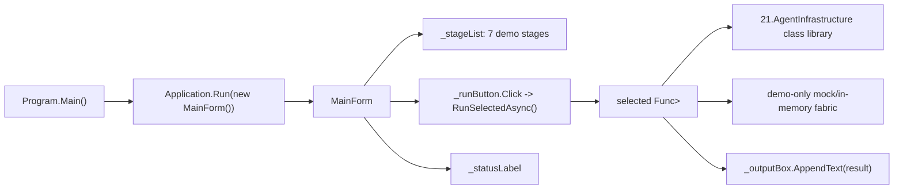

# 21.AgentInfrastructure.Desktop — документация реализации

## 1. Человеческое объяснение

`21.AgentInfrastructure.Desktop` — это маленькое WinForms-приложение-обозреватель для подпроекта `21.AgentInfrastructure`. Оно открывает окно, показывает список из семи демонстрационных этапов и по кнопке запускает заранее подготовленный сценарий, чтобы Луба могла увидеть, как выглядят конфигурация, индексирование кода, сбор контекста, agent loop, permission gate, применение патча и хранение сессии.

Важно: это demo/stage explorer, а не production host. Он не является IDE extension runtime, не доказывает внешнюю AI-интеграцию с approval от Лубы, не тренирует модель и не доказывает жизненный цикл trainable asset. Внутри используются mock/in-memory помощники, поэтому результат полезен как объяснение wiring и UX-поверхности, но не как end-to-end runtime evidence.

## 2. UML для draw.io



### Симуляции связей

| Связь | Пример входа | Что происходит | Ожидаемый результат | Что нельзя считать доказанным |
|---|---|---|---|---|
| `Program.Main` -> `Application.Run(new MainForm())` | Пользователь запускает exe | WinForms инициализируется, затем создается и показывается `MainForm` | Открыто окно stage explorer | Это не доказывает production host integration или plugin runtime |
| `MainForm` -> список демо | Конструктор формы | `_demos` получает семь названий и функций запуска | В левом списке видны Stage 01..07 | Наличие пунктов меню не доказывает качество алгоритмов |
| Кнопка -> `RunSelectedAsync()` | Выбран Stage 04, нажата кнопка | Кнопка блокируется, статус меняется, runner выполняется, результат пишется в textbox | Пользователь видит текстовый лог демо | Это не доказывает работу с реальным LLM: Stage 04 использует `MockLlmClient` |
| Demo runner -> `21.AgentInfrastructure` | Stage 03 передает chunks в `ContextAssembler` | Демонстрационный код вызывает core class library | На экран выводится отсортированный контекст в рамках token budget | Это не UI automation test и не runtime evidence для всего продукта |
| Demo runner -> in-memory helpers | Stage 06 использует `InMemoryCodeReader`/`InMemoryCodeWriter` | Патч применяется к словарю в памяти | На экран выводится измененный текст | Это не доказывает запись на диск или approval workflow |

## 3. Алгоритмы без кода

### Алгоритм A: запуск desktop-приложения

- Где логика: `Program.Main()` в `21.AgentInfrastructure.Desktop/Program.cs:13-20`.
- Входные параметры: явных параметров нет; метод запускается процессом приложения.
- Выход: возвращаемого DTO нет; побочный результат — WinForms message loop и окно `MainForm`.
- Текущий ход:
  1. Метод помечен `[STAThread]`, потому что WinForms UI должен работать в single-threaded apartment.
  2. `ApplicationConfiguration.Initialize()` включает стандартные настройки WinForms/high-DPI.
  3. `Application.Run(new MainForm())` создает главное окно и держит message loop до закрытия.
- Ветки и ограничения: если конструктор `MainForm` бросит исключение, отдельной recovery-логики в `Program.Main` нет. Метод не запускает агентный runtime, external AI host или обучение.

### Алгоритм B: создание `MainForm` и списка этапов

- Где логика: `MainForm.MainForm()` в `21.AgentInfrastructure.Desktop/MainForm.cs:36-58`.
- Входные параметры: нет.
- Выход: объект `MainForm` с заполненным `_demos` и собранным layout.
- Текущий ход:
  1. Создается список `_demos` из семи пар `(Name, Run)`.
  2. Каждая пара связывает человекочитаемое имя Stage 01..07 с конкретным async-методом демо.
  3. Вызывается `InitializeLayout()`, который строит split container, listbox, кнопку, output textbox и status strip.
- Что не делает: не сканирует плагины, не загружает внешние модели, не проверяет production permissions.

### Алгоритм C: выбор этапа и показ результата

- Где логика: `MainForm.RunSelectedAsync()` в `21.AgentInfrastructure.Desktop/MainForm.cs:112-139`.
- Входные параметры: нет явного DTO; вход — текущий `_stageList.SelectedIndex`.
- Выход: текст в `_outputBox`, статус в `_statusLabel`.
- Текущий ход:
  1. Проверяет индекс выбранного этапа; при невалидном индексе тихо выходит.
  2. Берет `(name, runner)` из `_demos`.
  3. Блокирует кнопку, пишет заголовок в output и статус `Running ...`.
  4. Выполняет выбранный `Func<Task<string>>`.
  5. При успехе добавляет результат в textbox и ставит статус `Done.`.
  6. При исключении печатает exception в textbox и ставит статус `Failed.`.
  7. В `finally` снова включает кнопку.
- Что не делает: не сохраняет отчет, не создает runtime QA artifact, не превращает demo-output в proof of product quality.

### Алгоритм D: семь демонстрационных сценариев

| Stage | Метод | Вход | Выход | Реальное поведение | Ограничение |
|---|---|---|---|---|---|
| 01 | `RunConfigurationLoaderDemoAsync()` | Синтетические JSON/text в `InMemoryConfigurationProvider` | Строка с merged keys | Вызывает `ConfigurationLoader.LoadAsync(_projectRoot)` | Не читает реальные пользовательские config-файлы |
| 02 | `RunCodebaseIndexerDemoAsync()` | Два in-memory `.cs` файла | Строка с nodes/PageRank sample | Вызывает `CodebaseIndexer.IndexDirectoryAsync(_projectRoot)` через demo reader | Не индексирует реальный репозиторий |
| 03 | `RunContextAssemblerDemoAsync()` | Список `ContextChunk` и token budget 50 | Строка с выбранными chunks | Вызывает `ContextAssembler.Assemble(chunks)` | Не доказывает качество prompt context в IDE |
| 04 | `RunAgentLoopDemoAsync()` | Очередь `MockLlmClient` responses | Conversation log | Запускает `AgentLoop` с mock LLM и fake `read_file` tool | Не доказывает реальную LLM/AI-интеграцию |
| 05 | `RunToolSystemDemoAsync()` | Набор sample probes | Permission decisions | Проверяет `PermissionGate.Check(...)` | Permission check не равен approval от Лубы |
| 06 | `RunFileChangeApplierDemoAsync()` | `greet.cs` в памяти, search/replace | Новый in-memory content | Вызывает `FileChangeApplier.ApplyPatchAsync(...)` | Не пишет на диск и не доказывает production edit workflow |
| 07 | `RunSessionStateStoreDemoAsync()` | `AgentState` в памяти | Loaded task/session ids | Сохраняет и загружает через `InMemorySessionStorage` | Не доказывает SQLite/session persistence |

### Алгоритм E: mock/in-memory demo helpers

- Где логика: `InMemoryConfigurationProvider`, `MockLlmClient`, `InMemoryCodeReader`, `InMemoryCodeWriter`, `InMemorySessionStorage` в `21.AgentInfrastructure.Desktop/MainForm.cs:377-496`.
- Вход: path/content/session id или очередной LLM request.
- Выход: `OperationResult<T>` или сохраненное значение в словаре.
- Текущий ход: helpers держат данные в `Dictionary`/`Queue`, возвращают `Ok(...)` при найденном значении и `Fail(...)` при отсутствующем path/session.
- Что не делает: эти helpers не являются production storage, real LLM gateway, approval system, model lifecycle или plugin host.

## 4. Короткие цитаты из кода

### Desktop project зависит от core library

`21.AgentInfrastructure.Desktop/AgentInfrastructure.Desktop.csproj:16-19`

```xml
  <ItemGroup>
    <!-- Reference the class library that holds all the agent-stage logic. -->
    <ProjectReference Include="..\21.AgentInfrastructure\AgentInfrastructure.csproj" />
  </ItemGroup>
```

Почему важно: desktop-проект сам не реализует агентные алгоритмы; он ссылается на core library и показывает демо-поверхность поверх нее. Это доказывает compile-time dependency, но не production runtime integration.

### Entry point открывает `MainForm`

`21.AgentInfrastructure.Desktop/Program.cs:13-20`

```csharp
    [STAThread]
    private static void Main()
    {
        // Opt in to per-monitor v2 high-DPI scaling; modern font rendering, etc.
        ApplicationConfiguration.Initialize();

        // Open the main window and pump the message loop until the user closes it.
        Application.Run(new MainForm());
```

Почему важно: цитата показывает фактический старт WinForms. Входных DTO нет, выход — окно и message loop. Она не доказывает работу stage demos до нажатия кнопки.

### Список этапов создается в конструкторе

`21.AgentInfrastructure.Desktop/MainForm.cs:36-58`

```csharp
    public MainForm()
    {
        // Build the demo list before the constructor wires the controls.
        _demos =
        [
            ("Stage 01 — Configuration loader (deep merge of three layers)",
             RunConfigurationLoaderDemoAsync),
            ("Stage 02 — Codebase indexer (Roslyn symbol extraction)",
             RunCodebaseIndexerDemoAsync),
            ("Stage 03 — Context assembler (token budget + ranking)",
             RunContextAssemblerDemoAsync),
            ("Stage 04 — Agent loop (ReAct pattern with mock LLM)",
             RunAgentLoopDemoAsync),
            ("Stage 05 — Tool system (registry + permission gate)",
             RunToolSystemDemoAsync),
            ("Stage 06 — File change applier (search-and-replace patches)",
             RunFileChangeApplierDemoAsync),
            ("Stage 07 — Session state store (in-memory ISessionStorage)",
             RunSessionStateStoreDemoAsync),
        ];

        InitializeLayout();
    }
```

Почему важно: это доказывает, какие именно семь сценариев доступны пользователю. В тексте прямо видно `mock LLM` и `in-memory ISessionStorage`, поэтому нельзя выдавать этот UI за production integration.

### Кнопка запускает выбранный runner и показывает текст

`21.AgentInfrastructure.Desktop/MainForm.cs:112-139`

```csharp
    private async Task RunSelectedAsync()
    {
        int index = _stageList.SelectedIndex;
        if (index < 0 || index >= _demos.Count) return;

        var (name, runner) = _demos[index];

        _runButton.Enabled = false;
        _statusLabel.Text  = $"Running {name}...";
        _outputBox.Text    = $"=== {name} ===\r\n\r\n";

        try
        {
            // Run the demo and append its output to the box.
            string result = await runner();
            _outputBox.AppendText(result);
            _statusLabel.Text = "Done.";
        }
        catch (Exception ex)
        {
            // Any unexpected exception is shown in the output instead of crashing.
            _outputBox.AppendText($"[unexpected exception]\r\n{ex}");
            _statusLabel.Text = "Failed.";
        }
        finally
        {
            _runButton.Enabled = true;
        }
```

Почему важно: это доказывает branch behavior UI: невалидный выбор ничего не делает, success пишет result, exception пишет stack text, кнопка включается обратно. Это не доказывает, что result является QA report.

### Stage 04 использует mock LLM

`21.AgentInfrastructure.Desktop/MainForm.cs:240-267`

```csharp
    private async Task<string> RunAgentLoopDemoAsync()
    {
        // The mock language model produces a deterministic sequence of three
        // responses: thought, tool call, then task complete. The user sees the
        // exact same flow a real LLM would drive.
        var mockLlm = new MockLlmClient(
        [
            new LlmResponse("Looking up the requested file...", null, null),
            new LlmResponse("",
                            ToolCallName:      "read_file",
                            ToolCallArguments: new Dictionary<string, object> { ["path"] = Path.Combine(_projectRoot, "AGENTS.md") }),
            new LlmResponse("TASK_COMPLETE:Read the file successfully.", null, null),
        ]);

        // Wire up a single read-only tool so the loop has something safe to invoke.
        var permissionGate = new PermissionGate(_projectRoot);
        var toolRegistry   = new ToolRegistry(permissionGate);
        toolRegistry.Register(
            new ToolDefinition("read_file", "Reads the named file from disk", new()),
            args => Task.FromResult(OperationResult<string>.Ok(
                $"[fake content of {args.GetValueOrDefault("path")}]")));

        var loop = new AgentLoop(mockLlm, toolRegistry);
        var initialState = new AgentState
        {
            CurrentTask = "Read AGENTS.md",
        };
        var result = await loop.RunAsync(initialState);
```

Почему важно: цитата доказывает, что demo agent loop не вызывает внешний LLM и даже `read_file` возвращает fake content. Поэтому вывод Stage 04 не является evidence внешнего AI runtime.

### In-memory helpers не ходят в реальную инфраструктуру

`21.AgentInfrastructure.Desktop/MainForm.cs:423-443`

```csharp
// Mock ILlmClient that returns a fixed sequence of canned responses.
internal sealed class MockLlmClient : ILlmClient
{
    private readonly Queue<LlmResponse> _responses;

    public MockLlmClient(IEnumerable<LlmResponse> responses)
    {
        _responses = new Queue<LlmResponse>(responses);
    }

    public Task<OperationResult<LlmResponse>> SendAsync(
        IReadOnlyList<ConversationMessage> messageHistory,
        IReadOnlyList<ToolDefinition>?     availableTools,
        CancellationToken                  cancellationToken)
    {
        if (_responses.Count == 0)
            return Task.FromResult(OperationResult<LlmResponse>.Ok(
                new LlmResponse("TASK_COMPLETE:no more responses", null, null)));

        return Task.FromResult(OperationResult<LlmResponse>.Ok(_responses.Dequeue()));
    }
```

Почему важно: `MockLlmClient` возвращает очередь заранее заданных ответов. Он полезен для демонстрации loop shape, но не доказывает качество внешнего LLM, approval, latency, model access или product behavior.

`21.AgentInfrastructure.Desktop/MainForm.cs:446-461`

```csharp
// In-memory ICodeReader so demos can run without disk I/O.
internal sealed class InMemoryCodeReader : ICodeReader
{
    private readonly Dictionary<string, string> _files = [];

    public void Set(string path, string content) => _files[path] = content;

    public Task<OperationResult<string>> ReadFileAsync(string path)
        => Task.FromResult(_files.TryGetValue(path, out var content)
            ? OperationResult<string>.Ok(content)
            : OperationResult<string>.Fail($"File '{path}' not found", "NOT_FOUND"));

    public Task<OperationResult<IReadOnlyList<string>>> ListFilesAsync(string directory, string pattern)
        => Task.FromResult(OperationResult<IReadOnlyList<string>>.Ok(
            (IReadOnlyList<string>)_files.Keys.ToList()));
}
```

`21.AgentInfrastructure.Desktop/MainForm.cs:463-475`

```csharp
// In-memory ICodeWriter so demos can run without disk I/O.
internal sealed class InMemoryCodeWriter : ICodeWriter
{
    private readonly Dictionary<string, string> _files = [];

    public string? Get(string path) => _files.GetValueOrDefault(path);

    public Task<OperationResult<bool>> WriteFileAsync(string path, string content)
    {
        _files[path] = content;
        return Task.FromResult(OperationResult<bool>.Ok(true));
    }
}
```

Почему важно: reader/writer работают через словарь. Это доказывает demo isolation, но не доказывает настоящий filesystem edit path.

## 5. QA / test mapping

Прямых UI automation tests для `21.AgentInfrastructure.Desktop`, `MainForm`, `Program.Main`, кнопки `Run selected stage` или WinForms layout при focused `rg` не найдено. Это честный D4D gap: desktop-документация описывает source behavior, но не имеет отдельного UI runtime test evidence.

Связанные core-тесты прочитаны, но не запускались в этом documentation subphase:

| Связанный блок | Тестовый якорь | Что покрывает | Чего не доказывает |
|---|---|---|---|
| Context assembly | `Tests/AgentInfrastructureTests.cs:163-235` | `ContextAssembler` empty/ranking/token-budget behavior | Не доказывает WinForms textbox display |
| Permission/tool system | `Tests/AgentInfrastructureTests.cs:237-475` | `PermissionGate` и `ToolRegistry` decisions | Не доказывает approval от Лубы или production tool UI |
| File patches | `Tests/AgentInfrastructureTests.cs:478-704` | `FileChangeApplier` replacement/fuzzy/multi-patch behavior | Не доказывает desktop Stage 06 click path |
| Agent loop | `Tests/AgentInfrastructureTests.cs:709-812` | `AgentLoop` completion/tool/max-iteration branches | Не доказывает real LLM runtime |
| Codebase indexer | `Tests/AgentInfrastructureTests.cs:813-925` | symbol extraction/PageRank behavior | Не доказывает desktop Stage 02 UI |
| Session store | `Tests/AgentInfrastructureTests.cs:927-1004` | SQLite `SessionStateStore` save/load/list/failure | Desktop Stage 07 использует in-memory helper, не SQLite |

Тесты не запускались в D4D, потому что work order разрешает только static/doc checks.

## 6. Статус и границы

| Область | Статус | Честная граница |
|---|---|---|
| WinForms shell | Реально реализован: `Program.Main` открывает `MainForm` | Не production host integration |
| Stage explorer UI | Реально реализован: listbox, button, output textbox, status strip | Не runtime QA harness |
| Core library demos | Реально вызывают классы `21.AgentInfrastructure` | Данные чаще synthetic/in-memory |
| Mock LLM | Реально реализован как очередь canned responses | Не external AI approval и не model quality evidence |
| In-memory readers/writers/storage | Реально реализованы как demo doubles | Не filesystem/session production persistence |
| Direct UI tests | Не найдены | Нужен отдельный future UI automation work order, если desktop UI станет quality gate |

## 7. Anti-false-done

- Скриншот окна, наличие кнопки или текстовый output Stage demo не заменяют production plugin/host runtime evidence.
- `MockLlmClient` не является внешним AI gateway и не доказывает, что внешний AI может использоваться без явного approval Лубы.
- In-memory helper не является asset lifecycle, real filesystem persistence или runtime service.
- Core tests могут подтверждать библиотечные алгоритмы, но не доказывают desktop UI click flow.
- Этот проект не является `ILearningMachine`, не тренирует модель, не экспортирует/importирует checkpoint и не доказывает semantic agent intelligence.
