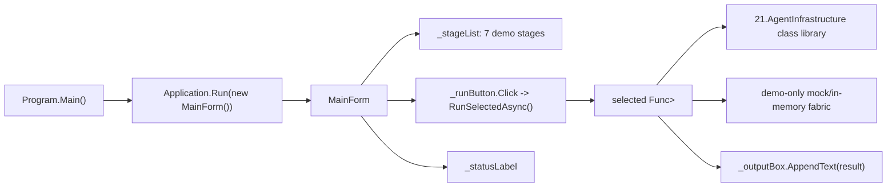

# 21.AgentInfrastructure.Desktop — implementation documentation

## 1. Human explanation

`21.AgentInfrastructure.Desktop` is a small WinForms explorer application for the `21.AgentInfrastructure` subproject. It opens a window, shows a list of seven demonstration stages and, on a button click, runs a pre-prepared scenario so that Luba can see what the configuration, code indexing, context assembly, agent loop, permission gate, patch application and session storage look like.

Important: this is a demo/stage explorer, not a production host. It is not an IDE extension runtime, does not prove external AI integration with approval from Luba, does not train a model and does not prove a trainable asset lifecycle. Mock/in-memory helpers are used inside, so the result is useful as an explanation of the wiring and the UX surface, but not as end-to-end runtime evidence.

## 2. UML for draw.io



### Connection simulations

| Connection | Example input | What happens | Expected result | What must not be considered proven |
|---|---|---|---|---|
| `Program.Main` -> `Application.Run(new MainForm())` | The user launches the exe | WinForms is initialized, then `MainForm` is created and shown | The stage explorer window is open | This does not prove production host integration or a plugin runtime |
| `MainForm` -> the demo list | The form constructor | `_demos` receives seven names and run functions | Stages 01..07 are visible in the left list | The presence of menu items does not prove algorithm quality |
| Button -> `RunSelectedAsync()` | Stage 04 selected, the button pressed | The button is disabled, the status changes, the runner executes, the result is written into the textbox | The user sees the demo's text log | This does not prove work with a real LLM: Stage 04 uses `MockLlmClient` |
| Demo runner -> `21.AgentInfrastructure` | Stage 03 passes chunks to `ContextAssembler` | The demo code calls the core class library | The sorted context within the token budget is displayed on screen | This is not a UI automation test and not runtime evidence for the whole product |
| Demo runner -> in-memory helpers | Stage 06 uses `InMemoryCodeReader`/`InMemoryCodeWriter` | The patch is applied to a dictionary in memory | The changed text is displayed on screen | This does not prove disk writing or an approval workflow |

## 3. No-code algorithms

### Algorithm A: launching the desktop application

- Where the logic is: `Program.Main()` in `21.AgentInfrastructure.Desktop/Program.cs:13-20`.
- Input parameters: no explicit parameters; the method is started by the application process.
- Output: no returned DTO; the side effect is the WinForms message loop and the `MainForm` window.
- Current flow:
  1. The method is marked `[STAThread]`, because the WinForms UI must run in a single-threaded apartment.
  2. `ApplicationConfiguration.Initialize()` enables the standard WinForms/high-DPI settings.
  3. `Application.Run(new MainForm())` creates the main window and holds the message loop until it is closed.
- Branches and limitations: if the `MainForm` constructor throws, there is no separate recovery logic in `Program.Main`. The method does not run an agent runtime, an external AI host or training.

### Algorithm B: creating `MainForm` and the stage list

- Where the logic is: `MainForm.MainForm()` in `21.AgentInfrastructure.Desktop/MainForm.cs:36-58`.
- Input parameters: none.
- Output: a `MainForm` object with a filled `_demos` and an assembled layout.
- Current flow:
  1. A `_demos` list of seven `(Name, Run)` pairs is created.
  2. Each pair links a human-readable name Stage 01..07 to a specific async demo method.
  3. `InitializeLayout()` is called, which builds the split container, listbox, button, output textbox and status strip.
- What it does not do: does not scan plugins, does not load external models, does not check production permissions.

### Algorithm C: selecting a stage and showing the result

- Where the logic is: `MainForm.RunSelectedAsync()` in `21.AgentInfrastructure.Desktop/MainForm.cs:112-139`.
- Input parameters: no explicit DTO; the input is the current `_stageList.SelectedIndex`.
- Output: text in `_outputBox`, status in `_statusLabel`.
- Current flow:
  1. Checks the index of the selected stage; on an invalid index it silently exits.
  2. Takes `(name, runner)` from `_demos`.
  3. Disables the button, writes a header into the output and the status `Running ...`.
  4. Executes the selected `Func<Task<string>>`.
  5. On success adds the result to the textbox and sets the status `Done.`.
  6. On an exception prints the exception into the textbox and sets the status `Failed.`.
  7. In `finally` re-enables the button.
- What it does not do: does not save a report, does not create a runtime QA artifact, does not turn the demo output into proof of product quality.

### Algorithm D: the seven demonstration scenarios

| Stage | Method | Input | Output | Real behavior | Limitation |
|---|---|---|---|---|---|
| 01 | `RunConfigurationLoaderDemoAsync()` | Synthetic JSON/text in `InMemoryConfigurationProvider` | A string with merged keys | Calls `ConfigurationLoader.LoadAsync(_projectRoot)` | Does not read real user config files |
| 02 | `RunCodebaseIndexerDemoAsync()` | Two in-memory `.cs` files | A string with a nodes/PageRank sample | Calls `CodebaseIndexer.IndexDirectoryAsync(_projectRoot)` via the demo reader | Does not index a real repository |
| 03 | `RunContextAssemblerDemoAsync()` | A list of `ContextChunk` and a token budget of 50 | A string with the selected chunks | Calls `ContextAssembler.Assemble(chunks)` | Does not prove prompt context quality in an IDE |
| 04 | `RunAgentLoopDemoAsync()` | A queue of `MockLlmClient` responses | A conversation log | Runs `AgentLoop` with a mock LLM and a fake `read_file` tool | Does not prove real LLM/AI integration |
| 05 | `RunToolSystemDemoAsync()` | A set of sample probes | Permission decisions | Checks `PermissionGate.Check(...)` | A permission check is not equal to approval from Luba |
| 06 | `RunFileChangeApplierDemoAsync()` | `greet.cs` in memory, search/replace | New in-memory content | Calls `FileChangeApplier.ApplyPatchAsync(...)` | Does not write to disk and does not prove a production edit workflow |
| 07 | `RunSessionStateStoreDemoAsync()` | An `AgentState` in memory | Loaded task/session ids | Saves and loads via `InMemorySessionStorage` | Does not prove SQLite/session persistence |

### Algorithm E: mock/in-memory demo helpers

- Where the logic is: `InMemoryConfigurationProvider`, `MockLlmClient`, `InMemoryCodeReader`, `InMemoryCodeWriter`, `InMemorySessionStorage` in `21.AgentInfrastructure.Desktop/MainForm.cs:377-496`.
- Input: path/content/session id or the next LLM request.
- Output: `OperationResult<T>` or a stored value in a dictionary.
- Current flow: the helpers keep the data in a `Dictionary`/`Queue`, return `Ok(...)` when a value is found and `Fail(...)` on a missing path/session.
- What it does not do: these helpers are not production storage, a real LLM gateway, an approval system, a model lifecycle or a plugin host.

## 4. Short code quotes

### The desktop project depends on the core library

`21.AgentInfrastructure.Desktop/AgentInfrastructure.Desktop.csproj:16-19`

```xml
  <ItemGroup>
    <!-- Reference the class library that holds all the agent-stage logic. -->
    <ProjectReference Include="..\21.AgentInfrastructure\AgentInfrastructure.csproj" />
  </ItemGroup>
```

Why it matters: the desktop project does not implement the agent algorithms itself; it references the core library and shows a demo surface on top of it. This proves a compile-time dependency, but not production runtime integration.

### The entry point opens `MainForm`

`21.AgentInfrastructure.Desktop/Program.cs:13-20`

```csharp
    [STAThread]
    private static void Main()
    {
        // Opt in to per-monitor v2 high-DPI scaling; modern font rendering, etc.
        ApplicationConfiguration.Initialize();

        // Open the main window and pump the message loop until the user closes it.
        Application.Run(new MainForm());
```

Why it matters: the quote shows the actual WinForms start. There are no input DTOs, the output is the window and the message loop. It does not prove that the stage demos work before a button is pressed.

### The stage list is created in the constructor

`21.AgentInfrastructure.Desktop/MainForm.cs:36-58`

```csharp
    public MainForm()
    {
        // Build the demo list before the constructor wires the controls.
        _demos =
        [
            ("Stage 01 — Configuration loader (deep merge of three layers)",
             RunConfigurationLoaderDemoAsync),
            ("Stage 02 — Codebase indexer (Roslyn symbol extraction)",
             RunCodebaseIndexerDemoAsync),
            ("Stage 03 — Context assembler (token budget + ranking)",
             RunContextAssemblerDemoAsync),
            ("Stage 04 — Agent loop (ReAct pattern with mock LLM)",
             RunAgentLoopDemoAsync),
            ("Stage 05 — Tool system (registry + permission gate)",
             RunToolSystemDemoAsync),
            ("Stage 06 — File change applier (search-and-replace patches)",
             RunFileChangeApplierDemoAsync),
            ("Stage 07 — Session state store (in-memory ISessionStorage)",
             RunSessionStateStoreDemoAsync),
        ];

        InitializeLayout();
    }
```

Why it matters: this proves exactly which seven scenarios are available to the user. The text directly shows `mock LLM` and `in-memory ISessionStorage`, so this UI must not be presented as production integration.

### The button runs the selected runner and shows the text

`21.AgentInfrastructure.Desktop/MainForm.cs:112-139`

```csharp
    private async Task RunSelectedAsync()
    {
        int index = _stageList.SelectedIndex;
        if (index < 0 || index >= _demos.Count) return;

        var (name, runner) = _demos[index];

        _runButton.Enabled = false;
        _statusLabel.Text  = $"Running {name}...";
        _outputBox.Text    = $"=== {name} ===\r\n\r\n";

        try
        {
            // Run the demo and append its output to the box.
            string result = await runner();
            _outputBox.AppendText(result);
            _statusLabel.Text = "Done.";
        }
        catch (Exception ex)
        {
            // Any unexpected exception is shown in the output instead of crashing.
            _outputBox.AppendText($"[unexpected exception]\r\n{ex}");
            _statusLabel.Text = "Failed.";
        }
        finally
        {
            _runButton.Enabled = true;
        }
```

Why it matters: this proves the UI branch behavior: an invalid selection does nothing, success writes the result, an exception writes the stack text, the button re-enables. This does not prove that the result is a QA report.

### Stage 04 uses a mock LLM

`21.AgentInfrastructure.Desktop/MainForm.cs:240-267`

```csharp
    private async Task<string> RunAgentLoopDemoAsync()
    {
        // The mock language model produces a deterministic sequence of three
        // responses: thought, tool call, then task complete. The user sees the
        // exact same flow a real LLM would drive.
        var mockLlm = new MockLlmClient(
        [
            new LlmResponse("Looking up the requested file...", null, null),
            new LlmResponse("",
                            ToolCallName:      "read_file",
                            ToolCallArguments: new Dictionary<string, object> { ["path"] = Path.Combine(_projectRoot, "AGENTS.md") }),
            new LlmResponse("TASK_COMPLETE:Read the file successfully.", null, null),
        ]);

        // Wire up a single read-only tool so the loop has something safe to invoke.
        var permissionGate = new PermissionGate(_projectRoot);
        var toolRegistry   = new ToolRegistry(permissionGate);
        toolRegistry.Register(
            new ToolDefinition("read_file", "Reads the named file from disk", new()),
            args => Task.FromResult(OperationResult<string>.Ok(
                $"[fake content of {args.GetValueOrDefault("path")}]")));

        var loop = new AgentLoop(mockLlm, toolRegistry);
        var initialState = new AgentState
        {
            CurrentTask = "Read AGENTS.md",
        };
        var result = await loop.RunAsync(initialState);
```

Why it matters: the quote proves that the demo agent loop does not call an external LLM and even `read_file` returns fake content. Therefore the Stage 04 output is not evidence of an external AI runtime.

### The in-memory helpers do not touch real infrastructure

`21.AgentInfrastructure.Desktop/MainForm.cs:423-443`

```csharp
// Mock ILlmClient that returns a fixed sequence of canned responses.
internal sealed class MockLlmClient : ILlmClient
{
    private readonly Queue<LlmResponse> _responses;

    public MockLlmClient(IEnumerable<LlmResponse> responses)
    {
        _responses = new Queue<LlmResponse>(responses);
    }

    public Task<OperationResult<LlmResponse>> SendAsync(
        IReadOnlyList<ConversationMessage> messageHistory,
        IReadOnlyList<ToolDefinition>?     availableTools,
        CancellationToken                  cancellationToken)
    {
        if (_responses.Count == 0)
            return Task.FromResult(OperationResult<LlmResponse>.Ok(
                new LlmResponse("TASK_COMPLETE:no more responses", null, null)));

        return Task.FromResult(OperationResult<LlmResponse>.Ok(_responses.Dequeue()));
    }
```

Why it matters: `MockLlmClient` returns a queue of pre-defined responses. It is useful for demonstrating the loop shape, but does not prove the quality of an external LLM, approval, latency, model access or product behavior.

`21.AgentInfrastructure.Desktop/MainForm.cs:446-461`

```csharp
// In-memory ICodeReader so demos can run without disk I/O.
internal sealed class InMemoryCodeReader : ICodeReader
{
    private readonly Dictionary<string, string> _files = [];

    public void Set(string path, string content) => _files[path] = content;

    public Task<OperationResult<string>> ReadFileAsync(string path)
        => Task.FromResult(_files.TryGetValue(path, out var content)
            ? OperationResult<string>.Ok(content)
            : OperationResult<string>.Fail($"File '{path}' not found", "NOT_FOUND"));

    public Task<OperationResult<IReadOnlyList<string>>> ListFilesAsync(string directory, string pattern)
        => Task.FromResult(OperationResult<IReadOnlyList<string>>.Ok(
            (IReadOnlyList<string>)_files.Keys.ToList()));
}
```

`21.AgentInfrastructure.Desktop/MainForm.cs:463-475`

```csharp
// In-memory ICodeWriter so demos can run without disk I/O.
internal sealed class InMemoryCodeWriter : ICodeWriter
{
    private readonly Dictionary<string, string> _files = [];

    public string? Get(string path) => _files.GetValueOrDefault(path);

    public Task<OperationResult<bool>> WriteFileAsync(string path, string content)
    {
        _files[path] = content;
        return Task.FromResult(OperationResult<bool>.Ok(true));
    }
}
```

Why it matters: the reader/writer work through a dictionary. This proves demo isolation, but does not prove a real filesystem edit path.

## 5. QA / test mapping

No direct UI automation tests for `21.AgentInfrastructure.Desktop`, `MainForm`, `Program.Main`, the `Run selected stage` button or the WinForms layout were found in a focused `rg`. This is an honest D4D gap: the desktop documentation describes source behavior, but has no separate UI runtime test evidence.

The related core tests were read, but not run in this documentation subphase:

| Related block | Test anchor | What it covers | What it does not prove |
|---|---|---|---|
| Context assembly | `Tests/AgentInfrastructureTests.cs:163-235` | `ContextAssembler` empty/ranking/token-budget behavior | Does not prove WinForms textbox display |
| Permission/tool system | `Tests/AgentInfrastructureTests.cs:237-475` | `PermissionGate` and `ToolRegistry` decisions | Does not prove approval from Luba or a production tool UI |
| File patches | `Tests/AgentInfrastructureTests.cs:478-704` | `FileChangeApplier` replacement/fuzzy/multi-patch behavior | Does not prove the desktop Stage 06 click path |
| Agent loop | `Tests/AgentInfrastructureTests.cs:709-812` | `AgentLoop` completion/tool/max-iteration branches | Does not prove a real LLM runtime |
| Codebase indexer | `Tests/AgentInfrastructureTests.cs:813-925` | symbol extraction/PageRank behavior | Does not prove the desktop Stage 02 UI |
| Session store | `Tests/AgentInfrastructureTests.cs:927-1004` | SQLite `SessionStateStore` save/load/list/failure | The desktop Stage 07 uses an in-memory helper, not SQLite |

The tests were not run in D4D, because the work order allows only static/doc checks.

## 6. Status and boundaries

| Area | Status | Honest boundary |
|---|---|---|
| WinForms shell | Actually implemented: `Program.Main` opens `MainForm` | Not production host integration |
| Stage explorer UI | Actually implemented: listbox, button, output textbox, status strip | Not a runtime QA harness |
| Core library demos | Actually call the `21.AgentInfrastructure` classes | The data is mostly synthetic/in-memory |
| Mock LLM | Actually implemented as a queue of canned responses | Not external AI approval and not model quality evidence |
| In-memory readers/writers/storage | Actually implemented as demo doubles | Not filesystem/session production persistence |
| Direct UI tests | Not found | A separate future UI automation work order is needed if the desktop UI becomes a quality gate |

## 7. Anti-false-done

- A screenshot of the window, the presence of a button or the text output of a stage demo do not replace production plugin/host runtime evidence.
- `MockLlmClient` is not an external AI gateway and does not prove that an external AI can be used without explicit approval from Luba.
- An in-memory helper is not an asset lifecycle, real filesystem persistence or a runtime service.
- The core tests can confirm the library algorithms, but do not prove the desktop UI click flow.
- This project is not an `ILearningMachine`, does not train a model, does not export/import a checkpoint and does not prove semantic agent intelligence.
