# 21.AgentInfrastructure — документация реализации

## 0. Краткая карта для Лубы

`21.AgentInfrastructure` — это общий каркас агента: он хранит сообщения и задачи, собирает контекст, читает конфигурацию, индексирует код, применяет правки через безопасные контракты, проверяет разрешения на инструменты и держит логическую инфраструктуру `ILogicalOrchestrator` / `ILogicalFlow` / `ILogicalUnit`. Через него проходят не "готовые ответы модели", а технические DTO: `AgentState`, `ConversationMessage`, `ToolDefinition`, `LogicalOrchestratorRequest`, `LogicalFlowRequest`, topology commands и registry descriptors. В проекте есть много реально работающей deterministic инфраструктуры: SQLite session store, context ranking, Roslyn indexing, permission gate, topology registries, logical flow/unit registries, universal nine-node bootstrap flow. Есть trainable-adjacent места: `KnnLogicalUnit`, `ExpressionCompletionUnit`, `CompiledDomainClassifierUnit`, `LogicalCapabilityTrainingContracts`, `AdaptiveLogicalOrchestrator.RunWithCapabilityGenerationAsync`; но сам проект D21 не является завершенным `ILearningMachine` asset с checkpoint/export/import/fresh-load/continue evidence. `InternalLlmGateway` и tool permission checks — это routing/permission infrastructure, а не разрешение использовать внешний AI без прямого решения Лубы.

### Shared transport для опубликованных remote-unit

`21.AgentInfrastructure` также держит общий transport-слой, которым пользуются `25.ModelServer` и downstream-клиенты без прямой ссылки на серверный executable. Это не переносит в проект 21 право публиковать веса: authority на публикацию checkpoint-ов остаётся в `25.ModelServer`, а здесь лежат только DTO, locator contract и in-memory/proxy bootstrap для чтения опубликованного паспорта.

| Transport file | Зачем он нужен | Граница честности |
|---|---|---|
| `21.AgentInfrastructure/ModelServer/Contracts/IRemoteUnitLocator.cs` | Общий контракт `LocateAsync` / `RegisterAsync` для поиска опубликованного `RemoteUnitManifest`. | Это lookup contract, не разрешение публиковать checkpoint. |
| `21.AgentInfrastructure/ModelServer/Remote/RemoteUnitManifest.cs` | Паспорт remote-unit: endpoint, provenance, model config, LoRA config и tokenizer path. | Это transport record; качество модели и fresh-load доказываются отдельно. |
| `21.AgentInfrastructure/ModelServer/Remote/InMemoryRemoteUnitLocator.cs` | In-process registry для тестов и bootstrap-сценариев. | Данные живут только в памяти процесса; это не production discovery. |
| `21.AgentInfrastructure/ModelServer/Remote/RemoteLogicalUnitProxy.cs` | Адаптер `ILogicalUnit<string,string>`, который читает manifest через locator и возвращает evidence. | Proxy не выполняет remote inference: он не вызывает модель и не меняет веса. |

Namespace у этих типов остаётся `ModelServer.*` ради совместимости существующего кода, но живой физический путь начинается с `21.AgentInfrastructure/ModelServer/...`.

## 1. Простая UML для draw.io

```plantuml
@startuml
title D21-A - 21.AgentInfrastructure

class "AgentLoop" as AgentLoop
class "AgentState" as AgentState
class "InternalLlmGateway" as Gateway
class "ToolRegistry" as ToolRegistry
class "PermissionGate" as PermissionGate
class "SessionStateStore" as SessionStore
class "ContextAssembler" as ContextAssembler
class "CodebaseIndexer" as Indexer
class "FileChangeApplier" as Patcher
class "AdaptiveLogicalOrchestrator" as Orchestrator
class "InMemoryLogicalFlowRegistry" as FlowRegistry
class "InMemoryLogicalUnitRegistry" as UnitRegistry
class "LogicalTopologyRegistry" as Topology
class "TopologyMutationFlow" as MutationFlow
class "UniversalNineNodeDevelopmentFlow" as NineFlow
class "KnnLogicalUnit" as KnnUnit
class "LearningEventScheduler" as Scheduler

AgentLoop --> AgentState : ConversationMessage[] + todo state
AgentLoop --> Gateway : message history -> LlmResponse
AgentLoop --> ToolRegistry : tool call -> OperationResult<string>
ToolRegistry --> PermissionGate : tool + arguments -> decision
AgentLoop --> SessionStore : AgentState save/load
ContextAssembler --> Indexer : ranked code chunks / symbol graph source
Patcher --> "ICodeReader/ICodeWriter" : file text -> patched text
Orchestrator --> FlowRegistry : scenario/subphase -> ILogicalFlow
Orchestrator --> UnitRegistry : logical unit lookup
Orchestrator --> Topology : domain/phase/subphase/transition graph
MutationFlow --> Topology : Add*Command -> registry entry
NineFlow --> "ILogicalUnit chain" : UniversalNodeState -> LogicalFlowResult
KnnUnit ..> "training examples" : deterministic KNN lookup
Scheduler --> "idle trainer boundary" : queued LearningEvent[]

note right of AgentLoop
Статус: реализованный bounded loop.
Не доказывает качество LLM и не заменяет approval protocol.
end note

note right of Orchestrator
Статус: logical orchestration infrastructure.
Может вызвать trainer, но сам не является ILearningMachine.
end note

note right of KnnUnit
Статус: trainable-adjacent KNN helper.
Нет полного model asset lifecycle.
end note
@enduml
```



| Узел | Что делает | Статус | Где живет |
|---|---|---|---|
| `AgentLoop` | Ведет итерации: история сообщений -> LLM -> tool call или `TASK_COMPLETE`. | Реализован loop | `21.AgentInfrastructure/Loop/AgentLoop.cs` |
| `ToolRegistry` / `PermissionGate` | Регистрирует tools и проверяет read/write/unknown behavior. | Реализована deterministic permission infrastructure | `21.AgentInfrastructure/Tools/*.cs` |
| `SessionStateStore` | Сохраняет/загружает `AgentState` в SQLite. | Реализован persistence слой | `21.AgentInfrastructure/State/SessionStateStore.cs` |
| `CodebaseIndexer` / `StackDetector` | Читает `.cs`, строит symbol graph, считает PageRank, определяет stack markers. | Реализован code infrastructure | `21.AgentInfrastructure/Indexing/*.cs` |
| `AdaptiveLogicalOrchestrator` | Компилирует prompt, классифицирует domain, выбирает flow/units и может обратиться к trainer. | Частичная trainable-adjacent orchestration | `21.AgentInfrastructure/Logical/AdaptiveLogicalOrchestrator.cs` |
| `TopologyMutationFlow` | Принимает topology commands и вызывает mutation units. | Реализован deterministic registry mutation flow | `21.AgentInfrastructure/Logical/TopologyMutationFlow.cs` |
| `UniversalNineNodeDevelopmentFlow` | Запускает девять bootstrap nodes A -> B + X. | Bootstrap flow | `21.AgentInfrastructure/Logical/UniversalNineNodeDevelopmentFlow.cs` |
| `KnnLogicalUnit` | Выбирает ближайший training example по features. | KNN infrastructure, не semantic authority | `21.AgentInfrastructure/Logical/KnnLogicalUnit.cs` |

### Симуляции важных связей

| Связь | Пример входа | Что происходит | Ожидаемый результат | Что нельзя считать доказанным |
|---|---|---|---|---|
| `AgentLoop -> Gateway` | `AgentState.MessageHistory=[user:"fix tests"]` | Loop отправляет историю и tools в `ILlmClient`. | `LlmResponse` с text или tool call. | Не доказательство внешнего AI approval или качества ответа. |
| `ToolRegistry -> PermissionGate` | tool=`write_file`, path вне project root | Gate нормализует путь и deny-ит вне root. | `PERMISSION_DENIED`. | Permission check не равен разрешению Лубы на опасное действие. |
| `AgentLoop -> SessionStateStore` | session id + messages/todos | Store upsert-ит session и перезаписывает messages/todos. | Загружаемый `AgentState`. | Persistence не доказывает trained memory. |
| `ContextAssembler -> TokenCounter` | chunks scores 0.9/0.3, token budget 1000 | Сортирует по relevance, добавляет пока влезает budget. | Список наиболее релевантных chunks. | Не semantic retrieval authority. |
| `CodebaseIndexer -> StackDetector` | source with `namespace`/`using` | Detector считает markers перед symbol extraction. | `StackLanguage.CSharp`, graph nodes. | Stack marker не доказывает build/runtime correctness. |
| `Patcher -> ICodeReader/ICodeWriter` | one exact search text | Читает файл, проверяет 0/1/>1 occurrences, пишет replacement. | Success только для однозначного patch. | Не разрешает edit без work-order authority. |
| `Orchestrator -> FlowRegistry` | scenario id `development.lifecycle` | Resolve flow binding and execute. | `LogicalOrchestratorResult`. | Не Level 5 model training. |
| `MutationFlow -> Topology` | `AddPhaseCommand(reason, phase)` | Flow dispatch-ит command в unit, registry adds/updates entry. | `LogicalFlowResult` с evidence id. | Registry mutation не trained topology reasoning. |
| `NineFlow -> ILogicalUnit chain` | prompt `"design auth then implement"` | Девять deterministic node transforms идут по порядку. | Final human result + metrics/evidence. | Bootstrap chain не trained orchestration. |
| `Scheduler -> idle trainer boundary` | pending=20, idle=false | Event queued, drain blocked while not idle. | `LearningDrainResult(false, ...)`. | Queued event не training run evidence. |

## 2. Алгоритмы без кода на русском

### Алгоритм A: агентский цикл `AgentLoop.RunAsync`

- Класс: `AgentLoop`.
- Метод: `RunAsync(AgentState initialState, CancellationToken cancellationToken = default)`.
- Вход: `AgentState` с `MessageHistory`, `TodoList`, `IterationCount`.
- Выход: `OperationResult<AgentLoopResult>` с флагом завершения, final text и updated state.
- Шаги: взять tools из registry; пока iteration count меньше лимита, проверить cancellation; при переполнении token threshold compact history; отправить history в LLM client; если ответ начинается с `TASK_COMPLETE:`, вернуть завершение; если есть tool call, выполнить tool через registry и добавить result в history; иначе добавить текстовый ответ и продолжить.
- Ветки: cancellation -> `CANCELLED`; LLM failure -> fail; tool failure -> tool result message; max iterations -> non-complete result.
- Не делает: не доказывает качество LLM, не является approval engine, не обучает модель.

`21.AgentInfrastructure/Loop/AgentLoop.cs:45-83`

```csharp
public async Task<OperationResult<AgentLoopResult>> RunAsync(
    AgentState         initialState,
    CancellationToken  cancellationToken = default)
{
    var state      = initialState;
    var toolDefs   = _tools.AllToolDefinitions();

    while (state.IterationCount < _maxIterations)
    {
        if (cancellationToken.IsCancellationRequested)
            return OperationResult<AgentLoopResult>.Fail("Cancelled", "CANCELLED");

        // Compact history if it is growing too large.
        if (TokenCounter.EstimateHistory(state.MessageHistory) > _compactionThreshold)
        {
            state = _summaryGenerator is not null
                ? await CompactWithSummaryAsync(state)
                : CompactHistory(state);
        }

        var llmResult = await _llm.SendAsync(state.MessageHistory, toolDefs, cancellationToken);
```

Почему важно: цитата показывает реальный loop и compaction branch. Она не доказывает, что LLM разрешен к использованию без внешней политики или прямой команды Лубы.

### Алгоритм B: tool permission path `ToolRegistry.ExecuteAsync` + `PermissionGate.Check`

- Классы: `ToolRegistry`, `PermissionGate`.
- Методы: `ExecuteAsync(string toolName, Dictionary<string, object> arguments)`, `Check(string toolName, Dictionary<string, object> toolArguments)`.
- Вход: tool name и arguments, часто с `path`.
- Выход: `OperationResult<string>` или `OperationResult<PermissionDecision>`.
- Шаги: registry ищет handler; gate проверяет path внутри project root; read-only tools разрешены; write tools возвращают `RequiresApproval`; unknown denied; registry блокирует denied и вызывает handler только при allowed/approval state.
- Не делает: `RequiresApproval` в library path не является согласием Лубы; UI/parent protocol обязан получить реальное разрешение, если оно требуется.

`21.AgentInfrastructure/Tools/PermissionGate.cs:30-52`

```csharp
public OperationResult<PermissionDecision> Check(
    string toolName,
    Dictionary<string, object> toolArguments)
{
    if (string.IsNullOrWhiteSpace(toolName))
        return OperationResult<PermissionDecision>.Fail("Tool name cannot be empty.", "INVALID_TOOL");

    // For file-targeting tools, verify the target path is inside the project root.
    if (toolArguments.TryGetValue("path", out var pathObj) && pathObj is string filePath)
    {
        string fullPath = Path.GetFullPath(filePath);
        if (!fullPath.StartsWith(_projectRootPath, StringComparison.OrdinalIgnoreCase))
            return OperationResult<PermissionDecision>.Ok(PermissionDecision.Denied);
    }
```

`21.AgentInfrastructure/Tools/ToolRegistry.cs:30-45`

```csharp
public async Task<OperationResult<string>> ExecuteAsync(
    string toolName,
    Dictionary<string, object> arguments)
{
    if (!_tools.TryGetValue(toolName, out var entry))
        return OperationResult<string>.Fail($"Tool '{toolName}' is not registered.", "UNKNOWN_TOOL");

    var permission = _gate.Check(toolName, arguments);
    if (!permission.IsSuccess)
        return OperationResult<string>.Fail(permission.ErrorMessage, permission.ErrorCode);

    if (permission.Value == PermissionDecision.Denied)
        return OperationResult<string>.Fail($"Tool '{toolName}' is denied.", "PERMISSION_DENIED");

    // RequiresApproval is granted automatically in the library (the UI layer handles the dialog).
    return await entry.Handler(arguments);
```

Почему важно: строка про automatic grant — граница риска. Документ фиксирует: это библиотечный контракт, не продукт-owner approval.

### Алгоритм C: состояние и session persistence

- Классы: `AgentState`, `SessionStateStore`.
- Методы: `AgentState.WithMessage`, `WithTodoCompleted`, `SaveAsync`, `LoadAsync`, `ListSessionsAsync`.
- Вход: session id, immutable state с messages/todos.
- Выход: сохраненный или загруженный `AgentState`.
- Шаги: state methods возвращают copy через record `with`; store открывает SQLite, upsert-ит session, чистит старые messages/todos, пишет новые; load читает session row, messages и todos по order.
- Не делает: не является long-term learning memory и не доказывает model improvement.

`21.AgentInfrastructure/Loop/AgentState.cs:11-35`

```csharp
public sealed record AgentState
{
    public string SessionId       { get; init; } = Guid.NewGuid().ToString();
    public string CurrentTask     { get; init; } = string.Empty;
    public int    IterationCount  { get; init; }

    public IReadOnlyList<ConversationMessage> MessageHistory { get; init; }
        = [];

    public IReadOnlyList<TodoItem> TodoList { get; init; }
        = [];
```

`21.AgentInfrastructure/State/SessionStateStore.cs:53-82`

```csharp
public async Task<OperationResult<bool>> SaveAsync(string sessionId, AgentState state)
{
    await using var conn = new SqliteConnection(_connectionString);
    conn.Open();
    await using var tx = conn.BeginTransaction();

    try
    {
        // Upsert the session row.
        await using (var cmd = conn.CreateCommand())
        {
            cmd.Transaction = tx;
            cmd.CommandText = """
                INSERT INTO sessions (id, task, created_at)
                VALUES (@id, @task, @ts)
                ON CONFLICT(id) DO UPDATE SET task = @task;
```

### Алгоритм D: конфигурация, контекст и token budget

- Классы: `ConfigurationLoader`, `ContextAssembler`, `TokenCounter`.
- Методы: `LoadAsync(string projectRootPath)`, `Assemble(IReadOnlyList<ContextChunk> chunks)`, `Estimate(string text)`.
- Вход: project root, ranked chunks, text/history.
- Выход: merged config dictionary, selected chunks, estimated token count.
- Шаги: loader merge-ит global config, project config и env overrides; assembler сортирует chunks по relevance и добавляет до token budget; token counter оценивает tokens через words / 0.75.
- Не делает: не является semantic compression или trained retrieval.

`21.AgentInfrastructure/Config/ConfigurationLoader.cs:15-31`

```csharp
public async Task<OperationResult<Dictionary<string, object>>> LoadAsync(string projectRootPath)
{
    var merged = new Dictionary<string, object>(StringComparer.Ordinal);

    // Layer 1 — global user configuration (lowest priority).
    var globalPath = Path.Combine(
        Environment.GetFolderPath(Environment.SpecialFolder.UserProfile),
        ".config", "agent", "agent.json");
```

`21.AgentInfrastructure/Context/ContextAssembler.cs:23-43`

```csharp
public OperationResult<IReadOnlyList<ContextChunk>> Assemble(IReadOnlyList<ContextChunk> chunks)
{
    if (chunks.Count == 0)
        return OperationResult<IReadOnlyList<ContextChunk>>.Ok([]);

    // Sort by relevance score descending so the most relevant chunk comes first.
    var ranked = chunks.OrderByDescending(c => c.RelevanceScore).ToList();
```

`21.AgentInfrastructure/Context/TokenCounter.cs:8-16`

```csharp
public static int Estimate(string text)
{
    if (string.IsNullOrWhiteSpace(text)) return 0;
    int wordCount = text.Split((char[])[], StringSplitOptions.RemoveEmptyEntries).Length;
    return (int)Math.Ceiling(wordCount / 0.75);
}
```

### Алгоритм E: code indexing and patching

- Классы: `CodebaseIndexer`, `StackDetector`, `FrequencyFileSelector`, `FileChangeApplier`.
- Методы: `IndexDirectoryAsync`, `Detect`, `SelectCoreFiles`, `ApplyPatchAsync`, `ApplyManyPatchesAsync`.
- Вход: directory path, source text, all files, search/replacement pairs.
- Выход: `SymbolGraph`, `StackInfo`, selected files, patch result.
- Шаги: indexer lists `*.cs`, reads each file, detects stack markers, extracts symbols into graph; selector ranks files by graph indegree; applier rejects empty/ambiguous search and can apply many patches sequentially.
- Не делает: не proves compilation, safe edit authority, or semantic refactoring quality.

`21.AgentInfrastructure/Indexing/CodebaseIndexer.cs:83-105`

```csharp
public async Task<OperationResult<SymbolGraph>> IndexDirectoryAsync(
    string directoryPath,
    IProgress<int>? progressReporter = null)
{
    var listResult = await _codeReader.ListFilesAsync(directoryPath, "*.cs");
    if (!listResult.IsSuccess)
        return OperationResult<SymbolGraph>.Fail(listResult.ErrorMessage, listResult.ErrorCode);
```

`21.AgentInfrastructure/Indexing/StackDetector.cs:26-39`

```csharp
public OperationResult<StackInfo> Detect(string sourceText)
{
    int csScore = CSharpMarkers.Count(m => sourceText.Contains(m));
    int tsScore = TypeScriptMarkers.Count(m => sourceText.Contains(m));
    int pyScore = PythonMarkers.Count(m => sourceText.Contains(m));
```

`21.AgentInfrastructure/Editing/FileChangeApplier.cs:16-37`

```csharp
public async Task<OperationResult<bool>> ApplyPatchAsync(
    string filePath,
    string searchText,
    string replacementText)
{
    if (string.IsNullOrEmpty(searchText))
        return OperationResult<bool>.Fail("Search text cannot be empty.", "EMPTY_SEARCH");
```

### Алгоритм F: logical orchestration and registries

- Классы: `AdaptiveLogicalOrchestrator`, `InMemoryLogicalFlowRegistry`, `InMemoryLogicalUnitRegistry`, `LogicalTopologyRegistry`.
- Методы: `RunAsync(LogicalOrchestratorRequest request, ...)`, `Register/Resolve`, `AddOrUpdateDomain`, `ResolveDomain`.
- Вход: orchestrator request, flow/unit descriptors, topology entries.
- Выход: `LogicalOrchestratorResult`, `LogicalFlowDescriptor`, `LogicalUnitDescriptor`, topology entry.
- Шаги: orchestrator validates request, compiles prompt, classifies domain, routes to flow; registries validate ids/types and return typed flow/unit; topology registry stores domains/phases/subphases/transitions in memory.
- Не делает: не является Level 5 training boundary; registry entries are not trained model assets.

`21.AgentInfrastructure/Logical/AdaptiveLogicalOrchestrator.cs:85-116`

```csharp
public async Task<OperationResult<LogicalOrchestratorResult>> RunAsync(LogicalOrchestratorRequest request, CancellationToken cancellationToken = default)
{
    // Return cancellation through the shared operation envelope.
    if (cancellationToken.IsCancellationRequested)
        return OperationResult<LogicalOrchestratorResult>.Fail("Cancelled.", "CANCELLED");

    // Reject missing requests before reading request properties.
    if (request is null)
        return OperationResult<LogicalOrchestratorResult>.Fail("Logical orchestrator request is required.", "REQUEST_REQUIRED");
```

`21.AgentInfrastructure/Logical/InMemoryLogicalFlowRegistry.cs:30-72`

```csharp
public OperationResult<LogicalFlowDescriptor> Register<TInput>(string flowId, string scenarioId, string version, ILogicalFlow<TInput> flow)
{
    return Register(flowId, scenarioId, version, flow, FlowFactory: null, FactoryInputType: null, BoundSubPhaseIds: []);
}
```

`21.AgentInfrastructure/Logical/InMemoryLogicalUnitRegistry.cs:39-64`

```csharp
public OperationResult<LogicalUnitDescriptor> Register<TInput, TOutput>(
    string unitId,
    string unitRole,
    string domainTag,
    string version,
    LogicalUnitTrustState trustState,
    bool isLearned,
    ILogicalUnit<TInput, TOutput> unit)
```

### Алгоритм G: topology mutation units and flow

- Классы: `TopologyMutationFlow`, `AddDomainTopologyMutationUnit`, `AddPhaseTopologyMutationUnit`, `AddSubPhaseTopologyMutationUnit`, `AddTransitionTopologyMutationUnit`.
- Методы: `ExecuteAsync(LogicalFlowRequest<LogicalTopologyCommand> request, ...)`, `ExecuteAsync(LogicalUnitRequest<Add*Command> request, ...)`.
- Вход: one of `AddDomainCommand`, `AddPhaseCommand`, `AddSubPhaseCommand`, `AddTransitionCommand`.
- Выход: `LogicalFlowResult` or `LogicalUnitResult<Logical*Entry>`.
- Шаги: flow validates cancellation/request/flow/scenario; dispatches by command type; each unit validates registry/input/reason and writes to topology registry.
- Не делает: no trained topology authoring; commands must be explicit.

`21.AgentInfrastructure/Logical/TopologyMutationFlow.cs:48-85`

```csharp
public async Task<OperationResult<LogicalFlowResult>> ExecuteAsync(
    LogicalFlowRequest<LogicalTopologyCommand> request,
    CancellationToken cancellationToken = default)
{
    // Return cancellation through the shared operation envelope.
    if (cancellationToken.IsCancellationRequested)
        return OperationResult<LogicalFlowResult>.Fail("Cancelled.", "CANCELLED");
```

`21.AgentInfrastructure/Logical/AddDomainTopologyMutationUnit.cs:31-47`

```csharp
public Task<OperationResult<LogicalUnitResult<LogicalDomainEntry>>> ExecuteAsync(
    LogicalUnitRequest<AddDomainCommand> request,
    CancellationToken cancellationToken = default)
{
    // Return cancellation through the shared operation envelope.
    if (cancellationToken.IsCancellationRequested)
        return Task.FromResult(OperationResult<LogicalUnitResult<LogicalDomainEntry>>.Fail("Cancelled.", "CANCELLED"));
```

### Алгоритм H: prompt/domain routing helpers

- Классы: `PromptRoutingInputCompilerUnit`, `PromptDomainClassifier`, `PromptDomainClassifierUnit`, `SubPhaseRouterUnit`, `MultiSubPhaseRouterUnit`, `AttributedSegmentRouterUnit`, `CompiledDomainClassifierUnit`.
- Методы: `ExecuteAsync(...)`, `Classify`, `AddCompiledPromptToMetadata`, `Train`.
- Вход: prompt/orchestrator request, compiled prompt, topology registry candidates.
- Выход: `SubPhaseRouterSourceDocument`, `PromptDomainClassification`, one or many `SubPhaseRoutingDecision`.
- Шаги: compiler turns prompt into structured source doc; classifier uses deterministic evidence/compiled prompt metadata; subphase routers score candidate subphases; wrappers delegate to inner units.
- Не делает: keyword/compiled/KNN routing must not be called completed semantic authority without asset lifecycle and evaluation.

`21.AgentInfrastructure/Logical/PromptRoutingInputCompilerUnit.cs:36-68`

```csharp
public async Task<OperationResult<LogicalUnitResult<SubPhaseRouterSourceDocument>>> ExecuteAsync(
    LogicalUnitRequest<LogicalOrchestratorRequest> request,
    CancellationToken cancellationToken = default)
{
    // Return cancellation through the shared operation envelope.
    if (cancellationToken.IsCancellationRequested)
        return OperationResult<LogicalUnitResult<SubPhaseRouterSourceDocument>>.Fail("Cancelled.", "CANCELLED");
```

`21.AgentInfrastructure/Logical/PromptDomainClassifier.cs:20-38`

```csharp
public static PromptDomainClassification Classify(
    string userRequest,
    IReadOnlyDictionary<string, object>? metadata = null)
{
    var compiled = TryReadCompiledPrompt(metadata);
    if (compiled is not null)
        return ClassifyCompiled(compiled);
```

`21.AgentInfrastructure/Logical/SubPhaseRouterUnit.cs:86-118`

```csharp
public Task<OperationResult<LogicalUnitResult<SubPhaseRoutingDecision>>> ExecuteAsync(
    LogicalUnitRequest<SubPhaseRouterSourceDocument> request,
    CancellationToken cancellationToken = default)
{
    // Return cancellation through the shared operation envelope.
    if (cancellationToken.IsCancellationRequested)
        return Task.FromResult(OperationResult<LogicalUnitResult<SubPhaseRoutingDecision>>.Fail("Cancelled.", "CANCELLED"));
```

### Алгоритм I: KNN and expression completion helpers

- Классы: `KnnLogicalUnit<TInput,TOutput>`, `IKnnAnswerSnapshot<TOutput>`, `ExpressionCompletionUnit`, `CompiledDomainClassifierUnit`.
- Методы: `Train(...)` (две перегрузки: без политики владения ответом и с ней), `ExecuteAsync(...)`, `Classify(...)`, `ForStorage(...)`/`ForRead(...)`.
- Вход: training examples/features, input payload, политика владения ответом, optional exact output map.
- Выход: nearest output or completed expression result in `LogicalUnitResult<T>`.
- Шаги: KNN validates examples, stores manifest/model data, computes features and nearest neighbors; expression completion uses trained map/exact entry behavior; compiled classifier delegates to inner classifier and exposes `Train`.
- Не делает: KNN/exact maps are not a completed trained semantic model; no full checkpoint/export/import/fresh-load evidence is claimed here.

**Владение ответом (работа R2 плана ремонта 102, 29.10.2026).** Описания урока
(условия, предметные метки, ссылки на доказательства) блок копировал себе и
раньше, а сам ОТВЕТ хранил и выдавал той же ссылкой, что пришла от вызывающей
стороны. Для изменяемого ответа — например ответа-маршрута со списком шагов —
это означало тихую порчу обученной памяти: получатель ответа менял объект у
себя, и следующий такой же вопрос возвращал уже испорченный ответ без всякого
обучения. Теперь владение значением ответа описано договором
`IKnnAnswerSnapshot<TOutput>` с двумя действиями, `ForStorage` (приём урока в
память) и `ForRead` (выдача ответа наружу). Один экземпляр политики закреплён
во владельце модели и применяется на обоих путях.

Выбор политики: для заведомо неизменяемых типов (строка, перечисление, простые
числовые типы, несколько известных типов значений) действует политика тождества
без копий; для изменяемого типа ответа нужна явная типизированная реализация,
которая создаёт новый верхний объект И копирует вложенные коллекции. Произвольный
ссылочный тип молча неизменяемым не считается: встроенная политика
`KnownImmutableKnnAnswerSnapshot<TOutput>` на таком типе отказывает с кодом
`KNN_ANSWER_SNAPSHOT_POLICY_REQUIRED` ещё до подготовки токенизатора и указателя
соседей. Универсальное клонирование через JSON как неявное умолчание запрещено.
Состояние владения видно в описи обученной модели отдельной строкой
`knn-answer-snapshot:known-immutable` | `:custom` | `:declared-shared`, поэтому
блок никогда не выдаёт общий изменяемый ответ за свою собственность. Отметка
`:declared-shared` — это честно названная граница, а не доказанное владение.

**Разрешитель по умолчанию (работа C02 плана ремонта 105, 30.10.2026).** До этой
работы вторая дверь оставалась открытой: прежняя перегрузка `Train` без политики
на любом незнакомом типе ответа молча выбирала общий доступ и обучалась. Снаружи
такой блок неотличим от блока, который ответом владеет, и получатель ответа мог
переписать обученную память, ничему её не обучая. Теперь
`KnnAnswerSnapshot.ResolveDefault<TOutput>()` возвращает не готовую политику, а
общий конверт `OperationResult<IKnnAnswerSnapshot<TOutput>>`: для явно
поддержанного неизменяемого типа — политику тождества, для любого другого типа —
именованный отказ `KNN_ANSWER_SNAPSHOT_DEFAULT_POLICY_REQUIRED`. Прежняя
перегрузка возвращает этот отказ сразу, **до** проверки набора уроков, **до**
словаря кусочков слов и указателя соседей и **до** выдачи обученного блока
наружу; ранее обученная память при этом не затронута. Сообщение отказа называет
тип ответа и обе законные двери: `KnnAnswerSnapshot.FromCopy` для
типизированного владельца копии и `KnnAnswerSnapshot.DeclaredShared` для явно
названного общего доступа. Общий доступ остаётся возможен, но его называет сам
вызывающий: молча он не выбирается никогда и успешным владением не считается.
Прежняя перегрузка остаётся удобной для неизменяемых выходов и лишних копий для
них не делает. Три отказа различаются по коду и проверяются отдельно:
`KNN_ANSWER_SNAPSHOT_DEFAULT_POLICY_REQUIRED` (нет политики по умолчанию для
этого типа), `KNN_ANSWER_SNAPSHOT_POLICY_REQUIRED` (вызывающий применил
встроенную политику для неизменяемых ответов к неподходящему типу) и
`ANSWER_SNAPSHOT_REQUIRED` (пустая политика).

**Носитель признаков запроса (перенос «Не терять признаки при чтении обученной
KNN-памяти», карточка номер 126 в папке docs/plans/replanning-possible-diffs/
fixes-based-on-experiments; строка работ номер 143 реестра того же каталога;
9 ноября 2026).** Признаки запроса приходят в метаданных под ключом
`predicate_ids` и занимают вторую половину вектора запроса, то есть прямо влияют
на выбор ближайшего урока. До этой правки чтение принимало ровно один носитель —
массив строк, — а любой другой законный носитель МОЛЧА становился пустым
набором: ответ выдавался успешным, признаки при этом терялись, и ни вызывающая
сторона, ни журнал об этом не узнавали. Отдельно терялась и диагностика
непригодного входа: элемент-пустышка внутри массива ронял чтение безымянным
`KNN_LOGICAL_UNIT_INFERENCE_FAILED`, а тот же элемент-пустышка внутри списка
исчезал вместе со всеми признаками и давал успешный ответ.

Поддерживаемые носители теперь: любая последовательность строк
`IEnumerable<string>` — массив `string[]`, список `List<string>`, закрытая от
записи коллекция `ReadOnlyCollection<string>` и прочие последовательности строк.
Одинаковые значения в любом из них дают одинаковый вектор запроса и потому
одинаковый ответ. Последовательность перечисляется РОВНО ОДИН раз в принадлежащий
вызову массив, поэтому одноразовый источник остаётся пригодным, а поздняя правка
коллекции вызывающей стороной этот запрос уже не меняет. Исключение, возникшее во
время перечисления, остаётся отказом прежнего конверта
`KNN_LOGICAL_UNIT_INFERENCE_FAILED` и частичным успешным ответом не становится.

Законное отсутствие признаков сохраняет прежнее поведение: отсутствующий ключ,
значение-пустышка, пустая коллекция и коллекция из одних пробельных строк дают
пустой набор признаков и успешный ответ. Нормализация не менялась ни у писателя
урока, ни у запроса: обрезка, верхний регистр, отбрасывание пустых строк,
множество и устойчивый хеш прежние.

Два новых именованных отказа прекращают вызов ДО построения вектора и поиска
соседей, то есть обученная память их даже не видит:
`PREDICATE_IDS_CARRIER_UNSUPPORTED` — носитель не является последовательностью
строк, и его фактический тип назван в сообщении (строка целиком, массив чисел,
`object[]` признаками не становятся ни через `OfType`, ни приведением к тексту);
`PREDICATE_IDS_NULL_ELEMENT` — внутри последовательности есть элемент-пустышка, и
сообщение называет носитель и точное место элемента. Прежние ранние отказы
остаются первыми: отменённый признак работы по-прежнему отвечает `CANCELLED`, а
отсутствующий вход — `INPUT_REQUIRED`, даже если носитель признаков заведомо
непригоден.

Предел этой правки назван прямо. Это ремонт чтения приобретённого знания и
внятности отказа, а НЕ новое обучение и НЕ рост точности: маршрут и шаги верны и
до правки, и после неё, исправлена сохранность признаков и шкала уверенности.
Уверенность здесь — шкала близости соседа, а не вероятность правильности ответа;
менять порог допуска этим результатом не разрешено. Правка живёт на уровне
отдельного блока `ILogicalUnit`: холодное восстановление памяти из сохранённого
состояния у обычного `KnnLogicalUnit` отсутствует и здесь не заявляется, а полный
путь приложения от промпта до ответа остаётся открытым у владельца сквозного
ввода и тестовым объектом не закрывается. Разные потребители называют ключ
по-разному: у обычного блока это `predicate_ids`, у разборщика промпта —
`prompt.compiled.predicate_ids`; одно сходство имён связи между ними не
доказывает, и переходник обязан передать фактические значения явно.

Место в коде: `21.AgentInfrastructure/Logical/KnnLogicalUnit.cs:365-397`
(приём носителя и два отказа внутри `ExecuteAsync`), нормализация без изменений
там же, строки 523-531. Постоянное покрытие: восемь проверок класса
`LlmFromScratch.Tests.ExperimentFixes.KnnPredicateCarrierLearningTests`.

Для точки сохранения модели правило записано заранее: сериализуются данные и
схема, а политику владения выбирает владелец типа при загрузке. Политика поверх
функции копирования хранит исполняемую функцию, переносимым состоянием не
является и в описи называется `:custom` именно для того, чтобы её нельзя было
принять за сохранённое состояние. У обычного блока ближайших соседей точки
сохранения на 30.10.2026 нет.

Покрытие: `Tests/ExperimentFixes/KnnDefaultAnswerOwnershipTests.cs` (разрешитель
по умолчанию, включая поведенческий отрицательный контроль обратного вызова
копирования, который возвращает исходную ссылку) и
`Tests/ExperimentFixes/KnnAnswerOwnershipTests.cs` (владение ответом).

**Явное «не знаю» у памяти формул (строка очереди переноса «нативная память
формул и явное „не знаю“», номер R32-EX в плане дополнений к переносу от
29.10.2026; перенос выполнен 31.10.2026).** Это про `ExpressionCompletionUnit`,
а не про блок ближайших соседей. Сама память формул
(`ExpressionCompletionCore.Lookup`) отвечает честно и всегда отвечала честно:
на незнакомую левую часть она возвращает «совпадения нет, значения нет». Но
обёртка-исполнитель этот признак совпадения выбрасывала и всё равно возвращала
наружу **успешный** конверт, внутри которого лежало пустое значение ответа —
причём поле ответа в договоре `LogicalUnitResult<TOutput>` объявлено как
непустое, и предупреждение компилятора об этом подавлялось восклицательным
знаком. Снаружи «я не знаю такой формулы» и «я выучил такую формулу» были
неотличимы по конверту, и каждый потребитель был обязан заново изобретать
признак «ответили ли мне». Это хуже честного отказа: вместо отсутствия ответа
вызывающая сторона получала вид успешного ответа.

Теперь промах памяти возвращает типизированный отказ с кодом
`EXPRESSION_NOT_IN_MEMORY`, и пустое значение в успешный конверт не попадает
никогда. Запрос без формулы (пустая строка или одни пробелы) отвечает тем же
кодом, потому что оснований для ответа у него тоже нет. Поведение на выученных
формулах не менялось: выученная правая часть и уверенность единица остались
прежними, предупреждений по-прежнему ноль. Пустая строка сама по себе больше не
служит признаком промаха — признак берётся у самой памяти.

Покрытие: `Tests/ExperimentFixes/ExpressionMemoryLearningContractTests.cs`
(четыре формулы и десять запросов опыта двадцать девятого, второе плечо с
циклически сдвинутыми правыми частями как отрицательный контроль обучения) и
приведённые к новому договору две проверки незнания в
`Tests/ExpressionCompletionTests.cs`. Договор самой памяти
`ExpressionCompletionCore` этим переносом не затронут. Доказательства прогонов:
`experiments-v2/_runners/TRANSFER-EXPRESSION-MEMORY-REFUSAL-attempt-0001/`.
Полного жизненного цикла обучаемого имущества (точка сохранения, вывоз, ввоз,
загрузка с чистого листа) у этого блока по-прежнему нет, и этот перенос его не
добавляет.

`21.AgentInfrastructure/Logical/IKnnAnswerSnapshot.cs:50-60`

```csharp
public interface IKnnAnswerSnapshot<TOutput>
{
    OperationResult<TOutput> ForStorage(TOutput value);

    OperationResult<TOutput> ForRead(TOutput ownedValue);
}
```

`21.AgentInfrastructure/Logical/KnnLogicalUnit.cs:144-158`

```csharp
public static OperationResult<KnnLogicalUnit<TInput, TOutput>> Train(
    string unitId,
    string unitRole,
    string domainTag,
    IReadOnlyList<LogicalKnnTrainingExample<TInput, TOutput>> examples,
    Func<TInput, string> textSelector,
    IKnnAnswerSnapshot<TOutput> answerSnapshot,
    int vectorDimensions = 64,
    int k = 3,
    double confidenceFloor = 0.70)
{
    if (string.IsNullOrWhiteSpace(unitId))
        return OperationResult<KnnLogicalUnit<TInput, TOutput>>.Fail("Unit id is required.", "UNIT_ID_REQUIRED");
```

`21.AgentInfrastructure/Logical/KnnLogicalUnit.cs:335-365`

```csharp
public Task<OperationResult<LogicalUnitResult<TOutput>>> ExecuteAsync(
    LogicalUnitRequest<TInput> request,
    CancellationToken cancellationToken = default)
{
    if (cancellationToken.IsCancellationRequested)
        return Task.FromResult(OperationResult<LogicalUnitResult<TOutput>>.Fail("Cancelled.", "CANCELLED"));
```

`21.AgentInfrastructure/Logical/ExpressionCompletionUnit.cs:20-52`

```csharp
public static OperationResult<ExpressionCompletionUnit> Train(
    string unitId,
    IReadOnlyDictionary<string, string> learnedExpressions)
{
    if (string.IsNullOrWhiteSpace(unitId))
        return OperationResult<ExpressionCompletionUnit>.Fail("Unit id is required.", "EMPTY_UNIT_ID");
```

### Алгоритм J: universal nine-node development flow

- Классы: `UniversalNineNodeDevelopmentFlow`, `UniversalDevelopmentNodeUnit`.
- Методы: `ExecuteAsync(LogicalFlowRequest<string> request, ...)`, `Transform(UniversalNodeState state, string nodeId, string role)`.
- Вход: prompt string.
- Выход: `LogicalFlowResult` with final human result, metrics, evidence ids, warnings.
- Шаги: creates initial `UniversalNodeState`; runs nine units in canonical order; each role maps to deterministic transform; compiler warnings are carried as warnings.
- Не делает: no learned nine-node reasoning unless a trained replacement with evidence is introduced.

`21.AgentInfrastructure/Logical/UniversalNineNodeDevelopmentFlow.cs:162-190`

```csharp
public async Task<OperationResult<LogicalFlowResult>> ExecuteAsync(
    LogicalFlowRequest<string> request,
    CancellationToken cancellationToken = default)
{
    // Return cancellation through the shared operation envelope.
    if (cancellationToken.IsCancellationRequested)
        return OperationResult<LogicalFlowResult>.Fail("Cancelled.", "CANCELLED");
```

`21.AgentInfrastructure/Logical/UniversalNineNodeDevelopmentFlow.cs:276-299`

```csharp
public static UniversalNodeTransform Transform(UniversalNodeState state, string nodeId, string role)
{
    return role switch
    {
        "domain-splitter" => CompileDomainSegments(state, nodeId),
        "domain-translator" => TranslateToAbx(state, nodeId),
```

### Алгоритм K: learning event scheduling and capability trainer contracts

- Классы/контракты: `LearningEventScheduler`, `LogicalCapabilityTrainingRequest`, `LogicalCapabilityTrainingResult`, `ILogicalCapabilityTrainer`.
- Методы: `QueueIfReady`, `DrainIfIdle`, `TrainAndRegisterAsync`.
- Вход: domain, pending example count, reason; capability training DTO.
- Выход: queued/drain result or trainer result.
- Шаги: scheduler queues only when pending examples meet threshold; drain releases only if idle; trainer contract describes branch timing, generated flow, descriptor and manifest paths.
- Не делает: queued event or contract DTO is not a real training run, checkpoint, manifest, or product-quality evidence.

`21.AgentInfrastructure/Loop/LearningEventScheduler.cs:28-48`

```csharp
public OperationResult<bool> QueueIfReady(string domain, int pendingExampleCount, string reason)
{
    if (string.IsNullOrWhiteSpace(domain))
        return OperationResult<bool>.Fail("Domain is required.", "EMPTY_DOMAIN");
    if (pendingExampleCount < _minimumExamples)
        return OperationResult<bool>.Ok(false);
```

`21.AgentInfrastructure/Logical/LogicalCapabilityTrainingContracts.cs:7-35`

```csharp
public sealed record LogicalCapabilityTrainingRequest(
    string RunId,
    string Domain,
    string ScenarioId,
    string FlowId,
    string UserRequest,
    string CompiledPromptText,
    string[] BranchSummaries,
```

### Алгоритм L: external/internal LLM gateway boundary

- Класс: `InternalLlmGateway`.
- Методы: `SendAsync(string prompt, CancellationToken ct = default)`, `InspectRouting(string prompt)`.
- Вход: prompt string.
- Выход: `InternalLlmGatewayResponse` or `InternalLlmRoutingInspection`.
- Шаги: validate prompt; classify internal domain from canonical evidence; fallback to generic below confidence 0.30; resolve adapter; send system+user messages to injected `ILlmClient`.
- Не делает: injected client path is not permission to use external AI; operator/product policy still controls allowed tools.

`21.AgentInfrastructure/Loop/InternalLlmGateway.cs:46-72`

```csharp
public async Task<OperationResult<InternalLlmGatewayResponse>> SendAsync(
    string prompt,
    CancellationToken ct = default)
{
    if (string.IsNullOrWhiteSpace(prompt))
        return OperationResult<InternalLlmGatewayResponse>.Fail("Prompt is required.", "EMPTY_PROMPT");

    var inspection = InspectRouting(prompt);
```

`21.AgentInfrastructure/Loop/InternalLlmGateway.cs:75-94`

```csharp
public OperationResult<InternalLlmRoutingInspection> InspectRouting(string prompt)
{
    if (string.IsNullOrWhiteSpace(prompt))
        return OperationResult<InternalLlmRoutingInspection>.Fail("Prompt is required.", "EMPTY_PROMPT");

    var (domain, confidence) = ClassifyWithCanonicalEvidence(prompt);
    if (confidence < 0.30)
        domain = InternalModelDomain.Generic;
```

## 3. Обязательная source coverage карта

Каждый файл из work order был прочитан. Таблица ниже фиксирует, где в коде находится контракт или алгоритм; для ключевых алгоритмов выше приведены короткие цитаты.

| Файл | Что покрыто | Точная ссылка |
|---|---|---|
| `21.AgentInfrastructure/AgentInfrastructure.csproj` | project references/package boundary | `21.AgentInfrastructure/AgentInfrastructure.csproj:1-26` |
| `21.AgentInfrastructure/Config/ConfigurationLoader.cs` | layered config load | `21.AgentInfrastructure/Config/ConfigurationLoader.cs:15-31` |
| `21.AgentInfrastructure/Context/ContextAssembler.cs` | relevance sorting + token budget | `21.AgentInfrastructure/Context/ContextAssembler.cs:23-43` |
| `21.AgentInfrastructure/Context/TokenCounter.cs` | word-based token estimate | `21.AgentInfrastructure/Context/TokenCounter.cs:8-16` |
| `21.AgentInfrastructure/Core/Core.cs` | shared DTOs | `21.AgentInfrastructure/Core/Core.cs:3-18` |
| `21.AgentInfrastructure/Editing/FileChangeApplier.cs` | exact/fuzzy patching and batch patch result | `21.AgentInfrastructure/Editing/FileChangeApplier.cs:16-37`, `21.AgentInfrastructure/Editing/FileChangeApplier.cs:77-96` |
| `21.AgentInfrastructure/Fabric/Interfaces.cs` | config/code/LLM/session contracts | `21.AgentInfrastructure/Fabric/Interfaces.cs:4-39` |
| `21.AgentInfrastructure/Indexing/CodebaseIndexer.cs` | Roslyn symbol graph indexing | `21.AgentInfrastructure/Indexing/CodebaseIndexer.cs:83-105` |
| `21.AgentInfrastructure/Indexing/FrequencyFileSelector.cs` | indegree-based file ranking | `21.AgentInfrastructure/Indexing/FrequencyFileSelector.cs:18-29` |
| `21.AgentInfrastructure/Indexing/StackDetector.cs` | marker-based stack detection | `21.AgentInfrastructure/Indexing/StackDetector.cs:26-39` |
| `21.AgentInfrastructure/ModelServer/Contracts/IRemoteUnitLocator.cs` | shared remote-unit lookup/register contract | `21.AgentInfrastructure/ModelServer/Contracts/IRemoteUnitLocator.cs:1-31` |
| `21.AgentInfrastructure/ModelServer/Remote/RemoteUnitManifest.cs` | shared remote-unit manifest and model/LoRA config records | `21.AgentInfrastructure/ModelServer/Remote/RemoteUnitManifest.cs:1-43` |
| `21.AgentInfrastructure/ModelServer/Remote/InMemoryRemoteUnitLocator.cs` | in-memory remote-unit locator for tests/bootstrap | `21.AgentInfrastructure/ModelServer/Remote/InMemoryRemoteUnitLocator.cs:1-72` |
| `21.AgentInfrastructure/ModelServer/Remote/RemoteLogicalUnitProxy.cs` | `ILogicalUnit<string,string>` proxy over a located manifest | `21.AgentInfrastructure/ModelServer/Remote/RemoteLogicalUnitProxy.cs:1-52` |
| `21.AgentInfrastructure/Logical/AdaptiveLogicalOrchestrator.cs` | logical orchestrator and trainer handoff | `21.AgentInfrastructure/Logical/AdaptiveLogicalOrchestrator.cs:85-116`, `21.AgentInfrastructure/Logical/AdaptiveLogicalOrchestrator.cs:158-180` |
| `21.AgentInfrastructure/Logical/AddDomainTopologyMutationUnit.cs` | add-domain command unit | `21.AgentInfrastructure/Logical/AddDomainTopologyMutationUnit.cs:31-47` |
| `21.AgentInfrastructure/Logical/AddPhaseTopologyMutationUnit.cs` | add-phase command unit | `21.AgentInfrastructure/Logical/AddPhaseTopologyMutationUnit.cs:31-47` |
| `21.AgentInfrastructure/Logical/AddSubPhaseTopologyMutationUnit.cs` | add-subphase command unit | `21.AgentInfrastructure/Logical/AddSubPhaseTopologyMutationUnit.cs:31-47` |
| `21.AgentInfrastructure/Logical/AddTransitionTopologyMutationUnit.cs` | add-transition command unit | `21.AgentInfrastructure/Logical/AddTransitionTopologyMutationUnit.cs:31-47` |
| `21.AgentInfrastructure/Logical/AttributedSegmentRouterUnit.cs` | wrapper delegation to inner router | `21.AgentInfrastructure/Logical/AttributedSegmentRouterUnit.cs:21-27` |
| `21.AgentInfrastructure/Logical/CompiledDomainClassifierUnit.cs` | wrapper classify/train delegation | `21.AgentInfrastructure/Logical/CompiledDomainClassifierUnit.cs:20-35` |
| `21.AgentInfrastructure/Logical/DevelopmentLifecycleTopologySeeder.cs` | seed lifecycle topology and flows | `21.AgentInfrastructure/Logical/DevelopmentLifecycleTopologySeeder.cs:27-55` |
| `21.AgentInfrastructure/Logical/ExpressionCompletionUnit.cs` | exact learned-expression helper | `21.AgentInfrastructure/Logical/ExpressionCompletionUnit.cs:20-52` |
| `21.AgentInfrastructure/Logical/InMemoryLogicalFlowRegistry.cs` | flow register/resolve | `21.AgentInfrastructure/Logical/InMemoryLogicalFlowRegistry.cs:30-72`, `21.AgentInfrastructure/Logical/InMemoryLogicalFlowRegistry.cs:74-100` |
| `21.AgentInfrastructure/Logical/InMemoryLogicalUnitRegistry.cs` | unit register/resolve | `21.AgentInfrastructure/Logical/InMemoryLogicalUnitRegistry.cs:39-64`, `21.AgentInfrastructure/Logical/InMemoryLogicalUnitRegistry.cs:88-104` |
| `21.AgentInfrastructure/Logical/KnnLogicalUnit.cs` | KNN train and execute | `21.AgentInfrastructure/Logical/KnnLogicalUnit.cs:144-158`, `21.AgentInfrastructure/Logical/KnnLogicalUnit.cs:335-365` |
| `21.AgentInfrastructure/Logical/IKnnAnswerSnapshot.cs` | Владение значением ответа обученной памяти: приём урока и выдача ответа | `21.AgentInfrastructure/Logical/IKnnAnswerSnapshot.cs:50-60` |
| `21.AgentInfrastructure/Logical/LogicalCapabilityTrainingContracts.cs` | trainer request/result contract | `21.AgentInfrastructure/Logical/LogicalCapabilityTrainingContracts.cs:7-35`, `21.AgentInfrastructure/Logical/LogicalCapabilityTrainingContracts.cs:68-74` |
| `21.AgentInfrastructure/Logical/LogicalFlowFactoryContracts.cs` | factory request/contract | `21.AgentInfrastructure/Logical/LogicalFlowFactoryContracts.cs:6-22` |
| `21.AgentInfrastructure/Logical/LogicalTopologyCommands.cs` | topology command DTOs | `21.AgentInfrastructure/Logical/LogicalTopologyCommands.cs:7-28` |
| `21.AgentInfrastructure/Logical/LogicalTopologyRegistry.cs` | topology add/resolve | `21.AgentInfrastructure/Logical/LogicalTopologyRegistry.cs:127-155`, `21.AgentInfrastructure/Logical/LogicalTopologyRegistry.cs:181-207` |
| `21.AgentInfrastructure/Logical/MultiSubPhaseRouterUnit.cs` | multi-route decision path | `21.AgentInfrastructure/Logical/MultiSubPhaseRouterUnit.cs:77-105` |
| `21.AgentInfrastructure/Logical/PromptDomainClassifier.cs` | compiled prompt domain classification | `21.AgentInfrastructure/Logical/PromptDomainClassifier.cs:20-38`, `21.AgentInfrastructure/Logical/PromptDomainClassifier.cs:129-160` |
| `21.AgentInfrastructure/Logical/PromptRoutingInputCompilerUnit.cs` | prompt-to-routing source doc | `21.AgentInfrastructure/Logical/PromptRoutingInputCompilerUnit.cs:36-68` |
| `21.AgentInfrastructure/Logical/SubPhaseRouterUnit.cs` | subphase scoring and routing | `21.AgentInfrastructure/Logical/SubPhaseRouterUnit.cs:86-118` |
| `21.AgentInfrastructure/Logical/TopologyMutationFlow.cs` | command dispatch flow | `21.AgentInfrastructure/Logical/TopologyMutationFlow.cs:48-85` |
| `21.AgentInfrastructure/Logical/UniversalNineNodeDevelopmentFlow.cs` | nine-node flow and transforms | `21.AgentInfrastructure/Logical/UniversalNineNodeDevelopmentFlow.cs:162-190`, `21.AgentInfrastructure/Logical/UniversalNineNodeDevelopmentFlow.cs:276-299` |
| `21.AgentInfrastructure/Loop/AgentLoop.cs` | bounded LLM/tool loop | `21.AgentInfrastructure/Loop/AgentLoop.cs:45-83` |
| `21.AgentInfrastructure/Loop/AgentState.cs` | immutable session state DTO | `21.AgentInfrastructure/Loop/AgentState.cs:11-35` |
| `21.AgentInfrastructure/Loop/InternalLlmGateway.cs` | internal routing and adapter send | `21.AgentInfrastructure/Loop/InternalLlmGateway.cs:46-72`, `21.AgentInfrastructure/Loop/InternalLlmGateway.cs:75-94` |
| `21.AgentInfrastructure/Loop/LearningEventScheduler.cs` | idle-gated learning events | `21.AgentInfrastructure/Loop/LearningEventScheduler.cs:28-48` |
| `21.AgentInfrastructure/State/SessionStateStore.cs` | SQLite save/load | `21.AgentInfrastructure/State/SessionStateStore.cs:53-82`, `21.AgentInfrastructure/State/SessionStateStore.cs:123-150` |
| `21.AgentInfrastructure/Tools/PermissionGate.cs` | path/tool permission decision | `21.AgentInfrastructure/Tools/PermissionGate.cs:30-52` |
| `21.AgentInfrastructure/Tools/ToolRegistry.cs` | registered tool execution | `21.AgentInfrastructure/Tools/ToolRegistry.cs:22-45` |

## 4. Иерархия `ILearningMachine` / `ILogical*`

```text
Уровень 5: ILearningMachine<TDomain>
  В D21 не реализован как готовый asset.
  Нет полного export/import/checkpoint/fresh-load/continue evidence.

Уровень 4: ILogicalOrchestrator
  Принимает: LogicalOrchestratorRequest(RunId, ScenarioId, UserRequest, Flags, Metadata)
  Возвращает: LogicalOrchestratorResult(ScenarioId, SelectedFlowId, OverallVerdict, BranchResults)
  Реализация D21: AdaptiveLogicalOrchestrator.

Уровень 3: ILogicalFlow<TInput>
  Принимает: LogicalFlowRequest<TInput>(FlowId, ScenarioId, Input, Metadata)
  Возвращает: LogicalFlowResult(FinalHumanResult, Metrics, EvidenceIds)
  Реализации D21: TopologyMutationFlow, UniversalNineNodeDevelopmentFlow.

Уровень 2: ILogicalUnit<TInput,TOutput>
  Принимает: LogicalUnitRequest<TInput>(Input, Metadata)
  Возвращает: LogicalUnitResult<TOutput>(Output, EvidenceIds, Confidence)
  Реализации D21: topology mutation units, routers, KNN helper, universal node units.

Уровень 1: ILearningMachinePair<TPersonal,TGlobal>
  В D21 не реализован.
```

Execution chain:

```text
LogicalOrchestratorRequest
  -> AdaptiveLogicalOrchestrator.RunAsync
  -> PromptRoutingInputCompilerUnit / PromptDomainClassifier
  -> InMemoryLogicalFlowRegistry.Resolve...
  -> ILogicalFlow.ExecuteAsync
  -> ILogicalUnit chain or topology mutation units
  -> LogicalOrchestratorResult
```

Честная граница: `RunWithCapabilityGenerationAsync` может вызвать `ILogicalCapabilityTrainer`, но сам факт handoff не доказывает обучение. Для trained claim нужны runner metrics, checkpoint, manifest, locator, export/import, fresh-load и continue-training evidence.

## 5. QA / test mapping

Тесты были прочитаны и замаплены, но не запускались в этой documentation subphase.

| Поведение | Evidence | Что доказывает | Чего не доказывает |
|---|---|---|---|
| Agent loop, tools, state, sessions, config, indexing, patching | `Tests/AgentInfrastructureTests.cs:1-1056` | Unit/integration coverage for infrastructure paths. | Не доказывает external AI approval или trained model quality. |
| Adaptive orchestrator branches | `Tests/AdaptiveLogicalOrchestratorTests.cs:1-1461` | Routing, generation handoff, branch behavior. | Не доказывает completed trainable asset lifecycle. |
| Logical orchestrator contracts | `Tests/LogicalOrchestratorTests.cs:1-151` | Request/result and flow behavior. | Не product runtime guarantee. |
| Flow registry behavior | `Tests/LogicalFlowRegistryTests.cs:1-214` | Register/resolve scenarios/subphases/factories. | Registry presence не trained model. |
| Topology commands | `Tests/LogicalTopologyCommandTests.cs:1-215` | Add domain/phase/subphase/transition commands. | No learned topology reasoning. |
| Lifecycle seeding | `Tests/DevelopmentLifecycleTopologySeederTests.cs:1-210` | Seeded phases/subphases/transitions. | Seeded topology не training. |
| Dependency graph wiring | `Tests/DependencyGraphWiringTests.cs:1-123` | Adjacent orchestration wiring evidence. | Не D21 model quality. |
| DPC domain classifier unit | `Tests/DpcDomainClassifierLogicalUnitTests.cs:1-313` | Compiled prompt classifier behavior. | Deterministic/compiled evidence only. |
| KNN domain path | `Tests/DomainClassifierKnnPathTests.cs:1-46` | KNN path has test coverage. | KNN helper не semantic authority. |
| Teaching integration / capability trainer | `Tests/DevelopmentPromptCompilerTeachingIntegrationTests.cs:1-233`, `Tests/DefaultLogicalCapabilityTrainerTests.cs:1-465`, `Tests/DefaultLogicalCapabilityTrainerClearCacheTests.cs:1-180` | Adjacent trainer integration/load/cache evidence. | Not full D21 `ILearningMachine` asset readiness. |
| StackDetector related behavior | `Tests/AutonomousLearningTests.cs:1-689` | Related stack/index behavior when referenced by autonomous learning. | Not broad runtime proof. |

## 6. Статус реализации

| Компонент | Файл | Статус | Что реально работает сейчас |
|---|---|---|---|
| `AgentLoop` | `21.AgentInfrastructure/Loop/AgentLoop.cs` | Полная infrastructure | Iterative loop, compaction, tool call dispatch, task completion marker. |
| `SessionStateStore` | `21.AgentInfrastructure/State/SessionStateStore.cs` | Полная infrastructure | SQLite save/load/list for `AgentState`. |
| `ToolRegistry` / `PermissionGate` | `21.AgentInfrastructure/Tools/*.cs` | Полная deterministic infrastructure | Tool lookup, permission deny/approval/allowed decisions. |
| `InternalLlmGateway` | `21.AgentInfrastructure/Loop/InternalLlmGateway.cs` | Частичная boundary | Routes prompt to adapter via injected `ILlmClient`; not external-AI approval. |
| `ContextAssembler` / `TokenCounter` | `21.AgentInfrastructure/Context/*.cs` | Полная utility | Relevance sort and simple token estimate. |
| `CodebaseIndexer` / `StackDetector` | `21.AgentInfrastructure/Indexing/*.cs` | Полная infrastructure | Lists `.cs`, extracts symbols, computes markers/graph. |
| `FileChangeApplier` | `21.AgentInfrastructure/Editing/FileChangeApplier.cs` | Полная utility | Exact/fuzzy patch mechanics with ambiguity failure. |
| `AdaptiveLogicalOrchestrator` | `21.AgentInfrastructure/Logical/AdaptiveLogicalOrchestrator.cs` | Частичная trainable-adjacent | Prompt compile, domain classification, flow routing, optional trainer handoff. |
| `InMemoryLogicalFlowRegistry` / `InMemoryLogicalUnitRegistry` | `21.AgentInfrastructure/Logical/*Registry.cs` | Полная registry infrastructure | Register/resolve/list typed flows and units. |
| `LogicalTopologyRegistry` / mutation units | `21.AgentInfrastructure/Logical/*Topology*.cs` | Полная deterministic topology infrastructure | Add/update/resolve topology entries and command flow. |
| `UniversalNineNodeDevelopmentFlow` | `21.AgentInfrastructure/Logical/UniversalNineNodeDevelopmentFlow.cs` | Bootstrap | Deterministic nine-node transform chain. |
| `KnnLogicalUnit` / `ExpressionCompletionUnit` | `21.AgentInfrastructure/Logical/KnnLogicalUnit.cs`, `21.AgentInfrastructure/Logical/ExpressionCompletionUnit.cs` | Trainable-adjacent utility | Stores examples/maps and performs KNN/exact lookup; no full asset lifecycle claim. Промах памяти формул с 31.10.2026 — типизированный отказ `EXPRESSION_NOT_IN_MEMORY`, а не успешный конверт с пустым значением ответа. |
| `LearningEventScheduler` | `21.AgentInfrastructure/Loop/LearningEventScheduler.cs` | Partial scheduling | Queues events and releases when idle. No training execution. |

## 7. Authority / external AI boundary

- `InternalLlmGateway` can call an injected `ILlmClient`; this is a technical adapter path, not permission to use an external AI provider.
- `PermissionGate.Check` protects tool/path categories; it is not a substitute for Luba's approval when the human protocol requires approval.
- `ToolRegistry` comment says UI handles approval for `RequiresApproval`; if no UI approval is actually shown in a runtime path, the doc must not claim human approval occurred.
- JSON reports, state files, PowerShell scripts, static validators and passing docs are evidence only. They cannot replace runtime invocation, tool approval, model asset lifecycle or trained-feature evaluation.

## 8. Anti-false-done checks

- `KnnLogicalUnit` is a deterministic K-nearest-neighbour helper over examples; do not call it completed semantic authority without held-out metrics and asset lifecycle.
- `PromptDomainClassifier`, `SubPhaseRouterUnit`, `MultiSubPhaseRouterUnit` are routing infrastructure; deterministic evidence/features are not trained reasoning.
- `DevelopmentLifecycleTopologySeeder` and topology mutation commands create registry structure; registry structure is not learned orchestration.
- `LearningEventScheduler` queues possible learning work; queued events are not training.
- `InternalLlmGateway` and `ILlmClient` plumbing do not override Luba's external-tool approval boundary.

Documentation status: draft pending parent review. Last verified against source: 2026-06-08. Known gaps: tests were mapped but not run; no trained `ILearningMachine` asset claim is made for D21.

## 9. Запись от 2026-11-02 — порог уверенности обучаемой памяти соседей назван честно: это заказ урока, а не отказ

**Что изменилось.** Имена, а не поведение. Признак `UseConfidenceFloor` стал
`UseLowConfidenceLessonSignal`, порог обучаемой памяти соседей —
`LessonRequestConfidenceThreshold`. Прежние имена оставлены **устаревшими
псевдонимами**. Ни один ответ, ни одно предупреждение, ни один заказ урока не
изменились: поведение переносом **не тронуто вовсе**.

**Что было неверно.** Оба прежних имени читались как жёсткий минимум, которого
обязан достичь ответ. На деле при включённом признаке и уверенности ниже порога
единица всё равно возвращает ответ ближайшего соседа и лишь добавляет
предупреждение «край знания». Поле читалось как гейт, гейтом не являясь, и
читатель кода обманывался. Комментарий автора на месте правки был при этом
**честен** — он говорил именно про предупреждения; лгали имена.

**Три опыта измерили это независимо, и их числа перепроверены по живому коду.**
Девяносто пятый нашёл чтением кода, что порог не влияет на ответ вовсе, и прямо
назвал границу: ни один его прогон ниже порога не опускался. Девяносто третий
измерил, что порог 0,70 поднял предупреждение на **четырёх ответах из
двенадцати** при уверенностях 0,6761, 0,6, 0,6, 0,6, причём **все двенадцать
ответов были верными**, то есть точность сигнала — ноль из четырёх. Девяносто
седьмой подтвердил независимо: порог отклонений не делает, незаконный граф
отвергала жёсткая проверка порядка ролей, а не обученный вес.

### Почему гейтом это делать НЕЛЬЗЯ — два измеренных основания, раздельно

**Первое, число.** В единственных четырёх наблюдённых случаях ниже порога ответ
был **верным во всех четырёх**. Отказ на этом сигнале отверг бы четыре верных
ответа из четырёх наблюдённых. Это измерение, а не рассуждение.

**Второе, разрыв обратной связи обучения.** Предупреждение — **вход учебного
цикла**, и реагируют на него четыре разных места адаптивного оркестратора:
планировщик уроков заказывает по нему учебный пример; отбор готовит учебные
ветви; выбор устойчивого источника его учитывает; и два охранника инварианта
снимка **дисквалифицируют** передачу обученной цели, когда метка присутствует.
Сделай порог отказом — ветви с этим признаком не станет, и планировщик
перестанет заказывать уроки ровно там, где обучение нужнее.

Третьего основания нет, и это проверено: охранники инварианта — дисквалификаторы,
а не действия. При отказе единица вернула бы отказ раньше, ветвь результата не
построилась бы вовсе, и чистой передачи не возникло бы тем более. Защитный исход
тот же, достигнутый раньше, поэтому ослабления охранников отказ не даёт.

### Почему прежние имена оставлены псевдонимами, а не выброшены

**Двадцать замороженных хозяев опытов** берут договор признаков **ссылкой на
проект** и называют прежнее имя; среди них `P9501`, `P9601` и `P9701` — те самые
опыты, которые нашли и подтвердили этот дефект. Простое переименование оставило
бы их несобираемыми, то есть лишило бы проект возможности пересобрать и
перепроверить собственные доказательства.

Устройство псевдонима измерено исполнением: у него **нет своего хранилища** — он
читает настоящий признак и при создании пересылает в него, поэтому разойтись с
ним не может по устройству и в равенстве записи не участвует. Потребитель старого
имени **собирается**, получая предупреждение об устаревании вместо ошибки. В
открытый перечень имён признаков псевдоним намеренно не внесён: он не отдельное
поведение, и счёт имён там остался прежним, поэтому проверки, закрепляющие счёт,
не падают.

### Асимметрия, которая выглядит недоделкой, и почему она верна

Поле рецепта средства замера `Rp01MechanismProbe` **переименовывать нельзя**, и у
него стоит комментарий с причиной. Эта запись связывается с записанным файлом
рецепта **по именам свойств**, без учёта регистра. Переименуй поле — и ключ в уже
записанном файле перестанет связываться **молча**: свойство примет значение по
умолчанию, прогон пойдёт с другой настройкой, ошибки не возникнет, а собственная
сверка файла по свёртке этого не поймает, потому что сам файл не менялся.

Отдельная граница области: **второй, несвязанный механизм носит то же имя**
`ConfidenceFloor` в обучаемом маршрутизаторе, и там он **сериализуется по имени**
в профилях маршрутизации, а его значения закреплены тремя проверками. Свип по
имени задел бы его и сломал бы сохранённые профили молча. Он не тронут.

### Приёмка: инвариант, потому что поведенческого различения нет по устройству

Поведение не изменено, значит поведенческой проверки быть не может. Вместо неё
две приёмки держат инварианты, и обе **проверены на внесённой порче**:
«сигнал нигде в боевом коде не используется как отказ» падает на всех трёх
порчах превращения в гейт (отказ, исключение, ранний выход), а «имена полей
рецепта совпадают с ключами записанного файла» падает на всех трёх порчах
разведения, включая удаление самого запрета словами.

### Чем это НЕ доказано

Сколько ответов изменится **в работающем продукте**, не измерил ни один из трёх
опытов: четыре случая — это четыре случая на одной панели, а не частота.
Устранение дефекта договора улучшением качества **не является** и так не
называется. Родная приёмка платформы не исполнялась: `NOT_EXECUTED`, а не `PASS`.
Про двадцать замороженных хозяев опытов доказано, что потребитель старого имени
собирается с предупреждением; что каждый из двадцати собирается, не проверялось —
лане сборки проекта закрыта.
