# 21.AgentInfrastructure — implementation documentation

## 0. Quick map for Luba

`21.AgentInfrastructure` is the shared agent framework: it stores messages and tasks, assembles context, reads configuration, indexes code, applies edits through safe contracts, checks tool permissions and holds the logical infrastructure `ILogicalOrchestrator` / `ILogicalFlow` / `ILogicalUnit`. What passes through it is not "finished model answers", but technical DTOs: `AgentState`, `ConversationMessage`, `ToolDefinition`, `LogicalOrchestratorRequest`, `LogicalFlowRequest`, topology commands and registry descriptors. The project has a lot of real, working deterministic infrastructure: a SQLite session store, context ranking, Roslyn indexing, a permission gate, topology registries, logical flow/unit registries, a universal nine-node bootstrap flow. There are trainable-adjacent places: `KnnLogicalUnit`, `ExpressionCompletionUnit`, `CompiledDomainClassifierUnit`, `LogicalCapabilityTrainingContracts`, `AdaptiveLogicalOrchestrator.RunWithCapabilityGenerationAsync`; but the D21 project itself is not a finished `ILearningMachine` asset with checkpoint/export/import/fresh-load/continue evidence. `InternalLlmGateway` and the tool permission checks are routing/permission infrastructure, not permission to use an external AI without a direct decision from Luba.

## 1. Simple UML for draw.io

```plantuml
@startuml
title D21-A - 21.AgentInfrastructure

class "AgentLoop" as AgentLoop
class "AgentState" as AgentState
class "InternalLlmGateway" as Gateway
class "ToolRegistry" as ToolRegistry
class "PermissionGate" as PermissionGate
class "SessionStateStore" as SessionStore
class "ContextAssembler" as ContextAssembler
class "CodebaseIndexer" as Indexer
class "FileChangeApplier" as Patcher
class "AdaptiveLogicalOrchestrator" as Orchestrator
class "InMemoryLogicalFlowRegistry" as FlowRegistry
class "InMemoryLogicalUnitRegistry" as UnitRegistry
class "LogicalTopologyRegistry" as Topology
class "TopologyMutationFlow" as MutationFlow
class "UniversalNineNodeDevelopmentFlow" as NineFlow
class "KnnLogicalUnit" as KnnUnit
class "LearningEventScheduler" as Scheduler

AgentLoop --> AgentState : ConversationMessage[] + todo state
AgentLoop --> Gateway : message history -> LlmResponse
AgentLoop --> ToolRegistry : tool call -> OperationResult<string>
ToolRegistry --> PermissionGate : tool + arguments -> decision
AgentLoop --> SessionStore : AgentState save/load
ContextAssembler --> Indexer : ranked code chunks / symbol graph source
Patcher --> "ICodeReader/ICodeWriter" : file text -> patched text
Orchestrator --> FlowRegistry : scenario/subphase -> ILogicalFlow
Orchestrator --> UnitRegistry : logical unit lookup
Orchestrator --> Topology : domain/phase/subphase/transition graph
MutationFlow --> Topology : Add*Command -> registry entry
NineFlow --> "ILogicalUnit chain" : UniversalNodeState -> LogicalFlowResult
KnnUnit ..> "training examples" : deterministic KNN lookup
Scheduler --> "idle trainer boundary" : queued LearningEvent[]

note right of AgentLoop
Status: implemented bounded loop.
Does not prove LLM quality and does not replace an approval protocol.
end note

note right of Orchestrator
Status: logical orchestration infrastructure.
Can call a trainer, but is not itself an ILearningMachine.
end note

note right of KnnUnit
Status: trainable-adjacent KNN helper.
No full model asset lifecycle.
end note
@enduml
```



| Node | What it does | Status | Where it lives |
|---|---|---|---|
| `AgentLoop` | Runs iterations: message history -> LLM -> tool call or `TASK_COMPLETE`. | Implemented loop | `21.AgentInfrastructure/Loop/AgentLoop.cs` |
| `ToolRegistry` / `PermissionGate` | Registers tools and checks read/write/unknown behavior. | Implemented deterministic permission infrastructure | `21.AgentInfrastructure/Tools/*.cs` |
| `SessionStateStore` | Saves/loads `AgentState` in SQLite. | Implemented persistence layer | `21.AgentInfrastructure/State/SessionStateStore.cs` |
| `CodebaseIndexer` / `StackDetector` | Reads `.cs`, builds a symbol graph, computes PageRank, detects stack markers. | Implemented code infrastructure | `21.AgentInfrastructure/Indexing/*.cs` |
| `AdaptiveLogicalOrchestrator` | Compiles the prompt, classifies the domain, selects the flow/units and can hand off to a trainer. | Partial trainable-adjacent orchestration | `21.AgentInfrastructure/Logical/AdaptiveLogicalOrchestrator.cs` |
| `TopologyMutationFlow` | Accepts topology commands and calls mutation units. | Implemented deterministic registry mutation flow | `21.AgentInfrastructure/Logical/TopologyMutationFlow.cs` |
| `UniversalNineNodeDevelopmentFlow` | Runs nine bootstrap nodes A -> B + X. | Bootstrap flow | `21.AgentInfrastructure/Logical/UniversalNineNodeDevelopmentFlow.cs` |
| `KnnLogicalUnit` | Selects the nearest training example by features. | KNN infrastructure, not a semantic authority | `21.AgentInfrastructure/Logical/KnnLogicalUnit.cs` |

### Simulations of important connections

| Connection | Example input | What happens | Expected result | What must not be considered proven |
|---|---|---|---|---|
| `AgentLoop -> Gateway` | `AgentState.MessageHistory=[user:"fix tests"]` | The loop sends the history and tools to `ILlmClient`. | An `LlmResponse` with text or a tool call. | Not proof of external AI approval or answer quality. |
| `ToolRegistry -> PermissionGate` | tool=`write_file`, path outside the project root | The gate normalizes the path and denies outside the root. | `PERMISSION_DENIED`. | A permission check is not equal to Luba's permission for a dangerous action. |
| `AgentLoop -> SessionStateStore` | session id + messages/todos | The store upserts the session and overwrites the messages/todos. | A loadable `AgentState`. | Persistence does not prove trained memory. |
| `ContextAssembler -> TokenCounter` | chunks scores 0.9/0.3, token budget 1000 | Sorts by relevance, adds while the budget fits. | A list of the most relevant chunks. | Not a semantic retrieval authority. |
| `CodebaseIndexer -> StackDetector` | source with `namespace`/`using` | The detector counts markers before symbol extraction. | `StackLanguage.CSharp`, graph nodes. | A stack marker does not prove build/runtime correctness. |
| `Patcher -> ICodeReader/ICodeWriter` | one exact search text | Reads the file, checks 0/1/>1 occurrences, writes the replacement. | Success only for an unambiguous patch. | Does not allow an edit without work-order authority. |
| `Orchestrator -> FlowRegistry` | scenario id `development.lifecycle` | Resolve flow binding and execute. | `LogicalOrchestratorResult`. | Not Level 5 model training. |
| `MutationFlow -> Topology` | `AddPhaseCommand(reason, phase)` | The flow dispatches the command to a unit, the registry adds/updates the entry. | `LogicalFlowResult` with an evidence id. | Registry mutation is not trained topology reasoning. |
| `NineFlow -> ILogicalUnit chain` | prompt `"design auth then implement"` | Nine deterministic node transforms run in order. | Final human result + metrics/evidence. | The bootstrap chain is not trained orchestration. |
| `Scheduler -> idle trainer boundary` | pending=20, idle=false | The event is queued, drain is blocked while not idle. | `LearningDrainResult(false, ...)`. | A queued event is not training run evidence. |

## 2. No-code algorithms, in the operator's language

### Algorithm A: the agent cycle `AgentLoop.RunAsync`

- Class: `AgentLoop`.
- Method: `RunAsync(AgentState initialState, CancellationToken cancellationToken = default)`.
- Input: an `AgentState` with `MessageHistory`, `TodoList`, `IterationCount`.
- Output: `OperationResult<AgentLoopResult>` with a completion flag, final text and updated state.
- Steps: take the tools from the registry; while the iteration count is below the limit, check cancellation; if the token threshold overflows, compact the history; send the history to the LLM client; if the answer starts with `TASK_COMPLETE:`, return completion; if there is a tool call, execute the tool via the registry and add the result to the history; otherwise add the text response and continue.
- Branches: cancellation -> `CANCELLED`; LLM failure -> fail; tool failure -> tool result message; max iterations -> non-complete result.
- Does not do: does not prove LLM quality, is not an approval engine, does not train a model.

`21.AgentInfrastructure/Loop/AgentLoop.cs:45-83`

```csharp
public async Task<OperationResult<AgentLoopResult>> RunAsync(
    AgentState         initialState,
    CancellationToken  cancellationToken = default)
{
    var state      = initialState;
    var toolDefs   = _tools.AllToolDefinitions();

    while (state.IterationCount < _maxIterations)
    {
        if (cancellationToken.IsCancellationRequested)
            return OperationResult<AgentLoopResult>.Fail("Cancelled", "CANCELLED");

        // Compact history if it is growing too large.
        if (TokenCounter.EstimateHistory(state.MessageHistory) > _compactionThreshold)
        {
            state = _summaryGenerator is not null
                ? await CompactWithSummaryAsync(state)
                : CompactHistory(state);
        }

        var llmResult = await _llm.SendAsync(state.MessageHistory, toolDefs, cancellationToken);
```

Why it matters: the quote shows the real loop and the compaction branch. It does not prove that the LLM is allowed to be used without an external policy or a direct command from Luba.

### Algorithm B: the tool permission path `ToolRegistry.ExecuteAsync` + `PermissionGate.Check`

- Classes: `ToolRegistry`, `PermissionGate`.
- Methods: `ExecuteAsync(string toolName, Dictionary<string, object> arguments)`, `Check(string toolName, Dictionary<string, object> toolArguments)`.
- Input: tool name and arguments, often with a `path`.
- Output: `OperationResult<string>` or `OperationResult<PermissionDecision>`.
- Steps: the registry finds the handler; the gate checks that the path is inside the project root; read-only tools are allowed; write tools return `RequiresApproval`; unknown denied; the registry blocks denied and calls the handler only for an allowed/approval state.
- Does not do: `RequiresApproval` in the library path is not Luba's consent; the UI/parent protocol must obtain real permission if it is required.

`21.AgentInfrastructure/Tools/PermissionGate.cs:30-52`

```csharp
public OperationResult<PermissionDecision> Check(
    string toolName,
    Dictionary<string, object> toolArguments)
{
    if (string.IsNullOrWhiteSpace(toolName))
        return OperationResult<PermissionDecision>.Fail("Tool name cannot be empty.", "INVALID_TOOL");

    // For file-targeting tools, verify the target path is inside the project root.
    if (toolArguments.TryGetValue("path", out var pathObj) && pathObj is string filePath)
    {
        string fullPath = Path.GetFullPath(filePath);
        if (!fullPath.StartsWith(_projectRootPath, StringComparison.OrdinalIgnoreCase))
            return OperationResult<PermissionDecision>.Ok(PermissionDecision.Denied);
    }
```

`21.AgentInfrastructure/Tools/ToolRegistry.cs:30-45`

```csharp
public async Task<OperationResult<string>> ExecuteAsync(
    string toolName,
    Dictionary<string, object> arguments)
{
    if (!_tools.TryGetValue(toolName, out var entry))
        return OperationResult<string>.Fail($"Tool '{toolName}' is not registered.", "UNKNOWN_TOOL");

    var permission = _gate.Check(toolName, arguments);
    if (!permission.IsSuccess)
        return OperationResult<string>.Fail(permission.ErrorMessage, permission.ErrorCode);

    if (permission.Value == PermissionDecision.Denied)
        return OperationResult<string>.Fail($"Tool '{toolName}' is denied.", "PERMISSION_DENIED");

    // RequiresApproval is granted automatically in the library (the UI layer handles the dialog).
    return await entry.Handler(arguments);
```

Why it matters: the line about the automatic grant is a risk boundary. The document records: this is a library contract, not product-owner approval.

### Algorithm C: state and session persistence

- Classes: `AgentState`, `SessionStateStore`.
- Methods: `AgentState.WithMessage`, `WithTodoCompleted`, `SaveAsync`, `LoadAsync`, `ListSessionsAsync`.
- Input: session id, immutable state with messages/todos.
- Output: a saved or loaded `AgentState`.
- Steps: the state methods return a copy via the record `with`; the store opens SQLite, upserts the session, clears old messages/todos, writes the new ones; load reads the session row, messages and todos by order.
- Does not do: is not long-term learning memory and does not prove model improvement.

`21.AgentInfrastructure/Loop/AgentState.cs:11-35`

```csharp
public sealed record AgentState
{
    public string SessionId       { get; init; } = Guid.NewGuid().ToString();
    public string CurrentTask     { get; init; } = string.Empty;
    public int    IterationCount  { get; init; }

    public IReadOnlyList<ConversationMessage> MessageHistory { get; init; }
        = [];

    public IReadOnlyList<TodoItem> TodoList { get; init; }
        = [];
```

`21.AgentInfrastructure/State/SessionStateStore.cs:53-82`

```csharp
public async Task<OperationResult<bool>> SaveAsync(string sessionId, AgentState state)
{
    await using var conn = new SqliteConnection(_connectionString);
    conn.Open();
    await using var tx = conn.BeginTransaction();

    try
    {
        // Upsert the session row.
        await using (var cmd = conn.CreateCommand())
        {
            cmd.Transaction = tx;
            cmd.CommandText = """
                INSERT INTO sessions (id, task, created_at)
                VALUES (@id, @task, @ts)
                ON CONFLICT(id) DO UPDATE SET task = @task;
```

### Algorithm D: configuration, context and token budget

- Classes: `ConfigurationLoader`, `ContextAssembler`, `TokenCounter`.
- Methods: `LoadAsync(string projectRootPath)`, `Assemble(IReadOnlyList<ContextChunk> chunks)`, `Estimate(string text)`.
- Input: project root, ranked chunks, text/history.
- Output: merged config dictionary, selected chunks, estimated token count.
- Steps: the loader merges the global config, project config and env overrides; the assembler sorts chunks by relevance and adds up to the token budget; the token counter estimates tokens via words / 0.75.
- Does not do: is not semantic compression or trained retrieval.

`21.AgentInfrastructure/Config/ConfigurationLoader.cs:15-31`

```csharp
public async Task<OperationResult<Dictionary<string, object>>> LoadAsync(string projectRootPath)
{
    var merged = new Dictionary<string, object>(StringComparer.Ordinal);

    // Layer 1 — global user configuration (lowest priority).
    var globalPath = Path.Combine(
        Environment.GetFolderPath(Environment.SpecialFolder.UserProfile),
        ".config", "agent", "agent.json");
```

`21.AgentInfrastructure/Context/ContextAssembler.cs:23-43`

```csharp
public OperationResult<IReadOnlyList<ContextChunk>> Assemble(IReadOnlyList<ContextChunk> chunks)
{
    if (chunks.Count == 0)
        return OperationResult<IReadOnlyList<ContextChunk>>.Ok([]);

    // Sort by relevance score descending so the most relevant chunk comes first.
    var ranked = chunks.OrderByDescending(c => c.RelevanceScore).ToList();
```

`21.AgentInfrastructure/Context/TokenCounter.cs:8-16`

```csharp
public static int Estimate(string text)
{
    if (string.IsNullOrWhiteSpace(text)) return 0;
    int wordCount = text.Split((char[])[], StringSplitOptions.RemoveEmptyEntries).Length;
    return (int)Math.Ceiling(wordCount / 0.75);
}
```

### Algorithm E: code indexing and patching

- Classes: `CodebaseIndexer`, `StackDetector`, `FrequencyFileSelector`, `FileChangeApplier`.
- Methods: `IndexDirectoryAsync`, `Detect`, `SelectCoreFiles`, `ApplyPatchAsync`, `ApplyManyPatchesAsync`.
- Input: directory path, source text, all files, search/replacement pairs.
- Output: `SymbolGraph`, `StackInfo`, selected files, patch result.
- Steps: the indexer lists `*.cs`, reads each file, detects stack markers, extracts symbols into a graph; the selector ranks files by graph indegree; the applier rejects empty/ambiguous search and can apply many patches sequentially.
- Does not do: does not prove compilation, safe edit authority, or semantic refactoring quality.

`21.AgentInfrastructure/Indexing/CodebaseIndexer.cs:83-105`

```csharp
public async Task<OperationResult<SymbolGraph>> IndexDirectoryAsync(
    string directoryPath,
    IProgress<int>? progressReporter = null)
{
    var listResult = await _codeReader.ListFilesAsync(directoryPath, "*.cs");
    if (!listResult.IsSuccess)
        return OperationResult<SymbolGraph>.Fail(listResult.ErrorMessage, listResult.ErrorCode);
```

`21.AgentInfrastructure/Indexing/StackDetector.cs:26-39`

```csharp
public OperationResult<StackInfo> Detect(string sourceText)
{
    int csScore = CSharpMarkers.Count(m => sourceText.Contains(m));
    int tsScore = TypeScriptMarkers.Count(m => sourceText.Contains(m));
    int pyScore = PythonMarkers.Count(m => sourceText.Contains(m));
```

`21.AgentInfrastructure/Editing/FileChangeApplier.cs:16-37`

```csharp
public async Task<OperationResult<bool>> ApplyPatchAsync(
    string filePath,
    string searchText,
    string replacementText)
{
    if (string.IsNullOrEmpty(searchText))
        return OperationResult<bool>.Fail("Search text cannot be empty.", "EMPTY_SEARCH");
```

### Algorithm F: logical orchestration and registries

- Classes: `AdaptiveLogicalOrchestrator`, `InMemoryLogicalFlowRegistry`, `InMemoryLogicalUnitRegistry`, `LogicalTopologyRegistry`.
- Methods: `RunAsync(LogicalOrchestratorRequest request, ...)`, `Register/Resolve`, `AddOrUpdateDomain`, `ResolveDomain`.
- Input: orchestrator request, flow/unit descriptors, topology entries.
- Output: `LogicalOrchestratorResult`, `LogicalFlowDescriptor`, `LogicalUnitDescriptor`, topology entry.
- Steps: the orchestrator validates the request, compiles the prompt, classifies the domain, routes to the flow; the registries validate ids/types and return a typed flow/unit; the topology registry stores domains/phases/subphases/transitions in memory.
- Does not do: is not a Level 5 training boundary; registry entries are not trained model assets.

`21.AgentInfrastructure/Logical/AdaptiveLogicalOrchestrator.cs:85-116`

```csharp
public async Task<OperationResult<LogicalOrchestratorResult>> RunAsync(LogicalOrchestratorRequest request, CancellationToken cancellationToken = default)
{
    // Return cancellation through the shared operation envelope.
    if (cancellationToken.IsCancellationRequested)
        return OperationResult<LogicalOrchestratorResult>.Fail("Cancelled.", "CANCELLED");

    // Reject missing requests before reading request properties.
    if (request is null)
        return OperationResult<LogicalOrchestratorResult>.Fail("Logical orchestrator request is required.", "REQUEST_REQUIRED");
```

`21.AgentInfrastructure/Logical/InMemoryLogicalFlowRegistry.cs:30-72`

```csharp
public OperationResult<LogicalFlowDescriptor> Register<TInput>(string flowId, string scenarioId, string version, ILogicalFlow<TInput> flow)
{
    return Register(flowId, scenarioId, version, flow, FlowFactory: null, FactoryInputType: null, BoundSubPhaseIds: []);
}
```

`21.AgentInfrastructure/Logical/InMemoryLogicalUnitRegistry.cs:39-64`

```csharp
public OperationResult<LogicalUnitDescriptor> Register<TInput, TOutput>(
    string unitId,
    string unitRole,
    string domainTag,
    string version,
    LogicalUnitTrustState trustState,
    bool isLearned,
    ILogicalUnit<TInput, TOutput> unit)
```

### Algorithm G: topology mutation units and flow

- Classes: `TopologyMutationFlow`, `AddDomainTopologyMutationUnit`, `AddPhaseTopologyMutationUnit`, `AddSubPhaseTopologyMutationUnit`, `AddTransitionTopologyMutationUnit`.
- Methods: `ExecuteAsync(LogicalFlowRequest<LogicalTopologyCommand> request, ...)`, `ExecuteAsync(LogicalUnitRequest<Add*Command> request, ...)`.
- Input: one of `AddDomainCommand`, `AddPhaseCommand`, `AddSubPhaseCommand`, `AddTransitionCommand`.
- Output: `LogicalFlowResult` or `LogicalUnitResult<Logical*Entry>`.
- Steps: the flow validates cancellation/request/flow/scenario; dispatches by command type; each unit validates registry/input/reason and writes to the topology registry.
- Does not do: no trained topology authoring; commands must be explicit.

`21.AgentInfrastructure/Logical/TopologyMutationFlow.cs:48-85`

```csharp
public async Task<OperationResult<LogicalFlowResult>> ExecuteAsync(
    LogicalFlowRequest<LogicalTopologyCommand> request,
    CancellationToken cancellationToken = default)
{
    // Return cancellation through the shared operation envelope.
    if (cancellationToken.IsCancellationRequested)
        return OperationResult<LogicalFlowResult>.Fail("Cancelled.", "CANCELLED");
```

`21.AgentInfrastructure/Logical/AddDomainTopologyMutationUnit.cs:31-47`

```csharp
public Task<OperationResult<LogicalUnitResult<LogicalDomainEntry>>> ExecuteAsync(
    LogicalUnitRequest<AddDomainCommand> request,
    CancellationToken cancellationToken = default)
{
    // Return cancellation through the shared operation envelope.
    if (cancellationToken.IsCancellationRequested)
        return Task.FromResult(OperationResult<LogicalUnitResult<LogicalDomainEntry>>.Fail("Cancelled.", "CANCELLED"));
```

### Algorithm H: prompt/domain routing helpers

- Classes: `PromptRoutingInputCompilerUnit`, `PromptDomainClassifier`, `PromptDomainClassifierUnit`, `SubPhaseRouterUnit`, `MultiSubPhaseRouterUnit`, `AttributedSegmentRouterUnit`, `CompiledDomainClassifierUnit`.
- Methods: `ExecuteAsync(...)`, `Classify`, `AddCompiledPromptToMetadata`, `Train`.
- Input: prompt/orchestrator request, compiled prompt, topology registry candidates.
- Output: `SubPhaseRouterSourceDocument`, `PromptDomainClassification`, one or many `SubPhaseRoutingDecision`.
- Steps: the compiler turns the prompt into a structured source doc; the classifier uses deterministic evidence/compiled prompt metadata; the subphase routers score candidate subphases; the wrappers delegate to inner units.
- Does not do: keyword/compiled/KNN routing must not be called completed semantic authority without an asset lifecycle and evaluation.

`21.AgentInfrastructure/Logical/PromptRoutingInputCompilerUnit.cs:36-68`

```csharp
public async Task<OperationResult<LogicalUnitResult<SubPhaseRouterSourceDocument>>> ExecuteAsync(
    LogicalUnitRequest<LogicalOrchestratorRequest> request,
    CancellationToken cancellationToken = default)
{
    // Return cancellation through the shared operation envelope.
    if (cancellationToken.IsCancellationRequested)
        return OperationResult<LogicalUnitResult<SubPhaseRouterSourceDocument>>.Fail("Cancelled.", "CANCELLED");
```

`21.AgentInfrastructure/Logical/PromptDomainClassifier.cs:20-38`

```csharp
public static PromptDomainClassification Classify(
    string userRequest,
    IReadOnlyDictionary<string, object>? metadata = null)
{
    var compiled = TryReadCompiledPrompt(metadata);
    if (compiled is not null)
        return ClassifyCompiled(compiled);
```

`21.AgentInfrastructure/Logical/SubPhaseRouterUnit.cs:86-118`

```csharp
public Task<OperationResult<LogicalUnitResult<SubPhaseRoutingDecision>>> ExecuteAsync(
    LogicalUnitRequest<SubPhaseRouterSourceDocument> request,
    CancellationToken cancellationToken = default)
{
    // Return cancellation through the shared operation envelope.
    if (cancellationToken.IsCancellationRequested)
        return Task.FromResult(OperationResult<LogicalUnitResult<SubPhaseRoutingDecision>>.Fail("Cancelled.", "CANCELLED"));
```

### Algorithm I: KNN and expression completion helpers

- Classes: `KnnLogicalUnit<TInput,TOutput>`, `ExpressionCompletionUnit`, `CompiledDomainClassifierUnit`.
- Methods: `Train(...)`, `ExecuteAsync(...)`, `Classify(...)`.
- Input: training examples/features, input payload, optional exact output map.
- Output: nearest output or completed expression result in `LogicalUnitResult<T>`.
- Steps: KNN validates examples, stores manifest/model data, computes features and nearest neighbors; expression completion uses trained map/exact entry behavior; the compiled classifier delegates to the inner classifier and exposes `Train`.
- Does not do: KNN/exact maps are not a completed trained semantic model; no full checkpoint/export/import/fresh-load evidence is claimed here.

`21.AgentInfrastructure/Logical/KnnLogicalUnit.cs:98-125`

```csharp
public static OperationResult<KnnLogicalUnit<TInput, TOutput>> Train(
    string unitId,
    string unitRole,
    string domainTag,
    string version,
    IReadOnlyList<LogicalKnnTrainingExample<TInput, TOutput>> examples,
    Func<TInput, double[]> inputFeatureExtractor,
    Func<TOutput, double[]> outputFeatureExtractor,
    int k = 3)
{
    if (string.IsNullOrWhiteSpace(unitId))
        return OperationResult<KnnLogicalUnit<TInput, TOutput>>.Fail("Unit id is required.", "EMPTY_UNIT_ID");
```

`21.AgentInfrastructure/Logical/KnnLogicalUnit.cs:197-227`

```csharp
public Task<OperationResult<LogicalUnitResult<TOutput>>> ExecuteAsync(
    LogicalUnitRequest<TInput> request,
    CancellationToken cancellationToken = default)
{
    if (cancellationToken.IsCancellationRequested)
        return Task.FromResult(OperationResult<LogicalUnitResult<TOutput>>.Fail("Cancelled.", "CANCELLED"));
```

`21.AgentInfrastructure/Logical/ExpressionCompletionUnit.cs:20-52`

```csharp
public static OperationResult<ExpressionCompletionUnit> Train(
    string unitId,
    IReadOnlyDictionary<string, string> learnedExpressions)
{
    if (string.IsNullOrWhiteSpace(unitId))
        return OperationResult<ExpressionCompletionUnit>.Fail("Unit id is required.", "EMPTY_UNIT_ID");
```

### Algorithm J: the universal nine-node development flow

- Classes: `UniversalNineNodeDevelopmentFlow`, `UniversalDevelopmentNodeUnit`.
- Methods: `ExecuteAsync(LogicalFlowRequest<string> request, ...)`, `Transform(UniversalNodeState state, string nodeId, string role)`.
- Input: prompt string.
- Output: `LogicalFlowResult` with final human result, metrics, evidence ids, warnings.
- Steps: creates an initial `UniversalNodeState`; runs nine units in canonical order; each role maps to a deterministic transform; compiler warnings are carried as warnings.
- Does not do: no learned nine-node reasoning unless a trained replacement with evidence is introduced.

`21.AgentInfrastructure/Logical/UniversalNineNodeDevelopmentFlow.cs:162-190`

```csharp
public async Task<OperationResult<LogicalFlowResult>> ExecuteAsync(
    LogicalFlowRequest<string> request,
    CancellationToken cancellationToken = default)
{
    // Return cancellation through the shared operation envelope.
    if (cancellationToken.IsCancellationRequested)
        return OperationResult<LogicalFlowResult>.Fail("Cancelled.", "CANCELLED");
```

`21.AgentInfrastructure/Logical/UniversalNineNodeDevelopmentFlow.cs:276-299`

```csharp
public static UniversalNodeTransform Transform(UniversalNodeState state, string nodeId, string role)
{
    return role switch
    {
        "domain-splitter" => CompileDomainSegments(state, nodeId),
        "domain-translator" => TranslateToAbx(state, nodeId),
```

### Algorithm K: learning event scheduling and capability trainer contracts

- Classes/contracts: `LearningEventScheduler`, `LogicalCapabilityTrainingRequest`, `LogicalCapabilityTrainingResult`, `ILogicalCapabilityTrainer`.
- Methods: `QueueIfReady`, `DrainIfIdle`, `TrainAndRegisterAsync`.
- Input: domain, pending example count, reason; capability training DTO.
- Output: queued/drain result or trainer result.
- Steps: the scheduler queues only when the pending examples meet the threshold; drain releases only if idle; the trainer contract describes branch timing, generated flow, descriptor and manifest paths.
- Does not do: a queued event or contract DTO is not a real training run, checkpoint, manifest, or product-quality evidence.

`21.AgentInfrastructure/Loop/LearningEventScheduler.cs:28-48`

```csharp
public OperationResult<bool> QueueIfReady(string domain, int pendingExampleCount, string reason)
{
    if (string.IsNullOrWhiteSpace(domain))
        return OperationResult<bool>.Fail("Domain is required.", "EMPTY_DOMAIN");
    if (pendingExampleCount < _minimumExamples)
        return OperationResult<bool>.Ok(false);
```

`21.AgentInfrastructure/Logical/LogicalCapabilityTrainingContracts.cs:7-35`

```csharp
public sealed record LogicalCapabilityTrainingRequest(
    string RunId,
    string Domain,
    string ScenarioId,
    string FlowId,
    string UserRequest,
    string CompiledPromptText,
    string[] BranchSummaries,
```

### Algorithm L: the external/internal LLM gateway boundary

- Class: `InternalLlmGateway`.
- Methods: `SendAsync(string prompt, CancellationToken ct = default)`, `InspectRouting(string prompt)`.
- Input: prompt string.
- Output: `InternalLlmGatewayResponse` or `InternalLlmRoutingInspection`.
- Steps: validate the prompt; classify the internal domain from canonical evidence; fall back to generic below confidence 0.30; resolve the adapter; send system+user messages to the injected `ILlmClient`.
- Does not do: the injected client path is not permission to use external AI; the operator/product policy still controls the allowed tools.

`21.AgentInfrastructure/Loop/InternalLlmGateway.cs:46-72`

```csharp
public async Task<OperationResult<InternalLlmGatewayResponse>> SendAsync(
    string prompt,
    CancellationToken ct = default)
{
    if (string.IsNullOrWhiteSpace(prompt))
        return OperationResult<InternalLlmGatewayResponse>.Fail("Prompt is required.", "EMPTY_PROMPT");

    var inspection = InspectRouting(prompt);
```

`21.AgentInfrastructure/Loop/InternalLlmGateway.cs:75-94`

```csharp
public OperationResult<InternalLlmRoutingInspection> InspectRouting(string prompt)
{
    if (string.IsNullOrWhiteSpace(prompt))
        return OperationResult<InternalLlmRoutingInspection>.Fail("Prompt is required.", "EMPTY_PROMPT");

    var (domain, confidence) = ClassifyWithCanonicalEvidence(prompt);
    if (confidence < 0.30)
        domain = InternalModelDomain.Generic;
```

## 3. Mandatory source coverage map

Every file from the work order was read. The table below records where in the code the contract or algorithm is; for the key algorithms, short quotes are given above.

| File | What is covered | Exact reference |
|---|---|---|
| `21.AgentInfrastructure/AgentInfrastructure.csproj` | project references/package boundary | `21.AgentInfrastructure/AgentInfrastructure.csproj:1-26` |
| `21.AgentInfrastructure/Config/ConfigurationLoader.cs` | layered config load | `21.AgentInfrastructure/Config/ConfigurationLoader.cs:15-31` |
| `21.AgentInfrastructure/Context/ContextAssembler.cs` | relevance sorting + token budget | `21.AgentInfrastructure/Context/ContextAssembler.cs:23-43` |
| `21.AgentInfrastructure/Context/TokenCounter.cs` | word-based token estimate | `21.AgentInfrastructure/Context/TokenCounter.cs:8-16` |
| `21.AgentInfrastructure/Core/Core.cs` | shared DTOs | `21.AgentInfrastructure/Core/Core.cs:3-18` |
| `21.AgentInfrastructure/Editing/FileChangeApplier.cs` | exact/fuzzy patching and batch patch result | `21.AgentInfrastructure/Editing/FileChangeApplier.cs:16-37`, `21.AgentInfrastructure/Editing/FileChangeApplier.cs:77-96` |
| `21.AgentInfrastructure/Fabric/Interfaces.cs` | config/code/LLM/session contracts | `21.AgentInfrastructure/Fabric/Interfaces.cs:4-39` |
| `21.AgentInfrastructure/Indexing/CodebaseIndexer.cs` | Roslyn symbol graph indexing | `21.AgentInfrastructure/Indexing/CodebaseIndexer.cs:83-105` |
| `21.AgentInfrastructure/Indexing/FrequencyFileSelector.cs` | indegree-based file ranking | `21.AgentInfrastructure/Indexing/FrequencyFileSelector.cs:18-29` |
| `21.AgentInfrastructure/Indexing/StackDetector.cs` | marker-based stack detection | `21.AgentInfrastructure/Indexing/StackDetector.cs:26-39` |
| `21.AgentInfrastructure/Logical/AdaptiveLogicalOrchestrator.cs` | logical orchestrator and trainer handoff | `21.AgentInfrastructure/Logical/AdaptiveLogicalOrchestrator.cs:85-116`, `21.AgentInfrastructure/Logical/AdaptiveLogicalOrchestrator.cs:158-180` |
| `21.AgentInfrastructure/Logical/AddDomainTopologyMutationUnit.cs` | add-domain command unit | `21.AgentInfrastructure/Logical/AddDomainTopologyMutationUnit.cs:31-47` |
| `21.AgentInfrastructure/Logical/AddPhaseTopologyMutationUnit.cs` | add-phase command unit | `21.AgentInfrastructure/Logical/AddPhaseTopologyMutationUnit.cs:31-47` |
| `21.AgentInfrastructure/Logical/AddSubPhaseTopologyMutationUnit.cs` | add-subphase command unit | `21.AgentInfrastructure/Logical/AddSubPhaseTopologyMutationUnit.cs:31-47` |
| `21.AgentInfrastructure/Logical/AddTransitionTopologyMutationUnit.cs` | add-transition command unit | `21.AgentInfrastructure/Logical/AddTransitionTopologyMutationUnit.cs:31-47` |
| `21.AgentInfrastructure/Logical/AttributedSegmentRouterUnit.cs` | wrapper delegation to inner router | `21.AgentInfrastructure/Logical/AttributedSegmentRouterUnit.cs:21-27` |
| `21.AgentInfrastructure/Logical/CompiledDomainClassifierUnit.cs` | wrapper classify/train delegation | `21.AgentInfrastructure/Logical/CompiledDomainClassifierUnit.cs:20-35` |
| `21.AgentInfrastructure/Logical/DevelopmentLifecycleTopologySeeder.cs` | seed lifecycle topology and flows | `21.AgentInfrastructure/Logical/DevelopmentLifecycleTopologySeeder.cs:27-55` |
| `21.AgentInfrastructure/Logical/ExpressionCompletionUnit.cs` | exact learned-expression helper | `21.AgentInfrastructure/Logical/ExpressionCompletionUnit.cs:20-52` |
| `21.AgentInfrastructure/Logical/InMemoryLogicalFlowRegistry.cs` | flow register/resolve | `21.AgentInfrastructure/Logical/InMemoryLogicalFlowRegistry.cs:30-72`, `21.AgentInfrastructure/Logical/InMemoryLogicalFlowRegistry.cs:74-100` |
| `21.AgentInfrastructure/Logical/InMemoryLogicalUnitRegistry.cs` | unit register/resolve | `21.AgentInfrastructure/Logical/InMemoryLogicalUnitRegistry.cs:39-64`, `21.AgentInfrastructure/Logical/InMemoryLogicalUnitRegistry.cs:88-104` |
| `21.AgentInfrastructure/Logical/KnnLogicalUnit.cs` | KNN train and execute | `21.AgentInfrastructure/Logical/KnnLogicalUnit.cs:98-125`, `21.AgentInfrastructure/Logical/KnnLogicalUnit.cs:197-227` |
| `21.AgentInfrastructure/Logical/LogicalCapabilityTrainingContracts.cs` | trainer request/result contract | `21.AgentInfrastructure/Logical/LogicalCapabilityTrainingContracts.cs:7-35`, `21.AgentInfrastructure/Logical/LogicalCapabilityTrainingContracts.cs:68-74` |
| `21.AgentInfrastructure/Logical/LogicalFlowFactoryContracts.cs` | factory request/contract | `21.AgentInfrastructure/Logical/LogicalFlowFactoryContracts.cs:6-22` |
| `21.AgentInfrastructure/Logical/LogicalTopologyCommands.cs` | topology command DTOs | `21.AgentInfrastructure/Logical/LogicalTopologyCommands.cs:7-28` |
| `21.AgentInfrastructure/Logical/LogicalTopologyRegistry.cs` | topology add/resolve | `21.AgentInfrastructure/Logical/LogicalTopologyRegistry.cs:127-155`, `21.AgentInfrastructure/Logical/LogicalTopologyRegistry.cs:181-207` |
| `21.AgentInfrastructure/Logical/MultiSubPhaseRouterUnit.cs` | multi-route decision path | `21.AgentInfrastructure/Logical/MultiSubPhaseRouterUnit.cs:77-105` |
| `21.AgentInfrastructure/Logical/PromptDomainClassifier.cs` | compiled prompt domain classification | `21.AgentInfrastructure/Logical/PromptDomainClassifier.cs:20-38`, `21.AgentInfrastructure/Logical/PromptDomainClassifier.cs:129-160` |
| `21.AgentInfrastructure/Logical/PromptRoutingInputCompilerUnit.cs` | prompt-to-routing source doc | `21.AgentInfrastructure/Logical/PromptRoutingInputCompilerUnit.cs:36-68` |
| `21.AgentInfrastructure/Logical/SubPhaseRouterUnit.cs` | subphase scoring and routing | `21.AgentInfrastructure/Logical/SubPhaseRouterUnit.cs:86-118` |
| `21.AgentInfrastructure/Logical/TopologyMutationFlow.cs` | command dispatch flow | `21.AgentInfrastructure/Logical/TopologyMutationFlow.cs:48-85` |
| `21.AgentInfrastructure/Logical/UniversalNineNodeDevelopmentFlow.cs` | nine-node flow and transforms | `21.AgentInfrastructure/Logical/UniversalNineNodeDevelopmentFlow.cs:162-190`, `21.AgentInfrastructure/Logical/UniversalNineNodeDevelopmentFlow.cs:276-299` |
| `21.AgentInfrastructure/Loop/AgentLoop.cs` | bounded LLM/tool loop | `21.AgentInfrastructure/Loop/AgentLoop.cs:45-83` |
| `21.AgentInfrastructure/Loop/AgentState.cs` | immutable session state DTO | `21.AgentInfrastructure/Loop/AgentState.cs:11-35` |
| `21.AgentInfrastructure/Loop/InternalLlmGateway.cs` | internal routing and adapter send | `21.AgentInfrastructure/Loop/InternalLlmGateway.cs:46-72`, `21.AgentInfrastructure/Loop/InternalLlmGateway.cs:75-94` |
| `21.AgentInfrastructure/Loop/LearningEventScheduler.cs` | idle-gated learning events | `21.AgentInfrastructure/Loop/LearningEventScheduler.cs:28-48` |
| `21.AgentInfrastructure/State/SessionStateStore.cs` | SQLite save/load | `21.AgentInfrastructure/State/SessionStateStore.cs:53-82`, `21.AgentInfrastructure/State/SessionStateStore.cs:123-150` |
| `21.AgentInfrastructure/Tools/PermissionGate.cs` | path/tool permission decision | `21.AgentInfrastructure/Tools/PermissionGate.cs:30-52` |
| `21.AgentInfrastructure/Tools/ToolRegistry.cs` | registered tool execution | `21.AgentInfrastructure/Tools/ToolRegistry.cs:22-45` |

## 4. `ILearningMachine` / `ILogical*` hierarchy

```text
Level 5: ILearningMachine<TDomain>
  Not implemented as a finished asset in D21.
  No full export/import/checkpoint/fresh-load/continue evidence.

Level 4: ILogicalOrchestrator
  Accepts: LogicalOrchestratorRequest(RunId, ScenarioId, UserRequest, Flags, Metadata)
  Returns: LogicalOrchestratorResult(ScenarioId, SelectedFlowId, OverallVerdict, BranchResults)
  D21 implementation: AdaptiveLogicalOrchestrator.

Level 3: ILogicalFlow<TInput>
  Accepts: LogicalFlowRequest<TInput>(FlowId, ScenarioId, Input, Metadata)
  Returns: LogicalFlowResult(FinalHumanResult, Metrics, EvidenceIds)
  D21 implementations: TopologyMutationFlow, UniversalNineNodeDevelopmentFlow.

Level 2: ILogicalUnit<TInput,TOutput>
  Accepts: LogicalUnitRequest<TInput>(Input, Metadata)
  Returns: LogicalUnitResult<TOutput>(Output, EvidenceIds, Confidence)
  D21 implementations: topology mutation units, routers, KNN helper, universal node units.

Level 1: ILearningMachinePair<TPersonal,TGlobal>
  Not implemented in D21.
```

Execution chain:

```text
LogicalOrchestratorRequest
  -> AdaptiveLogicalOrchestrator.RunAsync
  -> PromptRoutingInputCompilerUnit / PromptDomainClassifier
  -> InMemoryLogicalFlowRegistry.Resolve...
  -> ILogicalFlow.ExecuteAsync
  -> ILogicalUnit chain or topology mutation units
  -> LogicalOrchestratorResult
```

Honest boundary: `RunWithCapabilityGenerationAsync` can call `ILogicalCapabilityTrainer`, but the mere fact of the handoff does not prove training. A trained claim requires runner metrics, checkpoint, manifest, locator, export/import, fresh-load and continue-training evidence.

## 5. QA / test mapping

The tests were read and mapped, but not run in this documentation subphase.

| Behavior | Evidence | What it proves | What it does not prove |
|---|---|---|---|
| Agent loop, tools, state, sessions, config, indexing, patching | `Tests/AgentInfrastructureTests.cs:1-1056` | Unit/integration coverage for infrastructure paths. | Does not prove external AI approval or trained model quality. |
| Adaptive orchestrator branches | `Tests/AdaptiveLogicalOrchestratorTests.cs:1-1461` | Routing, generation handoff, branch behavior. | Does not prove a completed trainable asset lifecycle. |
| Logical orchestrator contracts | `Tests/LogicalOrchestratorTests.cs:1-151` | Request/result and flow behavior. | Not a product runtime guarantee. |
| Flow registry behavior | `Tests/LogicalFlowRegistryTests.cs:1-214` | Register/resolve scenarios/subphases/factories. | Registry presence is not a trained model. |
| Topology commands | `Tests/LogicalTopologyCommandTests.cs:1-215` | Add domain/phase/subphase/transition commands. | No learned topology reasoning. |
| Lifecycle seeding | `Tests/DevelopmentLifecycleTopologySeederTests.cs:1-210` | Seeded phases/subphases/transitions. | Seeded topology is not training. |
| Dependency graph wiring | `Tests/DependencyGraphWiringTests.cs:1-123` | Adjacent orchestration wiring evidence. | Not D21 model quality. |
| DPC domain classifier unit | `Tests/DpcDomainClassifierLogicalUnitTests.cs:1-313` | Compiled prompt classifier behavior. | Deterministic/compiled evidence only. |
| KNN domain path | `Tests/DomainClassifierKnnPathTests.cs:1-46` | The KNN path has test coverage. | The KNN helper is not a semantic authority. |
| Teaching integration / capability trainer | `Tests/DevelopmentPromptCompilerTeachingIntegrationTests.cs:1-233`, `Tests/DefaultLogicalCapabilityTrainerTests.cs:1-465`, `Tests/DefaultLogicalCapabilityTrainerClearCacheTests.cs:1-180` | Adjacent trainer integration/load/cache evidence. | Not full D21 `ILearningMachine` asset readiness. |
| StackDetector related behavior | `Tests/AutonomousLearningTests.cs:1-689` | Related stack/index behavior when referenced by autonomous learning. | Not broad runtime proof. |

## 6. Implementation status

| Component | File | Status | What actually works now |
|---|---|---|---|
| `AgentLoop` | `21.AgentInfrastructure/Loop/AgentLoop.cs` | Complete infrastructure | Iterative loop, compaction, tool call dispatch, task completion marker. |
| `SessionStateStore` | `21.AgentInfrastructure/State/SessionStateStore.cs` | Complete infrastructure | SQLite save/load/list for `AgentState`. |
| `ToolRegistry` / `PermissionGate` | `21.AgentInfrastructure/Tools/*.cs` | Complete deterministic infrastructure | Tool lookup, permission deny/approval/allowed decisions. |
| `InternalLlmGateway` | `21.AgentInfrastructure/Loop/InternalLlmGateway.cs` | Partial boundary | Routes prompt to adapter via injected `ILlmClient`; not external-AI approval. |
| `ContextAssembler` / `TokenCounter` | `21.AgentInfrastructure/Context/*.cs` | Complete utility | Relevance sort and simple token estimate. |
| `CodebaseIndexer` / `StackDetector` | `21.AgentInfrastructure/Indexing/*.cs` | Complete infrastructure | Lists `.cs`, extracts symbols, computes markers/graph. |
| `FileChangeApplier` | `21.AgentInfrastructure/Editing/FileChangeApplier.cs` | Complete utility | Exact/fuzzy patch mechanics with ambiguity failure. |
| `AdaptiveLogicalOrchestrator` | `21.AgentInfrastructure/Logical/AdaptiveLogicalOrchestrator.cs` | Partial trainable-adjacent | Prompt compile, domain classification, flow routing, optional trainer handoff. |
| `InMemoryLogicalFlowRegistry` / `InMemoryLogicalUnitRegistry` | `21.AgentInfrastructure/Logical/*Registry.cs` | Complete registry infrastructure | Register/resolve/list typed flows and units. |
| `LogicalTopologyRegistry` / mutation units | `21.AgentInfrastructure/Logical/*Topology*.cs` | Complete deterministic topology infrastructure | Add/update/resolve topology entries and command flow. |
| `UniversalNineNodeDevelopmentFlow` | `21.AgentInfrastructure/Logical/UniversalNineNodeDevelopmentFlow.cs` | Bootstrap | Deterministic nine-node transform chain. |
| `KnnLogicalUnit` / `ExpressionCompletionUnit` | `21.AgentInfrastructure/Logical/KnnLogicalUnit.cs`, `21.AgentInfrastructure/Logical/ExpressionCompletionUnit.cs` | Trainable-adjacent utility | Stores examples/maps and performs KNN/exact lookup; no full asset lifecycle claim. |
| `LearningEventScheduler` | `21.AgentInfrastructure/Loop/LearningEventScheduler.cs` | Partial scheduling | Queues events and releases when idle. No training execution. |

## 7. Authority / external AI boundary

- `InternalLlmGateway` can call an injected `ILlmClient`; this is a technical adapter path, not permission to use an external AI provider.
- `PermissionGate.Check` protects tool/path categories; it is not a substitute for Luba's approval when the human protocol requires approval.
- `ToolRegistry` comment says the UI handles approval for `RequiresApproval`; if no UI approval is actually shown in a runtime path, the doc must not claim human approval occurred.
- JSON reports, state files, PowerShell scripts, static validators and passing docs are evidence only. They cannot replace runtime invocation, tool approval, model asset lifecycle or trained-feature evaluation.

## 8. Anti-false-done checks

- `KnnLogicalUnit` is a deterministic K-nearest-neighbour helper over examples; do not call it completed semantic authority without held-out metrics and an asset lifecycle.
- `PromptDomainClassifier`, `SubPhaseRouterUnit`, `MultiSubPhaseRouterUnit` are routing infrastructure; deterministic evidence/features are not trained reasoning.
- `DevelopmentLifecycleTopologySeeder` and topology mutation commands create registry structure; registry structure is not learned orchestration.
- `LearningEventScheduler` queues possible learning work; queued events are not training.
- `InternalLlmGateway` and `ILlmClient` plumbing do not override Luba's external-tool approval boundary.

Documentation status: draft pending parent review. Last verified against source: 2026-06-08. Known gaps: tests were mapped but not run; no trained `ILearningMachine` asset claim is made for D21.
