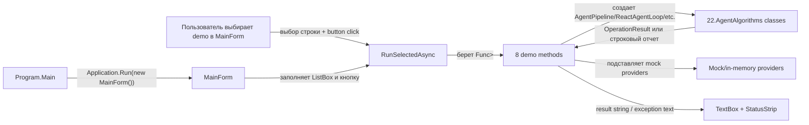

# 22.AgentAlgorithms.Desktop - документация реализации

## 1. Человеческое объяснение

`22.AgentAlgorithms.Desktop` - это WinForms-оболочка для ручного просмотра восьми демонстраций из `22.AgentAlgorithms`. Проект открывает окно, показывает список демо-сценариев, запускает выбранный сценарий по кнопке и выводит текстовый результат. Это удобно для Лубы как "витрина" алгоритмов: можно увидеть, какой класс вызывается и какой примерный результат возвращается.

Честная граница: это desktop demo/harness, а не production host, не IDE/plugin runtime, не внешний AI approval path и не доказательство обученной `ILearningMachine`. Внутри формы есть mock/in-memory помощники (`MockLlmGateway`, `MockSymbolGraphProvider`, `MockSemanticSearchProvider`, `MockAgentMessageBus`), поэтому успешный вывод в окне показывает только работу демонстрационного сценария и вызов underlying infrastructure.

## 2. UML для draw.io



## 3. Симуляции связей

| Связь | Пример входа | Что происходит | Ожидаемый результат | Что нельзя утверждать |
|---|---|---|---|---|
| `Program.Main` -> `MainForm` | Запуск `AgentAlgorithms.Desktop.exe` | Инициализируется WinForms и создается `MainForm`. | Открывается desktop-окно с демо-списком. | Это не доказывает production plugin/host integration. |
| `MainForm` -> `RunSelectedAsync` | Выбрана строка `03 - ReAct agent loop`, нажата кнопка | UI отключает кнопку, ставит статус `Running...`, вызывает выбранный runner. | В текстовом поле появляется результат выбранного демо. | Это не доказывает, что сценарий прошел через реальные инструменты или внешний AI. |
| `RunPipelineDemoAsync` -> `AgentPipeline` | `"Refactor the login function to add error handling"` | Форма создает mock symbol/search/LLM и вызывает pipeline. | Возвращается summary и список changed files из mock LLM. | Это не applied code rewrite и не качество реального плана. |
| `RunRepoMapDemoAsync` -> `RepoMapBuilder` | `AppContext.BaseDirectory` | Builder сканирует `.cs` файлы в каталоге сборки. | Возвращается count symbols и top by simplified PageRank. | Пустой или короткий список не является полной индексацией репозитория. |
| `RunReactLoopDemoAsync` -> `ReactAgentLoop` | Prompt `"Read auth.cs..."` и scripted responses | Mock LLM выдает `TOOL:read_file`, затем `TASK_COMPLETE`. | История показывает tool call и финальный ответ. | Это не реальный tool sandbox и не разрешение на внешние действия. |
| `RunContextCompactionDemoAsync` -> `ContextCompactor` | 12 synthetic messages | Старые сообщения сворачиваются в summary, последние 3 остаются. | В отчете 1 summary + 3 recent messages. | Это не гарантия качества summary на реальной переписке. |
| `RunOrchestratorDemoAsync` -> `AgentOrchestrator` | `"read ... then refactor ..."` | Декомпозер делит задачу, mock bus записывает вызовы sub-agent. | Отчет показывает количество calls и combined result. | Это не запуск настоящих sub-agents и не обученное orchestration reasoning. |
| `RunPermissionModelDemoAsync` -> `PermissionModel` | `read_file`, `apply_patch`, `delete_file` | Модель возвращает уровни разрешений/запреты. | В UI отображаются deterministic decisions. | Это не approval Лубы и не production security gate. |
| `RunRulesParserDemoAsync` -> `RulesFileParser` | Текст с `# Tools`, `@allow`, `@deny` | Парсер выделяет секции и списки allow/deny. | В UI отображаются секции, allowed tools, denied tools. | Наличие rules text не доказывает соблюдение правил в host runtime. |
| `RunDecomposerDemoAsync` -> `ComplexTaskDecomposer` | `"read ... and then refactor ... and verify ..."` | Детерминированный splitter/role inference создает sub-tasks. | UI показывает список задач с ролями. | Это не semantic planner и не trainable unit. |

## 4. Алгоритмы без кода

### Алгоритм A: запуск WinForms приложения

- Где живет логика: `22.AgentAlgorithms.Desktop/Program.cs`, `Program.Main()`.
- Вход: без пользовательского DTO; процесс запускает desktop executable.
- Выход: открытое WinForms окно `MainForm`.
- Текущее поведение: метод помечен `[STAThread]`, вызывает `ApplicationConfiguration.Initialize()`, затем `Application.Run(new MainForm())`.
- Ветви: в `Program.Main` нет проверки конфигурации, выбора режима или CLI-параметров.
- Что не делает: не запускает тесты, не стартует plugin host, не делает runtime smoke для production IDE.

### Алгоритм B: построение `MainForm`

- Где живет логика: `22.AgentAlgorithms.Desktop/MainForm.cs`, `MainForm.MainForm()`.
- Вход: конструктор без параметров.
- Выход: форма с внутренним списком `_demos`, где каждый элемент имеет `Name` и `Func<Task<string>> Run`.
- Текущее поведение: регистрирует восемь демо: pipeline, repo map, ReAct loop, compaction, orchestrator, permission model, rules parser, decomposer; затем вызывает `InitializeLayout()`.
- Ветви: список статический; пользователь не может добавить demo через UI.
- Что не делает: не загружает модели, не подключает внешние сервисы, не читает project state.

### Алгоритм C: разметка окна

- Где живет логика: `MainForm.InitializeLayout()`.
- Вход: внутренние WinForms controls: `_algorithmList`, `_runButton`, `_outputBox`, `_statusLabel`.
- Выход: готовый UI: список слева, текстовый output справа, status strip снизу.
- Текущее поведение: задает title/size, создает `SplitContainer`, наполняет `ListBox` именами demo, выбирает первый элемент, привязывает click handler к `RunSelectedAsync`.
- Ветви: если demos есть, выбирается `SelectedIndex = 0`; если список пуст, выбор не выставляется.
- Что не делает: не проверяет доступность production runtime и не сохраняет результаты.

### Алгоритм D: выбор и запуск демо

- Где живет логика: `MainForm.RunSelectedAsync()`.
- Вход: текущий `SelectedIndex` в `_algorithmList`.
- Выход: текст в `_outputBox` и статус `Done.` или `Failed.`.
- Текущее поведение: если индекс вне диапазона, возвращается без действий. Иначе отключает кнопку, пишет заголовок, await runner, append result. На exception пишет `[unexpected exception]` и статус `Failed.`, в `finally` включает кнопку.
- Что не делает: не ретраит, не пишет файл отчета, не отличает demo failure от production failure.

### Алгоритм E: `RunPipelineDemoAsync`

- Где живет логика: `MainForm.RunPipelineDemoAsync()`.
- Вход: fixed prompt `"Refactor the login function to add error handling"`.
- Выход: строка с количеством calls, top chunk, LLM calls, summary, changed files.
- Текущее поведение: создает `MockSymbolGraphProvider`, `MockSemanticSearchProvider`, `MockLlmGateway`, затем `AgentPipeline.RunAsync(...)`; при `!IsSuccess` возвращает `Failed: ...`.
- Что не делает: не редактирует файлы и не доказывает качество плана.

### Алгоритм F: `RunRepoMapDemoAsync`

- Где живет логика: `MainForm.RunRepoMapDemoAsync()`.
- Вход: `AppContext.BaseDirectory`.
- Выход: строка с count symbols и top-15 по `InDegreeScore`.
- Текущее поведение: вызывает `RepoMapBuilder.BuildAsync`, сортирует найденные symbols и форматирует preview.
- Что не делает: не индексирует обязательно весь workspace; комментарий прямо говорит, что demo идет по каталогу desktop assembly.

### Алгоритм G: `RunReactLoopDemoAsync`

- Где живет логика: `MainForm.RunReactLoopDemoAsync()`.
- Вход: scripted mock LLM responses и prompt `"Read auth.cs and report what it does"`.
- Выход: строка с iterations, completion flag, final response и history.
- Текущее поведение: mock LLM выдает thinking, tool call и `TASK_COMPLETE`; `ReactAgentLoop` получает fake tool executor, который всегда возвращает `[mock-... returned: ok]`.
- Что не делает: не читает реальный `auth.cs` и не вызывает реальный tool registry.

### Алгоритм H: `RunContextCompactionDemoAsync`

- Где живет логика: `MainForm.RunContextCompactionDemoAsync()`.
- Вход: synthetic list из 12 `ConversationMessage`.
- Выход: строка с исходным/сжатым count и компактной историей.
- Текущее поведение: `ContextCompactor(recentTurnsToPreserve: 3)` суммаризирует 9 старых сообщений callback-строкой `summary of ... earlier messages`.
- Что не делает: не проверяет смысловое качество summary.

### Алгоритм I: `RunOrchestratorDemoAsync`

- Где живет логика: `MainForm.RunOrchestratorDemoAsync()`.
- Вход: fixed task `"read the auth module and then refactor the login function"`.
- Выход: строка с количеством mock bus calls и combined result.
- Текущее поведение: регистрирует `ReaderBot` и `RefactorerBot`, вызывает `AgentOrchestrator.RunAsync`.
- Что не делает: не запускает настоящих агентов, не создает Pull Request, не применяет patch.

### Алгоритм J: permission/rules/decomposer demos

- Где живет логика: `RunPermissionModelDemoAsync`, `RunRulesParserDemoAsync`, `RunDecomposerDemoAsync`.
- Вход: фиксированные массивы tool names, rules text, task text.
- Выход: форматированные строки для UI.
- Текущее поведение: вызывает core deterministic helpers (`PermissionModel.Check`, `RulesFileParser.Parse`, `ComplexTaskDecomposer.Decompose`) и печатает результат.
- Что не делает: не становится production policy engine, не доказывает выполнение правил в внешнем host.

## 5. Короткие цитаты кода

`22.AgentAlgorithms.Desktop/AgentAlgorithms.Desktop.csproj:3-16`

```xml
  <PropertyGroup>
    <!-- Windows Forms desktop executable for the eight algorithm demos. -->
    <OutputType>WinExe</OutputType>
    <TargetFramework>net9.0-windows</TargetFramework>
    <UseWindowsForms>true</UseWindowsForms>
    <ImplicitUsings>enable</ImplicitUsings>
    <Nullable>enable</Nullable>
    <RootNamespace>AgentAlgorithms.Desktop</RootNamespace>
    <AssemblyName>AgentAlgorithms.Desktop</AssemblyName>
  </PropertyGroup>

  <ItemGroup>
    <ProjectReference Include="..\22.AgentAlgorithms\AgentAlgorithms.csproj" />
  </ItemGroup>
```

Почему важно: это доказывает, что проект является Windows Forms executable и ссылается на `22.AgentAlgorithms`. Это не доказывает production integration за пределами desktop process.

`22.AgentAlgorithms.Desktop/Program.cs:7-12`

```csharp
    [STAThread]
    private static void Main()
    {
        ApplicationConfiguration.Initialize();
        Application.Run(new MainForm());
    }
```

Почему важно: это весь entrypoint. Он только открывает `MainForm`; нет CLI, service host, plugin host или обучающего runner.

`22.AgentAlgorithms.Desktop/MainForm.cs:19-34`

```csharp
    public MainForm()
    {
        _demos =
        [
            ("01 — Pipeline (4-stage agent flow with mocks)",            RunPipelineDemoAsync),
            ("02 — RepoMap indexing (signatures + simplified PageRank)", RunRepoMapDemoAsync),
            ("03 — ReAct agent loop (mock LLM)",                         RunReactLoopDemoAsync),
            ("04 — Context compaction (long history → summary + tail)",  RunContextCompactionDemoAsync),
            ("05 — Multi-agent orchestrator (sub-task routing)",         RunOrchestratorDemoAsync),
            ("06 — Permission model (ReadOnly / WriteWithApproval / Denied)", RunPermissionModelDemoAsync),
            ("07 — Rules file parser (sections + @allow/@deny)",         RunRulesParserDemoAsync),
            ("08 — Complex task decomposition (and/then splitter)",      RunDecomposerDemoAsync),
        ];

        InitializeLayout();
    }
```

Почему важно: список demo статический и прямо показывает восемь поверхностей. Названия `mock LLM` и `with mocks` важны для честного статуса.

`22.AgentAlgorithms.Desktop/MainForm.cs:36-59`

```csharp
    private void InitializeLayout()
    {
        Text          = "Sub-project 22 — Coding Agent Algorithms Explorer";
        Width         = 1100;
        Height        = 720;
        StartPosition = FormStartPosition.CenterScreen;

        var split = new SplitContainer
        {
            Dock             = DockStyle.Fill,
            Orientation      = Orientation.Vertical,
            SplitterDistance = 380,
            FixedPanel       = FixedPanel.Panel1,
        };

        _algorithmList.Dock           = DockStyle.Fill;
        _algorithmList.IntegralHeight = false;
        foreach (var (name, _) in _demos) _algorithmList.Items.Add(name);
        if (_algorithmList.Items.Count > 0) _algorithmList.SelectedIndex = 0;

        _runButton.Text   = "Run selected algorithm";
        _runButton.Dock   = DockStyle.Bottom;
        _runButton.Height = 36;
        _runButton.Click += async (_, _) => await RunSelectedAsync();
```

Почему важно: UI wiring локальный: список, кнопка и handler. Это не host command и не plugin-facing entrypoint.

`22.AgentAlgorithms.Desktop/MainForm.cs:77-102`

```csharp
    private async Task RunSelectedAsync()
    {
        int index = _algorithmList.SelectedIndex;
        if (index < 0 || index >= _demos.Count) return;

        var (name, runner) = _demos[index];
        _runButton.Enabled = false;
        _statusLabel.Text  = $"Running {name}...";
        _outputBox.Text    = $"=== {name} ===\r\n\r\n";

        try
        {
            string result = await runner();
            _outputBox.AppendText(result);
            _statusLabel.Text = "Done.";
        }
        catch (Exception ex)
        {
            _outputBox.AppendText($"[unexpected exception]\r\n{ex}");
            _statusLabel.Text = "Failed.";
        }
        finally
        {
            _runButton.Enabled = true;
        }
    }
```

Почему важно: алгоритм запуска demo имеет guard, success path, exception path и always-enable cleanup. Он не сохраняет runtime report и не является QA evidence сам по себе.

`22.AgentAlgorithms.Desktop/MainForm.cs:106-123`

```csharp
    private async Task<string> RunPipelineDemoAsync()
    {
        var symbols = new MockSymbolGraphProvider();
        var search  = new MockSemanticSearchProvider();
        var llm     = new MockLlmGateway("Plan: read auth.cs, then refactor login()");

        var pipeline = new AgentPipeline(symbols, search, llm);
        var result   = await pipeline.RunAsync("Refactor the login function to add error handling");

        if (!result.IsSuccess)
            return $"Failed: {result.ErrorMessage} ({result.ErrorCode})";

        return $"Stage 1 (index): {symbols.Calls} call(s)\r\n" +
               $"Stage 2 (search): {search.Calls} call(s), top chunk = {search.LastTopChunk}\r\n" +
               $"Stage 3 (LLM): {llm.Calls} call(s)\r\n" +
               $"Pipeline summary: {result.Value!.Summary}\r\n" +
               $"Changed files: [{string.Join(", ", result.Value!.ChangedFiles)}]";
    }
```

Почему важно: pipeline demo использует mock providers и форматирует результат. Это не applied optimization и не доказательство реального LLM качества.

`22.AgentAlgorithms.Desktop/MainForm.cs:150-176`

```csharp
    private async Task<string> RunReactLoopDemoAsync()
    {
        var llm = new MockLlmGateway(
        [
            "Thinking about the task...",
            "TOOL:read_file:{\"path\":\"auth.cs\"}",
            "TASK_COMPLETE:Read the file successfully.",
        ]);

        var compactor = new ContextCompactor(recentTurnsToPreserve: 5);
        var loop      = new ReactAgentLoop(
            llm,
            compactor,
            toolExecutor: (name, args) => Task.FromResult(
                $"[mock-{name} returned: ok]"));

        var result = await loop.RunAsync("Read auth.cs and report what it does");
        if (!result.IsSuccess)
            return $"Failed: {result.ErrorMessage} ({result.ErrorCode})";

        var loopResult = result.Value!;
        return $"Iterations: {loopResult.TotalIterations}, complete = {loopResult.IsComplete}\r\n" +
               $"Final response: {loopResult.FinalResponse}\r\n\r\n" +
               $"History:\r\n" +
               string.Join("\r\n", loopResult.FinalHistory
                   .Select((m, i) => $"  {i:D2} [{m.Role}] {m.Content}"));
    }
```

Почему важно: ReAct demo специально scripted и использует fake tool executor. Оно показывает control-flow, но не реальное чтение файла.

`22.AgentAlgorithms.Desktop/MainForm.cs:342-362`

```csharp
internal sealed class MockLlmGateway : ILlmGateway
{
    public int Calls { get; private set; }

    private readonly Queue<string> _responses;

    public MockLlmGateway(string singleResponse)
        => _responses = new Queue<string>([singleResponse]);

    public MockLlmGateway(IEnumerable<string> responses)
        => _responses = new Queue<string>(responses);

    public Task<OperationResult<string>> SendAsync(
        IReadOnlyList<ConversationMessage> history,
        CancellationToken cancellationToken = default)
    {
        Calls++;
        string response = _responses.Count > 0 ? _responses.Dequeue() : "TASK_COMPLETE:done";
        return Task.FromResult(OperationResult<string>.Ok(response));
    }
}
```

Почему важно: desktop LLM в demo - очередь заранее заданных строк. Это не внешний AI, не approval path и не модельный asset.

## 6. QA/test mapping

Прямых UI automation tests для `22.AgentAlgorithms.Desktop` focused search не нашел: нет теста, который открывает `MainForm`, нажимает кнопку и проверяет `_outputBox`.

Связанная проверка есть на core-уровне в `Tests/AgentAlgorithmsTests.cs`: `ReactAgentLoop` проверяется в строках 60-120, `ContextCompactor` в строках 126-153, `AgentOrchestrator` в строках 213-239 и 1230-1263, `PermissionModel` в строках 245-292, `RulesFileParser` в строках 301-338, `ComplexTaskDecomposer` в строках 347-424, `AgentPipeline` в строках 433-459, `RepoMapBuilder` в строках 489-520. Эти тесты были прочитаны/сопоставлены, но не запускались в этой documentation subphase.

Что это доказывает: underlying deterministic/core classes имеют unit coverage. Что не доказывает: desktop event wiring, WinForms rendering, UI threading, interactive user flow, production host runtime или plugin integration.

## 7. Статус реализации и ограничения

| Область | Текущий статус | Честная граница |
|---|---|---|
| Desktop entrypoint | Реализован `Program.Main` с WinForms запуском. | Только desktop exe, не IDE/plugin host. |
| UI layout | Реализованы `ListBox`, кнопка, `TextBox`, `StatusStrip`. | Нет direct UI automation evidence. |
| Demo selection | Реализован `RunSelectedAsync` с guard/success/exception/finally. | Нет persisted report и нет retry policy. |
| Eight demos | Реализованы локальные demo methods для core algorithms. | Сценарии фиксированные, не product workflows. |
| Mock fabric | Реализованы in-file mocks для symbol/search/LLM/bus. | Mocks не являются runtime service evidence. |
| Model/training | В проекте не найден trainable `ILearningMachine` lifecycle. | Нет checkpoint/export/import/fresh-load/continue-training evidence. |

## 8. Anti-false-done

- Desktop UI screenshot или успешный запуск формы не заменяет production plugin/host/runtime evidence.
- JSON, PowerShell, static docs или smoke check не доказывают качество agent algorithms.
- `MockLlmGateway` не является внешним AI и не подтверждает, что внешний AI разрешен без Лубы.
- `PermissionModel` demo не является product-owner approval.
- `AgentPipeline` demo не применяет изменения к файлам; строка `Changed files` приходит из mock/demo result.
- `AgentOrchestrator` demo с `MockAgentMessageBus` не запускает настоящих sub-agents.
- Детерминированные helpers (`PermissionModel`, `RulesFileParser`, `ComplexTaskDecomposer`) не надо выдавать за обученную semantic authority.
- `22.AgentAlgorithms.Desktop` не является `ILearningMachine` asset: нет manifest, checkpoint, locator, export/import, fresh-load или resume-training evidence.
