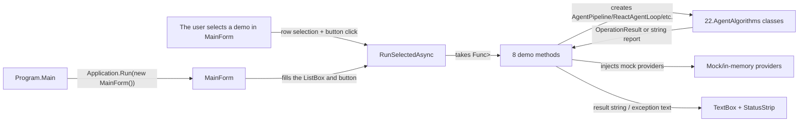

# 22.AgentAlgorithms.Desktop - implementation documentation

## 1. Human explanation

`22.AgentAlgorithms.Desktop` is a WinForms shell for manually browsing the eight demonstrations from `22.AgentAlgorithms`. The project opens a window, shows a list of demo scenarios, runs the selected scenario on a button click and displays a text result. This is convenient for Luba as a "showcase" of the algorithms: you can see which class is called and what approximate result is returned.

Honest boundary: this is a desktop demo/harness, not a production host, not an IDE/plugin runtime, not an external AI approval path and not proof of a trained `ILearningMachine`. Inside the form there are mock/in-memory helpers (`MockLlmGateway`, `MockSymbolGraphProvider`, `MockSemanticSearchProvider`, `MockAgentMessageBus`), so a successful output in the window only shows that the demo scenario ran and called the underlying infrastructure.

## 2. UML for draw.io



## 3. Connection simulations

| Connection | Example input | What happens | Expected result | What must not be claimed |
|---|---|---|---|---|
| `Program.Main` -> `MainForm` | Launching `AgentAlgorithms.Desktop.exe` | WinForms is initialized and a `MainForm` is created. | A desktop window with the demo list opens. | This does not prove production plugin/host integration. |
| `MainForm` -> `RunSelectedAsync` | The row `03 - ReAct agent loop` is selected, the button pressed | The UI disables the button, sets the status `Running...`, calls the selected runner. | The result of the selected demo appears in the text field. | This does not prove that the scenario went through real tools or an external AI. |
| `RunPipelineDemoAsync` -> `AgentPipeline` | `"Refactor the login function to add error handling"` | The form creates mock symbol/search/LLM and calls the pipeline. | A summary and a list of changed files from the mock LLM are returned. | This is not an applied code rewrite and not the quality of a real plan. |
| `RunRepoMapDemoAsync` -> `RepoMapBuilder` | `AppContext.BaseDirectory` | The builder scans `.cs` files in the build directory. | A symbol count and top-by-simplified-PageRank are returned. | An empty or short list is not a full repository index. |
| `RunReactLoopDemoAsync` -> `ReactAgentLoop` | Prompt `"Read auth.cs..."` and scripted responses | The mock LLM emits `TOOL:read_file`, then `TASK_COMPLETE`. | The history shows the tool call and the final answer. | This is not a real tool sandbox and not permission for external actions. |
| `RunContextCompactionDemoAsync` -> `ContextCompactor` | 12 synthetic messages | The old messages are compacted into a summary, the last 3 remain. | The report has 1 summary + 3 recent messages. | This is not a guarantee of summary quality on a real conversation. |
| `RunOrchestratorDemoAsync` -> `AgentOrchestrator` | `"read ... then refactor ..."` | The decomposer splits the task, the mock bus records the sub-agent calls. | The report shows the number of calls and the combined result. | This is not launching real sub-agents and not trained orchestration reasoning. |
| `RunPermissionModelDemoAsync` -> `PermissionModel` | `read_file`, `apply_patch`, `delete_file` | The model returns permission levels/denials. | Deterministic decisions are shown in the UI. | This is not Luba's approval and not a production security gate. |
| `RunRulesParserDemoAsync` -> `RulesFileParser` | Text with `# Tools`, `@allow`, `@deny` | The parser extracts sections and allow/deny lists. | Sections, allowed tools, denied tools are shown in the UI. | The presence of rules text does not prove the rules are enforced in a host runtime. |
| `RunDecomposerDemoAsync` -> `ComplexTaskDecomposer` | `"read ... and then refactor ... and verify ..."` | A deterministic splitter/role inference creates sub-tasks. | The UI shows a list of tasks with roles. | This is not a semantic planner and not a trainable unit. |

## 4. No-code algorithms

### Algorithm A: launching the WinForms application

- Where the logic lives: `22.AgentAlgorithms.Desktop/Program.cs`, `Program.Main()`.
- Input: no user DTO; the process launches the desktop executable.
- Output: an open WinForms window `MainForm`.
- Current behavior: the method is marked `[STAThread]`, calls `ApplicationConfiguration.Initialize()`, then `Application.Run(new MainForm())`.
- Branches: there is no configuration check, mode selection or CLI parameters in `Program.Main`.
- What it does not do: does not run tests, does not start a plugin host, does not do a runtime smoke for a production IDE.

### Algorithm B: building `MainForm`

- Where the logic lives: `22.AgentAlgorithms.Desktop/MainForm.cs`, `MainForm.MainForm()`.
- Input: a parameterless constructor.
- Output: a form with an internal `_demos` list, where each element has a `Name` and a `Func<Task<string>> Run`.
- Current behavior: registers eight demos: pipeline, repo map, ReAct loop, compaction, orchestrator, permission model, rules parser, decomposer; then calls `InitializeLayout()`.
- Branches: the list is static; the user cannot add a demo through the UI.
- What it does not do: does not load models, does not connect external services, does not read project state.

### Algorithm C: laying out the window

- Where the logic lives: `MainForm.InitializeLayout()`.
- Input: internal WinForms controls: `_algorithmList`, `_runButton`, `_outputBox`, `_statusLabel`.
- Output: a ready UI: the list on the left, the text output on the right, the status strip at the bottom.
- Current behavior: sets the title/size, creates a `SplitContainer`, fills the `ListBox` with demo names, selects the first element, binds the click handler to `RunSelectedAsync`.
- Branches: if there are demos, `SelectedIndex = 0` is selected; if the list is empty, no selection is set.
- What it does not do: does not check production runtime availability and does not save results.

### Algorithm D: selecting and running a demo

- Where the logic lives: `MainForm.RunSelectedAsync()`.
- Input: the current `SelectedIndex` in `_algorithmList`.
- Output: text in `_outputBox` and the status `Done.` or `Failed.`.
- Current behavior: if the index is out of range, returns without action. Otherwise disables the button, writes a header, awaits the runner, appends the result. On an exception writes `[unexpected exception]` and the status `Failed.`, in `finally` re-enables the button.
- What it does not do: does not retry, does not write a report file, does not distinguish a demo failure from a production failure.

### Algorithm E: `RunPipelineDemoAsync`

- Where the logic lives: `MainForm.RunPipelineDemoAsync()`.
- Input: the fixed prompt `"Refactor the login function to add error handling"`.
- Output: a string with the number of calls, top chunk, LLM calls, summary, changed files.
- Current behavior: creates `MockSymbolGraphProvider`, `MockSemanticSearchProvider`, `MockLlmGateway`, then `AgentPipeline.RunAsync(...)`; on `!IsSuccess` returns `Failed: ...`.
- What it does not do: does not edit files and does not prove plan quality.

### Algorithm F: `RunRepoMapDemoAsync`

- Where the logic lives: `MainForm.RunRepoMapDemoAsync()`.
- Input: `AppContext.BaseDirectory`.
- Output: a string with the symbol count and top-15 by `InDegreeScore`.
- Current behavior: calls `RepoMapBuilder.BuildAsync`, sorts the found symbols and formats a preview.
- What it does not do: does not necessarily index the whole workspace; the comment directly says the demo walks the desktop assembly directory.

### Algorithm G: `RunReactLoopDemoAsync`

- Where the logic lives: `MainForm.RunReactLoopDemoAsync()`.
- Input: scripted mock LLM responses and the prompt `"Read auth.cs and report what it does"`.
- Output: a string with iterations, a completion flag, the final response and the history.
- Current behavior: the mock LLM emits thinking, a tool call and `TASK_COMPLETE`; `ReactAgentLoop` gets a fake tool executor that always returns `[mock-... returned: ok]`.
- What it does not do: does not read a real `auth.cs` and does not call a real tool registry.

### Algorithm H: `RunContextCompactionDemoAsync`

- Where the logic lives: `MainForm.RunContextCompactionDemoAsync()`.
- Input: a synthetic list of 12 `ConversationMessage`.
- Output: a string with the original/compacted count and the compact history.
- Current behavior: `ContextCompactor(recentTurnsToPreserve: 3)` summarizes the 9 old messages with the callback string `summary of ... earlier messages`.
- What it does not do: does not check the semantic quality of the summary.

### Algorithm I: `RunOrchestratorDemoAsync`

- Where the logic lives: `MainForm.RunOrchestratorDemoAsync()`.
- Input: the fixed task `"read the auth module and then refactor the login function"`.
- Output: a string with the number of mock bus calls and the combined result.
- Current behavior: registers `ReaderBot` and `RefactorerBot`, calls `AgentOrchestrator.RunAsync`.
- What it does not do: does not launch real agents, does not create a Pull Request, does not apply a patch.

### Algorithm J: the permission/rules/decomposer demos

- Where the logic lives: `RunPermissionModelDemoAsync`, `RunRulesParserDemoAsync`, `RunDecomposerDemoAsync`.
- Input: fixed arrays of tool names, rules text, task text.
- Output: formatted strings for the UI.
- Current behavior: calls the core deterministic helpers (`PermissionModel.Check`, `RulesFileParser.Parse`, `ComplexTaskDecomposer.Decompose`) and prints the result.
- What it does not do: does not become a production policy engine, does not prove that the rules are enforced in an external host.

## 5. Short code quotes

`22.AgentAlgorithms.Desktop/AgentAlgorithms.Desktop.csproj:3-16`

```xml
  <PropertyGroup>
    <!-- Windows Forms desktop executable for the eight algorithm demos. -->
    <OutputType>WinExe</OutputType>
    <TargetFramework>net9.0-windows</TargetFramework>
    <UseWindowsForms>true</UseWindowsForms>
    <ImplicitUsings>enable</ImplicitUsings>
    <Nullable>enable</Nullable>
    <RootNamespace>AgentAlgorithms.Desktop</RootNamespace>
    <AssemblyName>AgentAlgorithms.Desktop</AssemblyName>
  </PropertyGroup>

  <ItemGroup>
    <ProjectReference Include="..\22.AgentAlgorithms\AgentAlgorithms.csproj" />
  </ItemGroup>
```

Why it matters: this proves that the project is a Windows Forms executable and references `22.AgentAlgorithms`. This does not prove production integration beyond the desktop process.

`22.AgentAlgorithms.Desktop/Program.cs:7-12`

```csharp
    [STAThread]
    private static void Main()
    {
        ApplicationConfiguration.Initialize();
        Application.Run(new MainForm());
    }
```

Why it matters: this is the whole entrypoint. It only opens `MainForm`; there is no CLI, service host, plugin host or training runner.

`22.AgentAlgorithms.Desktop/MainForm.cs:19-34`

```csharp
    public MainForm()
    {
        _demos =
        [
            ("01 — Pipeline (4-stage agent flow with mocks)",            RunPipelineDemoAsync),
            ("02 — RepoMap indexing (signatures + simplified PageRank)", RunRepoMapDemoAsync),
            ("03 — ReAct agent loop (mock LLM)",                         RunReactLoopDemoAsync),
            ("04 — Context compaction (long history → summary + tail)",  RunContextCompactionDemoAsync),
            ("05 — Multi-agent orchestrator (sub-task routing)",         RunOrchestratorDemoAsync),
            ("06 — Permission model (ReadOnly / WriteWithApproval / Denied)", RunPermissionModelDemoAsync),
            ("07 — Rules file parser (sections + @allow/@deny)",         RunRulesParserDemoAsync),
            ("08 — Complex task decomposition (and/then splitter)",      RunDecomposerDemoAsync),
        ];

        InitializeLayout();
    }
```

Why it matters: the demo list is static and directly shows the eight surfaces. The names `mock LLM` and `with mocks` are important for an honest status.

`22.AgentAlgorithms.Desktop/MainForm.cs:36-59`

```csharp
    private void InitializeLayout()
    {
        Text          = "Sub-project 22 — Coding Agent Algorithms Explorer";
        Width         = 1100;
        Height        = 720;
        StartPosition = FormStartPosition.CenterScreen;

        var split = new SplitContainer
        {
            Dock             = DockStyle.Fill,
            Orientation      = Orientation.Vertical,
            SplitterDistance = 380,
            FixedPanel       = FixedPanel.Panel1,
        };

        _algorithmList.Dock           = DockStyle.Fill;
        _algorithmList.IntegralHeight = false;
        foreach (var (name, _) in _demos) _algorithmList.Items.Add(name);
        if (_algorithmList.Items.Count > 0) _algorithmList.SelectedIndex = 0;

        _runButton.Text   = "Run selected algorithm";
        _runButton.Dock   = DockStyle.Bottom;
        _runButton.Height = 36;
        _runButton.Click += async (_, _) => await RunSelectedAsync();
```

Why it matters: the UI wiring is local: a list, a button and a handler. This is not a host command and not a plugin-facing entrypoint.

`22.AgentAlgorithms.Desktop/MainForm.cs:77-102`

```csharp
    private async Task RunSelectedAsync()
    {
        int index = _algorithmList.SelectedIndex;
        if (index < 0 || index >= _demos.Count) return;

        var (name, runner) = _demos[index];
        _runButton.Enabled = false;
        _statusLabel.Text  = $"Running {name}...";
        _outputBox.Text    = $"=== {name} ===\r\n\r\n";

        try
        {
            string result = await runner();
            _outputBox.AppendText(result);
            _statusLabel.Text = "Done.";
        }
        catch (Exception ex)
        {
            _outputBox.AppendText($"[unexpected exception]\r\n{ex}");
            _statusLabel.Text = "Failed.";
        }
        finally
        {
            _runButton.Enabled = true;
        }
    }
```

Why it matters: the demo launch algorithm has a guard, a success path, an exception path and always-enable cleanup. It does not save a runtime report and is not QA evidence by itself.

`22.AgentAlgorithms.Desktop/MainForm.cs:106-123`

```csharp
    private async Task<string> RunPipelineDemoAsync()
    {
        var symbols = new MockSymbolGraphProvider();
        var search  = new MockSemanticSearchProvider();
        var llm     = new MockLlmGateway("Plan: read auth.cs, then refactor login()");

        var pipeline = new AgentPipeline(symbols, search, llm);
        var result   = await pipeline.RunAsync("Refactor the login function to add error handling");

        if (!result.IsSuccess)
            return $"Failed: {result.ErrorMessage} ({result.ErrorCode})";

        return $"Stage 1 (index): {symbols.Calls} call(s)\r\n" +
               $"Stage 2 (search): {search.Calls} call(s), top chunk = {search.LastTopChunk}\r\n" +
               $"Stage 3 (LLM): {llm.Calls} call(s)\r\n" +
               $"Pipeline summary: {result.Value!.Summary}\r\n" +
               $"Changed files: [{string.Join(", ", result.Value!.ChangedFiles)}]";
    }
```

Why it matters: the pipeline demo uses mock providers and formats the result. This is not an applied optimization and not proof of real LLM quality.

`22.AgentAlgorithms.Desktop/MainForm.cs:150-176`

```csharp
    private async Task<string> RunReactLoopDemoAsync()
    {
        var llm = new MockLlmGateway(
        [
            "Thinking about the task...",
            "TOOL:read_file:{\"path\":\"auth.cs\"}",
            "TASK_COMPLETE:Read the file successfully.",
        ]);

        var compactor = new ContextCompactor(recentTurnsToPreserve: 5);
        var loop      = new ReactAgentLoop(
            llm,
            compactor,
            toolExecutor: (name, args) => Task.FromResult(
                $"[mock-{name} returned: ok]"));

        var result = await loop.RunAsync("Read auth.cs and report what it does");
        if (!result.IsSuccess)
            return $"Failed: {result.ErrorMessage} ({result.ErrorCode})";

        var loopResult = result.Value!;
        return $"Iterations: {loopResult.TotalIterations}, complete = {loopResult.IsComplete}\r\n" +
               $"Final response: {loopResult.FinalResponse}\r\n\r\n" +
               $"History:\r\n" +
               string.Join("\r\n", loopResult.FinalHistory
                   .Select((m, i) => $"  {i:D2} [{m.Role}] {m.Content}"));
    }
```

Why it matters: the ReAct demo is deliberately scripted and uses a fake tool executor. It shows the control-flow, but not real file reading.

`22.AgentAlgorithms.Desktop/MainForm.cs:342-362`

```csharp
internal sealed class MockLlmGateway : ILlmGateway
{
    public int Calls { get; private set; }

    private readonly Queue<string> _responses;

    public MockLlmGateway(string singleResponse)
        => _responses = new Queue<string>([singleResponse]);

    public MockLlmGateway(IEnumerable<string> responses)
        => _responses = new Queue<string>(responses);

    public Task<OperationResult<string>> SendAsync(
        IReadOnlyList<ConversationMessage> history,
        CancellationToken cancellationToken = default)
    {
        Calls++;
        string response = _responses.Count > 0 ? _responses.Dequeue() : "TASK_COMPLETE:done";
        return Task.FromResult(OperationResult<string>.Ok(response));
    }
}
```

Why it matters: the desktop LLM in the demo is a queue of pre-defined strings. This is not an external AI, not an approval path and not a model asset.

## 6. QA/test mapping

A focused search found no direct UI automation tests for `22.AgentAlgorithms.Desktop`: there is no test that opens `MainForm`, presses the button and checks `_outputBox`.

A related check exists at the core level in `Tests/AgentAlgorithmsTests.cs`: `ReactAgentLoop` is checked in lines 60-120, `ContextCompactor` in lines 126-153, `AgentOrchestrator` in lines 213-239 and 1230-1263, `PermissionModel` in lines 245-292, `RulesFileParser` in lines 301-338, `ComplexTaskDecomposer` in lines 347-424, `AgentPipeline` in lines 433-459, `RepoMapBuilder` in lines 489-520. These tests were read/mapped, but not run in this documentation subphase.

What this proves: the underlying deterministic/core classes have unit coverage. What it does not prove: the desktop event wiring, WinForms rendering, UI threading, interactive user flow, production host runtime or plugin integration.

## 7. Implementation status and limitations

| Area | Current status | Honest boundary |
|---|---|---|
| Desktop entrypoint | `Program.Main` with a WinForms launch is implemented. | Only a desktop exe, not an IDE/plugin host. |
| UI layout | `ListBox`, button, `TextBox`, `StatusStrip` are implemented. | No direct UI automation evidence. |
| Demo selection | `RunSelectedAsync` with guard/success/exception/finally is implemented. | No persisted report and no retry policy. |
| Eight demos | Local demo methods for the core algorithms are implemented. | The scenarios are fixed, not product workflows. |
| Mock fabric | In-file mocks for symbol/search/LLM/bus are implemented. | The mocks are not runtime service evidence. |
| Model/training | No trainable `ILearningMachine` lifecycle was found in the project. | No checkpoint/export/import/fresh-load/continue-training evidence. |

## 8. Anti-false-done

- A desktop UI screenshot or a successful form launch does not replace production plugin/host/runtime evidence.
- JSON, PowerShell, static docs or a smoke check do not prove the quality of the agent algorithms.
- `MockLlmGateway` is not an external AI and does not confirm that an external AI is allowed without Luba.
- The `PermissionModel` demo is not product-owner approval.
- The `AgentPipeline` demo does not apply changes to files; the `Changed files` string comes from the mock/demo result.
- The `AgentOrchestrator` demo with `MockAgentMessageBus` does not launch real sub-agents.
- Deterministic helpers (`PermissionModel`, `RulesFileParser`, `ComplexTaskDecomposer`) must not be presented as a trained semantic authority.
- `22.AgentAlgorithms.Desktop` is not an `ILearningMachine` asset: there is no manifest, checkpoint, locator, export/import, fresh-load or resume-training evidence.
