# 22.AgentAlgorithms — implementation documentation

## 1. Quick map for Luba

`22.AgentAlgorithms` is a set of algorithms for agent behavior: ReAct loop, context assembly, task decomposition, multi-agent orchestration, dependency graph, route classification, permission model, retrieval/ranking and skill retrieval. What passes through the project is task strings, dialog messages, context chunks, sub-task DTOs, tool names, skill documents and comparison metrics. The outputs are also mostly textual and structural: `ReactLoopResult`, `PipelineResult`, `SubTask`, ranked `TextChunk`, `PermissionLevel`, `DomainClassification`, `ComparisonResult`.

The main honest boundary: most of the project is deterministic/rule/ranker/KNN/helper infrastructure. `KnnSkillFilter`, `HybridRanker`, `SkillRetriever`, `RouteClassifier`, `PermissionModel` and the task decomposers are not a trained semantic authority and are not an `ILearningMachine` asset. `InternalFirstAiSupport` can turn an approved external answer into a local learning record/DPO-ready signal, but it does not itself allow silent external AI, does not prove the quality of the external answer and does not publish a trained model.

## 2. Simple UML for draw.io

```mermaid
classDiagram
    class ReactAgentLoop
    class AgentPipeline
    class AgentOrchestrator
    class DependencyGraph
    class ComplexTaskDecomposer
    class ContextWindowManager
    class SemanticRanker
    class KnnSkillFilter
    class SkillRetriever
    class RouteClassifier
    class PermissionModel
    class InternalResultExaminer
    class ExternalAiResultAdapter
    class AgentComparisonHarness

    ReactAgentLoop --> ContextCompactor : compacts history
    AgentPipeline --> SemanticRanker : context search
    AgentPipeline --> ILlmGateway : asks for plan
    AgentOrchestrator --> ComplexTaskDecomposer : task to SubTask
    AgentOrchestrator --> DependencyGraph : role order
    AgentOrchestrator --> IAgentMessageBus : assign task
    ContextWindowManager --> KnnSkillFilter : optional skill filter
    ContextWindowManager --> SemanticRanker : rank chunks
    SkillRetriever --> SkillTriggerLibrary : static skill catalogue
    RouteClassifier --> SemanticCompiler29 : keyword classifier
    PermissionModel --> PermissionLevel : rule lookup
    InternalResultExaminer --> ExternalAiRequestPackage : names missing competence
    ExternalAiResultAdapter --> PreprocessedLearningData : DPO-ready signal
    AgentComparisonHarness --> AstRelevanceRanker : enhanced ranking

    note for ReactAgentLoop "Implemented: calls ILlmGateway, handles TASK_COMPLETE and TOOL."
    note for AgentPipeline "Partial: builds a plan, but does not change files; ChangedFiles is empty."
    note for AgentOrchestrator "Implemented deterministic orchestrator by roles and dependency levels."
    note for DependencyGraph "Implemented topological/Kahn sort; cycle -> DEPENDENCY_CYCLE."
    note for ContextWindowManager "Implemented context window assembly: skill filter, rank, budget."
    note for KnnSkillFilter "KNN helper: skill filter, not a trained semantic authority."
    note for SkillRetriever "Jaccard KNN over trigger tags, fallback to always-required/category."
    note for RouteClassifier "Keyword bridge to SemanticCompiler29, not a trained classifier."
    note for PermissionModel "Rule table for tool names; approval does not replace Luba's decision."
    note for ExternalAiResultAdapter "Creates a local learning record only from an approved external answer."
```



### Legend

| Node | What it does | Status |
|---|---|---|
| `ReactAgentLoop` | Runs the message/tool call/completion signal cycle | Implemented deterministic loop |
| `AgentPipeline` | Index, semantic search, LLM plan; does not write files | Partial pipeline |
| `AgentOrchestrator`/`DependencyGraph` | Splits the task by roles and runs the levels | Implemented deterministic orchestrator |
| `ContextWindowManager`/rankers | Filters, ranks and packs the context | Infrastructure |
| `RouteClassifier`/`SkillRetriever` | Keyword/Jaccard/KNN routing helpers | Deterministic/bootstrap |
| `InternalFirstAiSupport` | Checks the internal answer and prepares an external-answer learning signal | Adapter, not a permission grant |

### Connection simulations

| Connection | Example input | What happens | Expected result | What must not be considered proven |
|---|---|---|---|---|
| `ReactAgentLoop -> ILlmGateway` | `task="read file"`, the LLM returns `TOOL:read_file:{...}` | The loop parses the tool name/JSON, calls the executor, puts the tool output into the history | The next LLM iteration sees the tool result | This does not prove LLM quality or tool safety without a separate permission |
| `AgentPipeline -> SemanticRanker -> ILlmGateway` | `task="Add null check"` | Gets symbols/search context, builds a prompt, asks the LLM for a plan | `PipelineResult(Succeeded=true, ChangedFiles=[])` | This does not apply the patch to files |
| `AgentOrchestrator -> DependencyGraph` | `ARCH -> CODE_Q`, tasks design/implement | Sort puts `ARCH` in level 0, `CODE_Q` in level 1 | the coder gets context from the reader/architect stage | This is not trained orchestration reasoning |
| `ContextWindowManager -> KnnSkillFilter` | 30 skill chunks, high top score | The KNN filter keeps the topK skills, then the ranker sorts the candidates | Fewer skill chunks enter the context window | KNN is not a semantic authority |
| `InternalResultExaminer -> ExternalAiResultAdapter` | Internal answer without `VALIDATE_OP`, an approved external answer exists | The examiner names the missing competence; the adapter builds `PreprocessedLearningData` | A DPO-ready local learning record | This is not silent external AI permission and not a trained model |

## 3. No-code algorithms

### 3.1 ReAct loop

It is like a conversation dispatcher: it asks the model, reads the answer, if the answer requests a tool it calls the tool, if the answer says `TASK_COMPLETE:` it finishes.

| Field | Value |
|---|---|
| Class | `ReactAgentLoop` |
| Method | `RunAsync(string task, CancellationToken cancellationToken = default)` |
| File | `22.AgentAlgorithms/Loop/ReactAgentLoop.cs:43` |
| Input | `task`, for example `"read a file"` |
| Output | `OperationResult<ReactLoopResult>`: `IsComplete`, `FinalResponse`, `TotalIterations`, `History` |

Steps: creates the history from system/user messages; up to `_maxIterations` checks cancellation; on a long history calls `ContextCompactor`; calls `ILlmGateway.SendAsync`; the `TASK_COMPLETE:` branch returns success; the `TOOL:` branch parses the tool and JSON args, calls the injected executor and continues; plain text is added to the history; after the limit returns `IsComplete=false`. Does not do: does not check tool rights itself and does not prove model quality.

### 3.2 AgentPipeline

This is a draft planning pipeline: it assembles context and asks the LLM for a plan, but deliberately does not write files.

| Field | Value |
|---|---|
| Class | `AgentPipeline` |
| Method | `RunAsync(string task, CancellationToken cancellationToken = default)` |
| File | `22.AgentAlgorithms/Pipeline/AgentPipeline.cs:33` |
| Input | `task`, for example `"Add null check to GetUser method"` |
| Output | `OperationResult<PipelineResult>` |

Steps: gets the symbol graph; does a semantic search topK=10; builds a prompt with chunk ids; calls `ILlmGateway`; on error returns `STAGE1_FAILED`, `STAGE2_FAILED` or `STAGE3_FAILED`; on success returns the plan text and an empty `ChangedFiles`. Does not do: does not call `FileChangeApplier`, does not change production code, is not a full agent executor.

### 3.3 Multi-agent orchestration and dependency graph

This is a task coordinator by roles. It does not "understand" the task like a trained model; it splits the string into sub-tasks, sorts the roles and calls the registered sub-agents via the bus.

| Field | Value |
|---|---|
| Classes | `AgentOrchestrator`, `DependencyGraph`, `SubAgentDefinition`, `SubTask` |
| Methods | `RunAsync(string task)`, `Sort(IReadOnlyList<SubTask> tasks)`, `AddDependency(string prerequisiteRole, string dependentRole)` |
| Input | a task string, registered roles, dependency edges |
| Output | a merged string of results or the error `MISSING_SUBAGENT`/`DEPENDENCY_CYCLE` |

Steps: the decomposer creates `SubTask`; the graph groups roles and computes in-degree; Kahn BFS returns levels; the orchestrator runs a level's tasks via `Task.WhenAll`; the results of previous levels become context for the next. Does not do: does not train a router and does not prove the correct role without tests/metrics.

### 3.4 Task decomposition

`ComplexTaskDecomposer`, `RoleBasedTaskDecomposer`, `NgramTaskDecomposer` split a task string into `SubTask`. These are rule/N-gram/POS-like heuristics, not a trained semantic parser. `TodoList` only stores `AgentTaskItem` and marks complete by index.

| Class | Method | Parameters | Output |
|---|---|---|---|
| `ComplexTaskDecomposer` | `Decompose(string taskDescription)` | raw task text | `OperationResult<IReadOnlyList<SubTask>>` |
| `RoleBasedTaskDecomposer` | `Decompose(string taskDescription)` | raw task text | `OperationResult<IReadOnlyList<SubTask>>` |
| `NgramTaskDecomposer` | `Decompose(string taskDescription)` | raw task text | `OperationResult<IReadOnlyList<SubTask>>` |
| `TodoList` | `Complete(int index)` | item index | `OperationResult<bool>` |

Branches: empty input -> `EMPTY_TASK`; a false conjunction like "Find null and log them" is kept as one task; a true conjunction like "Add method and update tests" is split into roles. Does not do: does not produce a trained plan.

### 3.5 Context, ranking, skill filtering

`ContextWindowManager` takes candidate chunks, separately filters `SkillDocument`, merges the candidates, ranks them, then collects chunks up to the token budget. `SemanticRanker` trusts the injected `ISemanticSearchProvider` score. `KnnSkillFilter` uses a top score mass/confidence threshold and, on weak confidence, returns all skills. `HybridRanker`, `AstRelevanceRanker`, `AstPackedContextBuilder`, `AstTokenBudgetCalculator`, `PredicateDatasetRouter` are deterministic ranking/packing helpers.

Does not do: BM25/KNN/Jaccard/AST packing are not a learned semantic authority and do not prove host quality.

### 3.6 Route classifier, permissions, rules, skills

`RouteClassifier.Classify(string semanticTokens)` calls the keyword classifier from `SemanticCompiler29`. `PermissionModel.Check(string toolName)` returns read-only/write-with-approval/denied by a table. `RulesFileParser.Parse(string fileContent)` extracts markdown sections and `@allow`/`@deny`. `SkillRetriever.Retrieve(string taskDescription, int? expectedCategory = null)` computes Jaccard over collapsed tags with a fallback.

Does not do: a permission level is not approval from Luba; a keyword/Jaccard route is not a trained classifier.

### 3.7 Internal-first AI support and external-answer-to-learning-signal adapter

`InternalResultExaminer.Examine(...)` compares the internal answer with required predicates/arbiter constraints and names the missing competence. `ExternalAiRequestPackage.ToApprovalPrompt()` forms a prompt for an explicit approval scope. `ExternalAiResultAdapter.Adapt(ExternalAiRequestPackage package, string externalAnswer, string domain)` validates answer/domain, checks arbiter rejection, extracts predicates from the compiled logical structure and returns `PreprocessedLearningData`.

Does not do: does not allow external AI automatically, does not hide the external answer, does not train a model itself and does not prove the answer quality without downstream DPO/training/evaluation.

## 4. Important code quotes

### `ReactAgentLoop` completes, calls tools and limits iterations

`22.AgentAlgorithms/Loop/ReactAgentLoop.cs:55-83`

```csharp
        while (iteration < _maxIterations)
        {
            if (cancellationToken.IsCancellationRequested)
                return OperationResult<ReactLoopResult>.Fail("Cancelled", "CANCELLED");

            // Compact history if the total character count exceeds the threshold.
            int totalChars = history.Sum(m => m.Content.Length);
            if (totalChars > _compactionThresholdChars)
            {
                var compact = await _compactor.CompactAsync(history, msgs =>
                    Task.FromResult($"[summarized {msgs.Count} messages]"));
                if (compact.IsSuccess)
                    history = compact.Value!;
            }

            var llmResult = await _llm.SendAsync(history, cancellationToken);
            if (!llmResult.IsSuccess)
                return OperationResult<ReactLoopResult>.Fail(llmResult.ErrorMessage, llmResult.ErrorCode);

            string response = llmResult.Value!;
            iteration++;

            // Task complete signal.
            if (response.StartsWith("TASK_COMPLETE:", StringComparison.Ordinal))
            {
                string final = response["TASK_COMPLETE:".Length..];
                history.Add(new ConversationMessage("assistant", final));
                return OperationResult<ReactLoopResult>.Ok(
                    new ReactLoopResult(true, final, iteration, history));
```

Why it matters: this proves the actual loop branches: cancellation, compaction, LLM failure, completion signal. It does not prove the semantic correctness of the LLM.

### `AgentPipeline` does not apply changes

`22.AgentAlgorithms/Pipeline/AgentPipeline.cs:57-74`

```csharp
        // Stage 3 — call the language model for a plan.
        var llmResult = await _llm.SendAsync(history, cancellationToken);
        if (!llmResult.IsSuccess)
            return OperationResult<PipelineResult>.Fail(
                $"Stage 3 failed: {llmResult.ErrorMessage}", "STAGE3_FAILED");

        // Stage 4 — change application.
        //
        // This pipeline returns the language model's plan as the result.
        // The caller is responsible for parsing that plan and calling
        // FileChangeApplier (21.AgentInfrastructure/Editing/FileChangeApplier.cs)
        // to apply each search-replace block to the relevant files.
        //
        // This separation is intentional: the pipeline provides the reasoning;
        // the infrastructure layer owns file writes and atomic rollback.
        // ChangedFiles is empty here because no files are written at this layer.
        return OperationResult<PipelineResult>.Ok(
            new PipelineResult(true, llmResult.Value!, []));
```

Why it matters: the quote directly records the partial boundary: the pipeline produces a plan, not file writes.

### The orchestrator runs the dependency graph levels

`22.AgentAlgorithms/MultiAgent/AgentOrchestrator.cs:47-66`

```csharp
        foreach (var level in sortResult.Value!)
        {
            // Context from all earlier levels is forwarded to tasks in this level
            string context = accumulatedResults.Count > 0
                ? string.Join("\n", accumulatedResults)
                : string.Empty;

            // Run all tasks in this level concurrently (E49: Task.WhenAll per level)
            var levelTasks = level.Select(subTask => ExecuteSubTask(subTask, context));
            var levelResults = await Task.WhenAll(levelTasks);

            foreach (var r in levelResults)
            {
                if (!r.IsSuccess)
                    return OperationResult<string>.Fail(r.ErrorMessage, r.ErrorCode);
                accumulatedResults.Add(r.Value!);
            }
        }

        return OperationResult<string>.Ok(string.Join("\n\n", accumulatedResults));
```

Why it matters: this shows the data movement between levels. There is context propagation, but no trained planning.

### The dependency graph catches a cycle

`22.AgentAlgorithms/MultiAgent/DependencyGraph.cs:57-94`

```csharp
        // Kahn's BFS: start with roles that have no unmet prerequisites
        var queue = new Queue<string>(
            inDegree.Where(kv => kv.Value == 0).Select(kv => kv.Key));

        var levels   = new List<IReadOnlyList<SubTask>>();
        int processed = 0;

        while (queue.Count > 0)
        {
            // Collect all roles at the current level (those enqueued together)
            int count      = queue.Count;
            var levelRoles = new List<string>(count);
            for (int i = 0; i < count; i++)
                levelRoles.Add(queue.Dequeue());

            var levelTasks = levelRoles.SelectMany(r => byRole[r]).ToList();
            levels.Add(levelTasks);
            processed += levelTasks.Count;

            // Reduce in-degree of downstream roles
            foreach (var role in levelRoles)
            {
                if (!_dependencies.TryGetValue(role, out var dependents)) continue;
                foreach (var dep in dependents)
                {
                    if (!inDegree.ContainsKey(dep)) continue;
                    if (--inDegree[dep] == 0)
                        queue.Enqueue(dep);
                }
            }
        }

        if (processed != tasks.Count)
            return OperationResult<IReadOnlyList<IReadOnlyList<SubTask>>>.Fail(
                "Circular dependency detected between roles.", "DEPENDENCY_CYCLE");

        return OperationResult<IReadOnlyList<IReadOnlyList<SubTask>>>.Ok(levels);
    }
```

Why it matters: the sort is topological/Kahn-style, not learned orchestration. The cycle branch returns `DEPENDENCY_CYCLE` later in the same method.

### The KNN skill filter has a fallback-all branch

`22.AgentAlgorithms/Context/KnnSkillFilter.cs:14-37`

```csharp
    public async Task<OperationResult<IReadOnlyList<TextChunk>>> FilterAsync(
        IReadOnlyList<TextChunk> skillCandidates,
        string                   taskDescription,
        int                      topK                = 5,
        double                   confidenceThreshold = 0.40)
    {
        if (!skillCandidates.Any())
            return OperationResult<IReadOnlyList<TextChunk>>.Ok(skillCandidates);

        var searchResult = await _search.SearchAsync(taskDescription, topK: topK);

        if (!searchResult.IsSuccess || !searchResult.Value!.Any())
            return OperationResult<IReadOnlyList<TextChunk>>.Ok(skillCandidates);

        double topScore   = searchResult.Value!.First().Score;
        double totalScore = searchResult.Value!.Sum(r => r.Score) + 1e-9;
        double confidence = topScore / totalScore;

        if (confidence < confidenceThreshold)
            return OperationResult<IReadOnlyList<TextChunk>>.Ok(skillCandidates);

        var topIds   = searchResult.Value!.Select(r => r.ChunkId).ToHashSet(StringComparer.Ordinal);
        var filtered = skillCandidates.Where(c => topIds.Contains(c.Id)).ToList();
        return OperationResult<IReadOnlyList<TextChunk>>.Ok(filtered);
```

Why it matters: low confidence returns all skills. This is an honesty guard against an over-confident deterministic KNN.

### The internal-first examiner names the missing competence

`22.AgentAlgorithms/Pipeline/InternalFirstAiSupport.cs:111-131`

```csharp
        // Count all required checks while preventing a divide-by-zero for empty criteria.
        int totalChecks = Math.Max(1, requiredPredicates.Length + arbiterConstraints.Length);
        // Score confidence as the fraction of required checks that were found.
        double confidence = (present.Length + satisfied.Length) / (double)totalChecks;
        // External help is needed only when confidence is low and something specific is missing.
        bool needsExternal = confidence < confidenceThreshold && missing.Length > 0;
        // Name the missing competence only when the result actually needs outside help.
        string missingCompetence = needsExternal
            // Explain exactly which required predicates lacked coverage.
            ? $"The internal model is missing coverage for {string.Join(", ", missing)}."
            // Leave the field empty when no outside help is needed.
            : "";
        // Add a correction note only when missing coverage must be resolved.
        string corrected = needsExternal
            // Preserve the original answer and append the missing coverage list.
            ? $"{internalResponse}\n\nMissing coverage to resolve before final answer: {string.Join(", ", missing)}."
            // Preserve the original answer unchanged when it is good enough.
            : internalResponse;

        // Return the complete examination so the caller can decide whether to ask for help.
        return OperationResult<ResultExamination>.Ok(new ResultExamination(
```

Why it matters: external help is a named need, not implicit permission. Approval and arbiter rules still matter.

### An external answer becomes a local learning record only after checks

`22.AgentAlgorithms/Pipeline/InternalFirstAiSupport.cs:180-228`

```csharp
        // Reject an empty external answer because there is nothing to adapt or learn from.
        if (string.IsNullOrWhiteSpace(externalAnswer))
            // Return a structured failure instead of throwing.
            return OperationResult<PreprocessedLearningData>.Fail("External answer is required.", "EMPTY_EXTERNAL_ANSWER");
        // Reject an empty domain because the learning record would have no owner.
        if (string.IsNullOrWhiteSpace(domain))
            // Return a structured failure instead of throwing.
            return OperationResult<PreprocessedLearningData>.Fail("Domain is required.", "EMPTY_DOMAIN");

        // Ask the named arbiter rules whether the external answer violates any locked constraint.
        var rejection = FindArbiterRejection(package, externalAnswer);
        // Stop adaptation when an arbiter rejects the external answer.
        if (rejection is not null)
            // Return a learning record that preserves the rejection reason as a warning example.
            return OperationResult<PreprocessedLearningData>.Ok(new PreprocessedLearningData(
                // Store the domain that would have received the adapted answer.
                domain,
                // Preserve the original user request.
                package.OriginalRequest,
                // Preserve the internal attempt that triggered the external call.
                package.InternalAttempt,
                // Preserve the external answer that was rejected.
                externalAnswer,
                // Store the arbiter rejection message as the adapted result.
                rejection,
                // Rejected external answers do not contribute positive predicates.
                [],
                // Mark this record as rejected by arbiter authority.
                "external_answer_rejected_by_arbiter",
                // Keep the single-request source marker for auditability.
                "external_ai_approved_single_request"));

        // Split the logical structure into individual local meaning tokens.
        var predicates = package.CompiledLogicalStructure
            // Break on separators used by the compact logical-structure text.
            .Split([' ', ',', ';', '|'], StringSplitOptions.RemoveEmptyEntries)
            // Keep only operation predicates and explicit failure markers.
            .Where(t => t.EndsWith("_OP", StringComparison.OrdinalIgnoreCase) || t.Equals("FAIL", StringComparison.OrdinalIgnoreCase))
            // Normalize predicates so future matching is stable.
            .Select(t => t.ToUpperInvariant())
            // Keep each predicate only once.
            .Distinct(StringComparer.Ordinal)
            // Materialize the predicate list for the learning record.
            .ToArray();

        // Wrap the external answer in the local domain wording used by downstream learning.
        string adapted = $"Adapted external answer for {domain}: {externalAnswer.Trim()}";
        // Return the adapted external answer as a DPO-ready learning signal.
        return OperationResult<PreprocessedLearningData>.Ok(new PreprocessedLearningData(
```

Why it matters: an empty answer/domain fails; an arbiter rejection is preserved. This is not silent external AI acceptance.

### The permission model is a rule table

`22.AgentAlgorithms/Security/PermissionModel.cs:16-48`

```csharp
    // Register a default set of rules covering common agent tools.
    public PermissionModel()
    {
        // Read-only tools are always permitted automatically.
        Register("read_file",      PermissionLevel.ReadOnly);
        Register("list_directory", PermissionLevel.ReadOnly);
        Register("search_code",    PermissionLevel.ReadOnly);
        Register("get_file_info",  PermissionLevel.ReadOnly);

        // Write tools require explicit approval from the user.
        Register("edit_file",   PermissionLevel.WriteWithApproval);
        Register("write_file",  PermissionLevel.WriteWithApproval);
        Register("apply_patch", PermissionLevel.WriteWithApproval);

        // Destructive operations are denied unless the user unlocks them explicitly.
        Register("delete_file",    PermissionLevel.AlwaysDenied);
        Register("run_command",    PermissionLevel.AlwaysDenied);
        Register("execute_script", PermissionLevel.AlwaysDenied);
    }

    // Add or overwrite a rule for a tool.
    public void Register(string toolName, PermissionLevel level)
        => _rules[toolName] = level;

    // Return the permission level for a tool.
    // Unknown tools default to AlwaysDenied (safe default).
    public OperationResult<PermissionLevel> Check(string toolName)
    {
        if (string.IsNullOrWhiteSpace(toolName))
            return OperationResult<PermissionLevel>.Fail("Tool name cannot be empty.", "INVALID_TOOL");

        var level = _rules.TryGetValue(toolName, out var l) ? l : PermissionLevel.AlwaysDenied;
        return OperationResult<PermissionLevel>.Ok(level);
```

Why it matters: a deterministic permission level helps classify tool calls, but does not replace real human approval.

### The skill retriever is Jaccard KNN with a fallback

`22.AgentAlgorithms/Skills/SkillRetriever.cs:11-34`

```csharp
    public (IReadOnlyList<SkillTriggerLibrary.SkillTrigger> Skills, bool IsFallback) Retrieve(
        string taskDescription,
        int? expectedCategory = null)
    {
        var queryTags = FamilyCollapser.CollapseString(taskDescription ?? string.Empty).ToHashSet(StringComparer.OrdinalIgnoreCase);
        var ranked = SkillTriggerLibrary.All
            .Where(trigger => !trigger.AlwaysOn)
            .Select(trigger => new RankedSkill(
                trigger,
                JaccardSim(queryTags, FamilyCollapser.CollapseString(trigger.Condition).ToHashSet(StringComparer.OrdinalIgnoreCase))))
            .OrderByDescending(item => item.Score)
            .ToArray();
        var maxScore = ranked.Length == 0 ? 0.0 : ranked[0].Score;
        if (maxScore < ConfidenceThreshold)
        {
            var fallback = expectedCategory.HasValue
                ? SkillTriggerLibrary.All.Where(trigger => trigger.AlwaysOn || trigger.Category == expectedCategory.Value).ToArray()
                : SkillTriggerLibrary.AlwaysRequired.ToArray();
            return (fallback, true);
        }

        var selected = SkillTriggerLibrary.AlwaysRequired.ToList();
        selected.AddRange(ranked.Select(item => item.Trigger).Take(Math.Max(0, TopK - selected.Count)));
        return (selected, false);
```

Why it matters: this is a deterministic Jaccard over tags, not trained skill selection.

## 5. QA/test mapping

The tests were read and mapped, but not run in D4E.

| Behavior | Evidence | What it proves | What it does not prove |
|---|---|---|---|
| ReAct completion/tool/max iterations/cancel | `Tests/AgentAlgorithmsTests.cs:60-108` | Loop branches over a scripted LLM | Real LLM quality or host integration |
| Context manager/ranker | `Tests/AgentAlgorithmsTests.cs:193-208`, `1035-1099` | Ranking and KNN skill filter branches | Trained semantic retrieval |
| Agent pipeline | `Tests/AgentAlgorithmsTests.cs:433-460` | Plan returned, LLM failure -> `STAGE3_FAILED`, `ChangedFiles` empty | Real patch application |
| Orchestrator/dependency graph | `Tests/AgentAlgorithmsTests.cs:213-239`, `1152-1260` | role ordering, context propagation, missing sub-agent failure | Learned orchestration |
| Internal-first adapter | `Tests/AgentAlgorithmsTests.cs:796-856` | missing competence, approval prompt, adapted learning data | External AI permission or downstream DPO success |
| Permission/rules/decomposers/repo map | `Tests/AgentAlgorithmsTests.cs:242-530` | deterministic unit behavior | Product runtime quality |

Gaps: no broad tests were run in this documentation phase; no evidence here proves plugin/host runtime, trained model asset lifecycle, or external AI approval.

## 6. Status table

| Component | File | Status | What actually works now |
|---|---|---|---|
| `OperationResult<T>` | `22.AgentAlgorithms/Core/Core.cs:5-21` | Implemented | `Ok`, `Fail`, `MapError` for the local result type |
| Fabric contracts | `22.AgentAlgorithms/Fabric/Interfaces.cs:8-66` | Implemented contracts | calculator/index/decomposer/search/bus/filter/LLM interfaces |
| `ReactAgentLoop` | `22.AgentAlgorithms/Loop/ReactAgentLoop.cs:21-118` | Implemented | completion/tool/plain/max-iteration/cancel branches |
| `AgentPipeline` | `22.AgentAlgorithms/Pipeline/AgentPipeline.cs:17-76` | Partial | returns plan; no file writes |
| `InternalResultExaminer`/`ExternalAiResultAdapter` | `22.AgentAlgorithms/Pipeline/InternalFirstAiSupport.cs:60-236` | Implemented adapter | creates DPO-ready records from an approved external answer; no training |
| `AgentOrchestrator`/`DependencyGraph` | `22.AgentAlgorithms/MultiAgent/*.cs` | Implemented deterministic | role decomposition, dependency levels, bus assignment |
| Task decomposers | `22.AgentAlgorithms/Tasks/*.cs` | Implemented heuristics | complex/role/ngram split and todo counters |
| Context/rankers | `22.AgentAlgorithms/Context/*.cs` | Implemented infrastructure | BM25/KNN/AST packing/budget/ranking/filtering |
| `RepoMapBuilder` | `22.AgentAlgorithms/Indexing/RepoMapBuilder.cs:24-78` | Implemented | scans `.cs`, extracts method symbols and in-degree score |
| `RouteClassifier` | `22.AgentAlgorithms/Routing/RouteClassifier.cs:16-29` | Deterministic bridge | keyword route to SemanticCompiler29 |
| `PermissionModel` | `22.AgentAlgorithms/Security/PermissionModel.cs:16-48` | Implemented | read/write/deny rule lookup |
| `AgentComparisonHarness`/`LlmJudge` | `22.AgentAlgorithms/Comparison/*.cs` | Implemented harnesses | compares original/enhanced context and optional LLM JSON judgment |
| `RulesFileParser` | `22.AgentAlgorithms/Rules/RulesFileParser.cs:18-70` | Implemented | sections + allow/deny directives |
| `SkillRetriever` | `22.AgentAlgorithms/Skills/SkillRetriever.cs:11-53` | Deterministic KNN/Jaccard helper | returns always-required + ranked triggers or fallback |

## 7. Anti-false-done

- JSON/state/report/static docs/tests-not-run do not replace runtime/host/model asset evidence.
- `AgentPipeline` with `ChangedFiles=[]` must not be treated as applying code.
- `KnnSkillFilter`, `HybridRanker`, `SkillRetriever`, `RouteClassifier`, BM25/Jaccard/KNN/keyword paths must not be hidden as a trained semantic router.
- `PermissionModel.WriteWithApproval` is not actual approval from Luba.
- `ExternalAiResultAdapter` creates a learning signal only from an approved external answer; it does not allow external AI, does not prove the quality of the external answer and does not publish a trained checkpoint.
- No `ILearningMachine` asset lifecycle was found in the project: there is no checkpoint/manifest/locator/fresh-load/continue-training evidence for a claim of "trained agent algorithms".

Documentation status: draft pending parent review. Last verified against source: 2026-06-08. Known gaps: no tests run in D4E; no host/runtime/trained-model evidence claimed.
