# 22.AgentAlgorithms — документация реализации

## 1. Краткая карта для Лубы

`22.AgentAlgorithms` — это набор алгоритмов для agent-поведения: ReAct-loop, сбор контекста, разбиение задач, multi-agent orchestration, dependency graph, route classification, permission model, retrieval/ranking и skill retrieval. Через проект проходят строки задач, сообщения диалога, chunks контекста, sub-task DTO, tool names, skill documents и comparison metrics. Выходы тоже в основном текстовые и структурные: `ReactLoopResult`, `PipelineResult`, `SubTask`, ranked `TextChunk`, `PermissionLevel`, `DomainClassification`, `ComparisonResult`.

Главная честная граница: большая часть проекта — deterministic/rule/ranker/KNN/helper infrastructure. `KnnSkillFilter`, `HybridRanker`, `SkillRetriever`, `RouteClassifier`, `PermissionModel` и task decomposers не являются обученной semantic authority и не являются `ILearningMachine` asset. `InternalFirstAiSupport` умеет превратить одобренный внешний ответ в локальную learning record/DPO-ready signal, но сам не разрешает silent external AI, не доказывает качество внешнего ответа и не публикует trained model.

## 2. Простая UML для draw.io

```mermaid
classDiagram
    class ReactAgentLoop
    class AgentPipeline
    class AgentOrchestrator
    class DependencyGraph
    class ComplexTaskDecomposer
    class ContextWindowManager
    class SemanticRanker
    class KnnSkillFilter
    class SkillRetriever
    class RouteClassifier
    class PermissionModel
    class InternalResultExaminer
    class ExternalAiResultAdapter
    class AgentComparisonHarness

    ReactAgentLoop --> ContextCompactor : compacts history
    AgentPipeline --> SemanticRanker : context search
    AgentPipeline --> ILlmGateway : asks for plan
    AgentOrchestrator --> ComplexTaskDecomposer : task to SubTask
    AgentOrchestrator --> DependencyGraph : role order
    AgentOrchestrator --> IAgentMessageBus : assign task
    ContextWindowManager --> KnnSkillFilter : optional skill filter
    ContextWindowManager --> SemanticRanker : rank chunks
    SkillRetriever --> SkillTriggerLibrary : static skill catalogue
    RouteClassifier --> SemanticCompiler29 : keyword classifier
    PermissionModel --> PermissionLevel : rule lookup
    InternalResultExaminer --> ExternalAiRequestPackage : names missing competence
    ExternalAiResultAdapter --> PreprocessedLearningData : DPO-ready signal
    AgentComparisonHarness --> AstRelevanceRanker : enhanced ranking

    note for ReactAgentLoop "Реализован: вызывает ILlmGateway, обрабатывает TASK_COMPLETE и TOOL."
    note for AgentPipeline "Частичный: строит plan, но файлы не меняет; ChangedFiles пустой."
    note for AgentOrchestrator "Реализован deterministic orchestrator по ролям и dependency levels."
    note for DependencyGraph "Реализован topological/Kahn sort; cycle -> DEPENDENCY_CYCLE."
    note for ContextWindowManager "Реализован сбор context window: skill filter, rank, budget."
    note for KnnSkillFilter "KNN helper: фильтр skills, не обученная semantic authority."
    note for SkillRetriever "Jaccard KNN по trigger tags, fallback на always-required/category."
    note for RouteClassifier "Keyword bridge к SemanticCompiler29, не trained classifier."
    note for PermissionModel "Rule table для tool names; approval не заменяет решение Лубы."
    note for ExternalAiResultAdapter "Создает local learning record только из approved external answer."
```



### Легенда

| Узел | Что делает | Статус |
|---|---|---|
| `ReactAgentLoop` | Ведет цикл сообщений, tool calls и completion signal | Реализован deterministic loop |
| `AgentPipeline` | Индекс, semantic search, LLM plan; не пишет файлы | Частичный pipeline |
| `AgentOrchestrator`/`DependencyGraph` | Делит задачу по ролям и запускает уровни | Реализован deterministic orchestrator |
| `ContextWindowManager`/rankers | Фильтрует, ранжирует и упаковывает контекст | Infrastructure |
| `RouteClassifier`/`SkillRetriever` | Keyword/Jaccard/KNN routing helpers | Deterministic/bootstrap |
| `InternalFirstAiSupport` | Проверяет внутренний ответ и готовит external-answer learning signal | Adapter, не permission grant |

### Симуляции связей

| Связь | Пример входа | Что происходит | Ожидаемый результат | Что нельзя считать доказанным |
|---|---|---|---|---|
| `ReactAgentLoop -> ILlmGateway` | `task="read file"`, LLM возвращает `TOOL:read_file:{...}` | Loop парсит tool name/JSON, вызывает executor, кладет tool output в history | Следующая LLM итерация видит tool result | Это не доказывает качество LLM или безопасность tool без separate permission |
| `AgentPipeline -> SemanticRanker -> ILlmGateway` | `task="Add null check"` | Получает symbols/search context, строит prompt, просит LLM plan | `PipelineResult(Succeeded=true, ChangedFiles=[])` | Это не применяет патч к файлам |
| `AgentOrchestrator -> DependencyGraph` | `ARCH -> CODE_Q`, задачи design/implement | Sort кладет `ARCH` в уровень 0, `CODE_Q` в уровень 1 | coder получает context от reader/architect stage | Это не trained orchestration reasoning |
| `ContextWindowManager -> KnnSkillFilter` | 30 skill chunks, top score high | KNN filter оставляет topK skills, потом ranker сортирует candidates | Меньше skill chunks попадает в context window | KNN не является semantic authority |
| `InternalResultExaminer -> ExternalAiResultAdapter` | Internal answer без `VALIDATE_OP`, approved external answer есть | Examiner называет missing competence; adapter строит `PreprocessedLearningData` | DPO-ready local learning record | Это не silent external AI permission и не trained model |

## 3. Алгоритмы без кода

### 3.1 ReAct loop

Похоже на диспетчера разговора: он спрашивает модель, читает ответ, если ответ просит инструмент — вызывает инструмент, если ответ говорит `TASK_COMPLETE:` — завершает.

| Поле | Значение |
|---|---|
| Класс | `ReactAgentLoop` |
| Метод | `RunAsync(string task, CancellationToken cancellationToken = default)` |
| Файл | `22.AgentAlgorithms/Loop/ReactAgentLoop.cs:43` |
| Вход | `task`, например `"read a file"` |
| Выход | `OperationResult<ReactLoopResult>`: `IsComplete`, `FinalResponse`, `TotalIterations`, `History` |

Шаги: создает history из system/user messages; до `_maxIterations` проверяет cancellation; при длинной истории вызывает `ContextCompactor`; вызывает `ILlmGateway.SendAsync`; ветка `TASK_COMPLETE:` возвращает success; ветка `TOOL:` парсит tool и JSON args, вызывает injected executor и продолжает; обычный текст добавляет в history; после лимита возвращает `IsComplete=false`. Не делает: не проверяет права инструментов сам и не доказывает качество модели.

### 3.2 AgentPipeline

Это черновой pipeline планирования: он собирает context и просит LLM план, но намеренно не пишет файлы.

| Поле | Значение |
|---|---|
| Класс | `AgentPipeline` |
| Метод | `RunAsync(string task, CancellationToken cancellationToken = default)` |
| Файл | `22.AgentAlgorithms/Pipeline/AgentPipeline.cs:33` |
| Вход | `task`, например `"Add null check to GetUser method"` |
| Выход | `OperationResult<PipelineResult>` |

Шаги: получает symbol graph; делает semantic search topK=10; строит prompt с chunk ids; вызывает `ILlmGateway`; при ошибке возвращает `STAGE1_FAILED`, `STAGE2_FAILED` или `STAGE3_FAILED`; при успехе возвращает plan text и пустой `ChangedFiles`. Не делает: не вызывает `FileChangeApplier`, не меняет production code, не является full agent executor.

### 3.3 Multi-agent orchestration и dependency graph

Это координатор задач по ролям. Он не “понимает” задачу как обученная модель; он делит строку на sub-tasks, сортирует роли и вызывает зарегистрированных sub-agents через bus.

| Поле | Значение |
|---|---|
| Классы | `AgentOrchestrator`, `DependencyGraph`, `SubAgentDefinition`, `SubTask` |
| Методы | `RunAsync(string task)`, `Sort(IReadOnlyList<SubTask> tasks)`, `AddDependency(string prerequisiteRole, string dependentRole)` |
| Вход | строка задачи, зарегистрированные роли, dependency edges |
| Выход | merged string результатов или error `MISSING_SUBAGENT`/`DEPENDENCY_CYCLE` |

Шаги: decomposer создает `SubTask`; graph группирует роли и считает in-degree; Kahn BFS возвращает уровни; orchestrator запускает tasks уровня через `Task.WhenAll`; результаты предыдущих уровней становятся context для следующих. Не делает: не обучает маршрутизатор и не доказывает правильную роль без тестов/метрик.

### 3.4 Task decomposition

`ComplexTaskDecomposer`, `RoleBasedTaskDecomposer`, `NgramTaskDecomposer` разбивают строку задачи на `SubTask`. Это rule/N-gram/POS-like heuristics, а не trained semantic parser. `TodoList` только хранит `AgentTaskItem` и marks complete by index.

| Класс | Метод | Параметры | Выход |
|---|---|---|---|
| `ComplexTaskDecomposer` | `Decompose(string taskDescription)` | raw task text | `OperationResult<IReadOnlyList<SubTask>>` |
| `RoleBasedTaskDecomposer` | `Decompose(string taskDescription)` | raw task text | `OperationResult<IReadOnlyList<SubTask>>` |
| `NgramTaskDecomposer` | `Decompose(string taskDescription)` | raw task text | `OperationResult<IReadOnlyList<SubTask>>` |
| `TodoList` | `Complete(int index)` | item index | `OperationResult<bool>` |

Ветки: empty input -> `EMPTY_TASK`; false conjunction вроде “Find null and log them” сохраняется одной задачей; true conjunction вроде “Add method and update tests” делится на роли. Не делает: не выдает trained plan.

### 3.5 Context, ranking, skill filtering

`ContextWindowManager` берет candidate chunks, отдельно фильтрует `SkillDocument`, объединяет candidates, ранжирует, затем набирает chunks до token budget. `SemanticRanker` доверяет injected `ISemanticSearchProvider` score. `KnnSkillFilter` использует top score mass/confidence threshold и при слабой уверенности возвращает все skills. `HybridRanker`, `AstRelevanceRanker`, `AstPackedContextBuilder`, `AstTokenBudgetCalculator`, `PredicateDatasetRouter` — deterministic ranking/packing helpers.

Владение памятью маршрутизатора наборов данных: `PredicateDatasetRouter.Train` (`22.AgentAlgorithms/Context/PredicateDatasetRouter.cs:27-56`) собирает новую приватную таблицу и кладёт в неё собственные копии обоих массивов каждой строки — и признаков, и маски корзин. После обучения изменение этих массивов на стороне вызывающего не меняет уже принятую память. Политика ширины маски при этом не менялась: короткую маску `Predict` дополняет значениями `false`, элементы сверх `datasetCount` игнорирует, поэтому копия сохраняет ровно ту длину, которую дал вызывающий. Выходной массив `Predict` и раньше создавался заново и принадлежит вызывающему.

Целостность приёма партии маршрутизатором наборов данных: тот же `Train` (`22.AgentAlgorithms/Context/PredicateDatasetRouter.cs:27-56`) читает, проверяет и копирует всю новую партию в локальную таблицу и публикует её последней строкой метода, поэтому любой отказ случается до публикации. Партия, переданная пустой ссылкой; урок, у которого вместо массива признаков или вместо маски корзин стоит пустая ссылка; и партия, чтение которой оборвалось на полпути, — отклоняются исключением, и уже принятая обученная память остаётся прежней целиком. Успешный приём остаётся полной заменой набора уроков, а не дописыванием к нему, поэтому повторная подача той же партии не удваивает уроки. Эта целостность получена перестройкой приёма ради владения массивами и с 2026-10-30 закреплена отдельным владельцем проверок.

Запрос без признаков у маршрутизатора наборов данных: `PredicateDatasetRouter.Predict` (`22.AgentAlgorithms/Context/PredicateDatasetRouter.cs:58-96`) с 2026-10-30 отвечает на пустой набор признаков вектором, в котором не отмечена ни одна корзина. Причина: расстояние Жаккара от пустого набора до любой непустой учебной строки равно единице, поэтому все уроки оказываются одинаково «близкими», а устойчивая сортировка отбора соседей берёт просто первый уложенный урок. До правки обученный маршрутизатор на запросе `[]` выдавал метку первого урока и менял её при изменении порядка укладки тех же уроков — вид осмысленного выбора без основания. Проверка стоит после ветки пустой памяти (строки 60-61) и до отбора соседей, поэтому необученный маршрутизатор сохраняет прежнее умолчание «все корзины истинны», а ответы на непустые запросы не меняются вовсе. Обработка пустой ссылки вместо массива признаков намеренно оставлена прежней. Пустой набор выбранных корзин вызывающая сторона читает как «данных для выбора нет», а не как уверенный выбор чужого домена. Основание переноса — тридцать седьмой опыт «запрос без признаков получает метку первого уложенного урока» (`P37-PRIMARY-01`): у прежнего чтения 3 верных ответа из 4 при потолке постоянного ответа 1, у нового — 4 из 4.

Не делает: BM25/KNN/Jaccard/AST packing не являются learned semantic authority и не доказывают host quality. Владение входными массивами и целостность приёма партии — сохранность состояния механизма, а не доказательство его обобщения. Отказ по пустой ссылке приходит как обращение по пустой ссылке, а оборванное чтение — как исключение самого источника: осмысленной именованной ошибки аргумента у `Train` нет, общая архитектура ошибок этими правками не менялась. Содержательной проверки материала партии (дубликаты уроков, согласованность ширины маски с `datasetCount`) в `Train` тоже нет. Отказ на запросе без признаков проверен при одном заданном соседе и трёх непересекающихся уроках: поведение при большем числе соседей, при пересекающихся наборах признаков и обобщение на новые входы этим переносом не измерялись.

### 3.6 Route classifier, permissions, rules, skills

`RouteClassifier.Classify(string semanticTokens)` вызывает keyword classifier из `SemanticCompiler29`. `PermissionModel.Check(string toolName)` возвращает read-only/write-with-approval/denied по таблице. `RulesFileParser.Parse(string fileContent)` извлекает markdown sections и `@allow`/`@deny`. `SkillRetriever.Retrieve(string taskDescription, int? expectedCategory = null)` считает Jaccard по collapsed tags и fallback.

Не делает: permission level не является approval от Лубы; keyword/Jaccard route не является trained classifier.

### 3.7 Internal-first AI support и external-answer-to-learning-signal adapter

`InternalResultExaminer.Examine(...)` сравнивает внутренний ответ с required predicates/arbiter constraints и называет missing competence. `ExternalAiRequestPackage.ToApprovalPrompt()` формирует prompt для явного approval scope. `ExternalAiResultAdapter.Adapt(ExternalAiRequestPackage package, string externalAnswer, string domain)` валидирует answer/domain, проверяет arbiter rejection, извлекает predicates из compiled logical structure и возвращает `PreprocessedLearningData`.

Не делает: не разрешает внешний AI автоматически, не скрывает внешний ответ, не обучает модель сам и не доказывает качество ответа без downstream DPO/training/evaluation.

## 4. Важные цитаты кода

### `ReactAgentLoop` завершает, вызывает tools и ограничивает итерации

`22.AgentAlgorithms/Loop/ReactAgentLoop.cs:55-83`

```csharp
        while (iteration < _maxIterations)
        {
            if (cancellationToken.IsCancellationRequested)
                return OperationResult<ReactLoopResult>.Fail("Cancelled", "CANCELLED");

            // Compact history if the total character count exceeds the threshold.
            int totalChars = history.Sum(m => m.Content.Length);
            if (totalChars > _compactionThresholdChars)
            {
                var compact = await _compactor.CompactAsync(history, msgs =>
                    Task.FromResult($"[summarized {msgs.Count} messages]"));
                if (compact.IsSuccess)
                    history = compact.Value!;
            }

            var llmResult = await _llm.SendAsync(history, cancellationToken);
            if (!llmResult.IsSuccess)
                return OperationResult<ReactLoopResult>.Fail(llmResult.ErrorMessage, llmResult.ErrorCode);

            string response = llmResult.Value!;
            iteration++;

            // Task complete signal.
            if (response.StartsWith("TASK_COMPLETE:", StringComparison.Ordinal))
            {
                string final = response["TASK_COMPLETE:".Length..];
                history.Add(new ConversationMessage("assistant", final));
                return OperationResult<ReactLoopResult>.Ok(
                    new ReactLoopResult(true, final, iteration, history));
```

Почему важно: это доказывает actual loop branches: cancellation, compaction, LLM failure, completion signal. Не доказывает semantic correctness of LLM.

### `AgentPipeline` не применяет изменения

`22.AgentAlgorithms/Pipeline/AgentPipeline.cs:57-74`

```csharp
        // Stage 3 — call the language model for a plan.
        var llmResult = await _llm.SendAsync(history, cancellationToken);
        if (!llmResult.IsSuccess)
            return OperationResult<PipelineResult>.Fail(
                $"Stage 3 failed: {llmResult.ErrorMessage}", "STAGE3_FAILED");

        // Stage 4 — change application.
        //
        // This pipeline returns the language model's plan as the result.
        // The caller is responsible for parsing that plan and calling
        // FileChangeApplier (21.AgentInfrastructure/Editing/FileChangeApplier.cs)
        // to apply each search-replace block to the relevant files.
        //
        // This separation is intentional: the pipeline provides the reasoning;
        // the infrastructure layer owns file writes and atomic rollback.
        // ChangedFiles is empty here because no files are written at this layer.
        return OperationResult<PipelineResult>.Ok(
            new PipelineResult(true, llmResult.Value!, []));
```

Почему важно: цитата прямо фиксирует partial boundary: pipeline produces plan, not file writes.

### Orchestrator запускает уровни dependency graph

`22.AgentAlgorithms/MultiAgent/AgentOrchestrator.cs:47-66`

```csharp
        foreach (var level in sortResult.Value!)
        {
            // Context from all earlier levels is forwarded to tasks in this level
            string context = accumulatedResults.Count > 0
                ? string.Join("\n", accumulatedResults)
                : string.Empty;

            // Run all tasks in this level concurrently (E49: Task.WhenAll per level)
            var levelTasks = level.Select(subTask => ExecuteSubTask(subTask, context));
            var levelResults = await Task.WhenAll(levelTasks);

            foreach (var r in levelResults)
            {
                if (!r.IsSuccess)
                    return OperationResult<string>.Fail(r.ErrorMessage, r.ErrorCode);
                accumulatedResults.Add(r.Value!);
            }
        }

        return OperationResult<string>.Ok(string.Join("\n\n", accumulatedResults));
```

Почему важно: это показывает data movement между уровнями. Context propagation есть, но trained planning нет.

### Dependency graph ловит cycle

`22.AgentAlgorithms/MultiAgent/DependencyGraph.cs:57-94`

```csharp
        // Kahn's BFS: start with roles that have no unmet prerequisites
        var queue = new Queue<string>(
            inDegree.Where(kv => kv.Value == 0).Select(kv => kv.Key));

        var levels   = new List<IReadOnlyList<SubTask>>();
        int processed = 0;

        while (queue.Count > 0)
        {
            // Collect all roles at the current level (those enqueued together)
            int count      = queue.Count;
            var levelRoles = new List<string>(count);
            for (int i = 0; i < count; i++)
                levelRoles.Add(queue.Dequeue());

            var levelTasks = levelRoles.SelectMany(r => byRole[r]).ToList();
            levels.Add(levelTasks);
            processed += levelTasks.Count;

            // Reduce in-degree of downstream roles
            foreach (var role in levelRoles)
            {
                if (!_dependencies.TryGetValue(role, out var dependents)) continue;
                foreach (var dep in dependents)
                {
                    if (!inDegree.ContainsKey(dep)) continue;
                    if (--inDegree[dep] == 0)
                        queue.Enqueue(dep);
                }
            }
        }

        if (processed != tasks.Count)
            return OperationResult<IReadOnlyList<IReadOnlyList<SubTask>>>.Fail(
                "Circular dependency detected between roles.", "DEPENDENCY_CYCLE");

        return OperationResult<IReadOnlyList<IReadOnlyList<SubTask>>>.Ok(levels);
    }
```

Почему важно: sort is topological/Kahn-style, not learned orchestration. Cycle branch returns `DEPENDENCY_CYCLE` later in the same method.

### KNN skill filter has fallback-all branch

`22.AgentAlgorithms/Context/KnnSkillFilter.cs:14-37`

```csharp
    public async Task<OperationResult<IReadOnlyList<TextChunk>>> FilterAsync(
        IReadOnlyList<TextChunk> skillCandidates,
        string                   taskDescription,
        int                      topK                = 5,
        double                   confidenceThreshold = 0.40)
    {
        if (!skillCandidates.Any())
            return OperationResult<IReadOnlyList<TextChunk>>.Ok(skillCandidates);

        var searchResult = await _search.SearchAsync(taskDescription, topK: topK);

        if (!searchResult.IsSuccess || !searchResult.Value!.Any())
            return OperationResult<IReadOnlyList<TextChunk>>.Ok(skillCandidates);

        double topScore   = searchResult.Value!.First().Score;
        double totalScore = searchResult.Value!.Sum(r => r.Score) + 1e-9;
        double confidence = topScore / totalScore;

        if (confidence < confidenceThreshold)
            return OperationResult<IReadOnlyList<TextChunk>>.Ok(skillCandidates);

        var topIds   = searchResult.Value!.Select(r => r.ChunkId).ToHashSet(StringComparer.Ordinal);
        var filtered = skillCandidates.Where(c => topIds.Contains(c.Id)).ToList();
        return OperationResult<IReadOnlyList<TextChunk>>.Ok(filtered);
```

Почему важно: low confidence returns all skills. Это honesty guard против слишком уверенного deterministic KNN.

### Internal-first examiner names missing competence

`22.AgentAlgorithms/Pipeline/InternalFirstAiSupport.cs:111-131`

```csharp
        // Count all required checks while preventing a divide-by-zero for empty criteria.
        int totalChecks = Math.Max(1, requiredPredicates.Length + arbiterConstraints.Length);
        // Score confidence as the fraction of required checks that were found.
        double confidence = (present.Length + satisfied.Length) / (double)totalChecks;
        // External help is needed only when confidence is low and something specific is missing.
        bool needsExternal = confidence < confidenceThreshold && missing.Length > 0;
        // Name the missing competence only when the result actually needs outside help.
        string missingCompetence = needsExternal
            // Explain exactly which required predicates lacked coverage.
            ? $"The internal model is missing coverage for {string.Join(", ", missing)}."
            // Leave the field empty when no outside help is needed.
            : "";
        // Add a correction note only when missing coverage must be resolved.
        string corrected = needsExternal
            // Preserve the original answer and append the missing coverage list.
            ? $"{internalResponse}\n\nMissing coverage to resolve before final answer: {string.Join(", ", missing)}."
            // Preserve the original answer unchanged when it is good enough.
            : internalResponse;

        // Return the complete examination so the caller can decide whether to ask for help.
        return OperationResult<ResultExamination>.Ok(new ResultExamination(
```

Почему важно: external help is a named need, not implicit permission. Approval and arbiter rules still matter.

### External answer becomes local learning record only after checks

`22.AgentAlgorithms/Pipeline/InternalFirstAiSupport.cs:180-228`

```csharp
        // Reject an empty external answer because there is nothing to adapt or learn from.
        if (string.IsNullOrWhiteSpace(externalAnswer))
            // Return a structured failure instead of throwing.
            return OperationResult<PreprocessedLearningData>.Fail("External answer is required.", "EMPTY_EXTERNAL_ANSWER");
        // Reject an empty domain because the learning record would have no owner.
        if (string.IsNullOrWhiteSpace(domain))
            // Return a structured failure instead of throwing.
            return OperationResult<PreprocessedLearningData>.Fail("Domain is required.", "EMPTY_DOMAIN");

        // Ask the named arbiter rules whether the external answer violates any locked constraint.
        var rejection = FindArbiterRejection(package, externalAnswer);
        // Stop adaptation when an arbiter rejects the external answer.
        if (rejection is not null)
            // Return a learning record that preserves the rejection reason as a warning example.
            return OperationResult<PreprocessedLearningData>.Ok(new PreprocessedLearningData(
                // Store the domain that would have received the adapted answer.
                domain,
                // Preserve the original user request.
                package.OriginalRequest,
                // Preserve the internal attempt that triggered the external call.
                package.InternalAttempt,
                // Preserve the external answer that was rejected.
                externalAnswer,
                // Store the arbiter rejection message as the adapted result.
                rejection,
                // Rejected external answers do not contribute positive predicates.
                [],
                // Mark this record as rejected by arbiter authority.
                "external_answer_rejected_by_arbiter",
                // Keep the single-request source marker for auditability.
                "external_ai_approved_single_request"));

        // Split the logical structure into individual local meaning tokens.
        var predicates = package.CompiledLogicalStructure
            // Break on separators used by the compact logical-structure text.
            .Split([' ', ',', ';', '|'], StringSplitOptions.RemoveEmptyEntries)
            // Keep only operation predicates and explicit failure markers.
            .Where(t => t.EndsWith("_OP", StringComparison.OrdinalIgnoreCase) || t.Equals("FAIL", StringComparison.OrdinalIgnoreCase))
            // Normalize predicates so future matching is stable.
            .Select(t => t.ToUpperInvariant())
            // Keep each predicate only once.
            .Distinct(StringComparer.Ordinal)
            // Materialize the predicate list for the learning record.
            .ToArray();

        // Wrap the external answer in the local domain wording used by downstream learning.
        string adapted = $"Adapted external answer for {domain}: {externalAnswer.Trim()}";
        // Return the adapted external answer as a DPO-ready learning signal.
        return OperationResult<PreprocessedLearningData>.Ok(new PreprocessedLearningData(
```

Почему важно: empty answer/domain fail; arbiter rejection is preserved. This is not silent external AI acceptance.

### Permission model is a rule table

`22.AgentAlgorithms/Security/PermissionModel.cs:16-48`

```csharp
    // Register a default set of rules covering common agent tools.
    public PermissionModel()
    {
        // Read-only tools are always permitted automatically.
        Register("read_file",      PermissionLevel.ReadOnly);
        Register("list_directory", PermissionLevel.ReadOnly);
        Register("search_code",    PermissionLevel.ReadOnly);
        Register("get_file_info",  PermissionLevel.ReadOnly);

        // Write tools require explicit approval from the user.
        Register("edit_file",   PermissionLevel.WriteWithApproval);
        Register("write_file",  PermissionLevel.WriteWithApproval);
        Register("apply_patch", PermissionLevel.WriteWithApproval);

        // Destructive operations are denied unless the user unlocks them explicitly.
        Register("delete_file",    PermissionLevel.AlwaysDenied);
        Register("run_command",    PermissionLevel.AlwaysDenied);
        Register("execute_script", PermissionLevel.AlwaysDenied);
    }

    // Add or overwrite a rule for a tool.
    public void Register(string toolName, PermissionLevel level)
        => _rules[toolName] = level;

    // Return the permission level for a tool.
    // Unknown tools default to AlwaysDenied (safe default).
    public OperationResult<PermissionLevel> Check(string toolName)
    {
        if (string.IsNullOrWhiteSpace(toolName))
            return OperationResult<PermissionLevel>.Fail("Tool name cannot be empty.", "INVALID_TOOL");

        var level = _rules.TryGetValue(toolName, out var l) ? l : PermissionLevel.AlwaysDenied;
        return OperationResult<PermissionLevel>.Ok(level);
```

Почему важно: deterministic permission level помогает классифицировать tool calls, но не заменяет реальное human approval.

### Skill retriever is Jaccard KNN with fallback

`22.AgentAlgorithms/Skills/SkillRetriever.cs:11-34`

```csharp
    public (IReadOnlyList<SkillTriggerLibrary.SkillTrigger> Skills, bool IsFallback) Retrieve(
        string taskDescription,
        int? expectedCategory = null)
    {
        var queryTags = FamilyCollapser.CollapseString(taskDescription ?? string.Empty).ToHashSet(StringComparer.OrdinalIgnoreCase);
        var ranked = SkillTriggerLibrary.All
            .Where(trigger => !trigger.AlwaysOn)
            .Select(trigger => new RankedSkill(
                trigger,
                JaccardSim(queryTags, FamilyCollapser.CollapseString(trigger.Condition).ToHashSet(StringComparer.OrdinalIgnoreCase))))
            .OrderByDescending(item => item.Score)
            .ToArray();
        var maxScore = ranked.Length == 0 ? 0.0 : ranked[0].Score;
        if (maxScore < ConfidenceThreshold)
        {
            var fallback = expectedCategory.HasValue
                ? SkillTriggerLibrary.All.Where(trigger => trigger.AlwaysOn || trigger.Category == expectedCategory.Value).ToArray()
                : SkillTriggerLibrary.AlwaysRequired.ToArray();
            return (fallback, true);
        }

        var selected = SkillTriggerLibrary.AlwaysRequired.ToList();
        selected.AddRange(ranked.Select(item => item.Trigger).Take(Math.Max(0, TopK - selected.Count)));
        return (selected, false);
```

Почему важно: это deterministic Jaccard over tags, not trained skill selection.

## 5. QA/test mapping

Тесты были прочитаны и сопоставлены, но не запускались в D4E.

| Поведение | Evidence | Что доказывает | Что не доказывает |
|---|---|---|---|
| ReAct completion/tool/max iterations/cancel | `Tests/AgentAlgorithmsTests.cs:60-108` | Loop branches over scripted LLM | Real LLM quality or host integration |
| Context manager/ranker | `Tests/AgentAlgorithmsTests.cs:193-208`, `1035-1099` | Ranking and KNN skill filter branches | Trained semantic retrieval |
| Agent pipeline | `Tests/AgentAlgorithmsTests.cs:433-460` | Plan returned, LLM failure -> `STAGE3_FAILED`, `ChangedFiles` empty | Real patch application |
| Orchestrator/dependency graph | `Tests/AgentAlgorithmsTests.cs:213-239`, `1152-1260` | role ordering, context propagation, missing sub-agent failure | Learned orchestration |
| Internal-first adapter | `Tests/AgentAlgorithmsTests.cs:796-856` | missing competence, approval prompt, adapted learning data | External AI permission or downstream DPO success |
| Permission/rules/decomposers/repo map | `Tests/AgentAlgorithmsTests.cs:242-530` | deterministic unit behavior | Product runtime quality |
| Dataset router memory ownership | `Tests/ExperimentFixes/DatasetRouterMemoryOwnershipTests.cs` (запускался 2026-10-30) | caller feature array and caller label array mutated after `Train` do not change the answer; returned-array independence, short/long mask width policy and tie refusal stay unchanged | Trained routing quality, generalisation to unseen predicates, or `Train` behaviour when the new batch is rejected |
| Dataset router training atomicity | `Tests/ExperimentFixes/DatasetRouterTrainingAtomicityTests.cs` (запускался 2026-10-30) | a null batch, a lesson with a null feature array, a lesson with a null label array and a batch that fails while being read are each rejected and leave the accepted memory and its answer unchanged; a successful batch replaces the whole memory instead of appending to it; the same harness without a failure, the short mask and the long mask stay accepted | Trained routing quality, generalisation to unseen predicates, a named argument-error contract for `Train`, or any validation of the batch content itself |
| Dataset router empty-query refusal | `Tests/ExperimentFixes/DatasetRouterLearningStateTests.cs` (запускался 2026-10-30, красный до правки и зелёный после) | a trained router answers a feature-less query with no bucket selected instead of the first stored lesson's label, and the answer no longer changes when the same three lessons are stored in reverse order; the three exact-match queries keep their learned answers on both orders; an untrained router keeps the unchanged take-everything default on the same feature-less query | Trained routing quality, generalisation to unseen predicates, behaviour at more than one configured neighbour, behaviour on overlapping feature sets, or any contract for a null feature array |

Gaps: no broad tests were run in this documentation phase; no evidence here proves plugin/host runtime, trained model asset lifecycle, or external AI approval.

## 6. Status table

| Компонент | Файл | Статус | Что реально работает сейчас |
|---|---|---|---|
| `OperationResult<T>` | `22.AgentAlgorithms/Core/Core.cs:5-21` | Реализован | `Ok`, `Fail`, `MapError` для локального result type |
| Fabric contracts | `22.AgentAlgorithms/Fabric/Interfaces.cs:8-66` | Реализованы contracts | calculator/index/decomposer/search/bus/filter/LLM interfaces |
| `ReactAgentLoop` | `22.AgentAlgorithms/Loop/ReactAgentLoop.cs:21-118` | Реализован | completion/tool/plain/max-iteration/cancel branches |
| `AgentPipeline` | `22.AgentAlgorithms/Pipeline/AgentPipeline.cs:17-76` | Частичный | returns plan; no file writes |
| `InternalResultExaminer`/`ExternalAiResultAdapter` | `22.AgentAlgorithms/Pipeline/InternalFirstAiSupport.cs:60-236` | Реализован adapter | creates DPO-ready records from approved external answer; no training |
| `AgentOrchestrator`/`DependencyGraph` | `22.AgentAlgorithms/MultiAgent/*.cs` | Реализован deterministic | role decomposition, dependency levels, bus assignment |
| Task decomposers | `22.AgentAlgorithms/Tasks/*.cs` | Реализованы heuristics | complex/role/ngram split and todo counters |
| Context/rankers | `22.AgentAlgorithms/Context/*.cs` | Реализованы infrastructure | BM25/KNN/AST packing/budget/ranking/filtering |
| `RepoMapBuilder` | `22.AgentAlgorithms/Indexing/RepoMapBuilder.cs:24-78` | Реализован | scans `.cs`, extracts method symbols and in-degree score |
| `RouteClassifier` | `22.AgentAlgorithms/Routing/RouteClassifier.cs:16-29` | Deterministic bridge | keyword route to SemanticCompiler29 |
| `PermissionModel` | `22.AgentAlgorithms/Security/PermissionModel.cs:16-48` | Реализован | read/write/deny rule lookup |
| `AgentComparisonHarness`/`LlmJudge` | `22.AgentAlgorithms/Comparison/*.cs` | Реализованы harnesses | compares original/enhanced context and optional LLM JSON judgment |
| `RulesFileParser` | `22.AgentAlgorithms/Rules/RulesFileParser.cs:18-70` | Реализован | sections + allow/deny directives |
| `SkillRetriever` | `22.AgentAlgorithms/Skills/SkillRetriever.cs:11-53` | Deterministic KNN/Jaccard helper | returns always-required + ranked triggers or fallback |

## 7. Anti-false-done

- JSON/state/report/static docs/tests-not-run не заменяют runtime/host/model asset evidence.
- `AgentPipeline` с `ChangedFiles=[]` нельзя считать применением кода.
- `KnnSkillFilter`, `HybridRanker`, `SkillRetriever`, `RouteClassifier`, BM25/Jaccard/KNN/keyword paths нельзя прятать как trained semantic router.
- Отказ `PredicateDatasetRouter.Predict` выбирать корзину на запросе без признаков — починка честности диагностики, а не прирост качества маршрутизации: на непустых запросах ответы те же, что и были, и ни обучение, ни обобщение этим не улучшены.
- `PermissionModel.WriteWithApproval` не является фактическим approval от Лубы.
- `ExternalAiResultAdapter` создает learning signal только из approved external answer; он не разрешает внешний AI, не доказывает качество внешнего ответа и не публикует trained checkpoint.
- В проекте не найден `ILearningMachine` asset lifecycle: нет checkpoint/manifest/locator/fresh-load/continue-training evidence для claim “trained agent algorithms”.

Documentation status: draft pending parent review. Last verified against source: 2026-06-08. Known gaps: no tests run in D4E; no host/runtime/trained-model evidence claimed.
