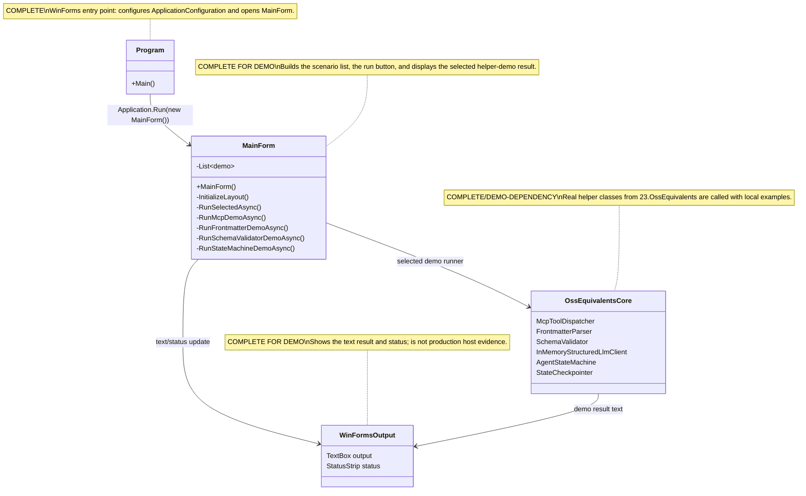

# 23.OssEquivalents.Desktop — implementation documentation

## 0. Quick map for Luba

`23.OssEquivalents.Desktop` is a Windows Forms explorer window for manually browsing the demos from the `23.OssEquivalents` project. The user selects one of four scenarios in a list and clicks the run button; the form shows the text result on the right and status at the bottom. UI events and demonstration data flow through this project: JSON for MCP, Markdown with frontmatter, dictionaries for schema validation, a temporary SQLite database for a state-machine checkpoint. This is not a production plugin runtime, not a real MCP host, not an external AI runtime, and not a trained `ILearningMachine`; it is a local desktop harness that calls already-existing helper classes.

## 1. Simple UML for draw.io



| Node | What it does | Status | Where it lives |
|---|---|---|---|
| `Program` | Launches the WinForms application and creates the form | ✅ Complete for desktop entrypoint | `23.OssEquivalents.Desktop/Program.cs` |
| `MainForm` | Builds the UI, holds the list of demo-runner functions, and runs the selected scenario | ✅ Complete for demo harness | `23.OssEquivalents.Desktop/MainForm.cs` |
| `OssEquivalentsCore` | The set of helper classes from the neighboring project that the form demonstrates | ✅ A real dependency, but not a desktop runtime in itself | `23.OssEquivalents` |
| `WinFormsOutput` | Text box and status strip for the result | ✅ Complete for manual browsing | `23.OssEquivalents.Desktop/MainForm.cs` |

### 1.1 Simulations for each UML connection

| Connection | Example input | What happens | Expected result | What must not be taken as the result |
|---|---|---|---|---|
| `Program -> MainForm` | The user launches the `.exe` | `Main()` calls `ApplicationConfiguration.Initialize()` and `Application.Run(new MainForm())` | The window `Sub-project 23 — OSS Equivalents Explorer` opens | This does not prove production plugin integration or host runtime |
| `MainForm -> OssEquivalentsCore` | `MCP — Tool registration + dispatch over JSON` is selected in the list | `RunSelectedAsync()` takes the runner from `_demos` and calls `RunMcpDemoAsync()` | An `McpToolDispatcher` is created, `ping` is registered, and known/unknown/malformed requests are checked | This is not a real MCP server/host, only a local dispatcher demo |
| `MainForm -> WinFormsOutput` | The runner returned the string `Dispatch (known tool): ...` | The form appends text to `_outputBox` and sets status `Done.` | The user sees the demo log in the TextBox | Text in the UI is not runtime QA or model evidence |
| `OssEquivalentsCore -> WinFormsOutput` | `AgentStateMachine` returned the final state | The demo formats `Run succeeded`, `Checkpoints saved`, `finalAnswer` | A summary and the last checkpoint record appear in the UI | The temporary SQLite record does not prove production asset lifecycle |

## 2. No-code algorithms in plain language

### 2.1 Launching the WinForms window

Analogy: it is like opening a showcase with buttons for demonstrating tools; the showcase itself does not perform production integration, it only lets a person click a demo.

| Field | Value |
|---|---|
| Class | `Program` |
| Method/function | `Main()` |
| File and line | `23.OssEquivalents.Desktop/Program.cs:8` |
| Input parameters/DTO | No parameters; the input is the start of the Windows process |
| Output DTO/result | No DTO; a WinForms message loop with `MainForm` is created |
| Status | ✅ Complete for desktop entrypoint |

Steps of the current algorithm:

1. Windows launches the application.
2. `ApplicationConfiguration.Initialize()` applies the standard WinForms configuration.
3. `Application.Run(new MainForm())` creates the form and holds the message loop.
4. No external AI, MCP host, or plugin host is started.

Branches and simulations:

| Branch | Example input | Why it is chosen | Expected result | Check/QA |
|---|---|---|---|---|
| Normal launch | Launching the desktop exe | The method has no conditions | The window is created via `MainForm` | No direct UI automation test found |

### 2.2 Building the demo list and UI

Analogy: the form builds a tasting menu: four dishes are recorded in advance, and the button runs the selected one.

| Field | Value |
|---|---|
| Class | `MainForm` |
| Method/function | `MainForm()` and `InitializeLayout()` |
| File and line | `23.OssEquivalents.Desktop/MainForm.cs:24`, `23.OssEquivalents.Desktop/MainForm.cs:37` |
| Input parameters/DTO | No parameters; the internal `_demos` holds `(string Name, Func<Task<string>> Run)` |
| Output DTO/result | UI controls: `ListBox`, `Button`, `TextBox`, `StatusStrip` |
| Status | ✅ Complete for demo UI |

Steps of the current algorithm:

1. The constructor creates four `_demos` entries: MCP, frontmatter, schema validator, state machine.
2. `InitializeLayout()` creates the split layout.
3. The left panel gets the demo list and the `Run selected demo` button.
4. The right panel gets a read-only `TextBox`.
5. The status strip starts with the text `Ready`.

Branches and simulations:

| Branch | Example input | Why it is chosen | Expected result | Check/QA |
|---|---|---|---|---|
| Demos present | `_demos.Count = 4` | The list is filled in the constructor | The first item is selected automatically | Source evidence |
| No demos | `_demos.Count = 0` theoretically | The code checks `Items.Count > 0` | SelectedIndex is not set | Not covered by a dedicated UI test |

### 2.3 Running the selected demo

Analogy: the button takes the selected card from the list, temporarily locks the button against repeated clicking, runs the work, and shows the result.

| Field | Value |
|---|---|
| Class | `MainForm` |
| Method/function | `RunSelectedAsync()` |
| File and line | `23.OssEquivalents.Desktop/MainForm.cs:78` |
| Input parameters/DTO | SelectedIndex from `_demoList`; example `0` for MCP |
| Output DTO/result | Side effects: `_outputBox.Text`, `_statusLabel.Text`, `_runButton.Enabled` |
| Status | ✅ Complete for demo runner |

Steps of the current algorithm:

1. The method reads the selected index.
2. If the index is out of range, the method returns silently.
3. For a valid index it takes `(name, runner)` from `_demos`.
4. Disables the button, writes status `Running ...`, clears the output header.
5. Calls the runner and appends the result to `_outputBox`.
6. On an exception it prints the exception and sets `Failed.`
7. In `finally` it re-enables the button.

Branches and simulations:

| Branch | Example input | Why it is chosen | Expected result | Check/QA |
|---|---|---|---|---|
| Nothing selected | `SelectedIndex = -1` | The index is less than 0 | The method returns without running | Source evidence |
| Successful runner | `SelectedIndex = 1` | The runner returns a string | Output contains the result, status `Done.` | Source evidence |
| Runner throws an exception | Any demo function threw an exception | `catch (Exception ex)` | Output contains `[unexpected exception]`, status `Failed.` | UI-specific test gap |

### 2.4 MCP demo

Analogy: it is a local reception-desk dispatcher: it knows a single tool `ping`, so a familiar request is handed to the handler, an unknown one returns an error envelope, and broken JSON fails at parsing.

| Field | Value |
|---|---|
| Class | `MainForm` |
| Method/function | `RunMcpDemoAsync()` |
| File and line | `23.OssEquivalents.Desktop/MainForm.cs:107` |
| Input parameters/DTO | Internal JSON strings: `{"toolName":"ping","arguments":{"text":"hello"}}`, unknown tool, malformed JSON |
| Output DTO/result | `Task<string>` with a text report for the UI |
| Status | ✅ Complete demo branch on top of `McpToolDispatcher` |

What it does NOT do: it does not open a socket/server, does not integrate with a real MCP host, does not prove plugin runtime.

### 2.5 Frontmatter demo

Analogy: it is a small check of a book cover: the parser separates the `name/description/version` fields from the Markdown body and separately shows the error of an unclosed cover.

| Field | Value |
|---|---|
| Class | `MainForm` |
| Method/function | `RunFrontmatterDemoAsync()` |
| File and line | `23.OssEquivalents.Desktop/MainForm.cs:150` |
| Input parameters/DTO | A Markdown sample string with a YAML-like delimiter |
| Output DTO/result | `Task<string>` with metadata/content and a malformed branch |
| Status | ✅ Complete demo branch on top of `FrontmatterParser` |

What it does NOT do: it does not scan real skill folders, does not prove extension install/runtime.

### 2.6 Schema validator and retry demo

Analogy: first a form is checked against the rules, then an LLM imitator brings a bad form twice and on the third time brings a correct one.

| Field | Value |
|---|---|
| Class | `MainForm` |
| Method/function | `RunSchemaValidatorDemoAsync()` |
| File and line | `23.OssEquivalents.Desktop/MainForm.cs:190` |
| Input parameters/DTO | `Dictionary<string, object>` schema, good/bad values, `ConversationMessage("user", "Pick a skill.")` |
| Output DTO/result | `Task<string>` with validation results and the keys of the validated dictionary |
| Status | ✅ Complete demo branch with an in-memory client |

What it does NOT do: it does not call an external AI runtime; `InMemoryStructuredLlmClient` is a deterministic test/demo double.

### 2.7 State machine and checkpoint demo

Analogy: it is a toy route of three stations: analyze adds a plan, execute adds a result, respond assembles the final answer, and checkpoint records the stops into a temporary SQLite database.

| Field | Value |
|---|---|
| Class | `MainForm` |
| Method/function | `RunStateMachineDemoAsync()` |
| File and line | `23.OssEquivalents.Desktop/MainForm.cs:248` |
| Input parameters/DTO | `Dictionary<string, object> { ["task"] = "demo task" }` |
| Output DTO/result | `Task<string>` with success, checkpoint count, final keys, and latest checkpoint |
| Status | ✅ Complete demo branch with a temp SQLite file |

What it does NOT do: it does not prove production state lifecycle, model asset lifecycle, fresh-load/continue-training, or a trained semantic state machine.

## 3. Where the logic sits in the code

| Logic | File | Why this place matters | What it proves | What it does not prove |
|---|---|---|---|---|
| Desktop entrypoint | `23.OssEquivalents.Desktop/Program.cs:8` | This is where the WinForms process begins | The form is launched via `Application.Run(new MainForm())` | Does not prove host/plugin integration |
| Demo registration | `23.OssEquivalents.Desktop/MainForm.cs:24-35` | This is where the scenario list is fixed | The UI has four demo-runner functions | Does not prove full coverage of all `23.OssEquivalents` classes |
| UI layout | `23.OssEquivalents.Desktop/MainForm.cs:37-76` | This is where controls and the click handler are created | The list, button, output, and status are actually wired | Does not prove UI automation coverage |
| Selected runner | `23.OssEquivalents.Desktop/MainForm.cs:78-103` | This is where the selected demo runs and the exception is handled | The status/button/output are updated | Does not prove the quality of the helper algorithms |
| Core dependency | `23.OssEquivalents.Desktop/OssEquivalents.Desktop.csproj:14-16` | The desktop project references `23.OssEquivalents` | The demo calls the neighboring core project | Does not prove production plugin packaging |

## 4. Short important code quotations

> **Why it matters:** the entrypoint shows the real boundary of the project: it is a WinForms application that opens `MainForm`.
>
> **What comes in:** the start of the Windows process.
>
> **What comes out:** a message loop with the form.
>
> **What it does not prove:** production plugin runtime, a real MCP host, or an external AI runtime.

`23.OssEquivalents.Desktop/Program.cs:8-12`

```csharp
    private static void Main()
    {
        ApplicationConfiguration.Initialize();
        Application.Run(new MainForm());
    }
```

> **Why it matters:** the `_demos` list shows the actual scope of the desktop harness: four demonstrations, not the whole set of OSS-equivalent functions.
>
> **What comes in:** the form's parameterless constructor.
>
> **What comes out:** a list of `(Name, Run)` with runner functions.
>
> **What it does not prove:** production workflow or a trained router.

`23.OssEquivalents.Desktop/MainForm.cs:24-35`

```csharp
    public MainForm()
    {
        _demos =
        [
            ("MCP — Tool registration + dispatch over JSON",      RunMcpDemoAsync),
            ("Frontmatter — gray-matter equivalent parsing",      RunFrontmatterDemoAsync),
            ("Schema validator — zod equivalent + retry loop",    RunSchemaValidatorDemoAsync),
            ("State machine — LangGraph equivalent + SQLite ckpt",RunStateMachineDemoAsync),
        ];

        InitializeLayout();
    }
```

> **Why it matters:** here it is visible that running a demo is a UI side effect: the button is disabled, status/output are updated, exceptions are printed into the text field.
>
> **What comes in:** the selected index in `_demoList`.
>
> **What comes out:** the string result of the demo-runner into `_outputBox`.
>
> **What it does not prove:** that the scenario was verified in real host automation.

`23.OssEquivalents.Desktop/MainForm.cs:78-103`

```csharp
    private async Task RunSelectedAsync()
    {
        int index = _demoList.SelectedIndex;
        if (index < 0 || index >= _demos.Count) return;

        var (name, runner) = _demos[index];
        _runButton.Enabled = false;
        _statusLabel.Text  = $"Running {name}...";
        _outputBox.Text    = $"=== {name} ===\r\n\r\n";

        try
        {
            string result = await runner();
            _outputBox.AppendText(result);
            _statusLabel.Text = "Done.";
        }
        catch (Exception ex)
        {
            _outputBox.AppendText($"[unexpected exception]\r\n{ex}");
            _statusLabel.Text = "Failed.";
        }
        finally
        {
            _runButton.Enabled = true;
        }
    }
```

> **Why it matters:** the MCP demo registers only a local `ping`; this is a dispatcher demonstration, not a server.
>
> **What comes in:** a JSON request with `toolName`.
>
> **What comes out:** a text report of the known/unknown/malformed branches.
>
> **What it does not prove:** a real MCP host, network transport, or plugin execution.

`23.OssEquivalents.Desktop/MainForm.cs:107-146`

```csharp
    private async Task<string> RunMcpDemoAsync()
    {
        var dispatcher = new McpToolDispatcher();

        // Register a single read-only "ping" tool that echoes its arguments back.
        dispatcher.Register(
            new McpToolDefinition(
                Name:             "ping",
                Description:      "Echoes the arguments back to the caller",
                ParameterSchema:  new Dictionary<string, object> { ["text"] = "string" }),
            args => Task.FromResult(new Dictionary<string, object>
            {
                ["echo"]      = args.GetValueOrDefault("text") ?? "<no text>",
                ["timestamp"] = DateTimeOffset.UtcNow.ToString("O"),
            }));

        var output = new StringBuilder();
        output.AppendLine($"Registered tools: {dispatcher.Definitions.Count}");
        foreach (var definition in dispatcher.Definitions)
            output.AppendLine($"  - {definition.Name}: {definition.Description}");
        output.AppendLine();

        // Dispatch a well-formed request to the registered tool.
        string okJson = "{\"toolName\":\"ping\",\"arguments\":{\"text\":\"hello\"}}";
        var okResult  = await dispatcher.DispatchAsync(okJson);
        output.AppendLine($"Dispatch (known tool): {okResult.Value}");

        // Dispatch a request for an unknown tool — should produce an error response.
        string unknownJson = "{\"toolName\":\"missing\",\"arguments\":{}}";
        var unknownResult  = await dispatcher.DispatchAsync(unknownJson);
        output.AppendLine($"Dispatch (unknown):   {unknownResult.Value}");

        // Dispatch invalid JSON — should produce a parse failure result.
        var malformedResult = await dispatcher.DispatchAsync("{not valid json");
        output.AppendLine(malformedResult.IsSuccess
            ? $"Dispatch (malformed): unexpectedly succeeded with {malformedResult.Value}"
            : $"Dispatch (malformed): failure {malformedResult.ErrorCode} — {malformedResult.ErrorMessage}");

        return output.ToString();
    }
```

> **Why it matters:** the retry demo uses `InMemoryStructuredLlmClient`, so it is a deterministic demo double, not external AI.
>
> **What comes in:** three predefined JSON responses and a schema.
>
> **What comes out:** the validated dictionary after retry.
>
> **What it does not prove:** permission to use external AI or the quality of real structured generation.

`23.OssEquivalents.Desktop/MainForm.cs:223-243`

```csharp
        // Use the InMemoryStructuredLlmClient to demonstrate the schema-retry loop.
        // The client returns invalid JSON twice, then a valid object on the third call.
        var inMemoryClient = new InMemoryStructuredLlmClient(
        [
            "{\"name\": \"skill-A\"}",                                      // missing required field
            "{\"name\": \"skill-A\", \"confidence\": \"oops\"}",            // wrong type
            "{\"name\": \"skill-A\", \"confidence\": 0.91, \"tags\": []}",  // valid
        ]);

        var clientResult = await inMemoryClient.SendWithSchemaAsync(
            messageHistory:    new List<ConversationMessage> { new("user", "Pick a skill.") },
            expectedSchema:    schema,
            maximumRetryCount: 3);

        sb.AppendLine($"Structured LLM retry result: success = {clientResult.IsSuccess}");
        if (clientResult.IsSuccess)
            sb.AppendLine($"  validated dictionary keys: {string.Join(", ", clientResult.Value!.Keys)}");
        else
            sb.AppendLine($"  failure: {clientResult.ErrorMessage}");

        return sb.ToString();
```

> **Why it matters:** the state-machine demo writes a checkpoint into a temporary SQLite file and then reads the latest checkpoint. This is a useful persistence demonstration, but scoped to the demo run.
>
> **What comes in:** `initialState` with `task = "demo task"`.
>
> **What comes out:** the final state and a latest checkpoint summary.
>
> **What it does not prove:** production asset lifecycle, fresh-load model evidence, or a trained state machine.

`23.OssEquivalents.Desktop/MainForm.cs:248-316`

```csharp
    private async Task<string> RunStateMachineDemoAsync()
    {
        // SQLite checkpointer writes to a temp file scoped to this demo run.
        string tempDb = Path.Combine(Path.GetTempPath(), $"oss-23-demo-{Guid.NewGuid():N}.sqlite");

        await using var checkpointer = new StateCheckpointer(tempDb);
        var machine = new AgentStateMachine(checkpointer);

        // Three nodes: analyze → execute → respond.
        machine.AddNode(new AgentStateNode("analyze",
            state =>
            {
                var next = new Dictionary<string, object>(state) { ["plan"] = "do work" };
                return Task.FromResult(next);
            }));

        machine.AddNode(new AgentStateNode("execute",
            state =>
            {
                var next = new Dictionary<string, object>(state) { ["resultText"] = "done" };
                return Task.FromResult(next);
            }));

        machine.AddNode(new AgentStateNode("respond",
            state =>
            {
                var next = new Dictionary<string, object>(state) { ["finalAnswer"] = $"answer: {state["resultText"]}" };
                return Task.FromResult(next);
            }));

        // Linear conditional edges that always advance to the next stage.
        machine.AddConditionalEdge("analyze", _ => true, "execute");
        machine.AddConditionalEdge("execute", _ => true, "respond");
        machine.AddConditionalEdge("respond", _ => true, "done");

        var initialState = new Dictionary<string, object> { ["task"] = "demo task" };

        var result = await machine.RunAsync(initialState,
            startingStateName:  "analyze",
            terminalStateName:  "done");

        var sb = new StringBuilder();
        sb.AppendLine($"Run succeeded: {result.IsSuccess}");
        sb.AppendLine($"Checkpoints saved during run: {machine.CheckpointsSaved}");

        if (result.IsSuccess)
        {
            sb.AppendLine($"Final state keys: {string.Join(", ", result.Value!.Keys)}");
            sb.AppendLine($"finalAnswer = {result.Value!.GetValueOrDefault("finalAnswer")}");
        }
        else
        {
            sb.AppendLine($"Failure: {result.ErrorMessage} ({result.ErrorCode})");
        }

        // Read the latest checkpoint back out of SQLite to prove persistence.
        var latest = await checkpointer.LoadLatestAsync();
        if (latest.IsSuccess)
        {
            sb.AppendLine();
            sb.AppendLine($"Latest checkpoint state name: {latest.Value.StateName}");
            sb.AppendLine($"Latest checkpoint keys: {string.Join(", ", latest.Value.StateData.Keys)}");
        }

        // Best-effort cleanup of the temp database file.
        try { File.Delete(tempDb); } catch { /* ignore on Windows file lock */ }

        return sb.ToString();
    }
```

> **Why it matters:** the `.csproj` fixes the desktop nature of the project: a Windows Forms executable plus a reference to the core project.
>
> **What comes in:** building the desktop project.
>
> **What comes out:** a WinExe with a project reference to `23.OssEquivalents`.
>
> **What it does not prove:** an extension package, plugin host, or runtime integration.

`23.OssEquivalents.Desktop/OssEquivalents.Desktop.csproj:3-16`

```xml
  <PropertyGroup>
    <!-- Windows Forms desktop host for the OSS-equivalents demos. -->
    <OutputType>WinExe</OutputType>
    <TargetFramework>net9.0-windows</TargetFramework>
    <UseWindowsForms>true</UseWindowsForms>
    <ImplicitUsings>enable</ImplicitUsings>
    <Nullable>enable</Nullable>
    <RootNamespace>OssEquivalents.Desktop</RootNamespace>
    <AssemblyName>OssEquivalents.Desktop</AssemblyName>
  </PropertyGroup>

  <ItemGroup>
    <ProjectReference Include="..\23.OssEquivalents\OssEquivalents.csproj" />
  </ItemGroup>
```

## 5. Test, e2e, and QA mapping (QA/test mapping)

The tests in this documentation subphase were read/cross-referenced but not run. There is no direct UI automation test for `23.OssEquivalents.Desktop` in the found references.

| Behavior | Verification level | Current evidence | Status | Next work order if gap |
|---|---|---|---|---|
| `Program.Main` opens `MainForm` | source/static | `23.OssEquivalents.Desktop/Program.cs:8-12` | source-covered | UI automation gap |
| List of four demo-runner scenarios | source/static | `23.OssEquivalents.Desktop/MainForm.cs:24-35` | source-covered | UI automation gap |
| MCP known/unknown/malformed behavior | unit tests for core helper | `Tests/OssEquivalentsTests.cs:142-188` | helper-covered, desktop not directly tested | Desktop UI test if needed |
| Frontmatter parse/malformed behavior | unit tests for core helper | `Tests/OssEquivalentsTests.cs:11-68` | helper-covered, desktop not directly tested | Desktop UI test if needed |
| Schema validator and structured retry | unit tests for core helper | `Tests/OssEquivalentsTests.cs:202-255` and surrounding structured-client tests | helper-covered, desktop not directly tested | Desktop UI test if needed |
| State machine checkpoint | unit tests for core helper | `Tests/OssEquivalentsTests.cs:335-455` | helper-covered, desktop not directly tested | Desktop UI test if needed |
| Production plugin/host runtime | none in this project | Desktop source is a WinForms harness only | gap/not claimed | Future host-specific work order |

## 6. Anti-false-done checks

| Gate | Check for D4H |
|---|---|
| Human-readable | The document explains the desktop harness in plain language down to code details |
| UML | A Mermaid class diagram exists and is importable to draw.io |
| UML simulations | Every arrow of the diagram has an example and an expected result |
| Algorithms | `Program.Main`, `MainForm`, `RunSelectedAsync`, and the four demo-runner branches are described with methods and inputs/outputs |
| Code refs | Quotations are short/medium, with exact line refs and WHY/HOW/WHAT |
| Status honesty | The project is named a demo/harness, not a production runtime |
| No JSON-only done | The MCP/schema JSON strings are demo inputs, not evidence of full runtime integration |
| No hidden deterministic shortcut | The in-memory client, temp SQLite, and helper demos are not called a trained semantic authority |
| Trainable claim | There is no claim of a trained `ILearningMachine`; the checkpoint demo is not a model asset lifecycle |
| Testability | There is helper-test mapping and an honest gap on direct desktop UI automation |

## 7. Status table

| Component | File | Status | What actually works now |
|---|---|---|---|
| `Program` | `23.OssEquivalents.Desktop/Program.cs` | ✅ Complete | `Main()` initializes WinForms and launches `MainForm` |
| `MainForm` | `23.OssEquivalents.Desktop/MainForm.cs` | ✅ Complete for demo harness | Creates the demo list, layout, button, output/status controls |
| `RunSelectedAsync` | `23.OssEquivalents.Desktop/MainForm.cs` | ✅ Complete for demo runner | Checks the index, disables the button, runs the runner, writes success/failure to the UI |
| `RunMcpDemoAsync` | `23.OssEquivalents.Desktop/MainForm.cs` | ✅ Complete demo branch | Registers a local `ping`, calls known/unknown/malformed JSON |
| `RunFrontmatterDemoAsync` | `23.OssEquivalents.Desktop/MainForm.cs` | ✅ Complete demo branch | Parses sample Markdown and malformed frontmatter |
| `RunSchemaValidatorDemoAsync` | `23.OssEquivalents.Desktop/MainForm.cs` | ✅ Complete demo branch | Validates good/bad dictionaries and retry via `InMemoryStructuredLlmClient` |
| `RunStateMachineDemoAsync` | `23.OssEquivalents.Desktop/MainForm.cs` | ✅ Complete demo branch | Creates a temp SQLite checkpoint, runs three state nodes, reads the latest checkpoint |
| `OssEquivalents.Desktop.csproj` | `23.OssEquivalents.Desktop/OssEquivalents.Desktop.csproj` | ✅ Complete project wiring | `WinExe`, `net9.0-windows`, `UseWindowsForms`, reference to `23.OssEquivalents` |

## 8. Hierarchy / runtime boundary

`23.OssEquivalents.Desktop` does not implement `ILearningMachine`, `ILogicalFlow`, or `ILogicalUnit`. It is a Level 0 UI/demo shell around deterministic helpers. No export/import checkpoint for a trainable unit, manifest, locator, fresh-load, or continue-training is shown here. The temporary SQLite database in `RunStateMachineDemoAsync()` is a checkpoint demo for the state machine, not a model lifecycle.

## 9. Sources and drift check

Cross-checked against:

- `23.OssEquivalents.Desktop/Program.cs`
- `23.OssEquivalents.Desktop/MainForm.cs`
- `23.OssEquivalents.Desktop/OssEquivalents.Desktop.csproj`
- `Tests/OssEquivalentsTests.cs`
- `docs/projects/PROJECT-DOCUMENTATION-TEMPLATE.md`
- `docs/projects/PROJECT-DOCUMENTATION-INDEX.md`
- `docs/projects/_status/coverage-matrix.json`

Documentation status: draft pending parent review  
Last verified against source: 2026-06-08  
Known gaps: no direct desktop UI automation test; production plugin/runtime evidence is not claimed
