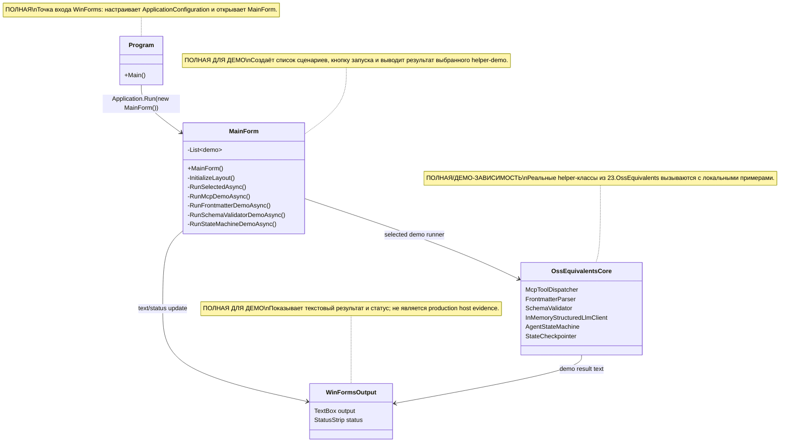

# 23.OssEquivalents.Desktop — документация реализации

## 0. Краткая карта для Лубы

`23.OssEquivalents.Desktop` — это Windows Forms окно-обозреватель для ручного просмотра демо из проекта `23.OssEquivalents`. Пользователь выбирает один из четырёх сценариев в списке и нажимает кнопку запуска; форма показывает текстовый результат справа и статус снизу. Через этот проект проходят UI-события и демонстрационные данные: JSON для MCP, Markdown с frontmatter, словари для schema validation, временная SQLite-база для state-machine checkpoint. Это не production plugin runtime, не настоящий MCP host, не внешний AI runtime и не обученная `ILearningMachine`; это локальный desktop harness, который вызывает уже существующие helper-классы.

## 1. Простая UML для draw.io



| Узел | Что делает | Статус | Где живёт |
|---|---|---|---|
| `Program` | Запускает WinForms-приложение и создаёт форму | ✅ Полная для desktop entrypoint | `23.OssEquivalents.Desktop/Program.cs` |
| `MainForm` | Строит UI, хранит список demo-runner функций и запускает выбранный сценарий | ✅ Полная для demo harness | `23.OssEquivalents.Desktop/MainForm.cs` |
| `OssEquivalentsCore` | Набор helper-классов из соседнего проекта, которые форма демонстрирует | ✅ Реальная зависимость, но не desktop runtime сама по себе | `23.OssEquivalents` |
| `WinFormsOutput` | Текстовое поле и status strip для результата | ✅ Полная для ручного просмотра | `23.OssEquivalents.Desktop/MainForm.cs` |

### 1.1 Симуляции по каждой связи UML

| Связь | Пример входа | Что происходит | Ожидаемый результат | Что запрещено принимать за результат |
|---|---|---|---|---|
| `Program -> MainForm` | Пользователь запускает `.exe` | `Main()` вызывает `ApplicationConfiguration.Initialize()` и `Application.Run(new MainForm())` | Открывается окно `Sub-project 23 — OSS Equivalents Explorer` | Это не доказывает production plugin integration или host runtime |
| `MainForm -> OssEquivalentsCore` | В списке выбран `MCP — Tool registration + dispatch over JSON` | `RunSelectedAsync()` берёт runner из `_demos` и вызывает `RunMcpDemoAsync()` | Создаётся `McpToolDispatcher`, регистрируется `ping`, проверяются known/unknown/malformed запросы | Это не настоящий MCP server/host, только локальный dispatcher demo |
| `MainForm -> WinFormsOutput` | Runner вернул строку `Dispatch (known tool): ...` | Форма добавляет текст в `_outputBox` и ставит статус `Done.` | Пользователь видит протокол демо в TextBox | Текст в UI не является runtime QA или model evidence |
| `OssEquivalentsCore -> WinFormsOutput` | `AgentStateMachine` вернул финальное состояние | Demo форматирует `Run succeeded`, `Checkpoints saved`, `finalAnswer` | В UI появляется сводка и последняя checkpoint-запись | Временная SQLite-запись не доказывает production asset lifecycle |

## 2. Алгоритмы без кода на русском

### 2.1 Запуск WinForms окна

Аналогия: это как открыть витрину с кнопками для демонстрации инструментов; витрина сама не выполняет production-интеграцию, она только даёт человеку нажать демо.

| Поле | Значение |
|---|---|
| Класс | `Program` |
| Метод/функция | `Main()` |
| Файл и строка | `23.OssEquivalents.Desktop/Program.cs:8` |
| Входные параметры/DTO | Нет параметров; входом является запуск процесса Windows |
| Выходной DTO/результат | Нет DTO; создаётся WinForms message loop с `MainForm` |
| Статус | ✅ Полная для desktop entrypoint |

Шаги текущего алгоритма:

1. Windows запускает приложение.
2. `ApplicationConfiguration.Initialize()` применяет стандартную конфигурацию WinForms.
3. `Application.Run(new MainForm())` создаёт форму и держит message loop.
4. Никакой внешний AI, MCP host или plugin host не запускается.

Ветки и симуляции:

| Ветка | Пример входа | Почему выбирается | Ожидаемый результат | Проверка/QA |
|---|---|---|---|---|
| Нормальный запуск | Запуск desktop exe | Метод не имеет условий | Окно создаётся через `MainForm` | Прямого UI automation test не найдено |

### 2.2 Построение списка демо и UI

Аналогия: форма делает меню дегустации: заранее записаны четыре блюда, а кнопка запускает выбранное.

| Поле | Значение |
|---|---|
| Класс | `MainForm` |
| Метод/функция | `MainForm()` и `InitializeLayout()` |
| Файл и строка | `23.OssEquivalents.Desktop/MainForm.cs:24`, `23.OssEquivalents.Desktop/MainForm.cs:37` |
| Входные параметры/DTO | Нет параметров; internal `_demos` содержит `(string Name, Func<Task<string>> Run)` |
| Выходной DTO/результат | UI controls: `ListBox`, `Button`, `TextBox`, `StatusStrip` |
| Статус | ✅ Полная для demo UI |

Шаги текущего алгоритма:

1. Конструктор создаёт четыре записи `_demos`: MCP, frontmatter, schema validator, state machine.
2. `InitializeLayout()` создаёт split layout.
3. Левая панель получает список демо и кнопку `Run selected demo`.
4. Правая панель получает read-only `TextBox`.
5. Status strip начинает с текста `Ready`.

Ветки и симуляции:

| Ветка | Пример входа | Почему выбирается | Ожидаемый результат | Проверка/QA |
|---|---|---|---|---|
| Есть демо | `_demos.Count = 4` | Список заполнен в конструкторе | Первый элемент выбран автоматически | Source evidence |
| Нет демо | `_demos.Count = 0` теоретически | Код проверяет `Items.Count > 0` | SelectedIndex не задаётся | Не покрыто отдельным UI test |

### 2.3 Запуск выбранного демо

Аналогия: кнопка берёт выбранную карточку из списка, временно закрывает кнопку от повторного нажатия, запускает работу и показывает итог.

| Поле | Значение |
|---|---|
| Класс | `MainForm` |
| Метод/функция | `RunSelectedAsync()` |
| Файл и строка | `23.OssEquivalents.Desktop/MainForm.cs:78` |
| Входные параметры/DTO | SelectedIndex из `_demoList`; пример `0` для MCP |
| Выходной DTO/результат | Side effects: `_outputBox.Text`, `_statusLabel.Text`, `_runButton.Enabled` |
| Статус | ✅ Полная для demo runner |

Шаги текущего алгоритма:

1. Метод читает выбранный индекс.
2. Если индекс вне диапазона, метод молча возвращается.
3. Для корректного индекса берёт `(name, runner)` из `_demos`.
4. Отключает кнопку, пишет статус `Running ...`, очищает output header.
5. Вызывает runner и добавляет результат в `_outputBox`.
6. При исключении печатает exception и ставит `Failed.`
7. В `finally` снова включает кнопку.

Ветки и симуляции:

| Ветка | Пример входа | Почему выбирается | Ожидаемый результат | Проверка/QA |
|---|---|---|---|---|
| Ничего не выбрано | `SelectedIndex = -1` | Индекс меньше 0 | Метод возвращается без запуска | Source evidence |
| Успешный runner | `SelectedIndex = 1` | Runner возвращает строку | Output содержит результат, статус `Done.` | Source evidence |
| Runner кидает exception | Любая demo-функция выбросила исключение | `catch (Exception ex)` | Output содержит `[unexpected exception]`, статус `Failed.` | UI-specific test gap |

### 2.4 MCP demo

Аналогия: это локальный диспетчер приёмной: он знает один инструмент `ping`, поэтому знакомый запрос отдаёт в обработчик, неизвестный возвращает ошибочный конверт, а битый JSON ломается на парсинге.

| Поле | Значение |
|---|---|
| Класс | `MainForm` |
| Метод/функция | `RunMcpDemoAsync()` |
| Файл и строка | `23.OssEquivalents.Desktop/MainForm.cs:107` |
| Входные параметры/DTO | Внутренние JSON-строки: `{"toolName":"ping","arguments":{"text":"hello"}}`, unknown tool, malformed JSON |
| Выходной DTO/результат | `Task<string>` с текстовым отчётом для UI |
| Статус | ✅ Полная demo-ветка поверх `McpToolDispatcher` |

Что НЕ делает: не открывает socket/server, не интегрируется с реальным MCP host, не доказывает plugin runtime.

### 2.5 Frontmatter demo

Аналогия: это маленькая проверка обложки книги: parser отделяет поля `name/description/version` от тела Markdown и отдельно показывает ошибку незакрытой обложки.

| Поле | Значение |
|---|---|
| Класс | `MainForm` |
| Метод/функция | `RunFrontmatterDemoAsync()` |
| Файл и строка | `23.OssEquivalents.Desktop/MainForm.cs:150` |
| Входные параметры/DTO | Markdown sample string с YAML-like delimiter |
| Выходной DTO/результат | `Task<string>` с metadata/content и malformed branch |
| Статус | ✅ Полная demo-ветка поверх `FrontmatterParser` |

Что НЕ делает: не сканирует реальные skill folders, не доказывает extension install/runtime.

### 2.6 Schema validator и retry demo

Аналогия: сначала проверяется анкета по правилам, потом имитатор LLM два раза приносит плохую анкету и на третий раз приносит правильную.

| Поле | Значение |
|---|---|
| Класс | `MainForm` |
| Метод/функция | `RunSchemaValidatorDemoAsync()` |
| Файл и строка | `23.OssEquivalents.Desktop/MainForm.cs:190` |
| Входные параметры/DTO | `Dictionary<string, object>` schema, good/bad values, `ConversationMessage("user", "Pick a skill.")` |
| Выходной DTO/результат | `Task<string>` с validation результатами и ключами validated dictionary |
| Статус | ✅ Полная demo-ветка с in-memory client |

Что НЕ делает: не вызывает внешний AI runtime; `InMemoryStructuredLlmClient` — deterministic test/demo double.

### 2.7 State machine и checkpoint demo

Аналогия: это игрушечный маршрут из трёх станций: analyze добавляет план, execute добавляет результат, respond собирает финальный ответ, а checkpoint записывает остановки во временную SQLite-базу.

| Поле | Значение |
|---|---|
| Класс | `MainForm` |
| Метод/функция | `RunStateMachineDemoAsync()` |
| Файл и строка | `23.OssEquivalents.Desktop/MainForm.cs:248` |
| Входные параметры/DTO | `Dictionary<string, object> { ["task"] = "demo task" }` |
| Выходной DTO/результат | `Task<string>` с success, checkpoint count, final keys и latest checkpoint |
| Статус | ✅ Полная demo-ветка с temp SQLite file |

Что НЕ делает: не доказывает production state lifecycle, model asset lifecycle, fresh-load/continue-training или обученную semantic state machine.

## 3. Где логика сидит в коде

| Логика | Файл | Почему это место важно | Что доказывает | Чего не доказывает |
|---|---|---|---|---|
| Desktop entrypoint | `23.OssEquivalents.Desktop/Program.cs:8` | Здесь начинается WinForms process | Форма запускается через `Application.Run(new MainForm())` | Не доказывает host/plugin integration |
| Demo registration | `23.OssEquivalents.Desktop/MainForm.cs:24-35` | Здесь фиксирован список сценариев | UI имеет четыре demo-runner функции | Не доказывает полный coverage всех `23.OssEquivalents` классов |
| UI layout | `23.OssEquivalents.Desktop/MainForm.cs:37-76` | Здесь создаются controls и click handler | Список, кнопка, output и status реально связаны | Не доказывает UI automation coverage |
| Selected runner | `23.OssEquivalents.Desktop/MainForm.cs:78-103` | Здесь выполняется выбранное демо и обрабатывается exception | Статус/кнопка/output обновляются | Не доказывает качество helper algorithms |
| Core dependency | `23.OssEquivalents.Desktop/OssEquivalents.Desktop.csproj:14-16` | Desktop проект ссылается на `23.OssEquivalents` | Демо вызывает соседний core project | Не доказывает production plugin packaging |

## 4. Короткие важные цитаты кода

> **Почему важно:** entrypoint показывает реальную границу проекта: это WinForms-приложение, которое открывает `MainForm`.
>
> **Что входит:** запуск процесса Windows.
>
> **Что выходит:** message loop с формой.
>
> **Чего не доказывает:** production plugin runtime, реальный MCP host или внешний AI runtime.

`23.OssEquivalents.Desktop/Program.cs:8-12`

```csharp
    private static void Main()
    {
        ApplicationConfiguration.Initialize();
        Application.Run(new MainForm());
    }
```

> **Почему важно:** список `_demos` показывает фактический scope desktop harness: четыре демонстрации, а не весь набор OSS-equivalent функций.
>
> **Что входит:** конструктор формы без параметров.
>
> **Что выходит:** список `(Name, Run)` с runner-функциями.
>
> **Чего не доказывает:** production workflow или обученный router.

`23.OssEquivalents.Desktop/MainForm.cs:24-35`

```csharp
    public MainForm()
    {
        _demos =
        [
            ("MCP — Tool registration + dispatch over JSON",      RunMcpDemoAsync),
            ("Frontmatter — gray-matter equivalent parsing",      RunFrontmatterDemoAsync),
            ("Schema validator — zod equivalent + retry loop",    RunSchemaValidatorDemoAsync),
            ("State machine — LangGraph equivalent + SQLite ckpt",RunStateMachineDemoAsync),
        ];

        InitializeLayout();
    }
```

> **Почему важно:** здесь видно, что запуск демо — UI side effect: кнопка отключается, status/output обновляются, exceptions печатаются в текстовое поле.
>
> **Что входит:** выбранный индекс в `_demoList`.
>
> **Что выходит:** строковый результат demo-runner в `_outputBox`.
>
> **Чего не доказывает:** что сценарий был проверен в реальном host automation.

`23.OssEquivalents.Desktop/MainForm.cs:78-103`

```csharp
    private async Task RunSelectedAsync()
    {
        int index = _demoList.SelectedIndex;
        if (index < 0 || index >= _demos.Count) return;

        var (name, runner) = _demos[index];
        _runButton.Enabled = false;
        _statusLabel.Text  = $"Running {name}...";
        _outputBox.Text    = $"=== {name} ===\r\n\r\n";

        try
        {
            string result = await runner();
            _outputBox.AppendText(result);
            _statusLabel.Text = "Done.";
        }
        catch (Exception ex)
        {
            _outputBox.AppendText($"[unexpected exception]\r\n{ex}");
            _statusLabel.Text = "Failed.";
        }
        finally
        {
            _runButton.Enabled = true;
        }
    }
```

> **Почему важно:** MCP demo регистрирует только локальный `ping`; это dispatcher demonstration, не server.
>
> **Что входит:** JSON request с `toolName`.
>
> **Что выходит:** текстовый отчёт known/unknown/malformed веток.
>
> **Чего не доказывает:** настоящий MCP host, network transport или plugin execution.

`23.OssEquivalents.Desktop/MainForm.cs:107-146`

```csharp
    private async Task<string> RunMcpDemoAsync()
    {
        var dispatcher = new McpToolDispatcher();

        // Register a single read-only "ping" tool that echoes its arguments back.
        dispatcher.Register(
            new McpToolDefinition(
                Name:             "ping",
                Description:      "Echoes the arguments back to the caller",
                ParameterSchema:  new Dictionary<string, object> { ["text"] = "string" }),
            args => Task.FromResult(new Dictionary<string, object>
            {
                ["echo"]      = args.GetValueOrDefault("text") ?? "<no text>",
                ["timestamp"] = DateTimeOffset.UtcNow.ToString("O"),
            }));

        var output = new StringBuilder();
        output.AppendLine($"Registered tools: {dispatcher.Definitions.Count}");
        foreach (var definition in dispatcher.Definitions)
            output.AppendLine($"  - {definition.Name}: {definition.Description}");
        output.AppendLine();

        // Dispatch a well-formed request to the registered tool.
        string okJson = "{\"toolName\":\"ping\",\"arguments\":{\"text\":\"hello\"}}";
        var okResult  = await dispatcher.DispatchAsync(okJson);
        output.AppendLine($"Dispatch (known tool): {okResult.Value}");

        // Dispatch a request for an unknown tool — should produce an error response.
        string unknownJson = "{\"toolName\":\"missing\",\"arguments\":{}}";
        var unknownResult  = await dispatcher.DispatchAsync(unknownJson);
        output.AppendLine($"Dispatch (unknown):   {unknownResult.Value}");

        // Dispatch invalid JSON — should produce a parse failure result.
        var malformedResult = await dispatcher.DispatchAsync("{not valid json");
        output.AppendLine(malformedResult.IsSuccess
            ? $"Dispatch (malformed): unexpectedly succeeded with {malformedResult.Value}"
            : $"Dispatch (malformed): failure {malformedResult.ErrorCode} — {malformedResult.ErrorMessage}");

        return output.ToString();
    }
```

> **Почему важно:** retry demo использует `InMemoryStructuredLlmClient`, поэтому это deterministic demo double, а не внешний AI.
>
> **Что входит:** три заранее заданных JSON responses и schema.
>
> **Что выходит:** validated dictionary после retry.
>
> **Чего не доказывает:** разрешение использовать external AI или качество реального structured generation.

`23.OssEquivalents.Desktop/MainForm.cs:223-243`

```csharp
        // Use the InMemoryStructuredLlmClient to demonstrate the schema-retry loop.
        // The client returns invalid JSON twice, then a valid object on the third call.
        var inMemoryClient = new InMemoryStructuredLlmClient(
        [
            "{\"name\": \"skill-A\"}",                                      // missing required field
            "{\"name\": \"skill-A\", \"confidence\": \"oops\"}",            // wrong type
            "{\"name\": \"skill-A\", \"confidence\": 0.91, \"tags\": []}",  // valid
        ]);

        var clientResult = await inMemoryClient.SendWithSchemaAsync(
            messageHistory:    new List<ConversationMessage> { new("user", "Pick a skill.") },
            expectedSchema:    schema,
            maximumRetryCount: 3);

        sb.AppendLine($"Structured LLM retry result: success = {clientResult.IsSuccess}");
        if (clientResult.IsSuccess)
            sb.AppendLine($"  validated dictionary keys: {string.Join(", ", clientResult.Value!.Keys)}");
        else
            sb.AppendLine($"  failure: {clientResult.ErrorMessage}");

        return sb.ToString();
```

> **Почему важно:** state-machine demo пишет checkpoint во временный SQLite-файл и потом читает latest checkpoint. Это полезная persistence демонстрация, но scoped to demo run.
>
> **Что входит:** `initialState` с `task = "demo task"`.
>
> **Что выходит:** финальное состояние и latest checkpoint summary.
>
> **Чего не доказывает:** production asset lifecycle, fresh-load model evidence или обученную state machine.

`23.OssEquivalents.Desktop/MainForm.cs:248-316`

```csharp
    private async Task<string> RunStateMachineDemoAsync()
    {
        // SQLite checkpointer writes to a temp file scoped to this demo run.
        string tempDb = Path.Combine(Path.GetTempPath(), $"oss-23-demo-{Guid.NewGuid():N}.sqlite");

        await using var checkpointer = new StateCheckpointer(tempDb);
        var machine = new AgentStateMachine(checkpointer);

        // Three nodes: analyze → execute → respond.
        machine.AddNode(new AgentStateNode("analyze",
            state =>
            {
                var next = new Dictionary<string, object>(state) { ["plan"] = "do work" };
                return Task.FromResult(next);
            }));

        machine.AddNode(new AgentStateNode("execute",
            state =>
            {
                var next = new Dictionary<string, object>(state) { ["resultText"] = "done" };
                return Task.FromResult(next);
            }));

        machine.AddNode(new AgentStateNode("respond",
            state =>
            {
                var next = new Dictionary<string, object>(state) { ["finalAnswer"] = $"answer: {state["resultText"]}" };
                return Task.FromResult(next);
            }));

        // Linear conditional edges that always advance to the next stage.
        machine.AddConditionalEdge("analyze", _ => true, "execute");
        machine.AddConditionalEdge("execute", _ => true, "respond");
        machine.AddConditionalEdge("respond", _ => true, "done");

        var initialState = new Dictionary<string, object> { ["task"] = "demo task" };

        var result = await machine.RunAsync(initialState,
            startingStateName:  "analyze",
            terminalStateName:  "done");

        var sb = new StringBuilder();
        sb.AppendLine($"Run succeeded: {result.IsSuccess}");
        sb.AppendLine($"Checkpoints saved during run: {machine.CheckpointsSaved}");

        if (result.IsSuccess)
        {
            sb.AppendLine($"Final state keys: {string.Join(", ", result.Value!.Keys)}");
            sb.AppendLine($"finalAnswer = {result.Value!.GetValueOrDefault("finalAnswer")}");
        }
        else
        {
            sb.AppendLine($"Failure: {result.ErrorMessage} ({result.ErrorCode})");
        }

        // Read the latest checkpoint back out of SQLite to prove persistence.
        var latest = await checkpointer.LoadLatestAsync();
        if (latest.IsSuccess)
        {
            sb.AppendLine();
            sb.AppendLine($"Latest checkpoint state name: {latest.Value.StateName}");
            sb.AppendLine($"Latest checkpoint keys: {string.Join(", ", latest.Value.StateData.Keys)}");
        }

        // Best-effort cleanup of the temp database file.
        try { File.Delete(tempDb); } catch { /* ignore on Windows file lock */ }

        return sb.ToString();
    }
```

> **Почему важно:** `.csproj` фиксирует desktop nature проекта: Windows Forms executable плюс ссылка на core project.
>
> **Что входит:** сборка desktop project.
>
> **Что выходит:** WinExe с project reference на `23.OssEquivalents`.
>
> **Чего не доказывает:** extension package, plugin host или runtime integration.

`23.OssEquivalents.Desktop/OssEquivalents.Desktop.csproj:3-16`

```xml
  <PropertyGroup>
    <!-- Windows Forms desktop host for the OSS-equivalents demos. -->
    <OutputType>WinExe</OutputType>
    <TargetFramework>net9.0-windows</TargetFramework>
    <UseWindowsForms>true</UseWindowsForms>
    <ImplicitUsings>enable</ImplicitUsings>
    <Nullable>enable</Nullable>
    <RootNamespace>OssEquivalents.Desktop</RootNamespace>
    <AssemblyName>OssEquivalents.Desktop</AssemblyName>
  </PropertyGroup>

  <ItemGroup>
    <ProjectReference Include="..\23.OssEquivalents\OssEquivalents.csproj" />
  </ItemGroup>
```

## 5. Test, e2e и QA mapping (QA/test mapping)

Тесты в этом documentation subphase были прочитаны/сопоставлены, но не запускались. Прямого UI automation test для `23.OssEquivalents.Desktop` в найденных ссылках нет.

| Поведение | Уровень проверки | Текущий evidence | Статус | Следующий work order если gap |
|---|---|---|---|---|
| `Program.Main` открывает `MainForm` | source/static | `23.OssEquivalents.Desktop/Program.cs:8-12` | source-covered | UI automation gap |
| Список из четырёх demo-runner сценариев | source/static | `23.OssEquivalents.Desktop/MainForm.cs:24-35` | source-covered | UI automation gap |
| MCP known/unknown/malformed behavior | unit tests for core helper | `Tests/OssEquivalentsTests.cs:142-188` | helper-covered, desktop not directly tested | Desktop UI test if needed |
| Frontmatter parse/malformed behavior | unit tests for core helper | `Tests/OssEquivalentsTests.cs:11-68` | helper-covered, desktop not directly tested | Desktop UI test if needed |
| Schema validator and structured retry | unit tests for core helper | `Tests/OssEquivalentsTests.cs:202-255` and surrounding structured-client tests | helper-covered, desktop not directly tested | Desktop UI test if needed |
| State machine checkpoint | unit tests for core helper | `Tests/OssEquivalentsTests.cs:335-455` | helper-covered, desktop not directly tested | Desktop UI test if needed |
| Production plugin/host runtime | none in this project | Desktop source is WinForms harness only | gap/not claimed | Future host-specific work order |

## 6. Anti-false-done checks

| Gate | Проверка для D4H |
|---|---|
| Human-readable | Документ объясняет desktop harness по-русски до деталей кода |
| UML | Mermaid class diagram есть и импортируем в draw.io |
| UML simulations | Каждая стрелка диаграммы имеет пример и ожидаемый результат |
| Algorithms | `Program.Main`, `MainForm`, `RunSelectedAsync`, четыре demo-runner ветки описаны с методами и входами/выходами |
| Code refs | Цитаты короткие/средние, с точными line refs и WHY/HOW/WHAT |
| Status honesty | Проект назван demo/harness, а не production runtime |
| No JSON-only done | JSON-строки MCP/schema являются demo inputs, не evidence полной runtime-интеграции |
| No hidden deterministic shortcut | In-memory client, temp SQLite и helper demos не названы обученной semantic authority |
| Trainable claim | Нет claim обученной `ILearningMachine`; checkpoint demo не model asset lifecycle |
| Testability | Есть helper-test mapping и честный gap по direct desktop UI automation |

## 7. Status table

| Компонент | Файл | Статус | Что реально работает сейчас |
|---|---|---|---|
| `Program` | `23.OssEquivalents.Desktop/Program.cs` | ✅ Полная | `Main()` инициализирует WinForms и запускает `MainForm` |
| `MainForm` | `23.OssEquivalents.Desktop/MainForm.cs` | ✅ Полная для demo harness | Создаёт список демо, layout, кнопку, output/status controls |
| `RunSelectedAsync` | `23.OssEquivalents.Desktop/MainForm.cs` | ✅ Полная для demo runner | Проверяет индекс, отключает кнопку, запускает runner, пишет success/failure в UI |
| `RunMcpDemoAsync` | `23.OssEquivalents.Desktop/MainForm.cs` | ✅ Полная demo-ветка | Регистрирует локальный `ping`, вызывает known/unknown/malformed JSON |
| `RunFrontmatterDemoAsync` | `23.OssEquivalents.Desktop/MainForm.cs` | ✅ Полная demo-ветка | Парсит sample Markdown и malformed frontmatter |
| `RunSchemaValidatorDemoAsync` | `23.OssEquivalents.Desktop/MainForm.cs` | ✅ Полная demo-ветка | Валидирует good/bad dictionaries и retry через `InMemoryStructuredLlmClient` |
| `RunStateMachineDemoAsync` | `23.OssEquivalents.Desktop/MainForm.cs` | ✅ Полная demo-ветка | Создаёт temp SQLite checkpoint, запускает три state nodes, читает latest checkpoint |
| `OssEquivalents.Desktop.csproj` | `23.OssEquivalents.Desktop/OssEquivalents.Desktop.csproj` | ✅ Полная project wiring | `WinExe`, `net9.0-windows`, `UseWindowsForms`, reference на `23.OssEquivalents` |

## 8. Hierarchy / runtime boundary

`23.OssEquivalents.Desktop` не реализует `ILearningMachine`, `ILogicalFlow` или `ILogicalUnit`. Это Level 0 UI/demo shell вокруг deterministic helpers. Никакой export/import checkpoint для trainable unit, manifest, locator, fresh-load или continue-training здесь не показаны. Временная SQLite-база в `RunStateMachineDemoAsync()` — checkpoint demo для state machine, а не жизненный цикл модели.

## 9. Источники и drift check

Сверено с:

- `23.OssEquivalents.Desktop/Program.cs`
- `23.OssEquivalents.Desktop/MainForm.cs`
- `23.OssEquivalents.Desktop/OssEquivalents.Desktop.csproj`
- `Tests/OssEquivalentsTests.cs`
- `docs/projects/PROJECT-DOCUMENTATION-TEMPLATE.md`
- `docs/projects/PROJECT-DOCUMENTATION-INDEX.md`
- `docs/projects/_status/coverage-matrix.json`

Documentation status: draft pending parent review  
Last verified against source: 2026-06-08  
Known gaps: нет direct desktop UI automation test; production plugin/runtime evidence не заявляется
