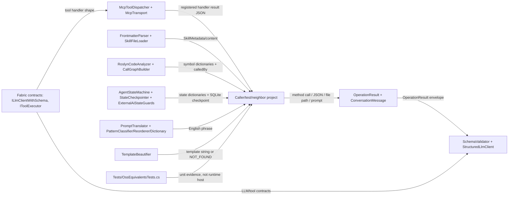

# 23.OssEquivalents - документация реализации

## 1. Человеческое объяснение

`23.OssEquivalents` - это набор C#-эквивалентов для нескольких OSS (open-source software) библиотек, которые обычно используют в agent/LLM tooling: MCP transport/dispatcher, frontmatter parser, Roslyn code analysis, schema validation, structured LLM wrapper, state-machine checkpointing, deterministic prompt translation и template beautification.

Проект не является production plugin runtime и не подключает IDE/host сам по себе. Он дает локальные building blocks: принять JSON tool-call, проверить словарь по схеме, разобрать Markdown frontmatter, просканировать C# код через Roslyn, построить обратные call edges, прогнать маленькую state machine с SQLite checkpoint-ами или перевести ограниченный RU/HE prompt в английскую техническую фразу.

Честная граница: эти helpers - deterministic/schema/Roslyn/translation/MCP infrastructure. Наличие `state.json`, unit tests или helper class names не является доказательством external AI runtime, production plugin integration, trained semantic model или `ILearningMachine` asset lifecycle.

## 2. UML для draw.io



| Узел | Что делает | Статус | Где живет |
|---|---|---|---|
| `Core` | Общий result envelope и message DTO для этого проекта | Полная infrastructure | `23.OssEquivalents/Core/Core.cs` |
| `Fabric` | Контракты LLM-with-schema и tool executor | Контрактный слой | `23.OssEquivalents/Fabric/Interfaces.cs` |
| `Schema` | Проверяет словари по schema и оборачивает structured LLM calls | Частичная: real validation + in-memory test client | `23.OssEquivalents/Validation/*.cs` |
| `Mcp` | Регистрирует tools, dispatch JSON, named-pipe transport | Частичная: dispatcher tested, transport source exists | `23.OssEquivalents/Mcp/*.cs` |
| `Frontmatter` | Делит Markdown на YAML metadata/content и грузит skill files | Полная utility | `23.OssEquivalents/Frontmatter/*.cs` |
| `Roslyn` | Извлекает C# classes/methods/calls и строит reverse call graph | Полная deterministic analyzer utility | `23.OssEquivalents/CodeAnalysis/*.cs` |
| `State` | Запускает state machine, сохраняет checkpoints, guards approval branch | Полная local utility | `23.OssEquivalents/StateMachine/*.cs` |
| `Translation` | Rule/POS/context translation RU/HE -> English for limited technical prompts | Частичная deterministic helper | `23.OssEquivalents/Translation/*.cs` |
| `Beautifier` | Возвращает template по predicate sequence | Hardcoded deterministic mapping | `23.OssEquivalents/Beautification/TemplateBeautifier.cs` |

## 3. Симуляции связей

| Связь | Пример входа | Что происходит | Ожидаемый результат | Что нельзя принимать за результат |
|---|---|---|---|---|
| Caller -> `SchemaValidator` | data `{name:"Alice"}`, schema `{name:"string"}` | Проверяется обязательное поле и тип. | `OperationResult<bool>.Ok(true)` | Это не доказывает качество LLM ответа вне schema. |
| Caller -> `StructuredLlmClient` | responses: `bad json`, потом `{"name":"Bob"}` | In-memory client парсит, валидирует, retry до лимита. | Валидный dictionary или `SCHEMA_VALIDATION_EXHAUSTED`. | Это не external AI runtime; это test/in-memory queue. |
| Caller -> `McpToolDispatcher` | JSON `{ToolName:"echo", Arguments:{input:"hi"}}` | JSON parse, lookup handler, serialize `McpResponse`. | `Success=true`, result from handler. | Это не proof real MCP host; dispatcher не гарантирует transport/server deployment. |
| `McpTransport` -> `McpToolDispatcher` | Named pipe line with JSON request | Pipe reads line, dispatches, writes reply line. | JSON response written to pipe. | Source path exists; D4G did not run runtime pipe smoke. |
| Caller -> `FrontmatterParser` | Markdown starts with `--- name: skill ---` | Finds closing delimiter, YAML deserialize, returns content. | Metadata dictionary + Markdown body. | Frontmatter metadata is not skill quality evidence. |
| `SkillFileLoader` -> `FrontmatterParser` | Directory with `*.md` skill files | Reads files, parses metadata, caches by name. | `IReadOnlyList<SkillMetadata>` and lazy body load. | It does not execute skills or prove host integration. |
| Caller -> `RoslynCodeAnalyzer` | Directory with `Sample.cs` | Recursively reads `.cs`, parses Roslyn syntax tree, extracts classes/methods/calls. | List of dictionaries. | This is static analysis, not semantic code understanding. |
| `CallGraphBuilder` -> symbol list | Method `A` has calls `[B]` | Builds name lookup and mutates `B.calledBy += A`. | Reverse edge appears in list. | No runtime call tracing or full semantic resolution. |
| Caller -> `AgentStateMachine` | node `start`, edge true -> `end` | Executes node, saves checkpoint, chooses first matching edge. | Final state dictionary and `CheckpointsSaved=1`. | SQLite checkpoint is not model asset lifecycle. |
| `ExternalAiStateGuards` -> state machine edge | confidence `0.31`, missing competence non-empty | Guard returns true if approval not already requested. | Route to approval state. | It requests approval; it does not authorize external AI. |
| Caller -> `PromptTranslator` | `"Добавь проверку null"` | Detects Russian, tags POS, translates contextually, reorders to SVO. | `"Add null check"`. | This is deterministic translation helper, not trained TranslationMachine. |
| Caller -> `TemplateBeautifier` | `VALIDATE_OP(X) -> SUCCESS`, target CSharp | Looks up exact/partial template. | `return Validate({X});` | Hardcoded table is not code generation intelligence. |

## 4. Алгоритмы без кода

### Алгоритм A: schema validation

- Класс/метод: `SchemaValidator.Validate(Dictionary<string, object>? data, Dictionary<string, object> schema)`.
- Вход: словарь данных и schema dictionary, где type spec может быть `string`, `number`, `boolean`, `object`, `array` или optional `?`.
- Выход: `OperationResult<bool>` с `Ok(true)` или error code `NULL_DATA`, `MISSING_FIELD`, `TYPE_MISMATCH`.
- Шаги: если data null - fail; для каждого schema field вычисляет optional/base type; если required field отсутствует - fail; если тип не совпал - fail; иначе success.
- Не делает: не валидирует вложенную JSON Schema полностью, не доказывает LLM correctness.

### Алгоритм B: structured LLM wrapper / in-memory retry

- Класс/метод: `StructuredLlmClient.SendAsync(...)` и `InMemoryStructuredLlmClient.SendWithSchemaAsync(...)`.
- Вход: `messageHistory`, `expectedSchema`, `maximumRetryCount`, `CancellationToken`.
- Выход: `OperationResult<Dictionary<string, object>>`.
- Шаги: production wrapper делегирует `ILlmClientWithSchema`; in-memory client берет JSON строки из queue, парсит dictionary, валидирует schema, возвращает первый valid или exhausted failure.
- Не делает: не вызывает реальный внешний AI в текущей реализации in-memory клиента и не добавляет product approval.

### Алгоритм C: MCP tool dispatch и named pipe transport

- Класс/метод: `McpToolDispatcher.Register(...)`, `McpToolDispatcher.DispatchAsync(string jsonMessage)`, `McpTransport.StartListeningAsync(CancellationToken)`.
- Вход: JSON request с `ToolName` и `Arguments`; tool definitions/handlers.
- Выход: serialized `McpResponse` или `OperationResult<string>.Fail` on parse/null.
- Шаги: register stores definition and handler; dispatch deserializes JSON, checks unknown tool, invokes handler, serializes success/error envelope; transport reads newline JSON from named pipe and writes dispatcher reply.
- Не делает: не доказывает live MCP deployment; no broad runtime smoke was run.

### Алгоритм D: frontmatter parse и skill file load

- Класс/метод: `FrontmatterParser.Parse(string markdownText)`, `SkillFileLoader.LoadDirectoryAsync(string directoryPath)`, `LoadFullContentAsync(string skillName)`.
- Вход: Markdown text или directory path.
- Выход: metadata/content tuple, list of `SkillMetadata`, or full content string.
- Шаги: parser handles empty/no frontmatter/malformed YAML; loader scans top-level `.md`, parses metadata, caches `name/description/version/filePath`, then loads full body on demand.
- Не делает: не исполняет skill и не доказывает extension host behavior.

### Алгоритм E: Roslyn static analysis и call graph

- Класс/метод: `RoslynCodeAnalyzer.AnalyzeDirectoryAsync(string directoryPath)`, `CallGraphBuilder.Build(List<Dictionary<string, object>> symbols)`.
- Вход: directory path with `.cs`; symbol dictionaries.
- Выход: list of dictionaries with `name`, `kind`, `signature`, `documentation`, `filePath`, `calls`, `calledBy`.
- Шаги: analyzer validates directory, reads files, parses syntax trees, extracts class/method declarations and invocation names; call graph builder builds lookup and mutates `calledBy`.
- Не делает: no semantic compilation/type binding/full runtime trace.

### Алгоритм F: state machine, checkpointing и external AI guard

- Класс/метод: `AgentStateMachine.RunAsync(...)`, `StateCheckpointer.SaveAsync(...)`, `LoadLatestAsync()`, `ExternalAiStateGuards.ShouldRequestExternalAiApproval(...)`.
- Вход: state dictionary, start/terminal state names, nodes/edges, SQLite db path.
- Выход: final state dictionary, saved checkpoints, or error codes `CANCELLED`, `UNKNOWN_STATE`, `NO_TRANSITION`, `EMPTY`, `DB_ERROR`.
- Шаги: machine executes current node, saves checkpoint, picks first matching edge, repeats until terminal; guard returns true only when missing competence exists, approval was not already requested, and confidence is below threshold.
- Не делает: approval guard is a request signal, not Luba approval and not permission to call external AI.

### Алгоритм G: deterministic prompt translation

- Класс/метод: `PromptTranslator.ToEnglish(string prompt)`, `PatternClassifier.Classify(...)`, `PatternReorderer.Reorder(...)`, `TranslationDictionary.TranslateWithContext(...)`.
- Вход: prompt such as `"Добавь проверку null"`.
- Выход: English string, e.g. `"Add null check"`.
- Шаги: detects source language by character ranges; English passes through; non-English tokenizes by spaces, assigns POS tags by heuristics, classifies pattern, translates words with context dictionary, reorders to English SVO.
- Не делает: not trained translation domain, no checkpoint, no learned model.

### Алгоритм H: template beautification

- Класс/метод: `TemplateBeautifier.Beautify(string predicateSequence, BeautifyTarget target)`.
- Вход: predicate sequence and target enum `CSharp`, `TypeScript`, `Python`, `PlainText`.
- Выход: template string or `NOT_FOUND`.
- Шаги: empty input fails; target selects hardcoded dictionary; exact key wins; partial contains match falls back; otherwise failure.
- Не делает: does not synthesize arbitrary code and is not semantic code generation.

## 5. Короткие цитаты кода

`23.OssEquivalents/OssEquivalents.csproj:7-11`

```xml
  <ItemGroup>
    <PackageReference Include="Microsoft.CodeAnalysis.CSharp" Version="4.12.0" />
    <PackageReference Include="Microsoft.Data.Sqlite" Version="9.0.4" />
    <PackageReference Include="YamlDotNet" Version="16.3.0" />
  </ItemGroup>
```

Почему важно: зависимости соответствуют реальным helper families: Roslyn, SQLite checkpointing, YAML frontmatter. Это не external AI dependency и не plugin runtime.

`23.OssEquivalents/Validation/SchemaValidator.cs:14-36`

```csharp
        if (data is null)
            return OperationResult<bool>.Fail("Data is null.", "NULL_DATA");

        foreach (var (field, typeSpec) in schema)
        {
            string typeName = typeSpec?.ToString() ?? "";
            bool   optional = typeName.EndsWith('?');
            string baseType = optional ? typeName[..^1] : typeName;

            if (!data.TryGetValue(field, out var value))
            {
                if (optional) continue;
                return OperationResult<bool>.Fail(
                    $"Required field '{field}' is missing.", "MISSING_FIELD");
            }

            if (!MatchesType(value, baseType))
                return OperationResult<bool>.Fail(
                    $"Field '{field}' expected type '{baseType}' but got '{value?.GetType().Name}'.",
                    "TYPE_MISMATCH");
        }

        return OperationResult<bool>.Ok(true);
```

Почему важно: quote shows all important validation branches. It proves schema helper behavior, not semantic correctness of generated answers.

`23.OssEquivalents/Mcp/McpToolDispatcher.cs:34-66`

```csharp
    public async Task<OperationResult<string>> DispatchAsync(string jsonMessage)
    {
        McpRequest? request;
        try
        {
            request = JsonSerializer.Deserialize<McpRequest>(jsonMessage,
                new JsonSerializerOptions { PropertyNameCaseInsensitive = true });
        }
        catch (JsonException ex)
        {
            return OperationResult<string>.Fail($"Invalid JSON: {ex.Message}", "PARSE_ERROR");
        }

        if (request is null)
            return OperationResult<string>.Fail("Request was null after parsing.", "NULL_REQUEST");

        if (!_handlers.TryGetValue(request.ToolName, out var handler))
        {
            var err = new McpResponse(false, null, $"Tool '{request.ToolName}' not registered.");
            return OperationResult<string>.Ok(JsonSerializer.Serialize(err));
        }

        try
        {
            var result   = await handler(request.Arguments);
            var response = new McpResponse(true, result, null);
            return OperationResult<string>.Ok(JsonSerializer.Serialize(response));
        }
        catch (Exception ex)
        {
            var errResponse = new McpResponse(false, null, ex.Message);
            return OperationResult<string>.Ok(JsonSerializer.Serialize(errResponse));
        }
```

Почему важно: dispatcher branch behavior is explicit: parse failure, null request, unknown tool response, registered handler call. It does not prove named pipe runtime or host integration.

`23.OssEquivalents/Frontmatter/FrontmatterParser.cs:18-29`

```csharp
        if (string.IsNullOrEmpty(markdownText))
            return OperationResult<(Dictionary<string, object>, string)>.Ok(
                (new Dictionary<string, object>(), string.Empty));

        // Normalize line endings.
        var lines = markdownText.Replace("\r\n", "\n").Split('\n');

        if (lines.Length == 0 || lines[0].Trim() != "---")
        {
            // No frontmatter — return empty metadata and the full text.
            return OperationResult<(Dictionary<string, object>, string)>.Ok(
                (new Dictionary<string, object>(), markdownText));
```

Почему важно: parser intentionally treats empty/no-frontmatter Markdown as valid. This proves tolerant metadata parsing, not skill execution.

`23.OssEquivalents/CodeAnalysis/RoslynCodeAnalyzer.cs:13-30`

```csharp
    public async Task<OperationResult<List<Dictionary<string, object>>>> AnalyzeDirectoryAsync(
        string directoryPath)
    {
        if (!Directory.Exists(directoryPath))
            return OperationResult<List<Dictionary<string, object>>>.Fail(
                $"Directory not found: {directoryPath}", "DIR_NOT_FOUND");

        var files  = Directory.GetFiles(directoryPath, "*.cs", SearchOption.AllDirectories);
        var result = new List<Dictionary<string, object>>();

        foreach (var filePath in files)
        {
            string source = await File.ReadAllTextAsync(filePath);
            ExtractSymbols(filePath, source, result);
        }

        return OperationResult<List<Dictionary<string, object>>>.Ok(result);
    }
```

Почему важно: analysis is file-system/Roslyn static extraction. It does not compile or run the code and does not infer semantic intent.

`23.OssEquivalents/StateMachine/AgentStateMachine.cs:48-81`

```csharp
        while (stateName != terminalStateName)
        {
            if (cancellationToken.IsCancellationRequested)
                return OperationResult<Dictionary<string, object>>.Fail("Cancelled", "CANCELLED");

            if (!_nodes.TryGetValue(stateName, out var node))
                return OperationResult<Dictionary<string, object>>.Fail(
                    $"No node registered for state '{stateName}'.", "UNKNOWN_STATE");

            // Execute the node function to produce the updated state.
            current = await node.Execute(current);

            // Save a checkpoint after each transition.
            await _checkpointer.SaveAsync(stateName, current);
            CheckpointsSaved++;

            // Find the first matching conditional edge.
            string? nextState = null;
            if (_edges.TryGetValue(stateName, out var edges))
            {
                foreach (var (cond, target) in edges)
                {
                    if (cond(current)) { nextState = target; break; }
                }
            }

            if (nextState is null)
                return OperationResult<Dictionary<string, object>>.Fail(
                    $"No transition matched from state '{stateName}'.", "NO_TRANSITION");

            stateName = nextState;
        }

        return OperationResult<Dictionary<string, object>>.Ok(current);
```

Почему важно: this is the current state-machine algorithm. It proves deterministic state transitions and checkpoint calls, not trained workflow reasoning.

`23.OssEquivalents/StateMachine/ExternalAiStateGuards.cs:9-32`

```csharp
    public static bool ShouldRequestExternalAiApproval(Dictionary<string, object> state, double confidenceThreshold = 0.50)
    {
        if (!state.TryGetValue(MissingCompetenceKey, out var missingObj) ||
            missingObj is not string missing ||
            string.IsNullOrWhiteSpace(missing))
            return false;

        if (state.TryGetValue(ApprovalRequestedKey, out var requestedObj) &&
            requestedObj is bool alreadyRequested &&
            alreadyRequested)
            return false;

        double confidence = 1.0;
        if (state.TryGetValue(ExaminerConfidenceKey, out var confidenceObj))
            confidence = confidenceObj switch
            {
                double d => d,
                float f => f,
                decimal m => (double)m,
                int i => i,
                _ => confidence
            };

        return confidence < confidenceThreshold;
```

Почему важно: guard only decides whether approval should be requested. It is not approval itself and must not be treated as permission to use external AI.

`23.OssEquivalents/Translation/PromptTranslator.cs:29-56`

```csharp
    public OperationResult<string> ToEnglish(string prompt)
    {
        if (string.IsNullOrWhiteSpace(prompt))
            return OperationResult<string>.Fail("Empty prompt.", "EMPTY");

        // Step 1 (E20): detect source language BEFORE any processing
        string srcLang = DetectLanguage(prompt);
        if (srcLang == "English")
            return OperationResult<string>.Ok(prompt.Trim());

        // Step 2: tokenize
        var tokens = prompt.Split(' ', StringSplitOptions.RemoveEmptyEntries);

        // Step 3: assign POS tags
        var tagged = tokens.Select(t => new PatternReorderer.TaggedWord(t, AssignPos(t, srcLang))).ToList();

        // Step 4: classify sentence pattern (E25)
        var posTags = tagged.Select(w => w.PosTag).ToList();
        int pattern = _classifier.Classify(posTags);

        // Step 5: translate each word with context (E26)
        var translated = TranslateAll(tagged);

        // Step 6: reorder to English SVO (E27)
        var reordered = _reorderer.Reorder(translated, pattern);

        string result = string.Join(" ", reordered.Select(w => w.Text)).Trim();
        return OperationResult<string>.Ok(result);
```

Почему важно: translation path is deterministic and rule/context based. It does not prove trained translation quality or checkpoint lifecycle.

`23.OssEquivalents/Beautification/TemplateBeautifier.cs:44-67`

```csharp
    public OperationResult<string> Beautify(string predicateSequence, BeautifyTarget target)
    {
        if (string.IsNullOrWhiteSpace(predicateSequence))
            return OperationResult<string>.Fail("Empty predicate sequence.", "EMPTY");

        var templates = target switch
        {
            BeautifyTarget.TypeScript => TypeScriptTemplates,
            BeautifyTarget.Python     => PythonTemplates,
            _                         => CSharpTemplates,
        };

        if (templates.TryGetValue(predicateSequence, out var exact))
            return OperationResult<string>.Ok(exact);

        // Partial-key match: predicate contains or is contained by a known key
        foreach (var (key, tmpl) in templates)
        {
            if (predicateSequence.Contains(key, StringComparison.OrdinalIgnoreCase) ||
                key.Contains(predicateSequence, StringComparison.OrdinalIgnoreCase))
                return OperationResult<string>.Ok(tmpl);
        }

        return OperationResult<string>.Fail($"No template for: {predicateSequence}", "NOT_FOUND");
```

Почему важно: beautifier is a deterministic table lookup with partial fallback. It is not a trainable code generator.

## 6. QA/test mapping

Tests were read/mapped but not run in D4G.

| Поведение | Evidence | Что доказывает | Чего не доказывает |
|---|---|---|---|
| Frontmatter parsing | `Tests/OssEquivalentsTests.cs:10-71` | Metadata/content, no-frontmatter, malformed branch. | Skill runtime quality. |
| Skill loader | `Tests/OssEquivalentsTests.cs:75-137` | Directory scan, full content load, empty directory. | Host skill activation. |
| MCP dispatcher | `Tests/OssEquivalentsTests.cs:141-197` | Registered/unknown/invalid JSON/definitions. | Live named-pipe server runtime. |
| Schema validator + structured client | `Tests/OssEquivalentsTests.cs:201-330` | Valid/missing/optional/type/null/retry/exhaustion. | External LLM behavior. |
| State machine/checkpointer/approval guard | `Tests/OssEquivalentsTests.cs:335-570` | terminal path, multiple checkpoints, no transition, unknown state, approval guard, SQLite load latest. | Product workflow training or approval itself. |
| Roslyn + call graph | `Tests/OssEquivalentsTests.cs:575-611` and `704-815` | symbol extraction, docs, calls, missing/empty directory. | Runtime execution or semantic compiler parity. |
| TemplateBeautifier + PromptTranslator | `Tests/OssEquivalentsTests.cs:620-699` | hardcoded template branches and limited RU/HE translation examples. | General translation product quality. |

Known QA gap: D4G did not run tests, build, named-pipe runtime smoke, or production plugin host path. `McpTransport` has source implementation but direct runtime pipe verification is not part of this documentation slice.

## 7. Status table

| Компонент | Файл | Статус | Что реально работает сейчас |
|---|---|---|---|
| `OperationResult<T>` | `23.OssEquivalents/Core/Core.cs` | ✅ Полная | Ok/Fail/MapError envelope. |
| `ILlmClientWithSchema`, `IToolExecutor` | `23.OssEquivalents/Fabric/Interfaces.cs` | ✅ Полная contract | Method signatures only; implementations live elsewhere/in tests. |
| `SchemaValidator` | `23.OssEquivalents/Validation/SchemaValidator.cs` | ✅ Полная utility | Required/optional/null/type branches. |
| `StructuredLlmClient` | `23.OssEquivalents/Validation/StructuredLlmClient.cs` | ⚠️ Частичная | Delegates to inner client; in-memory test client retries queued JSON. |
| `RoslynSyntaxValidator` | `23.OssEquivalents/Validation/RoslynSyntaxValidator.cs` | ✅ Полная utility | Finds invalid C#-looking string fields. |
| `McpToolDispatcher` | `23.OssEquivalents/Mcp/McpToolDispatcher.cs` | ✅ Полная utility | Register/dispatch/unknown/parse/error envelope. |
| `McpTransport` | `23.OssEquivalents/Mcp/McpTransport.cs` | ⚠️ Частичная evidence | Source implements named pipe loop; no D4G runtime smoke. |
| `FrontmatterParser` | `23.OssEquivalents/Frontmatter/FrontmatterParser.cs` | ✅ Полная utility | Empty/no-frontmatter/malformed/YAML parse branches. |
| `SkillFileLoader` | `23.OssEquivalents/Frontmatter/SkillFileLoader.cs` | ✅ Полная utility | Loads metadata and lazy full content from `.md`. |
| `RoslynCodeAnalyzer` | `23.OssEquivalents/CodeAnalysis/RoslynCodeAnalyzer.cs` | ✅ Полная static analyzer | Extracts class/method dictionaries and calls. |
| `CallGraphBuilder` | `23.OssEquivalents/CodeAnalysis/CallGraphBuilder.cs` | ✅ Полная utility | Mutates symbols with reverse `calledBy`. |
| `AgentStateMachine` | `23.OssEquivalents/StateMachine/AgentStateMachine.cs` | ✅ Полная utility | Node execution, edge selection, checkpoints, failure branches. |
| `StateCheckpointer` | `23.OssEquivalents/StateMachine/StateCheckpointer.cs` | ✅ Полная utility | SQLite schema, save, load latest. |
| `ExternalAiStateGuards` | `23.OssEquivalents/StateMachine/ExternalAiStateGuards.cs` | ✅ Полная guard | Computes request-needed boolean; does not approve external AI. |
| `PromptTranslator` | `23.OssEquivalents/Translation/PromptTranslator.cs` | ⚠️ Частичная deterministic helper | Limited RU/HE/English prompt translation; no trained model. |
| `TemplateBeautifier` | `23.OssEquivalents/Beautification/TemplateBeautifier.cs` | ✅ Hardcoded | Exact/partial lookup in fixed template dictionaries. |
| `state.json` | `23.OssEquivalents/state.json` | Historical/status evidence | Lists mappings/deps/test categories; not fresh runtime proof. |

## 8. Anti-false-done checks

- `state.json` says status complete, but in this doc it is historical/status context only, not fresh D4G runtime evidence.
- JSON, PowerShell, static docs, smoke reports, or unit test names cannot substitute for live plugin/MCP/host runtime evidence.
- `McpToolDispatcher` and `McpTransport` helper code is not proof that a production MCP server was launched and used by a real host.
- `StructuredLlmClient` and `InMemoryStructuredLlmClient` are not external AI permission or model quality evidence.
- `ExternalAiStateGuards.ShouldRequestExternalAiApproval` can request approval; it is not Luba approval and must not silently authorize external AI.
- `PromptTranslator`, `PatternClassifier`, `TranslationDictionary`, and `TemplateBeautifier` are deterministic/rule/table helpers, not trained semantic authority.
- `RoslynCodeAnalyzer`/`CallGraphBuilder` are static code helpers, not runtime tracing or semantic compiler proof.
- No `ILearningMachine`, checkpoint manifest, locator, export/import, fresh-load, continue-training, or trained metric evidence exists in `23.OssEquivalents` itself.

Documentation status: draft pending parent review.  
Last verified against source: 2026-06-08.  
Known gaps: tests/build/runtime smoke not run in D4G; named-pipe transport has no D4G runtime proof; production plugin host path is out of scope.
