# 23.SemanticCompilerAdapter — документация реализации

## 0. Краткая карта для Лубы

`23.SemanticCompilerAdapter` — это адаптер между semantic compiler projects (`12.SemanticCompiler`, `29.SemanticCompiler`) и logical infrastructure из `00.Core`/`21.AgentInfrastructure`. Он берёт пользовательский prompt или уже скомпилированный `DevelopmentPromptCompilation`, превращает его в canonical text, predicate vector, domain classification или attributed segment documents. Внутри есть два `ILogicalUnit`: `DomainClassifierUnit` и `AttributedSegmentRouter`; они помогают logical orchestrator-слоям получать typed output, а не raw string. Важно: это не проект-level `ILearningMachine`, не полный runtime semantic compiler и не доказательство обученной модели; большая часть поведения deterministic/helper, а `Train(...)` у classifier обучает локальный in-memory `RouteClassifier` без export/import/manifest/fresh-load lifecycle.

## 1. Простая UML для draw.io

```mermaid
classDiagram
    class SemanticTeachingPromptCompiler {
      +Compile(prompt)
      +BuildCanonicalPromptText(compiled)
      +BuildTokenizerSeedText(compiled, canonicalText)
    }
    class TrainingVectorBuilder {
      +Build(compiled)
      +BuildVector(roots, predicates, prompt, rootVocab)
      +PredicateSlotFor(predicate)
    }
    class DomainClassifierUnit {
      +Train(examples)
      +Classify(request)
      +ExecuteAsync(request, cancellationToken)
    }
    class ContextPacketReader {
      +Read(metadata)
      +TryReadDomain(metrics, domain)
      +TryReadConfidence(metrics, confidence)
    }
    class AttributedSegmentRouter {
      +Route(segments, metadata)
      +ExecuteAsync(request, cancellationToken)
    }
    class ExpressionCompletionCore {
      +Train(completeExpressions)
      +Normalise(value)
      +Lookup(partial)
    }
    class SemanticCompilerAdapterProject {
      ProjectReference 00.Core
      ProjectReference 12.SemanticCompiler
      ProjectReference 29.SemanticCompiler
    }

    SemanticTeachingPromptCompiler --> TrainingVectorBuilder : compiled prompt -> teaching vector
    DomainClassifierUnit --> ContextPacketReader : metadata/prior context -> context signals
    DomainClassifierUnit --> TrainingVectorBuilder : predicate ids -> slots
    AttributedSegmentRouter --> DomainClassifierUnit : segment text/predicates -> domain
    ExpressionCompletionCore --> ExpressionCompletionCore : complete rows -> lookup memory
    SemanticCompilerAdapterProject --> SemanticTeachingPromptCompiler : project wiring
    SemanticCompilerAdapterProject --> DomainClassifierUnit : logical-unit wiring

    note for SemanticTeachingPromptCompiler "ПОЛНАЯ\nСтроит canonical prompt, tokenizer seed и vector для teaching/training текстов."
    note for TrainingVectorBuilder "ПОЛНАЯ\nДетерминированно кодирует roots, predicates, domain slot и длину prompt в vector[60]."
    note for DomainClassifierUnit "ЧАСТИЧНАЯ/АДАПТЕР\nILogicalUnit; keyword/predicate/context classifier, optional in-memory Train path."
    note for ContextPacketReader "ПОЛНАЯ\nЧитает только typed ContextSignals/metadata keys; не reflection over project 21."
    note for AttributedSegmentRouter "ПОЛНАЯ/АДАПТЕР\nМаршрутизирует compiled segments через classifier, existing domain может override."
    note for ExpressionCompletionCore "ПОЛНАЯ ДЛЯ EXACT MEMORY\nСоздаёт lookup по expression partial; unseen partial честно abstain."
    note for SemanticCompilerAdapterProject "ПОЛНАЯ WIRING\nСсылается на 00.Core, 12.SemanticCompiler, 29.SemanticCompiler."
```



| Узел | Что делает | Статус | Где живёт |
|---|---|---|---|
| `SemanticTeachingPromptCompiler` | Переводит prompt в canonical representation для teaching/training side | ✅ Полная | `23.SemanticCompilerAdapter/SemanticTeachingPromptCompiler.cs` |
| `TrainingVectorBuilder` | Строит fixed-width vector из predicates, domain hints и normalized roots | ✅ Полная deterministic helper | `23.SemanticCompilerAdapter/TrainingVectorBuilder.cs` |
| `DomainClassifierUnit` | Классифицирует domain по prompt, predicates и context; реализует `ILogicalUnit` | ⚠️ Частичная: logical unit работает, trained path in-memory only | `23.SemanticCompilerAdapter/DomainClassifierUnit.cs` |
| `ContextPacketReader` | Читает безопасные context signals из metadata/object без reflection | ✅ Полная helper | `23.SemanticCompilerAdapter/ContextPacketReader.cs` |
| `AttributedSegmentRouter` | Делит compiled prompt на segment documents и назначает domain/confidence/evidence | ✅ Полная adapter unit | `23.SemanticCompilerAdapter/AttributedSegmentRouter.cs` |
| `ExpressionCompletionCore` | Делает exact lookup completion по нормализованной левой части expression | ✅ Полная exact-memory helper | `23.SemanticCompilerAdapter/ExpressionCompletionCore.cs` |
| `SemanticCompilerAdapterProject` | Собирает adapter assembly и project references | ✅ Полная wiring | `23.SemanticCompilerAdapter/SemanticCompilerAdapter.csproj` |

### 1.1 Симуляции по каждой связи UML

| Связь | Пример входа | Что происходит | Ожидаемый результат | Что запрещено принимать за результат |
|---|---|---|---|---|
| `SemanticTeachingPromptCompiler -> TrainingVectorBuilder` | Prompt: `fix the null ref in Angular service` | Compiler строит `DevelopmentPromptCompilation`, затем vector builder кодирует predicates/domain/roots | `TeachingVector.Length == 60`, canonical text содержит `semantic_domain:` и `semantic_stack:` | Нельзя считать vector доказательством обученной модели |
| `DomainClassifierUnit -> ContextPacketReader` | `PriorContext = ContextSignals(PriorDomains=[BUG], confidence=0.93)` | Classifier читает typed signals, повышает confidence при совпадении domain | `UsedContext=true`, evidence включает `context_domain_match`/`context_prior_confidence` | Context boost не является human approval или runtime truth |
| `DomainClassifierUnit -> TrainingVectorBuilder` | Predicate ids `["IMPLEMENT", "TEST"]` | `EncodePredicateProfile` переводит ids в numeric slots | Возвращаются отсортированные slots `[5,6]` | Slot mapping не является semantic training asset |
| `AttributedSegmentRouter -> DomainClassifierUnit` | Segment `fix crash`, predicates `["IMPLEMENT"]` | Router вызывает classifier для каждого segment, но existing domain может override | Segment получает `Domain.BUG` или заданный existing domain | Router не обучает classifier и не делает product reasoning |
| `ExpressionCompletionCore -> ExpressionCompletionCore` | Corpus `Revenue - Cost = Profit`, query `Revenue - Cost =` | Train строит lookup по normalised partial, Lookup возвращает completion | `(Matched=true, Completion="Profit")` | Exact lookup не является general algebra model |
| `SemanticCompilerAdapterProject -> SemanticTeachingPromptCompiler` | Build adapter project | `.csproj` подключает `29.SemanticCompiler` | Compiler может использовать `DevelopmentPromptCompiler` | Project reference не доказывает runtime integration |
| `SemanticCompilerAdapterProject -> DomainClassifierUnit` | Logical unit consumer references assembly | `.csproj` подключает `00.Core` | `DomainClassifierUnit` может реализовать `ILogicalUnit<...>` | Наличие интерфейса не делает проект `ILearningMachine` |

## 2. Алгоритмы без кода на русском

### 2.1 Чтение context packet

Аналогия: `ContextPacketReader` — это секретарь, который читает только заранее подготовленную карточку с сигналами, а не лезет в чужую систему через reflection.

| Поле | Значение |
|---|---|
| Класс | `ContextPacketReader` |
| Метод/функция | `Read(IReadOnlyDictionary<string, object>? metadata)`, `Read(object? contextPacket)`, `TryReadDomain(...)`, `TryReadConfidence(...)` |
| Файл и строка | `23.SemanticCompilerAdapter/ContextPacketReader.cs:28`, `23.SemanticCompilerAdapter/ContextPacketReader.cs:44`, `23.SemanticCompilerAdapter/ContextPacketReader.cs:51` |
| Входные параметры/DTO | Metadata dictionary; ключи `context.signals`, `context.packet`, `domain.label`, `domain.confidence` |
| Выходной DTO/результат | `ContextSignals(PriorDomains, CompletedSubPhases, ActiveKnowledgeEdges, PriorConfidenceMap)` или parsed values |
| Статус | ✅ Полная deterministic helper |

Шаги текущего алгоритма:

1. Если metadata `null`, возвращается `ContextSignals.Empty`.
2. Если есть ключ `context.signals`, читается typed object через `Read(object?)`.
3. Иначе проверяется legacy/transitional ключ `context.packet`.
4. Raw packet не разбирается reflection-ом; принимается только `ContextSignals`.
5. `TryReadDomain` и `TryReadConfidence` отдельно читают string metrics.

Что НЕ делает: не читает project 21 contracts через reflection, не валидирует runtime truth, не является permission/approval gate.

### 2.2 Классификация domain

Аналогия: `DomainClassifierUnit` похож на диспетчера, который сначала смотрит на обученную карточку predicates, потом на явные слова вроде `fix`, потом на context из предыдущего шага, и только после этого ставит label/confidence.

| Поле | Значение |
|---|---|
| Класс | `DomainClassifierUnit` |
| Метод/функция | `Classify(DomainClassifierRequest request)`, `Train(IReadOnlyList<(int[] Predicates, Domain Domain)> examples)`, `ExecuteAsync(LogicalUnitRequest<DomainClassifierRequest> request, CancellationToken cancellationToken)` |
| Файл и строка | `23.SemanticCompilerAdapter/DomainClassifierUnit.cs:95`, `23.SemanticCompilerAdapter/DomainClassifierUnit.cs:59`, `23.SemanticCompilerAdapter/DomainClassifierUnit.cs:37` |
| Входные параметры/DTO | `DomainClassifierRequest(Prompt, Predicates, DevelopmentPredicateIds, PipelinePredicates, NormalizedText, CompilerDomain, PriorContext, Metadata)` |
| Выходной DTO/результат | `DomainClassification(Label, Confidence, Evidence, UsedContext)` или `LogicalUnitResult<DomainClassification>` |
| Статус | ⚠️ Частичная: `ILogicalUnit` path есть; `Train` in-memory, без persisted model lifecycle |

Шаги текущего алгоритма:

1. Если нет prompt и нет predicates, возвращает `Domain.UNKNOWN`, confidence `0.20`, evidence `empty_prompt`.
2. `ClassifyBaseDomain` пытается trained predicate K-NN path, если `_trained=true` и predicates есть.
3. Если trained path не сработал, проверяются direct question и runtime failure keyword signals.
4. Если есть predicates, но classifier не trained, используется deterministic predicate affinity.
5. Иначе вызывается keyword fallback из semantic compiler.
6. Confidence считается по количеству keyword evidence, затем корректируется K-NN/path/context.
7. Context может поднять confidence при совпадении domain или снизить при shift; итог clamp `0.20..0.99`.

Что НЕ делает: не экспортирует/импортирует model, не сохраняет checkpoint, не доказывает trained product model, не заменяет `ILearningMachine`.

### 2.3 Маршрутизация attributed segments

Аналогия: `AttributedSegmentRouter` — это редактор, который берёт несколько абзацев одной задачи, каждому абзацу ставит domain label и собирает карточки для downstream flow.

| Поле | Значение |
|---|---|
| Класс | `AttributedSegmentRouter` |
| Метод/функция | `ExecuteAsync(LogicalUnitRequest<DevelopmentPromptCompilation> request, CancellationToken cancellationToken)`, `Route(IReadOnlyList<AttributedSegmentInput> segments, IReadOnlyDictionary<string, object>? metadata)` |
| Файл и строка | `23.SemanticCompilerAdapter/AttributedSegmentRouter.cs:34`, `23.SemanticCompilerAdapter/AttributedSegmentRouter.cs:70` |
| Входные параметры/DTO | `DevelopmentPromptCompilation` или `AttributedSegmentInput(SegmentId, Text, PredicateIds, ExistingDomain)` |
| Выходной DTO/результат | `AttributedSegmentDocument[]` или `LogicalUnitResult<AttributedSegmentDocument[]>` |
| Статус | ✅ Полная adapter unit |

Шаги текущего алгоритма:

1. `ExecuteAsync` уважает cancellation и возвращает `CANCELLED`.
2. Если compilation имеет 0-1 segment, строится один synthetic segment из всего prompt.
3. Если segments больше одного, каждый compiled segment получает deterministic id `${RunId}-segment-N`.
4. `Route` вызывает `DomainClassifierUnit.Classify(...)` для каждого segment.
5. Если `ExistingDomain` задан и не `UNKNOWN`, он override-ит classifier label.
6. Возвращается массив documents и confidence результата равен minimum confidence среди segment documents.

Что НЕ делает: не обучает classifier, не сшивает full orchestration plan, не доказывает correctness routing в host.

### 2.4 Expression completion exact-memory

Аналогия: это маленький словарь формул: если раньше была строка `Revenue - Cost = Profit`, то вопрос `Revenue - Cost =` вернёт `Profit`; если такой левой части не было, он честно молчит.

| Поле | Значение |
|---|---|
| Класс | `ExpressionCompletionCore` и `ExpressionCorpusBuilder` |
| Метод/функция | `Train(IReadOnlyList<string> completeExpressions)`, `Lookup(string partial)`, `Normalise(string value)`, `ExtractPairs(...)` |
| Файл и строка | `23.SemanticCompilerAdapter/ExpressionCompletionCore.cs:54`, `23.SemanticCompilerAdapter/ExpressionCompletionCore.cs:91`, `23.SemanticCompilerAdapter/ExpressionCompletionCore.cs:67` |
| Входные параметры/DTO | Complete expression rows; example `Revenue - Cost = Profit`; query partial `Revenue - Cost =` |
| Выходной DTO/результат | `ExpressionCompletionCore?`, `(bool Matched, string? Completion)` |
| Статус | ✅ Полная exact-memory helper |

Шаги текущего алгоритма:

1. `ExtractPairs` пропускает пустые строки, строки без `=`, пустую левую или правую часть.
2. `Train` строит dictionary: normalized partial -> completion.
3. `Normalise` чистит brackets/stars/placeholders, приводит operators к пробелам, collapses whitespace, lowercases.
4. `Lookup` возвращает `(false,null)` для пустого partial.
5. Иначе lookup по exact normalized key.

Что НЕ делает: не обобщает математику, не выводит новые формулы, не является neural expression model.

### 2.5 Построение training vector

Аналогия: `TrainingVectorBuilder` превращает prompt в фиксированную анкету на 60 клеток: первые клетки для predicate signals, дальше domain slot, дальше roots, последняя клетка — простой сигнал сложности.

| Поле | Значение |
|---|---|
| Класс | `TrainingVectorBuilder` |
| Метод/функция | `Build(DevelopmentPromptCompilation compiled)`, `BuildVector(string[] roots, string[] predicates, string prompt, IReadOnlyDictionary<string,int> rootVocab)`, `PredicateSlotFor(string predicate)` |
| Файл и строка | `23.SemanticCompilerAdapter/TrainingVectorBuilder.cs:20`, `23.SemanticCompilerAdapter/TrainingVectorBuilder.cs:72`, `23.SemanticCompilerAdapter/TrainingVectorBuilder.cs:149` |
| Входные параметры/DTO | Compiled prompt with `DevelopmentPredicateIds`, `PipelinePredicates`, `NormalizedText`, `Domain`; root vocabulary |
| Выходной DTO/результат | `float[60]` |
| Статус | ✅ Полная deterministic vector helper |

Шаги текущего алгоритма:

1. Собирает vector text из predicates, normalized text, pipeline predicates и `semantic_domain`.
2. Нормализует roots из текста.
3. Расширяет predicates через `PredicateNamesForRoot`.
4. Создаёт root vocabulary максимум на 32 roots.
5. `BuildVector` увеличивает predicate slots, ставит один domain slot, добавляет root counts и complexity marker `1` или `2`.

Что НЕ делает: vector не является trained embedding; это hand-built feature vector.

### 2.6 Компиляция semantic teaching prompt

Аналогия: это переводчик из человеческой фразы в учебную карточку: raw prompt остаётся для trace, а model/training side получает canonical text, tokenizer seed и vector.

| Поле | Значение |
|---|---|
| Класс | `SemanticTeachingPromptCompiler` |
| Метод/функция | `Compile(string prompt)`, `BuildCanonicalPromptText(DevelopmentPromptCompilation compiled)`, `BuildTokenizerSeedText(DevelopmentPromptCompilation compiled, string? canonicalText)` |
| Файл и строка | `23.SemanticCompilerAdapter/SemanticTeachingPromptCompiler.cs:19`, `23.SemanticCompilerAdapter/SemanticTeachingPromptCompiler.cs:35`, `23.SemanticCompilerAdapter/SemanticTeachingPromptCompiler.cs:47` |
| Входные параметры/DTO | raw prompt string; example `fix the null ref in Angular service` |
| Выходной DTO/результат | `SemanticTeachingPromptRepresentation(RawText, Compilation, CanonicalText, TokenizerSeedText, TeachingVector)` |
| Статус | ✅ Полная adapter helper |

Шаги текущего алгоритма:

1. Делегирует raw prompt в `DevelopmentPromptCompiler`.
2. Если compiler вернул fail, error переносится в adapter result.
3. Строит canonical text из development predicates, normalized text, pipeline predicates, explicit sub-phase hints, semantic domain и stack.
4. Строит tokenizer seed с canonical predicate vocabulary и segment predicates/text.
5. Строит `TeachingVector` через `TrainingVectorBuilder.Build(compiled)`.

Что НЕ делает: не создаёт DPO pairs сам, не тренирует LoRA/DPO, не доказывает runtime model quality.

### 2.7 Project wiring

Аналогия: `.csproj` — это розетка: он показывает, к каким соседним проектам подключён adapter, но не доказывает, что кто-то реально нажал кнопку в runtime.

| Поле | Значение |
|---|---|
| Класс | `SemanticCompilerAdapter.csproj` |
| Метод/функция | MSBuild project references |
| Файл и строка | `23.SemanticCompilerAdapter/SemanticCompilerAdapter.csproj:1` |
| Входные параметры/DTO | Build graph |
| Выходной DTO/результат | Assembly `SemanticCompilerAdapter` |
| Статус | ✅ Полная project wiring |

Шаги текущего алгоритма:

1. Target framework `net9.0`.
2. Assembly/root namespace `SemanticCompilerAdapter`.
3. References на `00.Core`, `12.SemanticCompiler`, `29.SemanticCompiler`.
4. Не запускает runtime flow и не тренирует модель.

## 3. Где логика сидит в коде

| Логика | Файл | Почему это место важно | Что доказывает | Чего не доказывает |
|---|---|---|---|---|
| Context signal read | `23.SemanticCompilerAdapter/ContextPacketReader.cs:28` | Граница metadata/context без reflection | Adapter принимает only typed signals | Не доказывает authority approval |
| Domain classification | `23.SemanticCompilerAdapter/DomainClassifierUnit.cs:95` | Главная domain decision path | Есть K-NN/profile/keyword/context branches | Не доказывает persisted trained model |
| Logical unit wrapping | `23.SemanticCompilerAdapter/DomainClassifierUnit.cs:37` | Возврат `LogicalUnitResult` для infrastructure | Unit совместим с registry/orchestrator | Не делает project-level `ILearningMachine` |
| Segment routing | `23.SemanticCompilerAdapter/AttributedSegmentRouter.cs:70` | Segment-by-segment domain attribution | Existing domain override и classifier path | Не доказывает host e2e routing |
| Expression memory | `23.SemanticCompilerAdapter/ExpressionCompletionCore.cs:54` | Exact train/lookup storage | Known partial recall, unseen abstain | Не является semantic expression model |
| Vector builder | `23.SemanticCompilerAdapter/TrainingVectorBuilder.cs:72` | Fixed feature contract | `float[60]` deterministic vector | Не является learned embedding |
| Teaching prompt compiler | `23.SemanticCompilerAdapter/SemanticTeachingPromptCompiler.cs:19` | Raw prompt -> canonical training side | Canonical text/tokenizer seed/vector | Не тренирует DPO/LoRA |
| Project references | `23.SemanticCompilerAdapter/SemanticCompilerAdapter.csproj:9` | Assembly dependency boundary | Adapter compiles against core/compiler projects | Не доказывает runtime invocation |

## 4. Короткие важные цитаты кода

> **Почему важно:** здесь видно, что `ContextPacketReader` не лезет reflection-ом в чужой packet; он принимает либо готовые `ContextSignals`, либо возвращает empty.
>
> **Что входит:** metadata dictionary с `context.signals` или `context.packet`.
>
> **Что выходит:** `ContextSignals`.
>
> **Чего не доказывает:** что context является runtime truth или human approval.

`23.SemanticCompilerAdapter/ContextPacketReader.cs:28-42`

```csharp
    public static ContextSignals Read(IReadOnlyDictionary<string, object>? metadata)
    {
        if (metadata is null)
            return ContextSignals.Empty;

        if (metadata.TryGetValue(ContextSignalsMetadataKey, out var signals))
            return Read(signals);

        // Transitional compatibility: callers may place pre-extracted signals under
        // the older packet key. Raw LogicalContextPacket is intentionally not read
        // here because project 23 must not reflect over project 21 contracts.
        return metadata.TryGetValue(ContextPacketMetadataKey, out var packet)
            ? Read(packet)
            : ContextSignals.Empty;
    }
```

> **Почему важно:** это полный `ILogicalUnit` wrapper для classifier: cancellation branch, classify call, output/evidence упаковка.
>
> **Что входит:** `LogicalUnitRequest<DomainClassifierRequest>`.
>
> **Что выходит:** `OperationResult<LogicalUnitResult<DomainClassification>>`.
>
> **Чего не доказывает:** наличие export/import/checkpoint lifecycle для trained classifier.

`23.SemanticCompilerAdapter/DomainClassifierUnit.cs:37-57`

```csharp
    public Task<AgentInfrastructure.OperationResult<LogicalUnitResult<DomainClassification>>> ExecuteAsync(
        LogicalUnitRequest<DomainClassifierRequest> request,
        CancellationToken cancellationToken = default)
    {
        if (cancellationToken.IsCancellationRequested)
            return Task.FromResult(AgentInfrastructure.OperationResult<LogicalUnitResult<DomainClassification>>.Fail("Cancelled.", "CANCELLED"));

        var classification = Classify(request.Input);
        var result = new LogicalUnitResult<DomainClassification>(
            request.UnitId,
            request.UnitRole,
            request.DomainTag,
            classification,
            classification.Confidence,
            classification.Evidence,
            [DomainTag, classification.Label.ToString()],
            classification.Evidence,
            []);

        return Task.FromResult(AgentInfrastructure.OperationResult<LogicalUnitResult<DomainClassification>>.Ok(result));
    }
```

> **Почему важно:** `Train` здесь меняет только local classifier state и `_trained`; это trainable-adjacent helper, но не persisted model asset.
>
> **Что входит:** pairs `(int[] Predicates, Domain Domain)`.
>
> **Что выходит:** side effect внутри `_classifier`, `_trained=true` если examples есть.
>
> **Чего не доказывает:** checkpoint, manifest, locator, fresh-load или continue-training.

`23.SemanticCompilerAdapter/DomainClassifierUnit.cs:64-68`

```csharp
    public void Train(IReadOnlyList<(int[] Predicates, Domain Domain)> examples)
    {
        _classifier.Train(examples);
        _trained = examples.Count > 0;
    }
```

> **Что изменилось в поведении (2026-10-30):** канонический `RouteClassifier.Train` теперь владеет копиями переданных массивов признаков и заменяет память одной операцией только после полной проверки партии. Для этого потребителя из этого следует два видимых свойства, закреплённых проверками: внешняя правка переданного массива признаков после обучения не меняет ответ `Classify`; негодная новая партия (отсутствующая ссылка, пустая партия, урок без массива признаков, обрыв чтения) отклоняется исключением прямо на строке `_classifier.Train(examples)`, флаг `_trained` остаётся прежним, и потребитель продолжает отвечать обученным путём, а не скатывается в запасной путь сходства признаков.

> **Почему важно:** этот блок показывает порядок domain branch: trained predicate K-NN, direct question, runtime failure, predicate affinity, keyword fallback.
>
> **Что входит:** `DomainClassifierRequest` с prompt/predicates.
>
> **Что выходит:** internal `BaseDomainClassification`.
>
> **Чего не доказывает:** что keyword/predicate fallback является обученной semantic authority.

`23.SemanticCompilerAdapter/DomainClassifierUnit.cs:153-177`

```csharp
    private BaseDomainClassification ClassifyBaseDomain(DomainClassifierRequest request)
    {
        if (_trained && request.Predicates is { Length: > 0 } predicates)
        {
            var classified = _classifier.Classify(predicates);
            if (classified.IsSuccess)
                return new BaseDomainClassification(classified.Value, UsedKnn: true, UsedPredicateAffinity: false);
        }

        var evidenceText = request.NormalizedText ?? request.Prompt;
        if (HasDirectQuestionSignal(evidenceText))
            return new BaseDomainClassification(Domain.CODE_Q, UsedKnn: false, UsedPredicateAffinity: false);

        if (HasRuntimeFailureSignal(evidenceText))
            return new BaseDomainClassification(Domain.BUG, UsedKnn: false, UsedPredicateAffinity: false);

        if (request.Predicates is { Length: > 0 } untrainedPredicates)
        {
            var affinity = ClassifyByPredicateAffinity(untrainedPredicates);
            if (affinity != Domain.UNKNOWN)
                return new BaseDomainClassification(affinity, UsedKnn: false, UsedPredicateAffinity: true);
        }

        return new BaseDomainClassification(SemanticCompiler.RouteClassifier.ClassifyByKeywords(evidenceText), UsedKnn: false, UsedPredicateAffinity: false);
    }
```

> **Что изменилось в поведении (2026-11-01), и этот потребитель — то место, где цена видна.** Канонический классификатор проекта 29 перестал отвечать темой первого уложенного урока, когда свидетельства нет. Он теперь возвращает отказ `NO_EVIDENCE_FOR_DECISION` в трёх случаях: профиль пуст, профиль отсутствует и — главное для этого потребителя — **ни один выученный урок не разделяет с запросом ни одного признака** (лучшее, то есть наименьшее, расстояние равно единице). Первые два случая сюда не доходят: охрана `request.Predicates is { Length: > 0 }` в первой строке показанного блока отсекает их сама. Третий случай охрану **проходит**, потому что профиль непуст, — и именно он меняет ответ этого потребителя.
>
> Код этого файла не менялся ни на строку. Меняется то, что возвращает первая ветвь: при отказе проверка `classified.IsSuccess` не проходит, и управление проваливается дальше, в объявленную детерминированную цепочку — прямой вопрос, затем признак сбоя времени выполнения, затем близость предикатов, затем ключевые слова. Падения нет; отказ попадает ровно в документированный запасной путь.
>
> Цена измерена, а не предположена: проверяемая программа `Tests/ExperimentFixes/oracle-route-classifier-zero-similarity.ps1` (панель 3) переносит эту цепочку дословно и прогоняет её на семи уроках, которыми продукт засевает классификатор (`21.AgentInfrastructure/Logical/PromptDomainClassifier.cs:79-87`).
>
> | Запрос без общих признаков | Прежде | Теперь | Сработавшая ветвь |
> |---|---|---|---|
> | признак вне уроков, нейтральный текст | `BUG`, уверенность 0,90, довод `trained_predicate_knn` | `BUG`, уверенность **0,20**, довод `predicate_affinity` | близость предикатов |
> | тот же признак, текст с прямым вопросом | `BUG`, уверенность 0,90 | **`CODE_Q`**, уверенность 0,90 | прямой вопрос |
> | тот же признак, текст о сбое | `BUG`, уверенность 0,90 | `BUG`, уверенность 0,90 | признак сбоя |
> | неизвестные признаки, нейтральный текст | `BUG`, уверенность 0,90 | **`CODE_Q`**, уверенность **0,20** | ключевые слова |
>
> То есть тема меняется в двух случаях из четырёх, уверенность падает с 0,90 до 0,20 тоже в двух из четырёх. На девяти запросах, где есть хотя бы один общий признак, не изменился ни один ответ — 9 из 9 и у классификатора, и у этого потребителя.
>
> **Чего эта пометка не утверждает.** Что прежний ответ был хуже по теме: в двух случаях из четырёх тема осталась той же, изменилась только её происхождение и уверенность. Что новый ответ верен: он лишь перестал быть выданным без свидетельства. Что ответ на запросе с пересечением осмыслен: в той же панели измерено, что при пяти соседях и семи уроках голос не взвешен по расстоянию, поэтому семь контрольных запросов из девяти получают одну и ту же тему `BUG`, включая запросы, дословно равные урокам тем `PLAN`, `CODE_Q` и `REFACTOR`. Контекстные пакеты этого потребителя в панелях не передавались и не моделировались. Сборка и прогон платформенных тестов не выполнялись: закрыты правами сессии.

> **Почему важно:** router строит segment documents и честно использует `ExistingDomain` как override, если он уже известен.
>
> **Что входит:** список `AttributedSegmentInput`.
>
> **Что выходит:** `AttributedSegmentDocument[]`.
>
> **Чего не доказывает:** что classifier обучился или что downstream flow выбрал правильную стратегию.

`23.SemanticCompilerAdapter/AttributedSegmentRouter.cs:70-96`

```csharp
    public AttributedSegmentDocument[] Route(
        IReadOnlyList<AttributedSegmentInput> segments,
        IReadOnlyDictionary<string, object>? metadata = null)
    {
        if (segments.Count == 0)
            return [];

        return segments
            .Select(segment =>
            {
                var classified = _classifier.Classify(new DomainClassifierRequest(
                    segment.Text,
                    Predicates: DomainClassifierUnit.EncodePredicateProfile(segment.PredicateIds),
                    Metadata: metadata));
                var domain = segment.ExistingDomain is { } existing && existing != Domain.UNKNOWN
                    ? existing
                    : classified.Label;
                return new AttributedSegmentDocument(
                    segment.SegmentId,
                    segment.Text,
                    segment.PredicateIds,
                    domain,
                    classified.Confidence,
                    classified.Evidence);
            })
            .ToArray();
    }
```

> **Почему важно:** expression core строит exact lookup; если corpus не дал valid pairs, возвращается `null`.
>
> **Что входит:** complete expression rows.
>
> **Что выходит:** `ExpressionCompletionCore?` с `_lookup`.
>
> **Чего не доказывает:** general reasoning over formulas.

`23.SemanticCompilerAdapter/ExpressionCompletionCore.cs:54-65`

```csharp
    public static ExpressionCompletionCore? Train(IReadOnlyList<string> completeExpressions)
    {
        var pairs = ExpressionCorpusBuilder.ExtractPairs(completeExpressions);
        if (pairs.Count == 0)
            return null;

        var lookup = new Dictionary<string, string>(StringComparer.Ordinal);
        foreach (var (partial, completion) in pairs)
            lookup[Normalise(partial)] = completion;

        return new ExpressionCompletionCore(lookup);
    }
```

> **Почему важно:** vector contract явно фиксирован на `float[60]`; это deterministic feature construction.
>
> **Что входит:** roots, predicate names, prompt, root vocabulary.
>
> **Что выходит:** `float[] vector`.
>
> **Чего не доказывает:** learned embedding или semantic model.

`23.SemanticCompilerAdapter/TrainingVectorBuilder.cs:72-97`

```csharp
    public static float[] BuildVector(
        string[] roots,
        string[] predicates,
        string prompt,
        IReadOnlyDictionary<string, int> rootVocab)
    {
        var vector = new float[VectorWidth];
        foreach (var predicate in predicates)
        {
            var slot = PredicateSlotFor(predicate);
            if (slot >= 0 && slot < PredicateSlotCount)
                vector[slot] += 1f;
        }

        var domainSlot = PredicateSlotCount + PredictDomainSlot(prompt);
        vector[domainSlot] = 1f;

        foreach (var root in roots)
        {
            if (rootVocab.TryGetValue(root, out var slot) && slot < RootSlotCount)
                vector[PredicateSlotCount + DomainSlotCount + slot] += 1f;
        }

        vector[VectorWidth - 1] = prompt.Contains(" and ", StringComparison.OrdinalIgnoreCase) ? 2f : 1f;
        return vector;
    }
```

> **Почему важно:** compiler output сохраняет raw text, compiled structure, canonical text, tokenizer seed и vector вместе.
>
> **Что входит:** raw prompt string.
>
> **Что выходит:** `SemanticTeachingPromptRepresentation`.
>
> **Чего не доказывает:** что DPO/LoRA training уже выполнен.

`23.SemanticCompilerAdapter/SemanticTeachingPromptCompiler.cs:19-33`

```csharp
    public OperationResult<SemanticTeachingPromptRepresentation> Compile(string prompt)
    {
        var compiled = _compiler.Compile(prompt);
        if (!compiled.IsSuccess)
            return compiled.MapError<SemanticTeachingPromptRepresentation>();

        var canonicalText = BuildCanonicalPromptText(compiled.Value!);
        var tokenizerSeed = BuildTokenizerSeedText(compiled.Value!, canonicalText);
        return OperationResult<SemanticTeachingPromptRepresentation>.Ok(new SemanticTeachingPromptRepresentation(
            prompt?.Trim() ?? string.Empty,
            compiled.Value!,
            canonicalText,
            tokenizerSeed,
            TrainingVectorBuilder.Build(compiled.Value!)));
    }
```

> **Почему важно:** project wiring показывает, что adapter именно связывает core contracts и semantic compiler assemblies.
>
> **Что входит:** build graph.
>
> **Что выходит:** assembly `SemanticCompilerAdapter`.
>
> **Чего не доказывает:** runtime host path или trained model lifecycle.

`23.SemanticCompilerAdapter/SemanticCompilerAdapter.csproj:9-13`

```xml
  <ItemGroup>
    <ProjectReference Include="..\00.Core\Core.csproj" />
    <ProjectReference Include="..\12.SemanticCompiler\SemanticCompiler.csproj" />
    <ProjectReference Include="..\29.SemanticCompiler\SemanticCompiler.csproj" />
  </ItemGroup>
```

## 5. Test, e2e и QA mapping (QA/test mapping)

Тесты были прочитаны/сопоставлены, но не запускались в этом documentation subphase.

| Поведение | Уровень проверки | Текущий evidence | Статус | Следующий work order если gap |
|---|---|---|---|---|
| Keyword fallback для `DomainClassifierUnit` | unit | `Tests/PromptRoutingInputCompilerUnitTests.cs:23-67` | covered, read-not-run | N/A |
| Context confidence match/shift/clamp | unit | `Tests/PromptRoutingInputCompilerUnitTests.cs:95-136` | covered, read-not-run | N/A |
| `ContextPacketReader` empty/typed signals | unit | `Tests/PromptRoutingInputCompilerUnitTests.cs:139-180` | covered, read-not-run | N/A |
| Segment routing и existing domain override | unit | `Tests/PromptRoutingInputCompilerUnitTests.cs:200-235` | covered, read-not-run | N/A |
| Canonical prompt/vector integration | unit/integration | `Tests/CompiledPromptTrainingTests.cs:87-95`, `Tests/DevelopmentPromptCompilerTeachingIntegrationTests.cs:11-50` | covered, read-not-run | N/A |
| LogicalUnit implementation/registry path | unit/integration | `Tests/DpcDomainClassifierLogicalUnitTests.cs:44-67`, `Tests/DpcDomainClassifierLogicalUnitTests.cs:145-210` | covered, read-not-run | N/A |
| K-NN predicate evidence path | unit | `Tests/DomainClassifierKnnPathTests.cs:10-20` | covered, read-not-run | N/A |
| Expression exact lookup, normalization, abstain | unit | `Tests/ExpressionCompletionTests.cs:51-76`, `Tests/ExpressionCompletionTests.cs:91-152`, `Tests/ExpressionCompletionTests.cs:285-337` | covered, read-not-run | N/A |
| Persisted model lifecycle for classifier | none in this project | Source has `Train(...)` but no export/import/manifest/fresh-load | gap/not claimed | Future trainable asset work order if needed |
| Host/plugin runtime path | none in this project | Adapter assembly only | gap/not claimed | Future host-specific work order |

## 6. Anti-false-done checks

| Gate | Проверка для D4I |
|---|---|
| Human-readable | Документ объясняет adapter boundary по-русски до деталей кода |
| UML | Mermaid class diagram есть и содержит notes |
| UML simulations | Каждая стрелка имеет пример и ожидаемый результат |
| Algorithms | Все required classes имеют method/function, parameters, input/output и текущие шаги |
| Code refs | Цитаты имеют line refs и WHY/HOW/WHAT объяснение |
| Status honesty | `DomainClassifierUnit.Train` назван in-memory/local, не model lifecycle |
| No JSON-only done | Static/source/test refs не заменяют runtime/host evidence |
| No hidden deterministic shortcut | Keyword/predicate/context/vector/exact lookup названы helper/deterministic, не trained semantic authority |
| Trainable claim | Нет claim project-level trained `ILearningMachine`; `ILogicalUnit` boundary документирован отдельно |
| Testability | Tests mapped/read-not-run, host/persisted lifecycle gaps названы |

## 7. Status table

| Компонент | Файл | Статус | Что реально работает сейчас |
|---|---|---|---|
| `ContextPacketReader` | `23.SemanticCompilerAdapter/ContextPacketReader.cs` | ✅ Полная | `Read(...)` возвращает typed `ContextSignals` или empty; `TryReadDomain`/`TryReadConfidence` парсят metrics |
| `DomainClassifierUnit` | `23.SemanticCompilerAdapter/DomainClassifierUnit.cs` | ⚠️ Частичная | `ExecuteAsync`, `Classify`, keyword/predicate/context branches работают; `Train` only local in-memory route classifier, без asset lifecycle |
| `AttributedSegmentRouter` | `23.SemanticCompilerAdapter/AttributedSegmentRouter.cs` | ✅ Полная | `ExecuteAsync`/`Route` строят `AttributedSegmentDocument[]`, existing domain override работает |
| `ExpressionCompletionCore` | `23.SemanticCompilerAdapter/ExpressionCompletionCore.cs` | ✅ Полная | `Train`, `Normalise`, `Lookup` делают exact-memory completion и abstain для unknown |
| `ExpressionCorpusBuilder` | `23.SemanticCompilerAdapter/ExpressionCompletionCore.cs` | ✅ Полная | `ExtractPairs` строит partial/completion pairs и пропускает invalid rows |
| `TrainingVectorBuilder` | `23.SemanticCompilerAdapter/TrainingVectorBuilder.cs` | ✅ Полная | `Build`, `BuildVector`, `PredicateSlotFor`, `PredictDomainSlot` строят deterministic `float[60]` |
| `SemanticTeachingPromptCompiler` | `23.SemanticCompilerAdapter/SemanticTeachingPromptCompiler.cs` | ✅ Полная | `Compile` возвращает raw, compiled, canonical text, tokenizer seed и teaching vector |
| `SemanticCompilerAdapter.csproj` | `23.SemanticCompilerAdapter/SemanticCompilerAdapter.csproj` | ✅ Полная | `net9.0`, assembly/root namespace, references на `00.Core`, `12.SemanticCompiler`, `29.SemanticCompiler` |

## 8. Hierarchy / runtime boundary

`DomainClassifierUnit` реализует уровень 2: `ILogicalUnit<DomainClassifierRequest, DomainClassification>`. `AttributedSegmentRouter` реализует уровень 2: `ILogicalUnit<DevelopmentPromptCompilation, AttributedSegmentDocument[]>`. Они принимают typed `LogicalUnitRequest<TInput>` и возвращают `LogicalUnitResult<TOutput>` через `OperationResult`. В этом проекте нет уровня 5 `ILearningMachine<TDomain>`: нет `TrainBatchAsync`, `EvaluateAsync`, `ExportAsync`, `ImportAsync`, manifest, checkpoint locator, fresh-load или continue-training evidence. Поэтому D4I должен трактовать adapter как infrastructure/logical-unit helper, а не как завершённую обученную semantic authority.

```text
Уровень 5: ILearningMachine<TDomain>
  В этом проекте отсутствует.

Уровень 2: DomainClassifierUnit : ILogicalUnit<DomainClassifierRequest, DomainClassification>
  Принимает: prompt/predicates/context metadata.
  Возвращает: label/confidence/evidence/usedContext.
  Роль: domain adapter для logical routing.

Уровень 2: AttributedSegmentRouter : ILogicalUnit<DevelopmentPromptCompilation, AttributedSegmentDocument[]>
  Принимает: compiled prompt с segments/predicates/domain.
  Возвращает: attributed segment documents.
  Роль: segment-level router для downstream orchestration.
```

## 9. Источники и drift check

Сверено с:

- `23.SemanticCompilerAdapter/ContextPacketReader.cs`
- `23.SemanticCompilerAdapter/AttributedSegmentRouter.cs`
- `23.SemanticCompilerAdapter/DomainClassifierUnit.cs`
- `23.SemanticCompilerAdapter/ExpressionCompletionCore.cs`
- `23.SemanticCompilerAdapter/TrainingVectorBuilder.cs`
- `23.SemanticCompilerAdapter/SemanticTeachingPromptCompiler.cs`
- `23.SemanticCompilerAdapter/SemanticCompilerAdapter.csproj`
- `Tests/PromptRoutingInputCompilerUnitTests.cs`
- `Tests/CompiledPromptTrainingTests.cs`
- `Tests/DevelopmentPromptCompilerTeachingIntegrationTests.cs`
- `Tests/DpcDomainClassifierLogicalUnitTests.cs`
- `Tests/DomainClassifierKnnPathTests.cs`
- `Tests/ExpressionCompletionTests.cs`
- `docs/projects/PROJECT-DOCUMENTATION-TEMPLATE.md`
- `docs/projects/PROJECT-DOCUMENTATION-INDEX.md`
- `docs/projects/_status/coverage-matrix.json`

Documentation status: draft pending parent review  
Last verified against source: 2026-06-08  
Known gaps: нет direct host/plugin runtime evidence; нет persisted trained `ILearningMachine` lifecycle для classifier; tests read/mapped but not run
