# 23.SemanticCompilerAdapter — implementation documentation

## 0. Quick map for Luba

`23.SemanticCompilerAdapter` is an adapter between the semantic compiler projects (`12.SemanticCompiler`, `29.SemanticCompiler`) and the logical infrastructure from `00.Core`/`21.AgentInfrastructure`. It takes a user prompt or an already-compiled `DevelopmentPromptCompilation`, turns it into canonical text, a predicate vector, a domain classification, or attributed segment documents. Inside there are two `ILogicalUnit`s: `DomainClassifierUnit` and `AttributedSegmentRouter`; they help logical orchestrator layers get typed output instead of a raw string. Important: this is not a project-level `ILearningMachine`, not a full runtime semantic compiler, and not proof of a trained model; most of the behavior is deterministic/helper, and the classifier's `Train(...)` trains a local in-memory `RouteClassifier` without an export/import/manifest/fresh-load lifecycle.

## 1. Simple UML for draw.io

```mermaid
classDiagram
    class SemanticTeachingPromptCompiler {
      +Compile(prompt)
      +BuildCanonicalPromptText(compiled)
      +BuildTokenizerSeedText(compiled, canonicalText)
    }
    class TrainingVectorBuilder {
      +Build(compiled)
      +BuildVector(roots, predicates, prompt, rootVocab)
      +PredicateSlotFor(predicate)
    }
    class DomainClassifierUnit {
      +Train(examples)
      +Classify(request)
      +ExecuteAsync(request, cancellationToken)
    }
    class ContextPacketReader {
      +Read(metadata)
      +TryReadDomain(metrics, domain)
      +TryReadConfidence(metrics, confidence)
    }
    class AttributedSegmentRouter {
      +Route(segments, metadata)
      +ExecuteAsync(request, cancellationToken)
    }
    class ExpressionCompletionCore {
      +Train(completeExpressions)
      +Normalise(value)
      +Lookup(partial)
    }
    class SemanticCompilerAdapterProject {
      ProjectReference 00.Core
      ProjectReference 12.SemanticCompiler
      ProjectReference 29.SemanticCompiler
    }

    SemanticTeachingPromptCompiler --> TrainingVectorBuilder : compiled prompt -> teaching vector
    DomainClassifierUnit --> ContextPacketReader : metadata/prior context -> context signals
    DomainClassifierUnit --> TrainingVectorBuilder : predicate ids -> slots
    AttributedSegmentRouter --> DomainClassifierUnit : segment text/predicates -> domain
    ExpressionCompletionCore --> ExpressionCompletionCore : complete rows -> lookup memory
    SemanticCompilerAdapterProject --> SemanticTeachingPromptCompiler : project wiring
    SemanticCompilerAdapterProject --> DomainClassifierUnit : logical-unit wiring

    note for SemanticTeachingPromptCompiler "COMPLETE\nBuilds canonical prompt, tokenizer seed, and vector for teaching/training texts."
    note for TrainingVectorBuilder "COMPLETE\nDeterministically encodes roots, predicates, domain slot, and prompt length into vector[60]."
    note for DomainClassifierUnit "PARTIAL/ADAPTER\nILogicalUnit; keyword/predicate/context classifier, optional in-memory Train path."
    note for ContextPacketReader "COMPLETE\nReads only typed ContextSignals/metadata keys; no reflection over project 21."
    note for AttributedSegmentRouter "COMPLETE/ADAPTER\nRoutes compiled segments through the classifier; an existing domain can override."
    note for ExpressionCompletionCore "COMPLETE FOR EXACT MEMORY\nBuilds a lookup by expression partial; an unseen partial honestly abstains."
    note for SemanticCompilerAdapterProject "COMPLETE WIRING\nReferences 00.Core, 12.SemanticCompiler, 29.SemanticCompiler."
```



| Node | What it does | Status | Where it lives |
|---|---|---|---|
| `SemanticTeachingPromptCompiler` | Translates a prompt into a canonical representation for the teaching/training side | ✅ Complete | `23.SemanticCompilerAdapter/SemanticTeachingPromptCompiler.cs` |
| `TrainingVectorBuilder` | Builds a fixed-width vector from predicates, domain hints, and normalized roots | ✅ Complete deterministic helper | `23.SemanticCompilerAdapter/TrainingVectorBuilder.cs` |
| `DomainClassifierUnit` | Classifies the domain by prompt, predicates, and context; implements `ILogicalUnit` | ⚠️ Partial: the logical unit works, the trained path is in-memory only | `23.SemanticCompilerAdapter/DomainClassifierUnit.cs` |
| `ContextPacketReader` | Reads safe context signals from metadata/object without reflection | ✅ Complete helper | `23.SemanticCompilerAdapter/ContextPacketReader.cs` |
| `AttributedSegmentRouter` | Splits the compiled prompt into segment documents and assigns domain/confidence/evidence | ✅ Complete adapter unit | `23.SemanticCompilerAdapter/AttributedSegmentRouter.cs` |
| `ExpressionCompletionCore` | Does exact lookup completion by the normalized left-hand side of an expression | ✅ Complete exact-memory helper | `23.SemanticCompilerAdapter/ExpressionCompletionCore.cs` |
| `SemanticCompilerAdapterProject` | Assembles the adapter assembly and project references | ✅ Complete wiring | `23.SemanticCompilerAdapter/SemanticCompilerAdapter.csproj` |

### 1.1 Simulations for each UML connection

| Connection | Example input | What happens | Expected result | What must not be taken as the result |
|---|---|---|---|---|
| `SemanticTeachingPromptCompiler -> TrainingVectorBuilder` | Prompt: `fix the null ref in Angular service` | The compiler builds a `DevelopmentPromptCompilation`, then the vector builder encodes predicates/domain/roots | `TeachingVector.Length == 60`, the canonical text contains `semantic_domain:` and `semantic_stack:` | The vector must not be treated as proof of a trained model |
| `DomainClassifierUnit -> ContextPacketReader` | `PriorContext = ContextSignals(PriorDomains=[BUG], confidence=0.93)` | The classifier reads typed signals, raises confidence on a domain match | `UsedContext=true`, evidence includes `context_domain_match`/`context_prior_confidence` | The context boost is not human approval or runtime truth |
| `DomainClassifierUnit -> TrainingVectorBuilder` | Predicate ids `["IMPLEMENT", "TEST"]` | `EncodePredicateProfile` translates ids into numeric slots | Sorted slots `[5,6]` are returned | Slot mapping is not a semantic training asset |
| `AttributedSegmentRouter -> DomainClassifierUnit` | Segment `fix crash`, predicates `["IMPLEMENT"]` | The router calls the classifier for each segment, but an existing domain can override | The segment gets `Domain.BUG` or the given existing domain | The router does not train the classifier and does not do product reasoning |
| `ExpressionCompletionCore -> ExpressionCompletionCore` | Corpus `Revenue - Cost = Profit`, query `Revenue - Cost =` | Train builds a lookup by normalised partial, Lookup returns the completion | `(Matched=true, Completion="Profit")` | Exact lookup is not a general algebra model |
| `SemanticCompilerAdapterProject -> SemanticTeachingPromptCompiler` | Build the adapter project | The `.csproj` links `29.SemanticCompiler` | The compiler can use `DevelopmentPromptCompiler` | A project reference does not prove runtime integration |
| `SemanticCompilerAdapterProject -> DomainClassifierUnit` | A logical-unit consumer references the assembly | The `.csproj` links `00.Core` | `DomainClassifierUnit` can implement `ILogicalUnit<...>` | The presence of the interface does not make the project an `ILearningMachine` |

## 2. No-code algorithms in plain language

### 2.1 Reading the context packet

Analogy: `ContextPacketReader` is a secretary who reads only a pre-prepared card of signals, rather than reaching into someone else's system via reflection.

| Field | Value |
|---|---|
| Class | `ContextPacketReader` |
| Method/function | `Read(IReadOnlyDictionary<string, object>? metadata)`, `Read(object? contextPacket)`, `TryReadDomain(...)`, `TryReadConfidence(...)` |
| File and line | `23.SemanticCompilerAdapter/ContextPacketReader.cs:28`, `23.SemanticCompilerAdapter/ContextPacketReader.cs:44`, `23.SemanticCompilerAdapter/ContextPacketReader.cs:51` |
| Input parameters/DTO | Metadata dictionary; keys `context.signals`, `context.packet`, `domain.label`, `domain.confidence` |
| Output DTO/result | `ContextSignals(PriorDomains, CompletedSubPhases, ActiveKnowledgeEdges, PriorConfidenceMap)` or parsed values |
| Status | ✅ Complete deterministic helper |

Steps of the current algorithm:

1. If metadata is `null`, `ContextSignals.Empty` is returned.
2. If the key `context.signals` exists, a typed object is read via `Read(object?)`.
3. Otherwise the legacy/transitional key `context.packet` is checked.
4. A raw packet is not parsed via reflection; only `ContextSignals` is accepted.
5. `TryReadDomain` and `TryReadConfidence` separately read string metrics.

What it does NOT do: it does not read project 21 contracts via reflection, does not validate runtime truth, is not a permission/approval gate.

### 2.2 Domain classification

Analogy: `DomainClassifierUnit` is like a dispatcher that first looks at a trained card of predicates, then at explicit words like `fix`, then at context from the previous step, and only after that assigns the label/confidence.

| Field | Value |
|---|---|
| Class | `DomainClassifierUnit` |
| Method/function | `Classify(DomainClassifierRequest request)`, `Train(IReadOnlyList<(int[] Predicates, Domain Domain)> examples)`, `ExecuteAsync(LogicalUnitRequest<DomainClassifierRequest> request, CancellationToken cancellationToken)` |
| File and line | `23.SemanticCompilerAdapter/DomainClassifierUnit.cs:95`, `23.SemanticCompilerAdapter/DomainClassifierUnit.cs:59`, `23.SemanticCompilerAdapter/DomainClassifierUnit.cs:37` |
| Input parameters/DTO | `DomainClassifierRequest(Prompt, Predicates, DevelopmentPredicateIds, PipelinePredicates, NormalizedText, CompilerDomain, PriorContext, Metadata)` |
| Output DTO/result | `DomainClassification(Label, Confidence, Evidence, UsedContext)` or `LogicalUnitResult<DomainClassification>` |
| Status | ⚠️ Partial: the `ILogicalUnit` path exists; `Train` is in-memory, without a persisted model lifecycle |

Steps of the current algorithm:

1. If there is no prompt and no predicates, it returns `Domain.UNKNOWN`, confidence `0.20`, evidence `empty_prompt`.
2. `ClassifyBaseDomain` tries the trained predicate K-NN path if `_trained=true` and predicates exist.
3. If the trained path did not work, direct question and runtime failure keyword signals are checked.
4. If there are predicates but the classifier is not trained, deterministic predicate affinity is used.
5. Otherwise the keyword fallback from the semantic compiler is called.
6. Confidence is computed from the amount of keyword evidence, then adjusted by K-NN/path/context.
7. Context can raise confidence on a domain match or lower it on a shift; the result is clamped `0.20..0.99`.

What it does NOT do: it does not export/import a model, does not save a checkpoint, does not prove a trained product model, does not replace `ILearningMachine`.

### 2.3 Routing attributed segments

Analogy: `AttributedSegmentRouter` is like an editor who takes several paragraphs of one task, assigns a domain label to each paragraph, and gathers the cards for the downstream flow.

| Field | Value |
|---|---|
| Class | `AttributedSegmentRouter` |
| Method/function | `ExecuteAsync(LogicalUnitRequest<DevelopmentPromptCompilation> request, CancellationToken cancellationToken)`, `Route(IReadOnlyList<AttributedSegmentInput> segments, IReadOnlyDictionary<string, object>? metadata)` |
| File and line | `23.SemanticCompilerAdapter/AttributedSegmentRouter.cs:34`, `23.SemanticCompilerAdapter/AttributedSegmentRouter.cs:70` |
| Input parameters/DTO | `DevelopmentPromptCompilation` or `AttributedSegmentInput(SegmentId, Text, PredicateIds, ExistingDomain)` |
| Output DTO/result | `AttributedSegmentDocument[]` or `LogicalUnitResult<AttributedSegmentDocument[]>` |
| Status | ✅ Complete adapter unit |

Steps of the current algorithm:

1. `ExecuteAsync` respects cancellation and returns `CANCELLED`.
2. If the compilation has 0-1 segments, one synthetic segment is built from the whole prompt.
3. If there is more than one segment, each compiled segment gets a deterministic id `${RunId}-segment-N`.
4. `Route` calls `DomainClassifierUnit.Classify(...)` for each segment.
5. If `ExistingDomain` is set and not `UNKNOWN`, it overrides the classifier label.
6. An array of documents is returned and the confidence of the result equals the minimum confidence among the segment documents.

What it does NOT do: it does not train the classifier, does not stitch a full orchestration plan, does not prove routing correctness in a host.

### 2.4 Expression completion exact-memory

Analogy: it is a small dictionary of formulas: if the string `Revenue - Cost = Profit` existed before, then the query `Revenue - Cost =` returns `Profit`; if there was no such left-hand side, it honestly stays silent.

| Field | Value |
|---|---|
| Class | `ExpressionCompletionCore` and `ExpressionCorpusBuilder` |
| Method/function | `Train(IReadOnlyList<string> completeExpressions)`, `Lookup(string partial)`, `Normalise(string value)`, `ExtractPairs(...)` |
| File and line | `23.SemanticCompilerAdapter/ExpressionCompletionCore.cs:54`, `23.SemanticCompilerAdapter/ExpressionCompletionCore.cs:91`, `23.SemanticCompilerAdapter/ExpressionCompletionCore.cs:67` |
| Input parameters/DTO | Complete expression rows; example `Revenue - Cost = Profit`; query partial `Revenue - Cost =` |
| Output DTO/result | `ExpressionCompletionCore?`, `(bool Matched, string? Completion)` |
| Status | ✅ Complete exact-memory helper |

Steps of the current algorithm:

1. `ExtractPairs` skips empty rows, rows without `=`, an empty left or right side.
2. `Train` builds a dictionary: normalized partial -> completion.
3. `Normalise` cleans brackets/stars/placeholders, converts operators to spaces, collapses whitespace, lowercases.
4. `Lookup` returns `(false,null)` for an empty partial.
5. Otherwise it looks up by the exact normalized key.

What it does NOT do: it does not generalize mathematics, does not derive new formulas, is not a neural expression model.

### 2.5 Building the training vector

Analogy: `TrainingVectorBuilder` turns a prompt into a fixed 60-cell form: the first cells for predicate signals, then the domain slot, then roots, and the last cell is a simple complexity signal.

| Field | Value |
|---|---|
| Class | `TrainingVectorBuilder` |
| Method/function | `Build(DevelopmentPromptCompilation compiled)`, `BuildVector(string[] roots, string[] predicates, string prompt, IReadOnlyDictionary<string,int> rootVocab)`, `PredicateSlotFor(string predicate)` |
| File and line | `23.SemanticCompilerAdapter/TrainingVectorBuilder.cs:20`, `23.SemanticCompilerAdapter/TrainingVectorBuilder.cs:72`, `23.SemanticCompilerAdapter/TrainingVectorBuilder.cs:149` |
| Input parameters/DTO | Compiled prompt with `DevelopmentPredicateIds`, `PipelinePredicates`, `NormalizedText`, `Domain`; root vocabulary |
| Output DTO/result | `float[60]` |
| Status | ✅ Complete deterministic vector helper |

Steps of the current algorithm:

1. Gathers the vector text from predicates, normalized text, pipeline predicates, and `semantic_domain`.
2. Normalizes roots from the text.
3. Expands predicates via `PredicateNamesForRoot`.
4. Creates a root vocabulary of at most 32 roots.
5. `BuildVector` increments predicate slots, sets one domain slot, adds root counts and a complexity marker `1` or `2`.

What it does NOT do: the vector is not a trained embedding; it is a hand-built feature vector.

### 2.6 Compiling the semantic teaching prompt

Analogy: it is a translator from a human phrase into a study card: the raw prompt remains for trace, and the model/training side gets canonical text, tokenizer seed, and vector.

| Field | Value |
|---|---|
| Class | `SemanticTeachingPromptCompiler` |
| Method/function | `Compile(string prompt)`, `BuildCanonicalPromptText(DevelopmentPromptCompilation compiled)`, `BuildTokenizerSeedText(DevelopmentPromptCompilation compiled, string? canonicalText)` |
| File and line | `23.SemanticCompilerAdapter/SemanticTeachingPromptCompiler.cs:19`, `23.SemanticCompilerAdapter/SemanticTeachingPromptCompiler.cs:35`, `23.SemanticCompilerAdapter/SemanticTeachingPromptCompiler.cs:47` |
| Input parameters/DTO | raw prompt string; example `fix the null ref in Angular service` |
| Output DTO/result | `SemanticTeachingPromptRepresentation(RawText, Compilation, CanonicalText, TokenizerSeedText, TeachingVector)` |
| Status | ✅ Complete adapter helper |

Steps of the current algorithm:

1. Delegates the raw prompt to `DevelopmentPromptCompiler`.
2. If the compiler returned a fail, the error is carried into the adapter result.
3. Builds canonical text from development predicates, normalized text, pipeline predicates, explicit sub-phase hints, semantic domain, and stack.
4. Builds the tokenizer seed with canonical predicate vocabulary and segment predicates/text.
5. Builds the `TeachingVector` via `TrainingVectorBuilder.Build(compiled)`.

What it does NOT do: it does not create DPO pairs itself, does not train LoRA/DPO, does not prove runtime model quality.

### 2.7 Project wiring

Analogy: the `.csproj` is a socket: it shows which neighboring projects the adapter is plugged into, but does not prove that anyone actually pressed the button at runtime.

| Field | Value |
|---|---|
| Class | `SemanticCompilerAdapter.csproj` |
| Method/function | MSBuild project references |
| File and line | `23.SemanticCompilerAdapter/SemanticCompilerAdapter.csproj:1` |
| Input parameters/DTO | Build graph |
| Output DTO/result | Assembly `SemanticCompilerAdapter` |
| Status | ✅ Complete project wiring |

Steps of the current algorithm:

1. Target framework `net9.0`.
2. Assembly/root namespace `SemanticCompilerAdapter`.
3. References to `00.Core`, `12.SemanticCompiler`, `29.SemanticCompiler`.
4. Does not run a runtime flow and does not train a model.

## 3. Where the logic sits in the code

| Logic | File | Why this place matters | What it proves | What it does not prove |
|---|---|---|---|---|
| Context signal read | `23.SemanticCompilerAdapter/ContextPacketReader.cs:28` | The metadata/context boundary without reflection | The adapter accepts only typed signals | Does not prove authority approval |
| Domain classification | `23.SemanticCompilerAdapter/DomainClassifierUnit.cs:95` | The main domain decision path | There are K-NN/profile/keyword/context branches | Does not prove a persisted trained model |
| Logical unit wrapping | `23.SemanticCompilerAdapter/DomainClassifierUnit.cs:37` | Returning `LogicalUnitResult` for infrastructure | The unit is compatible with registry/orchestrator | Does not make a project-level `ILearningMachine` |
| Segment routing | `23.SemanticCompilerAdapter/AttributedSegmentRouter.cs:70` | Segment-by-segment domain attribution | Existing domain override and classifier path | Does not prove host e2e routing |
| Expression memory | `23.SemanticCompilerAdapter/ExpressionCompletionCore.cs:54` | Exact train/lookup storage | Known partial recall, unseen abstain | Is not a semantic expression model |
| Vector builder | `23.SemanticCompilerAdapter/TrainingVectorBuilder.cs:72` | Fixed feature contract | `float[60]` deterministic vector | Is not a learned embedding |
| Teaching prompt compiler | `23.SemanticCompilerAdapter/SemanticTeachingPromptCompiler.cs:19` | Raw prompt -> canonical training side | Canonical text/tokenizer seed/vector | Does not train DPO/LoRA |
| Project references | `23.SemanticCompilerAdapter/SemanticCompilerAdapter.csproj:9` | Assembly dependency boundary | The adapter compiles against core/compiler projects | Does not prove runtime invocation |

## 4. Short important code quotations

> **Why it matters:** here it is visible that `ContextPacketReader` does not reach into someone else's packet via reflection; it accepts either ready `ContextSignals` or returns empty.
>
> **What comes in:** a metadata dictionary with `context.signals` or `context.packet`.
>
> **What comes out:** `ContextSignals`.
>
> **What it does not prove:** that context is runtime truth or human approval.

`23.SemanticCompilerAdapter/ContextPacketReader.cs:28-42`

```csharp
    public static ContextSignals Read(IReadOnlyDictionary<string, object>? metadata)
    {
        if (metadata is null)
            return ContextSignals.Empty;

        if (metadata.TryGetValue(ContextSignalsMetadataKey, out var signals))
            return Read(signals);

        // Transitional compatibility: callers may place pre-extracted signals under
        // the older packet key. Raw LogicalContextPacket is intentionally not read
        // here because project 23 must not reflect over project 21 contracts.
        return metadata.TryGetValue(ContextPacketMetadataKey, out var packet)
            ? Read(packet)
            : ContextSignals.Empty;
    }
```

> **Why it matters:** this is the full `ILogicalUnit` wrapper for the classifier: cancellation branch, classify call, output/evidence packaging.
>
> **What comes in:** `LogicalUnitRequest<DomainClassifierRequest>`.
>
> **What comes out:** `OperationResult<LogicalUnitResult<DomainClassification>>`.
>
> **What it does not prove:** the presence of an export/import/checkpoint lifecycle for a trained classifier.

`23.SemanticCompilerAdapter/DomainClassifierUnit.cs:37-57`

```csharp
    public Task<AgentInfrastructure.OperationResult<LogicalUnitResult<DomainClassification>>> ExecuteAsync(
        LogicalUnitRequest<DomainClassifierRequest> request,
        CancellationToken cancellationToken = default)
    {
        if (cancellationToken.IsCancellationRequested)
            return Task.FromResult(AgentInfrastructure.OperationResult<LogicalUnitResult<DomainClassification>>.Fail("Cancelled.", "CANCELLED"));

        var classification = Classify(request.Input);
        var result = new LogicalUnitResult<DomainClassification>(
            request.UnitId,
            request.UnitRole,
            request.DomainTag,
            classification,
            classification.Confidence,
            classification.Evidence,
            [DomainTag, classification.Label.ToString()],
            classification.Evidence,
            []);

        return Task.FromResult(AgentInfrastructure.OperationResult<LogicalUnitResult<DomainClassification>>.Ok(result));
    }
```

> **Why it matters:** `Train` here changes only the local classifier state and `_trained`; it is a trainable-adjacent helper, but not a persisted model asset.
>
> **What comes in:** pairs `(int[] Predicates, Domain Domain)`.
>
> **What comes out:** a side effect inside `_classifier`, `_trained=true` if examples exist.
>
> **What it does not prove:** a checkpoint, manifest, locator, fresh-load, or continue-training.

`23.SemanticCompilerAdapter/DomainClassifierUnit.cs:59-63`

```csharp
    public void Train(IReadOnlyList<(int[] Predicates, Domain Domain)> examples)
    {
        _classifier.Train(examples);
        _trained = examples.Count > 0;
    }
```

> **Why it matters:** this block shows the order of the domain branch: trained predicate K-NN, direct question, runtime failure, predicate affinity, keyword fallback.
>
> **What comes in:** `DomainClassifierRequest` with prompt/predicates.
>
> **What comes out:** an internal `BaseDomainClassification`.
>
> **What it does not prove:** that the keyword/predicate fallback is a trained semantic authority.

`23.SemanticCompilerAdapter/DomainClassifierUnit.cs:153-177`

```csharp
    private BaseDomainClassification ClassifyBaseDomain(DomainClassifierRequest request)
    {
        if (_trained && request.Predicates is { Length: > 0 } predicates)
        {
            var classified = _classifier.Classify(predicates);
            if (classified.IsSuccess)
                return new BaseDomainClassification(classified.Value, UsedKnn: true, UsedPredicateAffinity: false);
        }

        var evidenceText = request.NormalizedText ?? request.Prompt;
        if (HasDirectQuestionSignal(evidenceText))
            return new BaseDomainClassification(Domain.CODE_Q, UsedKnn: false, UsedPredicateAffinity: false);

        if (HasRuntimeFailureSignal(evidenceText))
            return new BaseDomainClassification(Domain.BUG, UsedKnn: false, UsedPredicateAffinity: false);

        if (request.Predicates is { Length: > 0 } untrainedPredicates)
        {
            var affinity = ClassifyByPredicateAffinity(untrainedPredicates);
            if (affinity != Domain.UNKNOWN)
                return new BaseDomainClassification(affinity, UsedKnn: false, UsedPredicateAffinity: true);
        }

        return new BaseDomainClassification(SemanticCompiler.RouteClassifier.ClassifyByKeywords(evidenceText), UsedKnn: false, UsedPredicateAffinity: false);
    }
```

> **Why it matters:** the router builds segment documents and honestly uses `ExistingDomain` as an override if it is already known.
>
> **What comes in:** a list of `AttributedSegmentInput`.
>
> **What comes out:** `AttributedSegmentDocument[]`.
>
> **What it does not prove:** that the classifier was trained or that the downstream flow chose the right strategy.

`23.SemanticCompilerAdapter/AttributedSegmentRouter.cs:70-96`

```csharp
    public AttributedSegmentDocument[] Route(
        IReadOnlyList<AttributedSegmentInput> segments,
        IReadOnlyDictionary<string, object>? metadata = null)
    {
        if (segments.Count == 0)
            return [];

        return segments
            .Select(segment =>
            {
                var classified = _classifier.Classify(new DomainClassifierRequest(
                    segment.Text,
                    Predicates: DomainClassifierUnit.EncodePredicateProfile(segment.PredicateIds),
                    Metadata: metadata));
                var domain = segment.ExistingDomain is { } existing && existing != Domain.UNKNOWN
                    ? existing
                    : classified.Label;
                return new AttributedSegmentDocument(
                    segment.SegmentId,
                    segment.Text,
                    segment.PredicateIds,
                    domain,
                    classified.Confidence,
                    classified.Evidence);
            })
            .ToArray();
    }
```

> **Why it matters:** the expression core builds an exact lookup; if the corpus did not yield valid pairs, `null` is returned.
>
> **What comes in:** complete expression rows.
>
> **What comes out:** `ExpressionCompletionCore?` with `_lookup`.
>
> **What it does not prove:** general reasoning over formulas.

`23.SemanticCompilerAdapter/ExpressionCompletionCore.cs:54-65`

```csharp
    public static ExpressionCompletionCore? Train(IReadOnlyList<string> completeExpressions)
    {
        var pairs = ExpressionCorpusBuilder.ExtractPairs(completeExpressions);
        if (pairs.Count == 0)
            return null;

        var lookup = new Dictionary<string, string>(StringComparer.Ordinal);
        foreach (var (partial, completion) in pairs)
            lookup[Normalise(partial)] = completion;

        return new ExpressionCompletionCore(lookup);
    }
```

> **Why it matters:** the vector contract is explicitly fixed at `float[60]`; this is deterministic feature construction.
>
> **What comes in:** roots, predicate names, prompt, root vocabulary.
>
> **What comes out:** `float[] vector`.
>
> **What it does not prove:** a learned embedding or a semantic model.

`23.SemanticCompilerAdapter/TrainingVectorBuilder.cs:72-97`

```csharp
    public static float[] BuildVector(
        string[] roots,
        string[] predicates,
        string prompt,
        IReadOnlyDictionary<string, int> rootVocab)
    {
        var vector = new float[VectorWidth];
        foreach (var predicate in predicates)
        {
            var slot = PredicateSlotFor(predicate);
            if (slot >= 0 && slot < PredicateSlotCount)
                vector[slot] += 1f;
        }

        var domainSlot = PredicateSlotCount + PredictDomainSlot(prompt);
        vector[domainSlot] = 1f;

        foreach (var root in roots)
        {
            if (rootVocab.TryGetValue(root, out var slot) && slot < RootSlotCount)
                vector[PredicateSlotCount + DomainSlotCount + slot] += 1f;
        }

        vector[VectorWidth - 1] = prompt.Contains(" and ", StringComparison.OrdinalIgnoreCase) ? 2f : 1f;
        return vector;
    }
```

> **Why it matters:** the compiler output saves the raw text, compiled structure, canonical text, tokenizer seed, and vector together.
>
> **What comes in:** a raw prompt string.
>
> **What comes out:** `SemanticTeachingPromptRepresentation`.
>
> **What it does not prove:** that DPO/LoRA training has already been performed.

`23.SemanticCompilerAdapter/SemanticTeachingPromptCompiler.cs:19-33`

```csharp
    public OperationResult<SemanticTeachingPromptRepresentation> Compile(string prompt)
    {
        var compiled = _compiler.Compile(prompt);
        if (!compiled.IsSuccess)
            return compiled.MapError<SemanticTeachingPromptRepresentation>();

        var canonicalText = BuildCanonicalPromptText(compiled.Value!);
        var tokenizerSeed = BuildTokenizerSeedText(compiled.Value!, canonicalText);
        return OperationResult<SemanticTeachingPromptRepresentation>.Ok(new SemanticTeachingPromptRepresentation(
            prompt?.Trim() ?? string.Empty,
            compiled.Value!,
            canonicalText,
            tokenizerSeed,
            TrainingVectorBuilder.Build(compiled.Value!)));
    }
```

> **Why it matters:** the project wiring shows that the adapter specifically links the core contracts and semantic compiler assemblies.
>
> **What comes in:** the build graph.
>
> **What comes out:** the assembly `SemanticCompilerAdapter`.
>
> **What it does not prove:** a runtime host path or a trained model lifecycle.

`23.SemanticCompilerAdapter/SemanticCompilerAdapter.csproj:9-13`

```xml
  <ItemGroup>
    <ProjectReference Include="..\00.Core\Core.csproj" />
    <ProjectReference Include="..\12.SemanticCompiler\SemanticCompiler.csproj" />
    <ProjectReference Include="..\29.SemanticCompiler\SemanticCompiler.csproj" />
  </ItemGroup>
```

## 5. Test, e2e, and QA mapping (QA/test mapping)

The tests were read/cross-referenced but not run in this documentation subphase.

| Behavior | Verification level | Current evidence | Status | Next work order if gap |
|---|---|---|---|---|
| Keyword fallback for `DomainClassifierUnit` | unit | `Tests/PromptRoutingInputCompilerUnitTests.cs:23-67` | covered, read-not-run | N/A |
| Context confidence match/shift/clamp | unit | `Tests/PromptRoutingInputCompilerUnitTests.cs:95-136` | covered, read-not-run | N/A |
| `ContextPacketReader` empty/typed signals | unit | `Tests/PromptRoutingInputCompilerUnitTests.cs:139-180` | covered, read-not-run | N/A |
| Segment routing and existing domain override | unit | `Tests/PromptRoutingInputCompilerUnitTests.cs:200-235` | covered, read-not-run | N/A |
| Canonical prompt/vector integration | unit/integration | `Tests/CompiledPromptTrainingTests.cs:87-95`, `Tests/DevelopmentPromptCompilerTeachingIntegrationTests.cs:11-50` | covered, read-not-run | N/A |
| LogicalUnit implementation/registry path | unit/integration | `Tests/DpcDomainClassifierLogicalUnitTests.cs:44-67`, `Tests/DpcDomainClassifierLogicalUnitTests.cs:145-210` | covered, read-not-run | N/A |
| K-NN predicate evidence path | unit | `Tests/DomainClassifierKnnPathTests.cs:10-20` | covered, read-not-run | N/A |
| Expression exact lookup, normalization, abstain | unit | `Tests/ExpressionCompletionTests.cs:51-76`, `Tests/ExpressionCompletionTests.cs:91-152`, `Tests/ExpressionCompletionTests.cs:285-337` | covered, read-not-run | N/A |
| Persisted model lifecycle for classifier | none in this project | Source has `Train(...)` but no export/import/manifest/fresh-load | gap/not claimed | Future trainable asset work order if needed |
| Host/plugin runtime path | none in this project | Adapter assembly only | gap/not claimed | Future host-specific work order |

## 6. Anti-false-done checks

| Gate | Check for D4I |
|---|---|
| Human-readable | The document explains the adapter boundary in plain language down to code details |
| UML | A Mermaid class diagram exists and contains notes |
| UML simulations | Every arrow has an example and an expected result |
| Algorithms | All required classes have method/function, parameters, input/output, and current steps |
| Code refs | Quotes have line refs and a WHY/HOW/WHAT explanation |
| Status honesty | `DomainClassifierUnit.Train` is named in-memory/local, not a model lifecycle |
| No JSON-only done | Static/source/test refs do not replace runtime/host evidence |
| No hidden deterministic shortcut | Keyword/predicate/context/vector/exact lookup are named helper/deterministic, not a trained semantic authority |
| Trainable claim | There is no claim of a project-level trained `ILearningMachine`; the `ILogicalUnit` boundary is documented separately |
| Testability | Tests mapped/read-not-run, host/persisted lifecycle gaps are named |

## 7. Status table

| Component | File | Status | What actually works now |
|---|---|---|---|
| `ContextPacketReader` | `23.SemanticCompilerAdapter/ContextPacketReader.cs` | ✅ Complete | `Read(...)` returns typed `ContextSignals` or empty; `TryReadDomain`/`TryReadConfidence` parse metrics |
| `DomainClassifierUnit` | `23.SemanticCompilerAdapter/DomainClassifierUnit.cs` | ⚠️ Partial | `ExecuteAsync`, `Classify`, keyword/predicate/context branches work; `Train` only local in-memory route classifier, without an asset lifecycle |
| `AttributedSegmentRouter` | `23.SemanticCompilerAdapter/AttributedSegmentRouter.cs` | ✅ Complete | `ExecuteAsync`/`Route` build `AttributedSegmentDocument[]`, existing domain override works |
| `ExpressionCompletionCore` | `23.SemanticCompilerAdapter/ExpressionCompletionCore.cs` | ✅ Complete | `Train`, `Normalise`, `Lookup` do exact-memory completion and abstain for unknown |
| `ExpressionCorpusBuilder` | `23.SemanticCompilerAdapter/ExpressionCompletionCore.cs` | ✅ Complete | `ExtractPairs` builds partial/completion pairs and skips invalid rows |
| `TrainingVectorBuilder` | `23.SemanticCompilerAdapter/TrainingVectorBuilder.cs` | ✅ Complete | `Build`, `BuildVector`, `PredicateSlotFor`, `PredictDomainSlot` build a deterministic `float[60]` |
| `SemanticTeachingPromptCompiler` | `23.SemanticCompilerAdapter/SemanticTeachingPromptCompiler.cs` | ✅ Complete | `Compile` returns raw, compiled, canonical text, tokenizer seed, and teaching vector |
| `SemanticCompilerAdapter.csproj` | `23.SemanticCompilerAdapter/SemanticCompilerAdapter.csproj` | ✅ Complete | `net9.0`, assembly/root namespace, references to `00.Core`, `12.SemanticCompiler`, `29.SemanticCompiler` |

## 8. Hierarchy / runtime boundary

`DomainClassifierUnit` implements level 2: `ILogicalUnit<DomainClassifierRequest, DomainClassification>`. `AttributedSegmentRouter` implements level 2: `ILogicalUnit<DevelopmentPromptCompilation, AttributedSegmentDocument[]>`. They accept a typed `LogicalUnitRequest<TInput>` and return a `LogicalUnitResult<TOutput>` via `OperationResult`. This project has no level 5 `ILearningMachine<TDomain>`: no `TrainBatchAsync`, `EvaluateAsync`, `ExportAsync`, `ImportAsync`, manifest, checkpoint locator, fresh-load, or continue-training evidence. Therefore D4I must treat the adapter as an infrastructure/logical-unit helper, not as a finished trained semantic authority.

```text
Level 5: ILearningMachine<TDomain>
  Absent in this project.

Level 2: DomainClassifierUnit : ILogicalUnit<DomainClassifierRequest, DomainClassification>
  Accepts: prompt/predicates/context metadata.
  Returns: label/confidence/evidence/usedContext.
  Role: domain adapter for logical routing.

Level 2: AttributedSegmentRouter : ILogicalUnit<DevelopmentPromptCompilation, AttributedSegmentDocument[]>
  Accepts: compiled prompt with segments/predicates/domain.
  Returns: attributed segment documents.
  Role: segment-level router for downstream orchestration.
```

## 9. Sources and drift check

Cross-checked against:

- `23.SemanticCompilerAdapter/ContextPacketReader.cs`
- `23.SemanticCompilerAdapter/AttributedSegmentRouter.cs`
- `23.SemanticCompilerAdapter/DomainClassifierUnit.cs`
- `23.SemanticCompilerAdapter/ExpressionCompletionCore.cs`
- `23.SemanticCompilerAdapter/TrainingVectorBuilder.cs`
- `23.SemanticCompilerAdapter/SemanticTeachingPromptCompiler.cs`
- `23.SemanticCompilerAdapter/SemanticCompilerAdapter.csproj`
- `Tests/PromptRoutingInputCompilerUnitTests.cs`
- `Tests/CompiledPromptTrainingTests.cs`
- `Tests/DevelopmentPromptCompilerTeachingIntegrationTests.cs`
- `Tests/DpcDomainClassifierLogicalUnitTests.cs`
- `Tests/DomainClassifierKnnPathTests.cs`
- `Tests/ExpressionCompletionTests.cs`
- `docs/projects/PROJECT-DOCUMENTATION-TEMPLATE.md`
- `docs/projects/PROJECT-DOCUMENTATION-INDEX.md`
- `docs/projects/_status/coverage-matrix.json`

Documentation status: draft pending parent review  
Last verified against source: 2026-06-08  
Known gaps: no direct host/plugin runtime evidence; no persisted trained `ILearningMachine` lifecycle for the classifier; tests read/mapped but not run
