# 24.Compression - implementation documentation

`24.Compression` is a set of deterministic byte compression algorithms: the LZ family, entropy coding, the BWT pipeline, and specialized codecs. The input is usually a `byte[] input` and `CompressionOptions`, and the output is an `OperationResult<CompressionResult>` with the compressed bytes, the original length, and the algorithm name. This is infrastructure for data storage/transfer, not an `ILearningMachine`, not trained semantic reasoning, and not proof of model quality. `24.Compression/state.json` is useful as historical status for the subproject, but is not fresh runtime proof.

## 1. Simple UML diagram for draw.io

```mermaid
classDiagram
    class ICompressor {
        <<interface>>
        +CompressAsync(byte[] input, CompressionOptions options)
        +DecompressAsync(byte[] compressed, int expectedOriginalLength)
    }
    class CompressionOptions
    class CompressionResult
    class OperationResult~T~
    class LzMatchFinder
    class SnappyCompressor
    class LzavCompressor
    class Lz4Compressor
    class ZstandardCompressor
    class SymbolStatistics
    class HuffmanTree
    class HuffmanCompressor
    class DeflateCompressor
    class RansCompressor
    class BurrowsWheelerTransform
    class MoveToFrontTransform
    class RunLengthEncoder
    class Bzip2StyleCompressor
    class BrotliContextModel
    class BrotliStaticDictionary
    class BrotliCompressor
    class LzmaRangeCoder
    class LzmaMarkovModel
    class LzmaCompressor
    class OpenZlStructureAnalyzer
    class OpenZlCompressor

    ICompressor <|.. SnappyCompressor
    ICompressor <|.. LzavCompressor
    ICompressor <|.. Lz4Compressor
    ICompressor <|.. ZstandardCompressor
    ICompressor <|.. HuffmanCompressor
    ICompressor <|.. DeflateCompressor
    ICompressor <|.. RansCompressor
    ICompressor <|.. Bzip2StyleCompressor
    ICompressor <|.. BrotliCompressor
    ICompressor <|.. LzmaCompressor
    ICompressor <|.. OpenZlCompressor
    LzmaCompressor --> LzMatchFinder
    ZstandardCompressor --> HuffmanCompressor
    HuffmanCompressor --> SymbolStatistics
    HuffmanCompressor --> HuffmanTree
    RansCompressor --> SymbolStatistics
    Bzip2StyleCompressor --> BurrowsWheelerTransform
    Bzip2StyleCompressor --> MoveToFrontTransform
    Bzip2StyleCompressor --> RunLengthEncoder
    Bzip2StyleCompressor --> HuffmanCompressor
    BrotliCompressor --> BrotliContextModel
    BrotliCompressor --> BrotliStaticDictionary
    LzmaCompressor --> LzmaRangeCoder
    LzmaCompressor --> LzmaMarkovModel
    OpenZlCompressor --> OpenZlStructureAnalyzer
    OpenZlCompressor --> ICompressor

    note for ICompressor "COMPLETE\nSingle compress/decompress contract\nfor all codec classes."
    note for SnappyCompressor "COMPLETE\nHash-table LZ77, literal/copy stream,\nfast compression path."
    note for LzavCompressor "COMPLETE\nChained hash LZ search,\ncopy marker + literal blocks."
    note for Lz4Compressor "COMPLETE\nLZ4 token format:\nliteral nibble + match nibble."
    note for ZstandardCompressor "PARTIAL/simplified\nZstd-style LZ77 + Huffman literals,\nnot full FSE Zstandard."
    note for HuffmanCompressor "COMPLETE\nFrequency table -> Huffman tree ->\nLSB-first bit-packed bytes."
    note for DeflateCompressor "COMPLETE wrapper\nOperationResult wrapper over .NET DeflateStream."
    note for RansCompressor "COMPLETE\nrANS normalized frequencies,\nreverse encode / forward decode."
    note for Bzip2StyleCompressor "COMPLETE/simplified\nBWT -> MTF -> RLE -> Huffman\nblock pipeline."
    note for BrotliCompressor "COMPLETE wrapper + analytical helpers\nBrotliStream for bytes,\ncontext/dictionary helpers alongside."
    note for LzmaCompressor "COMPLETE/simplified\nRange coder + Markov + LZ match finder."
    note for OpenZlCompressor "COMPLETE/simplified\nCSV/JSON columnar rearrangement,\nthen inner compressor."
```



| Node | What it does | Status | Where it lives |
|---|---|---|---|
| `ICompressor` | Common async contract `CompressAsync`/`DecompressAsync`. | Complete | `24.Compression/Fabric/Interfaces.cs` |
| `CompressionOptions`, `CompressionResult`, `OperationResult<T>` | DTO/options/result envelope for all codecs. | Complete | `24.Compression/Core/*.cs` |
| LZ family | Finds repeated byte spans and replaces them with back-references. | Complete/simplified by format | `24.Compression/Families/01-LzFamily/*` |
| Entropy family | Counts frequencies and encodes frequent symbols more compactly. | Complete, `Deflate` wrapper | `24.Compression/Families/02-EntropyCoding/*` |
| BWT family | Rearranges blocks, does MTF/RLE, then Huffman. | Complete/simplified | `24.Compression/Families/03-BwtFamily/*` |
| Specialized codecs | Brotli/LZMA/OpenZL variants and helpers. | Complete/partly wrapper/simplified | `24.Compression/Families/04-Specialized/*` |

### Simulations for each important UML connection

| Connection | Example input | What happens | Expected result | What it does NOT prove |
|---|---|---|---|---|
| `Caller -> ICompressor` | `input = UTF8("aaaa...")`, `CompressionOptions{CompressionLevel=6}` | The caller calls a single contract without knowing the specific algorithm. | `OperationResult<CompressionResult>.Ok(...)` or `Fail(code)`. | Does not prove that the algorithm is best for all data. |
| `Snappy/LZAV/LZ4 -> LZ match logic` | Repeat `abcdefghabcdefgh` | The hash/window finds a match and writes a literal/copy sequence. | Decompress returns the original bytes. | Does not prove semantic understanding of the data. |
| `ZstandardCompressor -> HuffmanCompressor` | Text with repeated literals | Zstd-style first makes LZ77 sequences, then Huffman-compresses the literals. | A frame with original length, literal section, and sequences. | This is not full production Zstandard with FSE (Finite State Entropy). |
| `HuffmanCompressor -> SymbolStatistics/HuffmanTree` | `aaaaab` | Frequencies build a tree; the frequent `a` gets a short code. | Bit-packed stream + 256-byte code length table. | Does not prove quality on random data. |
| `RansCompressor -> SymbolStatistics` | Repetitive bytes | Frequencies normalize to `Scale=65536`, the encoder goes backwards. | Header with original length + 256 frequency entries + encoded state. | This is not learning probabilities; the table is built from the current input. |
| `Bzip2Style -> BWT -> MTF -> RLE -> Huffman` | `"banana banana"` | BWT groups similar bytes, MTF gives small numbers, RLE compresses runs, Huffman encodes. | Decompress reverse pipeline restores the bytes. | This is bzip2-style, not full compatibility with the `.bz2` format. |
| `BrotliCompressor -> BrotliStream` | HTML/CSS text | The wrapper picks a quality and delegates byte-level compression to .NET `BrotliStream`. | Round-trip bytes through Brotli. | The context model/static dictionary do not prove a full custom Brotli encoder. |
| `LzmaCompressor -> RangeCoder/Markov/LzMatchFinder` | Text with repeats | A literal/match flag, match length/distance, or literal byte are encoded by the range coder. | `AlgorithmName="LZMA"`, decompress restores bytes in tests. | This is simplified single-pass LZMA, not the full LZMA SDK feature set. |
| `OpenZlCompressor -> StructureAnalyzer -> inner ICompressor` | CSV with 5 rows and 3 columns | The analyzer sees columnar-friendly CSV, rearranges by columns, then the inner compressor. | Header mode `1`, decompress does decolumnize. | Structured rearrangement is not equal to semantic data understanding. |

## 2. No-code algorithms in plain language

### Algorithm A: the common compression contract

| Field | Value |
|---|---|
| Classes | `OperationResult<T>`, `CompressionOptions`, `CompressionResult`, `ICompressor`, `ICompressionStorage`, `ICompressionBenchmark` |
| Methods | `CompressAsync(byte[] input, CompressionOptions options)`, `DecompressAsync(byte[] compressed, int expectedOriginalLength)` |
| Files | `24.Compression/Core/Core.cs:5`, `24.Compression/Core/Types.cs:4`, `24.Compression/Fabric/Interfaces.cs:5` |
| Input | `byte[] input`, `CompressionOptions{CompressionLevel, DictionaryPath, MaxMemoryMegabytes}` |
| Output | `OperationResult<CompressionResult>` or `OperationResult<byte[]>` |
| Status | Complete infrastructure contracts/DTO |

Steps:

1. The caller selects a compressor, for example `new Lz4Compressor()`.
2. Passes bytes and options.
3. The compressor returns `OperationResult.Ok(new CompressionResult { CompressedBytes, OriginalLength, AlgorithmName })` or `Fail`.
4. Decompress accepts the compressed bytes and expected original length, restores the bytes or returns `Fail`.

What it does not do: it does not train a model, does not hold semantic state, does not prove the quality of a specific codec without runtime QA.

### Algorithm B: LZ family - `SnappyCompressor`, `LzavCompressor`, `Lz4Compressor`, `ZstandardCompressor`

| Field | Value |
|---|---|
| Classes | `LzMatchFinder`, `SnappyCompressor`, `LzavCompressor`, `Lz4Compressor`, `ZstandardCompressor` |
| Methods | `FindBestMatch(ReadOnlySpan<byte>, int, int, int)`, `CompressAsync`, `DecompressAsync` |
| Files | `24.Compression/Families/01-LzFamily/*.cs` |
| Input | bytes like `"patternpatternpattern"` |
| Output | literal/copy encoded bytes in `CompressionResult` |
| Status | Implemented; `ZstandardCompressor` is honestly a simplified Zstd-style |

Steps:

1. Empty input is rejected as `EMPTY_INPUT`.
2. The algorithm scans the input left to right.
3. A hash table or match finder looks for a previous span with the same bytes.
4. If a match is found, the compressor writes a back-reference: distance/offset and length.
5. If no match is found, the compressor writes literal bytes.
6. Decompress reads the header/sequence format and copies literals or bytes from the already-restored output.

Branches:

| Branch | Example | Result | QA |
|---|---|---|---|
| Empty input | `[]` | `Fail("EMPTY_INPUT")` | `Tests/CompressionTests.cs:31`, `73`, `117`, `159` |
| Repetitive data | `"xxxx"` * 500 | compressed is smaller than input for LZ4/Snappy tests | `Tests/CompressionTests.cs:20`, `106` |
| Binary round-trip | bytes `0..255` | output after decompress equals input | `Tests/CompressionTests.cs:81` |

What it does not do: the LZ family does not understand the meaning of the data; this is byte-level redundancy search.

### Algorithm C: entropy coding - `SymbolStatistics`, `HuffmanTree`, `HuffmanCompressor`, `DeflateCompressor`, `RansCompressor`

| Field | Value |
|---|---|
| Classes | `SymbolStatistics`, `HuffmanTree`, `HuffmanCompressor`, `DeflateCompressor`, `RansCompressor` |
| Methods | `CountFrequencies`, `ComputeShannonEntropy`, `Build`, `CompressAsync`, `DecompressAsync` |
| Files | `24.Compression/Families/02-EntropyCoding/*.cs` |
| Input | bytes with symbol frequencies |
| Output | Huffman/rANS/Deflate compressed bytes |
| Status | Implemented; `DeflateCompressor` is a wrapper over `.NET DeflateStream` |

Steps:

1. `SymbolStatistics.CountFrequencies` builds an array of 256 counters.
2. The Huffman path builds a tree: each present symbol becomes a leaf, the two smallest frequencies merge up to the root.
3. `HuffmanCompressor` writes a 256-byte code length table, the original length, and the bit-packed payload.
4. `RansCompressor` normalizes frequencies to `Scale=65536`, encodes the input backwards, and writes a frequency header.
5. `DeflateCompressor` selects a `.NET CompressionLevel` and delegates to `DeflateStream`.

Branches:

| Branch | Example | Result | QA |
|---|---|---|---|
| Single symbol Huffman | `AAAAA` | code length >= 1 | `Tests/CompressionTests.cs:231` |
| Empty compressor input | `[]` | `Fail("EMPTY_INPUT")` | `Tests/CompressionTests.cs:276`, `299`, `339` |
| Corrupt/too short decode | too short buffer | `Fail("CORRUPT")` in code branches | Source evidence, no fresh test run in D2E |

What it does not do: entropy coding uses statistics of the current block, not a trainable semantic model.

### Algorithm D: BWT family - `BurrowsWheelerTransform`, `MoveToFrontTransform`, `RunLengthEncoder`, `Bzip2StyleCompressor`

| Field | Value |
|---|---|
| Classes | `BurrowsWheelerTransform`, `MoveToFrontTransform`, `RunLengthEncoder`, `Bzip2StyleCompressor` |
| Methods | `Forward`, `Inverse`, `CompressAsync`, `DecompressAsync` |
| Files | `24.Compression/Families/03-BwtFamily/*.cs` |
| Input | a byte block, for example `"banana"` or long text |
| Output | transformed bytes / restored bytes / bzip2-style frame |
| Status | Implemented as a bzip2-style pipeline, not a full `.bz2` compatibility claim |

Steps:

1. BWT builds all rotation start indices, sorts the rotations, and takes the last column.
2. BWT saves `OriginalRow`, without which the inverse is impossible.
3. MTF keeps a list of symbols `0..255`; each byte is replaced by its position and moved to the front.
4. RLE turns runs of identical MTF values into `(value,count)`.
5. The bzip2-style compressor does `BWT -> MTF -> RLE -> Huffman` per block.
6. Decompress goes back: Huffman -> RLE inverse -> MTF inverse -> BWT inverse.

Branches:

| Branch | Example | Result | QA |
|---|---|---|---|
| Single byte BWT | `[0x42]` | round-trip | `Tests/CompressionTests.cs:382` |
| Long RLE run | 300 zeros | split into count <= 255 and inverse restores | `Tests/CompressionTests.cs:444` |
| Empty bzip2-style input | `[]` | `Fail` | `Tests/CompressionTests.cs:479` |

What it does not do: BWT rearranges bytes for better compression, but does not recognize the meaning of the text.

### Algorithm E: specialized codecs - Brotli, LZMA, OpenZL

| Field | Value |
|---|---|
| Classes | `BrotliContextModel`, `BrotliStaticDictionary`, `BrotliCompressor`, `LzmaRangeCoder`, `LzmaMarkovModel`, `LzmaCompressor`, `OpenZlStructureAnalyzer`, `OpenZlCompressor` |
| Methods | `Train`, `FindMatch`, `CompressAsync`, `EncodeBit`, `EncodeLiteral`, `Analyze`, columnarize/decolumnize via compressor methods |
| Files | `24.Compression/Families/04-Specialized/*.cs` |
| Input | web text, LZMA bytes, CSV/JSON text |
| Output | Brotli/LZMA/OpenZL compressed bytes or structure report |
| Status | Implemented; Brotli/Deflate delegate to .NET streams; OpenZL/LZMA are simplified project implementations |

Steps:

1. Brotli path: `BrotliCompressor` rejects empty input, maps quality, compresses/decompresses via `BrotliStream`; context model/dictionary are helpers with direct tests.
2. LZMA path: `LzmaCompressor` writes original length, for each position selects literal or match using `LzMatchFinder`, encodes via `LzmaRangeCoder` and `LzmaMarkovModel`.
3. OpenZL path: analyzer detects CSV/JSON/Unknown; if columnar-friendly, compressor rearranges values by columns and delegates to inner `ICompressor`; otherwise mode `0` passes bytes through to inner compressor.

Branches:

| Branch | Example | Result | QA |
|---|---|---|---|
| Brotli context train | `"aaab"` | distribution count changes | `Tests/CompressionTests.cs:509` |
| Brotli dictionary hit | `"the quick brown fox"` | returns `"the "` entry | `Tests/CompressionTests.cs:531` |
| LZMA literal/match | short text | round-trip | `Tests/CompressionTests.cs:711` |
| OpenZL CSV/JSON | 4+ rows, 2+ columns | mode CSV/JSON columnar path | `Tests/CompressionTests.cs:751`, `809`, `823` |
| OpenZL passthrough | plain text | mode `0`, inner compressor only | `Tests/CompressionTests.cs:799` |

What it does not do: context counters and Markov probabilities are compression statistics, not trained domain reasoning.

## 3. Where the logic sits in the code

| Logic | File | Why it matters | What it proves | What it does not prove |
|---|---|---|---|---|
| Result/options/contracts | `24.Compression/Core/Core.cs:5`, `24.Compression/Core/Types.cs:4`, `24.Compression/Fabric/Interfaces.cs:5` | All compressors return the same DTO/envelope. | Public API shape. | Fresh runtime success. |
| LZ match search | `24.Compression/Families/01-LzFamily/LzPrimitives.cs:20` | Common longest back-reference helper. | Byte match logic. | Semantic compression. |
| Snappy/LZAV/LZ4 | `SnappyCompressor.cs:18`, `LzavCompressor.cs:18`, `Lz4Compressor.cs:14` | The main LZ variants. | Literal/copy formats implemented. | Full upstream codec compatibility. |
| Zstandard-style | `ZstandardCompressor.cs:14` | LZ77 + Huffman literals frame. | Project Zstd-style behavior. | Full Zstandard/FSE implementation. |
| Huffman/rANS/Deflate | `HuffmanCompressor.cs:10`, `RansCompressor.cs:18`, `DeflateCompressor.cs:11` | Entropy coding paths. | Round-trip algorithms/wrappers exist. | Product-level compression benchmark. |
| BWT pipeline | `Bzip2StyleCompressor.cs:16` | Multi-stage block transform. | BWT/MTF/RLE/Huffman chaining. | `.bz2` file compatibility. |
| Brotli/LZMA/OpenZL | `BrotliCompressor.cs:18`, `LzmaCompressor.cs:13`, `OpenZlCompressor.cs:18` | Specialized codecs and structured-data path. | Compression infrastructure. | Learned semantic data model. |

## 4. Short important code quotations

### The single compressor contract

> Why it matters: all algorithms are required to accept the same input/options and return an `OperationResult`, so the caller can swap a codec without knowing the internal format. This proves the contract, but does not prove a fresh runtime pass.

`24.Compression/Fabric/Interfaces.cs:5`

```csharp
public interface ICompressor
{
    Task<OperationResult<CompressionResult>> CompressAsync(
        byte[] input,
        CompressionOptions options);
```

### The LZ match finder looks for a back-reference, not meaning

> Why it matters: LZ compression is based on byte repetition within a window. The branch `bestLength >= minimumMatchLength` decides whether there is a copy token; this is deterministic byte matching.

`24.Compression/Families/01-LzFamily/LzPrimitives.cs:20`

```csharp
public static LzBackReference? FindBestMatch(
    ReadOnlySpan<byte> input,
    int currentPosition,
    int windowSize,
    int minimumMatchLength)
```

`24.Compression/Families/01-LzFamily/LzPrimitives.cs:52`

```csharp
return bestLength >= minimumMatchLength
    ? new LzBackReference(bestDistance, bestLength)
    : null;
```

### Huffman builds codes from the frequencies of the current input

> Why it matters: frequent bytes get shorter codes via a tree built from the current frequencies. This is not trained state: the table is born anew for each block.

`24.Compression/Families/02-EntropyCoding/HuffmanCompressor.cs:17`

```csharp
var freq = SymbolStatistics.CountFrequencies(input);
var tree = new HuffmanTree();
tree.Build(freq);
```

### The bzip2-style pipeline is explicitly reversible

> Why it matters: the compressor does BWT, MTF, RLE, and Huffman; the decompressor goes back. This shows the actual algorithm steps, not just the class name.

`24.Compression/Families/03-BwtFamily/Bzip2StyleCompressor.cs:39`

```csharp
var (bwtData, originalRow) = BurrowsWheelerTransform.Forward(block);
```

`24.Compression/Families/03-BwtFamily/Bzip2StyleCompressor.cs:112`

```csharp
int[]  mtfData = RunLengthEncoder.Inverse(huffResult.Value!);
byte[] bwtData = MoveToFrontTransform.Inverse(mtfData);
byte[] block   = BurrowsWheelerTransform.Inverse(bwtData, originalRow);
```

### Brotli and Deflate are honestly wrappers over .NET streams

> Why it matters: the status must be honest. Here byte-level correctness is delegated to the standard library, not a self-written full Brotli/Deflate implementation.

`24.Compression/Families/04-Specialized/BrotliCompressor.cs:28`

```csharp
using var output = new MemoryStream();
await using var brotli = new BrotliStream(output, (CompressionLevel)Math.Min(quality, 3));
await brotli.WriteAsync(input);
```

`24.Compression/Families/02-EntropyCoding/DeflateCompressor.cs:25`

```csharp
using var outputStream     = new MemoryStream();
await using var deflateStream = new DeflateStream(outputStream, dotNetLevel);
await deflateStream.WriteAsync(input);
```

### OpenZL picks the CSV/JSON/passthrough branch

> Why it matters: the structured compression branch is not always enabled. Only `IsColumnarFriendly` CSV/JSON gets rearrangement; everything else goes passthrough to the inner compressor.

`24.Compression/Families/04-Specialized/OpenZlCompressor.cs:30`

```csharp
if (report.IsColumnarFriendly && report.Format == OpenZlStructureAnalyzer.DataFormat.Csv)
{
    payload = ColumnarizeCsv(text, report);
    mode    = 1;
}
```

`24.Compression/Families/04-Specialized/OpenZlCompressor.cs:42`

```csharp
else
{
    payload = input;
    mode    = 0;
}
```

## 5. Test, e2e, and QA mapping

The tests in `Tests/CompressionTests.cs` were read, but not run in D2E due to the work order constraint.

| Behavior | Evidence | Status | Honest gap |
|---|---|---|---|
| Snappy round-trip, repetitive, empty, single byte | `Tests/CompressionTests.cs:10`-`48` | Unit covered in source | No fresh run in D2E |
| LZAV text/name/empty/binary | `Tests/CompressionTests.cs:55`-`88` | Unit covered in source | No corrupt input fuzzing |
| LZ4 text/repetitive/empty/ratio | `Tests/CompressionTests.cs:96`-`131` | Unit covered in source | No benchmark throughput gate |
| Zstandard-style text/repetitive/empty | `Tests/CompressionTests.cs:139`-`163` | Unit covered in source | No compatibility claim with real `.zst` |
| Symbol/Huffman/Deflate/rANS | `Tests/CompressionTests.cs:169`-`353` | Unit + round-trip source coverage | No broad randomized property tests |
| BWT/MTF/RLE/bzip2-style | `Tests/CompressionTests.cs:359`-`491` | Transform and round-trip source coverage | No `.bz2` compatibility claim |
| Brotli helpers/wrapper | `Tests/CompressionTests.cs:497`-`602` | Context/dictionary/round-trip coverage | Wrapper uses .NET stream; no custom Brotli encoder proof |
| LZMA range/Markov/compressor | `Tests/CompressionTests.cs:606`-`743` | Bit/probability/round-trip coverage | Simplified implementation; no official LZMA corpus parity |
| OpenZL analyzer/compressor | `Tests/CompressionTests.cs:747`-`848` | CSV/JSON/passthrough source coverage | Tests assert round-trip/contains, not compression ratio superiority |

## 6. Anti-false-done checks

- `24.Compression` is not an `ILearningMachine`; there is no training lifecycle, model checkpoint, manifest, locator, fresh-load, or continue-training evidence here.
- `BrotliContextModel.Train` and `LzmaMarkovModel` use statistical/probability tables to compress bytes; this is not semantic training.
- `state.json` is historical/status context only. It must not be taken as fresh runtime QA.
- JSON/status/build artifacts do not replace real algorithm implementation or runtime round-trip.
- `DeflateCompressor` and `BrotliCompressor` are honestly marked as wrappers over `.NET` streams, not as fully self-written codec internals.
- Zstandard/Bzip2/LZMA/OpenZL docs say "style/simplified", without claims of full format compatibility.

## 7. Implementation status table

| Component | File | Status | What actually works now |
|---|---|---|---|
| `OperationResult<T>` | `24.Compression/Core/Core.cs` | ✅ Complete | `Ok(value)` / `Fail(message, code)` envelope. |
| `CompressionOptions`, `CompressionResult`, `BenchmarkResult` | `24.Compression/Core/Types.cs` | ✅ Complete | Options, compressed bytes metadata, ratio, benchmark DTO. |
| `ICompressor`, `ICompressionStorage`, `ICompressionBenchmark` | `24.Compression/Fabric/Interfaces.cs` | ✅ Complete | Fabric-first contracts; storage/benchmark contracts present. |
| `LzMatchFinder` | `24.Compression/Families/01-LzFamily/LzPrimitives.cs` | ✅ Complete | Sliding-window longest match helper. |
| `SnappyCompressor` | `24.Compression/Families/01-LzFamily/SnappyCompressor.cs` | ✅ Complete | Varint length + literal/copy entries. |
| `LzavCompressor` | `24.Compression/Families/01-LzFamily/LzavCompressor.cs` | ✅ Complete | Chained hash, max chain 16, literal/copy format. |
| `Lz4Compressor` | `24.Compression/Families/01-LzFamily/Lz4Compressor.cs` | ✅ Complete | LZ4-style token/literal/match format. |
| `ZstandardCompressor` | `24.Compression/Families/01-LzFamily/ZstandardCompressor.cs` | ⚠️ Partial | Zstd-style LZ77 + Huffman literals; no full FSE/full `.zst` claim. |
| `SymbolStatistics` | `24.Compression/Families/02-EntropyCoding/SymbolStatistics.cs` | ✅ Complete | Counts, Shannon entropy, estimated compressed bytes. |
| `HuffmanTree`, `HuffmanCompressor` | `24.Compression/Families/02-EntropyCoding/*.cs` | ✅ Complete | Tree build, canonical LSB-first codes, compress/decompress. |
| `DeflateCompressor` | `24.Compression/Families/02-EntropyCoding/DeflateCompressor.cs` | ✅ Complete wrapper | OperationResult wrapper over `.NET DeflateStream`. |
| `RansCompressor` | `24.Compression/Families/02-EntropyCoding/RansCompressor.cs` | ✅ Complete | rANS encode/decode with normalized frequencies. |
| `BurrowsWheelerTransform`, `MoveToFrontTransform`, `RunLengthEncoder` | `24.Compression/Families/03-BwtFamily/*.cs` | ✅ Complete | Forward/inverse transforms and RLE split at 255. |
| `Bzip2StyleCompressor` | `24.Compression/Families/03-BwtFamily/Bzip2StyleCompressor.cs` | ⚠️ Partial | BWT/MTF/RLE/Huffman block pipeline; no full `.bz2` format claim. |
| `BrotliContextModel`, `BrotliStaticDictionary` | `24.Compression/Families/04-Specialized/*.cs` | ✅ Complete helpers | Second-order counts and small static dictionary subset. |
| `BrotliCompressor` | `24.Compression/Families/04-Specialized/BrotliCompressor.cs` | ✅ Complete wrapper | `BrotliStream` compress/decompress plus helper fields. |
| `LzmaRangeCoder`, `LzmaMarkovModel`, `LzmaCompressor` | `24.Compression/Families/04-Specialized/*.cs` | ⚠️ Partial | Simplified single-pass LZMA-style range/Markov/LZ match path. |
| `OpenZlStructureAnalyzer`, `OpenZlCompressor` | `24.Compression/Families/04-Specialized/*.cs` | ⚠️ Partial | CSV/JSON detection, columnar rearrangement, inner compressor; no semantic data model claim. |

Documentation status: draft/pass for DOC-WO-D2E sub-agent evidence.
Last verified against source: 2026-06-08.
Known gaps: no fresh test run in D2E; no benchmark/property/fuzz evidence added.
