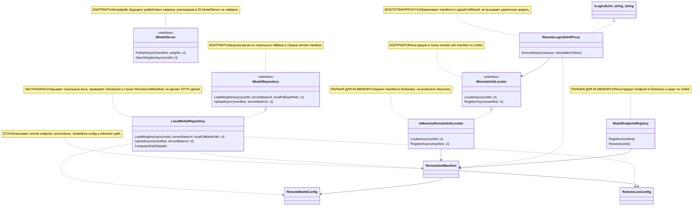

# 25.ModelServer - документация реализации

RP01.03A, partial C0 recovery 15.10.2026: explicit `/code-documentation/repository-owned-dpo/scientific/resume-baseline-and-hold` использует прежний strict raw-v2 intake и stable run ID, server-owned policy и caller/host lifetime. Source/legal/parent admission предшествует custody-protected run lease; сервер переоткрывает exact intent/source binding и допускает только clean pre-executor state через существующий journal owner. Все retained C0 slots проверяются до новых calls; пять сохранённых raw переиспользуются без повторной генерации. Genuine evaluator result/provenance сохраняется до advancement, cached result не выдаётся за новый CallIssued. Existing executor/Trial loop заканчивает HELD_FOR_SCIENCE с отдельным logical/current-call/UNKNOWN-history accounting. Canonical attempt, post-update/held state, orphan, drift и concurrent same-run request отказывают. Автоматического retry, timeout, нового grant или публикации до независимого T2 нет. [Точный CLI/operation contract](../../tools/Rp01RawDpoLesson/README.md).

RP01.03A, 15.10.2026: hosted activator перед inactive materialization вызывает
существующий server-owned initial-training owner для привязки полного B0/LoRA.
Только явный прежний `ROOT_B0_FIRST_UPDATE` с совпадающими canonical parent,
strict latest-compatible manifest/weights, topology и seed создаёт типизированный
`RepositoryOwnedFullLoraCheckpointDescriptor`. Частично заданный или неверный
выбор закрывает materialization. Выключенный выбор сохраняет base-only контракт.
Retained checkpoint дополнительно проверяется по точным hash/length и схеме;
топология доходит через provider options до всех трёх независимых загрузок,
где seeded slots создаются перед импортом сохранённых tensors. Это не выводит
training/optimizer/continuation permission из metadata и не меняет позднюю
проверку legal context. Реальный startup и обучение этим описанием не доказаны.

Новые public API codec/descriptor используют канонический `OperationResult<T>`;
startup и retained loader обрабатывают refusal до readiness или выдачи model set.
Обычный raw `train-existing` по опубликованному контракту возвращает
`409/ScientificHoldRequired` раньше initial choice. Отдельные проверки
`Required/Invalid` принадлежат `RequireChoice/Bind`; fixture не имитирует
scientific policy ради обхода раннего guard и не запускает C0 или обучение.

RP01.03A, 15.10.2026: прежний `DPO_PAIR_ROOT` остаётся адресом canonical dataset.
После успешного repository-owned resolution и проверки sealed manifest загрузчик
передаёт в retained owner явную роль `SealedRepositorySource`. Она открывает
sealed каталог для чтения и traversal, с прежними no-follow/identity и запретом
delete sharing в Windows. Mutable pair-store роль и Adapter/Cache/Registry
writer capabilities сохраняют прежние guards; sealed источник не разрешается
через mutable `DpoPairs`. Новых client/env переключателей и diagnostic CLI нет.
Singleton `AcquireRetainedFileAccess` и hosted activator по-прежнему выполняют
настоящий bind/materialization до readiness. Успешный реальный startup и первый
Student update этим изменением исходников ещё не подтверждены.

Один отдельно разрешённый retained diagnostic 14.10.2026 завершился без timer:
84 prompt / 256 generated tokens, `LENGTH_LIMIT`, generation error отсутствует,
native summary 35,59 секунды. Output SHA-256 `a6515a506f8bd46db1374c486df963c92316c1ff0024205135105bbc43f16e42`;
config/tokenizer/immutable snapshot/base/LoRA A/B/RNG не изменились. Получен output
необученного Student; C# utility, DPO gain, SEALED exam и ordinary adoption не измерялись.
Время одного наблюдения не является минимумом модели или следующим deadline.

Действующее указание пользователя 14.10.2026 отменило автоматический таймаут локального
Student. Retained-control entry проверяет защищённый прежний snapshot и допускает
prediction только после exact full-state воспроизведения owner START; config/tokenizer/
веса не переписываются. Tool поддерживает manual Ctrl+C/stop/process-shutdown cancellation,
heartbeat и наблюдение ресурсов, без автоматического wall-clock/RAM stop. Старый
30-секундный diagnostic остаётся историей. Изменён только публичный Student time-control
protocol; decoder, token budget, panel, Gold и thresholds не меняются.

RP01: отдельный локальный [Student control](../../tools/Rp01StudentControls/README.md)
теперь создаёт canonical generation configuration/tokenizer и частный необученный
snapshot через реальный reader → repository-owned START → общую Student generation.
Reader доступен этому инструменту без нового parser и сохраняет `Denied` для обычного
cold start. Optional `baseInitializationSeed` отдельно задаёт scoped initialization
базовых весов только при clean missing; отсутствие поля не меняет legacy RNG. Authority
LoRA остаётся отдельной. Контроль не выдаёт raw Model/handle публичному caller, не
публикует accepted manifest и не запускает optimizer либо Teacher.

Initial и retained controls вызывают initial-only discovery внутри того же START.
При наличии checkpoint candidate owner возвращает
`REPOSITORY_OWNED_MODEL_INITIAL_CONTROL_CHECKPOINT_PRESENT` до custody preparation
и открытия manifest/DPO/weights. Private snapshot открывается только после clean
initial admission; обычный Generate сохраняет default загрузку accepted checkpoint.
Этот guard repair проверяется отдельно без Student prediction: успешный diagnostic
выше относится к предыдущей версии исходников.

Actual control 14.10.2026: production Small с контекстом 2048 и BPE vocabulary 629,
построенным только на четырёх разрешённых TRAIN teaching inputs. Reader загрузил живые
config bytes; два owner START дали один full checkpoint hash, а единственный diagnostic
по shared generation был отменён 30-секундным deadline. Веса/base/LoRA A/B/RNG до и после
совпали; успешный ответ, качество и обучение не доказаны. Private snapshot и receipts
сохранены в `RP01.03A-initial-control-binding-20261014`; первый отказ и позднейший
отдельно разрешённый пользователем retained diagnostic имеют разные receipts/source pins.
Обычный endpoint/adoption, старый код P и полный закрытый экзамен этим запуском не проверены.

RP01: необученный исходный baseline перед первым уроком — отдельная bootstrap-композиция: отдельная offline-команда `--code-documentation-bootstrap-parent --dataset-version <version> --dataset-manifest-sha256 <lowercase SHA256>` создаёт первый сохранённый **необученный** baseline только при отдельном разрешении оператора, до будущего шага RP01.03A.T0. Сам T0 разрешает только чтение состояния и фиксацию научных контролей; он не разрешает bootstrap-запись, вызов Teacher или шаг optimizer. Команда завершает процесс после результата и не запускает HTTP host. Без этой команды `Main` продолжает обычный серверный запуск; normal generation и DPO coordinator сохраняют прежние запреты на скрытый cold start и отсутствующий parent.

Оператор независимо разрешает эту стадию через `XIIGEN_CODE_DOCUMENTATION_BASELINE_BOOTSTRAP_ENABLED=true`, а также существующие `DESIGN_CONVERSION_MODELSERVER_REPOSITORY_OWNED_TRAINING_ENABLED=true` и `DESIGN_CONVERSION_MODELSERVER_REPOSITORY_OWNED_TRAINING_ALLOW_COLD_START=true`. Требуются точная непустая причина в `DESIGN_CONVERSION_MODELSERVER_REPOSITORY_OWNED_TRAINING_COLD_START_REASON` (до 512 символов, без control chars или краевого whitespace) и уникальные непустые provenance refs в `DESIGN_CONVERSION_MODELSERVER_REPOSITORY_OWNED_TRAINING_PROVENANCE_REFS` (разделитель `;`, 1–32 строки, каждая до 512 символов). Только явное `true` допускает стадию. Startup значения захватываются один раз до custody/model effects. Optional asserted repository root должен совпасть с закреплённым `C:\Projects\llm_mvp_core`; CLI root override отсутствует. Неизвестные/повторные/неполные аргументы отвергаются до чтения артефактов.

Команда использует тот же strict generation profile и canonical tokenizer, описанные ниже, с теми же generation opt-in/hash ключами. Она не создаёт profile/tokenizer и не подставляет tiny/default модель. Адрес DPO выводится из canonical root, domain/design pattern проверенного profile и указанной dataset version. Выбранный manifest hash должен совпасть с текущим sealed manifest; полное открытие через `RepositoryOwnedDpoDatasetManifestSealer.OpenSealedTrainingEligible` повторно проверяет pair bytes, schema, identity, teacher/content/authorship и существующий persisted governance decision (licence, quarantine, evidence). Owner-open сохраняет существующую custody preparation; это не обещание отсутствия всех filesystem effects. Governance validation подтверждает сохранённое решение, а не самостоятельно устанавливает права на исходник. Реальный оператор должен иметь действительные права и provenance для выбранного материала; hash сам по себе разрешением не является.

После допуска команда передаёт копию проверенного запроса с точной authorized cold-start причиной внутреннему publication owner. Только этот owner вызывает initial START: команда не создаёт предварительную модель. Типизированный `AlreadyPresent` означает, что единственный START загрузил совместимый parent; публикация и Step 2 не вызываются. Corrupt/incompatible/ambiguous состояние не становится свежей моделью. Только clean missing lineage проходит прежний atomic sealer как Step 1 и возвращает типизированный `Created` с written/reopened evidence. Затем отдельный fresh START с `ColdStartPolicy.Denied` обязан загрузить те же manifest/weights/runtime/model/tokenizer identities. Успех сообщает `INITIAL_BASELINE_CREATED / NO_TRAINING` (exit 0). Validation/START/cancellation до входа в checkpoint sealer возвращают `REFUSED` (exit 1). Private owner callback отмечает вход в sealer; ошибка после этой границы возвращает типизированный `ReconciliationRequired`, а сбой последующего denied reload тоже сообщает `RECONCILIATION_REQUIRED` (exit 2): сверить состояние с диском, не повторять неизвестную запись и не создавать следующий шаг. START и custody остаются существующими IO/model boundaries; это не обещание чистого filesystem read. Повтор успешного bootstrap не добавляет Step 2.

Baseline initialization не вызывает Teacher, judge, DpoTrainer или optimizer и не расходует DPO-пару, не пишет training-attempt journal и не измеряет improvement. Внутренний `PublishInitialBaseline` сам вызывает START и сохраняет собственную свежую модель: caller не передаёт ему модель, которая могла быть обучена или изменена. Manifest получает отдельную схему `repository-owned-model-checkpoint-manifest-v2-initial-baseline` и типизированную `dpoApplication: 1` (`InitialBaselineNoUpdate`). Роль включена в canonical bytes и manifest self hash; parser допускает её только у parentless Step 1 с cold-start причиной. Свежий denied START обязан подтвердить эту роль вместе с полной идентичностью весов. DPO identity здесь — подлинная ссылка на проверенный материал, а не свидетельство применения optimizer. Existing lineage owner вновь открывает provenance dataset, но не считает его пары применёнными только для этой проверенной роли; первый реальный урок может использовать выбранную пару. Обычные и legacy v1 manifests, включая первый шаг с cold-start причиной, сохраняют запрет повторного PairId/SHA и конфликт изменённых bytes. V1 canonical bytes/self hash не получают нового null-поля и не переписываются. Реальное создание baseline требует отдельно разрешённого профиля/ресурсного бюджета; focused synthetic fixture проверяет только lifecycle guards. P/C0/T, реальный Student update, независимый sealed exam и cold ordinary adoption остаются отдельными стадиями RP01.

RP01.01C: ordinary local `POST /api/code-documentation/generate` принимает JSON `requestId`, `domainSlug`, `ownerInput`, `contractVersion` (`code-documentation-student-generation-v1`). Unknown fields, включая weight/trial paths и client settings, отвергаются до loader. Ответ содержит actual text, repository-published checkpoint identity, input/tokenizer/settings/framing identity, counts/stop и measured timings. Ошибки сохраняют typed code; cancellation — `CANCELLED`, неизвестные counts — null. TIME_LIMIT без deadline не заявляется.

Обычный standalone запуск `Main` настраивается оператором: `XIIGEN_CODE_DOCUMENTATION_GENERATION_ENABLED=true` и `XIIGEN_CODE_DOCUMENTATION_GENERATION_CONFIG_SHA256=<lowercase SHA256 точных bytes generation-v1.json>`. Файлы имеют фиксированные адреса `config/code-documentation/generation-v1.json` и `config/code-documentation/tokenizer.json` под существующим canonical trusted root хоста. Оператор заранее предоставляет regular files и каталог `code-documentation` с owner-only custody; reparse traversal и недоказанная custody отвергаются. Загрузчик generation configuration открывает только `FileMode.Open/FileAccess.Read`: не создаёт файлы, не исправляет ACL и не загружает модель. Missing/disabled opt-in возвращает `CODE_DOCUMENTATION_GENERATION_NOT_CONFIGURED` (503); enabled неправильный schema/hash — `CODE_DOCUMENTATION_GENERATION_CONFIGURATION_INVALID`, недоступные/custody/bounded-read artifacts — `CODE_DOCUMENTATION_GENERATION_CONFIGURATION_UNAVAILABLE` (503). Ошибка не превращается в fresh модель или частично настроенный service.

Config ≤64 KiB — strict UTF8 JSON с `version: "code-documentation-generation-server-config-v1"`, `domainSlug`, `designPatternSlug`, `modelIdSlug`, `modelVersion`, `modelConfig`, `runtimeCompatibility`, `settings`. Все девять writable model fields обязательны: `vocabSize`, `contextLen`, `hiddenDim`, `numLayers`, `numHeads`, `numKvHeads`, `ffnHiddenDim`, `ropeTheta`, `rmsNormEps`; computed `headDim`/`kvGroupSize` не являются inputs. Runtime содержит `configSha256`, `topologySha256`, `tokenizerSha256`, `trainerSha256`, `schemaSha256`, `compatibilityKey`. Settings содержит `maxNewTokens`, `temperature`, `topK`, `topP`, `seed`, `maxAnswerChars`: используются прежние assessment bounds (1–2048 tokens и ≤context, temperature 0–2, topK 0–10000, topP >0–1, answer chars 1–65536). Необязательные `loraConfig` (`rank`, `alpha`, `dropout`, `targetModules`) и `adapterSeedAuthority` (`rootInitializationSeed`, `policyDropoutStreamDomain`, `referenceDropoutStreamDomain`) задаются вместе для exact сохранённой topology; значения не выводятся из weights. Unknown/duplicate fields запрещены в каждом объекте. Tokenizer должен быть canonical artifact из `BpeTokenizer.Save`, с совпадающими raw/canonical SHA и runtime tokenizer identity; reused canonical parser сохраняет свои production byte/token/vocabulary budgets.

Typed embedding через `Program.CreateLocalLoopbackHost(generationOptions: new CodeDocumentationGenerationOptions(startRequest, tokenizer, settings))` остаётся доступным и использует ту же root-проверку. Artifact route всегда `ColdStartPolicy.Denied`, выбирает existing latest-compatible published lineage через START, без client paths, trial/step selectors или inference из training switch. Все варианты сохраняют прежнюю local exposure и process-owned startup authority. Текущий verified manifest не содержит EOS: ordinary facade сообщает `LENGTH_LIMIT`. Научная selected/adopted модель, новый OS process, DTC/IDE и Student improvement этим bootstrap не доказаны.

Статус D3G: parent review passed. Тесты, сборка и runtime smoke не запускались в этой documentation subphase.

## 0. Человеческое объяснение

`25.ModelServer` сейчас похож на диспетчерскую карточек для обученных логических единиц: он умеет взять локальный `GeneratedCapabilityCheckpointManifest`, проверить, что checkpoint-файл реально существует, посчитать SHA256 и собрать `RemoteUnitManifest`. Сами общие транспортные типы remote-unit (`IRemoteUnitLocator`, `RemoteUnitManifest`, `InMemoryRemoteUnitLocator`, `RemoteLogicalUnitProxy`) теперь физически живут в `21.AgentInfrastructure/ModelServer`, чтобы клиентские проекты могли читать паспорт опубликованной единицы без ссылки на серверный executable. `25.ModelServer` остаётся владельцем публикации, checkpoint-адресов и серверной власти, но не является полноценным сервером моделей: здесь нет HTTP-клиента, нет сетевой отправки весов, нет удаленного inference, нет fresh-load проверки модели и нет доказательства качества продукта.

Главная честная граница: `LocalModelRepository.UploadAsync` называется `Upload`, но по текущему коду он строит локальный remote-manifest и SHA, а не отправляет веса в сеть. Когда сервер или downstream-клиент использует `RemoteLogicalUnitProxy.ExecuteAsync`, он использует shared transport из `21.AgentInfrastructure/ModelServer`: proxy находит manifest через locator и возвращает исходный `request.Input` с evidence по manifest; он не вызывает удаленную модель и не выполняет runtime inference.

### Серверный запуск обучения документации кода

`25.ModelServer` теперь имеет внутренний локальный маршрут
`POST /internal/continuous-learning/code-documentation/repository-owned-dpo/train-and-publish`.
Он нужен для полного цикла CodeDocumentation: открыть уже сохранённый DPO из
`training-data/dpo`, проверить manifest/receipt/pairs, загрузить последний
совместимый checkpoint из `training-artifacts/models`, выполнить DPO через
единственный серверный `IServerOwnedDpoTrainingLeaseBroker` и опубликовать
следующий checkpoint обратно в `training-artifacts/models`.

Клиентский JSON намеренно маленький: домен документации, design pattern, версия
набора DPO, id запуска, результат routing-run и provenance refs. Клиент не может
передать путь репозитория, tokenizer, форму модели, LoRA, runtime hashes,
cold-start policy, число DPO-шагов или broker. Эти значения берутся только из
живой конфигурации ContinuousLearning, которую сервер уже принял и удерживает
через `ServerOwnedContinuousLearningFileAccess`.

Маршрут падает закрыто до записи файлов, если серверная власть обучения не
активна, retained tokenizer не привязан, legal evidence не проверен, домен не
входит в allowlist CodeDocumentation, design pattern не совпадает с allowlist,
или запрошенный DPO manifest не является тем manifest, который startup уже
прочитал как текущий. Ответ об успехе содержит только относительные пути и
хэши; абсолютные локальные пути не возвращаются. CLI, который будет вызывать
этот маршрут после batch-runner, остаётся отдельным следующим срезом.

### Где теперь граница между 25 и 21

`25.ModelServer` держит server authority: `IModelRepository`, `IModelServer`, `LocalModelRepository`, `ModelEndpointRegistry`, endpoint composition и публикацию checkpoint-ов. `21.AgentInfrastructure/ModelServer` держит shared transport: `IRemoteUnitLocator`, `RemoteUnitManifest`, `RemoteModelConfig`, `RemoteLoraConfig`, `InMemoryRemoteUnitLocator`, `RemoteLogicalUnitProxy`. Namespace у этих transport-типов остался `ModelServer.*`, чтобы не ломать уже существующих consumers, но живой физический путь теперь начинается с `21.AgentInfrastructure/ModelServer/...`.

## DesignConversion DPO handoff admission

`DesignConversionDpoTrainingHandoff` теперь передаёт в `LogicalDpoPreferenceExample`
только already-resolved `ChosenAuthorKind` и `RejectedAuthorKind` из
`DesignConversionDpoTrainingRecord`. Он не выводит авторство заново из
deterministic provenance, score или order of chosen/rejected: это важно, потому
что directed teacher side может быть `OpenTeacher`, incumbent side —
`LocalModel`, а Capability/Logical DPO bridge должен получить уже выбранный
паспорт сторон.

Если training record приходит без обеих сторон авторства, handoff падает до
provider invocation и до checkpoint directory. Успешный path получает
`DpoBatch.Admission` от `LogicalDpoTrainingUnit` с issuer
`LogicalDpoTrainingUnit` и fingerprint по raw optimizer `Prompt`/`Chosen`/
`Rejected`. Runtime/held-out DesignConversion paths остаются без training
admission: они не являются входом optimizer training door.

### Конфигурация локального Qwen-судьи

Для автора CodeDocumentation добавлен отдельный явный startup opt-in: `XIIGEN_CONTINUOUS_LEARNING_TP1_AUTHORING_PROFILE_ID=qwen35-local-authoring-cpu-bounded-v1` вместе с `XIIGEN_CONTINUOUS_LEARNING_TP1_AUTHORING_PROFILE_SHA256=c1973891d1414f24b8625668446f5b33ffddeb433acb9b15daedc00d52d8aea5`. Loader из `14.ContinuousLearning` читает оба значения один раз и сохраняет точный профиль в immutable teacher configuration; неизвестная или несовпадающая пара отказывается. При отсутствии обеих переменных остаётся прежний authoring default. Новый CPU (центральный процессор) профиль ограничивает полный prompt+выход контекстом 2048, резервом 512, deadline 600 секунд, двумя потоками/пакетом 16/без GPU, отключённым thinking, no-truncation/no-shift и `keep_alive=0`. Тело, доказательство профиля, deadline и CodeDocumentation policy/creator identity связаны одним выбором; authoring-wrapper передаёт тот же паспорт, а чужая фабрика отклоняется до вызова. Подробности и научные границы — в [документации ContinuousLearning](14-continuous-learning.md#rp0102ba1-отдельный-ограниченный-cpu-профиль-автора).

Это реализация ограниченного authoring-контракта, `IMPLEMENTED_NOT_OBSERVED`: настоящий полный урок/обучение/качество не запускались в этом срезе. Конфигурационный выбор не выдаёт source rights, не открывает protected OneLesson и не меняет frozen Evaluation или его бюджет. Значения 512/600 — конечные протокольные ограничения после A0 с cold load 39.69 секунды, а не измеренная гарантия урока или минимум модели.

Model-server composition передаёт независимому DesignConversion evaluator те же
три обязательных production-пина локальной модели: model id, Ollama manifest
digest и model-layer digest. Оценщик не выбирает модель из локального списка и
не обращается к платному внешнему сервису. Его evaluation-only запрос требует
строгий JSON, отключает reasoning (`think=false`), ограничивает ответ 256
токенами и имеет отдельный 120-секундный deadline. Legacy teacher-authoring запрос и
его 30-секундный предел от этого не меняются.

Наличие composition и корректных metadata ещё не является доказательством
качества. Контрактный focused batch проверяет сериализацию, fingerprint,
таймауты, parser и fail-closed границы без модели. Реальное доказательство —
отдельный Windows canary с явным
`XIIGEN_RUN_LOCAL_QWEN_JUDGE_CANARY=1`: четыре ответа pinned Qwen обязаны
выбрать один и тот же хороший HTML/CSS до и после перестановки сторон. Без
флага результат честно не исполнен; блокировка Smart App Control не заменяет
quality oracle. Canary не создаёт обучающие пары, не вызывает тренер и не
изменяет checkpoint или веса.

Этот handoff — одно из пяти продуктовых мест создания
`LogicalDpoPreferenceExample`: он копирует авторов обеих сторон богатой пары,
а текущие и повторные Capability-строки получают проверенное детерминированное
авторство. Старый строковый перегруженный метод без авторов сохранён только для
совместимости и останавливается в `LogicalDpoTrainingUnit.PrepareExecution` до
токенизации и оптимизатора. Затем единственная общая фабрика
`DpoTrainerPairCustoms.CreateAdmitted` связывает исходные строки и авторов до
сокращения текста; параллельного публичного пути выдачи допуска нет.

Текущий статус: все пять продуктовых мест создания пары учтены, а три
изменяющих входа тренера требуют допуска и запрещают платную внешнюю модель на
любой стороне. Точечный пакет на вершине
`c325d52a37c8faeb8923fb1d7d44f5f4215ef05c` прошёл 18 из 18 проверок. Полный
набор тестов не запускался и зелёным не объявляется.

## 1. UML для draw.io



| Класс | Что делает | Статус |
|---|---|---|
| `IModelRepository` | Контракт загрузки весов и публикации manifest из локального checkpoint | контракт |
| `IModelServer` | Контракт настоящего server-side publish/open | контракт без реализации в этом проекте |
| `IRemoteUnitLocator` | Контракт lookup/register для `RemoteUnitManifest` | контракт |
| `LocalModelRepository` | Читает локальный файл весов и строит `RemoteUnitManifest` с SHA | частично: локальная сборка, не сеть |
| `InMemoryRemoteUnitLocator` | Хранит manifests в памяти процесса | реализован in-memory |
| `RemoteLogicalUnitProxy` | Выполняет `ILogicalUnit<string,string>` через lookup manifest | proxy/bootstrap, не inference |
| `ModelEndpointRegistry` | In-memory registry endpoint-ов | реализован in-memory |
| `RemoteUnitManifest` / configs | DTO remote unit, модели и LoRA | реализованные records |

### Симуляции соединений UML

| Соединение | Пример входа | Что происходит | Ожидаемый результат | Что нельзя считать доказательством |
|---|---|---|---|---|
| `IModelRepository` -> `LocalModelRepository` | `UploadAsync(manifest, "https://models.local")`, где `PolicyCheckpointPath` существует | Проверяются manifest, cancellation, server URL, checkpoint path; строится endpoint `/models/{UnitId}` и SHA checkpoint | `OperationResult<RemoteUnitManifest>.Ok(remote)` с `ServerBaseUrl`, `UnitEndpoint`, provenance и config | Нельзя говорить, что веса реально отправлены на сервер |
| `LocalModelRepository` -> `RemoteUnitManifest` | `UnitId="unit-orchestration-plan-v1"`, `TrainingRunId="train-ready-v309"` | Данные из training manifest переносятся в remote record | Remote manifest содержит unit metadata, `RemoteModelConfig`, `RemoteLoraConfig`, tokenizer path и `RegisteredAtUtc` | Нельзя считать это fresh-load, continue-training или качество модели |
| `IRemoteUnitLocator` -> `InMemoryRemoteUnitLocator` | `RegisterAsync(remoteManifest)` затем `LocateAsync(unitId)` | Manifest кладется в `_manifests`, потом достается по `UnitId` | `Ok(true)` на register и `Ok(manifest)` на locate | In-memory locator не доказывает production discovery или сеть |
| `RemoteLogicalUnitProxy` -> `IRemoteUnitLocator` | `ExecuteAsync(request)` для зарегистрированного `_unitId` | Proxy вызывает `LocateAsync`, берет manifest и строит `LogicalUnitResult<string>` | Output равен `request.Input`, confidence `1.0`, predicate `REMOTE_UNIT`, evidence `ManifestSha256` | Это не удаленный inference и не семантическая обработка текста |
| `ModelEndpointRegistry` -> `RemoteUnitManifest` | `Register(manifest)` с `UnitEndpoint="/models/u1"` | Registry валидирует UnitId/endpoint и кладет manifest в Dictionary | `Resolve("u1")` возвращает тот же manifest | Это не HTTP route и не lifecycle registry за пределами процесса |
| `RemoteUnitManifest` -> configs | `RemoteModelConfig(2048,96,64,2,4,4,128)` и `RemoteLoraConfig(2,4,0.05,["q_proj"])` | DTO хранит форму модели и LoRA adapter параметры | Эти поля доступны downstream consumer-ам | Наличие config не доказывает, что model file загружен и совместим |

## 2. Алгоритмы без кода на русском

### Алгоритм A: `LocalModelRepository.UploadAsync(GeneratedCapabilityCheckpointManifest manifest, string serverBaseUrl, CancellationToken ct = default)`

Представь, что перед отправкой посылки сотрудник склада проверяет накладную и саму коробку, взвешивает ее и печатает адресную карточку. Сейчас `UploadAsync` делает именно это: проверяет входной manifest и локальный checkpoint, считает SHA и печатает remote manifest. Курьера, который реально отвозит файл на сервер, в этом коде нет.

**Вход:** `GeneratedCapabilityCheckpointManifest` из `18.CapabilityTraining`, `serverBaseUrl`, `CancellationToken`.

**Выход:** `Task<OperationResult<RemoteUnitManifest>>`.

**Текущие шаги:**
1. Если `manifest == null`, вернуть `MANIFEST_REQUIRED`.
2. Если `ct.IsCancellationRequested`, вернуть `MODEL_UPLOAD_CANCELLED`.
3. Если `serverBaseUrl` пустой, вернуть `SERVER_URL_REQUIRED`.
4. Если `manifest.PolicyCheckpointPath` пустой или файл не существует, вернуть `POLICY_CHECKPOINT_NOT_FOUND`.
5. Собрать endpoint `/models/{Uri.EscapeDataString(manifest.UnitId)}`.
6. Посчитать `ManifestSha256` через чтение checkpoint-файла и `SHA256.HashData`.
7. Перенести branch/run/dataset provenance, model config, LoRA config, tokenizer path и время регистрации в `RemoteUnitManifest`.
8. Вернуть `Ok(remote)`.

**Что алгоритм не делает:** не вызывает `IModelServer.PublishAsync`, не открывает HTTP соединение, не копирует weights на server, не проверяет, что remote endpoint реально доступен.

### Алгоритм B: `LocalModelRepository.LoadWeightsAsync(string unitId, string? serverBaseUrl, string localFallbackPath, CancellationToken ct = default)`

Это локальный аварийный доступ к файлу весов: если есть `unitId` и путь к файлу, метод открывает read stream.

**Вход:** `unitId`, необязательный `serverBaseUrl`, `localFallbackPath`, `CancellationToken`.

**Выход:** `Task<OperationResult<Stream>>`.

**Текущие ветки:** пустой `unitId` -> `UNIT_ID_REQUIRED`; cancellation -> `MODEL_LOAD_CANCELLED`; пустой path -> `LOCAL_PATH_REQUIRED`; отсутствующий файл -> `MODEL_WEIGHTS_NOT_FOUND`; существующий файл -> `Ok(File.OpenRead(localFallbackPath))`.

**Что не делает:** не использует `serverBaseUrl` для сетевой загрузки и не валидирует содержимое checkpoint как рабочую модель.

### Алгоритм C: `InMemoryRemoteUnitLocator.RegisterAsync(RemoteUnitManifest manifest, CancellationToken ct = default)`

Это телефонная книга в памяти процесса. Она принимает карточку remote unit и кладет ее по ключу `UnitId`.

**Вход:** `RemoteUnitManifest`.

**Выход:** `Task<OperationResult<bool>>`.

**Текущие ветки:** `manifest == null` -> `MANIFEST_REQUIRED`; cancellation -> `UNIT_REGISTER_CANCELLED`; пустой `UnitId` -> `UNIT_ID_REQUIRED`; пустой `ServerBaseUrl` или `UnitEndpoint` -> `REMOTE_ENDPOINT_REQUIRED`; валидный manifest -> `_manifests[UnitId] = manifest` и `Ok(true)`.

**Что не делает:** не сохраняет manifest на диск, не синхронизирует registry между процессами, не проверяет доступность remote URL.

### Алгоритм D: `InMemoryRemoteUnitLocator.LocateAsync(string unitId, CancellationToken ct = default)`

Поиск в той же телефонной книге: пришел `unitId`, locator смотрит в Dictionary.

**Вход:** `unitId`.

**Выход:** `Task<OperationResult<RemoteUnitManifest>>`.

**Текущие ветки:** пустой `unitId` -> `UNIT_ID_REQUIRED`; cancellation -> `UNIT_LOOKUP_CANCELLED`; ключ найден -> `Ok(manifest)`; ключ не найден -> `REMOTE_UNIT_NOT_FOUND`.

### Алгоритм E: `RemoteLogicalUnitProxy.ExecuteAsync(LogicalUnitRequest<string> request, CancellationToken cancellationToken = default)`

Это не удаленная модель, а заглушка-proxy уровня `ILogicalUnit`: она подтверждает, что unit зарегистрирован, и возвращает результат с evidence из manifest.

**Вход:** `LogicalUnitRequest<string>` с `Input`, `RunId`, `UnitId`, flags и metadata.

**Выход:** `Task<OperationResult<LogicalUnitResult<string>>>`.

**Текущие шаги:**
1. Если `request == null`, вернуть `REQUEST_REQUIRED`.
2. Вызвать `_locator.LocateAsync(_unitId, cancellationToken)`.
3. Если locator вернул ошибку, пробросить `ErrorMessage` и `ErrorCode`.
4. Если manifest найден, создать `LogicalUnitResult<string>`:
   - `UnitId`, `UnitRole`, `DomainTag` берутся из manifest;
   - `Output` равен `request.Input`;
   - `Confidence` всегда `1.0`;
   - `PredicateIds` содержит `REMOTE_UNIT`;
   - `EvidenceIds` содержит `manifest.ManifestSha256`.
5. Вернуть `Ok(output)`.

**Что не делает:** не делает remote inference, не отправляет prompt на server, не применяет LoRA/checkpoint и не изменяет input.

### Алгоритм F: `ModelEndpointRegistry.Register(RemoteUnitManifest manifest)` и `Resolve(string unitId)`

Это простая in-memory таблица endpoint-ов, не HTTP router.

**Вход:** для `Register` - `RemoteUnitManifest`; для `Resolve` - `unitId`.

**Выход:** `OperationResult<bool>` или `OperationResult<RemoteUnitManifest>`.

**Ветки:** `Register` блокирует `null`, пустой `UnitId`, пустой `UnitEndpoint`; успешный manifest кладется в `_endpoints`. `Resolve` блокирует пустой `unitId`, затем возвращает найденный manifest или `ENDPOINT_NOT_FOUND`.

### Алгоритм G: contracts и DTO

`IModelRepository`, `IModelServer`, `IRemoteUnitLocator` задают границы будущего lifecycle. `RemoteUnitManifest`, `RemoteModelConfig`, `RemoteLoraConfig` описывают, где якобы находится unit, от какого training run он произошел и какие shape/config параметры должны знать consumers. Это контрактные данные, не runtime proof.

## 3. Короткие цитаты кода с точными ссылками

### Контракт repository

`25.ModelServer/Contracts/IModelRepository.cs:6-18`

```csharp
public interface IModelRepository
{
    Task<OperationResult<Stream>> LoadWeightsAsync(
        string unitId,
        string? serverBaseUrl,
        string localFallbackPath,
        CancellationToken ct = default);

    Task<OperationResult<RemoteUnitManifest>> UploadAsync(
        GeneratedCapabilityCheckpointManifest manifest,
        string serverBaseUrl,
        CancellationToken ct = default);
}
```

> **Почему важно:** это публичная граница: загрузка весов возвращает `Stream`, а "upload" возвращает только `RemoteUnitManifest`. Сам контракт не доказывает, что есть реализация сетевой публикации.

### Guard-ветки `UploadAsync`

`25.ModelServer/Local/LocalModelRepository.cs:32-47`

```csharp
public Task<OperationResult<RemoteUnitManifest>> UploadAsync(
    GeneratedCapabilityCheckpointManifest manifest,
    string serverBaseUrl,
    CancellationToken ct = default)
{
    if (manifest is null)
        return Task.FromResult(OperationResult<RemoteUnitManifest>.Fail("Manifest is required.", "MANIFEST_REQUIRED"));

    if (ct.IsCancellationRequested)
        return Task.FromResult(OperationResult<RemoteUnitManifest>.Fail("Model upload was cancelled.", "MODEL_UPLOAD_CANCELLED"));

    if (string.IsNullOrWhiteSpace(serverBaseUrl))
        return Task.FromResult(OperationResult<RemoteUnitManifest>.Fail("Server base URL is required.", "SERVER_URL_REQUIRED"));

    if (string.IsNullOrWhiteSpace(manifest.PolicyCheckpointPath) || !File.Exists(manifest.PolicyCheckpointPath))
        return Task.FromResult(OperationResult<RemoteUnitManifest>.Fail("Policy checkpoint must exist before upload.", "POLICY_CHECKPOINT_NOT_FOUND"));
```

> **Как читать:** эти проверки защищают от пустого manifest, отмены, пустого URL и отсутствующего checkpoint. Последняя ветка важна: checkpoint-файл должен существовать до публикации manifest. Но это все еще локальная проверка файла, а не загрузка модели в runtime.

### Сборка `RemoteUnitManifest` и SHA

`25.ModelServer/Local/LocalModelRepository.cs:49-77`

```csharp
var endpoint = $"/models/{Uri.EscapeDataString(manifest.UnitId)}";
var remote = new RemoteUnitManifest(
    manifest.UnitId,
    manifest.UnitRole,
    manifest.DomainTag,
    manifest.Version,
    serverBaseUrl.TrimEnd('/'),
    endpoint,
    ComputeSha256(manifest.PolicyCheckpointPath),
    manifest.TrainingBranch ?? "",
    manifest.TrainingRunId ?? "",
    manifest.SourceDatasetSha256 ?? "",
    new RemoteModelConfig(
        manifest.VocabSize,
        manifest.ContextLen,
        manifest.HiddenDim,
        manifest.NumLayers,
        manifest.NumHeads,
        manifest.NumKvHeads,
        manifest.FfnHiddenDim),
    new RemoteLoraConfig(
        manifest.LoraRank,
        manifest.LoraAlpha,
        manifest.LoraDropout,
        manifest.LoraTargetModules),
    manifest.TokenizerPath,
    DateTimeOffset.UtcNow);

return Task.FromResult(OperationResult<RemoteUnitManifest>.Ok(remote));
```

> **Что доказывает:** manifest получает endpoint, SHA checkpoint, training branch/run/dataset, model config, LoRA config и tokenizer path. **Что не доказывает:** что `/models/...` существует на сервере, что веса были загружены туда, что checkpoint можно fresh-load или продолжить обучение.

### In-memory locator

`21.AgentInfrastructure/ModelServer/Remote/InMemoryRemoteUnitLocator.cs:10-22`

```csharp
public Task<OperationResult<RemoteUnitManifest>> LocateAsync(
    string unitId,
    CancellationToken ct = default)
{
    if (string.IsNullOrWhiteSpace(unitId))
        return Task.FromResult(OperationResult<RemoteUnitManifest>.Fail("Unit id is required.", "UNIT_ID_REQUIRED"));

    if (ct.IsCancellationRequested)
        return Task.FromResult(OperationResult<RemoteUnitManifest>.Fail("Unit lookup was cancelled.", "UNIT_LOOKUP_CANCELLED"));

    return _manifests.TryGetValue(unitId, out var manifest)
        ? Task.FromResult(OperationResult<RemoteUnitManifest>.Ok(manifest))
        : Task.FromResult(OperationResult<RemoteUnitManifest>.Fail($"Remote unit not registered: {unitId}", "REMOTE_UNIT_NOT_FOUND"));
}
```

> **Почему важно:** lookup имеет честные error branches. Это доказывает управляемое поведение in-memory registry, но не production discovery.

`21.AgentInfrastructure/ModelServer/Remote/InMemoryRemoteUnitLocator.cs:25-42`

```csharp
public Task<OperationResult<bool>> RegisterAsync(
    RemoteUnitManifest manifest,
    CancellationToken ct = default)
{
    if (manifest is null)
        return Task.FromResult(OperationResult<bool>.Fail("Remote unit manifest is required.", "MANIFEST_REQUIRED"));

    if (ct.IsCancellationRequested)
        return Task.FromResult(OperationResult<bool>.Fail("Unit registration was cancelled.", "UNIT_REGISTER_CANCELLED"));

    if (string.IsNullOrWhiteSpace(manifest.UnitId))
        return Task.FromResult(OperationResult<bool>.Fail("Unit id is required.", "UNIT_ID_REQUIRED"));

    if (string.IsNullOrWhiteSpace(manifest.ServerBaseUrl) || string.IsNullOrWhiteSpace(manifest.UnitEndpoint))
        return Task.FromResult(OperationResult<bool>.Fail("Server URL and endpoint are required.", "REMOTE_ENDPOINT_REQUIRED"));

    _manifests[manifest.UnitId] = manifest;
    return Task.FromResult(OperationResult<bool>.Ok(true));
}
```

> **Как работает:** регистрация валидирует минимальный remote address и кладет manifest в Dictionary. После завершения процесса эти данные пропадут.

### Proxy как `ILogicalUnit<string,string>`

`21.AgentInfrastructure/ModelServer/Remote/RemoteLogicalUnitProxy.cs:7-20`

```csharp
public sealed class RemoteLogicalUnitProxy : ILogicalUnit<string, string>
{
    private readonly string _unitId;
    private readonly IRemoteUnitLocator _locator;

    public RemoteLogicalUnitProxy(string unitId, IRemoteUnitLocator locator)
    {
        _unitId = unitId;
        _locator = locator;
    }

    public async Task<OperationResult<LogicalUnitResult<string>>> ExecuteAsync(
        LogicalUnitRequest<string> request,
        CancellationToken cancellationToken = default)
```

> **Почему важно:** это реальное подключение к hierarchy: proxy реализует `ILogicalUnit<string,string>`. Но тип wrapper не делает его `ILearningMachine` и не добавляет обучение.

`21.AgentInfrastructure/ModelServer/Remote/RemoteLogicalUnitProxy.cs:22-41`

```csharp
if (request is null)
    return OperationResult<LogicalUnitResult<string>>.Fail("Logical unit request is required.", "REQUEST_REQUIRED");

var located = await _locator.LocateAsync(_unitId, cancellationToken);
if (!located.IsSuccess)
    return OperationResult<LogicalUnitResult<string>>.Fail(located.ErrorMessage, located.ErrorCode);

var manifest = located.Value!;
var output = new LogicalUnitResult<string>(
    manifest.UnitId,
    manifest.UnitRole,
    manifest.DomainTag,
    request.Input,
    1.0,
    ["REMOTE_UNIT"],
    [manifest.DomainTag],
    [manifest.ManifestSha256],
    []);

return OperationResult<LogicalUnitResult<string>>.Ok(output);
```

> **Что доказывает:** если locator нашел manifest, proxy возвращает логический результат с provenance evidence. **Что не доказывает:** remote inference. `request.Input` становится `Output` без вызова модели.

### Endpoint registry

`25.ModelServer/Http/ModelEndpointRegistry.cs:10-22`

```csharp
public OperationResult<bool> Register(RemoteUnitManifest manifest)
{
    if (manifest is null)
        return OperationResult<bool>.Fail("Remote unit manifest is required.", "MANIFEST_REQUIRED");

    if (string.IsNullOrWhiteSpace(manifest.UnitId))
        return OperationResult<bool>.Fail("Unit id is required.", "UNIT_ID_REQUIRED");

    if (string.IsNullOrWhiteSpace(manifest.UnitEndpoint))
        return OperationResult<bool>.Fail("Unit endpoint is required.", "UNIT_ENDPOINT_REQUIRED");

    _endpoints[manifest.UnitId] = manifest;
    return OperationResult<bool>.Ok(true);
}
```

`25.ModelServer/Http/ModelEndpointRegistry.cs:25-33`

```csharp
public OperationResult<RemoteUnitManifest> Resolve(string unitId)
{
    if (string.IsNullOrWhiteSpace(unitId))
        return OperationResult<RemoteUnitManifest>.Fail("Unit id is required.", "UNIT_ID_REQUIRED");

    return _endpoints.TryGetValue(unitId, out var manifest)
        ? OperationResult<RemoteUnitManifest>.Ok(manifest)
        : OperationResult<RemoteUnitManifest>.Fail($"Endpoint not registered: {unitId}", "ENDPOINT_NOT_FOUND");
}
```

> **Как читать:** registry повторяет паттерн lookup/register, но синхронно и без cancellation. Это локальная таблица endpoint-ов, не web server routing.

### DTO remote manifest

`21.AgentInfrastructure/ModelServer/Remote/RemoteUnitManifest.cs:3-17`

```csharp
public sealed record RemoteUnitManifest(
    string UnitId,
    string UnitRole,
    string DomainTag,
    string Version,
    string ServerBaseUrl,
    string UnitEndpoint,
    string ManifestSha256,
    string TrainingBranch,
    string TrainingRunId,
    string SourceDatasetSha256,
    RemoteModelConfig ModelConfig,
    RemoteLoraConfig LoraConfig,
    string TokenizerPath,
    DateTimeOffset RegisteredAtUtc);
```

> **Почему важно:** DTO хранит locator/provenance/config поля, которые нужны жизненному циклу модели. Но DTO сам по себе не является manifest file, не открывает checkpoint и не подтверждает runtime model quality.

## 4. Иерархия `ILogicalUnit`

`RemoteLogicalUnitProxy` участвует только на уровне `ILogicalUnit<string,string>`.

```text
Уровень 2: ILogicalUnit<string,string>
  Принимает: LogicalUnitRequest<string>(RunId, UnitId, UnitRole, DomainTag, Input, Flags, Metadata)
  Возвращает: LogicalUnitResult<string>(UnitId, UnitRole, DomainTag, Output, Confidence, PredicateIds, DomainTags, EvidenceIds, Metrics)
  Роль: proxy-обертка, которая превращает найденный RemoteUnitManifest в LogicalUnitResult.
```

Чего нет в `25.ModelServer`: нет `ILearningMachine`, нет `ILogicalOrchestrator`, нет `ILogicalFlow`, нет `ILearningMachinePair`, нет train/export/import lifecycle внутри этого проекта. Training остается на границах соседних проектов вроде `18.CapabilityTraining`; `25.ModelServer` только помогает описать и найти опубликованный unit.

### Публичный путь утверждения кандидатов Design-to-Code

`25.ModelServer` участвует в контуре полезности Design-to-Code через
`DesignConversionDpoUsefulnessApi`: вызывающий путь может передать не одного, а
сразу несколько runtime-кандидатов, которых разрешено утвердить для дальнейшего
DPO intake. Серверная часть не подделывает reviewer authority и не обходит
admission/capability boundary: она отдаёт неизменяемые запросы в
`44.DesignConversionDomain`, а локальное хранилище само проверяет состояние
каждого кандидата до первой мутации. Публичная пачка ограничена 256 запросами и
256 КиБ точных UTF-8 метаданных. Одна операция захватывает власть журнала один
раз, делает один начальный scan журнала, получает один общий снимок реального
post-evaluation state-store и переписывает журнал один раз. После commit
допускается не более одного согласующего scan уже зафиксированных байтов для
точного кеша и производного индекса; это не внешний снимок состояния и не
чтение по одному кандидату. Сервер не создаёт отдельный путь утверждения,
который мог бы обойти эти проверки.

Практический смысл для model-server сценария простой: длинный review-only
improvement-loop со 100 source-парами создаёт 200 кандидатов. После первых
малых контрольных случаев оставшиеся кандидаты можно утвердить одной
ограниченной пачкой, и локальный журнал будет переписан один раз, а не сотни
раз. Отмена до атомарной замены сохраняет старые байты. После замены операция
возвращает подтверждённый commit, даже если вторичный индекс требует
отложенного ремонта; она не выдаёт такой случай за отменённую запись. Это
ускоряет подготовку данных к обучению, но не меняет честную границу:
утверждённые кандидаты ещё не являются обученной моделью, удалённой публикацией
или доказательством качества.

Платформенная граница для этого пути теперь различает Windows и Linux/WSL
честно. На Windows сохраняется handle-bound открытие без reparse-follow и
обязательные share-mode гарантии. На Linux/WSL `44.DesignConversionDomain`
закрепляет durable root открытым directory file descriptor, открывает leaf
файлы через `openat`, проверяет `device+inode`, берёт advisory `flock` для
mutation lease, публикует через no-overwrite rename и flush-ит каталог. Поэтому
model-server сценарий на Linux больше не падает на первом storage вызове как
“Windows-only”; он доходит до тех же бизнес-проверок кандидатов, post-evaluation
state и DPO/local-promotion журнала.

У журнала локального продвижения есть отдельная Windows-проверка NTFS alternate
data streams: файл с чужим stream отвергается, даже если его основные байты
выглядят корректно. На Linux/WSL этот шаг не вызывается, потому что он не
соответствует Linux-модели хранения; остаются проверки обычного leaf-файла,
`device+inode` identity и link-count. Поэтому model-server путь на Linux
больше не превращает отсутствие `kernel32.dll` в ложную ошибку хранилища.

Новая переносимая проверка contention относится именно к mutation lease:
общий sidecar открывается через `DesignConversionDeterministicMutationLock`,
на Windows спор распознаётся по share/lock кодам `32/33`, а на Linux/WSL — только
по errno `11`, нормализованной внутри acquire-пути этого sidecar-а. Это может
произойти на .NET-открытии файла или на явном `flock`, но не распространяется на
чужие raw `IOException(11)`. Это не тот же самый oracle, что Windows
delete-share для directory handle и чужого rename. Неизвестный `IOException` не
ретраится как “занято”; он остаётся storage failure. Если model-server отменили,
пока он ждёт этот lease, отменённая попытка не пишет новые байты authority,
DPO/local-promotion журнала, activation state или cache, а retry после
освобождения lease проходит один раз через обычную бизнес-ветку.

При этом Linux/WSL не заявлен как “блокирует всё так же, как Windows”.
Несоблюдающий процесс всё ещё может сделать обычный rename поверх destination.
Контракт model-server storage в этом случае такой: старый проверенный state
сохранён в `.publication-backup`, чужой destination не тронут, наш временный
файл убран, а вызов возвращает storage/trust failure вместо ложной успешной
публикации или silent overwrite. Если такой backup обнаружен уже после
перезапуска, model-server не считает его живой властью по одному имени файла:
чтение и список падают закрыто с сообщением о ручной сверке, а destination,
backup и чужие байты остаются на диске для оператора. Автоматический cleanup
разрешён только внутри той же успешной публикации, когда backup всё ещё открыт
и сверяется по identity, а новый destination уже durable.

Публичное чтение статуса теперь отдельно закрывает платформенную дыру с
Windows-style локальными путями. Раньше sanitizer полагался на
`Path.IsPathFullyQualified`, а под Linux/WSL эта проверка не распознавала
`C:\tenant\...`, `C:/tenant/...`, `C:\`, `C:/` и UNC-адреса как чувствительные
пути. Теперь статусный readback хеширует такие значения независимо от ОС
testhost, сохраняя обычные безопасные labels и уже canonical `sha256:*` refs
без лишнего хеширования. Это меняет только публичную форму metadata; политика
доступа к artifacts, tenant ownership и refs-only граница остаются прежними.
Та же публичная граница закрывает POSIX-формы и escaped-варианты:
`/tmp/...`, `/root/...`, `/home/user/...`, `\/home\/user\/...`, UNC,
Windows drive paths и `file://...` превращаются в стабильные `*:sha256:<16>`
refs. Live-local ready/health больше не публикует logical artifact ref с
сегментом `root`; наружу выходит нейтральная стабильная метка
`artifact://pass143/live-local/render-artifacts/store`.

### Что это меняет при приёме DPO-обучения сервером модели на Linux/WSL

Путь «мост с проверкой качества → тренер DPO → очистка временного каталога»
теперь различает время жизни блокировки и самого каталога. На Linux/WSL x64
тренер повторно использует постоянный служебный файл и удерживает на нём
настоящую системную блокировку `flock` до завершения своей публикации; наличие файла без
занятой блокировки не мешает новому запуску. Мост открывает отдельный дескриптор
доказанного файла в принадлежащем ему временном каталоге и может удалить его
лишь при подтверждённой уборке всего каталога. Обычный каталог контрольной
точки сохраняет служебный файл для повторного использования.

То же правило удержанного файлового дескриптора теперь действует для временных и финальных
файлов bridge: чужая замена с теми же байтами не удаляется после закрытия
проверочного потока. Измеренный результат этого слайса после защиты unretained
cleanup: три прежние красные Linux-проверки прошли 3 из 3; группа identity
прошла 6 из 6; группа повышенного сигнала прошла 9 из 9; широкий Linux-набор
вокруг DPO-блокировки, удержанных файлов и durable storage прошёл 36 из 36. Это
не полный прогон всей системы. Поддержка здесь заявлена только для x64; Linux
arm64 и macOS падают закрыто.

### Order-independent local DPO promotion readiness

Локальная публикация training-intake больше не зависит от того, какие
`LlmModel` были построены раньше в том же testhost. Тестовый DPO base provider
создаёт policy/reference/fresh-load модели внутри явного
`Initializers.UseDeterministicSeed(...)` scope, поэтому initial checkpoint
привязан к опубликованному root seed и конфигурации модели, а не к
process-wide позиции генератора весов.

Это не “зелёный shortcut”: `localPromotionReady` по-прежнему становится true
только после реального evaluated DPO held-out gate. Если measured accuracy ниже
порога 0.90, ModelServer возвращает неготовую локальную публикацию и не заявляет
product-ready или удалённую загрузку.

## 5. QA / test mapping

Тесты были прочитаны для mapping, но не запускались в этой документационной subphase.

| Тест | Что проверяет | Что не доказывает |
|---|---|---|
| `Tests/DistributedModelArchitectureTests.cs:14-50` `LocalModelRepository_UploadBuildsRemoteManifestWithTrainingProvenance` | Создает временный checkpoint/tokenizer, вызывает `UploadAsync`, проверяет `UnitId`, `ServerBaseUrl`, `UnitEndpoint`, branch/run/dataset provenance и непустой SHA | Не доказывает сетевой upload, remote endpoint availability, fresh-load checkpoint или качество модели |
| `Tests/DistributedModelArchitectureTests.cs:52-92` `RemoteUnitLocator_RegistersManifestAndProxyExecutesThroughLogicalUnitContract` | Регистрирует `RemoteUnitManifest`, выполняет `RemoteLogicalUnitProxy`, проверяет `Output == request.Input`, predicate `REMOTE_UNIT`, evidence `ABC123` | Не доказывает удаленный inference, model execution или семантическую обработку |
| `Tests/ProjectWikiDomainTests.cs:587-617` query-planning publisher | Использует `InMemoryRemoteUnitLocator` в project wiki publication path и проверяет, что published endpoint можно locate | Не доказывает production locator, remote server или общую asset lifecycle полноту |
| `Tests/ProjectWikiDomainTests.cs:740-769` answer-composer publisher | Аналогично проверяет публикацию answer-composer manifest и lookup endpoint | Не доказывает runtime serving и не заменяет fresh-load/continue-training probe |
| `Tests/DesignConversionModelServerImprovementLoopTests.cs` длинный review-only сценарий Design-to-Code | 100 source-пар и 200 кандидатов сохраняются, последние 196 утверждений проходят через публичную пачку и дают одну перепись authority-журнала | Не доказывает полный suite, качество модели или удалённый runtime inference |

## 6. Anti-false-done и честные границы

- `RemoteUnitManifest` и locator entry - это shared transport/provenance записи из `21.AgentInfrastructure/ModelServer`, но не полный model lifecycle.
- `InMemoryRemoteUnitLocator` - тестовая/in-process реализация из `21.AgentInfrastructure/ModelServer`, не production remote server evidence.
- `LocalModelRepository.UploadAsync` считает SHA и строит remote manifest, но в текущем коде не делает HTTP/network upload.
- `RemoteLogicalUnitProxy.ExecuteAsync` возвращает `LogicalUnitResult<string>` с тем же текстом, который пришел во входе; это не remote model inference.
- Checkpoint existence и SHA полезны для целостности файла, но сами по себе не доказывают fresh-load, continue-training, runtime inference или product quality.
- JSON/report/static наличие manifest нельзя принимать как доказательство обученной продуктовой модели.
- `25.ModelServer` не является Level 5 `ILearningMachine`; это server-authority слой для repository/publication, а locator/proxy/remote manifest transport теперь вынесен в `21.AgentInfrastructure/ModelServer`.

## 7. Статус реализации

| Компонент | Файл | Статус | Что реально работает сейчас |
|---|---|---|---|
| `IModelRepository` | `25.ModelServer/Contracts/IModelRepository.cs` | контракт | Объявляет `LoadWeightsAsync` и `UploadAsync` |
| `IModelServer` | `25.ModelServer/Contracts/IModelServer.cs` | скелет контракта | Объявляет `PublishAsync` и `OpenWeightsAsync`; реализации в 25.ModelServer не найдено |
| `IRemoteUnitLocator` | `21.AgentInfrastructure/ModelServer/Contracts/IRemoteUnitLocator.cs` | shared transport contract | Объявляет `LocateAsync` и `RegisterAsync`; physical owner 21, server authority remains 25 |
| `LocalModelRepository` | `25.ModelServer/Local/LocalModelRepository.cs` | частичная | Открывает локальный fallback stream; строит remote manifest и SHA; не отправляет веса в сеть |
| `InMemoryRemoteUnitLocator` | `21.AgentInfrastructure/ModelServer/Remote/InMemoryRemoteUnitLocator.cs` | полная для in-memory | Валидирует и хранит manifests в Dictionary, возвращает not-found/cancel/required ошибки |
| `RemoteLogicalUnitProxy` | `21.AgentInfrastructure/ModelServer/Remote/RemoteLogicalUnitProxy.cs` | bootstrap/proxy | Ищет manifest и возвращает `LogicalUnitResult<string>`; output равен input, confidence всегда `1.0` |
| `ModelEndpointRegistry` | `25.ModelServer/Http/ModelEndpointRegistry.cs` | полная для in-memory | Регистрирует/resolve endpoint в Dictionary |
| `RemoteUnitManifest`, `RemoteModelConfig`, `RemoteLoraConfig` | `21.AgentInfrastructure/ModelServer/Remote/RemoteUnitManifest.cs` | shared transport DTOs | Хранят endpoint/provenance/model/LoRA/tokenizer поля |

### Авторитетный журнал и восстанавливаемый индекс Design-to-Code

Для локальных результатов Design-to-Code серверный путь доверяет
`conversion-results.jsonl`: успешное добавление строки в этот журнал уже
является зафиксированным продуктовым фактом. Соседний
`conversion-results.index.json` лишь ускоряет чтение и может быть полностью
восстановлен из JSONL. Поэтому отказ атомарной замены индекса не откатывает и
не маскирует уже зафиксированный результат: ответ отмечает отложенное
обновление индекса и прямо запрещает утверждать межфайловую атомарность.

Эта граница теперь проверяется одинаково в Windows и Linux/WSL. Тестовый код
вводит один `IOException` непосредственно перед атомарной публикацией
производного индекса; он больше не полагается на непереносимую семантику
`FileShare`. Production-путь не получает нового публичного переключателя:
внутренний callback по умолчанию отсутствует, старый индекс сохраняется,
временный файл удаляется, а следующая успешная запись строит актуальный индекс
по всем строкам авторитетного журнала.

Отдельная переносимая проверка защищает отказ записи самого
`conversion-results.jsonl`. Она не использует `FileShare.Read`, потому что этот
режим блокирует writer в Windows, но не обязан блокировать его в Linux/WSL.
Вместо этого внутренний callback один раз выбрасывает `IOException` сразу перед
открытием журнала. Production-путь и публичный API не меняются: ошибка остаётся
безопасной и типизированной, журнал и индекс не меняются, gate освобождается, а
один последующий повтор добавляет запись ровно один раз и не оставляет временных
файлов.
