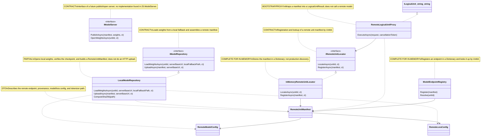

# 25.ModelServer - implementation documentation

Status D3G: parent review passed. Tests, build, and runtime smoke were not run in this documentation subphase.

## 0. Human explanation

`25.ModelServer` currently resembles a dispatch card index for trained logical units: it can take a local `GeneratedCapabilityCheckpointManifest`, verify that the checkpoint file actually exists, compute a SHA256, assemble a `RemoteUnitManifest`, store such a manifest in memory, and return it through a proxy as the result of an `ILogicalUnit<string,string>`. This is useful infrastructure for future distributed model serving, but in the current code it is not a full-fledged model server: there is no HTTP client, no network sending of weights, no remote inference, no fresh-load model check, and no proof of product quality.

The main honest boundary: `LocalModelRepository.UploadAsync` is called `Upload`, but by the current code it builds a local remote-manifest and SHA, rather than sending the weights over the network. `RemoteLogicalUnitProxy.ExecuteAsync` finds a manifest via the locator and returns the original `request.Input` with evidence from the manifest; it does not call a remote model and does not perform runtime inference.

## 1. UML for draw.io



| Class | What it does | Status |
|---|---|---|
| `IModelRepository` | Contract for loading weights and publishing a manifest from a local checkpoint | contract |
| `IModelServer` | Contract for a real server-side publish/open | contract without an implementation in this project |
| `IRemoteUnitLocator` | Lookup/register contract for `RemoteUnitManifest` | contract |
| `LocalModelRepository` | Reads a local weights file and builds a `RemoteUnitManifest` with SHA | partial: local assembly, not network |
| `InMemoryRemoteUnitLocator` | Stores manifests in process memory | implemented in-memory |
| `RemoteLogicalUnitProxy` | Executes `ILogicalUnit<string,string>` via manifest lookup | proxy/bootstrap, not inference |
| `ModelEndpointRegistry` | In-memory endpoint registry | implemented in-memory |
| `RemoteUnitManifest` / configs | DTO for the remote unit, model, and LoRA | implemented records |

### Simulations of the UML connections

| Connection | Example input | What happens | Expected result | What must not be treated as proof |
|---|---|---|---|---|
| `IModelRepository` -> `LocalModelRepository` | `UploadAsync(manifest, "https://models.local")`, where `PolicyCheckpointPath` exists | The manifest, cancellation, server URL, and checkpoint path are checked; the endpoint `/models/{UnitId}` and the checkpoint SHA are built | `OperationResult<RemoteUnitManifest>.Ok(remote)` with `ServerBaseUrl`, `UnitEndpoint`, provenance, and config | You must not say the weights were actually sent to the server |
| `LocalModelRepository` -> `RemoteUnitManifest` | `UnitId="unit-orchestration-plan-v1"`, `TrainingRunId="train-ready-v309"` | Data from the training manifest is transferred into the remote record | The remote manifest contains unit metadata, `RemoteModelConfig`, `RemoteLoraConfig`, tokenizer path, and `RegisteredAtUtc` | This must not be treated as fresh-load, continue-training, or model quality |
| `IRemoteUnitLocator` -> `InMemoryRemoteUnitLocator` | `RegisterAsync(remoteManifest)` then `LocateAsync(unitId)` | The manifest is placed into `_manifests`, then retrieved by `UnitId` | `Ok(true)` on register and `Ok(manifest)` on locate | The in-memory locator does not prove production discovery or a network |
| `RemoteLogicalUnitProxy` -> `IRemoteUnitLocator` | `ExecuteAsync(request)` for a registered `_unitId` | The proxy calls `LocateAsync`, takes the manifest, and builds a `LogicalUnitResult<string>` | Output equals `request.Input`, confidence `1.0`, predicate `REMOTE_UNIT`, evidence `ManifestSha256` | This is not remote inference and not semantic processing of text |
| `ModelEndpointRegistry` -> `RemoteUnitManifest` | `Register(manifest)` with `UnitEndpoint="/models/u1"` | The registry validates UnitId/endpoint and places the manifest into a Dictionary | `Resolve("u1")` returns the same manifest | This is not an HTTP route and not a lifecycle registry beyond the process |
| `RemoteUnitManifest` -> configs | `RemoteModelConfig(2048,96,64,2,4,4,128)` and `RemoteLoraConfig(2,4,0.05,["q_proj"])` | The DTO holds the model shape and LoRA adapter parameters | These fields are available to downstream consumers | The presence of the config does not prove that the model file was loaded and is compatible |

## 2. No-code algorithms in plain language

### Algorithm A: `LocalModelRepository.UploadAsync(GeneratedCapabilityCheckpointManifest manifest, string serverBaseUrl, CancellationToken ct = default)`

Imagine that before shipping a parcel, a warehouse worker checks the waybill and the box itself, weighs it, and prints an address card. Right now `UploadAsync` does exactly this: it checks the input manifest and the local checkpoint, computes the SHA, and prints a remote manifest. There is no courier in this code that actually delivers the file to the server.

**Input:** `GeneratedCapabilityCheckpointManifest` from `18.CapabilityTraining`, `serverBaseUrl`, `CancellationToken`.

**Output:** `Task<OperationResult<RemoteUnitManifest>>`.

**Current steps:**
1. If `manifest == null`, return `MANIFEST_REQUIRED`.
2. If `ct.IsCancellationRequested`, return `MODEL_UPLOAD_CANCELLED`.
3. If `serverBaseUrl` is empty, return `SERVER_URL_REQUIRED`.
4. If `manifest.PolicyCheckpointPath` is empty or the file does not exist, return `POLICY_CHECKPOINT_NOT_FOUND`.
5. Build the endpoint `/models/{Uri.EscapeDataString(manifest.UnitId)}`.
6. Compute `ManifestSha256` by reading the checkpoint file and `SHA256.HashData`.
7. Transfer branch/run/dataset provenance, model config, LoRA config, tokenizer path, and registration time into `RemoteUnitManifest`.
8. Return `Ok(remote)`.

**What the algorithm does not do:** it does not call `IModelServer.PublishAsync`, does not open an HTTP connection, does not copy weights to a server, does not verify that the remote endpoint is actually reachable.

### Algorithm B: `LocalModelRepository.LoadWeightsAsync(string unitId, string? serverBaseUrl, string localFallbackPath, CancellationToken ct = default)`

This is local emergency access to a weights file: if there is a `unitId` and a file path, the method opens a read stream.

**Input:** `unitId`, optional `serverBaseUrl`, `localFallbackPath`, `CancellationToken`.

**Output:** `Task<OperationResult<Stream>>`.

**Current branches:** empty `unitId` -> `UNIT_ID_REQUIRED`; cancellation -> `MODEL_LOAD_CANCELLED`; empty path -> `LOCAL_PATH_REQUIRED`; missing file -> `MODEL_WEIGHTS_NOT_FOUND`; existing file -> `Ok(File.OpenRead(localFallbackPath))`.

**What it does not do:** it does not use `serverBaseUrl` for a network load and does not validate the checkpoint content as a working model.

### Algorithm C: `InMemoryRemoteUnitLocator.RegisterAsync(RemoteUnitManifest manifest, CancellationToken ct = default)`

This is a phone book in the process memory. It accepts a remote unit card and places it under the key `UnitId`.

**Input:** `RemoteUnitManifest`.

**Output:** `Task<OperationResult<bool>>`.

**Current branches:** `manifest == null` -> `MANIFEST_REQUIRED`; cancellation -> `UNIT_REGISTER_CANCELLED`; empty `UnitId` -> `UNIT_ID_REQUIRED`; empty `ServerBaseUrl` or `UnitEndpoint` -> `REMOTE_ENDPOINT_REQUIRED`; valid manifest -> `_manifests[UnitId] = manifest` and `Ok(true)`.

**What it does not do:** it does not save the manifest to disk, does not synchronize the registry between processes, does not check the availability of the remote URL.

### Algorithm D: `InMemoryRemoteUnitLocator.LocateAsync(string unitId, CancellationToken ct = default)`

A lookup in the same phone book: a `unitId` came in, the locator looks in the Dictionary.

**Input:** `unitId`.

**Output:** `Task<OperationResult<RemoteUnitManifest>>`.

**Current branches:** empty `unitId` -> `UNIT_ID_REQUIRED`; cancellation -> `UNIT_LOOKUP_CANCELLED`; key found -> `Ok(manifest)`; key not found -> `REMOTE_UNIT_NOT_FOUND`.

### Algorithm E: `RemoteLogicalUnitProxy.ExecuteAsync(LogicalUnitRequest<string> request, CancellationToken cancellationToken = default)`

This is not a remote model, but a stub-proxy at the `ILogicalUnit` level: it confirms that the unit is registered and returns a result with evidence from the manifest.

**Input:** `LogicalUnitRequest<string>` with `Input`, `RunId`, `UnitId`, flags, and metadata.

**Output:** `Task<OperationResult<LogicalUnitResult<string>>>`.

**Current steps:**
1. If `request == null`, return `REQUEST_REQUIRED`.
2. Call `_locator.LocateAsync(_unitId, cancellationToken)`.
3. If the locator returned an error, propagate `ErrorMessage` and `ErrorCode`.
4. If the manifest is found, create a `LogicalUnitResult<string>`:
   - `UnitId`, `UnitRole`, `DomainTag` are taken from the manifest;
   - `Output` equals `request.Input`;
   - `Confidence` is always `1.0`;
   - `PredicateIds` contains `REMOTE_UNIT`;
   - `EvidenceIds` contains `manifest.ManifestSha256`.
5. Return `Ok(output)`.

**What it does not do:** it does not do remote inference, does not send the prompt to a server, does not apply LoRA/checkpoint, and does not change the input.

### Algorithm F: `ModelEndpointRegistry.Register(RemoteUnitManifest manifest)` and `Resolve(string unitId)`

This is a simple in-memory table of endpoints, not an HTTP router.

**Input:** for `Register` - `RemoteUnitManifest`; for `Resolve` - `unitId`.

**Output:** `OperationResult<bool>` or `OperationResult<RemoteUnitManifest>`.

**Branches:** `Register` blocks `null`, empty `UnitId`, empty `UnitEndpoint`; a successful manifest is placed into `_endpoints`. `Resolve` blocks an empty `unitId`, then returns the found manifest or `ENDPOINT_NOT_FOUND`.

### Algorithm G: contracts and DTO

`IModelRepository`, `IModelServer`, `IRemoteUnitLocator` define the boundaries of the future lifecycle. `RemoteUnitManifest`, `RemoteModelConfig`, `RemoteLoraConfig` describe where a unit is supposedly located, which training run it came from, and which shape/config parameters consumers should know. This is contract data, not runtime proof.

## 3. Short code quotations with exact references

### Repository contract

`25.ModelServer/Contracts/IModelRepository.cs:6-18`

```csharp
public interface IModelRepository
{
    Task<OperationResult<Stream>> LoadWeightsAsync(
        string unitId,
        string? serverBaseUrl,
        string localFallbackPath,
        CancellationToken ct = default);

    Task<OperationResult<RemoteUnitManifest>> UploadAsync(
        GeneratedCapabilityCheckpointManifest manifest,
        string serverBaseUrl,
        CancellationToken ct = default);
}
```

> **Why it matters:** this is the public boundary: loading weights returns a `Stream`, while "upload" returns only a `RemoteUnitManifest`. The contract itself does not prove that a network-publishing implementation exists.

### `UploadAsync` guard branches

`25.ModelServer/Local/LocalModelRepository.cs:32-47`

```csharp
public Task<OperationResult<RemoteUnitManifest>> UploadAsync(
    GeneratedCapabilityCheckpointManifest manifest,
    string serverBaseUrl,
    CancellationToken ct = default)
{
    if (manifest is null)
        return Task.FromResult(OperationResult<RemoteUnitManifest>.Fail("Manifest is required.", "MANIFEST_REQUIRED"));

    if (ct.IsCancellationRequested)
        return Task.FromResult(OperationResult<RemoteUnitManifest>.Fail("Model upload was cancelled.", "MODEL_UPLOAD_CANCELLED"));

    if (string.IsNullOrWhiteSpace(serverBaseUrl))
        return Task.FromResult(OperationResult<RemoteUnitManifest>.Fail("Server base URL is required.", "SERVER_URL_REQUIRED"));

    if (string.IsNullOrWhiteSpace(manifest.PolicyCheckpointPath) || !File.Exists(manifest.PolicyCheckpointPath))
        return Task.FromResult(OperationResult<RemoteUnitManifest>.Fail("Policy checkpoint must exist before upload.", "POLICY_CHECKPOINT_NOT_FOUND"));
```

> **How to read it:** these checks protect against an empty manifest, cancellation, an empty URL, and a missing checkpoint. The last branch is important: the checkpoint file must exist before the manifest is published. But this is still a local file check, not loading the model at runtime.

### Assembling `RemoteUnitManifest` and the SHA

`25.ModelServer/Local/LocalModelRepository.cs:49-77`

```csharp
var endpoint = $"/models/{Uri.EscapeDataString(manifest.UnitId)}";
var remote = new RemoteUnitManifest(
    manifest.UnitId,
    manifest.UnitRole,
    manifest.DomainTag,
    manifest.Version,
    serverBaseUrl.TrimEnd('/'),
    endpoint,
    ComputeSha256(manifest.PolicyCheckpointPath),
    manifest.TrainingBranch ?? "",
    manifest.TrainingRunId ?? "",
    manifest.SourceDatasetSha256 ?? "",
    new RemoteModelConfig(
        manifest.VocabSize,
        manifest.ContextLen,
        manifest.HiddenDim,
        manifest.NumLayers,
        manifest.NumHeads,
        manifest.NumKvHeads,
        manifest.FfnHiddenDim),
    new RemoteLoraConfig(
        manifest.LoraRank,
        manifest.LoraAlpha,
        manifest.LoraDropout,
        manifest.LoraTargetModules),
    manifest.TokenizerPath,
    DateTimeOffset.UtcNow);

return Task.FromResult(OperationResult<RemoteUnitManifest>.Ok(remote));
```

> **What it proves:** the manifest gets the endpoint, checkpoint SHA, training branch/run/dataset, model config, LoRA config, and tokenizer path. **What it does not prove:** that `/models/...` exists on the server, that the weights were uploaded there, that the checkpoint can be fresh-loaded or training continued.

### In-memory locator

`25.ModelServer/Remote/InMemoryRemoteUnitLocator.cs:10-22`

```csharp
public Task<OperationResult<RemoteUnitManifest>> LocateAsync(
    string unitId,
    CancellationToken ct = default)
{
    if (string.IsNullOrWhiteSpace(unitId))
        return Task.FromResult(OperationResult<RemoteUnitManifest>.Fail("Unit id is required.", "UNIT_ID_REQUIRED"));

    if (ct.IsCancellationRequested)
        return Task.FromResult(OperationResult<RemoteUnitManifest>.Fail("Unit lookup was cancelled.", "UNIT_LOOKUP_CANCELLED"));

    return _manifests.TryGetValue(unitId, out var manifest)
        ? Task.FromResult(OperationResult<RemoteUnitManifest>.Ok(manifest))
        : Task.FromResult(OperationResult<RemoteUnitManifest>.Fail($"Remote unit not registered: {unitId}", "REMOTE_UNIT_NOT_FOUND"));
}
```

> **Why it matters:** the lookup has honest error branches. This proves controlled behavior of the in-memory registry, but not production discovery.

`25.ModelServer/Remote/InMemoryRemoteUnitLocator.cs:25-42`

```csharp
public Task<OperationResult<bool>> RegisterAsync(
    RemoteUnitManifest manifest,
    CancellationToken ct = default)
{
    if (manifest is null)
        return Task.FromResult(OperationResult<bool>.Fail("Remote unit manifest is required.", "MANIFEST_REQUIRED"));

    if (ct.IsCancellationRequested)
        return Task.FromResult(OperationResult<bool>.Fail("Unit registration was cancelled.", "UNIT_REGISTER_CANCELLED"));

    if (string.IsNullOrWhiteSpace(manifest.UnitId))
        return Task.FromResult(OperationResult<bool>.Fail("Unit id is required.", "UNIT_ID_REQUIRED"));

    if (string.IsNullOrWhiteSpace(manifest.ServerBaseUrl) || string.IsNullOrWhiteSpace(manifest.UnitEndpoint))
        return Task.FromResult(OperationResult<bool>.Fail("Server URL and endpoint are required.", "REMOTE_ENDPOINT_REQUIRED"));

    _manifests[manifest.UnitId] = manifest;
    return Task.FromResult(OperationResult<bool>.Ok(true));
}
```

> **How it works:** registration validates the minimal remote address and places the manifest into a Dictionary. After the process ends, this data will be gone.

### Proxy as `ILogicalUnit<string,string>`

`25.ModelServer/Remote/RemoteLogicalUnitProxy.cs:7-20`

```csharp
public sealed class RemoteLogicalUnitProxy : ILogicalUnit<string, string>
{
    private readonly string _unitId;
    private readonly IRemoteUnitLocator _locator;

    public RemoteLogicalUnitProxy(string unitId, IRemoteUnitLocator locator)
    {
        _unitId = unitId;
        _locator = locator;
    }

    public async Task<OperationResult<LogicalUnitResult<string>>> ExecuteAsync(
        LogicalUnitRequest<string> request,
        CancellationToken cancellationToken = default)
```

> **Why it matters:** this is a real connection to the hierarchy: the proxy implements `ILogicalUnit<string,string>`. But the wrapper type does not make it an `ILearningMachine` and does not add training.

`25.ModelServer/Remote/RemoteLogicalUnitProxy.cs:22-41`

```csharp
if (request is null)
    return OperationResult<LogicalUnitResult<string>>.Fail("Logical unit request is required.", "REQUEST_REQUIRED");

var located = await _locator.LocateAsync(_unitId, cancellationToken);
if (!located.IsSuccess)
    return OperationResult<LogicalUnitResult<string>>.Fail(located.ErrorMessage, located.ErrorCode);

var manifest = located.Value!;
var output = new LogicalUnitResult<string>(
    manifest.UnitId,
    manifest.UnitRole,
    manifest.DomainTag,
    request.Input,
    1.0,
    ["REMOTE_UNIT"],
    [manifest.DomainTag],
    [manifest.ManifestSha256],
    []);

return OperationResult<LogicalUnitResult<string>>.Ok(output);
```

> **What it proves:** if the locator found the manifest, the proxy returns a logical result with provenance evidence. **What it does not prove:** remote inference. `request.Input` becomes `Output` without calling a model.

### Endpoint registry

`25.ModelServer/Http/ModelEndpointRegistry.cs:10-22`

```csharp
public OperationResult<bool> Register(RemoteUnitManifest manifest)
{
    if (manifest is null)
        return OperationResult<bool>.Fail("Remote unit manifest is required.", "MANIFEST_REQUIRED");

    if (string.IsNullOrWhiteSpace(manifest.UnitId))
        return OperationResult<bool>.Fail("Unit id is required.", "UNIT_ID_REQUIRED");

    if (string.IsNullOrWhiteSpace(manifest.UnitEndpoint))
        return OperationResult<bool>.Fail("Unit endpoint is required.", "UNIT_ENDPOINT_REQUIRED");

    _endpoints[manifest.UnitId] = manifest;
    return OperationResult<bool>.Ok(true);
}
```

`25.ModelServer/Http/ModelEndpointRegistry.cs:25-33`

```csharp
public OperationResult<RemoteUnitManifest> Resolve(string unitId)
{
    if (string.IsNullOrWhiteSpace(unitId))
        return OperationResult<RemoteUnitManifest>.Fail("Unit id is required.", "UNIT_ID_REQUIRED");

    return _endpoints.TryGetValue(unitId, out var manifest)
        ? OperationResult<RemoteUnitManifest>.Ok(manifest)
        : OperationResult<RemoteUnitManifest>.Fail($"Endpoint not registered: {unitId}", "ENDPOINT_NOT_FOUND");
}
```

> **How to read it:** the registry repeats the lookup/register pattern, but synchronously and without cancellation. This is a local table of endpoints, not web server routing.

### Remote manifest DTO

`25.ModelServer/Remote/RemoteUnitManifest.cs:3-17`

```csharp
public sealed record RemoteUnitManifest(
    string UnitId,
    string UnitRole,
    string DomainTag,
    string Version,
    string ServerBaseUrl,
    string UnitEndpoint,
    string ManifestSha256,
    string TrainingBranch,
    string TrainingRunId,
    string SourceDatasetSha256,
    RemoteModelConfig ModelConfig,
    RemoteLoraConfig LoraConfig,
    string TokenizerPath,
    DateTimeOffset RegisteredAtUtc);
```

> **Why it matters:** the DTO holds locator/provenance/config fields that a model lifecycle needs. But the DTO by itself is not a manifest file, does not open a checkpoint, and does not confirm runtime model quality.

## 4. `ILogicalUnit` hierarchy

`RemoteLogicalUnitProxy` participates only at the `ILogicalUnit<string,string>` level.

```text
Level 2: ILogicalUnit<string,string>
  Accepts: LogicalUnitRequest<string>(RunId, UnitId, UnitRole, DomainTag, Input, Flags, Metadata)
  Returns: LogicalUnitResult<string>(UnitId, UnitRole, DomainTag, Output, Confidence, PredicateIds, DomainTags, EvidenceIds, Metrics)
  Role: a proxy wrapper that turns a found RemoteUnitManifest into a LogicalUnitResult.
```

What is missing in `25.ModelServer`: there is no `ILearningMachine`, no `ILogicalOrchestrator`, no `ILogicalFlow`, no `ILearningMachinePair`, no train/export/import lifecycle inside this project. Training stays at the boundaries of neighboring projects like `18.CapabilityTraining`; `25.ModelServer` only helps describe and find a published unit.

## 5. QA / test mapping

The tests were read for mapping, but not run in this documentation subphase.

| Test | What it checks | What it does not prove |
|---|---|---|
| `Tests/DistributedModelArchitectureTests.cs:14-50` `LocalModelRepository_UploadBuildsRemoteManifestWithTrainingProvenance` | Creates a temp checkpoint/tokenizer, calls `UploadAsync`, checks `UnitId`, `ServerBaseUrl`, `UnitEndpoint`, branch/run/dataset provenance, and a non-empty SHA | Does not prove a network upload, remote endpoint availability, fresh-load checkpoint, or model quality |
| `Tests/DistributedModelArchitectureTests.cs:52-92` `RemoteUnitLocator_RegistersManifestAndProxyExecutesThroughLogicalUnitContract` | Registers a `RemoteUnitManifest`, executes `RemoteLogicalUnitProxy`, checks `Output == request.Input`, predicate `REMOTE_UNIT`, evidence `ABC123` | Does not prove remote inference, model execution, or semantic processing |
| `Tests/ProjectWikiDomainTests.cs:587-617` query-planning publisher | Uses `InMemoryRemoteUnitLocator` in the project wiki publication path and checks that the published endpoint can be located | Does not prove a production locator, remote server, or overall asset lifecycle completeness |
| `Tests/ProjectWikiDomainTests.cs:740-769` answer-composer publisher | Similarly checks publication of the answer-composer manifest and endpoint lookup | Does not prove runtime serving and does not replace a fresh-load/continue-training probe |

## 6. Anti-false-done and honest boundaries

- `RemoteUnitManifest` and the locator entry are useful asset/provenance records, but not a full model lifecycle.
- `InMemoryRemoteUnitLocator` is a test/in-process implementation, not production remote server evidence.
- `LocalModelRepository.UploadAsync` computes a SHA and builds a remote manifest, but in the current code does not do an HTTP/network upload.
- `RemoteLogicalUnitProxy.ExecuteAsync` returns a `LogicalUnitResult<string>` with the same text that came in the input; this is not remote model inference.
- Checkpoint existence and SHA are useful for file integrity, but by themselves do not prove fresh-load, continue-training, runtime inference, or product quality.
- The JSON/report/static presence of a manifest must not be taken as proof of a trained product model.
- `25.ModelServer` is not a Level 5 `ILearningMachine`; it is an infrastructure layer of locator/repository/proxy.

## 7. Implementation status

| Component | File | Status | What actually works now |
|---|---|---|---|
| `IModelRepository` | `25.ModelServer/Contracts/IModelRepository.cs` | contract | Declares `LoadWeightsAsync` and `UploadAsync` |
| `IModelServer` | `25.ModelServer/Contracts/IModelServer.cs` | contract skeleton | Declares `PublishAsync` and `OpenWeightsAsync`; no implementation found in 25.ModelServer |
| `IRemoteUnitLocator` | `25.ModelServer/Contracts/IRemoteUnitLocator.cs` | contract | Declares `LocateAsync` and `RegisterAsync` |
| `LocalModelRepository` | `25.ModelServer/Local/LocalModelRepository.cs` | partial | Opens a local fallback stream; builds a remote manifest and SHA; does not send weights over the network |
| `InMemoryRemoteUnitLocator` | `25.ModelServer/Remote/InMemoryRemoteUnitLocator.cs` | complete for in-memory | Validates and stores manifests in a Dictionary, returns not-found/cancel/required errors |
| `RemoteLogicalUnitProxy` | `25.ModelServer/Remote/RemoteLogicalUnitProxy.cs` | bootstrap/proxy | Looks up the manifest and returns a `LogicalUnitResult<string>`; output equals input, confidence always `1.0` |
| `ModelEndpointRegistry` | `25.ModelServer/Http/ModelEndpointRegistry.cs` | complete for in-memory | Registers/resolves an endpoint in a Dictionary |
| `RemoteUnitManifest`, `RemoteModelConfig`, `RemoteLoraConfig` | `25.ModelServer/Remote/RemoteUnitManifest.cs` | DTOs implemented | Hold endpoint/provenance/model/LoRA/tokenizer fields |
