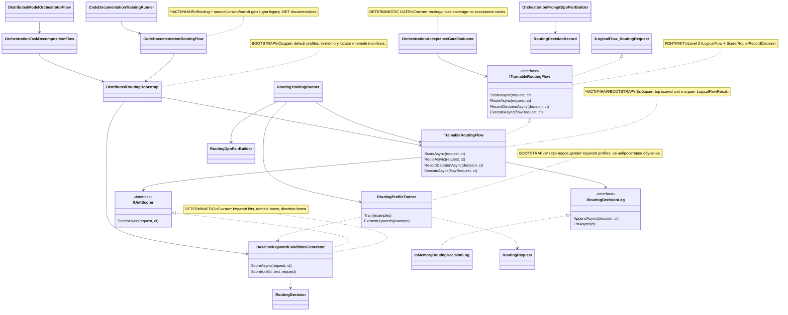

# 26.TrainableRouter - документация реализации

### RP01.03A на 2026-10-15: raw sealed DPO → существующий update → science HOLD → publish-only

`CodeDocumentationRawDpoTrainingComposition.CreateRequest` выполняет настоящий строгий `CodeDocumentationRawDpoLessonAuthoring.Reopen`, копирует canonical manifest receipt и точные rich пары. Live CLI-команды `train-and-hold` и `publish-held` описаны в [README](../../tools/Rp01RawDpoLesson/README.md). Они требуют отдельно допущенного J, существующего initial-B0 server startup и нового заранее закреплённого scientific policy. Старый raw `train-existing` теперь отказывает: native noise-floor gate не является научным разрешением adoption. Legacy completed-routing с null marker сохраняет прежний маршрут.

Optional init property `RoutingDisposition` на local/wire request передаёт `NOT_PERFORMED`: raw reopen не является выполненным routing-run. Общий validator клиента и endpoint отклоняет неизвестный marker, любые routing observations/resources/cases/routing pairs, иной source enum и несогласованную rich pair identity. Endpoint повторно связывает receipt с действительным raw-v2 request identity на диске; прежние current-manifest и full pair reopen проверки сохраняются. При `null` marker JSON-поле не пишется, позиционные конструкторы и legacy routing wire остаются прежними.

Существующий coordinator выполняет единственные C0 и optimizer update, сохраняет Trial и выполняет существующие Trial repeats. Новый scientific intent записывается до C0/optimizer вне canonical model tree; полный held bundle сохраняет обе quality graphs и native positive/negative disposition. Ни один ordinary/direct resume run ID с этим intent, даже неполным, не может автоматически публиковать Trial. Проверка actual raw manifest также запрещает обход через пропущенный marker. Новый trainer, objective, masks, optimizer math, LoRA algorithm, lease или no-repeat journal не вводятся.

Publish-only проходит существующий recovery prefix: baseline binding, optimizer sidecar/state, RNG, sealed Trial, runtime identity. До прежней re-evaluation ветки он чисто проверяет сохранённые graphs, все private raw answers и настоящий hash-pinned независимый verdict с pre-T1 criteria. Двенадцать binary source families должны дать целый прирост ≥2 correct, Trial/new critical=0; пять repeats не становятся независимыми семьями. Native improvement остаётся обязательным. Missing/negative/drifted verdict, parent или source не публикует. Только прежний canonical publisher получает **те же** сохранённые Trial weights; нового optimizer, calibration, Teacher/Student generation и pair replay в этой ветке нет. HELD response не имитирует publication receipt.

Новые typed HTTP client methods явно используют caller cancellation и host lifetime без deadline; legacy transport сохраняет maximum 24 часа и отказ Infinite. Policy/held/verdict hashes выбирает server startup, не client JSON. Полные source/schema/privacy/startup selectors описаны в CLI README. Отказ/cancel после отправки означает неизвестный effect до journal reconciliation без автоматического retry. Синтетические проверки механизма не являются настоящим T1, научным gain или cold adoption; полный RP01 остаётся открытым.

Коррекция `RP01.03A-REVIEW-01`: первый raw T1 требует отдельного server startup выбора `ROOT_B0_FIRST_UPDATE`, настоящей причины optimizer update и точного canonical B0 manifest SHA (имена публичных selectors — в CLI README). Без выбора или с неверной причиной endpoint отказывает до assessment/C0. Новый owner в25 переиспользует проверенные `generation-v1` options: exact модель/tokenizer/runtime/LoRA/seed сверяются с admitted ContinuousLearning context, strict latest-compatible loader подтверждает точный root Step1 `InitialBaselineNoUpdate`. Для actual B0 используются его dropout0 и seed/streams; общий default0.05 не меняется, дополнительный RNG grant не создаётся. Existing optimizer authorization с auditable reason передаётся в прежний publication request; model-cold-start permission не переиспользуется. Descendant/continuation остаётся отказом до C0, а не сбросом optimizer. Один тот же synthetic Fact расширен для этой границы; эти метаданные и тест не являются реальным T1.

### RP01: выбранный raw C# TRAIN source → пара от допущенного учителя

`CodeDocumentationRawDpoLessonSource.Open(trustedRoot, intakePath, intakeSha256)` — производственный вход для одного уже выбранного оригинального синтетического C#12 TRAIN-урока. Он сверяет закреплённый платформенный S handoff, только три соседних selected copies, их UTF8/хеши, отдельную текущую инструкцию оператора об authoring/retention и локальный файл Apache license. DEV/SEALED, неизвестное происхождение и несовпавший source/config отказываются до teacher factory. Вход основан на доверии к оператору и внешнему SHA256, не выдаёт metadata за независимую сертификацию прав или Native receipt. Исходные строки захватываются без caller alias; drift файлов запрещает последующий вызов.

`CodeDocumentationRawDpoLessonAuthoring` использует существующие production context/client, одноразовый permit, provenance validator, repository resolver и rich pair v5 sealer. Teacher получает полный JSON `raw_task` и соблюдает запрошенный язык ответа; китайское происхождение модели подтверждается паспортом, не CJK-символами. `Pair.Prompt` сохраняет именно raw owner input, совместимый с обычным `CodeDocumentationStudentGeneration` и `CodeDocumentationGenerationService.Generate`. В decoded `chosen`/`rejected` не применяется Trim, нормализация Unicode/переводов строк или `[WRONG:]` append. Механический gate проверяет только строгий bounded UTF8, непустые/не-whitespace строки и точное Ordinal-неравенство. Он сохраняет различия операторов, регистра и Unicode form; смысловой контраст, косметика и TIE принадлежат отдельному J.

Версия request identity raw-v2 честно хранит полный source/selection preimage без фиктивного paid reference. Legacy routing authoring со своим `Prompt/Task slice/Candidate units` и `[WRONG:]` остаётся прежним. Новый adapter не меняет обучение, objective, response-only masks, LoRA, journal, checkpoint либо decoder.

Вызов и обязательная схема оператора: [tools/Rp01RawDpoLesson](../../tools/Rp01RawDpoLesson/README.md). `inspect` проверяет настоящий intake без client factory; `author` допускает один локальный Chinese BOTH вызов только при clean miss; `reopen` строго читает сохранённые байты без factory. Corrupt/conflict не вызывает повторного authoring. CPU/manual профиль проверяется до вызова и по ответу; реальный client сохраняет существующие native token/manifest/layer/loopback проверки и caller cancellation. Команды `author`/`reopen` возвращают точный pair path и хеши для отдельного J без optimizer/training/adoption; effect-bearing `train-existing` описан выше. Ни запись пары, ни synthetic stub test не доказывают Chinese model invocation, judge acceptance или улучшение Student.

RP01.01C: новый `CodeDocumentationGenerationService` принимает server-owned `CodeDocumentationGenerationOptions(StartRequest, Tokenizer, Settings)`, отделяет tokenizer bytes/settings и использует существующий `PrepareStart`. Каждый ordinary request cold-loads actual latest-compatible sealed state; tokenizer hash обязан совпасть с runtime compatibility. Результат обозначен `repository_published_checkpoint` с actual manifest/weights SHA и step, без научного accepted/selected утверждения. Clean missing допускается только через явно переданный cold grant с честным initial-state source kind. Corrupt/incompatible/unavailable source сохраняет typed lower refusal без fresh fallback. Cross-request cache и promotion не добавляются; RoutingFlow остаётся routing/stages. Scientific utility и post-verdict adoption `NOT_MEASURED`.

Standalone `Main` теперь получает эти же options от отдельного server-owned bootstrap25: fixed config/tokenizer paths под host trusted root, explicit env opt-in + exact config SHA, read-only custody/stable bytes, strict required schema и canonical tokenizer proof. Bootstrap вызывает только pure `START.ValidateRequest`, не `PrepareStart` и не constructor модели; actual saved source остаётся обязанностью неизменённого wrapper26 при запросе. Artifact route всегда cold denied, configuration failures типизированы до service registration; existing typed embedding с явной authority сохранён. Training switch, научная selected pointer и новый process provenance не выводятся из config.

### RP01.01B/D на 2026-10-14: ordinary warm same-run recovery

Ordinary `TrainAndPublishAsync` восстанавливает сохранённый unpublished Trial T2 отдельно от его canonical source S1. В `ResumeQualityDecisionFromExistingAttemptAsync` invocation-local проверка до чтения T повторно открывает полный accepted parent, DPO manifest/single pair, paired optimizer/RNG S и существующий closed continuation proof. Проверка включает фактическое равенство source policy bytes принятому parent. Отсутствующий обязательный S либо изменённый источник возвращает `TrainingAttemptRecoveryRequiredErrorCode`; cold authorization не подменяет warm source.

Только успешная независимая проверка S позволяет не сравнивать RNG разных шагов S1/T2. Сохранённый T продолжает проходить прежние baseline/pair/parent, v5 profile, optimizer/runtime, RNG hash/length/step/topology/configuration и trial policy checks. Исходный detached S остаётся входом повторной проверки после quality evaluation await и непосредственно перед resumed publication. Same-run recovery выполняет оценку и публикацию T без нового trainer Step или training lease; prepared recovery и root caller-state equality сохраняют прежние проверки.

Один existing exact-profile Fact использует tiny synthetic LoRA state: реальный update S1→T2, publisher refusal, missing-S отказ до дополнительных trainer/lease/evaluator calls и последующее same-run восстановление с сохранёнными optimizer/RNG bytes T2. Это инженерная проверка lifecycle, не научная оценка качества. HTTP endpoint25 сейчас не передаёт source attempt/optimizer/RNG fields; готовность его warm recovery этим изменением не заявляется. Linux runtime, concurrency, crash/power-loss и изменение S во время await не проверялись; Student/learning gain `NOT_MEASURED`, Astra `NOT_PERFORMED`.

### RP01.01B/D на 2026-10-14: отказ повторной пары после неизвестного результата

Новый `TrainingRunId` больше не обходит durable резервирование той же запечатанной пары в соседней попытке модели/версии. Coordinator после прежней проверки опубликованной истории и ветки восстановления текущего запуска вызывает существующий baseline journal перед новым baseline. Тот атрибутирует sibling через canonical address, полный claim и bounded stable baseline readback; partial/corrupt/unknown sibling закрывает маршрут с существующим `TrainingAttemptRecoveryRequiredErrorCode`.

После legal lease server executor повторяет discovery под общим `attempts/.dpo-update.lock` этой версии модели. Lock охватывает проверку соседей, attempt claim и durable baseline write/readback, затем освобождается перед существующим trainer. Другой запуск не получает разрешение из отсутствия своего собственного каталога. Same-run resume остаётся без второго Step; чужой запуск не становится автоматически текущим. Это ограниченная инженерная защита резервирования; измерение learning gain, наблюдение конкурентных процессов и полный crash/power-loss lifecycle этим срезом не заявлены (`NOT_MEASURED`; Astra `NOT_PERFORMED`).

Для v1/v2 sibling journal сохранённые PairId/path/SHA являются ожиданиями. Они сравниваются с read-only raw identity projection существующего DPO sealer: фактический strict manifest/selfhash → canonical OrderedPairs row/path → stable raw pair bytes/SHA. Проекция не гидратирует и не допускает `DpoPair` для нового обучения, не вызывает pair-store mutation, custody preparation или нормализацию прав. Linux owner modes проверяются до/после и при небезопасных modes маршрут отказывается. Windows boundary остаётся прежней stable path/handle/reparse проверкой; новая ACL-защита исторических pair-файлов и Linux runtime не заявлены. Strict custody нового reservation lock сохранена. Изменение находится в существующих journal/sealer/coordinator/executor, одном existing exact-profile Fact и этих двух документах.

### RP01.01B/B-C на 2026-10-14: source-bound exact continuation

`ResolveOptimizerAndRandomStateBeforePrepareStart` открывает canonical source attempt и v5 optimizer manifest до START. Помимо прежних lineage/address/step/hash/RNG checks требуется exact tuple и actual allowed map; manifest owner выдаёт закрытый proof для прочитанных optimizer/RNG bytes. Raw state без source attempt и прежний root-parent route, доверявший только format/step, не допускают exact continuation. Old v2/v3/v4 state manifest не получает совместимость из версии метрики. Начальный cold route по-прежнему требует явной authorization; ошибки не переключают исполнение на fresh optimizer.

Proof переносится через существующий request → server executor → Stable → Logical → `DpoTrainer`; loader повторно связывает источник перед подготовкой/restore. Производитель profile — фактически проверенный constrained trainer, потребитель — существующий manifest writer и subsequent loader. Дополнительный trainer, rollback или журнал не создаётся. Existing same-run recovery остаётся evaluation/publication-only; опубликованный replay отказывается до нового trainer Step.

Минимальный synthetic integration пишет реальный v5 source, читает moments/RNG из диска и делает следующий update с согласованным global step; wrong/old/missing profile и raw state проверяются до logical execution. Это не подтверждает subject learning, полное crash/power-loss recovery или ordinary generation/adoption RP01.01C: Student `NOT_MEASURED`, Astra `NOT_PERFORMED`.

Статус WL-01C на 2026-07-27: `26.TrainableRouter` успешно собран в Debug и Release; focused filter для `DistributedModelArchitectureTests`, `TrainableRouterOrchestrationTests` и `CodeDocumentationRoutingFlowTests` прошел 39/39 в каждой конфигурации. Полный test suite, runtime smoke, runtime neural inference и product-quality evaluation не запускались и этим статусом не заявляются.

Статус CodeDocumentation repository-owned checkpoint START на 2026-09-06:
добавлен узкий startup-boundary `CodeDocumentationRepositoryOwnedModelCheckpointStartService`
для `TransformerModel.LlmModel`. Он не тренирует, не публикует и не меняет CLI:
он только валидирует канонический repository-owned model target, открывает
последний совместимый sealed checkpoint из `training-artifacts/models`, проверяет
payload как full `LlmModel` checkpoint для заданного `ModelConfig`, создает
свежий `LlmModel` и вызывает `LoadCheckpoint` перед возвратом. Чистое отсутствие
checkpoint допускает cold start только через явный `RepositoryOwnedIncrementalTrainingColdStartPolicy.Authorize(...)`
с непустой человеческой причиной. Incompatible/corrupt/ambiguous checkpoint не
переходит в cold start и остается fail-closed.

Статус CodeDocumentation repository-owned checkpoint PUBLICATION на 2026-09-06:
добавлен узкий save-boundary `CodeDocumentationRepositoryOwnedModelCheckpointPublicationService`.
Он принимает тот же START-request, результат START, identity уже sealed DPO
dataset, UTC-время и provenance refs. Если START был продолжением, сервис
публикует ровно следующий checkpoint step: `parent.Step + 1`. Если START был
явным разрешённым холодным стартом, сервис публикует только step `000001` и
только с той же человеческой причиной, которая была в cold-start policy. Модель
сама пишет полный checkpoint через `LlmModel.SaveCheckpointToStream`; общий
`RepositoryOwnedModelCheckpointManifestSealer.PersistAndSeal` кладёт bytes в
`training-artifacts/models/.../weights.bin` и manifest рядом. После записи
service сразу вызывает `OpenSealed` и сравнивает manifest hash, weights hash и
длину bytes. Это важно для правила Лубы: обученные веса остаются в репозитории,
следующий запуск читает их с диска и дообучает, а не начинает заново. Граница
не запускает реальное обучение, не вызывает Qwen, не создаёт DPO пары и не
подключает CLI/runner; она только безопасно публикует уже изменённую модель.
Если lineage повреждена, DPO больше не открывается или следующий номер шага не
помещается в `Int32`, сервис отказывает до принятого manifest и не оставляет
собственные staging-файлы.

Комментарий-дополнение на 2026-09-06: поведение START-сервиса не изменено,
добавлена документация прямо на code boundary. Комментарии объясняют, зачем
проверяется canonical repository address до чтения байтов, почему full
`LlmModel` checkpoint валидируется до создания fresh model, как exact saved
weights попадают через `LoadCheckpoint`, где проходит явный clean-absence
cold-start с human reason, и почему corrupt/incompatible checkpoint не имеет
тихого перехода к пустой модели. Тесты тоже прокомментированы: Arrange/Act/Assert
и fixture helpers теперь показывают, какую product-инварианту ловит каждая
ветка.

## 0. Краткая карта для Лубы

`26.TrainableRouter` сейчас маршрутизирует запросы между specialist unit-ами: orchestration, translation и documentation. Входом служит `RoutingRequest` или специализированные запросы вроде `CodeDocumentationRequest`; выходом становится выбранный `ChosenUnitId`, ranked candidates, confidence, manifest из `25.ModelServer` и иногда `LogicalFlowResult`.

Честная граница: слово `Trainable` здесь не означает полноценную обученную нейросетевую семантическую модель. Основная текущая "обучаемость" - это `RoutingProfileTrainer`, который извлекает ключевые слова из примеров и строит `UnitScoringProfile`, а `BaselineKeywordCandidateGenerator` потом считает совпадения ключевых слов, domain boost и direction boost. Это полезная bootstrap/profile routing infrastructure, но не доказательство trained semantic router без checkpoint, fresh-load, runtime model evidence и независимой продуктовой оценки.

Проект также содержит orchestration acceptance gates, DPO pair builders, code-documentation routing flow и runners, которые измеряют deterministic/profile routing и gate metrics. JSONL, отчеты, acceptance gate и DPO pairs не заменяют реальное доказательство качества runtime-модели.

Важно по именам DTO: в work order упомянуты `CandidateUnit` и `ScoredUnit`, но в текущем source таких record/class нет. Реальные формы сейчас: список кандидатов хранится как `RoutingRequest.CandidateUnitIds`, а scored candidate представлен record `UnitScoringResult`.

Граница routing authority теперь явная: `BaselineKeywordCandidateGenerator` помечает каждый известный и неизвестный scored candidate значением `routing_authority_role=baseline_candidate_generator`. `TrainableRoutingFlow` fail-closed отклоняет пустую или любую другую роль с кодом `ROUTING_SCORER_AUTHORITY_ROLE_INVALID`, а принятую baseline-роль переносит в `RoutingDecision`, downstream DTO и `LogicalFlowResult.Metrics`. Поэтому фиксированная keyword-формула остается только генератором baseline candidates и не может выдать себя за trained routing authority.

## 1. UML для draw.io



| Узел | Что делает | Статус | Где живет |
|---|---|---|---|
| `ITrainableRoutingFlow` | Контракт routing flow поверх `ILogicalFlow<RoutingRequest>` | контракт | `26.TrainableRouter/Contracts/ITrainableRoutingFlow.cs` |
| `RoutingProfileTrainer` | Делает keyword profile из training examples | bootstrap/profile trainer | `26.TrainableRouter/Training/RoutingProfileTrainer.cs` |
| `BaselineKeywordCandidateGenerator` | Детерминированно ранжирует candidates по keywords/domain/direction | deterministic scorer | `26.TrainableRouter/Training/BaselineKeywordCandidateGenerator.cs` |
| `TrainableRoutingFlow` | Делегирует scorer, выбирает top candidate, строит `LogicalFlowResult` | partial/bootstrap flow | `26.TrainableRouter/Training/TrainableRoutingFlow.cs` |
| `RoutingTrainingRunner` | Обучает profiles, оценивает held-out examples, строит DPO pairs | profile evaluation runner | `26.TrainableRouter/Training/RoutingTrainingRunner.cs` |
| `DistributedRoutingBootstrap` | Строит runtime с in-memory locator и manifests | bootstrap | `26.TrainableRouter/Training/DistributedRoutingBootstrap.cs` |
| `CodeDocumentationRoutingFlow` | Маршрутизирует code documentation и проверяет gates | deterministic/profile flow | `26.TrainableRouter/Training/CodeDocumentationRoutingFlow.cs` |
| `CodeDocumentationRepositoryOwnedModelCheckpointStartService` | START boundary для `TransformerModel.LlmModel`: load latest compatible sealed checkpoint или explicit cold start | repository-owned checkpoint startup, no training/publish | `26.TrainableRouter/Training/CodeDocumentationRepositoryOwnedModelCheckpointStartService.cs` |
| `CodeDocumentationRepositoryOwnedModelCheckpointPublicationService` | PUBLICATION boundary для `TransformerModel.LlmModel`: сохранить полный checkpoint как следующий repository-owned step и сразу открыть обратно | repository-owned checkpoint publication, no training/Qwen/CLI wiring | `26.TrainableRouter/Training/CodeDocumentationRepositoryOwnedModelCheckpointPublicationService.cs` |
| `OrchestrationAcceptanceGateEvaluator` | Считает acceptance routing/phase coverage | deterministic gate | `26.TrainableRouter/Training/OrchestrationAcceptanceGateEvaluator.cs` |

### Симуляции соединений UML

| Связь | Пример входа | Что происходит | Ожидаемый результат | Что нельзя принять за доказательство |
|---|---|---|---|---|
| `RoutingProfileTrainer -> BaselineKeywordCandidateGenerator` | 50 examples, где chosen `unit-dotnet-legacy-doc-l1` и текст содержит `legacy dotnet documentation` | Trainer извлекает tokens, строит `UnitScoringProfile`; scorer использует эти keywords | Documentation unit получает score выше при совпадении слов и `DomainHint="documentation"` | Это не нейросетевое semantic learning |
| `TrainableRoutingFlow -> IUnitScorer` | `RoutingRequest("route-001", "...legacy C# MVC...", "legacy C# MVC documentation", null, "documentation", candidates, {})` | Flow вызывает `ScoreAsync`, сортировка уже сделана scorer-ом | Top candidate становится `RoutingDecision.ChosenUnitId` | Top score не доказывает product-quality router |
| `TrainableRoutingFlow -> IRoutingDecisionLog` | `RecordDecisionAsync(decision)` | Flow делегирует append в log | In-memory log хранит record до конца процесса | Log record не равен model training evidence |
| `RoutingTrainingRunner -> RoutingDpoPairBuilder` | evaluation decisions с rejected candidates | Runner строит `RoutingDecisionRecord`; builder берет лучший rejected и добавляет `[WRONG: ...]` | Массив `RoutingDpoPair[]` для DPO-style contrast | DPO pair file не доказывает, что DPO training выполнено |
| `DistributedRoutingBootstrap -> 25.ModelServer locator` | default server URL `https://models.local` | Bootstrap регистрирует remote manifests в `InMemoryRemoteUnitLocator` | `RouteAndLocateAsync` возвращает decision + manifest | In-memory manifest не доказывает remote model inference |
| `CodeDocumentationRoutingFlow -> DistributedRoutingBootstrap` | `CodeDocumentationRequest` с net46/AuthController/D3 | Flow строит routing request, получает chosen manifest, считает source/version/transit gates | `DOCUMENTATION_ROUTE_READY` или `DOCUMENTATION_ROUTE_REVIEW_REQUIRED` | Gate pass не равен пользовательскому качеству документации |
| `DistributedModelOrchestratorFlow -> OrchestrationTaskDecompositionFlow` | prompt про Figma/system orchestration | Если chosen unit = V309 orchestration, запускается phase decomposition | `ORCHESTRATION_MODEL_SELECTED_AND_DECOMPOSED` с phase tags | Phase rules не являются обученной моделью планирования |

## 2. Алгоритмы без кода

### Алгоритм A: базовый контракт routing flow

| Поле | Значение |
|---|---|
| Класс/интерфейс | `ITrainableRoutingFlow` |
| Метод | `ScoreAsync(RoutingRequest request, CancellationToken ct)`, `RouteAsync(...)`, `RecordDecisionAsync(...)`, `ExecuteAsync(LogicalFlowRequest<RoutingRequest> request, ...)` |
| Файл | `26.TrainableRouter/Contracts/ITrainableRoutingFlow.cs:6-19` |
| Вход | `RoutingRequest(RequestId, OriginalPrompt, TaskSlice, RequiredDirection, DomainHint, CandidateUnitIds, Context)` |
| Выход | `UnitScoringResult[]`, `RoutingDecision`, `OperationResult<bool>`, `LogicalFlowResult` |
| Статус | контракт + реализован bootstrap flow |

Как диспетчер в call center, контракт говорит: сначала оцени candidates, потом выбери один, потом при необходимости запиши решение. Он не обещает neural training; он только задает typed boundary.

### Алгоритм B: `RoutingProfileTrainer.Train(IReadOnlyList<RoutingTrainingExample> examples)`

| Поле | Значение |
|---|---|
| Класс | `RoutingProfileTrainer` |
| Метод | `Train(IReadOnlyList<RoutingTrainingExample> examples)` |
| Файл | `26.TrainableRouter/Training/RoutingProfileTrainer.cs:15-45` |
| Вход | training examples с `Prompt`, `TaskSlice`, `RequiredDirection`, `DomainHint`, `ChosenUnitId` |
| Выход | `OperationResult<IReadOnlyDictionary<string, UnitScoringProfile>>` |
| Статус | bootstrap/profile trainer |

Шаги:
1. Reject `null` examples или пустой список.
2. Для каждого example проверить `ChosenUnitId`.
3. Создать `HashSet<string>` keywords на каждый chosen unit.
4. `ExtractKeywords` склеивает prompt/slice/direction/domain, заменяет `C#` на `csharp`, `.NET` на `dotnet`, приводит к lowercase, режет по разделителям и убирает stop words.
5. `BuildProfile` назначает `UnitRole`, `DomainTag` и `BaseScore` по имени unit: orchestration/translation/doc/general.

Что не делает: не обучает веса модели, не сохраняет checkpoint, не вычисляет embeddings, не проверяет semantic intent за пределами keyword extraction.

### Алгоритм C: `BaselineKeywordCandidateGenerator.ScoreAsync(RoutingRequest request, CancellationToken ct)`

| Поле | Значение |
|---|---|
| Класс | `BaselineKeywordCandidateGenerator` |
| Метод | `ScoreAsync(RoutingRequest request, CancellationToken ct = default)` |
| Файл | `26.TrainableRouter/Training/BaselineKeywordCandidateGenerator.cs:21-41`, scoring formula `:44-65` |
| Вход | `RoutingRequest` с prompt/slice/domain/candidates |
| Выход | sorted `OperationResult<UnitScoringResult[]>` |
| Статус | deterministic scorer |

Шаги:
1. Reject `null`, cancellation и пустой `CandidateUnitIds`.
2. Собрать lowercase text из prompt, task slice, direction, domain hint.
3. Для каждого candidate вызвать `Score`.
4. Если profile отсутствует, вернуть score `0`, confidence `0.01`, но все равно поставить `AuthorityRole=baseline_candidate_generator`.
5. Если profile есть, посчитать keyword hits через `text.Contains(keyword)`.
6. Добавить `20.0` domain boost при совпадении `DomainHint`.
7. Добавить `2.0` direction boost, если `RequiredDirection` совпадает с keyword.
8. Для каждого результата поставить `AuthorityRole=baseline_candidate_generator` и отсортировать по score desc, затем `UnitId`.

Что не делает: не понимает смысл как LLM, не читает checkpoint, не вызывает remote model.

### Алгоритм D: `TrainableRoutingFlow.ScoreAsync`, `RouteAsync` и `ExecuteAsync`

| Поле | Значение |
|---|---|
| Класс | `TrainableRoutingFlow` |
| Методы | `ScoreAsync(RoutingRequest request, CancellationToken ct)`, `RouteAsync(...)`, `ExecuteAsync(LogicalFlowRequest<RoutingRequest> request, CancellationToken)` |
| Файл | `26.TrainableRouter/Training/TrainableRoutingFlow.cs:30-51` (`ScoreAsync` guard), `:53-83` (`RouteAsync`), `:90-145` (`ExecuteAsync`) |
| Вход | `RoutingRequest` или `LogicalFlowRequest<RoutingRequest>` |
| Выход | `RoutingDecision` или `LogicalFlowResult` |
| Статус | Level 3 `ILogicalFlow<RoutingRequest>` bootstrap implementation |

Шаги:
1. Публичный `ScoreAsync` вызывает scorer и без изменений возвращает его upstream failure.
2. Для успешного непустого результата `ScoreAsync` до возврата проверяет роль каждого candidate: допустима только точная `baseline_candidate_generator`; пустая, `trained_edge_unit` или любая другая роль дают `ROUTING_SCORER_AUTHORITY_ROLE_INVALID` и `Value=null`.
3. Успешный пустой массив `ScoreAsync` сохраняет как пустой, чтобы `RouteAsync` вернул прежний `NO_SCORED_UNITS`.
4. `RouteAsync` использует только защищенный публичный `ScoreAsync`, затем применяет confidence/score-gap thresholds.
5. Для принятого маршрута сформировать reason и перенести роль выбранного candidate в `RoutingDecision.AuthorityRole`; knowledge-edge decision получает роль top candidate.
6. В `ExecuteAsync` завернуть decision в `LogicalFlowSummary`, metrics и `LogicalFlowResult`; canonical metric `routing_authority_role` повторяет роль decision.

Что не делает: не записывает decision автоматически при `RouteAsync`; для записи надо явно вызвать `RecordDecisionAsync`.

### Алгоритм E: `RoutingTrainingRunner.TrainAndEvaluateAsync`

| Поле | Значение |
|---|---|
| Класс | `RoutingTrainingRunner` |
| Метод | `TrainAndEvaluateAsync(IReadOnlyList<RoutingTrainingExample> trainingExamples, IReadOnlyList<RoutingTrainingExample> evaluationExamples, CancellationToken ct)` |
| Файл | `26.TrainableRouter/Training/RoutingTrainingRunner.cs:14-79` |
| Вход | training/evaluation examples |
| Выход | `RoutingTrainingRunResult` with accuracy, profiles, DPO pairs, cases |
| Статус | deterministic/profile training evaluation |

Шаги:
1. Validate training/evaluation arrays.
2. Train keyword profiles.
3. Build `TrainableRoutingFlow(new BaselineKeywordCandidateGenerator(...), new InMemoryRoutingDecisionLog())`.
4. For each evaluation example: route, compare expected vs actual, create `RoutingCaseResult` and `RoutingDecisionRecord`.
5. Build DPO pairs from decisions.
6. Return accuracy and cases.

Что не делает: не запускает DPO trainer, не сохраняет trained router checkpoint, не делает fresh-load.

### Алгоритм E2: `CodeDocumentationRepositoryOwnedModelCheckpointStartService.PrepareStart`

| Поле | Значение |
|---|---|
| Класс | `CodeDocumentationRepositoryOwnedModelCheckpointStartService` |
| Метод | `PrepareStart(CodeDocumentationRepositoryOwnedModelCheckpointStartRequest request, CancellationToken ct)` |
| Файл | `26.TrainableRouter/Training/CodeDocumentationRepositoryOwnedModelCheckpointStartService.cs` |
| Вход | canonical repository root, CodeDocumentation domain/design pattern, model id/version, `ModelConfig`, `RepositoryOwnedModelRuntimeCompatibility`, cold-start policy |
| Выход | `CodeDocumentationRepositoryOwnedModelCheckpointStart` с fresh `LlmModel`, optional parent manifest, evidence refs, diagnostics |
| Статус | START-only repository-owned checkpoint lifecycle for CodeDocumentation `LlmModel`; no training/publish/CLI wiring |

Шаги:
1. Проверить, что domain входит в allowlist CodeDocumentation (`csharp-code-documentation`, `angular-code-documentation`, `sql-code-documentation`) и что design pattern равен `ilearning-unit`.
2. Проверить `ModelConfig`, runtime compatibility fingerprints и что `RuntimeCompatibility.ConfigSha256` совпадает с `TrainingSourceProvenance.Identify(ModelConfig).Sha256`.
3. Через `RepositoryOwnedTrainingArtifactLayout.CreateModelCheckpointAddress(..., step: 1)` доказать canonical repository-owned target: абсолютный repo root, sentinels, safe slugs, descendant path и no-reparse checks.
4. Вызвать `RepositoryOwnedModelCheckpointLoader.LoadLatestCompatible(...)`, который выбирает самый новый compatible sealed checkpoint из `training-artifacts/models/<domain>/<pattern>/<model>/<version>/checkpoints/...`.
5. Если checkpoint найден, сначала вызвать `LlmModel.ValidateFullCheckpointArtifact(stream, ModelConfig, maxBytes, ct)`, затем сбросить stream и создать fresh `new LlmModel(ModelConfig)`, затем вызвать `LoadCheckpoint(stream)`.
6. Если checkpoint tree/ sealed candidate чисто отсутствует, вернуть fresh cold-start model только при explicit nonempty human reason.
7. Если checkpoint incompatible, corrupt, ambiguous, unavailable или invalid, вернуть failure и не cold-start-ить.

Что не делает: не обучает модель, не пишет `training-artifacts`, не создает worktree, не меняет `.gitignore`, не публикует manifest/weights и не подключает CLI. Это только стартовая граница для следующего admitted training slice.

### Алгоритм E3: `CodeDocumentationRepositoryOwnedModelCheckpointPublicationService.Publish`

| Поле | Значение |
|---|---|
| Класс | `CodeDocumentationRepositoryOwnedModelCheckpointPublicationService` |
| Метод | `Publish(CodeDocumentationRepositoryOwnedModelCheckpointStartRequest request, CodeDocumentationRepositoryOwnedModelCheckpointStart start, RepositoryOwnedDpoDatasetManifestIdentity dpo, DateTimeOffset createdAtUtc, IReadOnlyList<string> provenanceRefs, CancellationToken ct)` |
| Файл | `26.TrainableRouter/Training/CodeDocumentationRepositoryOwnedModelCheckpointPublicationService.cs` |
| Вход | тот же repository-owned START request, модель из START, identity sealed DPO dataset, UTC и provenance |
| Выход | `CodeDocumentationRepositoryOwnedModelCheckpointPublicationEvidence` с step, full/relative paths, manifest hash, weights hash, byte length, parent или cold reason, DPO identity |
| Статус | save-only repository-owned checkpoint lifecycle for CodeDocumentation `LlmModel`; no training/Qwen/runner wiring |

Шаги:
1. Повторно проверить START request через `CodeDocumentationRepositoryOwnedModelCheckpointStartService.ValidateRequest`, чтобы публикация не ушла в другой repository root, domain, design pattern, model id или runtime fingerprint.
2. Проверить, что `start.Model.Config` имеет тот же `ConfigSha256`, что и request/runtime compatibility.
3. Принять только одну lineage-форму: либо sealed parent manifest, либо точную cold-start reason из authorized policy. Оба сразу или ни одного — отказ до записи.
4. Для parent continuation вычислить следующий step как `parent.Step + 1`; если номер выходит за пределы `Int32`, вернуть безопасный отказ без exception наружу. Для explicit cold start — step `1`.
5. Построить canonical address через `RepositoryOwnedTrainingArtifactLayout.CreateModelCheckpointAddress`.
6. Вызвать `RepositoryOwnedModelCheckpointManifestSealer.PersistAndSeal(address, start.Model.SaveCheckpointToStream, manifestRequest)`, чтобы в `training-artifacts/models` попали полные bytes модели и manifest.
7. Сразу вызвать `OpenSealed(address)` и сравнить manifest hash, weights hash и byte length с результатом seal.
8. Вернуть evidence с путями и явной пометкой, что это только публикация checkpoint; обучение, Qwen и DPO authoring этим методом не выполнялись.

Что не делает: не тренирует модель, не вызывает китайскую модель, не создаёт DPO dataset, не пишет вне canonical repository layout, не делает временную копию worktree и не подключает production runner. Эта граница нужна, чтобы следующий START мог загрузить сохранённые веса с диска и продолжать обучение, а не начинать заново.

### Алгоритм F: `RoutingDpoPairBuilder.BuildPairs`

| Поле | Значение |
|---|---|
| Класс | `RoutingDpoPairBuilder` |
| Метод | `BuildPairs(IReadOnlyList<RoutingDecisionRecord> decisions)` |
| Файл | `26.TrainableRouter/Training/RoutingDpoPairBuilder.cs:7-34` |
| Вход | decision records with chosen and rejected candidates |
| Выход | `RoutingDpoPair[]` |
| Статус | DPO pair generator, not DPO trainer |

Builder берет rejected candidate с максимальным score и строит pair: chosen route with correct reason, rejected route with `[WRONG: ...]`. Если rejected нет, decision пропускается.

### Алгоритм G: `DistributedRoutingBootstrap.BuildDefaultAsync` и `RouteAndLocateAsync`

| Поле | Значение |
|---|---|
| Класс | `DistributedRoutingBootstrap` |
| Методы | `BuildDefaultAsync(string serverBaseUrl, CancellationToken ct)`, `RouteAndLocateAsync(DistributedRoutingRuntime runtime, RoutingRequest request, CancellationToken ct)` |
| Файл | `26.TrainableRouter/Training/DistributedRoutingBootstrap.cs:10-52` |
| Вход | server URL, routing request |
| Выход | `DistributedRoutingRuntime`, `RoutedRemoteModelDecision` |
| Статус | bootstrap integration with in-memory ModelServer locator |

BuildDefault trains default profiles from `OrchestrationRoutingCurriculum.CreateV309RouterBatch50`, registers default manifests, and creates `TrainableRoutingFlow`. RouteAndLocate routes request and then locates manifest for chosen unit.

Что не делает: does not prove remote model inference; manifests include placeholder translation/documentation run ids in default bootstrap.

### Алгоритм H: orchestration curriculum, DPO pairs, acceptance gates

| Компонент | Где | Текущее поведение |
|---|---|---|
| `OrchestrationRoutingCurriculum.CreateV309RouterBatch50` | `26.TrainableRouter/Training/OrchestrationRoutingCurriculum.cs:11-57` | Собирает 50-ish routing examples for orchestration/translation/documentation candidates |
| `OrchestrationPromptDpoPairBuilder.BuildPromptFilePairs` | `26.TrainableRouter/Training/OrchestrationPromptDpoPairBuilder.cs:7-17` | Делает chosen/rejected pairs из prompt acceptance cases |
| `OrchestrationScenarioPhasePlanner.PlanPhases` | `26.TrainableRouter/Training/OrchestrationScenarioPhasePlanner.cs:21-37` | Выбирает phase tags по keyword rules |
| `OrchestrationAcceptanceGateEvaluator.EvaluateAsync` | `26.TrainableRouter/Training/OrchestrationAcceptanceGateEvaluator.cs:20-67` | Для cases проверяет routing to V309 и coverage expected phase tags |
| `OrchestrationEvaluationRunner.RunPromptFileGateAsync` | `26.TrainableRouter/Training/OrchestrationEvaluationRunner.cs:20-58` | Считает gate metrics + CPU/time/memory deltas |

Честная граница: phase planner и acceptance gate - deterministic rules. Они полезны как gate evidence, но не являются runtime semantic model quality.

### Алгоритм I: orchestration и code documentation flows

| Компонент | Где | Текущее поведение |
|---|---|---|
| `OrchestrationTaskDecompositionFlow.DecomposeAsync` | `26.TrainableRouter/Training/OrchestrationTaskDecompositionFlow.cs:43-89` | Роутит в orchestration, планирует phases по rules, строит `OrchestrationTaskDecompositionResult` |
| `DistributedModelOrchestratorFlow.OrchestrateAsync` | `26.TrainableRouter/Training/DistributedModelOrchestratorFlow.cs:20-76` | Если chosen unit не V309, возвращает specialist verdict; если V309, вызывает decomposition |
| `CodeDocumentationRoutingFlow.RouteDocumentationAsync` | `26.TrainableRouter/Training/CodeDocumentationRoutingFlow.cs:25-89` | Роутит documentation request, считает source/version/transit gates, stages, warnings и verdict |
| `CodeDocumentationTrainingRunner.TrainAndEvaluateAsync` | `26.TrainableRouter/Training/CodeDocumentationTrainingRunner.cs` | Требует 50 train + 50 held-out rows, trains profiles, routes held-out, measures gate accuracies and legacy routing DPO evaluation pairs. With explicit repository-owned options it resolves/seals/reopens the selected code-doc profile under `training-data/dpo/<csharp-code-documentation|angular-code-documentation|sql-code-documentation>/ilearning-unit/<version>/` and returns `RepositoryOwnedDpoPairs` plus a disk receipt. |
| `CodeDocumentationBatchFileRunner.RunAsync` | `26.TrainableRouter/Training/CodeDocumentationBatchFileRunner.cs` | Читает JSONL paths, converts rows, запускает code doc training runner. The optional repository-owned DPO option is passed through; CLI/environment composition is intentionally still outside this slice. |

Repository-owned DPO note: `DpoPairs` is kept for old metrics and compatibility.
It is not the repository training source. When repository-owned mode is enabled,
future training must consume the rich `RepositoryOwnedDpoPairs` that were
reopened from the sealed manifest, while the receipt records the exact disk
source and hashes. The Angular and SQL documentation profiles use the same
repository-owned lifecycle: `angular-code-documentation` and
`sql-code-documentation` datasets live under
`training-data/dpo/.../ilearning-unit/<version>/`, are future model-training
sources, and are not evaluation-only legacy pairs.

## 3. Короткие цитаты кода с точными ссылками

### Контракт `ITrainableRoutingFlow`

`26.TrainableRouter/Contracts/ITrainableRoutingFlow.cs:6-19`

```csharp
public interface ITrainableRoutingFlow : ILogicalFlow<RoutingRequest>
{
    Task<OperationResult<UnitScoringResult[]>> ScoreAsync(
        RoutingRequest request,
        CancellationToken ct = default);

    Task<OperationResult<RoutingDecision>> RouteAsync(
        RoutingRequest request,
        CancellationToken ct = default);

    Task<OperationResult<bool>> RecordDecisionAsync(
        RoutingDecisionRecord decision,
        CancellationToken ct = default);
}
```

> **Почему важно:** это Level 3 flow boundary. Он добавляет score/route/record, но не объявляет `ILearningMachine` lifecycle, export/import или checkpoint.

### DTO routing boundary

`26.TrainableRouter/Models/RoutingModels.cs:3-24`

```csharp
public sealed record RoutingRequest(
    string RequestId,
    string OriginalPrompt,
    string TaskSlice,
    string? RequiredDirection,
    string? DomainHint,
    string[] CandidateUnitIds,
    IReadOnlyDictionary<string, string> Context);

public sealed record UnitScoringResult(
    string UnitId,
    string UnitRole,
    string DomainTag,
    double Score,
    double Confidence);

public sealed record RoutingDecision(
    string RequestId,
    string ChosenUnitId,
    UnitScoringResult[] RankedCandidates,
    double Confidence,
    string Reason);
```

> **Что доказывает:** routing работает typed DTO-ами. **Что не доказывает:** semantic authority; поля `Score` и `Confidence` могут быть deterministic keyword values.

### Keyword/profile training

`26.TrainableRouter/Training/RoutingProfileTrainer.cs:24-45`

```csharp
var keywordMap = new Dictionary<string, HashSet<string>>(StringComparer.Ordinal);
foreach (var example in examples)
{
    if (string.IsNullOrWhiteSpace(example.ChosenUnitId))
        return OperationResult<IReadOnlyDictionary<string, UnitScoringProfile>>.Fail("Chosen unit id is required.", "CHOSEN_UNIT_REQUIRED");

    if (!keywordMap.TryGetValue(example.ChosenUnitId, out var keywords))
    {
        keywords = new HashSet<string>(StringComparer.OrdinalIgnoreCase);
        keywordMap[example.ChosenUnitId] = keywords;
    }

    foreach (var token in ExtractKeywords(example))
        keywords.Add(token);
}

var profiles = keywordMap.ToDictionary(
    pair => pair.Key,
    pair => BuildProfile(pair.Key, pair.Value.OrderBy(value => value, StringComparer.OrdinalIgnoreCase).ToArray()),
    StringComparer.Ordinal);

return OperationResult<IReadOnlyDictionary<string, UnitScoringProfile>>.Ok(profiles);
```

> **Почему важно:** это "обучение" в текущем коде: накопление keyword sets per unit. Оно не обновляет neural weights.

`26.TrainableRouter/Training/RoutingProfileTrainer.cs:48-64`

```csharp
private static IEnumerable<string> ExtractKeywords(RoutingTrainingExample example)
{
    var text = $"{example.Prompt} {example.TaskSlice} {example.RequiredDirection} {example.DomainHint}"
        .Replace("C#", "csharp", StringComparison.OrdinalIgnoreCase)
        .Replace(".NET", "dotnet", StringComparison.OrdinalIgnoreCase)
        .ToLowerInvariant();

    foreach (var token in text.Split([' ', '\t', '\r', '\n', '.', ',', ':', ';', '/', '\\', '-', '_', '(', ')', '[', ']', '{', '}', '"', '\''], StringSplitOptions.RemoveEmptyEntries))
    {
        if (token.Length < 3)
            continue;

        if (StopWords.Contains(token))
            continue;

        yield return token;
    }
}
```

> **Как работает:** text normalization and token filtering create profile keywords. Это прозрачный deterministic tokenizer-like path, не semantic embedding.

### Deterministic scorer

`26.TrainableRouter/Training/BaselineKeywordCandidateGenerator.cs:21-41`

```csharp
var text = $"{request.OriginalPrompt} {request.TaskSlice} {request.RequiredDirection} {request.DomainHint}".ToLowerInvariant();
var scored = request.CandidateUnitIds
    .Select(unitId => Score(unitId, text, request))
    .OrderByDescending(result => result.Score)
    .ThenBy(result => result.UnitId, StringComparer.Ordinal)
    .ToArray();

return Task.FromResult(OperationResult<UnitScoringResult[]>.Ok(scored));
```

`26.TrainableRouter/Training/BaselineKeywordCandidateGenerator.cs:44-65`

```csharp
private UnitScoringResult Score(string unitId, string text, RoutingRequest request)
{
    if (!_profiles.TryGetValue(unitId, out var profile))
    {
        return new UnitScoringResult(unitId, "unknown", "unknown", 0, 0.01)
        {
            AuthorityRole = RoutingAuthorityVocabulary.BaselineCandidateGeneratorRole
        };
    }

    var hits = profile.Keywords.Count(keyword => text.Contains(keyword, StringComparison.OrdinalIgnoreCase));
    var domainBoost = string.Equals(request.DomainHint, profile.DomainTag, StringComparison.OrdinalIgnoreCase) ? 20.0 : 0.0;
    var directionBoost = !string.IsNullOrWhiteSpace(request.RequiredDirection)
        && profile.Keywords.Any(keyword => string.Equals(keyword, request.RequiredDirection, StringComparison.OrdinalIgnoreCase))
            ? 2.0
            : 0.0;
    var score = profile.BaseScore + hits + domainBoost + directionBoost;
    var confidence = Math.Min(
        0.99,
        Math.Max(
            profile.ConfidenceFloor,
            0.20 + (hits * 0.12) + (domainBoost * 0.02) + (directionBoost * 0.08) + profile.BaseScore));
    return new UnitScoringResult(unitId, profile.UnitRole, profile.DomainTag, score, confidence)
    {
        AuthorityRole = RoutingAuthorityVocabulary.BaselineCandidateGeneratorRole
    };
}
```

> **Почему важно:** confidence is formula-based. Domain boost `20.0` dominates many keyword hits, so tests can pass because `DomainHint` is strong, not because a neural router learned semantics.

### `TrainableRoutingFlow.ScoreAsync` и `RouteAsync`

`26.TrainableRouter/Training/TrainableRoutingFlow.cs:30-83`

```csharp
public async Task<OperationResult<UnitScoringResult[]>> ScoreAsync(
    RoutingRequest request,
    CancellationToken ct = default)
{
    var scored = await _scorer.ScoreAsync(request, ct);
    if (!scored.IsSuccess)
        return scored;

    var ranked = scored.Value!;
    if (ranked.Length > 0 && ranked.Any(candidate =>
            string.IsNullOrWhiteSpace(candidate.AuthorityRole) ||
            !StringComparer.Ordinal.Equals(
                candidate.AuthorityRole,
                RoutingAuthorityVocabulary.BaselineCandidateGeneratorRole)))
    {
        return OperationResult<UnitScoringResult[]>.Fail(
            "Routing scorer candidate authority role is invalid.",
            "ROUTING_SCORER_AUTHORITY_ROLE_INVALID");
    }

    return scored;
}

public async Task<OperationResult<RoutingDecision>> RouteAsync(
    RoutingRequest request,
    CancellationToken ct = default)
{
    var scored = await ScoreAsync(request, ct);
    if (!scored.IsSuccess)
        return scored.MapError<RoutingDecision>();

    var ranked = scored.Value!;
    if (ranked.Length == 0)
        return OperationResult<RoutingDecision>.Fail("No scored unit candidates were returned.", "NO_SCORED_UNITS");

    var scoreGap = ComputeScoreGap(ranked, _thresholds);
    if (!TryChooseRoutableCandidate(ranked, _thresholds, out var chosen, out scoreGap))
        return OperationResult<RoutingDecision>.Ok(BuildKnowledgeEdgeDecision(request, ranked, chosen, scoreGap, _thresholds));

    var reason = $"Selected {chosen.UnitId} for domain {chosen.DomainTag} with score {chosen.Score:0.###}, confidence {chosen.Confidence:0.###}, and score gap {scoreGap.ScoreGap:0.###}.";
    var decision = new RoutingDecision(
        request.RequestId,
        chosen.UnitId,
        ranked,
        chosen.Confidence,
        reason)
    {
        AuthorityRole = chosen.AuthorityRole,
        ScoreGap = scoreGap,
        ThresholdsRef = _thresholds
    };

    return OperationResult<RoutingDecision>.Ok(decision);
}
```

> **Что доказывает:** любой публичный scoring/routing путь fail-closed проверяет baseline provenance до публикации candidates или decision. **Что не доказывает:** что выбранный unit решает пользовательскую задачу; применяется deterministic scoring order и thresholds.

### Training runner and DPO pair builder

`26.TrainableRouter/Training/RoutingTrainingRunner.cs:25-31`

```csharp
var profiles = _profileTrainer.Train(trainingExamples);
if (!profiles.IsSuccess)
    return profiles.MapError<RoutingTrainingRunResult>();

var log = new InMemoryRoutingDecisionLog();
var flow = new TrainableRoutingFlow(new BaselineKeywordCandidateGenerator(profiles.Value!), log);
```

`26.TrainableRouter/Training/RoutingDpoPairBuilder.cs:24-34`

```csharp
pairs.Add(new RoutingDpoPair(
    $"{decision.RunId}/routing-dpo-{i + 1:0000}",
    $"Prompt slice: {decision.TaskSlice}\nCandidate units: {string.Join(", ", decision.RejectedCandidates.Select(candidate => candidate.UnitId).Prepend(decision.ChosenUnitId))}",
    $"Route to {decision.ChosenUnitId}. {decision.CorrectReason}",
    $"Route to {rejected.UnitId}. [WRONG: {decision.WrongRouteConsequence}]",
    decision.RunId,
    decision.ChosenUnitId,
    rejected.UnitId));
}

return OperationResult<RoutingDpoPair[]>.Ok(pairs.ToArray());
```

> **Как читать:** runner measures profile routing and creates contrast pairs. The `[WRONG:]` annotation is useful training data hygiene, not proof that DPO training was performed.

### Bootstrap with ModelServer locator

`26.TrainableRouter/Training/DistributedRoutingBootstrap.cs:17-33`

```csharp
var training = new RoutingProfileTrainer().Train(OrchestrationRoutingCurriculum.CreateV309RouterBatch50());
if (!training.IsSuccess)
    return training.MapError<DistributedRoutingRuntime>();

var locator = new InMemoryRemoteUnitLocator();
foreach (var manifest in BuildDefaultManifests(serverBaseUrl.TrimEnd('/')))
{
    var registered = await locator.RegisterAsync(manifest, ct);
    if (!registered.IsSuccess)
        return registered.MapError<DistributedRoutingRuntime>();
}

var flow = new TrainableRoutingFlow(
    new BaselineKeywordCandidateGenerator(training.Value!),
    new InMemoryRoutingDecisionLog());

return OperationResult<DistributedRoutingRuntime>.Ok(new DistributedRoutingRuntime(flow, locator, training.Value!));
```

> **Почему важно:** bootstrap wires profiles + in-memory manifests. It does not upload models or run remote inference.

### Code documentation route gates

`26.TrainableRouter/Training/CodeDocumentationRoutingFlow.cs:51-61`

```csharp
var sourceGate = EvaluateSourceGate(request);
var versionGate = EvaluateVersionGate(request);
var transitGate = EvaluateTransitGate(request);
var stages = BuildStages(request, transitGate);
var warnings = BuildWarnings(sourceGate, versionGate, transitGate);
var verdict = routed.Value!.Decision.ChosenUnitId == OrchestrationRoutingCurriculum.DocumentationDotNetUnitId &&
              sourceGate.IsPassed &&
              versionGate.IsPassed &&
              transitGate.IsPassed
    ? "DOCUMENTATION_ROUTE_READY"
    : "DOCUMENTATION_ROUTE_REVIEW_REQUIRED";
```

`26.TrainableRouter/Training/CodeDocumentationRoutingFlow.cs:321-348`

```csharp
private static CodeDocumentationTransitGate EvaluateTransitGate(CodeDocumentationRequest request)
{
    var needsCalleeSummaries = NeedsCalleeSummaries(request);
    var knownIds = request.KnownCallees
        .Select(item => item.SymbolId)
        .Where(id => !string.IsNullOrWhiteSpace(id))
        .ToHashSet(StringComparer.Ordinal);
    var missing = needsCalleeSummaries
        ? request.Calls.Count(call => !knownIds.Contains(call.CalleeSymbolId))
        : 0;
    var transitScore = missing == 0 ? 1.0 : 0.0;
    var hasRequiredCallees = !needsCalleeSummaries || missing == 0;
    var bottomUpScore = string.Equals(request.DocumentationLevel, "D1", StringComparison.OrdinalIgnoreCase) || hasRequiredCallees || request.Calls.Count == 0
        ? 1.0
        : 0.0;
    var localVsDelegated = hasRequiredCallees || request.Calls.Count == 0
        ? 1.0
        : 0.0;
    var required = BuildRequiredEvidence(request, needsCalleeSummaries);

    return new CodeDocumentationTransitGate(
        missing == 0,
        needsCalleeSummaries,
        missing,
        bottomUpScore,
        transitScore,
        localVsDelegated,
        required);
}
```

> **Что доказывает:** documentation flow has concrete branch gates for source/version/transit. **Что не доказывает:** generated documentation quality; it only says whether routing/gate inputs are acceptable.

## 4. Hierarchy / уровни

```text
Уровень 3: ITrainableRoutingFlow : ILogicalFlow<RoutingRequest>
  Принимает: RoutingRequest(RequestId, OriginalPrompt, TaskSlice, RequiredDirection, DomainHint, CandidateUnitIds, Context)
  Возвращает: UnitScoringResult[] / RoutingDecision / LogicalFlowResult
  Роль: выбирает specialist unit по scorer output и может быть вызван как logical flow.

Уровень 3: CodeDocumentationRoutingFlow : ILogicalFlow<CodeDocumentationRequest>
  Принимает: CodeDocumentationRequest(code, file path, symbol, framework/version/context, calls, callee summaries)
  Возвращает: CodeDocumentationRoutingResult или LogicalFlowResult
  Роль: специализированный documentation routing + source/version/transit gates.

Уровень 3: OrchestrationTaskDecompositionFlow : ILogicalFlow<OrchestrationTaskDecompositionRequest>
  Принимает: prompt + step hints
  Возвращает: phase tags and ordered phases
  Роль: deterministic phase decomposition after routing.
```

В `26.TrainableRouter` нет project-level `ILearningMachine`, нет `ILearningMachinePair`, нет train/export/import lifecycle. Training boundary here is profile extraction and evaluation runners, not a full model asset lifecycle.

## 5. QA / test mapping

WL-01C focused verification выполнена 2026-07-27: три перечисленных test class прошли 39/39 в Debug и 39/39 в Release, а проект `26.TrainableRouter` успешно собран в обеих конфигурациях. Остальные mapped tests в рамках этого slice не запускались.

| Тест | Что покрывает | Что не доказывает |
|---|---|---|
| `Tests/DistributedModelArchitectureTests.cs:95-143` | `TrainableRoutingFlow.RouteAsync`, `ExecuteAsync`, `RecordDecisionAsync`, in-memory decision log | Не доказывает neural semantic routing |
| `Tests/DistributedModelArchitectureTests.cs:145-177` | `RoutingDpoPairBuilder.BuildPairs` and `[WRONG:]` rejected annotation | Не доказывает DPO training execution |
| `Tests/CodeDocumentationRoutingFlowTests.cs:9-204` | documentation route ready/review branches, version/source/transit gates, legacy framework versions | Не доказывает generated docs quality |
| `Tests/CodeDocumentationTrainingRunnerTests.cs:14-56` | 50-row train/held-out requirement, metric outputs, DPO pair count | Не доказывает checkpoint/fresh-load router model |
| `Tests/CodeDocumentationTrainingRunnerTests.cs:58-99` | JSONL batch runner paths and missing `[WRONG:]` rejection | JSONL parsing is not training evidence |
| `Tests/CodeDocumentationTrainingRunnerTests.cs` repository-owned DPO cases | C# default plus Angular/SQL code-documentation profiles seal rich DPO pairs, reopen exact manifest/pair bytes and fail closed for invalid profile/options | Не запускает real Qwen call, DPO trainer, checkpoint save/load or model-quality evaluation |

QA gaps:
- Full repository test suite and runtime smoke were not run in WL-01C; verification was limited to the exact three-class filter and `26.TrainableRouter` builds.
- No runtime remote model inference evidence is present in this doc.
- No router checkpoint/export/import/fresh-load/continue-training evidence exists in `26.TrainableRouter` source.

## 6. Anti-false-done и границы доказательств

- `BaselineKeywordCandidateGenerator` and `RoutingProfileTrainer` are keyword/profile scoring, not a fully trained semantic model.
- `routing_authority_role=baseline_candidate_generator` означает только provenance deterministic candidate generation; это не trained-edge authority.
- Любой scorer output без точной baseline-роли блокируется до публикации routing decision.
- `TrainableRoutingFlow` being an `ILogicalFlow` does not make it a Level 5 `ILearningMachine`.
- DPO pairs with `[WRONG:]` are training data candidates, not proof that DPO training ran or improved runtime behavior.
- Acceptance gate metrics and JSONL reports do not replace runtime/product-quality evidence.
- In-memory `DistributedRoutingBootstrap` manifests and locator entries do not prove remote model serving.
- Code documentation gates prove source/version/transit branch behavior, not the correctness of final human documentation.

## 7. Статус реализации

| Компонент | Файл | Статус | Что реально работает сейчас |
|---|---|---|---|
| `ITrainableRoutingFlow` | `26.TrainableRouter/Contracts/ITrainableRoutingFlow.cs` | контракт | Defines score/route/record + `ILogicalFlow<RoutingRequest>` boundary |
| `RoutingRequest`, `UnitScoringResult`, `RoutingDecision`, `RoutingDecisionRecord` | `26.TrainableRouter/Models/RoutingModels.cs` | DTO реализованы | Typed input/output records; scored candidates and decisions carry explicit routing authority provenance |
| `RoutingProfileTrainer` | `26.TrainableRouter/Training/RoutingProfileTrainer.cs` | bootstrap/profile | Extracts keywords and builds `UnitScoringProfile`; no checkpoint |
| `BaselineKeywordCandidateGenerator` | `26.TrainableRouter/Training/BaselineKeywordCandidateGenerator.cs` | deterministic baseline generator | Scores by keyword hits + domain/direction boosts and stamps every candidate as `baseline_candidate_generator` |
| `TrainableRoutingFlow` | `26.TrainableRouter/Training/TrainableRoutingFlow.cs` | partial/bootstrap | Fail-closed validates candidate authority, routes the top scored unit and publishes canonical authority provenance |
| `RoutingTrainingRunner` | `26.TrainableRouter/Training/RoutingTrainingRunner.cs` | evaluation runner | Trains profiles, evaluates examples, builds DPO pairs |
| `RoutingDpoPairBuilder` | `26.TrainableRouter/Training/RoutingDpoPairBuilder.cs` | utility | Builds chosen/rejected routing pairs with `[WRONG:]` |
| `DistributedRoutingBootstrap` | `26.TrainableRouter/Training/DistributedRoutingBootstrap.cs` | bootstrap | Builds default runtime with in-memory locator and manifests |
| `Orchestration*` components | `26.TrainableRouter/Training/Orchestration*.cs` | deterministic gates/flows | Curriculum, phase rules, DPO prompt pairs, acceptance metrics |
| `CodeDocumentationRoutingFlow` | `26.TrainableRouter/Training/CodeDocumentationRoutingFlow.cs` | partial/profile flow | Routes code docs and computes source/version/transit gates |
| `CodeDocumentationTrainingRunner` | `26.TrainableRouter/Training/CodeDocumentationTrainingRunner.cs` | evaluation runner | Requires 50/50 rows, measures routing and gate accuracies |
| `CodeDocumentationBatchFileRunner` | `26.TrainableRouter/Training/CodeDocumentationBatchFileRunner.cs` | utility | Reads JSONL rows, validates `[WRONG:]`, converts to training examples |

Documentation status: WL-01C source-aligned; focused Debug/Release verification passed 39/39. Review and publication state is tracked in branch history rather than this document.
Last verified against source and focused tests: 2026-07-27
Known gaps: no runtime neural router checkpoint/export/import/fresh-load evidence in this project.
