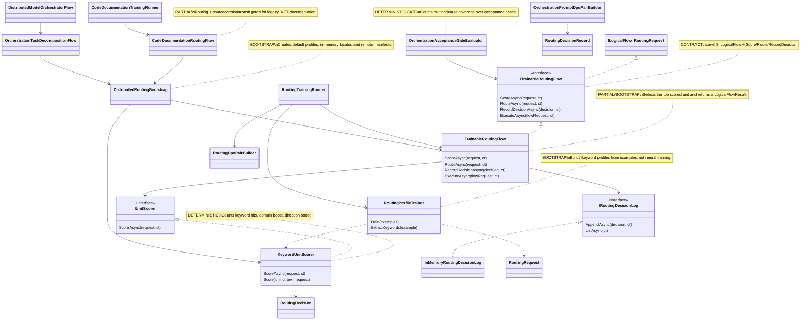

# 26.TrainableRouter - implementation documentation

Status D3H: parent review passed. Tests, build, and runtime smoke were not run in this documentation subphase.

## 0. Quick map for Luba

`26.TrainableRouter` currently routes requests between specialist units: orchestration, translation, and documentation. The input is a `RoutingRequest` or specialized requests like `CodeDocumentationRequest`; the output is the selected `ChosenUnitId`, ranked candidates, confidence, a manifest from `25.ModelServer`, and sometimes a `LogicalFlowResult`.

Honest boundary: the word `Trainable` here does not mean a full trained neural semantic model. The main current "trainability" is `RoutingProfileTrainer`, which extracts keywords from examples and builds a `UnitScoringProfile`, and `KeywordUnitScorer` then counts keyword matches, domain boost, and direction boost. This is useful bootstrap/profile routing infrastructure, but not proof of a trained semantic router without checkpoint, fresh-load, runtime model evidence, and an independent product evaluation.

The project also contains orchestration acceptance gates, DPO pair builders, a code-documentation routing flow, and runners that measure deterministic/profile routing and gate metrics. JSONL, reports, acceptance gates, and DPO pairs do not replace real proof of runtime model quality.

Important about DTO names: the work order mentions `CandidateUnit` and `ScoredUnit`, but there are no such record/class in the current source. The real shapes right now: the list of candidates is stored as `RoutingRequest.CandidateUnitIds`, and a scored candidate is represented by the record `UnitScoringResult`.

## 1. UML for draw.io



| Node | What it does | Status | Where it lives |
|---|---|---|---|
| `ITrainableRoutingFlow` | Routing flow contract on top of `ILogicalFlow<RoutingRequest>` | contract | `26.TrainableRouter/Contracts/ITrainableRoutingFlow.cs` |
| `RoutingProfileTrainer` | Builds a keyword profile from training examples | bootstrap/profile trainer | `26.TrainableRouter/Training/RoutingProfileTrainer.cs` |
| `KeywordUnitScorer` | Deterministically ranks candidates by keywords/domain/direction | deterministic scorer | `26.TrainableRouter/Training/KeywordUnitScorer.cs` |
| `TrainableRoutingFlow` | Delegates to the scorer, selects the top candidate, builds a `LogicalFlowResult` | partial/bootstrap flow | `26.TrainableRouter/Training/TrainableRoutingFlow.cs` |
| `RoutingTrainingRunner` | Trains profiles, evaluates held-out examples, builds DPO pairs | profile evaluation runner | `26.TrainableRouter/Training/RoutingTrainingRunner.cs` |
| `DistributedRoutingBootstrap` | Builds a runtime with an in-memory locator and manifests | bootstrap | `26.TrainableRouter/Training/DistributedRoutingBootstrap.cs` |
| `CodeDocumentationRoutingFlow` | Routes code documentation and checks gates | deterministic/profile flow | `26.TrainableRouter/Training/CodeDocumentationRoutingFlow.cs` |
| `OrchestrationAcceptanceGateEvaluator` | Counts acceptance routing/phase coverage | deterministic gate | `26.TrainableRouter/Training/OrchestrationAcceptanceGateEvaluator.cs` |

### Simulations of the UML connections

| Connection | Example input | What happens | Expected result | What must not be taken as proof |
|---|---|---|---|---|
| `RoutingProfileTrainer -> KeywordUnitScorer` | 50 examples where chosen is `unit-dotnet-legacy-doc-l1` and the text contains `legacy dotnet documentation` | The trainer extracts tokens, builds a `UnitScoringProfile`; the scorer uses these keywords | The documentation unit gets a higher score on a word match and `DomainHint="documentation"` | This is not neural semantic learning |
| `TrainableRoutingFlow -> IUnitScorer` | `RoutingRequest("route-001", "...legacy C# MVC...", "legacy C# MVC documentation", null, "documentation", candidates, {})` | The flow calls `ScoreAsync`, sorting is already done by the scorer | The top candidate becomes `RoutingDecision.ChosenUnitId` | The top score does not prove a product-quality router |
| `TrainableRoutingFlow -> IRoutingDecisionLog` | `RecordDecisionAsync(decision)` | The flow delegates the append to the log | The in-memory log holds the record until the end of the process | A log record is not equal to model training evidence |
| `RoutingTrainingRunner -> RoutingDpoPairBuilder` | evaluation decisions with rejected candidates | The runner builds `RoutingDecisionRecord`; the builder takes the best rejected and adds `[WRONG: ...]` | An array `RoutingDpoPair[]` for a DPO-style contrast | The DPO pair file does not prove that DPO training was performed |
| `DistributedRoutingBootstrap -> 25.ModelServer locator` | default server URL `https://models.local` | The bootstrap registers remote manifests in `InMemoryRemoteUnitLocator` | `RouteAndLocateAsync` returns decision + manifest | The in-memory manifest does not prove remote model inference |
| `CodeDocumentationRoutingFlow -> DistributedRoutingBootstrap` | `CodeDocumentationRequest` with net46/AuthController/D3 | The flow builds a routing request, gets the chosen manifest, computes source/version/transit gates | `DOCUMENTATION_ROUTE_READY` or `DOCUMENTATION_ROUTE_REVIEW_REQUIRED` | A gate pass is not equal to user-facing documentation quality |
| `DistributedModelOrchestratorFlow -> OrchestrationTaskDecompositionFlow` | a prompt about Figma/system orchestration | If the chosen unit = V309 orchestration, phase decomposition is run | `ORCHESTRATION_MODEL_SELECTED_AND_DECOMPOSED` with phase tags | Phase rules are not a trained planning model |

## 2. No-code algorithms

### Algorithm A: the base routing flow contract

| Field | Value |
|---|---|
| Class/interface | `ITrainableRoutingFlow` |
| Method | `ScoreAsync(RoutingRequest request, CancellationToken ct)`, `RouteAsync(...)`, `RecordDecisionAsync(...)`, `ExecuteAsync(LogicalFlowRequest<RoutingRequest> request, ...)` |
| File | `26.TrainableRouter/Contracts/ITrainableRoutingFlow.cs:6-19` |
| Input | `RoutingRequest(RequestId, OriginalPrompt, TaskSlice, RequiredDirection, DomainHint, CandidateUnitIds, Context)` |
| Output | `UnitScoringResult[]`, `RoutingDecision`, `OperationResult<bool>`, `LogicalFlowResult` |
| Status | contract + implemented bootstrap flow |

Like a dispatcher in a call center, the contract says: first score the candidates, then pick one, then record the decision if needed. It does not promise neural training; it only defines a typed boundary.

### Algorithm B: `RoutingProfileTrainer.Train(IReadOnlyList<RoutingTrainingExample> examples)`

| Field | Value |
|---|---|
| Class | `RoutingProfileTrainer` |
| Method | `Train(IReadOnlyList<RoutingTrainingExample> examples)` |
| File | `26.TrainableRouter/Training/RoutingProfileTrainer.cs:15-45` |
| Input | training examples with `Prompt`, `TaskSlice`, `RequiredDirection`, `DomainHint`, `ChosenUnitId` |
| Output | `OperationResult<IReadOnlyDictionary<string, UnitScoringProfile>>` |
| Status | bootstrap/profile trainer |

Steps:
1. Reject `null` examples or an empty list.
2. For each example, check `ChosenUnitId`.
3. Create a `HashSet<string>` of keywords per chosen unit.
4. `ExtractKeywords` concatenates prompt/slice/direction/domain, replaces `C#` with `csharp`, `.NET` with `dotnet`, lowercases, splits by delimiters, and removes stop words.
5. `BuildProfile` assigns `UnitRole`, `DomainTag`, and `BaseScore` by unit name: orchestration/translation/doc/general.

What it does not do: it does not train model weights, does not save a checkpoint, does not compute embeddings, does not check semantic intent beyond keyword extraction.

### Algorithm C: `KeywordUnitScorer.ScoreAsync(RoutingRequest request, CancellationToken ct)`

| Field | Value |
|---|---|
| Class | `KeywordUnitScorer` |
| Method | `ScoreAsync(RoutingRequest request, CancellationToken ct = default)` |
| File | `26.TrainableRouter/Training/KeywordUnitScorer.cs:15-35`, scoring formula `:38-51` |
| Input | `RoutingRequest` with prompt/slice/domain/candidates |
| Output | sorted `OperationResult<UnitScoringResult[]>` |
| Status | deterministic scorer |

Steps:
1. Reject `null`, cancellation, and empty `CandidateUnitIds`.
2. Build lowercase text from prompt, task slice, direction, domain hint.
3. For each candidate call `Score`.
4. If the profile is absent, return score `0`, confidence `0.01`.
5. If the profile exists, count keyword hits via `text.Contains(keyword)`.
6. Add a `20.0` domain boost on a `DomainHint` match.
7. Add a `2.0` direction boost if `RequiredDirection` matches a keyword.
8. Sort by score desc, then `UnitId`.

What it does not do: it does not understand meaning like an LLM, does not read a checkpoint, does not call a remote model.

### Algorithm D: `TrainableRoutingFlow.RouteAsync` and `ExecuteAsync`

| Field | Value |
|---|---|
| Class | `TrainableRoutingFlow` |
| Methods | `RouteAsync(RoutingRequest request, CancellationToken ct)`, `ExecuteAsync(LogicalFlowRequest<RoutingRequest> request, CancellationToken)` |
| File | `26.TrainableRouter/Training/TrainableRoutingFlow.cs:25-47`, `:54-99` |
| Input | `RoutingRequest` or `LogicalFlowRequest<RoutingRequest>` |
| Output | `RoutingDecision` or `LogicalFlowResult` |
| Status | Level 3 `ILogicalFlow<RoutingRequest>` bootstrap implementation |

Steps:
1. Call the scorer.
2. Take the first ranked candidate.
3. If there are no candidates, return `NO_SCORED_UNITS`.
4. Form the reason `Selected ... with score ...`.
5. In `ExecuteAsync` wrap the decision into a `LogicalFlowSummary`, metrics, and a `LogicalFlowResult` with verdict `ROUTED`.

What it does not do: it does not record the decision automatically on `RouteAsync`; to record you must explicitly call `RecordDecisionAsync`.

### Algorithm E: `RoutingTrainingRunner.TrainAndEvaluateAsync`

| Field | Value |
|---|---|
| Class | `RoutingTrainingRunner` |
| Method | `TrainAndEvaluateAsync(IReadOnlyList<RoutingTrainingExample> trainingExamples, IReadOnlyList<RoutingTrainingExample> evaluationExamples, CancellationToken ct)` |
| File | `26.TrainableRouter/Training/RoutingTrainingRunner.cs:14-79` |
| Input | training/evaluation examples |
| Output | `RoutingTrainingRunResult` with accuracy, profiles, DPO pairs, cases |
| Status | deterministic/profile training evaluation |

Steps:
1. Validate training/evaluation arrays.
2. Train keyword profiles.
3. Build `TrainableRoutingFlow(new KeywordUnitScorer(...), new InMemoryRoutingDecisionLog())`.
4. For each evaluation example: route, compare expected vs actual, create `RoutingCaseResult` and `RoutingDecisionRecord`.
5. Build DPO pairs from decisions.
6. Return accuracy and cases.

What it does not do: it does not run a DPO trainer, does not save a trained router checkpoint, does not do fresh-load.

### Algorithm F: `RoutingDpoPairBuilder.BuildPairs`

| Field | Value |
|---|---|
| Class | `RoutingDpoPairBuilder` |
| Method | `BuildPairs(IReadOnlyList<RoutingDecisionRecord> decisions)` |
| File | `26.TrainableRouter/Training/RoutingDpoPairBuilder.cs:7-34` |
| Input | decision records with chosen and rejected candidates |
| Output | `RoutingDpoPair[]` |
| Status | DPO pair generator, not DPO trainer |

The builder takes the rejected candidate with the maximum score and builds a pair: chosen route with the correct reason, rejected route with `[WRONG: ...]`. If there is no rejected candidate, the decision is skipped.

### Algorithm G: `DistributedRoutingBootstrap.BuildDefaultAsync` and `RouteAndLocateAsync`

| Field | Value |
|---|---|
| Class | `DistributedRoutingBootstrap` |
| Methods | `BuildDefaultAsync(string serverBaseUrl, CancellationToken ct)`, `RouteAndLocateAsync(DistributedRoutingRuntime runtime, RoutingRequest request, CancellationToken ct)` |
| File | `26.TrainableRouter/Training/DistributedRoutingBootstrap.cs:10-52` |
| Input | server URL, routing request |
| Output | `DistributedRoutingRuntime`, `RoutedRemoteModelDecision` |
| Status | bootstrap integration with in-memory ModelServer locator |

BuildDefault trains default profiles from `OrchestrationRoutingCurriculum.CreateV309RouterBatch50`, registers default manifests, and creates `TrainableRoutingFlow`. RouteAndLocate routes request and then locates manifest for chosen unit.

What it does not do: does not prove remote model inference; manifests include placeholder translation/documentation run ids in default bootstrap.

### Algorithm H: orchestration curriculum, DPO pairs, acceptance gates

| Component | Where | Current behavior |
|---|---|---|
| `OrchestrationRoutingCurriculum.CreateV309RouterBatch50` | `26.TrainableRouter/Training/OrchestrationRoutingCurriculum.cs:11-57` | Assembles 50-ish routing examples for orchestration/translation/documentation candidates |
| `OrchestrationPromptDpoPairBuilder.BuildPromptFilePairs` | `26.TrainableRouter/Training/OrchestrationPromptDpoPairBuilder.cs:7-17` | Builds chosen/rejected pairs from prompt acceptance cases |
| `OrchestrationScenarioPhasePlanner.PlanPhases` | `26.TrainableRouter/Training/OrchestrationScenarioPhasePlanner.cs:21-37` | Selects phase tags by keyword rules |
| `OrchestrationAcceptanceGateEvaluator.EvaluateAsync` | `26.TrainableRouter/Training/OrchestrationAcceptanceGateEvaluator.cs:20-67` | For cases, checks routing to V309 and coverage of expected phase tags |
| `OrchestrationEvaluationRunner.RunPromptFileGateAsync` | `26.TrainableRouter/Training/OrchestrationEvaluationRunner.cs:20-58` | Counts gate metrics + CPU/time/memory deltas |

Honest boundary: the phase planner and acceptance gate are deterministic rules. They are useful as gate evidence, but are not runtime semantic model quality.

### Algorithm I: orchestration and code documentation flows

| Component | Where | Current behavior |
|---|---|---|
| `OrchestrationTaskDecompositionFlow.DecomposeAsync` | `26.TrainableRouter/Training/OrchestrationTaskDecompositionFlow.cs:43-89` | Routes to orchestration, plans phases by rules, builds `OrchestrationTaskDecompositionResult` |
| `DistributedModelOrchestratorFlow.OrchestrateAsync` | `26.TrainableRouter/Training/DistributedModelOrchestratorFlow.cs:20-76` | If the chosen unit is not V309, returns a specialist verdict; if V309, invokes decomposition |
| `CodeDocumentationRoutingFlow.RouteDocumentationAsync` | `26.TrainableRouter/Training/CodeDocumentationRoutingFlow.cs:25-89` | Routes a documentation request, computes source/version/transit gates, stages, warnings, and verdict |
| `CodeDocumentationTrainingRunner.TrainAndEvaluateAsync` | `26.TrainableRouter/Training/CodeDocumentationTrainingRunner.cs:17-131` | Requires 50 train + 50 held-out rows, trains profiles, routes held-out, measures gate accuracies and DPO pairs |
| `CodeDocumentationBatchFileRunner.RunAsync` | `26.TrainableRouter/Training/CodeDocumentationBatchFileRunner.cs:22-49` | Reads JSONL paths, converts rows, runs the code doc training runner |

## 3. Short code quotations with exact references

### The `ITrainableRoutingFlow` contract

`26.TrainableRouter/Contracts/ITrainableRoutingFlow.cs:6-19`

```csharp
public interface ITrainableRoutingFlow : ILogicalFlow<RoutingRequest>
{
    Task<OperationResult<UnitScoringResult[]>> ScoreAsync(
        RoutingRequest request,
        CancellationToken ct = default);

    Task<OperationResult<RoutingDecision>> RouteAsync(
        RoutingRequest request,
        CancellationToken ct = default);

    Task<OperationResult<bool>> RecordDecisionAsync(
        RoutingDecisionRecord decision,
        CancellationToken ct = default);
}
```

> **Why it matters:** this is the Level 3 flow boundary. It adds score/route/record, but does not declare an `ILearningMachine` lifecycle, export/import, or checkpoint.

### The routing DTO boundary

`26.TrainableRouter/Models/RoutingModels.cs:3-24`

```csharp
public sealed record RoutingRequest(
    string RequestId,
    string OriginalPrompt,
    string TaskSlice,
    string? RequiredDirection,
    string? DomainHint,
    string[] CandidateUnitIds,
    IReadOnlyDictionary<string, string> Context);

public sealed record UnitScoringResult(
    string UnitId,
    string UnitRole,
    string DomainTag,
    double Score,
    double Confidence);

public sealed record RoutingDecision(
    string RequestId,
    string ChosenUnitId,
    UnitScoringResult[] RankedCandidates,
    double Confidence,
    string Reason);
```

> **What it proves:** routing works with typed DTOs. **What it does not prove:** semantic authority; the `Score` and `Confidence` fields can be deterministic keyword values.

### Keyword/profile training

`26.TrainableRouter/Training/RoutingProfileTrainer.cs:24-45`

```csharp
var keywordMap = new Dictionary<string, HashSet<string>>(StringComparer.Ordinal);
foreach (var example in examples)
{
    if (string.IsNullOrWhiteSpace(example.ChosenUnitId))
        return OperationResult<IReadOnlyDictionary<string, UnitScoringProfile>>.Fail("Chosen unit id is required.", "CHOSEN_UNIT_REQUIRED");

    if (!keywordMap.TryGetValue(example.ChosenUnitId, out var keywords))
    {
        keywords = new HashSet<string>(StringComparer.OrdinalIgnoreCase);
        keywordMap[example.ChosenUnitId] = keywords;
    }

    foreach (var token in ExtractKeywords(example))
        keywords.Add(token);
}

var profiles = keywordMap.ToDictionary(
    pair => pair.Key,
    pair => BuildProfile(pair.Key, pair.Value.OrderBy(value => value, StringComparer.OrdinalIgnoreCase).ToArray()),
    StringComparer.Ordinal);

return OperationResult<IReadOnlyDictionary<string, UnitScoringProfile>>.Ok(profiles);
```

> **Why it matters:** this is "training" in the current code: accumulating keyword sets per unit. It does not update neural weights.

`26.TrainableRouter/Training/RoutingProfileTrainer.cs:48-64`

```csharp
private static IEnumerable<string> ExtractKeywords(RoutingTrainingExample example)
{
    var text = $"{example.Prompt} {example.TaskSlice} {example.RequiredDirection} {example.DomainHint}"
        .Replace("C#", "csharp", StringComparison.OrdinalIgnoreCase)
        .Replace(".NET", "dotnet", StringComparison.OrdinalIgnoreCase)
        .ToLowerInvariant();

    foreach (var token in text.Split([' ', '\t', '\r', '\n', '.', ',', ':', ';', '/', '\\', '-', '_', '(', ')', '[', ']', '{', '}', '"', '\''], StringSplitOptions.RemoveEmptyEntries))
    {
        if (token.Length < 3)
            continue;

        if (StopWords.Contains(token))
            continue;

        yield return token;
    }
}
```

> **How it works:** text normalization and token filtering create profile keywords. This is a transparent deterministic tokenizer-like path, not a semantic embedding.

### Deterministic scorer

`26.TrainableRouter/Training/KeywordUnitScorer.cs:28-35`

```csharp
var text = $"{request.OriginalPrompt} {request.TaskSlice} {request.RequiredDirection} {request.DomainHint}".ToLowerInvariant();
var scored = request.CandidateUnitIds
    .Select(unitId => Score(unitId, text, request))
    .OrderByDescending(result => result.Score)
    .ThenBy(result => result.UnitId, StringComparer.Ordinal)
    .ToArray();

return Task.FromResult(OperationResult<UnitScoringResult[]>.Ok(scored));
```

`26.TrainableRouter/Training/KeywordUnitScorer.cs:38-51`

```csharp
private UnitScoringResult Score(string unitId, string text, RoutingRequest request)
{
    if (!_profiles.TryGetValue(unitId, out var profile))
        return new UnitScoringResult(unitId, "unknown", "unknown", 0, 0.01);

    var hits = profile.Keywords.Count(keyword => text.Contains(keyword, StringComparison.OrdinalIgnoreCase));
    var domainBoost = string.Equals(request.DomainHint, profile.DomainTag, StringComparison.OrdinalIgnoreCase) ? 20.0 : 0.0;
    var directionBoost = !string.IsNullOrWhiteSpace(request.RequiredDirection)
        && profile.Keywords.Any(keyword => string.Equals(keyword, request.RequiredDirection, StringComparison.OrdinalIgnoreCase))
            ? 2.0
            : 0.0;
    var score = profile.BaseScore + hits + domainBoost + directionBoost;
    var confidence = Math.Min(0.99, 0.20 + (hits * 0.12) + (domainBoost * 0.02) + (directionBoost * 0.08) + profile.BaseScore);
    return new UnitScoringResult(unitId, profile.UnitRole, profile.DomainTag, score, confidence);
}
```

> **Why it matters:** confidence is formula-based. Domain boost `20.0` dominates many keyword hits, so tests can pass because `DomainHint` is strong, not because a neural router learned semantics.

### `TrainableRoutingFlow.RouteAsync`

`26.TrainableRouter/Training/TrainableRoutingFlow.cs:25-47`

```csharp
public async Task<OperationResult<RoutingDecision>> RouteAsync(
    RoutingRequest request,
    CancellationToken ct = default)
{
    var scored = await ScoreAsync(request, ct);
    if (!scored.IsSuccess)
        return scored.MapError<RoutingDecision>();

    var ranked = scored.Value!;
    var chosen = ranked.FirstOrDefault();
    if (chosen is null)
        return OperationResult<RoutingDecision>.Fail("No scored unit candidates were returned.", "NO_SCORED_UNITS");

    var reason = $"Selected {chosen.UnitId} for domain {chosen.DomainTag} with score {chosen.Score:0.###}.";
    var decision = new RoutingDecision(
        request.RequestId,
        chosen.UnitId,
        ranked,
        chosen.Confidence,
        reason);

    return OperationResult<RoutingDecision>.Ok(decision);
}
```

> **What it proves:** the flow chooses the first ranked candidate. **What it does not prove:** that the selected unit can solve the user task; only scoring order is applied.

### Training runner and DPO pair builder

`26.TrainableRouter/Training/RoutingTrainingRunner.cs:25-31`

```csharp
var profiles = _profileTrainer.Train(trainingExamples);
if (!profiles.IsSuccess)
    return profiles.MapError<RoutingTrainingRunResult>();

var log = new InMemoryRoutingDecisionLog();
var flow = new TrainableRoutingFlow(new KeywordUnitScorer(profiles.Value!), log);
```

`26.TrainableRouter/Training/RoutingDpoPairBuilder.cs:24-34`

```csharp
pairs.Add(new RoutingDpoPair(
    $"{decision.RunId}/routing-dpo-{i + 1:0000}",
    $"Prompt slice: {decision.TaskSlice}\nCandidate units: {string.Join(", ", decision.RejectedCandidates.Select(candidate => candidate.UnitId).Prepend(decision.ChosenUnitId))}",
    $"Route to {decision.ChosenUnitId}. {decision.CorrectReason}",
    $"Route to {rejected.UnitId}. [WRONG: {decision.WrongRouteConsequence}]",
    decision.RunId,
    decision.ChosenUnitId,
    rejected.UnitId));
}

return OperationResult<RoutingDpoPair[]>.Ok(pairs.ToArray());
```

> **How to read it:** the runner measures profile routing and creates contrast pairs. The `[WRONG:]` annotation is useful training data hygiene, not proof that DPO training was performed.

### Bootstrap with the ModelServer locator

`26.TrainableRouter/Training/DistributedRoutingBootstrap.cs:17-33`

```csharp
var training = new RoutingProfileTrainer().Train(OrchestrationRoutingCurriculum.CreateV309RouterBatch50());
if (!training.IsSuccess)
    return training.MapError<DistributedRoutingRuntime>();

var locator = new InMemoryRemoteUnitLocator();
foreach (var manifest in BuildDefaultManifests(serverBaseUrl.TrimEnd('/')))
{
    var registered = await locator.RegisterAsync(manifest, ct);
    if (!registered.IsSuccess)
        return registered.MapError<DistributedRoutingRuntime>();
}

var flow = new TrainableRoutingFlow(
    new KeywordUnitScorer(training.Value!),
    new InMemoryRoutingDecisionLog());

return OperationResult<DistributedRoutingRuntime>.Ok(new DistributedRoutingRuntime(flow, locator, training.Value!));
```

> **Why it matters:** the bootstrap wires profiles + in-memory manifests. It does not upload models or run remote inference.

### Code documentation route gates

`26.TrainableRouter/Training/CodeDocumentationRoutingFlow.cs:51-61`

```csharp
var sourceGate = EvaluateSourceGate(request);
var versionGate = EvaluateVersionGate(request);
var transitGate = EvaluateTransitGate(request);
var stages = BuildStages(request, transitGate);
var warnings = BuildWarnings(sourceGate, versionGate, transitGate);
var verdict = routed.Value!.Decision.ChosenUnitId == OrchestrationRoutingCurriculum.DocumentationDotNetUnitId &&
              sourceGate.IsPassed &&
              versionGate.IsPassed &&
              transitGate.IsPassed
    ? "DOCUMENTATION_ROUTE_READY"
    : "DOCUMENTATION_ROUTE_REVIEW_REQUIRED";
```

`26.TrainableRouter/Training/CodeDocumentationRoutingFlow.cs:321-348`

```csharp
private static CodeDocumentationTransitGate EvaluateTransitGate(CodeDocumentationRequest request)
{
    var needsCalleeSummaries = NeedsCalleeSummaries(request);
    var knownIds = request.KnownCallees
        .Select(item => item.SymbolId)
        .Where(id => !string.IsNullOrWhiteSpace(id))
        .ToHashSet(StringComparer.Ordinal);
    var missing = needsCalleeSummaries
        ? request.Calls.Count(call => !knownIds.Contains(call.CalleeSymbolId))
        : 0;
    var transitScore = missing == 0 ? 1.0 : 0.0;
    var hasRequiredCallees = !needsCalleeSummaries || missing == 0;
    var bottomUpScore = string.Equals(request.DocumentationLevel, "D1", StringComparison.OrdinalIgnoreCase) || hasRequiredCallees || request.Calls.Count == 0
        ? 1.0
        : 0.0;
    var localVsDelegated = hasRequiredCallees || request.Calls.Count == 0
        ? 1.0
        : 0.0;
    var required = BuildRequiredEvidence(request, needsCalleeSummaries);

    return new CodeDocumentationTransitGate(
        missing == 0,
        needsCalleeSummaries,
        missing,
        bottomUpScore,
        transitScore,
        localVsDelegated,
        required);
}
```

> **What it proves:** the documentation flow has concrete branch gates for source/version/transit. **What it does not prove:** the quality of the generated documentation; it only says whether the routing/gate inputs are acceptable.

## 4. Hierarchy / levels

```text
Level 3: ITrainableRoutingFlow : ILogicalFlow<RoutingRequest>
  Accepts: RoutingRequest(RequestId, OriginalPrompt, TaskSlice, RequiredDirection, DomainHint, CandidateUnitIds, Context)
  Returns: UnitScoringResult[] / RoutingDecision / LogicalFlowResult
  Role: selects a specialist unit by scorer output and can be invoked as a logical flow.

Level 3: CodeDocumentationRoutingFlow : ILogicalFlow<CodeDocumentationRequest>
  Accepts: CodeDocumentationRequest(code, file path, symbol, framework/version/context, calls, callee summaries)
  Returns: CodeDocumentationRoutingResult or LogicalFlowResult
  Role: specialized documentation routing + source/version/transit gates.

Level 3: OrchestrationTaskDecompositionFlow : ILogicalFlow<OrchestrationTaskDecompositionRequest>
  Accepts: prompt + step hints
  Returns: phase tags and ordered phases
  Role: deterministic phase decomposition after routing.
```

`26.TrainableRouter` has no project-level `ILearningMachine`, no `ILearningMachinePair`, no train/export/import lifecycle. The training boundary here is profile extraction and evaluation runners, not a full model asset lifecycle.

## 5. QA / test mapping

The tests were read and mapped, but not run in this documentation subphase.

| Test | What it covers | What it does not prove |
|---|---|---|
| `Tests/DistributedModelArchitectureTests.cs:95-143` | `TrainableRoutingFlow.RouteAsync`, `ExecuteAsync`, `RecordDecisionAsync`, in-memory decision log | Does not prove neural semantic routing |
| `Tests/DistributedModelArchitectureTests.cs:145-177` | `RoutingDpoPairBuilder.BuildPairs` and `[WRONG:]` rejected annotation | Does not prove DPO training execution |
| `Tests/CodeDocumentationRoutingFlowTests.cs:9-204` | documentation route ready/review branches, version/source/transit gates, legacy framework versions | Does not prove generated docs quality |
| `Tests/CodeDocumentationTrainingRunnerTests.cs:14-56` | 50-row train/held-out requirement, metric outputs, DPO pair count | Does not prove a checkpoint/fresh-load router model |
| `Tests/CodeDocumentationTrainingRunnerTests.cs:58-99` | JSONL batch runner paths and missing `[WRONG:]` rejection | JSONL parsing is not training evidence |

QA gaps:
- No dotnet tests were run in this subphase by instruction.
- No runtime remote model inference evidence is present in this doc.
- No router checkpoint/export/import/fresh-load/continue-training evidence exists in `26.TrainableRouter` source.

## 6. Anti-false-done and evidence boundaries

- `KeywordUnitScorer` and `RoutingProfileTrainer` are keyword/profile scoring, not a fully trained semantic model.
- `TrainableRoutingFlow` being an `ILogicalFlow` does not make it a Level 5 `ILearningMachine`.
- DPO pairs with `[WRONG:]` are training data candidates, not proof that DPO training ran or improved runtime behavior.
- Acceptance gate metrics and JSONL reports do not replace runtime/product-quality evidence.
- In-memory `DistributedRoutingBootstrap` manifests and locator entries do not prove remote model serving.
- Code documentation gates prove source/version/transit branch behavior, not the correctness of final human documentation.

## 7. Implementation status

| Component | File | Status | What actually works now |
|---|---|---|---|
| `ITrainableRoutingFlow` | `26.TrainableRouter/Contracts/ITrainableRoutingFlow.cs` | contract | Defines score/route/record + `ILogicalFlow<RoutingRequest>` boundary |
| `RoutingRequest`, `RoutingDecision`, `RoutingDecisionRecord` | `26.TrainableRouter/Models/RoutingModels.cs` | DTOs implemented | Typed input/output records for routing and DPO pairs |
| `RoutingProfileTrainer` | `26.TrainableRouter/Training/RoutingProfileTrainer.cs` | bootstrap/profile | Extracts keywords and builds `UnitScoringProfile`; no checkpoint |
| `KeywordUnitScorer` | `26.TrainableRouter/Training/KeywordUnitScorer.cs` | deterministic | Scores by keyword hits + domain/direction boosts |
| `TrainableRoutingFlow` | `26.TrainableRouter/Training/TrainableRoutingFlow.cs` | partial/bootstrap | Routes top scored unit and creates `LogicalFlowResult` |
| `RoutingTrainingRunner` | `26.TrainableRouter/Training/RoutingTrainingRunner.cs` | evaluation runner | Trains profiles, evaluates examples, builds DPO pairs |
| `RoutingDpoPairBuilder` | `26.TrainableRouter/Training/RoutingDpoPairBuilder.cs` | utility | Builds chosen/rejected routing pairs with `[WRONG:]` |
| `DistributedRoutingBootstrap` | `26.TrainableRouter/Training/DistributedRoutingBootstrap.cs` | bootstrap | Builds default runtime with in-memory locator and manifests |
| `Orchestration*` components | `26.TrainableRouter/Training/Orchestration*.cs` | deterministic gates/flows | Curriculum, phase rules, DPO prompt pairs, acceptance metrics |
| `CodeDocumentationRoutingFlow` | `26.TrainableRouter/Training/CodeDocumentationRoutingFlow.cs` | partial/profile flow | Routes code docs and computes source/version/transit gates |
| `CodeDocumentationTrainingRunner` | `26.TrainableRouter/Training/CodeDocumentationTrainingRunner.cs` | evaluation runner | Requires 50/50 rows, measures routing and gate accuracies |
| `CodeDocumentationBatchFileRunner` | `26.TrainableRouter/Training/CodeDocumentationBatchFileRunner.cs` | utility | Reads JSONL rows, validates `[WRONG:]`, converts to training examples |

Documentation status: draft pending parent review
Last verified against source: 2026-06-08
Known gaps: no runtime neural router checkpoint/export/import/fresh-load evidence in this project.
