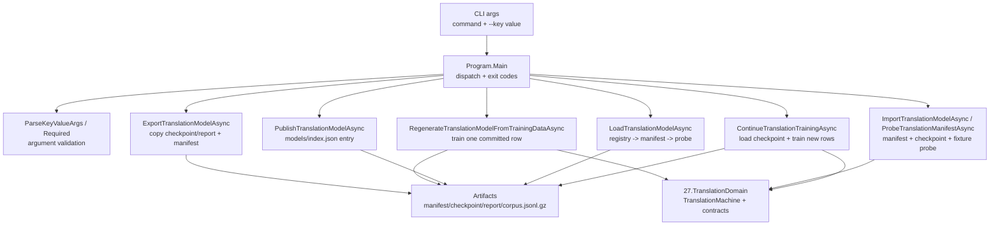

# 27.TranslationDomain.Tools - документация реализации

## 1. Карта для Лубы

`27.TranslationDomain.Tools` - это консольная CLI-поверхность для упаковки, проверки, публикации, загрузки и продолжения обучения артефактов `27.TranslationDomain`. Это не сама модель перевода: реальное обучение, checkpoint save/load и inference живут в `27.TranslationDomain`, а `Program.cs` собирает аргументы, читает/пишет JSON/GZip artifacts, вызывает model APIs и возвращает exit code.

В одном `Program.cs` живут также команды orchestration и skill-selection. Для D27-B важны translation commands: `export-translation-model`, `regenerate-translation-model-from-training-data`, `import-translation-model`, `publish-translation-model`, `load-translation-model`, `continue-translation-training`. Отдельных команд `audit-translation-corpus`, `build-translation-corpus` или `export-translation-training-data` в `Main` switch сейчас нет; translation training data ожидается как уже подготовленный `training-manifest.json` + `corpus.jsonl.gz`.

Главная честная граница: успешный CLI exit, JSON report, manifest или копирование checkpoint не являются модельной готовностью сами по себе. Машинно-проверяемая формулировка для review: **CLI is not the model**; **JSON/report/registry/copy is not model readiness**. Readiness требует source-backed checkpoint load/use/continue evidence из `TranslationMachine` path и честного разделения exact memory от held-out/generalization. Для training data tool читает manifest fields как JSON; совместимый contract живет в `TranslationTrainingDataContract`, но `Program.cs` в этих translation paths не вызывает этот class напрямую.

## 2. UML для draw.io



### Легенда

| Узел | Что делает | Статус | Где живет |
|---|---|---|---|
| `Program.Main` | Выбирает команду по первому аргументу и возвращает `0`, `2` или `3` | ✅ Полная CLI dispatch logic | `27.TranslationDomain.Tools/Program.cs` |
| `ParseKeyValueArgs` / `Required` | Парсит `--key value`, выбрасывает ошибку при missing/unknown shape | ✅ Полная validation helper | `27.TranslationDomain.Tools/Program.cs` |
| `ExportTranslationModelAsync` | Копирует checkpoint/report в output и создает model manifest | ✅ Полная packaging path | `27.TranslationDomain.Tools/Program.cs` |
| `RegenerateTranslationModelFromTrainingDataAsync` | Читает training manifest/corpus, тренирует одну committed row, пишет checkpoint/report/manifest | ✅ Полная narrow regeneration path | `27.TranslationDomain.Tools/Program.cs` |
| `ImportTranslationModelAsync` / `ProbeTranslationManifestAsync` | Загружает manifest/checkpoint и делает fixture route probe | ✅ Полная probe path | `27.TranslationDomain.Tools/Program.cs` |
| `PublishTranslationModelAsync` | Добавляет запись в `models/index.json` | ✅ Полная registry write path | `27.TranslationDomain.Tools/Program.cs` |
| `LoadTranslationModelAsync` | Находит manifest по registry и запускает import/probe | ✅ Полная registry load probe path | `27.TranslationDomain.Tools/Program.cs` |
| `ContinueTranslationTrainingAsync` | Загружает checkpoint, читает corpus, исключает старые pair ids, тренирует новые rows | ✅ Полная continue path с anti-replay gate | `27.TranslationDomain.Tools/Program.cs` |
| `TranslationMachine` | Реальная модельная логика, train/checkpoint/load/orchestrator | ✅ Реализовано в model project | `27.TranslationDomain/TranslationMachine.cs` |

### Симуляции связей

| Связь | Пример входа | Симуляция ветки | Ожидаемый результат | Что запрещено принимать за результат |
|---|---|---|---|---|
| `Args -> Main` | `export-translation-model --checkpoint c.json --report r.json --output out` | `Main` выбирает `ExportTranslationModelAsync` | Команда пишет JSON в stdout и exit `0` при успехе | Нельзя считать один exit `0` доказательством качества модели |
| `Main -> Parser` | `--manifest` без значения | `Required`/parser бросает `ArgumentException` | `Main` печатает error в stderr и возвращает `3` | Это не runtime model failure, только bad CLI input |
| `Export -> Files` | checkpoint/report существуют | Files copied to `translation-v1-checkpoint.json`, `runner-report.json`, `manifest.json` | Artifact package создан | Копирование не доказывает fresh-load |
| `Regen -> Domain` | training manifest + corpus hash + `initial-pair-id` | Создается `TranslationMachine`, строится `TranslationLearningBatch`, вызывается `TrainStructuredBatchAsync`; manifest shape соответствует `TranslationTrainingDataContract`, но читается как JSON | Новый checkpoint/report/manifest | Обучение одной строки не доказывает generalization |
| `Import -> Domain` | manifest указывает checkpoint | `ProbeTranslationManifestAsync` вызывает `TranslationMachine.LoadCheckpointAsync` и fixture probes | Probe report с `passed` true/false | Fixture не заменяет полный product held-out |
| `Publish -> Files` | `--manifest out/manifest.json` | `PublishModelAsync` обновляет `models/index.json` | Registry entry для `translation-v1` | Registry entry не является model lifecycle proof |
| `Load -> Files` | `--model-id translation-v1` | Registry resolves manifest, затем import/probe | Load probe output | Registry resolve не доказывает continue-training |
| `Continue -> Domain` | manifest + training-manifest + output | Load checkpoint, exclude old pair ids, train new rows, save continued checkpoint/report | `continue-report.json` и `translation-v1-continued-checkpoint.json` | Continue report не доказывает качество без route/held-out evidence |

## 3. Алгоритмы без кода

### Алгоритм A: dispatch команд `Program.Main(string[] args)`

- Файл: `27.TranslationDomain.Tools/Program.cs`.
- Сигнатура: `Main(string[] args)`.
- Вход: массив CLI аргументов; пример: `["continue-translation-training", "--manifest", "models/translation-v1/manifest.json", "--training-manifest", "training-data/translation/translation-v1/training-manifest.json", "--output", "out"]`.
- Выход: integer exit code: `0` success, `2` usage error, `3` runtime error.
- Шаги: если аргументов нет или есть `--help`, пишет usage; иначе берет `args[0].ToLowerInvariant()` и выбирает handler; unknown command пишет stderr и возвращает usage error; exception печатается в stderr, а для `continue-translation-training` и `regenerate-translation-model-from-training-data` печатается полный exception.
- Что не делает: не запускает модель сам по себе; он только выбирает handler.

### Алгоритм B: argument validation `ParseKeyValueArgs` / `Required`

- Файл: `27.TranslationDomain.Tools/Program.cs`.
- Сигнатуры: `ParseKeyValueArgs(IReadOnlyList<string> args, IReadOnlyCollection<string> flagNames)`, `Required(IReadOnlyDictionary<string,string> values, string key)`.
- Вход: пары `--name value`, optional flag names.
- Выход: `ParsedArgs` или exception.
- Шаги: проверяет, что каждый key начинается с `--`; flag names кладет в `Flags`; обычный key требует следующее значение; `Required` требует non-empty value.
- Что не делает: не валидирует семантику checkpoint/manifest; это делают handlers и contracts.

### Алгоритм C: export artifact package `ExportTranslationModelAsync`

- Сигнатура: `ExportTranslationModelAsync(IReadOnlyList<string> args)`.
- Параметры: `--checkpoint`, `--report`, `--output`.
- Вход/выход: входные checkpoint/report файлы -> output directory с `translation-v1-checkpoint.json`, `manifest.json`, `runner-report.json`.
- Шаги: копирует checkpoint/report; читает metric из report (`best_runtime_product_accuracy`, `accuracy_at_export`, `runtime_product_accuracy`, `target_accuracy`); создает `TranslationModelManifestContract`; проверяет `IsValidSharedAssetManifest`; пишет manifest; stdout содержит paths and model id.
- Что не делает: не проверяет fresh-load или route behavior; он упаковывает уже существующие artifacts.

### Алгоритм D: regenerate from committed training data

- Сигнатура: `RegenerateTranslationModelFromTrainingDataAsync(IReadOnlyList<string> args)`.
- Параметры: `--training-manifest`, `--output`, `--initial-pair-id`.
- Вход/выход: `training-manifest.json` + `corpus.jsonl.gz` -> checkpoint/report/manifest.
- Шаги: читает manifest, проверяет corpus sha256, ищет ровно одну строку `initial-pair-id`, создает `TranslationMachine`, строит `TranslationLearningBatch`, вызывает `TrainStructuredBatchAsync`, сохраняет checkpoint через `SaveCheckpointAsync`, проверяет persisted structured identity, пишет report.
- Что не делает: не обучает весь corpus; это узкая regeneration path для одной committed row.

### Алгоритм E: import/load probe `ImportTranslationModelAsync`, `LoadTranslationModelAsync`, `ProbeTranslationManifestAsync`

- Сигнатуры: `ImportTranslationModelAsync(IReadOnlyList<string> args)`, `LoadTranslationModelAsync(IReadOnlyList<string> args)`, `ProbeTranslationManifestAsync(string manifestPath)`.
- Параметры: import принимает `--manifest`; load принимает `--model-id`.
- Вход/выход: manifest/registry -> probe JSON в stdout.
- Шаги: manifest path resolves checkpoint; checkpoint JSON десериализуется; `TranslationMachine.LoadCheckpointAsync` делает fresh load; orchestrator запускает exact fixture и non-exact fixture; passed требует manifest/model id, structured training, non-empty KNN store, non-bootstrap exact fixture и non-exact generalization probe.
- Что не делает: не публикует модель и не тренирует ее.

### Алгоритм F: publish registry `PublishTranslationModelAsync`

- Сигнатура: `PublishTranslationModelAsync(IReadOnlyList<string> args)`.
- Параметры: `--manifest`.
- Вход/выход: manifest -> `models/index.json`.
- Шаги: вызывает `PublishModelAsync` с `TranslationModelManifestContract.ModelId`, `Domain`, `Version`; registry entry получает manifest path, version, accuracy.
- Что не делает: не загружает checkpoint и не проверяет inference; registry row не равен готовой модели.

### Алгоритм G: continue training `ContinueTranslationTrainingAsync`

- Сигнатура: `ContinueTranslationTrainingAsync(IReadOnlyList<string> args)`.
- Параметры: `--manifest`, `--training-manifest`, `--output`, optional `--max-cycles`.
- Вход/выход: manifest + checkpoint + training manifest/corpus -> `translation-v1-continued-checkpoint.json` and `continue-report.json`.
- Шаги: resolves checkpoint from manifest; reads training manifest and corpus path; verifies corpus sha256; loads checkpoint through `TranslationMachine.LoadCheckpointAsync`; exports before state; reads old structured identities; selects new rows excluding old pair ids; if replay proof is unavailable or overlaps, writes failed `continue-report.json`; otherwise builds `TranslationLearningBatch`, calls `TrainStructuredBatchAsync`, saves continued checkpoint, exports after state, builds route evidence, and returns success only when rows trained, no replay proven, and exact-memory leakage check passes.
- Что не делает: не claims product quality by report alone; route evidence is a probe, not broad held-out evaluation.

### Алгоритм G2: route evidence helpers для continue probe

- Файл: `27.TranslationDomain.Tools/Program.cs`.
- Сигнатуры: `BuildTranslationRouteEvidenceAsync(TranslationMachine machine)`, `RunTranslationRouteProbeAsync(ILogicalOrchestrator orchestrator, string source)`.
- Вход: уже загруженная/дообученная `TranslationMachine`; внутри helper запрашивает orchestrator и запускает два source prompt: exact `add null check ValidateToken` и non-exact `add a null check before ValidateToken`.
- Выход: `Dictionary<string, object?>` с `route_probe_available`, `route_ids`, exact/non-exact adapter ids, output и `exact_memory_leakage_proven`; отдельный helper возвращает `TranslationRouteProbeResult`.
- Шаги: если orchestrator недоступен, возвращает route evidence с `route_probe_available=false`; иначе запускает exact и non-exact probes, читает `adapter_id`, считает exact-source hits, проверяет, что non-exact probe успешен, не bootstrap и не exact-source. Это support helpers для `continue-translation-training` report, а не отдельные CLI commands.
- Что не делает: не скачивает данные, не тренирует модель и не доказывает full held-out/product quality; это узкая route-evidence проверка, чтобы не спрятать exact-memory replay под видом generalization.

### Алгоритм H: translation training corpus commands

- Текущий статус: в `Main` switch нет отдельной команды `audit-translation-corpus`, `build-translation-corpus` или `export-translation-training-data`.
- Как данные все равно проходят: `regenerate-translation-model-from-training-data` и `continue-translation-training` требуют готовый `training-manifest.json`, читают `corpus_filename`, проверяют `corpus_sha256`, затем читают `corpus.jsonl.gz`; это должен быть manifest, совместимый с `TranslationTrainingDataContract`, хотя current tool path обращается к полям через dictionary.
- Что не делает: CLI не строит translation corpus из private pairs в отдельной callable command path; если это нужно, это отдельный work order.

Строка `corpus.jsonl.gz` может дополнительно содержать `phrase_mappings`: массив заранее заданных соответствий частей урока, например `"phrase_mappings": [{"source_phrase": "delete", "target_phrase": "удали"}, {"source_phrase": "the file", "target_phrase": "файл"}]`. `ReadTranslationCorpusRowsAsync` читает эти пары, а `BuildTranslationContinueExample` передаёт их в `ExecutorOutput.PhraseMappings` существующему обучающему компоненту. Поле используется в regeneration и continue training через общий преобразователь; алгоритм памяти не изменяется. При отсутствии поля или значении `null` передаётся прежнее `null`; пустой массив остаётся пустым. Остальные обязательные поля строки сохраняются.

## 4. Точные цитаты из кода

### Dispatcher явно содержит translation commands

`27.TranslationDomain.Tools/Program.cs:22-79`

```csharp

    public static async Task<int> Main(string[] args)
    {
        if (args.Length == 0 || args.Contains("--help", StringComparer.OrdinalIgnoreCase))
        {
            WriteUsage();
            return args.Length == 0 ? UsageError : Success;
        }

        try
        {
            return args[0].ToLowerInvariant() switch
            {
                "audit-orchestration-corpus" => await AuditOrchestrationCorpusAsync(args.Skip(1).ToArray()),
                "build-orchestration-corpus" => await BuildOrchestrationCorpusAsync(args.Skip(1).ToArray()),
                "build-skill-selection-corpus" => await BuildSkillSelectionCorpusAsync(args.Skip(1).ToArray()),
                "run-skill-selection-loop" => await RunSkillSelectionLoopAsync(args.Skip(1).ToArray()),
                "run-codex-smart-skills-trace" => await RunCodexSmartSkillsTraceAsync(args.Skip(1).ToArray()),
                "regenerate-skill-selection-model-from-training-data" => await RegenerateSkillSelectionModelFromTrainingDataAsync(args.Skip(1).ToArray()),
                "export-skill-selection-model" => await ExportSkillSelectionModelAsync(args.Skip(1).ToArray()),
                "import-skill-selection-model" => await ImportSkillSelectionModelAsync(args.Skip(1).ToArray()),
                "publish-skill-selection-model" => await PublishSkillSelectionModelAsync(args.Skip(1).ToArray()),
                "load-skill-selection-model" => await LoadSkillSelectionModelAsync(args.Skip(1).ToArray()),
                "continue-skill-selection-training" => await ContinueSkillSelectionTrainingAsync(args.Skip(1).ToArray()),
                "run-orchestration-loop" => await RunOrchestrationLoopAsync(args.Skip(1).ToArray()),
                "export-translation-model" => await ExportTranslationModelAsync(args.Skip(1).ToArray()),
                "regenerate-translation-model-from-training-data" => await RegenerateTranslationModelFromTrainingDataAsync(args.Skip(1).ToArray()),
                "import-translation-model" => await ImportTranslationModelAsync(args.Skip(1).ToArray()),
                "export-orchestration-model" => await ExportOrchestrationModelAsync(args.Skip(1).ToArray()),
                "export-orchestration-training-data" => await ExportOrchestrationTrainingDataAsync(args.Skip(1).ToArray()),
                "import-orchestration-model" => await ImportOrchestrationModelAsync(args.Skip(1).ToArray()),
                "publish-translation-model" => await PublishTranslationModelAsync(args.Skip(1).ToArray()),
                "publish-orchestration-model" => await PublishOrchestrationModelAsync(args.Skip(1).ToArray()),
                "load-translation-model" => await LoadTranslationModelAsync(args.Skip(1).ToArray()),
                "load-orchestration-model" => await LoadOrchestrationModelAsync(args.Skip(1).ToArray()),
                "continue-translation-training" => await ContinueTranslationTrainingAsync(args.Skip(1).ToArray()),
                "continue-orchestration-training" => await ContinueOrchestrationTrainingAsync(args.Skip(1).ToArray()),
                "materialize-orchestration-reasoning-state" => await MaterializeOrchestrationReasoningStateAsync(args.Skip(1).ToArray()),
                "export-orchestration-reasoning-model" => await ExportOrchestrationReasoningModelAsync(args.Skip(1).ToArray()),
                "probe-orchestration-reasoning-fresh-load" => await ProbeOrchestrationReasoningFreshLoadAsync(args.Skip(1).ToArray()),
                "probe-orchestration-reasoning-continued-fresh-load" => await ProbeOrchestrationReasoningContinuedFreshLoadAsync(args.Skip(1).ToArray()),
                "continue-orchestration-reasoning-training" => await ContinueOrchestrationReasoningTrainingAsync(args.Skip(1).ToArray()),
                "export-orchestration-reasoning-continued-model" => await ExportOrchestrationReasoningContinuedModelAsync(args.Skip(1).ToArray()),
                "probe-orchestration-reasoning-held-out-guide-patterns" => await ProbeOrchestrationReasoningHeldOutGuidePatternsAsync(args.Skip(1).ToArray()),
                _ => UnknownCommand(args[0])
            };
        }
        catch (Exception ex)
        {
            if (args.Length > 0 &&
                (string.Equals(args[0], "continue-translation-training", StringComparison.OrdinalIgnoreCase) ||
                 string.Equals(args[0], "regenerate-translation-model-from-training-data", StringComparison.OrdinalIgnoreCase)))
                Console.Error.WriteLine(ex);
            else
                Console.Error.WriteLine(ex.Message);
            return RuntimeError;
        }
    }
```

Почему важно: это список реально callable commands. Здесь нет translation-specific corpus audit/build command, зато есть export/import/publish/load/continue paths.

### Export копирует checkpoint/report и создает manifest

`27.TranslationDomain.Tools/Program.cs:1942-1979`

```csharp
    private static async Task<int> ExportTranslationModelAsync(IReadOnlyList<string> args)
    {
        var values = ParseKeyValueArgs(args, []).Values;
        var checkpointPath = Required(values, "checkpoint");
        var outputDir = Required(values, "output");
        var reportPath = Required(values, "report");
        Directory.CreateDirectory(outputDir);

        var checkpointFile = Path.Combine(outputDir, TranslationModelManifestContract.CheckpointFilename);
        var manifestFile = Path.Combine(outputDir, "manifest.json");
        var runnerReportFile = Path.Combine(outputDir, TranslationModelManifestContract.RunnerReportRef);
        File.Copy(checkpointPath, checkpointFile, overwrite: true);
        File.Copy(reportPath, runnerReportFile, overwrite: true);

        var accuracy = ReadFirstReportMetric(
            reportPath,
            "best_runtime_product_accuracy",
            "accuracy_at_export",
            "runtime_product_accuracy",
            "target_accuracy");
        var manifest = TranslationModelManifestContract.Create(
            accuracyAtExport: accuracy,
            sourceBaseCommit: ReadGitHead(),
            createdAtUtc: DateTimeOffset.UtcNow);
        if (!TranslationModelManifestContract.IsValidSharedAssetManifest(manifest))
            throw new InvalidOperationException("Translation model manifest contract validation failed.");
        await WriteJsonFileAsync(manifestFile, manifest);

        Console.WriteLine(JsonSerializer.Serialize(new
        {
            command = "export-translation-model",
            manifest = manifestFile,
            checkpoint = checkpointFile,
            runner_report = runnerReportFile,
            model_id = TranslationModelManifestContract.ModelId
        }, ToolJsonOptions));
        return Success;
    }
```

Почему важно: export command is packaging. It copies existing files and validates manifest shape; it does not train or fresh-load.

### Regenerate проверяет training manifest hash и тренирует одну committed row

`27.TranslationDomain.Tools/Program.cs:1981-2020`

```csharp
    private static async Task<int> RegenerateTranslationModelFromTrainingDataAsync(IReadOnlyList<string> args)
    {
        var values = ParseKeyValueArgs(args, []).Values;
        var trainingManifestPath = Required(values, "training-manifest");
        var outputDir = Required(values, "output");
        var initialPairId = Required(values, "initial-pair-id");
        Directory.CreateDirectory(outputDir);

        var trainingManifest = await ReadJsonDictionaryAsync(trainingManifestPath);
        var corpusFilename = Convert.ToString(trainingManifest["corpus_filename"], CultureInfo.InvariantCulture)
            ?? throw new InvalidOperationException("Translation training manifest is missing corpus_filename.");
        var expectedCorpusSha = Convert.ToString(trainingManifest["corpus_sha256"], CultureInfo.InvariantCulture)
            ?? throw new InvalidOperationException("Translation training manifest is missing corpus_sha256.");
        var corpusPath = Path.Combine(Path.GetDirectoryName(Path.GetFullPath(trainingManifestPath))!, corpusFilename);
        var actualCorpusSha = Sha256File(corpusPath);
        if (!string.Equals(expectedCorpusSha, actualCorpusSha, StringComparison.OrdinalIgnoreCase))
            throw new InvalidOperationException("Translation training corpus hash mismatch.");

        var corpusRows = await ReadTranslationCorpusRowsAsync(corpusPath);
        var initialRows = corpusRows
            .Where(row => string.Equals(row.PairId, initialPairId, StringComparison.Ordinal))
            .ToArray();
        if (initialRows.Length != 1)
            throw new InvalidOperationException($"Expected exactly one committed corpus row for '{initialPairId}', found {initialRows.Length}.");

        var machine = new TranslationMachine();
        var examples = initialRows.Select(BuildTranslationContinueExample).ToArray();
        var batch = new TranslationLearningBatch(
            BatchId: "translation-v1-regenerate-001",
            DomainTag: TranslationMachine.DomainTag,
            Examples: examples,
            SourceIds: initialRows.Select(row => row.PairId).ToArray());
        var train = await machine.TrainStructuredBatchAsync(batch);
        if (!train.IsSuccess || train.Value is null)
            throw new InvalidOperationException(train.ErrorMessage);

        var checkpointFile = Path.Combine(outputDir, TranslationModelManifestContract.CheckpointFilename);
        var save = await machine.SaveCheckpointAsync(checkpointFile);
        if (!save.IsSuccess)
            throw new InvalidOperationException(save.ErrorMessage);
```

Почему важно: здесь CLI реально вызывает `TranslationMachine.TrainStructuredBatchAsync` и `SaveCheckpointAsync`; readiness все равно ограничена одной выбранной строкой.

### Publish only writes registry entry

`27.TranslationDomain.Tools/Program.cs:2197-2213`

```csharp
    private static async Task<int> PublishTranslationModelAsync(IReadOnlyList<string> args)
    {
        var values = ParseKeyValueArgs(args, []).Values;
        var manifest = Required(values, "manifest");
        await PublishModelAsync(
            TranslationModelManifestContract.ModelId,
            manifest,
            TranslationModelManifestContract.Domain,
            TranslationModelManifestContract.Version);
        Console.WriteLine(JsonSerializer.Serialize(new
        {
            command = "publish-translation-model",
            model_id = TranslationModelManifestContract.ModelId,
            manifest = ToRepoRelativePath(manifest)
        }, ToolJsonOptions));
        return Success;
    }
```

Почему важно: publish writes model registry metadata. It does not load checkpoint and does not prove translation quality.

### PublishModelAsync writes the registry file, not a model

`27.TranslationDomain.Tools/Program.cs:3478-3492`

```csharp
    private static async Task PublishModelAsync(string modelId, string manifestPath, string domain, string registryVersion)
    {
        var indexPath = Path.Combine(Directory.GetCurrentDirectory(), "models", "index.json");
        Directory.CreateDirectory(Path.GetDirectoryName(indexPath)!);
        var entries = File.Exists(indexPath)
            ? JsonSerializer.Deserialize<ModelIndex>(await File.ReadAllTextAsync(indexPath), ToolJsonOptions)?.Models.ToList() ?? []
            : [];
        var manifest = await ReadJsonDictionaryAsync(manifestPath);
        var accuracy = manifest.TryGetValue("accuracy_at_export", out var value) && value is JsonElement element && element.ValueKind == JsonValueKind.Number
            ? element.GetDouble()
            : 0.0;
        entries.RemoveAll(entry => string.Equals(entry.ModelId, modelId, StringComparison.Ordinal));
        entries.Add(new ModelIndexEntry(modelId, domain, ToRepoRelativePath(manifestPath), registryVersion, accuracy, DateTimeOffset.UtcNow));
        await WriteJsonFileAsync(indexPath, new ModelIndex(entries.OrderBy(entry => entry.ModelId, StringComparer.Ordinal).ToArray()));
    }
```

Почему важно: helper обновляет `models/index.json` и берет accuracy из manifest, но не вызывает `TranslationMachine.LoadCheckpointAsync`; registry/copy is not model readiness.

### ResolveModelManifestAsync resolves registry metadata only

`27.TranslationDomain.Tools/Program.cs:3494-3505`

```csharp
    private static async Task<string> ResolveModelManifestAsync(string modelId)
    {
        var indexPath = Path.Combine(Directory.GetCurrentDirectory(), "models", "index.json");
        if (!File.Exists(indexPath))
            throw new FileNotFoundException("Model index not found.", indexPath);
        var index = JsonSerializer.Deserialize<ModelIndex>(await File.ReadAllTextAsync(indexPath), ToolJsonOptions)
                    ?? new ModelIndex([]);
        var entry = index.Models.FirstOrDefault(item => string.Equals(item.ModelId, modelId, StringComparison.Ordinal));
        if (entry is null)
            throw new InvalidOperationException($"Model id '{modelId}' not found.");
        return Path.Combine(Directory.GetCurrentDirectory(), entry.ManifestPath);
    }
```

Почему важно: `load-translation-model` получает manifest path из registry; это только lookup, а не модельная готовность.

### ParseKeyValueArgs enforces CLI shape

`27.TranslationDomain.Tools/Program.cs:3644-3668`

```csharp
    private static ParsedArgs ParseKeyValueArgs(IReadOnlyList<string> args, IReadOnlyCollection<string> flagNames)
    {
        var values = new Dictionary<string, string>(StringComparer.OrdinalIgnoreCase);
        var flags = new HashSet<string>(StringComparer.OrdinalIgnoreCase);
        for (var i = 0; i < args.Count; i++)
        {
            var key = args[i];
            if (!key.StartsWith("--", StringComparison.Ordinal))
                throw new ArgumentException($"Unexpected argument '{key}'.");

            var name = key[2..];
            if (flagNames.Contains(name, StringComparer.OrdinalIgnoreCase))
            {
                flags.Add(name);
                continue;
            }

            if (i + 1 >= args.Count)
                throw new ArgumentException($"Missing value for '{key}'.");

            values[name] = args[++i];
        }

        return new ParsedArgs(values, flags);
    }
```

Почему важно: parser доказывает только форму CLI arguments; он не проверяет качество checkpoint, registry или модели.

### Load resolves registry then runs manifest probe

`27.TranslationDomain.Tools/Program.cs:2353-2363`

```csharp
    private static async Task<int> LoadTranslationModelAsync(IReadOnlyList<string> args)
    {
        var values = ParseKeyValueArgs(args, []).Values;
        var modelId = Required(values, "model-id");
        var manifest = await ResolveModelManifestAsync(modelId);
        var probe = await ProbeTranslationManifestAsync(manifest);
        probe["command"] = "load-translation-model";
        probe["registry_resolved_manifest"] = ToRepoRelativePath(manifest);
        Console.WriteLine(JsonSerializer.Serialize(probe, ToolJsonOptions));
        return (bool)probe["passed"]! ? Success : RuntimeError;
    }
```

Почему важно: load is registry + probe, not training.

### Continue training verifies corpus hash and anti-replay before training

`27.TranslationDomain.Tools/Program.cs:2776-2830`

```csharp
    private static async Task<int> ContinueTranslationTrainingAsync(IReadOnlyList<string> args)
    {
        var values = ParseKeyValueArgs(args, []).Values;
        var manifestPath = Required(values, "manifest");
        var trainingManifestPath = Required(values, "training-manifest");
        var outputDir = Required(values, "output");
        Directory.CreateDirectory(outputDir);

        var manifestDir = Path.GetDirectoryName(Path.GetFullPath(manifestPath))!;
        var modelManifest = await ReadJsonDictionaryAsync(manifestPath);
        var checkpointPath = Path.Combine(manifestDir, Convert.ToString(modelManifest["checkpoint_filename"], CultureInfo.InvariantCulture)!);
        var trainingManifest = await ReadJsonDictionaryAsync(trainingManifestPath);
        var corpusPath = Path.Combine(Path.GetDirectoryName(Path.GetFullPath(trainingManifestPath))!, Convert.ToString(trainingManifest["corpus_filename"], CultureInfo.InvariantCulture)!);
        var expectedHash = Convert.ToString(trainingManifest["corpus_sha256"], CultureInfo.InvariantCulture);
        var actualHash = Sha256File(corpusPath);
        if (!string.Equals(expectedHash, actualHash, StringComparison.OrdinalIgnoreCase))
            throw new InvalidOperationException("Translation training corpus hash mismatch.");

        var load = await TranslationMachine.LoadCheckpointAsync(checkpointPath);
        if (!load.IsSuccess)
            throw new InvalidOperationException(load.ErrorMessage);

        var loaded = load.Value ?? throw new InvalidOperationException("Translation checkpoint load returned success with null value.");
        var machine = loaded.Machine ?? throw new InvalidOperationException("Translation checkpoint load returned null machine.");
        var beforeExport = machine.ExportCheckpoint();
        if (!beforeExport.IsSuccess || beforeExport.Value is null)
            throw new InvalidOperationException($"Translation checkpoint export before continue failed: {beforeExport.ErrorMessage}");
        var before = beforeExport.Value;
        IReadOnlyList<TranslationTrainingHistoryEntryCheckpoint> beforeHistory = before.TrainingHistory ?? Array.Empty<TranslationTrainingHistoryEntryCheckpoint>();
        IReadOnlyList<TranslationKnnStoreEntryCheckpoint> beforeKnnEntries = before.KnnStore?.Entries ?? Array.Empty<TranslationKnnStoreEntryCheckpoint>();
        IReadOnlyList<TranslationStructuredTrainingIdentityCheckpoint> beforeIdentities =
            before.StructuredTrainingIdentities ?? Array.Empty<TranslationStructuredTrainingIdentityCheckpoint>();
        var oldPairIds = beforeIdentities
            .Select(identity => identity.ExampleId)
            .Where(id => !string.IsNullOrWhiteSpace(id))
            .Distinct(StringComparer.Ordinal)
            .Order(StringComparer.Ordinal)
            .ToArray();
        var oldPairIdSet = oldPairIds.ToHashSet(StringComparer.Ordinal);
        var pairReplayProofAvailable = oldPairIds.Length > 0;
        var rows = await ReadTranslationCorpusRowsAsync(corpusPath);
        if (rows.Count == 0)
            throw new InvalidOperationException("Translation training corpus contains no rows.");
        var maxRows = Math.Max(1, IntValue(values, "max-cycles", 1)) * 25;
        var selectedRows = rows
            .Where(row => !pairReplayProofAvailable || !oldPairIdSet.Contains(row.PairId))
            .Take(maxRows)
            .ToArray();
        if (selectedRows.Length == 0)
            throw new InvalidOperationException("Translation continue-training selected no new rows.");
        var newPairIds = selectedRows.Select(row => row.PairId).ToArray();
        var noReplayProven = pairReplayProofAvailable &&
                             newPairIds.All(pairId => !oldPairIdSet.Contains(pairId));
        if (!noReplayProven)
        {
```

Почему важно: continue path refuses to claim no-replay without structured identities; this is an anti-masquerade guard.

### Route evidence helpers separate exact memory from non-exact probe

`27.TranslationDomain.Tools/Program.cs:3405-3450`

```csharp
    private static async Task<Dictionary<string, object?>> BuildTranslationRouteEvidenceAsync(TranslationMachine machine)
    {
        var orchestrator = await machine.GetOrchestratorAsync();
        if (!orchestrator.IsSuccess || orchestrator.Value is null)
            return new Dictionary<string, object?>(StringComparer.Ordinal)
            {
                ["route_probe_available"] = false,
                ["route_probe_error"] = orchestrator.ErrorMessage,
                ["exact_memory_leakage_proven"] = false
            };

        var exactProbe = await RunTranslationRouteProbeAsync(orchestrator.Value, "add null check ValidateToken");
        var nonExactProbe = await RunTranslationRouteProbeAsync(orchestrator.Value, "add a null check before ValidateToken");
        var routeIds = new[] { exactProbe.AdapterId, nonExactProbe.AdapterId }
            .Where(route => !string.IsNullOrWhiteSpace(route))
            .Distinct(StringComparer.Ordinal)
            .Order(StringComparer.Ordinal)
            .ToArray();
        var exactSourceHitCount = new[] { exactProbe, nonExactProbe }.Count(probe => probe.ExactSourceHit);
        var nonExactProbeProvesGeneralization =
            nonExactProbe.Success &&
            !nonExactProbe.BootstrapOutput &&
            !nonExactProbe.ExactSourceHit;
        var exactMemoryLeakageProven = exactProbe.Success && nonExactProbeProvesGeneralization;
        return new Dictionary<string, object?>(StringComparer.Ordinal)
        {
            ["route_probe_available"] = true,
            ["route_ids"] = routeIds,
            ["exact_source_hit_count"] = exactSourceHitCount,
            ["exact_probe_source"] = exactProbe.Source,
            ["exact_probe_adapter_id"] = exactProbe.AdapterId,
            ["exact_probe_exact_source_hit"] = exactProbe.ExactSourceHit,
            ["exact_probe_bootstrap_output"] = exactProbe.BootstrapOutput,
            ["exact_probe_output"] = exactProbe.Output,
            ["non_exact_probe_source"] = nonExactProbe.Source,
            ["non_exact_probe_adapter_id"] = nonExactProbe.AdapterId,
            ["non_exact_probe_exact_source_hit"] = nonExactProbe.ExactSourceHit,
            ["non_exact_probe_bootstrap_output"] = nonExactProbe.BootstrapOutput,
            ["non_exact_probe_output"] = nonExactProbe.Output,
            ["non_exact_probe_proves_generalization"] = nonExactProbeProvesGeneralization,
            ["exact_memory_leakage_status"] = exactMemoryLeakageProven
                ? "CONTROLLED: exact-source is labeled separately and non-exact probe did not use exact-source."
                : "FAILED: route evidence does not prove non-exact generalization separate from exact-source memory.",
            ["exact_memory_leakage_proven"] = exactMemoryLeakageProven
        };
    }
```

`27.TranslationDomain.Tools/Program.cs:3452-3476`

```csharp
    private static async Task<TranslationRouteProbeResult> RunTranslationRouteProbeAsync(
        ILogicalOrchestrator orchestrator,
        string source)
    {
        var result = await orchestrator.RunAsync(new LogicalOrchestratorRequest(
            RunId: $"translation-continue-route-{Guid.NewGuid():N}",
            ScenarioId: TranslationRoutingFlow.ScenarioId,
            UserRequest: source,
            Flags: new LogicalExecutionFlags(),
            Metadata: new Dictionary<string, object>
            {
                ["source_language"] = "ru",
                ["target_language"] = "en",
                ["topic_domain"] = "technical"
            }));
        var output = result.Value?.FinalHumanResult ?? string.Empty;
        var adapterId = ReadFlowMetric(result.Value?.FlowResult, "adapter_id");
        return new TranslationRouteProbeResult(
            Source: source,
            Success: result.IsSuccess,
            Output: output,
            AdapterId: adapterId,
            ExactSourceHit: adapterId.Contains("exact-source", StringComparison.OrdinalIgnoreCase),
            BootstrapOutput: output.Contains(":BOOTSTRAP]", StringComparison.OrdinalIgnoreCase));
    }
```

Почему важно: эти helpers добавляют evidence в continue report и отделяют exact-source route от non-exact probe. Они не являются отдельной командой и не доказывают широкую модельную готовность.

### Import/load probe checks checkpoint, KNN and non-exact route

`27.TranslationDomain.Tools/Program.cs:2941-3022`

```csharp
    private static async Task<Dictionary<string, object?>> ProbeTranslationManifestAsync(string manifestPath)
    {
        var manifestDir = Path.GetDirectoryName(Path.GetFullPath(manifestPath))!;
        var manifest = await ReadJsonDictionaryAsync(manifestPath);
        var checkpointFilename = Convert.ToString(manifest["checkpoint_filename"], CultureInfo.InvariantCulture)!;
        var checkpointPath = Path.Combine(manifestDir, checkpointFilename);
        var checkpointJson = await File.ReadAllTextAsync(checkpointPath, Encoding.UTF8);
        var checkpoint = JsonSerializer.Deserialize<TranslationMachineCheckpoint>(
            checkpointJson,
            TranslationCheckpointJsonOptions.Standard)
            ?? throw new InvalidOperationException("Translation checkpoint deserialized null.");

        var load = await TranslationMachine.LoadCheckpointAsync(checkpointPath);
        if (!load.IsSuccess)
            throw new InvalidOperationException(load.ErrorMessage);

        var orchestrator = await load.Value!.Machine.GetOrchestratorAsync();
        if (!orchestrator.IsSuccess)
            throw new InvalidOperationException(orchestrator.ErrorMessage);

        var fixtureSource = "add null check ValidateToken";
        var fixture = await orchestrator.Value!.RunAsync(new LogicalOrchestratorRequest(
            RunId: $"translation-import-{Guid.NewGuid():N}",
            ScenarioId: TranslationRoutingFlow.ScenarioId,
            UserRequest: fixtureSource,
            Flags: new LogicalExecutionFlags(),
            Metadata: new Dictionary<string, object>
            {
                ["source_language"] = "ru",
                ["target_language"] = "en",
                ["topic_domain"] = "technical"
            }));

        var fixtureOutput = fixture.Value?.FinalHumanResult ?? string.Empty;
        var expectedFixtureOutput = "Add a null check to ValidateToken.";
        var bootstrapOutput = fixtureOutput.Contains(":BOOTSTRAP]", StringComparison.OrdinalIgnoreCase);
        var fixtureAdapterId = ReadFlowMetric(fixture.Value?.FlowResult, "adapter_id");
        var fixtureExactSourceHit = fixtureAdapterId.Contains("exact-source", StringComparison.OrdinalIgnoreCase);

        var nonExactFixtureSource = "add a null check before ValidateToken";
        var nonExactFixture = await orchestrator.Value!.RunAsync(new LogicalOrchestratorRequest(
            RunId: $"translation-import-non-exact-{Guid.NewGuid():N}",
            ScenarioId: TranslationRoutingFlow.ScenarioId,
            UserRequest: nonExactFixtureSource,
            Flags: new LogicalExecutionFlags(),
            Metadata: new Dictionary<string, object>
            {
                ["source_language"] = "ru",
                ["target_language"] = "en",
                ["topic_domain"] = "technical"
            }));
        var nonExactFixtureOutput = nonExactFixture.Value?.FinalHumanResult ?? string.Empty;
        var nonExactBootstrapOutput = nonExactFixtureOutput.Contains(":BOOTSTRAP]", StringComparison.OrdinalIgnoreCase);
        var nonExactFixtureAdapterId = ReadFlowMetric(nonExactFixture.Value?.FlowResult, "adapter_id");
        var nonExactFixtureExactSourceHit = nonExactFixtureAdapterId.Contains("exact-source", StringComparison.OrdinalIgnoreCase);
        var nonExactFixtureProvesGeneralization =
            nonExactFixture.IsSuccess &&
            !nonExactBootstrapOutput &&
            !nonExactFixtureExactSourceHit;
        var manifestLoaded = string.Equals(
            Convert.ToString(manifest["model_id"], CultureInfo.InvariantCulture),
            TranslationModelManifestContract.ModelId,
            StringComparison.Ordinal) &&
            string.Equals(
                Convert.ToString(manifest["loader_type"], CultureInfo.InvariantCulture),
                TranslationModelManifestContract.LoaderType,
                StringComparison.Ordinal);
        var passed = manifestLoaded &&
                     load.IsSuccess &&
                     checkpoint.HasStructuredTraining &&
                     checkpoint.KnnStore.Entries.Count > 0 &&
                     fixture.IsSuccess &&
                     !bootstrapOutput &&
                     string.Equals(fixtureOutput, expectedFixtureOutput, StringComparison.Ordinal) &&
                     nonExactFixtureProvesGeneralization;

        return new Dictionary<string, object?>(StringComparer.Ordinal)
        {
            ["command"] = "import-translation-model",
            ["model_id"] = manifest["model_id"],
            ["manifest_loaded"] = manifestLoaded,
            ["checkpoint_loaded"] = load.IsSuccess,
```

Почему важно: this is the strongest CLI readiness probe in the tool. It still remains a fixture probe, not full product held-out coverage.

### csproj wiring confirms this is an executable tooling project

`27.TranslationDomain.Tools/27.TranslationDomain.Tools.csproj:3-13`

```xml
  <ItemGroup>
    <ProjectReference Include="..\27.TranslationDomain\27.TranslationDomain.csproj" />
    <ProjectReference Include="..\42.ProjectWikiDomain\42.ProjectWikiDomain.csproj" />
    <ProjectReference Include="..\43.SmartSkillsDomain\43.SmartSkillsDomain.csproj" />
  </ItemGroup>

  <PropertyGroup>
    <OutputType>Exe</OutputType>
    <TargetFramework>net9.0</TargetFramework>
    <ImplicitUsings>enable</ImplicitUsings>
    <Nullable>enable</Nullable>
```

Почему важно: tool project directly references model/domain projects and builds as an executable, not as a library model.

## 5. Файлы и поток данных

| Command | Входные файлы | Выходные файлы | Реальная граница |
|---|---|---|---|
| `export-translation-model` | `--checkpoint`, `--report` | `manifest.json`, `translation-v1-checkpoint.json`, `runner-report.json` | Packaging only |
| `regenerate-translation-model-from-training-data` | `training-manifest.json`, `corpus.jsonl.gz`, `--initial-pair-id` | checkpoint, manifest, runner report | Calls `TranslationMachine.TrainStructuredBatchAsync` |
| `import-translation-model` | `--manifest` + manifest-relative checkpoint | stdout probe JSON | Calls `TranslationMachine.LoadCheckpointAsync` and orchestrator fixtures |
| `publish-translation-model` | `--manifest` | `models/index.json` | Registry update only |
| `load-translation-model` | `--model-id` | stdout probe JSON | Registry resolve + manifest probe |
| `continue-translation-training` | manifest, checkpoint, training manifest, corpus | `translation-v1-continued-checkpoint.json`, `continue-report.json` | Fresh load + new-row training + anti-replay report |
| route evidence helpers | loaded `TranslationMachine` inside continue path | route fields inside `continue-report.json` | Support probe only: exact/non-exact route evidence, not standalone CLI/model readiness |
| translation corpus audit/build | Отдельной callable command нет | Нет | Known documentation/CLI gap |

## 6. QA / test mapping

Тесты не запускались в D5B. Focused search по `export-translation-model`, `continue-translation-training`, `load-translation-model`, `publish-translation-model`, `regenerate-translation-model-from-training-data` в `Tests` не нашел прямых тестов `Program.cs` CLI commands. Существующие D5A tests for `27.TranslationDomain` покрывают model-side checkpoint/load/continue concepts, но не доказывают CLI stdout/stderr/exit-code behavior.

| Поведение | Evidence сейчас | Статус |
|---|---|---|
| Command dispatch | Source quote `Program.Main` | Source-covered, not runtime-tested in D5B |
| Manifest/checkpoint packaging | Source quote `ExportTranslationModelAsync` | Source-covered, no CLI test run |
| Regenerate from training data | Source quote and model API dependency | Source-covered, no CLI test run |
| Import/load fixture probe | Source quote `ProbeTranslationManifestAsync` | Source-covered, fixture scope only |
| Continue training anti-replay | Source quote `ContinueTranslationTrainingAsync` | Source-covered, no CLI test run |
| Translation corpus audit/build command | Absent in `Main` switch | Gap, needs future CLI work order if required |

## 7. Anti-false-done checks

- CLI exit `0` is not product quality by itself.
- CLI is not the model.
- JSON/report/registry/copy is not model readiness.
- JSON report, `manifest.json`, `models/index.json`, PowerShell wrapper or copied checkpoint is evidence only, not a substitute for model readiness.
- `publish-translation-model` writes registry metadata; it does not load or evaluate the model.
- `export-translation-model` packages existing artifacts; it does not prove checkpoint can fresh-load.
- `import-translation-model` / `load-translation-model` run fixture probes; fixture probes are useful but narrower than full held-out/product evaluation.
- `continue-translation-training` writes `continue-report.json`; the report must be read with its anti-replay fields and route evidence, not treated as blanket quality.
- Missing translation-specific corpus audit/build commands must not be hidden by orchestration commands with similar names.

## 8. Текущий статус

| Компонент | Файл | Статус | Что реально работает сейчас |
|---|---|---|---|
| `Program.Main` | `27.TranslationDomain.Tools/Program.cs` | ✅ Полная | Dispatches translation/orchestration/skill commands; unknown command returns usage error |
| `ExportTranslationModelAsync` | `27.TranslationDomain.Tools/Program.cs` | ✅ Полная | Copies checkpoint/report, writes manifest, prints paths |
| `RegenerateTranslationModelFromTrainingDataAsync` | `27.TranslationDomain.Tools/Program.cs` | ✅ Полная narrow path | Trains one committed row from corpus and writes checkpoint/report/manifest |
| `ImportTranslationModelAsync` / `ProbeTranslationManifestAsync` | `27.TranslationDomain.Tools/Program.cs` | ✅ Полная fixture probe | Loads checkpoint and checks exact/non-exact fixture probes |
| `PublishTranslationModelAsync` | `27.TranslationDomain.Tools/Program.cs` | ✅ Полная registry path | Updates model index through `PublishModelAsync` |
| `LoadTranslationModelAsync` | `27.TranslationDomain.Tools/Program.cs` | ✅ Полная registry probe | Resolves model id to manifest and reuses import probe |
| `ContinueTranslationTrainingAsync` | `27.TranslationDomain.Tools/Program.cs` | ✅ Полная guarded continue path | Loads checkpoint, verifies corpus hash, excludes old pair ids, trains new rows, writes continued checkpoint/report |
| `BuildTranslationRouteEvidenceAsync` / `RunTranslationRouteProbeAsync` | `27.TranslationDomain.Tools/Program.cs` | ✅ Support helpers для continue report | Runs exact/non-exact route probes and records exact-memory leakage fields; not standalone CLI/model readiness |
| Translation corpus audit/build CLI | `27.TranslationDomain.Tools/Program.cs` | ⚠️ Отсутствует | No `audit-translation-corpus` / `build-translation-corpus` / `export-translation-training-data` command in `Main` switch |

Documentation status: D5B documented - parent review passed  
Last verified against source: 2026-06-08  
Known gaps: direct CLI tests not run/found; translation-specific corpus audit/build command absent.
