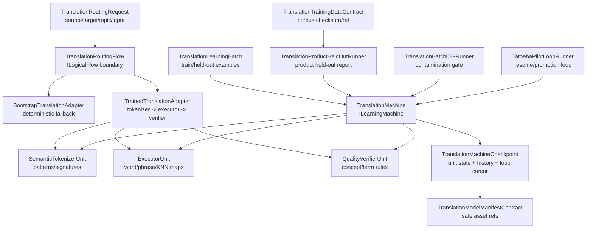

# 27.TranslationDomain - документация реализации

## 1. Карта для Лубы

`27.TranslationDomain` - доменный слой перевода: contracts для направлений и запросов, `TranslationMachine` как обучаемая машина, routing flow для inference, direction adapters, внутренние trained units, checkpoint/cache/manifest contracts и runner-ы для batch/held-out проверки.

Главная честная граница: `TranslationMachine` действительно реализует `ILearningMachine<TranslationDomain>` и имеет checkpoint save/load для trained state. Но `ExportAsync`/`ImportAsync` отдельно являются metadata-only путем. Manifest, JSON report, checkpoint path или accuracy number не доказывают продуктовую готовность без load/use evidence, held-out/product runner evidence и проверки, что train/held-out не пересекаются.

## 2. UML для draw.io



### Симуляции связей

| Связь | Пример входа | Что происходит | Ожидаемый результат | Что нельзя заявлять |
|---|---|---|---|---|
| `Request` -> `Flow` | `ru -> en`, topic `general`, text `привет` | Flow проверяет `FlowId`, input, direction и adapter | `LogicalFlowResult` или error code | Route не доказывает обученную модель |
| `Flow` -> `Bootstrap` | Adapter не обучен или verifier не принял candidate | Bootstrap возвращает fallback строку | Низкая confidence / bootstrap result | Это не trained translation |
| `Flow` -> `Trained` | Есть trained runtime units | Tokenizer -> executor -> verifier | Перевод принят или fallback | Один accepted candidate не доказывает generalization |
| `Batch` -> `Machine` | Structured batch с train и held-out rows | Non-held-out rows тренируют units; held-out измеряет accuracy | `LearningBatchResult` | Batch без независимой проверки не доказывает продукт |
| `Machine` -> `Checkpoint` | `SaveCheckpointAsync(path)` | Экспортирует unit state и пишет JSON атомарно | Checkpoint для `LoadCheckpointAsync` | Path/JSON без fresh load не равен готовой модели |
| `Manifest` -> asset | Safe refs и accuracy | Проверяет schema, filenames, relative refs | Valid manifest contract | Manifest не заменяет runtime evidence |
| `BatchRunner` -> `Machine` | Train/held-out split | Проверяет overlap before claiming accuracy | Ошибка при contamination | Пересеченный split нельзя считать held-out |
| `Tatoeba` -> `Machine` | Loop corpus + checkpoint | Тренирует batches, сохраняет cursor/history | Resume/continue path | Loop report без запуска не доказывает качество |

## 3. Алгоритмы без кода

### Алгоритм A: `TranslationMachine.TrainStructuredBatchAsync`

- Сигнатура: `TrainStructuredBatchAsync(TranslationLearningBatch batch, CancellationToken ct = default)`.
- Вход: `TranslationLearningBatch` с `Examples`, `UnitId`, train/held-out flags и JSON outputs.
- Выход: `OperationResult<LearningBatchResult>`.
- Поведение: `CANCELLED`, `BATCH_REQUIRED`, `BATCH_EMPTY`; затем non-held-out examples передаются в `_unitTrainers` по `UnitId`; identities сохраняются для checkpoint; held-out rows дают `MeasureHeldOutAccuracy`, иначе считается unit coverage.
- Не доказывает: качество вне held-out/product runner, если нет свежего run/load/use evidence.

### Алгоритм B: legacy `TranslationMachine.TrainBatchAsync`

- Сигнатура: `TrainBatchAsync(LearningBatch<TranslationDomain> batch, CancellationToken ct = default)`.
- Вход/выход: generic learning batch -> `OperationResult<LearningBatchResult>`.
- Поведение: bootstrap/legacy path с guards и scalar accuracy bump примерно на `0.01`.
- Не доказывает: реальное обучение tokenizer/executor/verifier units.

### Алгоритм B2: оценка `TranslationMachine.EvaluateAsync`

- Сигнатура: `EvaluateAsync(LearningEvaluationSet<TranslationDomain> evalSet, CancellationToken ct = default)`.
- Вход/выход: evaluation set -> `OperationResult<LearningEvaluationResult>`.
- Поведение: если structured training уже есть, машина выполняет перевод и сравнивает ожидаемый output; в bootstrap/legacy состоянии оценка остается ограниченной scalar-логикой.
- Не доказывает: качество на новых пользовательских данных без актуального held-out/product runner evidence.

### Алгоритм C: `TranslationRoutingFlow.ExecuteAsync`

- Сигнатура: `ExecuteAsync(LogicalFlowRequest<TranslationRoutingRequest> request, CancellationToken cancellationToken = default)`.
- Вход: logical request с `FlowId`, `RunId`, `TranslationRoutingRequest`.
- Выход: `OperationResult<LogicalFlowResult>`.
- Поведение: guards для cancel/null/wrong flow/null input; direction resolve; adapter lookup; adapter call; metrics/evidence/result packaging.
- Не доказывает: что adapter обучен или что output качественный.

### Алгоритм D: `TrainedTranslationAdapter.TranslateAsync`

- Сигнатура: `TranslateAsync(TranslationRoutingRequest request, CancellationToken cancellationToken = default)`.
- Вход/выход: routing request -> `OperationResult<TranslationRoutingResult>`.
- Поведение: `TranslationSemanticTokenizer` tokenizes; `ExecutorUnit` builds candidate; `QualityVerifierUnit` verifies; accepted branch требует confidence/verification, иначе fallback.
- Не доказывает: fallback или exact-map hit не являются generalization.

### Алгоритм E: trained units

- `SemanticTokenizerUnit.Tokenize(string text, string language)` -> `SemanticTokenSequence`; `TrainOnExample(TranslationLearningExample example)` учит signatures/patterns.
- `ExecutorUnit.Execute(SemanticTokenSequence tokens, string topicDomain)` -> candidate; `TrainOnExample(...)` наполняет exact source map, word map, phrase map и KNN store.
- `QualityVerifierUnit.Verify(string candidate, SemanticTokenSequence tokens)` -> pass/score; `TrainOnExample(...)` учит concept rules и required terms.
- Не доказывает: отдельный unit без machine checkpoint/manifest/load не является завершенным product asset.

### Алгоритм E2: общий KNN store `TranslationKnnStore`

- Где живет логика: `27.TranslationDomain/TranslationUnitContracts.cs`, класс `TranslationKnnStore`.
- Сигнатуры: `AddPair(string signature, string sourceText, string targetText)`, `FindNearest(string signature, int k = 3)`, `FindNearestCascade(string fullSignature, string prefixSignature, string structureSignature, int k = 3, string? querySourceText = null, bool enableEnglishPolarityField = false, Func<string, string, bool>? candidatePredicate = null)`, `Count`, `ExportCheckpoint()`, `ImportCheckpoint(TranslationKnnStoreCheckpoint checkpoint)`.
- Два завершающих необязательных довода каскада, оба со значением по умолчанию, которое сохраняет прежнее поведение для всех нынешних вызывающих:
  - `enableEnglishPolarityField`, по умолчанию `false` — включает сравнение знака английского высказывания перед прежним правилом связочных предложений (перенос «знак английского высказывания», раздел 11 этого документа);
  - `candidatePredicate`, по умолчанию `null` — вопрос вызывающего об одном уже отобранном кандидате: можно ли вообще отдать эту запись. Он применяется ПОСЛЕ отбора и обрезки каждого уровня, и уровень, опустевший из-за него, не заканчивает поиск, а проваливается на следующий, более широкий (перенос «проверка пригодности цели между уровнями», адрес P64).
- Вход: structural signatures из tokenizer/unit training, source text и target translation.
- Выход: список `(Source, Target)` ближайших trained pairs, счетчик stored pairs или `TranslationKnnStoreCheckpoint`.
- Поведение: `AddPair` кладет learned `(signature -> source/target)` в bucket; `FindNearest` сначала ищет exact signature, затем partial component overlap; `FindNearestCascade` идет от full signature к prefix и structure signature с source-aware guard, причём порог самого точного уровня теперь ровно тот же, что у более широких уровней, — постоянный `SourceAwareBroadSignatureSimilarity`, а не ноль и не выбор между двумя порогами по виду подписи (перенос «постоянный порог источника на самом точном уровне», адрес P62); `ExportCheckpoint` сохраняет все пары в deterministic flat list, а `ImportCheckpoint` очищает store и восстанавливает пары через `AddPair`.
- Как использует `ExecutorUnit`: executors пишут пары в общий `TranslationKnnStore` во время training и читают его во время inference как bridge между обучением и переводом.
- Не доказывает: KNN hit или exact-memory retrieval является trained state, но сам по себе не доказывает held-out generalization или качество продукта.

### Алгоритм F: batch/contracts/runners

- `TranslationStructuredBatchBuilder.BuildRuEnGeneralBatch(...)` и `BuildGeneralBatch(...)`: строят tokenizer/executor/verifier examples из train-ready pairs.
- `TranslationMachine.ExportCheckpoint`, `ImportCheckpoint`, `SaveCheckpointAsync`, `LoadCheckpointAsync` и `TranslationCheckpointCache`: сохраняют, загружают и кешируют full trained state по path/write timestamp/length.
- `TranslationModelManifestContract.Create/IsValidSharedAssetManifest`: фиксируют safe relative asset refs.
- `TranslationTrainingDataContract.CreateManifest/IsValidSharedTrainingDataManifest`: фиксируют corpus filename, sha256 и pair count.
- `TranslationProductHeldOutRunner`, `TranslationBatch029Runner`, `TatoebaPilotLoopRunner`: дают runtime paths для held-out reports, contamination checks, checkpoint resume/continue and promotion decisions.

### Алгоритм G: DPO-токены видят перевод, а не служебные подсказки

- Где живет логика: `27.TranslationDomain/TranslationDpoTrainerBridge.cs`, класс `TranslationDpoTextFeaturizer`.
- Сигнатуры: `BuildTrainDpoBatches(...)`, `BuildHeldOutEvaluationDpoBatches(...)`; внутри обе границы проходят через `BuildRecord` и очистку model-visible текста.
- Вход: raw `DpoPair` с chosen/rejected и audit-only блоками `[WRONG: ...]`, `[PHRASE: source => target]`, `[AGREEMENT: source => target]`.
- Выход: `TranslationDpoBatchRecord` с raw `SourcePair` для аудита и очищенными token ids / fingerprints для модели.
- Поведение: перед токенизацией bridge удаляет только закрытые квадратные блоки `WRONG:` и валидные `PHRASE:` / `AGREEMENT:` с `=>`; обычные скобки, эти же префиксы без стрелки и незакрытые скобки остаются текстом перевода.
- Защита: если chosen или rejected после очистки пустой, строка отвергается до создания тензоров; формат admitted tensor context теперь `translation-dpo-final-token-tensors-v2`.
- Не доказывает: сама очистка не доказывает качество перевода или held-out generalization; она только закрывает утечку служебных подсказок в модельный вход.

### Алгоритм G2: допуск пары перевода держится на raw-тексте

- Где живет выдача допуска: `TranslationDpoTrainingHandoffBuilder.BuildSeedCorpusTrainHandoff`.
- Issuer допуска: ровно `TranslationDpoTrainingHandoffBuilder`.
- Авторство сторон: chosen и rejected получают `DpoPairSideAuthorKind.User` только после проверки паспорта строки: `synthetic_self_authored`, лицензия `project_internal_self_authored`, provider/model `none`, нет external API, нет closed teacher, author непустой.
- Raw binding: fingerprint admission считается по фактическим `TrainerPair.Prompt`, `TrainerPair.Chosen`, `TrainerPair.Rejected`; это включает разрешенную train-ready replacement pair, если она пришла уже validated artifact-ом.
- Bridge-защита: перед tokenization `TranslationDpoTrainerBridge` заново связывает admission с raw pair. `with`-мутация Prompt/Chosen/Rejected после выдачи паспорта падает с `DPO_PAIR_ADMISSION_CONTENT_MISMATCH`; diagnostic stripping не может стать новым admitted content.
- Held-out граница: held-out evaluation rows не имеют training admission, а evaluation `DpoBatch` оставляет `Admission = null`.
- Scope: это только переводческий substage 2/5 из Prompt 10. Translation handoff и translation tokenization bridge заполнены; CapabilityTraining, Wiki, DesignConversion, внешний experimental runner и enforcement в `DpoTrainer` не входят в этот срез. Поэтому полный зеленый статус двери не заявляется: protected trainer inputs остаются 0/3, product bridges with admission сейчас 2/5.

> Текущая пометка от 29.08.2026: строка выше сохранена как исторический статус
> переводческого среза и не описывает нынешнее состояние всего контура. Теперь
> учтены все пять продуктовых мест создания пары, а три изменяющих входа
> тренера требуют допуска и отклоняют платную внешнюю модель на любой стороне.
> Точечный пакет проверки текущей связки на вершине
> `c325d52a37c8faeb8923fb1d7d44f5f4215ef05c` прошёл 18 из 18 проверок; полный
> набор тестов не запускался и зелёным не объявляется.

### Алгоритм H: запуск Translation DPO не теряет серверный контекст воспроизводимости

- Где живет общий контракт: `11.DPO/DpoTrainingReproducibilityContext.cs`.
- Где живет адаптер серверной власти: `27.TranslationDomain.Tools/TranslationDpoModelServerCoordinator.cs`.
- Где живет fail-closed запуск: `27.TranslationDomain/TranslationDpoTrainEvaluateRunner.cs`.
- Вход: ModelServer создаёт `DesignConversionDpoPolicyRandomContext` с root seed, fingerprint training configuration и тремя разными доменами случайных потоков — policy, reference и fresh-load.
- Адаптация: coordinator, который единственный видит и ModelServer, и Translation DPO, переводит этот серверный context в общий DPO contract. Сам `27.TranslationDomain` не зависит от `44.DesignConversionDomain`.
- Защита initial run: runner сначала проверяет context и строит evidence; только после этого разрешены чтение corpus, создание output/checkpoint paths, model factories, mutation-admission lease и JSON report.
- Защита continuation: source report обязан содержать valid `DpoTrainingReproducibilityEvidence`, а его canonical context hash должен совпасть с текущим context. Старые отчёты читаются как JSON, но не могут быть продолжены без evidence.
- Что пишет отчёт: typed context, canonical SHA-256 context hash и refs на root seed, training config fingerprint, random derivation scheme и context hash.
- Не доказывает: этот slice сохраняет и проверяет серверный context до side effects, но ещё не обещает bit-identical checkpoint и не доказывает, что каждый stochastic adapter/topology step уже использует этот context. Это следующий slice воспроизводимости.

### Алгоритм I: Translation DPO training pairs живут в repository-owned store

- Где живет typed context: `27.TranslationDomain/TranslationRepositoryOwnedDpoDatasetContext.cs`.
- Где живет fail-closed disk-first route: `27.TranslationDomain/TranslationDpoTrainEvaluateRunner.cs`.
- Где живет преобразование sealed common rows обратно в translation handoff: `27.TranslationDomain/TranslationDpoTrainingHandoff.cs`.
- Disabled value: `TranslationRepositoryOwnedDpoDatasetContext.Disabled` оставляет старый seed-corpus плюс translation-artifact путь.
- Enabled input: context содержит validated `RepositoryOwnedDpoDatasetAddress` и `RepositoryOwnedDpoDatasetRequestIdentity`; некорректный address или identity останавливает runner до чтения training artifact, trainer mutation, output report и checkpoint.
- Exact sealed hit: runner сначала открывает `training-data/dpo/<domain>/<pattern>/<version>/manifest.json` через `RepositoryOwnedDpoDatasetResolver`; если manifest и ordered pair files совпали с request identity, training handoff строится из reopened common `DpoPair` rows. Legacy `TranslationTrainingDataArtifactStore` для training rows не загружается.
- Authorship/provenance passport: reopened common `DpoPair` rows не сжимаются обратно в бедный `User/User` admission. `TranslationDpoTrainingHandoffRecord` несёт `TranslationRepositoryOwnedDpoPairPassport`: открытый учитель, governance decision и авторство сторон. Для текущей переводческой проекции trainer admission обязан быть `OpenTeacher` на chosen side и `LocalModel` на rejected side; legacy seed-строки остаются явным `User/User` путём без repository passport.
- Clean miss: только доказанно пустой repository-owned dataset позволяет один раз выполнить существующий validated seed/artifact-to-handoff путь. Train-ready rows проецируются в common rich `DpoPair` records с сохранением полной provenance/authorship/governance identity, запечатываются resolver-ом, переоткрываются с диска и только затем идут в training handoff.
- Fail-closed states: request mismatch, corrupt manifest, hash mismatch, partial dataset, foreign/legacy shape, projection failure, missing repository passport, mutated teacher provenance, mutated governance decision или side-authorship/admission mismatch останавливают runner до checkpoint write и до trainer mutation.
- Held-out граница: common `DpoPair` не хранит всё, что нужно для честного held-out перевода: expected target text, held-out row identity и translation direction/source metadata. Поэтому этот slice переиспользует repository-owned store только для training pairs; held-out evaluation всё ещё требует explicit seed corpus source и не подменяется teacher output-ом.
- Граница модели: `RepositoryOwnedDpoDatasetContext` отвечает только за DPO rows. Продолжение и публикация весов включаются отдельным `TranslationRepositoryOwnedModelCheckpointContext`; legacy `CheckpointDirectory` остаётся совместимым локальным artifact path только для disabled route. В enabled route он не получает model bytes, metrics, lock files или report artifacts.

### Алгоритм J: Translation DPO продолжает repository-owned policy checkpoint

- Где живет typed context: `27.TranslationDomain/TranslationRepositoryOwnedModelCheckpointContext.cs`.
- Где живет common storage contract: `14.ContinuousLearning/Training/RepositoryOwnedTrainingArtifactLayout.cs`, `RepositoryOwnedModelCheckpointLoader.cs`, `RepositoryOwnedModelCheckpointManifest.cs`.
- Где wired route: `27.TranslationDomain/TranslationDpoTrainEvaluateRunner.cs` и `27.TranslationDomain.Tools/TranslationDpoModelServerCoordinator.cs`.
- Disabled value: `TranslationRepositoryOwnedModelCheckpointContext.Disabled` сохраняет прежнее поведение runner-а и его `CheckpointDirectory`.
- Enabled input: context задаёт exact model identity под `training-artifacts/models/<domain>/<design-pattern>/<model>/<version>`, exact runtime compatibility fingerprints, provenance refs и explicit cold-start policy. Произвольный внешний output/checkpoint directory не принимается как model authority и не используется как trainer artifact directory.
- Порядок загрузки: runner сначала валидирует DPO context и model context. Затем policy/reference/fresh-load получают обязательную seeded LoRA форму. Только после этого, но до trainer lease, до создания `DpoTrainer` и до первой mutation, `RepositoryOwnedModelCheckpointLoader.LoadLatestCompatible` ищет sealed compatible parent и отдаёт свежий verified stream; именно этот stream загружается в policy model.
- Cold start: разрешён только для exact missing states (`no tree` или `no sealed candidate`) и только если context содержит непустую человеческую причину. Corrupt, ambiguous, unavailable или incompatible-only candidate останавливает run; silent fallback на fresh model запрещён.
- Публикация: после loader/start evidence runner вычисляет ровно один next-step root: cold start публикует step 1, continuation публикует checked `parent.Step + 1`. `DpoTrainer` пишет `dpo_policy_step_*.bin`, metrics и lock files в этот же repository step root; затем `RepositoryOwnedModelCheckpointManifestSealer.PersistAndSeal` копирует фактический trainer policy file в `weights.bin` и сразу вызывает `OpenSealed`. Manifest связывает веса с exact sealed DPO dataset manifest, runtime compatibility, parent identity или cold-start reason и provenance refs.
- Failure boundary: если публикация или reopen/verify fails, runner возвращает failure и не пишет success report. Caller-supplied legacy checkpoint directory остаётся отсутствующим; частичная попытка, если она есть, остаётся только внутри canonical repo-shaped `training-artifacts/models/.../checkpoints/<step>` tree and loader fails closed until a sealed manifest/weights pair exists.
- Доказано focused tests: first cold start публикует step 1 с `parent=null` и причиной; два последовательных enabled run с одним и тем же external decoy/options продолжаются с step 1 на step 2 без внешнего каталога; continuation выбирает latest compatible parent и публикует `parent+1`; corrupt/incompatible/ambiguous/invalid bytes падают до trainer mutation; DPO manifest binding проверяется через common sealer; SHA-256 sealed `weights.bin` совпадает с фактическим trainer policy checkpoint; `training-artifacts` остаётся неигнорируемым Git path.
- Не доказывает: real Chinese-model training, качество перевода, production corpus/teacher run, fresh clone LFS materialization. Тесты используют tiny deterministic temp fixtures вне canonical live tree и не создают настоящие DPO/weights в рабочем дереве.

## 4. Точные цитаты из кода

### Structured training работает по unit trainers

`27.TranslationDomain/TranslationMachine.cs:83-132`

```csharp
    public Task<OperationResult<LearningBatchResult>> TrainStructuredBatchAsync(
        TranslationLearningBatch batch,
        CancellationToken ct = default)
    {
        if (ct.IsCancellationRequested)
            return Task.FromResult(OperationResult<LearningBatchResult>.Fail("Structured training cancelled.", "CANCELLED"));

        if (batch is null)
            return Task.FromResult(OperationResult<LearningBatchResult>.Fail("Structured training batch is required.", "BATCH_REQUIRED"));

        if (batch.Examples.Count == 0)
            return Task.FromResult(OperationResult<LearningBatchResult>.Fail(
                "Structured training batch must contain at least one example.", "BATCH_EMPTY"));

        var startMs = Environment.TickCount64;
        var accuracyBefore = _accuracyAfterLastBatch;
        var trainedUnits = new HashSet<string>(StringComparer.Ordinal);

        foreach (var example in batch.Examples.Where(example => !example.HeldOut))
        {
            if (!_unitTrainers.TryGetValue(example.UnitId, out var trainer))
                continue;

            trainer.TrainOnExample(example);
            trainedUnits.Add(example.UnitId);
            if (!_structuredTrainingIdentities.Any(identity =>
                    string.Equals(identity.ExampleId, example.ExampleId, StringComparison.Ordinal) &&
                    string.Equals(identity.UnitId, example.UnitId, StringComparison.Ordinal)))
                _structuredTrainingIdentities.Add(new TranslationStructuredTrainingIdentityCheckpoint(
                    example.ExampleId,
                    example.SourceId,
                    example.UnitId,
                    batch.BatchId));
        }

        var heldOut = batch.Examples.Where(example => example.HeldOut).ToArray();
        var accuracyAfter = heldOut.Length > 0
            ? MeasureHeldOutAccuracy(heldOut)
            : MeasureUnitCoverage(trainedUnits);

        var rewardMargin = batch.Examples.All(example =>
            example.RejectedOutputJson.Contains("[WRONG:", StringComparison.Ordinal))
                ? 0.03
                : 0.0;

        _hasStructuredTraining = trainedUnits.Count > 0;
        _accuracyAfterLastBatch = accuracyAfter;
        IncrementPatchVersion();

        var result = new LearningBatchResult(
```

Почему важно: это actual algorithm, а не только class name: guards, unit trainer dispatch, held-out branch и reward margin.

### Metadata export не является full restore

`27.TranslationDomain/TranslationMachine.cs:199-221`

```csharp
    public Task<OperationResult<LearningMachineExport>> ExportAsync(CancellationToken ct = default)
    {
        // Return early if cancellation was requested before doing any work.
        if (ct.IsCancellationRequested)
            return Task.FromResult(OperationResult<LearningMachineExport>.Fail("Export cancelled.", "CANCELLED"));

        // Build a metadata record. CheckpointRef here is not a file path — it is a placeholder.
        // For a real checkpoint that restores trained state, call SaveCheckpointAsync instead.
        var export = new LearningMachineExport(
            MachineId: MachineId,
            DomainTag: DomainTag,
            Version: _currentVersion,
            CheckpointRef: $"{MachineId}/{_currentVersion}/checkpoint",
            ManifestRef: $"{MachineId}/{_currentVersion}/manifest.json",
            AccuracyAtExport: _accuracyAfterLastBatch,
            ExportedAtUtc: DateTimeOffset.UtcNow);

        return Task.FromResult(OperationResult<LearningMachineExport>.Ok(export));
    }

    // ImportAsync restores only scalar metadata (version, accuracy) from an export record.
    // It does NOT restore trained unit state. For full restore from disk use LoadCheckpointAsync.
    // This method is the metadata counterpart to ExportAsync — not a trained-model load path.
```

Почему важно: исходник сам запрещает подменять full checkpoint restore metadata-only export/import.

### Checkpoint содержит unit state

`27.TranslationDomain/TranslationMachine.cs:254-295`

```csharp
    public OperationResult<TranslationMachineCheckpoint> ExportCheckpoint()
    {
        // Verify that the machine has typed unit references required for checkpoint export.
        if (_runtime is null)
            return OperationResult<TranslationMachineCheckpoint>.Fail(
                "Runtime state is not available for this machine.", "RUNTIME_STATE_UNAVAILABLE");

        // Map the in-memory training history to checkpoint records.
        var historyEntries = _trainingHistory
            .Select(h => new TranslationTrainingHistoryEntryCheckpoint(
                BatchId: h.BatchId,
                RowsTrained: h.RowsTrained,
                AccuracyBefore: h.AccuracyBefore,
                AccuracyAfter: h.AccuracyAfter,
                RewardMargin: h.RewardMargin,
                CpuMs: h.CpuMs,
                PeakRamMb: h.PeakRamMb,
                ElapsedMs: h.ElapsedMs,
                PromotedUnitIds: h.PromotedUnitIds))
            .ToList();

        // Build the top-level checkpoint record from machine fields and all unit exports.
        var checkpoint = new TranslationMachineCheckpoint(
            SchemaVersion: 1,
            MachineId: MachineId,
            DomainTag: DomainTag,
            Version: _currentVersion,
            AccuracyAfterLastBatch: _accuracyAfterLastBatch,
            HasStructuredTraining: _hasStructuredTraining,
            ExportedAtUtc: DateTimeOffset.UtcNow,
            KnnStore: _runtime.KnnStore.ExportCheckpoint(),
            SemanticTokenizer: _runtime.SemanticTokenizer.ExportCheckpoint(),
            Executors: _runtime.Executors.Values.Select(e => e.ExportCheckpoint()).ToList(),
            QualityVerifier: _runtime.Verifier.ExportCheckpoint(),
            TrainingHistory: historyEntries,
            StructuredTrainingIdentities: _structuredTrainingIdentities
                .OrderBy(identity => identity.ExampleId, StringComparer.Ordinal)
                .ThenBy(identity => identity.UnitId, StringComparer.Ordinal)
                .ToList(),
            TatoebaLoop: null);  // Runner sets TatoebaLoop when it calls SaveCheckpointAsync.

        return OperationResult<TranslationMachineCheckpoint>.Ok(checkpoint);
```

Почему важно: здесь видно, какие trained artifacts реально входят в checkpoint.

### Fresh load восстанавливает новую машину из checkpoint

`27.TranslationDomain/TranslationMachine.cs:447-486`

```csharp
    public static async Task<OperationResult<TranslationMachineLoadResult>> LoadCheckpointAsync(
        string checkpointPath,
        CancellationToken ct = default)
    {
        // Validate the checkpoint path and check file existence before reading.
        if (ct.IsCancellationRequested)
            return OperationResult<TranslationMachineLoadResult>.Fail("Load cancelled.", "CANCELLED");
        if (string.IsNullOrWhiteSpace(checkpointPath))
            return OperationResult<TranslationMachineLoadResult>.Fail(
                "Checkpoint path is required.", "CHECKPOINT_PATH_REQUIRED");
        if (!File.Exists(checkpointPath))
            return OperationResult<TranslationMachineLoadResult>.Fail(
                $"Checkpoint file not found: {checkpointPath}", "CHECKPOINT_NOT_FOUND");

        // Read and deserialise the checkpoint JSON.
        TranslationMachineCheckpoint checkpoint;
        try
        {
            var json = await File.ReadAllTextAsync(checkpointPath, System.Text.Encoding.UTF8, ct);
            var parsed = JsonSerializer.Deserialize<TranslationMachineCheckpoint>(
                json, TranslationCheckpointJsonOptions.Standard);
            if (parsed is null)
                return OperationResult<TranslationMachineLoadResult>.Fail(
                    "Checkpoint deserialisation returned null.", "CHECKPOINT_DESERIALIZE_FAILED");
            checkpoint = parsed;
        }
        catch (Exception ex)
        {
            return OperationResult<TranslationMachineLoadResult>.Fail(ex.Message, "CHECKPOINT_READ_FAILED");
        }

        // Create a fresh machine and restore all trained state from the checkpoint.
        var machine = new TranslationMachine();
        var importResult = machine.ImportCheckpoint(checkpoint);
        if (!importResult.IsSuccess)
            return OperationResult<TranslationMachineLoadResult>.Fail(importResult.ErrorMessage, importResult.ErrorCode);

        // Return the fully restored machine with the runner loop cursor — ready for inference without replay.
        return OperationResult<TranslationMachineLoadResult>.Ok(
            new TranslationMachineLoadResult(machine, checkpoint.TatoebaLoop));
```

Почему важно: это source-backed fresh-load path. Он доказывает load mechanics, но не подменяет held-out/product quality.

### Routing flow выбирает adapter

`27.TranslationDomain/TranslationRoutingFlow.cs:39-119`

```csharp
    public async Task<OperationResult<LogicalFlowResult>> ExecuteAsync(
        LogicalFlowRequest<TranslationRoutingRequest> request,
        CancellationToken cancellationToken = default)
    {
        // Return cancellation immediately when the token was already cancelled.
        if (cancellationToken.IsCancellationRequested)
            return OperationResult<LogicalFlowResult>.Fail("Translation routing flow cancelled.", "CANCELLED");

        // Require a non-null request at the flow boundary.
        if (request is null)
            return OperationResult<LogicalFlowResult>.Fail("Logical flow request is required.", "REQUEST_REQUIRED");

        // Reject requests for a different flow id to prevent misrouting.
        if (!string.Equals(request.FlowId, FlowId, StringComparison.Ordinal))
            return OperationResult<LogicalFlowResult>.Fail(
                $"Unsupported flow id '{request.FlowId}'. Expected '{FlowId}'.", "UNSUPPORTED_FLOW_ID");

        // Reject null input — the routing request is always required.
        if (request.Input is null)
            return OperationResult<LogicalFlowResult>.Fail("TranslationRoutingRequest input is required.", "INPUT_REQUIRED");

        // Resolve which direction adapter should handle this source→target pair.
        var directionResult = ResolveDirection(request.Input.SourceLanguage, request.Input.TargetLanguage);
        if (!directionResult.IsSuccess)
            return OperationResult<LogicalFlowResult>.Fail(directionResult.ErrorMessage, directionResult.ErrorCode);

        var direction = directionResult.Value!;

        // Look up the adapter for the resolved direction.
        if (!_adapters.TryGetValue(direction, out var adapter))
            return OperationResult<LogicalFlowResult>.Fail(
                $"No adapter registered for direction '{direction}'.", "ADAPTER_NOT_FOUND");

        // Delegate the actual translation to the direction adapter.
        var adapterResult = await adapter.TranslateAsync(request.Input, cancellationToken);
        if (!adapterResult.IsSuccess)
            return adapterResult.MapError<LogicalFlowResult>();

        var translationResult = adapterResult.Value!;

        // Build a minimal LogicalFlowSummary from the translation outcome.
        var passed = translationResult.Confidence > 0.0;
        var summary = new LogicalFlowSummary(
            SummaryId: $"{FlowId}-{request.RunId}",
            Tier: 1,
            BaselinePrimary: 0,
            EnhancedPrimary: translationResult.Confidence,
            PrimaryMetricName: "translation_confidence",
            LowerIsBetter: false,
            Passed: passed,
            ShouldScaleUp: false,
            NextAction: passed ? "return_translation" : "request_more_context",
            ScalingSignal: 0,
            ScalingSignalNote: "",
            Notes: $"direction={direction}; adapter_id={translationResult.AdapterId}; topic={request.Input.TopicDomain}",
            BaselineTimeMs: 0,
            EnhancedTimeMs: 0);

        // Build the metrics dictionary for traceability and monitoring.
        var metrics = new Dictionary<string, string>(StringComparer.Ordinal)
        {
            ["direction"]            = direction.ToString(),
            ["adapter_id"]           = translationResult.AdapterId,
            ["source_language"]      = request.Input.SourceLanguage,
            ["target_language"]      = request.Input.TargetLanguage,
            ["topic_domain"]         = request.Input.TopicDomain,
            ["confidence"]           = translationResult.Confidence.ToString("F4", CultureInfo.InvariantCulture),
            ["input_length"]         = request.Input.InputText.Length.ToString(CultureInfo.InvariantCulture),
            ["translated_length"]    = translationResult.TranslatedText.Length.ToString(CultureInfo.InvariantCulture)
        };

        // Build and return the LogicalFlowResult carrying the translated text.
        var flowResult = new LogicalFlowResult(
            FlowId: FlowId,
            ScenarioId: ScenarioId,
            OverallVerdict: passed ? "TRANSLATED" : "TRANSLATION_LOW_CONFIDENCE",
            FinalHumanResult: translationResult.TranslatedText,
            Summary: summary,
            Metrics: metrics,
            EvidenceIds: [$"translation-adapter:{translationResult.AdapterId}"],
            Warnings: passed ? [] : ["Low confidence — Bootstrap adapter has no trained weights yet."]);
```

Почему важно: это `ILogicalFlow` boundary; он выбирает adapter и возвращает traceable result, но не является `ILearningMachine`.

### Trained adapter может уйти в fallback

`27.TranslationDomain/TranslationDirectionAdapters.cs:112-136`

```csharp
    public Task<OperationResult<TranslationRoutingResult>> TranslateAsync(
        TranslationRoutingRequest request,
        CancellationToken cancellationToken = default)
    {
        if (cancellationToken.IsCancellationRequested)
            return Task.FromResult(OperationResult<TranslationRoutingResult>.Fail("Translation cancelled.", "CANCELLED"));

        var tokens = _semanticTokenizer.Tokenize(request.InputText, request.SourceLanguage);
        var candidate = _executor.Execute(tokens, request.TopicDomain);
        var verification = _verifier.Verify(candidate.Text, tokens);

        var phraseMapCandidate = candidate.AdapterId.EndsWith("-phrase-map", StringComparison.Ordinal);
        if (candidate.Confidence >= 0.5 && (verification.Pass || (phraseMapCandidate && candidate.Confidence >= 0.85)))
        {
            var result = new TranslationRoutingResult(
                Direction,
                candidate.Text,
                Math.Min(0.99, Math.Max(candidate.Confidence, verification.Score)),
                candidate.AdapterId);
            return Task.FromResult(OperationResult<TranslationRoutingResult>.Ok(result));
        }

        return _fallback.TranslateAsync(request, cancellationToken);
    }
}
```

Почему важно: даже trained adapter не всегда возвращает trained result; fallback branch нельзя выдавать за обученное качество.

### `TranslationKnnStore` хранит пары source/target под structural signature

`27.TranslationDomain/TranslationUnitContracts.cs:196-234`

```csharp

    // _store maps structural signature to the list of (source, target) translation pairs.
    private readonly Dictionary<string, List<(string Source, string Target)>> _store
        = new(StringComparer.Ordinal);

    // AddPair stores one learned translation pair under its structural signature.
    public void AddPair(string signature, string sourceText, string targetText)
    {
        // Ensure the bucket for this signature exists.
        if (!_store.TryGetValue(signature, out var bucket))
        {
            bucket = new List<(string, string)>();
            _store[signature] = bucket;
        }
        // Append the new pair to the bucket — later pairs have higher DPO preference signal.
        bucket.Add((sourceText, targetText));
    }

    // FindNearest returns up to k translation pairs with signatures closest to the query.
    // Exact match is tried first; partial component overlap is the fallback.
    public IReadOnlyList<(string Source, string Target)> FindNearest(string signature, int k = 3)
    {
        // Exact match: return the bucket directly when the signature is known.
        if (_store.TryGetValue(signature, out var exact))
            return exact.Take(k).ToList();

        // Partial match: score each stored signature by component overlap with the query.
        var queryComponents = new HashSet<string>(signature.Split('|'), StringComparer.Ordinal);
        return _store
            .Select(kv => (
                Score: kv.Key.Split('|').Count(c => queryComponents.Contains(c)),
                Pairs: kv.Value))
            .Where(x => x.Score > 0)
            .OrderByDescending(x => x.Score)
            .Take(k)
            .SelectMany(x => x.Pairs)
            .Take(k)
            .ToList();
    }
```

Почему важно: это явное in-memory trained state для KNN retrieval. Оно хранит source/target пары, но exact/nearest lookup не является доказательством обобщения без held-out проверки.

### `TranslationKnnStore.FindNearestCascade` ограничивает broad fallback source-aware guard-ом

`27.TranslationDomain/TranslationUnitContracts.cs:253-308`

```csharp
    public IReadOnlyList<(string Source, string Target)> FindNearestCascade(
        string fullSignature,
        string prefixSignature,
        string structureSignature,
        int k = 3,
        string? querySourceText = null,
        bool enableEnglishPolarityField = false,
        Func<string, string, bool>? candidatePredicate = null)
    {
        var fullThreshold = SourceAwareBroadSignatureSimilarity;
        var full = ApplyCandidatePredicate(
            FindExactWithSourceGuard(fullSignature, k, querySourceText, fullThreshold, enableEnglishPolarityField),
            candidatePredicate);
        if (full.Count > 0) return full;

        var prefix = ApplyCandidatePredicate(
            FindExactWithSourceGuard(prefixSignature, k, querySourceText, SourceAwarePrefixSimilarity, enableEnglishPolarityField),
            candidatePredicate);
        if (prefix.Count > 0) return prefix;

        var structure = ApplyCandidatePredicate(
            FindExactWithSourceGuard(structureSignature, k, querySourceText, SourceAwareBroadSignatureSimilarity, enableEnglishPolarityField),
            candidatePredicate);
        if (structure.Count > 0) return structure;

        return [];
    }
```

Почему важно: cascade не просто берет любую похожую запись. Порог источника стоит теперь на ВСЕХ трёх уровнях, включая самый точный: у него тот же постоянный `SourceAwareBroadSignatureSimilarity`, что у широких уровней. Прежний ноль на самом точном уровне означал, что подпись одной формы отдавала первую запись своего ведра независимо от её слов, то есть вопрос об одном предмете получал выученный перевод про другой; выбор между двумя порогами по виду подписи вместе с этим и отпал (перенос «постоянный порог источника», адрес P62). Второй довод каскада даёт вызывающему право отклонить уже отобранного кандидата, и уровень, опустевший из-за этого, проваливается на следующий вместо того чтобы закончить поиск отказом (перенос «проверка пригодности цели между уровнями», адрес P64); фильтр работает ПОСЛЕ обрезки уровня, поэтому пригодная запись, стоящая в том же уровне за пятью непригодными, по-прежнему недостижима. Всё это снижает риск чужой trained sentence, но не превращает retrieval в доказанную semantic generalization.

### `TranslationKnnStore` экспортируется и импортируется в checkpoint

`27.TranslationDomain/TranslationUnitContracts.cs:316-343`

```csharp
    public int Count => _store.Values.Sum(b => b.Count);

    // ExportCheckpoint builds a TranslationKnnStoreCheckpoint from all current in-memory pairs.
    // Entries are sorted deterministically: signature ascending, then source ascending.
    // The export does not write to disk — the caller is responsible for persistence.
    internal TranslationKnnStoreCheckpoint ExportCheckpoint()
    {
        // Flatten all buckets into a sorted list of (signature, source, target) triples.
        var entries = _store
            .OrderBy(kv => kv.Key, StringComparer.Ordinal)
            .SelectMany(kv => kv.Value
                .Select(pair => new TranslationKnnStoreEntryCheckpoint(kv.Key, pair.Source, pair.Target)))
            .ToList();
        // Wrap in the checkpoint record and return.
        return new TranslationKnnStoreCheckpoint(entries);
    }

    // ImportCheckpoint clears all current pairs and rebuilds the store from checkpoint entries.
    // After import the store is identical to the state it was in when ExportCheckpoint was called.
    internal void ImportCheckpoint(TranslationKnnStoreCheckpoint checkpoint)
    {
        // Remove all previously learned pairs before restoring from checkpoint.
        _store.Clear();
        // Restore each entry by calling the same AddPair method used during training.
        foreach (var entry in checkpoint.Entries)
            AddPair(entry.Signature, entry.Source, entry.Target);
    }
}
```

Почему важно: KNN store является частью full checkpoint lifecycle. Но checkpointed memory store still needs fresh-load and held-out/product evidence before product claims.

### Manifest contract проверяет safe refs

`27.TranslationDomain/TranslationModelManifestContract.cs:28-60`

```csharp
    public static TranslationModelManifest Create(
        double accuracyAtExport,
        string sourceBaseCommit,
        DateTimeOffset createdAtUtc)
        => new(
            ModelId: ModelId,
            Domain: Domain,
            Version: Version,
            CheckpointFilename: CheckpointFilename,
            RunnerReportRef: RunnerReportRef,
            RunnerReportFilename: RunnerReportRef,
            TrainingDataRef: TrainingDataRef,
            AccuracyAtExport: accuracyAtExport,
            LoaderType: LoaderType,
            SourceBaseCommit: sourceBaseCommit,
            SchemaVersion: SchemaVersion,
            CreatedAtUtc: createdAtUtc);

    public static bool IsValidSharedAssetManifest(TranslationModelManifest manifest)
        => string.Equals(manifest.ModelId, ModelId, StringComparison.Ordinal) &&
           string.Equals(manifest.Domain, Domain, StringComparison.Ordinal) &&
           string.Equals(manifest.Version, Version, StringComparison.Ordinal) &&
           string.Equals(manifest.CheckpointFilename, CheckpointFilename, StringComparison.Ordinal) &&
           string.Equals(manifest.RunnerReportRef, RunnerReportRef, StringComparison.Ordinal) &&
           string.Equals(manifest.RunnerReportFilename, RunnerReportRef, StringComparison.Ordinal) &&
           string.Equals(manifest.TrainingDataRef, TrainingDataRef, StringComparison.Ordinal) &&
           manifest.AccuracyAtExport > 0.0 &&
           string.Equals(manifest.LoaderType, LoaderType, StringComparison.Ordinal) &&
           manifest.SchemaVersion == SchemaVersion &&
           IsSafeRelativeRef(manifest.CheckpointFilename) &&
           IsSafeRelativeRef(manifest.RunnerReportRef) &&
           IsSafeRelativeRef(manifest.RunnerReportFilename) &&
           IsSafeRelativeRef(manifest.TrainingDataRef);
```

Почему важно: manifest проверяет форму asset refs, но не заменяет checkpoint/load/runtime evidence.

### Batch runner ловит contamination

`27.TranslationDomain/TranslationBatch029Runner.cs:333-360`

```csharp
    private static string? BuildTrainHeldOutOverlapError(
        IReadOnlyList<TranslationTrainReadyPair> trainPairs,
        IReadOnlyList<TranslationTrainReadyPair> heldOutPairs)
    {
        var trainByInput = trainPairs
            .Where(IsUsableRuEnPair)
            .Select(row => (Key: NormalizeForOverlap(row.ASide), row.Id))
            .Where(row => !string.IsNullOrWhiteSpace(row.Key))
            .GroupBy(row => row.Key, StringComparer.Ordinal)
            .ToDictionary(
                group => group.Key,
                group => string.Join(",", group.Select(row => row.Id).Distinct(StringComparer.Ordinal).Take(3)),
                StringComparer.Ordinal);

        var overlaps = heldOutPairs
            .Where(IsUsableRuEnPair)
            .Select(row => (
                row.Id,
                TrainIds: trainByInput.GetValueOrDefault(NormalizeForOverlap(row.ASide))))
            .Where(row => !string.IsNullOrWhiteSpace(row.TrainIds))
            .ToArray();

        if (overlaps.Length == 0)
            return null;

        var examples = string.Join("; ",
            overlaps.Take(5).Select(row => $"{row.Id} duplicates train row(s) {row.TrainIds}"));
        return $"Train/held-out contamination detected: {overlaps.Length} held-out input(s) are also present in training. {examples}. Use a non-overlapping 100+100 split before claiming TranslationDomain accuracy.";
```

Почему важно: source explicitly blocks false held-out accuracy claims on overlapping splits.

## 5. Иерархия и статус

| Уровень | Статус в D27 |
|---|---|
| `ILearningMachine<TranslationDomain>` | Есть: `TranslationMachine` - Level 5 machine boundary |
| `ILogicalFlow<TranslationRoutingRequest>` | Есть: `TranslationRoutingFlow` - runtime routing boundary |
| Internal trainable units | Есть: `SemanticTokenizerUnit`, `ExecutorUnit`, `QualityVerifierUnit` внутри machine; `TranslationKnnStore` - общий trained memory bridge для executors |
| Deterministic/helpers | Есть: batch builders, manifest contracts, cache, corpus sourcing, runner guards |

Обучение живет на границе `TranslationMachine` и ее structured unit trainers. `TranslationRoutingFlow`, adapters, contracts и runner utilities не являются самостоятельными доказательствами обученного продукта.

## 6. QA / тестовая карта

Тесты прочитаны и сопоставлены, но не запускались в D5A.

| Тест | Что подтверждает | Что не подтверждает |
|---|---|---|
| `Tests/TranslationDomainTests.cs` | routing bootstrap/unsupported direction, structured training changes output, batch builder behavior, KNN guard, checkpoint round trip, continue-training, cache behavior, contamination rejection, held-out runner branches | Не доказывает новый внешний product run на всех directions |
| `Tests/TranslationModelAssetTests.cs` | safe manifest refs, checkpoint preserving trained state without private paths, training-data manifest contract | Не доказывает actual product accuracy |
| Runner source paths | `TranslationProductHeldOutRunner`, `TranslationBatch029Runner`, `TatoebaPilotLoopRunner` имеют source-backed runtime paths | В D5A эти runner-ы не запускались |

## 7. Anti-false-done

- JSON/report/manifest/checkpoint path не являются product readiness.
- `ExportAsync`/`ImportAsync` - metadata-only, не full trained unit restore.
- Checkpoint требует `LoadCheckpointAsync`/use evidence для fresh-load claims.
- Exact memory, phrase map или KNN hit нельзя выдавать за generalization без held-out/product runner evidence.
- `TranslationKnnStore` hit/exact memory является trained state, но не held-out generalization proof by itself.
- Bootstrap adapter output не является trained translation.
- Held-out accuracy нельзя заявлять при train/held-out contamination.
- Corpus manifest и sha256 доказывают форму данных, а не обучение.

## 8. Текущий статус

| Область | Статус |
|---|---|
| DTO/contracts | Реализованы |
| `TranslationMachine` | Реализованный `ILearningMachine<TranslationDomain>` с structured training/evaluate/checkpoint load/save |
| Metadata export/import | Реализовано, но metadata-only |
| Routing/inference | Реализован `TranslationRoutingFlow` и adapters с fallback |
| Asset lifecycle | Source-backed checkpoint save/load, `TranslationKnnStore`, `TranslationCheckpointCache` и manifest contracts есть; product readiness требует актуальных runner/load/use evidence |
| DPO training-pair store | Optional repository-owned route writes/reuses sealed common `DpoPair` rows under `training-data/dpo`; held-out still comes from explicit seed source |
| DPO model checkpoints | Optional repository-owned route loads latest compatible sealed policy checkpoint and publishes next sealed step under `training-artifacts/models` |
| Документация | D5A plus repository-owned Translation DPO training-pair/model-checkpoint boundaries documented |

## 9. DPO seeded-LoRA порядок для перевода

Текущий Translation DPO runner больше не принимает только policy/reference для первого запуска. Ему нужны три модели: policy, reference и fresh-load. Причина простая: continuation позже загружает policy checkpoint именно в fresh-load модель, поэтому fresh-load должна иметь ту же серверно утверждённую LoRA-форму ещё до `LoadCheckpoint`.

Initial run:

1. Coordinator получает от ModelServer один model set и один reproducibility context.
2. Coordinator берёт canonical LoRA topology из DesignConversion через нейтральный bridge и добавляет её в общий DPO context.
3. Runner атомарно применяет seeded LoRA topology к policy, reference и fresh-load.
4. Runner создаёт `DpoTrainer` только после этой подготовки.
5. Если repository-owned model route включён, runner до создания `DpoTrainer` вычисляет canonical next-step root внутри `training-artifacts/models/.../checkpoints`.
6. `DpoTrainer` пишет policy checkpoint и metrics в этот root, а report пишет seeded topology evidence и SHA-256 фактического trainer policy checkpoint.

Continuation run:

1. Source report обязан содержать reproducibility evidence, seeded topology evidence и SHA-256 исходного policy checkpoint.
2. Runner сначала проверяет, что fresh-load уже имеет seeded LoRA slots для fresh-load роли.
3. Runner отдельно проверяет reference provenance.
4. Только после этих проверок fresh-load вызывает `LoadCheckpoint`.

Если fresh-load неподготовлена, если role domains перепутаны, или если source report старый и не содержит topology/checkpoint evidence, continuation падает до второго training lease и до новых checkpoint-файлов.

## 10. Ранний отказ нечитаемой партии: урок первой строки больше не остаётся в памяти

Основание — назначение «отказ партии» раздела 3 плана
`docs/plans/replanning-possible-diffs/fixes-based-on-experiments/109-p53-p55-transfer-plan-2026-10-30.md`
(опыт отказа партии, подслучай с нечитаемым текстом правильного ответа).

### Что было неправильно

`TranslationMachine.TrainStructuredBatchAsync` шёл по строкам партии подряд и
записывал урок каждой строки в память единиц сразу. Проверки читаемости текстов
JSON (JavaScript Object Notation, текстовый формат записи данных) не было вовсе.
Поэтому нечитаемый текст второй строки прерывал работу разборщиком уже ПОСЛЕ
того, как урок первой строки был записан: партия считалась неприменённой, а
память переводчика помнила её половину.

Измеренный след на коде до правки (плечо кандидата приёмки, партия из законной
строки `open file -> открой файл` и нечитаемой строки `R53-invalid` с тем же
входом): пар ассоциативной памяти 3 -> 6, записей точного совпадения источника
1 -> 2, опознаний учебных строк 1 -> 2, отпечаток принятого обученного
содержимого изменился. Панель трёх независимых обращений давала 2 верных ответа
из 3 вместо 1: `open file` отвечался выученным переводом, хотя партия была
отклонена. Версия и история обучения при этом не менялись — разборщик прерывал
работу раньше них.

### Что стало

Перед первым обновлением памяти единиц выполняется чистый проход проверки
синтаксиса. Он перебирает только потенциально обучаемые строки — не отложенные
и с известным получателем обучения в карте обучателей — и читает входной текст и
текст правильного ответа разборщиком документа, без построения объекта. Проход
завершается полностью до первого обучения строки.

Нечитаемый текст даёт управляемый отказ партии: конверт результата с кодом
`BATCH_ROW_UNREADABLE` и настоящим идентификатором строки в сообщении. Ни одной
записи состояния, версии, истории обучения или опознаний учебных строк при этом
не происходит. Публичный смысл успешного обучения не изменился.

Существующие пропуски сохранены и новой ошибкой не стали: отложенная строка и
строка с неизвестным получателем обучения по-прежнему просто пропускаются, а
текст `null` синтаксически верен и остаётся прежним тихим пропуском обучателя.

Измеренный результат после правки на той же партии: отпечаток состояния совпал,
все счётчики памяти без изменений, панель даёт 1 верный ответ из 3. Исправная
партия на том же состоянии затем действительно учит открытие и закрытие — 3
верных из 3 с удержанием настроечного урока; новый объект переводчика читает
штатную контрольную точку с диска и даёт те же 3 из 3 без обучения.

Цена прохода на исправной партии после одинаковой настройки: выделения потоком
164 160 -> 164 520 байт, то есть +360 байт (+0,22 %). Фаза отказа измерена
отдельной стадией: 11,53 мс по стенным часам, 14 128 байт, 0 уроков. Время по
стенным часам и процессорное время одной короткой парой не разрешаются: разброс
даёт порядок стадий и первичная компиляция, а процессорное время короче
разрешения часов процесса. Это неустановленная скоростная ось, а не доказанная
регрессия и не доказанный выигрыш.

### Что эта правка НЕ закрывает

- Она не обещает атомарность партии при любой ошибке времени выполнения, при
  отмене или при отказе публикации. Закрыт только случай нечитаемого текста.
- Текст, который синтаксически верен, но не соответствует типу или смыслу
  структуры данных, остаётся незакрытой границей.
- Повторная доставка одной и той же учебной строки здесь не рассматривается:
  сравнение по списку опознаний учебных строк по-прежнему выполняется ПОСЛЕ
  вызова обучателя, и дедупликация этой правкой не добавлена.
- Общий механизм конвертов ошибок и транзакционный каркас в эту правку не входят.
- Основание допуска здесь — логическое исправление сохранности состояния, а не
  численный выигрыш: обычный численный порог переноса не объявляется пройденным.
- Выбранный проход проверки синтаксиса — предложенный механизм, а не измеренное
  в опыте плечо: в опыте измерялась более дорогая промежуточная копия всего
  состояния (+11,19 % выделений). Предложенный механизм измерен отдельно, здесь.

### Где лежат проверки и показания

- Проверки: `Tests/ExperimentFixes/TranslationBatchJsonLearningTests.cs`
  (плечо базы, плечо кандидата и проба чувствительности сравнения состояний).
- Запускатель и журналы четырёх прогонов с отдельными кодами возврата:
  `experiments-v2/_runners/FIX-P53-BATCH-JSON-attempt-0001/`.
- Показания плеч до и после правки: подкаталоги `receipts/01-before-fix` и
  `receipts/03-after-fix` того же каталога попытки.

## 11. Знак английского высказывания: сокращённое отрицание больше не получает противоположный перевод

Основание — опыт знака источника (назначение «узкое вето знака английского
высказывания» раздела 5 плана переноса трёх работ
`docs/plans/replanning-possible-diffs/fixes-based-on-experiments/109-p53-p55-transfer-plan-2026-10-30.md`).

### Что было неправильно

Переводчик берёт перевод самой похожей выученной записи, а похожесть считается
по набору значимых слов. Сокращение `can't` при разборе на слова распадается на
`can` и односимвольный остаток, который отбрасывается как незначащий. Поэтому у
запроса `I can't open the door` набор значимых слов совпадал с набором
выученной записи `I can open the door`, и на вопрос «я НЕ могу открыть дверь»
переводчик уверенно отдавал `Я могу открыть дверь` — противоположный смысл,
выданный как верный. Прежнее узкое правило связочных предложений этот случай не
узнаёт: оно описывает только предложения вида «предмет есть признак».

### Что стало

Перед допуском записи в память сравнивается знак английского высказывания
запроса и записи. Знак считается по словам исходной стороны: типографский
апостроф приводится к обычному, сокращения раскрываются в полную форму (15
базовых форм, каждая в двух написаниях — с апострофом и без него, итого 30
ключей словаря сокращений), затем отдельно считаются слова отрицания-всегда
(`never`, `nothing`, `nobody`, `nowhere`, `none`) и слова простого отрицания
(`not`, `cannot`, `no`).

- ноль признаков — утверждение;
- ровно один признак определяет вид отрицания, причём отрицание-всегда и
  простое отрицание считаются РАЗНЫМИ знаками;
- два и более признака — неоднозначность.

Разный знак у запроса и у записи означает противоречие: запись не допускается.
Неоднозначность (двойное отрицание) права вето НЕ даёт: решение отдаётся
прежнему правилу. Без этой ветки двойное отрицание начало бы блокировать
законных кандидатов.

### Английская область и прежний откат

- Знак считается ТОЛЬКО по исходной английской стороне. К русскому целевому
  тексту его применять нельзя: русские «не» и «никогда» в списках отсутствуют,
  поэтому любой русский перевод был бы классифицирован как утверждение и дал бы
  ложный вывод. Закон получает на вход два текста исходного языка — запрос и
  источник записи памяти; сохранённый перевод не классифицируется никогда.
- Включение — только для направления с английского на русский, в выборе
  кандидата памяти у сборщика ответа (`ExecutorUnit.TrySelectKnnCandidate` в
  `27.TranslationDomain/TranslationTrainedUnits.cs`). Остальные направления и
  все общие вызывающие хранилища пар сохраняют прежний допуск по умолчанию.
- Прежний закон не изменён по поведению. Вызов с двумя доводами
  (`TranslationMemorySourceLaw.Compare(запрос, запись)`) остался ровно тем же и
  остаётся дефолтом для всех нынешних вызывающих. Новый знак живёт в перегрузке
  с завершающим необязательным флагом `enableEnglishPolarityField`, по
  умолчанию выключенным; тот же флаг добавлен завершающим необязательным
  доводом в каскад поиска похожих пар
  (`TranslationKnnStore.FindNearestCascade`).
- Порог похожести, порядок кандидатов, список малоинформативных слов и разбор
  апострофа в разборщике этой правкой не менялись.

### Версии

- `en-simple-copular-polarity-v1` — прежнее узкое правило связочных
  предложений. Остаётся различимым и продолжает работать как дефолт.
- `en-source-polarity-field-v2` — знак английского высказывания источника.
  Версия описывает механизм, а не обещание правильного смысла каждого
  английского текста.

### Что эта правка НЕ закрывает

- Общей теории отрицания здесь нет. Закрыт ровно случай разного знака
  высказывания у запроса и у записи памяти в направлении с английского на
  русский.
- Наличие сокращения в словаре не равно его корпусной проверке: проверены
  четыре фразы (`I can open the door`, `I can't open the door`,
  `I never open the door`, `I cannot open the door`), а словарь сокращений
  шире.
- Область действия отрицания (например `not only ... but also`), другие языки,
  остальные варианты сокращений и сам адрес поиска по набору слов остаются за
  пределами доказательства.
- Двойное отрицание сознательно НЕ решается: оно отдаётся прежнему правилу, а
  не превращается в придуманный положительный или отрицательный смысл.
- Основание допуска здесь — логическое исправление восстановления правильных
  ответов, а не численный выигрыш: обычный численный порог переноса не
  объявляется пройденным.
- Самостоятельный контроль измерителя качества
  (`TatoebaProductMetric_DoesNotAcceptExtraNegationJunkAtSimilarityOne`)
  остался на месте и новым вето источника не заменён.

### Где лежат проверки и показания

- Проверки: `Tests/ExperimentFixes/TranslationSourcePolarityLearningTests.cs`
  (плечо базы с положительными контролями, плечо кандидата с четырьмя строками
  панели, свежей загрузкой и тремя пробами чувствительности, и двадцать чистых
  проверок допуска).
- Запускатель и журналы четырёх прогонов с отдельными кодами возврата:
  `experiments-v2/_runners/FIX-P55-SOURCE-POLARITY-attempt-0001/`.
- Показания плеч до и после правки: подкаталоги `receipts/01-before-fix` и
  `receipts/03-after-fix` того же каталога попытки.

## Адрес точной памяти перевода: пара «тема и источник»

Назначение FIX-P51-TOPIC раздела 3 плана
`docs/plans/replanning-possible-diffs/fixes-based-on-experiments/105-late-learning-transfer-plan-2026-10-30.md`;
основание — опыт о теме слова (`P51-PRIMARY-01`, подслучай `P51.1`).

### Что было не так

Точная память исполнителя хранит «этот исходный текст переводится так».
Адресом ячейки был ТОЛЬКО текст источника. Поэтому урок «`bank` в теме
финансов — банк» и урок «`bank` в теме реки — берег» попадали в одну ячейку:
второй урок затирал первый. Запрос в теме финансов отвечал «берег» — то есть
выдавал противоположное известное значение как верное. Тема при чтении не
участвовала вообще, хотя приходила в запросе и даже передавалась параметром в
метод чтения.

### Что стало

Адресом ячейки стала ПАРА «тема и источник» — типизированный ключ
`TranslationExactSourceKey` в файле `27.TranslationDomain/TranslationExactSourceKey.cs`.
Половина адреса с источником нормализуется существующим продуктовым
нормализатором `ExecutorUnit.NormalizeMapKey`; половина с темой — обрезкой
пробелов и приведением к нижнему регистру по инвариантной культуре, причём
пустая тема означает `general`. Один общий построитель `Create` вызывается и
при записи урока, и при чтении запроса, поэтому урок не может лечь по адресу,
который читатель не воспроизведёт.

Сознательные границы этого адреса:

- пользовательские части НЕ склеиваются через разделитель: непроверенный
  разделитель внутри текста источника или названия темы давал бы совпадающие
  адреса у разных пар;
- обучаемого распознавателя темы здесь нет: тема уже приходит в запросе;
- словарей эталонных переводов в файле адреса нет.

### Правила чтения старых сохранений

Форма сохранённого состояния исполнителя получила два завершающих поля:
`exact_source_key_version` (по умолчанию 1 для старого содержимого) и
допускающую пустоту `topic_source_map` из записей
`ExecutorTopicSourceMapEntryCheckpoint(TopicDomain, Source, Target)`. Верхняя
версия контейнера не менялась — у новой семантики своя проверяемая вложенная
версия.

Выгружатель состояния пишет версию 2, ПУСТУЮ старую карту источника и
отсортированную тематическую карту. Это один авторитетный набор, а не две
конкурирующие памяти.

Загрузка проверяет точную память в `TranslationMachine.ValidateCheckpointStructure`
ДО любых изменений принятой модели:

| Что в файле | Исход | Код отказа |
|---|---|---|
| Версия не 1 и не 2 | отказ | `CHECKPOINT_EXACT_SOURCE_SCHEMA_UNSUPPORTED` |
| Версия 1, старая карта непуста | отказ | `CHECKPOINT_EXACT_SOURCE_CONTEXT_REQUIRED` |
| Версия 1, но есть тематические записи | отказ | `CHECKPOINT_EXACT_SOURCE_STATE_INVALID` |
| Версия 2, старая карта непуста | отказ | `CHECKPOINT_EXACT_SOURCE_STATE_INVALID` |
| Версия 2, тематической карты нет совсем | отказ | `CHECKPOINT_EXACT_SOURCE_STATE_INVALID` |
| Версия 2, тема или источник пусты либо не в каноническом виде | отказ | `CHECKPOINT_EXACT_SOURCE_STATE_INVALID` |
| Версия 2, перевод пуст | отказ | `CHECKPOINT_EXACT_SOURCE_STATE_INVALID` |
| Версия 2, две записи на один адрес | отказ | `CHECKPOINT_EXACT_SOURCE_KEY_DUPLICATE` |
| Версия 1, старая карта пуста | принято как пустая тематическая память, обучения ноль | — |
| Версия 2, записи с каноническими уникальными адресами | принято | — |

Отказ версии 1 с непустой картой источника — намеренное ужесточение
совместимости, а не недоработка: утраченную тему нельзя восстановить из пары
«bank → берег». Приписать тему `general`, угадать её по переводу или скрыто
переобучиться ЗАПРЕЩЕНО — любое из этих действий назвало бы выдуманную тему
проверенным учебным фактом. Перенос содержимого старого снимка по
дополнительным исходным данным — отдельное назначение, не часть этой работы.

Нормализуется только АДРЕС. Текст перевода сохраняется дословно, включая
регистр. Пустая тематическая коллекция допустима для необученного исполнителя,
но отсутствие самой коллекции при версии 2 — отказ: это не то же самое.

### Чего этот перенос НЕ доказывает

- Он НЕ вводит общий запрет переводить незнакомую тему. Пара «тема и источник»
  снимает только конфликт точной памяти; на многословном источнике обороты,
  слова и ближайшие соседи по-прежнему могут выдать ответ, потому что они
  темой не разделены.
- Чтение уже известного перевода — это сохранение и повторное использование
  памяти, а не обобщение на невиданные предложения и не распознавание темы из
  свободного текста.
- Основание допуска — значительное улучшение правильности известных ответов
  плюс исправление явной логической ошибки сохранения, а не доказанный
  ресурсный выигрыш: сопоставимого измерения затрат у этой работы нет.

### Где лежат проверки и журналы

- Проверки: `Tests/ExperimentFixes/TranslationExactTopicMemoryTests.cs`
  (обучение/удержание/свежая загрузка, контроль смены тем, четыре дешёвых
  проверки версии без обучения, отказ старого сохранения без стирания принятой
  памяти и перенос старой пустой карты).
- Запускатель и журналы четырёх прогонов с отдельными кодами возврата:
  `experiments-v2/_runners/FIX-P51-TOPIC-attempt-0001/`.

## Сборка перевода из выученных фраз: разбиение выбирается целиком, а не слово за словом

Дата: 01.11.2026. Источник — опыт 54 и раздел `FIX-P54-PHRASE-COVERAGE` плана
переносов 109. Полоса сборки и площадочных тестов в сессии переноса была
закрыта настройками, поэтому алгоритм доказан исполняемым оракулом; компиляция
и прогон тестов площадки не выполнялись и не заявляются.

### Что было неправильно

Сборщик шёл по словам источника слева направо и на каждом месте брал самую
длинную выученную фразу, которая там начиналась. Этот выбор больше не
пересматривался, поэтому длинная фраза могла забрать слово, которое другое
разбиение перевело бы тоже.

На трёх выученных уроках `close user → закрой пользователя`,
`user session → сеанс пользователя` и `close → закрой` экзамен
`close user session` терял слово `session`: фраза `close user` забирала первые
два слова, на хвост `session` выученной фразы не было, покрытие оставалось
два слова из трёх, порог 0,85 не проходился, и фразовая ветка отказывалась
отвечать. После этого отказа ответ давала ассоциативная память — `закрой
пользователя`. Приёмочный гейт направления
([`TranslationDirectionAdapters.cs:129–135`](../../27.TranslationDomain/TranslationDirectionAdapters.cs))
принимал этот ответ и показывал уверенность 0,99, потому что проверяющий
качества не имел выученного правила об этой строке и возвращал полный балл.
Итог: уверенно неправильный перевод вместо отказа, без признака потери слова.

### Что стало

Появился отдельный планировщик
[`27.TranslationDomain/TranslationPhraseCompositionPlanner.cs`](../../27.TranslationDomain/TranslationPhraseCompositionPlanner.cs):
`TranslationPhraseCompositionPlanner.Plan` (строка 79) рассматривает места между
словами источника как точки, каждую подходящую выученную фразу — как переход от
точки к точке, и один переход на одно слово, который ничего не покрывает. Из
всех способов пройти от первой точки до последней выбирается один: сначала
наибольшее покрытие слов источника, при равенстве — меньшее число фраз, при
полном равенстве — письменно зафиксированный порядок выученных адресов. Имя
правила выбора — `phrase-coverage-canonical-v1` (строка 68).

Лучший путь строится от конца назад, и на каждой точке хранится только один
лучший путь. Поэтому записи растут вместе с числом слов источника, а не с числом
сочетаний фраз: на плотной памяти из восьми слов планировщик строит 14
промежуточных записей там, где перебор всех готовых вариантов держал бы 676.
Это ответ на цену прежнего прототипа этой правки: прямое копирование перебора
стоило в опыте +75,18% выделенной памяти, и такая цена планом допущена не была.

Место вызова —
[`ExecutorUnit.TryComposeFromPhraseMappings`, строка 875](../../27.TranslationDomain/TranslationTrainedUnits.cs).
Область разрешения проверяет `IsPhraseCoveragePlannerScope` (строка 954), ровно
три условия и все обязательны: направление с английского на русский; не больше
восьми нормализованных слов источника; ни у одного слова источника нет принятого
выученного однословного перевода.

Вне этой области не меняется ничего: прежний сборщик остаётся на месте (строка
907 и далее), порог покрытия 0,85 и условие повторной фразы 0,50 стоят там же
(строка 927), проверки целевого языка, приоритет точной памяти и однословный
откат не тронуты. Сдвиг индекса однословного отката из опыта 54.2 попутно не
чинится — это отдельная работа.

Измеренный результат на панели: три учебные строки отвечает точная память и они
остаются правильными в обоих плечах; экзаменационная строка переходит из
неправильной в правильную; ни одна строка не перешла из правильной в
неправильную; панель 3 из 4 становится 4 из 4. Край из восьми слов остаётся в
договорённом отказе, хотя покрытие выросло с двух слов до трёх — рост покрытия
правильным переводом не считается. Край из девяти слов выходит за предел области
и повторяет прежний ответ дословно.

### Пометка 11.11.2026: выбор разреза и правило допуска были не согласованы

Внешний аудит 11 ноября 2026 года нашёл, что описанный выше выбор и правило
допуска, стоящее сразу после него, отвечают на разные вопросы. Правило допуска
(строка 927 обученных единиц перевода) пропускает ответ в двух случаях: покрытие
не ниже 0,85 **либо** не меньше двух фраз при покрытии не ниже 0,50. Второй
критерий выбора — «при равенстве меньшее число фраз» — прямо противоположен
второму случаю допуска: выбор сокращает число фраз именно тогда, когда допуску
нужно иметь их две. Поэтому существует вход, на котором годный разрез есть, но
предъявлен другой, и ответа не получает никто.

Два подтверждённых входа (направление с английского на русский, ноль пословных
соответствий, длина внутри области). На восьми словах `close user session window
panel list item now` с выученными фразами `close user`, `panel list` и
`user session window panel list item` выбор берёт длинную фразу: 6 покрытых слов
из 8 — это 0,75, допуск отвергает; отброшенный разрез из двух коротких фраз даёт
ровно 0,50 и прошёл бы. На шести словах `close user session window panel list` с
фразами `close user`, `session window` и `user session window panel` покрытие у
двух разрезов равно (4 из 6), и правило «меньше фраз» выбирает недопустимый
вариант из одной фразы. В обоих случаях продукт выдавал не отказ, а перевод
недопустимой длинной фразы из ассоциативной памяти — то есть ту же болезнь, что
описана в разделе «Что было неправильно», только на другом входе.

Что добавлено в планировщик: метод `TranslationPhraseCompositionPlanner.PlanAdmissible`
держит по одному лучшему пути на точку **и на каждое число фраз**, поэтому
допустимая альтернатива не теряется внутри поиска, а правило допуска
применяется к готовым целым разрезам. Возвращается наилучший среди допустимых по
тому же порядку предпочтения; при отсутствии допустимого разреза возвращается
пустой ответ, который правило допуска само отвергает по условию «нет фраз, нет
частей», и продукт уходит в свой существующий резервный путь.

Чего этот метод не делает: он **не знает** чисел порога. Правило приходит в него
предикатом-аргументом, и его единственный владелец остаётся в
`ExecutorUnit.TryComposeFromPhraseMappings`. Порог 0,85 и условие 0,50 не
изменены. Прежний метод `Plan` не изменён ни на символ: он отвечает за ранее
принятые ответы, и проверка равенства при правиле «допустимо всё» доказывает, что
новый метод сузил выбор правилом допуска, а не поменял сам порядок предпочтения.

**Проводка поставлена 12 ноября 2026 года.** Продукт внутри разрешённой области
зовёт `PlanAdmissible` и передаёт ему действующее правило допуска как ограничение
поиска. Правило допуска при этом получило единственного владельца — закрытый
метод `IsPhraseCompositionAdmissible` в тех же обученных единицах перевода:
его зовут и предикат поиска, и проверка готового ответа, поэтому числа 0,85 и
0,50 живут в одном месте и два места не могут разойтись. Сама формула не
изменилась ни на символ, и в планировщик числа не попали. Оба продуктовых случая
выше теперь отвечают правильно; прогон после проводки — 29 проверок из 29
зелёных, четыре проверки, которые карточка требует сохранить, — 4 из 4.

**Два опознавателя правила выбора, а не один.** `AlgorithmIdentity` =
`phrase-coverage-canonical-v1` остался за прежним поиском одного ответа (метод
`Plan`), а продуктовый путь несёт новое значение `AdmissibleAlgorithmIdentity` =
`phrase-coverage-admissible-v2`. До этого значение было одно на оба пути, и
записи двух разных семантик были неразличимы: читатель квитанции не мог сказать,
какое правило дало запись. Разбор —
`artifacts/fbe/AUDIT-A07-PHRASE-ADMISSION/attempt-0001/algorithm-identity-change.md`.

**Цена по памяти и граница этого заявления.** Измеренная цена проводки и решение
принять рост — `artifacts/fbe/AUDIT-A07-PHRASE-ADMISSION/attempt-0001/allocation-risk-before-wiring.md`.
Там же записано важное ограничение: вывод о доле расхода опирается на
несопоставимый знаменатель (он включает оснастку проверки, а числитель — вызов
вне продуктовой области), поэтому это оценка, а не доказанное непревышение
порога; действующей охраной остаются абсолютные пределы 10 400 и 14 300 байт,
измеренные на самом новом пути.

### Что эта правка НЕ закрывает

- Наибольшее покрытие слов не означает понимания роли слов: два разбиения с
  равным покрытием для этого выбора одинаково хороши, и письменный порядок —
  только способ всегда давать один ответ, а не довод о смысле.
- Качество перевода на живых данных, время и память продукта здесь не измерены.
- Направления кроме английского в русский, строки длиннее восьми слов и строки с
  выученными однословными переводами идут прежним путём: для них ничего не
  доказано и ничего не изменено.
- Имя правила выбора хранится как константа кода; отдельного поля в сохранённом
  состоянии для него не добавлено, поэтому старые и новые сохранения читаются
  одинаково.

### Где лежат проверки и показания

- Постоянные проверки:
  `Tests/ExperimentFixes/TranslationPhraseCoverageLearningTests.cs` — панель
  после обучения, три учебные строки, оба края, чистые проверки алгоритма
  (пустая память, плотная память, обратный порядок записей), область разрешения
  и две пробы чувствительности к изменению выученного значения.
- Доказательство алгоритма:
  `Tests/ExperimentFixes/oracle-phrase-coverage-planner-109-p54.py` и его вывод
  `...-output.txt` — дословный перенос продуктового обучения и всего
  продуктового пути с указанием, какая ветка ответила по каждой строке.
- Сохранённые опубликованные проверки, которые обязаны стоять на месте:
  `ExecutorUnit_EnRuPhraseFirstComposition_DoesNotEmitFunctionWordJunk`,
  `ExecutorUnit_EnRuPhraseFirstComposition_ReplacesRepeatedPhraseBeforeUnigrams`,
  `ExecutorUnit_EnRuPhraseMapping_WinsOverOrdinaryKnn`,
  `TranslationMachine_CheckpointRoundTrip_ExecutorPhraseMap`.

## Пометка правила урока берётся из проверенной стороны, а не из «как неправильно»

Дата: 01.11.2026. Назначение `FIX-P52-TAGS` раздела 4 плана
`docs/plans/replanning-possible-diffs/fixes-based-on-experiments/105-late-learning-transfer-plan-2026-10-30.md`;
основание — опыт о пометках (`P52-PRIMARY-01`, подслучай `P52.1`).

### Заголовком, а не сноской: что именно улучшается и что НЕ улучшается

Улучшается **сохранение урока**: адрес, под которым урок лежит в обученной
памяти, и пометка правила в этом адресе. Ответ пользователю НЕ улучшается.

Исправленный адрес достижим обычным запросом: `SemanticTokenizerUnit.Tokenize`
вызывается на каждом запросе перевода через `TrainedTranslationAdapter`, и при
точном совпадении исходного текста он возвращает именно сохранённую подпись с
пометкой (`27.TranslationDomain/TranslationTrainedUnits.cs:94`). Но текст
перевода от этого не меняется: на обученных строках первым отвечает точная
память перевода с уверенностью 0,93 (`TranslationTrainedUnits.cs:272-277`),
ещё до любого уровня, который читает подпись. Поэтому измеренного улучшения
перевода у этой работы нет, и оно не заявляется. Отдельного продуктового входа,
который показал бы пометку пользователю, в живом дереве нет: метода
`InspectTokenization` из плана в коде пока не существует.

### Измеренное свидетельство опыта, как есть

Правильных добавленных пометок — ноль из двух против двух из двух. Тексты и
времена ответов — четыре из четырёх против четырёх из четырёх, все через точную
память источника, то есть нулевая разница. И отдельно: после обучения
продуктовый разборщик сообщает **противоположное** время — это и есть предмет
починки со стороны сохранения.

### Что было неправильно

Пометку правила, с которой сохраняется ПРАВИЛЬНЫЙ урок пары, собирали из
стороны «как неправильно» этой же пары:
`27.TranslationDomain/TranslationStructuredBatchBuilder.cs:98`, строка
`signature = AppendRuleTags(signature, BuildRuleTags(pair.Rejected));`, где
`BuildRuleTags(string rejected)` искал `[RULE: …]` в тексте отвергнутого
варианта. Для пары про время это ровно противоположность правды: у строки
`Он проверил файл` (прошедшее время) отвергнутый вариант заявляет
`[RULE: TENSE_PRESENT]`, и правильный урок сохранялся с пометкой настоящего
времени; у строки `Он проверяет файл` (настоящее время) — наоборот. Правильных
пометок было ноль из двух.

### Что стало

Три слоя теперь различимы и названы отдельно.

1. **Сырой разбор.** `TranslationSemanticTokenizer.BuildRuleTags` по-прежнему
   добавляет `RU:TENSE:PAST` каждому слову, которое признано глаголом
   (`27.TranslationDomain/TranslationSemanticTokenizer.cs:169`). Это его
   собственная догадка, и она НЕ исправлена: для предложения в настоящем времени
   он сообщает прошедшее. Эта неточность остаётся видимой ограниченной границей.
2. **Проверенные обучающие пометки.** У пары появилось завершающее необязательное
   поле `verified_rule_tags` (`TranslationStructuredBatchBuilder.cs:22-27`). Оно
   приходит рядом с идентификатором и полями проверки строки и является
   единственным источником пометок правила урока. Новый служебный тип
   `27.TranslationDomain/TranslationVerifiedRuleTags.cs` только приводит формат
   явных пометок к одному виду и отклоняет невозможные: три написания
   `TENSE_PAST`, `TENSE:PAST`, `TENSE=PAST` дают один канонический вид
   `TENSE=PAST`, одинаковые значения сворачиваются, пометка другой семьи
   (например `CASE=DATIVE`) проходит прежнюю нормализацию без изменений.
   Отклоняются: пустая пометка (`VERIFIED_RULE_TAG_EMPTY`), неизвестное значение
   времени вроде `TENSE_FUTURE` и голое имя семьи `TENSE`
   (`VERIFIED_RULE_TAG_UNSUPPORTED_TENSE`), одновременное прошедшее и настоящее
   (`VERIFIED_RULE_TAG_TENSE_CONFLICT`). Отказ происходит ДО того, как записан
   хоть один урок партии.
3. **Обученная правка.** Урок с правильной пометкой кладёт в память та же
   единица разборщика, которую использует продуктовая машина:
   `TrainOnExample` сохраняет правильный выход под нормализованным исходным
   текстом (`TranslationTrainedUnits.cs:140`), а `Tokenize` возвращает его при
   точном совпадении (строка 94). Своей формы сохранённого состояния для этого
   не потребовалось: подпись и так целиком лежит в
   `SemanticTokenizerSignatureCorrectionCheckpoint`
   (`TranslationCheckpointContracts.cs:75-76`), поэтому правильная пометка
   переживает сохранение и загрузку уже существующим путём.

> Историческая запись (до 9 ноября 2026). Фраза «своей формы сохранённого
> состояния для этого не потребовалось» верна только про саму пометку правила
> внутри подписи. Согласованность набора пометок, трёх ключей и слепка
> состояния потребовала завершающих полей записи — см. раздел «Согласованность
> пометок после позднего исправления (9 ноября 2026)» ниже.

Путь «из отвергнутой стороны» удалён, а не оставлен выключенным: приватный
`BuildRuleTags(string rejected)` и его регулярное выражение `RuleTagRegex`
убраны из файла. Остальное чтение отвергнутой стороны не тронуто: вид ошибки
(`[WRONG: …]`), соответствия оборотов (`[PHRASE: …]`) и соответствия
согласования (`[AGREEMENT: …]`) читаются как раньше.

### Старые сохранения и старые строки

Новой версии формата здесь нет и не нужно. Поле пары — завершающее и
необязательное, поэтому строка, записанная до его появления, читается как
прежде и просто не несёт проверенной пометки: такой урок получает вообще
никакой пометки правила. Отсутствие поля — честное отсутствие, а не разрешение
снова читать отвергнутый вариант. Форма сохранённого состояния не менялась,
поэтому старые и новые контрольные точки читаются одинаково.

> Историческая запись (до 9 ноября 2026). Последняя фраза описывает только эту
> правку. Перенос согласованности от 9 ноября 2026 добавил записи поправки
> разборщика завершающие поля набора пометок и номера формы записи; правила
> чтения прежних сохранений описаны в разделе «Согласованность пометок после
> позднего исправления (9 ноября 2026)».

### Что эта правка НЕ закрывает

- ~~Согласованность пометки с собственной догадкой разборщика.~~ **Закрыто
  9 ноября 2026**, см. раздел «Согласованность пометок после позднего
  исправления (9 ноября 2026)». Историческая формулировка пункта: для строки в
  настоящем времени сохранённая подпись несла и правильное
  `RULE:TENSE=PRESENT`, и неправильное сырое `RU:TENSE:PAST` одновременно.
- Продуктовое чтение пометки пользователем: узкого входа чтения
  (`InspectTokenization`) и неизменяемого объекта ответа для него здесь не
  добавлено.
- Общего морфологического распознавателя времени нет и не обещано: для невиданной
  строки правильное время не гарантируется.
- Пунктуационные варианты. Ключ точной правки разборщика нормализует только
  пробелы (`TranslationTrainedUnits.cs:142-148`), а ключ точной памяти перевода
  убирает ещё и знаки препинания (`ExecutorUnit.NormalizeMapKey`). Поэтому
  `Он проверил файл.` получает верный перевод из памяти, но проверенную пометку
  возвращает только дословный учебный текст. Корректность аннотации
  пунктуационных вариантов этой работой не обещается.
- Основание допуска — явная логическая ошибка сохранения урока, а не численный
  порог: измеренного улучшения перевода нет, численный порог переноса пройденным
  не объявляется.

### Где лежат проверки и показания

- Постоянные проверки:
  `Tests/ExperimentFixes/TranslationVerifiedRuleTagTests.cs` — обе учебные
  строки по отдельности и вместе, отсутствие поля, устойчивость к смене
  отвергнутого текста, четыре отказа, сворачивание написаний, пометка другой
  семьи, чтение пометки из обученной единицы после обучения и отдельная
  проверка того, что догадка сырого разборщика осталась неисправленной.
- Перенаправлена существующая проверка проекта:
  `TranslationStructuredBatchBuilder_AppendsRejectedRuleTagsToUnitSignatures`
  переименована в `..._AppendsVerifiedRuleTagsToUnitSignatures`, получила явные
  пометки `[TENSE=PAST, CASE=DATIVE]` и отвергнутую сторону с противоположным
  временем; прежние ожидания `RULE:TENSE=PAST` и `RULE:CASE=DATIVE` сохранены.
- Доказательство алгоритма:
  `Tests/ExperimentFixes/oracle-verified-rule-tags-105-p52.py` и его вывод
  `...-output.txt` — дословный перенос продуктового обучения и продуктового пути
  с печатью отвечающей ветви по каждой строке панели и прямой фразой о переходах
  из «верно» в «неверно». Полоса сборки и площадочных тестов в этой сессии
  закрыта настройками, поэтому компиляция и прогон тестов площадки не
  выполнялись и не заявляются.

## Согласованность пометок после позднего исправления (9 ноября 2026)

### Что было неправильно

Когда поздний урок исправлял разбор точного текста, у возвращаемой записи
менялись образец предложения и подпись, а учебные пометки оставались от
прежнего, ошибочного вида. Исправленный ответ носил пометки своего прошлого, и
дальше по ним собирались адреса поиска и писался слепок состояния:

- **нормализованные пометки** оставались пометками сырого разбора: у строки
  `Он проверяет файл` там стояло `RU:TENSE:PAST`;
- **полный ключ** нёс одновременно ложное `RU:TENSE:PAST` и проверенное
  `RULE:TENSE=PRESENT`, то есть противоречил сам себе;
- **префиксный и структурный ключи** собирались ДРУГОЙ формулой — вообще без
  пометок (`BuildPrefixSignature`/`BuildStructureSignature` в
  `TranslationTrainedUnits.cs`), хотя сырой разбор кладёт пометки в оба этих
  ключа. Поэтому адрес, который предъявляет чтение, не совпадал с адресом, под
  который обучение положило перевод: для строки `Он проверил файл` чтение
  предъявляло префиксный ключ `SOV`, а запись памяти ближайших соседей
  использовала `SOV|RU:SUBJECT:MASC|RU:TENSE:PAST|RU:VERB_GENDER:MASC`;
- **слепок состояния** набора пометок и номера формы записи не хранил вовсе,
  поэтому свежая загрузка не могла восстановить ни правильные пометки, ни
  согласие ключей.

### Что стало

1. **Один вычислитель ключей.** `TranslationSemanticTokenizer.ComposeSignatures`
   — единственное место, которое собирает полный, префиксный и структурный ключи
   из образца предложения, лексем и набора пометок, и отдаёт их одной записью
   `TranslationSignatureSet`. Сырой разбор, конструктор учебных партий и поздняя
   поправка получают ключи только здесь.
2. **Согласованный набор пометок.**
   `TranslationVerifiedRuleTags.ReconcileTrainedTags` берёт пометки сырого
   разбора и проверенное время учебной строки и возвращает один набор:
   проверенное время встаёт на место догадки, а пометки, осмысленные только при
   прошедшем времени (пол глагола прошедшей формы `RU:VERB_GENDER:*` и
   согласование `RU:AGREEMENT:*_PAST_*`), при другом времени убираются. Пометки
   других семейств переносятся без изменений, порядок первого появления
   сохраняется. Если сырой разбор о времени не сказал вообще, пометка языкового
   семейства не придумывается: проверенное время остаётся отдельной проверенной
   пометкой полного ключа.
3. **Форма записи аннотации.** `TokenizerOutput` получил завершающие поля
   `RuleTags` и `AnnotationVersion`
   (`TranslationTokenizerAnnotationVersions.Legacy = 0`,
   `ConsistentTagSet = 1`). Конструктор партий пишет версию 1: он собирает
   рабочий ключ заново общим вычислителем из согласованного набора и кладёт тот
   же набор в урок. Проверенные пометки вида `RULE:TENSE=PAST` по-прежнему
   добавляются к полному ключу отдельно — это удостоверение происхождения
   урока, и в префиксном и структурном ключах его нет.
4. **Чтение.** `SemanticTokenizerUnit.Tokenize` у записи версии 1 отдаёт копию
   набора пометок, сохранённый полный ключ и префиксный со структурным,
   собранные общим вычислителем из того же набора. Поправка ОБРАЗЦА предложения
   (`_patternCorrections`) теперь тоже собирает все три ключа общим
   вычислителем из пометок самого разбора, вместо подмены начала строки.
5. **Запись и слепок.** `TrainOnExample` проверяет форму набора до записи и
   копирует массив; негодный набор не записывается, прежнее принятое состояние
   остаётся целым. `SemanticTokenizerSignatureCorrectionCheckpoint` получил те
   же завершающие поля `RuleTags`/`AnnotationVersion`; экспорт и импорт
   копируют их, поэтому восстановленная единица отвечает тем же, что живая.

### Старые сохранения и отказы

Поля записи — завершающие и необязательные, поэтому сохранённое состояние
прежней формы читается как версия 0: набора пометок у него нет, согласовать
ключи по нему нечем, и поведение такой записи остаётся в точности прежним.
Версия 0 не получает статус исправленной сама по себе.

`TranslationMachine.ValidateCheckpointStructure` проверяет форму аннотации ДО
любой записи в живое состояние и отказывает:

- неизвестный номер формы записи —
  `CHECKPOINT_TOKENIZER_ANNOTATION_VERSION_UNSUPPORTED`;
- версия 0 с набором пометок, версия 1 без набора, пустая пометка внутри набора
  или два разных времени у одной записи —
  `CHECKPOINT_TOKENIZER_ANNOTATION_INVALID`.

Те же две причины отказа внутри набора называются отдельно:
`TRAINED_RULE_TAG_EMPTY` и `TRAINED_RULE_TAG_TENSE_CONFLICT`.

### Что этот перенос НЕ закрывает

- Базовая догадка сырого разборщика о частях речи и времени не исправлена:
  `TranslationSemanticTokenizer.BuildRuleTags` по-прежнему добавляет
  `RU:TENSE:PAST` каждому глаголу. Это отдельная строка работ, и отдельная
  проверка `RawParserTenseGuess_StaysUnrepairedByThisTransfer` намеренно
  закрепляет прежнее поведение.

  > Пометка 9 ноября 2026 (исполнитель переноса «роли слов согласованы с
  > исправленным смыслом»): формулировка выше — ИСТОРИЧЕСКАЯ в части ЧАСТЕЙ
  > РЕЧИ. Часть про части речи закрыта отдельной строкой работ — см. раздел
  > «Согласованность роли слова с целым разбором (9 ноября 2026)» ниже.
  > Часть про ВРЕМЯ остаётся в силе и сегодня: время обычного глагола сырой
  > разбор по-прежнему только угадывает прошедшим, и проверка
  > `RawParserTenseGuess_StaysUnrepairedByThisTransfer` по-прежнему закрепляет
  > это поведение, не ослабленная.
- Адрес записи памяти ближайших соседей у строки, чьё проверенное время
  расходится с догадкой сырого разбора. `ExecutorUnit.TrainOnExample` собирает
  префиксный и структурный адреса СВЕЖИМ сырым разборщиком, поэтому у такой
  строки эти два яруса по-прежнему адресованы прежней догадкой. Полный ключ у
  неё согласован, и чтение доходит до урока по нему.
- Узкого продуктового входа чтения аннотации (`InspectTokenization`) и
  неизменяемого объекта ответа для него здесь не добавлено.
- Улучшения перевода этот перенос не заявляет: на обученных строках текст верен
  и до, и после правки. Основание допуска — логическая целость сохранения и
  восстановления правильных ответов.

### Где лежат проверки и показания

- Постоянные проверки:
  `Tests/ExperimentFixes/TranslationLateCorrectionAnnotationConsistencyTests.cs`
  — пометки исправленной записи, согласие четырёх вещей, совпадение адреса
  чтения с адресом записи, контроль переставленных проверенных пометок, слепок и
  свежая загрузка, и шесть чистых проверок формы без обучения.
- Улики попытки: `artifacts/fbe/FIX-P52-TAGS/attempt-0001/` — журналы красного,
  зелёного и регрессионного прогонов, показания панели и слепков, русский
  `report.md`.

  > Пометка 9 ноября 2026 (исполнитель переноса «роли слов согласованы с
  > исправленным смыслом»): после закрытия классификации роли слова файл улик
  > `snapshot-and-fresh-load-receipt.json` этой попытки записывает уже
  > исправленный адрес обученной записи. Прежнее значение
  > `SOV|RU:SUBJECT:MASC|RU:TENSE:PAST|…` было снято с кода, который считал
  > существительное «файл» глаголом; новое значение
  > `SVO|DATA_ENTITY|RU:SUBJECT:MASC|RU:TENSE:PAST|…` снято с исправленного
  > кода. Само прежнее показание остаётся правдивой записью ТОГО состояния кода
  > и задним числом неверным не объявляется. Проверки этой попытки сравнивают
  > адрес записи с адресом чтения, поэтому они остались зелёными.

## Согласованность роли слова с целым разбором (9 ноября 2026)

### Что было неправильно

Разборщик определял роль слова по его окончанию. Из-за этого существительное
могло быть названо действием: слово `файл` суффиксное правило относило к
глаголам только потому, что оно кончается на `л`. Дальше эта неверная роль
расходилась по всему результату разбора, а обученная память начинала
адресоваться ложной ролью слова:

- **лексема** обрезалась до `фай`, и объявленное словарём понятие слова `файл`
  (`DATA_ENTITY`) исчезало из полного и префиксного ключей вообще;
- **роль в предложении** становилась `IMPERATIVE`: прямой объект выдавал себя за
  саму команду;
- **образец предложения** переворачивался. У `Он проверил файл` он получался
  `SOV` (глагол в конце), потому что прямой объект в конце считался вторым
  глаголом. У страдательного `файл проверен` он получался `IMPERATIVE_V`, а у
  настоящего повеления `проверь файл` — `SVO`: повелительное и страдательное
  предложения стояли ровно наоборот, потому что `проверь` действием не
  считалось вовсе;
- **пометки** получали `RU:TENSE:PAST`, пол глагола прошедшей формы
  `RU:VERB_GENDER:MASC` и согласование `RU:AGREEMENT:SUBJECT_MASC_PAST_MASC` —
  всё это поверх существительного и целиком выдуманное. Для `проверь файл`
  набор пометок был именно таким;
- **три ключа записи** собирались из этих токенов общим вычислителем, поэтому
  ложная роль слова попадала прямо в адрес, под которым обученная память хранит
  перевод.

### Что стало

1. **Объявленное чтение слова.** `TranslationWordReading` — объявленное чтение,
   которое классификатор выдаёт вместе с частью речи и лексемой:
   `NoVerbClaim`, `DeclaredEntity`, `VerbWithUnverifiedTenseGuess`,
   `ImperativeOfDeclaredAction`. Это не часть речи: часть речи говорит, чем
   слово стало, а чтение — по какому объявленному основанию и о каком времени
   или наклонении это слово вправе заявить.
2. **Предмет не переназывается действием.** `ClassifyPos` больше не отдаёт
   слово суффиксному правилу глагола, если словарь понятий объявил это слово
   предметом (`DeclaredEntityConcepts`: `DATA_ENTITY`, `METHOD_REF`,
   `CODE_IDENTIFIER`, `ERROR_EXCEPTION`, `PROCESSING_OF`, `THREAD_REF`,
   `FLOW_REF`, `STREAM_REF`, `NULL_LITERAL`). Эталон берётся из самого словаря
   проекта тем же поиском по объявленным началам слов, которым пользуется разбор
   понятий, а не из нового списка слов. Объявленный предмет сохраняет своё слово
   как лексему, поэтому его понятие остаётся разрешимым и доходит до ключей.
3. **Повеление узнаётся.** `TryReadImperativeOfDeclaredAction` узнаёт
   повелительную форму объявленного ДЕЙСТВИЯ (`DeclaredActionConcepts`:
   `ADD_OP`, `VALIDATE_CHECK`, `LOG_OP`, `WRITE_OP`, `LAUNCH_OP`, `RETURN_OP`,
   `HANDLE_OP`). Поддержанная форма объявлена одна — окончание на мягкий знак:
   `проверь`, `добавь`. Слово либо стоит в словаре прямо, либо проверяется
   словарная форма того же действия (`провер` + `ит` = `проверит`).
4. **Пометки читают чтение, а не часть речи.** `BuildRuleTags` получил второй
   список — объявленные чтения тех же слов в том же порядке. `RU:TENSE:PAST`,
   пол глагола и согласование ставятся только при
   `VerbWithUnverifiedTenseGuess`; повеление получает `RU:MOOD:IMPERATIVE` и
   времени не получает совсем.
5. **Ключи следуют автоматически.** Образец, роли, пометки и все три ключа
   собираются из одного и того же набора токенов, поэтому согласие достигается
   в одном месте — в классификации, — и одинаково приходит во все три пути:
   обучение, обычное чтение и загрузку состояния с диска.

Наблюдаемая разница на назначенных строках:

| Строка | Было | Стало |
|---|---|---|
| `Он проверил файл` | `SOV`, глаголов в адресе два, `DATA_ENTITY` потеряно, лексема `фай` | `SVO`, глагол один, `DATA_ENTITY` в полном и префиксном ключе, лексема `файл` |
| `проверь файл` | `SVO`; `проверь` — существительное; `файл` — глагол с ролью `IMPERATIVE`; пометки `RU:TENSE:PAST`, `RU:VERB_GENDER:MASC`, `RU:AGREEMENT:SUBJECT_MASC_PAST_MASC` | `IMPERATIVE_V`; `проверь` — действие с ролью `IMPERATIVE`; `файл` — предмет; пометка `RU:MOOD:IMPERATIVE`, выдуманного времени нет |
| `файл проверен` | `IMPERATIVE_V`, роль команды у слова `файл` | не повеление, роли команды ни у одного слова нет, ни времени, ни наклонения не приписано |

### Что этот перенос НЕ закрывает

- **Догадка о времени обычного глагола не исправлена.** Для `Он проверяет файл`
  сырой разбор по-прежнему сообщает `RU:TENSE:PAST`. Проверка
  `RawParserTenseGuess_StaysUnrepairedByThisTransfer` не ослаблена и
  по-прежнему закрепляет это поведение.
- **Защита охватывает только ОБЪЯВЛЕННЫЕ словарём сущности.** Незнакомое слово
  на `л` (например `журнал`) остаётся прежней догадкой суффикса и считается
  действием. Это закреплено отдельной проверкой-пределом
  `AnUndeclaredWordOnTheSameLetter_KeepsTheOldSuffixGuess`.
- **Поддержанная повелительная форма одна.** `проверяй`, `проверьте` и прочие
  формы объявленный разбор не узнаёт и поэтому ничего им не приписывает: явное
  молчание вместо выдуманного времени. Испорченное написание повелительной
  формы тоже не узнаётся; защита предмета в испорченном написании работает,
  потому что словарь несёт ключи для обоих написаний.
- **Поиск подлежащего не менялся.** У повелительного предложения он по-прежнему
  может указать на прямой объект (`RU:SUBJECT:MASC` у `проверь файл`). Это
  отдельный механизм определения рода, а не базовая классификация роли слова.
- **Краткое страдательное причастие** (`проверен`) отдельной частью речи не
  стало: объявленный разбор его не поддерживает и читает как неразобранное
  слово — без выдуманного времени. Повеление и страдательное при этом уже
  различаются.
- **Узкого продуктового входа чтения аннотации** (`InspectTokenization`) и
  неизменяемого объекта ответа для него здесь по-прежнему нет.
- **Улучшения перевода этот перенос не заявляет.** На обученных строках текст
  верен и до, и после правки; независимого сравнения точности у этого
  целостного ремонта нет. Основание допуска — логическая целость разбора и
  удержание правильных ответов.

### Где лежат проверки и показания

- Постоянные проверки:
  `Tests/ExperimentFixes/TranslationWordRoleConsistencyTests.cs` — роль
  объявленного предмета в трёх предложениях, образец трёх чтений, отсутствие
  выдуманного прошедшего времени у повеления и у страдательного, согласие
  токенов с тремя ключами, варианты со знаками препинания и переставленными
  словами, явное молчание при неподдержанной морфологии, названный предел по
  незнакомому слову и три пути отдельно: обычное чтение, обучение и загрузка
  состояния с диска свежим объектом без обучения.
- Улики попытки: `artifacts/fbe/FIX-124-S05/attempt-0001/` — журналы красного,
  зелёного и регрессионного прогонов, показания ролей, образцов, пометок,
  ключей и трёх путей, русский `report.md`.
