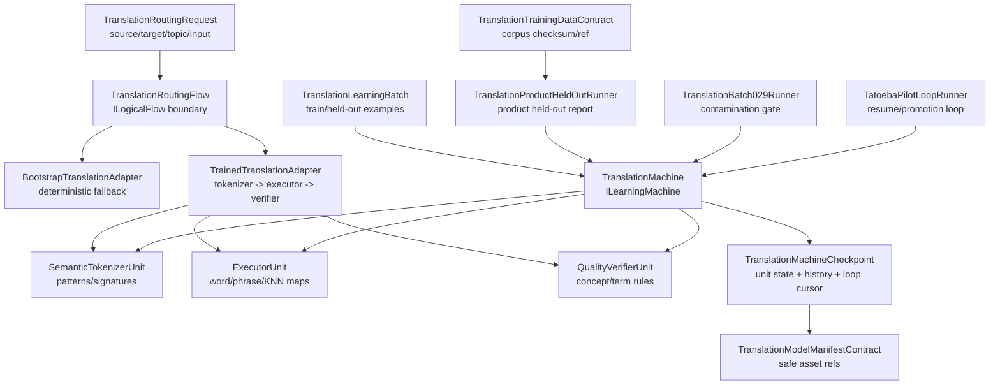

# 27.TranslationDomain - implementation documentation

## 1. Map for Luba

`27.TranslationDomain` is the translation domain layer: contracts for directions and requests, `TranslationMachine` as a trainable machine, a routing flow for inference, direction adapters, internal trained units, checkpoint/cache/manifest contracts, and runners for batch/held-out checks.

The main honest boundary: `TranslationMachine` does implement `ILearningMachine<TranslationDomain>` and has checkpoint save/load for the trained state. But `ExportAsync`/`ImportAsync` on their own are a metadata-only path. A manifest, JSON report, checkpoint path, or accuracy number does not prove product readiness without load/use evidence, held-out/product runner evidence, and a check that train/held-out do not overlap.

## 2. UML for draw.io



### Connection simulations

| Connection | Example input | What happens | Expected result | What must not be claimed |
|---|---|---|---|---|
| `Request` -> `Flow` | `ru -> en`, topic `general`, text `привет` | The flow checks `FlowId`, input, direction, and adapter | `LogicalFlowResult` or error code | A route does not prove a trained model |
| `Flow` -> `Bootstrap` | The adapter is untrained or the verifier did not accept the candidate | Bootstrap returns a fallback string | Low confidence / bootstrap result | This is not trained translation |
| `Flow` -> `Trained` | Trained runtime units exist | Tokenizer -> executor -> verifier | Translation accepted or fallback | One accepted candidate does not prove generalization |
| `Batch` -> `Machine` | Structured batch with train and held-out rows | Non-held-out rows train the units; held-out measures accuracy | `LearningBatchResult` | A batch without an independent check does not prove the product |
| `Machine` -> `Checkpoint` | `SaveCheckpointAsync(path)` | Exports unit state and writes JSON atomically | Checkpoint for `LoadCheckpointAsync` | A path/JSON without a fresh load is not equal to a ready model |
| `Manifest` -> asset | Safe refs and accuracy | Checks schema, filenames, relative refs | Valid manifest contract | A manifest does not replace runtime evidence |
| `BatchRunner` -> `Machine` | Train/held-out split | Checks overlap before claiming accuracy | Error on contamination | An overlapping split must not be treated as held-out |
| `Tatoeba` -> `Machine` | Loop corpus + checkpoint | Trains batches, saves cursor/history | Resume/continue path | A loop report without a run does not prove quality |

## 3. No-code algorithms

### Algorithm A: `TranslationMachine.TrainStructuredBatchAsync`

- Signature: `TrainStructuredBatchAsync(TranslationLearningBatch batch, CancellationToken ct = default)`.
- Input: `TranslationLearningBatch` with `Examples`, `UnitId`, train/held-out flags, and JSON outputs.
- Output: `OperationResult<LearningBatchResult>`.
- Behavior: `CANCELLED`, `BATCH_REQUIRED`, `BATCH_EMPTY`; then non-held-out examples are passed to `_unitTrainers` by `UnitId`; identities are saved for the checkpoint; held-out rows produce `MeasureHeldOutAccuracy`, otherwise unit coverage is counted.
- Does not prove: quality outside the held-out/product runner if there is no fresh run/load/use evidence.

### Algorithm B: legacy `TranslationMachine.TrainBatchAsync`

- Signature: `TrainBatchAsync(LearningBatch<TranslationDomain> batch, CancellationToken ct = default)`.
- Input/output: a generic learning batch -> `OperationResult<LearningBatchResult>`.
- Behavior: a bootstrap/legacy path with guards and a scalar accuracy bump of about `0.01`.
- Does not prove: real training of the tokenizer/executor/verifier units.

### Algorithm B2: evaluation `TranslationMachine.EvaluateAsync`

- Signature: `EvaluateAsync(LearningEvaluationSet<TranslationDomain> evalSet, CancellationToken ct = default)`.
- Input/output: an evaluation set -> `OperationResult<LearningEvaluationResult>`.
- Behavior: if structured training already exists, the machine performs a translation and compares the expected output; in the bootstrap/legacy state the evaluation remains limited to scalar logic.
- Does not prove: quality on new user data without current held-out/product runner evidence.

### Algorithm C: `TranslationRoutingFlow.ExecuteAsync`

- Signature: `ExecuteAsync(LogicalFlowRequest<TranslationRoutingRequest> request, CancellationToken cancellationToken = default)`.
- Input: a logical request with `FlowId`, `RunId`, `TranslationRoutingRequest`.
- Output: `OperationResult<LogicalFlowResult>`.
- Behavior: guards for cancel/null/wrong flow/null input; direction resolve; adapter lookup; adapter call; metrics/evidence/result packaging.
- Does not prove: that the adapter is trained or that the output is of good quality.

### Algorithm D: `TrainedTranslationAdapter.TranslateAsync`

- Signature: `TranslateAsync(TranslationRoutingRequest request, CancellationToken cancellationToken = default)`.
- Input/output: a routing request -> `OperationResult<TranslationRoutingResult>`.
- Behavior: `TranslationSemanticTokenizer` tokenizes; `ExecutorUnit` builds a candidate; `QualityVerifierUnit` verifies; the accepted branch requires confidence/verification, otherwise fallback.
- Does not prove: a fallback or an exact-map hit is not generalization.

### Algorithm E: trained units

- `SemanticTokenizerUnit.Tokenize(string text, string language)` -> `SemanticTokenSequence`; `TrainOnExample(TranslationLearningExample example)` teaches signatures/patterns.
- `ExecutorUnit.Execute(SemanticTokenSequence tokens, string topicDomain)` -> candidate; `TrainOnExample(...)` fills the exact source map, word map, phrase map, and KNN store.
- `QualityVerifierUnit.Verify(string candidate, SemanticTokenSequence tokens)` -> pass/score; `TrainOnExample(...)` teaches concept rules and required terms.
- Does not prove: a single unit without machine checkpoint/manifest/load is not a finished product asset.

### Algorithm E2: the shared KNN store `TranslationKnnStore`

- Where the logic lives: `27.TranslationDomain/TranslationUnitContracts.cs`, class `TranslationKnnStore`.
- Signatures: `AddPair(string signature, string sourceText, string targetText)`, `FindNearest(string signature, int k = 3)`, `FindNearestCascade(string fullSignature, string prefixSignature, string structureSignature, int k = 3, string? querySourceText = null)`, `Count`, `ExportCheckpoint()`, `ImportCheckpoint(TranslationKnnStoreCheckpoint checkpoint)`.
- Input: structural signatures from tokenizer/unit training, source text, and target translation.
- Output: a list of `(Source, Target)` nearest trained pairs, a count of stored pairs, or a `TranslationKnnStoreCheckpoint`.
- Behavior: `AddPair` places a learned `(signature -> source/target)` into a bucket; `FindNearest` first searches for an exact signature, then partial component overlap; `FindNearestCascade` goes from the full signature to the prefix and structure signature with a source-aware guard; `ExportCheckpoint` saves all pairs into a deterministic flat list, and `ImportCheckpoint` clears the store and restores the pairs via `AddPair`.
- How `ExecutorUnit` uses it: executors write pairs into the shared `TranslationKnnStore` during training and read it during inference as a bridge between training and translation.
- Does not prove: a KNN hit or exact-memory retrieval is trained state, but by itself does not prove held-out generalization or product quality.

### Algorithm F: batch/contracts/runners

- `TranslationStructuredBatchBuilder.BuildRuEnGeneralBatch(...)` and `BuildGeneralBatch(...)`: build tokenizer/executor/verifier examples from train-ready pairs.
- `TranslationMachine.ExportCheckpoint`, `ImportCheckpoint`, `SaveCheckpointAsync`, `LoadCheckpointAsync`, and `TranslationCheckpointCache`: save, load, and cache the full trained state by path/write timestamp/length.
- `TranslationModelManifestContract.Create/IsValidSharedAssetManifest`: fix safe relative asset refs.
- `TranslationTrainingDataContract.CreateManifest/IsValidSharedTrainingDataManifest`: fix the corpus filename, sha256, and pair count.
- `TranslationProductHeldOutRunner`, `TranslationBatch029Runner`, `TatoebaPilotLoopRunner`: provide runtime paths for held-out reports, contamination checks, checkpoint resume/continue and promotion decisions.

## 4. Exact quotations from the code

### Structured training works via unit trainers

`27.TranslationDomain/TranslationMachine.cs:83-132`

```csharp
    public Task<OperationResult<LearningBatchResult>> TrainStructuredBatchAsync(
        TranslationLearningBatch batch,
        CancellationToken ct = default)
    {
        if (ct.IsCancellationRequested)
            return Task.FromResult(OperationResult<LearningBatchResult>.Fail("Structured training cancelled.", "CANCELLED"));

        if (batch is null)
            return Task.FromResult(OperationResult<LearningBatchResult>.Fail("Structured training batch is required.", "BATCH_REQUIRED"));

        if (batch.Examples.Count == 0)
            return Task.FromResult(OperationResult<LearningBatchResult>.Fail(
                "Structured training batch must contain at least one example.", "BATCH_EMPTY"));

        var startMs = Environment.TickCount64;
        var accuracyBefore = _accuracyAfterLastBatch;
        var trainedUnits = new HashSet<string>(StringComparer.Ordinal);

        foreach (var example in batch.Examples.Where(example => !example.HeldOut))
        {
            if (!_unitTrainers.TryGetValue(example.UnitId, out var trainer))
                continue;

            trainer.TrainOnExample(example);
            trainedUnits.Add(example.UnitId);
            if (!_structuredTrainingIdentities.Any(identity =>
                    string.Equals(identity.ExampleId, example.ExampleId, StringComparison.Ordinal) &&
                    string.Equals(identity.UnitId, example.UnitId, StringComparison.Ordinal)))
                _structuredTrainingIdentities.Add(new TranslationStructuredTrainingIdentityCheckpoint(
                    example.ExampleId,
                    example.SourceId,
                    example.UnitId,
                    batch.BatchId));
        }

        var heldOut = batch.Examples.Where(example => example.HeldOut).ToArray();
        var accuracyAfter = heldOut.Length > 0
            ? MeasureHeldOutAccuracy(heldOut)
            : MeasureUnitCoverage(trainedUnits);

        var rewardMargin = batch.Examples.All(example =>
            example.RejectedOutputJson.Contains("[WRONG:", StringComparison.Ordinal))
                ? 0.03
                : 0.0;

        _hasStructuredTraining = trainedUnits.Count > 0;
        _accuracyAfterLastBatch = accuracyAfter;
        IncrementPatchVersion();

        var result = new LearningBatchResult(
```

Why it matters: this is the actual algorithm, not just the class name: guards, unit trainer dispatch, held-out branch, and reward margin.

### Metadata export is not a full restore

`27.TranslationDomain/TranslationMachine.cs:199-221`

```csharp
    public Task<OperationResult<LearningMachineExport>> ExportAsync(CancellationToken ct = default)
    {
        // Return early if cancellation was requested before doing any work.
        if (ct.IsCancellationRequested)
            return Task.FromResult(OperationResult<LearningMachineExport>.Fail("Export cancelled.", "CANCELLED"));

        // Build a metadata record. CheckpointRef here is not a file path — it is a placeholder.
        // For a real checkpoint that restores trained state, call SaveCheckpointAsync instead.
        var export = new LearningMachineExport(
            MachineId: MachineId,
            DomainTag: DomainTag,
            Version: _currentVersion,
            CheckpointRef: $"{MachineId}/{_currentVersion}/checkpoint",
            ManifestRef: $"{MachineId}/{_currentVersion}/manifest.json",
            AccuracyAtExport: _accuracyAfterLastBatch,
            ExportedAtUtc: DateTimeOffset.UtcNow);

        return Task.FromResult(OperationResult<LearningMachineExport>.Ok(export));
    }

    // ImportAsync restores only scalar metadata (version, accuracy) from an export record.
    // It does NOT restore trained unit state. For full restore from disk use LoadCheckpointAsync.
    // This method is the metadata counterpart to ExportAsync — not a trained-model load path.
```

Why it matters: the source itself forbids substituting metadata-only export/import for a full checkpoint restore.

### The checkpoint contains unit state

`27.TranslationDomain/TranslationMachine.cs:254-295`

```csharp
    public OperationResult<TranslationMachineCheckpoint> ExportCheckpoint()
    {
        // Verify that the machine has typed unit references required for checkpoint export.
        if (_runtime is null)
            return OperationResult<TranslationMachineCheckpoint>.Fail(
                "Runtime state is not available for this machine.", "RUNTIME_STATE_UNAVAILABLE");

        // Map the in-memory training history to checkpoint records.
        var historyEntries = _trainingHistory
            .Select(h => new TranslationTrainingHistoryEntryCheckpoint(
                BatchId: h.BatchId,
                RowsTrained: h.RowsTrained,
                AccuracyBefore: h.AccuracyBefore,
                AccuracyAfter: h.AccuracyAfter,
                RewardMargin: h.RewardMargin,
                CpuMs: h.CpuMs,
                PeakRamMb: h.PeakRamMb,
                ElapsedMs: h.ElapsedMs,
                PromotedUnitIds: h.PromotedUnitIds))
            .ToList();

        // Build the top-level checkpoint record from machine fields and all unit exports.
        var checkpoint = new TranslationMachineCheckpoint(
            SchemaVersion: 1,
            MachineId: MachineId,
            DomainTag: DomainTag,
            Version: _currentVersion,
            AccuracyAfterLastBatch: _accuracyAfterLastBatch,
            HasStructuredTraining: _hasStructuredTraining,
            ExportedAtUtc: DateTimeOffset.UtcNow,
            KnnStore: _runtime.KnnStore.ExportCheckpoint(),
            SemanticTokenizer: _runtime.SemanticTokenizer.ExportCheckpoint(),
            Executors: _runtime.Executors.Values.Select(e => e.ExportCheckpoint()).ToList(),
            QualityVerifier: _runtime.Verifier.ExportCheckpoint(),
            TrainingHistory: historyEntries,
            StructuredTrainingIdentities: _structuredTrainingIdentities
                .OrderBy(identity => identity.ExampleId, StringComparer.Ordinal)
                .ThenBy(identity => identity.UnitId, StringComparer.Ordinal)
                .ToList(),
            TatoebaLoop: null);  // Runner sets TatoebaLoop when it calls SaveCheckpointAsync.

        return OperationResult<TranslationMachineCheckpoint>.Ok(checkpoint);
```

Why it matters: here it is visible which trained artifacts actually go into the checkpoint.

### Fresh load restores a new machine from a checkpoint

`27.TranslationDomain/TranslationMachine.cs:447-486`

```csharp
    public static async Task<OperationResult<TranslationMachineLoadResult>> LoadCheckpointAsync(
        string checkpointPath,
        CancellationToken ct = default)
    {
        // Validate the checkpoint path and check file existence before reading.
        if (ct.IsCancellationRequested)
            return OperationResult<TranslationMachineLoadResult>.Fail("Load cancelled.", "CANCELLED");
        if (string.IsNullOrWhiteSpace(checkpointPath))
            return OperationResult<TranslationMachineLoadResult>.Fail(
                "Checkpoint path is required.", "CHECKPOINT_PATH_REQUIRED");
        if (!File.Exists(checkpointPath))
            return OperationResult<TranslationMachineLoadResult>.Fail(
                $"Checkpoint file not found: {checkpointPath}", "CHECKPOINT_NOT_FOUND");

        // Read and deserialise the checkpoint JSON.
        TranslationMachineCheckpoint checkpoint;
        try
        {
            var json = await File.ReadAllTextAsync(checkpointPath, System.Text.Encoding.UTF8, ct);
            var parsed = JsonSerializer.Deserialize<TranslationMachineCheckpoint>(
                json, TranslationCheckpointJsonOptions.Standard);
            if (parsed is null)
                return OperationResult<TranslationMachineLoadResult>.Fail(
                    "Checkpoint deserialisation returned null.", "CHECKPOINT_DESERIALIZE_FAILED");
            checkpoint = parsed;
        }
        catch (Exception ex)
        {
            return OperationResult<TranslationMachineLoadResult>.Fail(ex.Message, "CHECKPOINT_READ_FAILED");
        }

        // Create a fresh machine and restore all trained state from the checkpoint.
        var machine = new TranslationMachine();
        var importResult = machine.ImportCheckpoint(checkpoint);
        if (!importResult.IsSuccess)
            return OperationResult<TranslationMachineLoadResult>.Fail(importResult.ErrorMessage, importResult.ErrorCode);

        // Return the fully restored machine with the runner loop cursor — ready for inference without replay.
        return OperationResult<TranslationMachineLoadResult>.Ok(
            new TranslationMachineLoadResult(machine, checkpoint.TatoebaLoop));
```

Why it matters: this is a source-backed fresh-load path. It proves the load mechanics, but does not replace held-out/product quality.

### The routing flow selects an adapter

`27.TranslationDomain/TranslationRoutingFlow.cs:39-119`

```csharp
    public async Task<OperationResult<LogicalFlowResult>> ExecuteAsync(
        LogicalFlowRequest<TranslationRoutingRequest> request,
        CancellationToken cancellationToken = default)
    {
        // Return cancellation immediately when the token was already cancelled.
        if (cancellationToken.IsCancellationRequested)
            return OperationResult<LogicalFlowResult>.Fail("Translation routing flow cancelled.", "CANCELLED");

        // Require a non-null request at the flow boundary.
        if (request is null)
            return OperationResult<LogicalFlowResult>.Fail("Logical flow request is required.", "REQUEST_REQUIRED");

        // Reject requests for a different flow id to prevent misrouting.
        if (!string.Equals(request.FlowId, FlowId, StringComparison.Ordinal))
            return OperationResult<LogicalFlowResult>.Fail(
                $"Unsupported flow id '{request.FlowId}'. Expected '{FlowId}'.", "UNSUPPORTED_FLOW_ID");

        // Reject null input — the routing request is always required.
        if (request.Input is null)
            return OperationResult<LogicalFlowResult>.Fail("TranslationRoutingRequest input is required.", "INPUT_REQUIRED");

        // Resolve which direction adapter should handle this source→target pair.
        var directionResult = ResolveDirection(request.Input.SourceLanguage, request.Input.TargetLanguage);
        if (!directionResult.IsSuccess)
            return OperationResult<LogicalFlowResult>.Fail(directionResult.ErrorMessage, directionResult.ErrorCode);

        var direction = directionResult.Value!;

        // Look up the adapter for the resolved direction.
        if (!_adapters.TryGetValue(direction, out var adapter))
            return OperationResult<LogicalFlowResult>.Fail(
                $"No adapter registered for direction '{direction}'.", "ADAPTER_NOT_FOUND");

        // Delegate the actual translation to the direction adapter.
        var adapterResult = await adapter.TranslateAsync(request.Input, cancellationToken);
        if (!adapterResult.IsSuccess)
            return adapterResult.MapError<LogicalFlowResult>();

        var translationResult = adapterResult.Value!;

        // Build a minimal LogicalFlowSummary from the translation outcome.
        var passed = translationResult.Confidence > 0.0;
        var summary = new LogicalFlowSummary(
            SummaryId: $"{FlowId}-{request.RunId}",
            Tier: 1,
            BaselinePrimary: 0,
            EnhancedPrimary: translationResult.Confidence,
            PrimaryMetricName: "translation_confidence",
            LowerIsBetter: false,
            Passed: passed,
            ShouldScaleUp: false,
            NextAction: passed ? "return_translation" : "request_more_context",
            ScalingSignal: 0,
            ScalingSignalNote: "",
            Notes: $"direction={direction}; adapter_id={translationResult.AdapterId}; topic={request.Input.TopicDomain}",
            BaselineTimeMs: 0,
            EnhancedTimeMs: 0);

        // Build the metrics dictionary for traceability and monitoring.
        var metrics = new Dictionary<string, string>(StringComparer.Ordinal)
        {
            ["direction"]            = direction.ToString(),
            ["adapter_id"]           = translationResult.AdapterId,
            ["source_language"]      = request.Input.SourceLanguage,
            ["target_language"]      = request.Input.TargetLanguage,
            ["topic_domain"]         = request.Input.TopicDomain,
            ["confidence"]           = translationResult.Confidence.ToString("F4", CultureInfo.InvariantCulture),
            ["input_length"]         = request.Input.InputText.Length.ToString(CultureInfo.InvariantCulture),
            ["translated_length"]    = translationResult.TranslatedText.Length.ToString(CultureInfo.InvariantCulture)
        };

        // Build and return the LogicalFlowResult carrying the translated text.
        var flowResult = new LogicalFlowResult(
            FlowId: FlowId,
            ScenarioId: ScenarioId,
            OverallVerdict: passed ? "TRANSLATED" : "TRANSLATION_LOW_CONFIDENCE",
            FinalHumanResult: translationResult.TranslatedText,
            Summary: summary,
            Metrics: metrics,
            EvidenceIds: [$"translation-adapter:{translationResult.AdapterId}"],
            Warnings: passed ? [] : ["Low confidence — Bootstrap adapter has no trained weights yet."]);
```

Why it matters: this is the `ILogicalFlow` boundary; it selects an adapter and returns a traceable result, but is not an `ILearningMachine`.

### The trained adapter can fall back

`27.TranslationDomain/TranslationDirectionAdapters.cs:112-136`

```csharp
    public Task<OperationResult<TranslationRoutingResult>> TranslateAsync(
        TranslationRoutingRequest request,
        CancellationToken cancellationToken = default)
    {
        if (cancellationToken.IsCancellationRequested)
            return Task.FromResult(OperationResult<TranslationRoutingResult>.Fail("Translation cancelled.", "CANCELLED"));

        var tokens = _semanticTokenizer.Tokenize(request.InputText, request.SourceLanguage);
        var candidate = _executor.Execute(tokens, request.TopicDomain);
        var verification = _verifier.Verify(candidate.Text, tokens);

        var phraseMapCandidate = candidate.AdapterId.EndsWith("-phrase-map", StringComparison.Ordinal);
        if (candidate.Confidence >= 0.5 && (verification.Pass || (phraseMapCandidate && candidate.Confidence >= 0.85)))
        {
            var result = new TranslationRoutingResult(
                Direction,
                candidate.Text,
                Math.Min(0.99, Math.Max(candidate.Confidence, verification.Score)),
                candidate.AdapterId);
            return Task.FromResult(OperationResult<TranslationRoutingResult>.Ok(result));
        }

        return _fallback.TranslateAsync(request, cancellationToken);
    }
}
```

Why it matters: even a trained adapter does not always return a trained result; the fallback branch must not be passed off as trained quality.

### `TranslationKnnStore` stores source/target pairs under a structural signature

`27.TranslationDomain/TranslationUnitContracts.cs:196-234`

```csharp

    // _store maps structural signature to the list of (source, target) translation pairs.
    private readonly Dictionary<string, List<(string Source, string Target)>> _store
        = new(StringComparer.Ordinal);

    // AddPair stores one learned translation pair under its structural signature.
    public void AddPair(string signature, string sourceText, string targetText)
    {
        // Ensure the bucket for this signature exists.
        if (!_store.TryGetValue(signature, out var bucket))
        {
            bucket = new List<(string, string)>();
            _store[signature] = bucket;
        }
        // Append the new pair to the bucket — later pairs have higher DPO preference signal.
        bucket.Add((sourceText, targetText));
    }

    // FindNearest returns up to k translation pairs with signatures closest to the query.
    // Exact match is tried first; partial component overlap is the fallback.
    public IReadOnlyList<(string Source, string Target)> FindNearest(string signature, int k = 3)
    {
        // Exact match: return the bucket directly when the signature is known.
        if (_store.TryGetValue(signature, out var exact))
            return exact.Take(k).ToList();

        // Partial match: score each stored signature by component overlap with the query.
        var queryComponents = new HashSet<string>(signature.Split('|'), StringComparer.Ordinal);
        return _store
            .Select(kv => (
                Score: kv.Key.Split('|').Count(c => queryComponents.Contains(c)),
                Pairs: kv.Value))
            .Where(x => x.Score > 0)
            .OrderByDescending(x => x.Score)
            .Take(k)
            .SelectMany(x => x.Pairs)
            .Take(k)
            .ToList();
    }
```

Why it matters: this is explicit in-memory trained state for KNN retrieval. It stores source/target pairs, but exact/nearest lookup is not proof of generalization without a held-out check.

### `TranslationKnnStore.FindNearestCascade` constrains a broad fallback with a source-aware guard

`27.TranslationDomain/TranslationUnitContracts.cs:241-260`

```csharp
    public IReadOnlyList<(string Source, string Target)> FindNearestCascade(
        string fullSignature,
        string prefixSignature,
        string structureSignature,
        int k = 3,
        string? querySourceText = null)
    {
        var fullThreshold = IsLowInformationSignature(fullSignature)
            ? SourceAwareBroadSignatureSimilarity
            : 0.0;
        var full = FindExactWithSourceGuard(fullSignature, k, querySourceText, fullThreshold);
        if (full.Count > 0) return full;

        var prefix = FindExactWithSourceGuard(prefixSignature, k, querySourceText, SourceAwarePrefixSimilarity);
        if (prefix.Count > 0) return prefix;

        var structure = FindExactWithSourceGuard(structureSignature, k, querySourceText, SourceAwareBroadSignatureSimilarity);
        if (structure.Count > 0) return structure;

        return [];
```

Why it matters: the cascade does not just take any similar record; for broad signatures there are source-aware thresholds. This reduces the risk of another sentence's trained data, but does not turn retrieval into proven semantic generalization.

### `TranslationKnnStore` is exported and imported in the checkpoint

`27.TranslationDomain/TranslationUnitContracts.cs:316-343`

```csharp
    public int Count => _store.Values.Sum(b => b.Count);

    // ExportCheckpoint builds a TranslationKnnStoreCheckpoint from all current in-memory pairs.
    // Entries are sorted deterministically: signature ascending, then source ascending.
    // The export does not write to disk — the caller is responsible for persistence.
    internal TranslationKnnStoreCheckpoint ExportCheckpoint()
    {
        // Flatten all buckets into a sorted list of (signature, source, target) triples.
        var entries = _store
            .OrderBy(kv => kv.Key, StringComparer.Ordinal)
            .SelectMany(kv => kv.Value
                .Select(pair => new TranslationKnnStoreEntryCheckpoint(kv.Key, pair.Source, pair.Target)))
            .ToList();
        // Wrap in the checkpoint record and return.
        return new TranslationKnnStoreCheckpoint(entries);
    }

    // ImportCheckpoint clears all current pairs and rebuilds the store from checkpoint entries.
    // After import the store is identical to the state it was in when ExportCheckpoint was called.
    internal void ImportCheckpoint(TranslationKnnStoreCheckpoint checkpoint)
    {
        // Remove all previously learned pairs before restoring from checkpoint.
        _store.Clear();
        // Restore each entry by calling the same AddPair method used during training.
        foreach (var entry in checkpoint.Entries)
            AddPair(entry.Signature, entry.Source, entry.Target);
    }
}
```

Why it matters: the KNN store is part of the full checkpoint lifecycle. But a checkpointed memory store still needs fresh-load and held-out/product evidence before product claims.

### The manifest contract validates safe refs

`27.TranslationDomain/TranslationModelManifestContract.cs:28-60`

```csharp
    public static TranslationModelManifest Create(
        double accuracyAtExport,
        string sourceBaseCommit,
        DateTimeOffset createdAtUtc)
        => new(
            ModelId: ModelId,
            Domain: Domain,
            Version: Version,
            CheckpointFilename: CheckpointFilename,
            RunnerReportRef: RunnerReportRef,
            RunnerReportFilename: RunnerReportRef,
            TrainingDataRef: TrainingDataRef,
            AccuracyAtExport: accuracyAtExport,
            LoaderType: LoaderType,
            SourceBaseCommit: sourceBaseCommit,
            SchemaVersion: SchemaVersion,
            CreatedAtUtc: createdAtUtc);

    public static bool IsValidSharedAssetManifest(TranslationModelManifest manifest)
        => string.Equals(manifest.ModelId, ModelId, StringComparison.Ordinal) &&
           string.Equals(manifest.Domain, Domain, StringComparison.Ordinal) &&
           string.Equals(manifest.Version, Version, StringComparison.Ordinal) &&
           string.Equals(manifest.CheckpointFilename, CheckpointFilename, StringComparison.Ordinal) &&
           string.Equals(manifest.RunnerReportRef, RunnerReportRef, StringComparison.Ordinal) &&
           string.Equals(manifest.RunnerReportFilename, RunnerReportRef, StringComparison.Ordinal) &&
           string.Equals(manifest.TrainingDataRef, TrainingDataRef, StringComparison.Ordinal) &&
           manifest.AccuracyAtExport > 0.0 &&
           string.Equals(manifest.LoaderType, LoaderType, StringComparison.Ordinal) &&
           manifest.SchemaVersion == SchemaVersion &&
           IsSafeRelativeRef(manifest.CheckpointFilename) &&
           IsSafeRelativeRef(manifest.RunnerReportRef) &&
           IsSafeRelativeRef(manifest.RunnerReportFilename) &&
           IsSafeRelativeRef(manifest.TrainingDataRef);
```

Why it matters: the manifest checks the shape of the asset refs, but does not replace checkpoint/load/runtime evidence.

### The batch runner catches contamination

`27.TranslationDomain/TranslationBatch029Runner.cs:333-360`

```csharp
    private static string? BuildTrainHeldOutOverlapError(
        IReadOnlyList<TranslationTrainReadyPair> trainPairs,
        IReadOnlyList<TranslationTrainReadyPair> heldOutPairs)
    {
        var trainByInput = trainPairs
            .Where(IsUsableRuEnPair)
            .Select(row => (Key: NormalizeForOverlap(row.ASide), row.Id))
            .Where(row => !string.IsNullOrWhiteSpace(row.Key))
            .GroupBy(row => row.Key, StringComparer.Ordinal)
            .ToDictionary(
                group => group.Key,
                group => string.Join(",", group.Select(row => row.Id).Distinct(StringComparer.Ordinal).Take(3)),
                StringComparer.Ordinal);

        var overlaps = heldOutPairs
            .Where(IsUsableRuEnPair)
            .Select(row => (
                row.Id,
                TrainIds: trainByInput.GetValueOrDefault(NormalizeForOverlap(row.ASide))))
            .Where(row => !string.IsNullOrWhiteSpace(row.TrainIds))
            .ToArray();

        if (overlaps.Length == 0)
            return null;

        var examples = string.Join("; ",
            overlaps.Take(5).Select(row => $"{row.Id} duplicates train row(s) {row.TrainIds}"));
        return $"Train/held-out contamination detected: {overlaps.Length} held-out input(s) are also present in training. {examples}. Use a non-overlapping 100+100 split before claiming TranslationDomain accuracy.";
```

Why it matters: the source explicitly blocks false held-out accuracy claims on overlapping splits.

## 5. Hierarchy and status

| Level | Status in D27 |
|---|---|
| `ILearningMachine<TranslationDomain>` | Present: `TranslationMachine` - Level 5 machine boundary |
| `ILogicalFlow<TranslationRoutingRequest>` | Present: `TranslationRoutingFlow` - runtime routing boundary |
| Internal trainable units | Present: `SemanticTokenizerUnit`, `ExecutorUnit`, `QualityVerifierUnit` inside the machine; `TranslationKnnStore` - a shared trained memory bridge for executors |
| Deterministic/helpers | Present: batch builders, manifest contracts, cache, corpus sourcing, runner guards |

Training lives at the boundary of `TranslationMachine` and its structured unit trainers. `TranslationRoutingFlow`, adapters, contracts, and runner utilities are not standalone proofs of a trained product.

## 6. QA / test map

The tests were read and cross-referenced, but not run in D5A.

| Test | What it confirms | What it does not confirm |
|---|---|---|
| `Tests/TranslationDomainTests.cs` | routing bootstrap/unsupported direction, structured training changes output, batch builder behavior, KNN guard, checkpoint round trip, continue-training, cache behavior, contamination rejection, held-out runner branches | Does not prove a new external product run on all directions |
| `Tests/TranslationModelAssetTests.cs` | safe manifest refs, checkpoint preserving trained state without private paths, training-data manifest contract | Does not prove actual product accuracy |
| Runner source paths | `TranslationProductHeldOutRunner`, `TranslationBatch029Runner`, `TatoebaPilotLoopRunner` have source-backed runtime paths | These runners were not run in D5A |

## 7. Anti-false-done

- A JSON/report/manifest/checkpoint path is not product readiness.
- `ExportAsync`/`ImportAsync` are metadata-only, not a full trained unit restore.
- A checkpoint requires `LoadCheckpointAsync`/use evidence for fresh-load claims.
- Exact memory, a phrase map, or a KNN hit must not be passed off as generalization without held-out/product runner evidence.
- A `TranslationKnnStore` hit/exact memory is trained state, but not held-out generalization proof by itself.
- Bootstrap adapter output is not trained translation.
- Held-out accuracy must not be claimed under train/held-out contamination.
- A corpus manifest and sha256 prove the shape of the data, not the training.

## 8. Current status

| Area | Status |
|---|---|
| DTO/contracts | Implemented |
| `TranslationMachine` | Implemented `ILearningMachine<TranslationDomain>` with structured training/evaluate/checkpoint load/save |
| Metadata export/import | Implemented, but metadata-only |
| Routing/inference | Implemented `TranslationRoutingFlow` and adapters with fallback |
| Asset lifecycle | Source-backed checkpoint save/load, `TranslationKnnStore`, `TranslationCheckpointCache`, and manifest contracts are present; product readiness requires current runner/load/use evidence |
| Documentation | D5A documented - sub-agent draft pending parent review |
