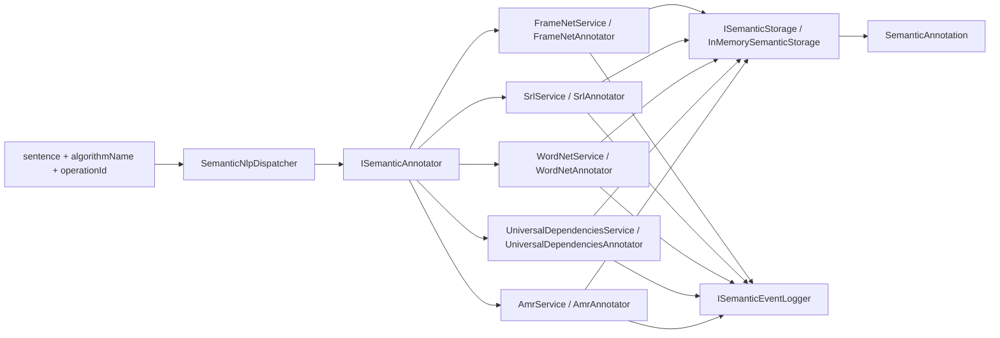

# 28.SemanticNlp

Documentation status: D28 documented - parent review passed.

## 1. Человеческое объяснение

`28.SemanticNlp` - это набор семантических NLP-помощников: FrameNet, SRL, WordNet, Universal Dependencies и AMR. Проект берет предложение как строку и возвращает `SemanticAnnotation`: список токенов с семантической семьей, ролью, возможным предикатом и рамкой.

Важно для Лубы: это инфраструктура анализа текста на правилах, словарях и простых эвристиках. Она помогает разметить английские примерные предложения, но не является обученной моделью понимания языка. В проекте нет доказанного `ILearningMachine`-цикла, нет checkpoint/manifest/locator/export/import/fresh-load/continue-training жизненного цикла. `28.SemanticNlp/state.json` полезен как исторический статус проекта, но сам по себе не является свежим runtime-доказательством качества.

## 2. UML / поток данных



## 3. Симуляции связей

| Связь | Пример входа | Что происходит | Ожидаемый результат | Что это НЕ доказывает |
|---|---|---|---|---|
| `sentence` -> `SemanticNlpDispatcher.AnnotateAsync` | `algorithmName="FrameNet"`, `operationId="op1"`, `sentence="John bought a book"` | Диспетчер ищет annotator по имени без учета регистра и пишет событие маршрутизации. | Запрос уходит в `FrameNetService`; неизвестное имя дает `ALGORITHM_NOT_FOUND`. | Это не доказывает качество FrameNet-разметки, только факт маршрутизации. |
| `FrameNetService` -> `FrameDetector` | `"The police attacked the protesters"` | Слова сверяются с локальным FrameNet-лексиконом, побеждает рамка с максимальным числом голосов. | `Attack`, trigger `attacked`, роли вроде `Attacker`/`Victim`. | Это не trained semantic reasoning; словарь маленький и локальный. |
| `SrlAnnotator` -> `PredicateFinder` | `"John quickly sold the book to Mary"` | Ищется первый глагол по словарю/суффиксам, затем роли назначаются по позиции и маркерам. | `sold` как `V`, `John` как `A0`, `book` как `A1`, `quickly` как `AM-MNR`. | Это не доказывает полноценный SRL-парсер для произвольного языка. |
| `WordNetAnnotator` -> `SynsetDatabase` | `"the dog is an animal"` | Для каждого токена берется первый synset из in-memory базы. | `dog` получает `synset:dog.n.01`, неизвестные слова получают `null`. | Первый synset - не disambiguation и не обученное понимание смысла. |
| `UniversalDependenciesAnnotator` -> `RuleBasedParser` | `"The cat chased the mouse"` | Первый найденный глагол становится `root`, ближайший номинал слева - `nsubj`, справа - `obj`. | `chased/root`, `cat/nsubj`, `mouse/obj`. | Это не UD-парсер общего назначения; это rule-based helper. |
| `AmrAnnotator` -> `SimpleAmrBuilder` | `"boy wants girl"` | Первый предикат становится root concept `wants-01`, ARG0/ARG1 берутся как ближайшие не-глагольные токены. | AMR-граф с root и ребрами `:ARG0`, `:ARG1`. | Это не полноценная AMR-модель и не гарантирует корректную семантическую генерализацию. |
| Service -> `InMemorySemanticStorage` | `operationId="op1"` | Аннотация сохраняется в словарь по id; повторный id может вернуть cached/idempotent результат через service. | `LoadAnnotationAsync("op1")` возвращает сохраненную аннотацию. | In-memory запись не является persisted asset lifecycle или product-readiness evidence. |

## 4. Алгоритмы без кода

### Контракты Fabric

`ISemanticAnnotator.AnnotateAsync(string operationId, string sentence)` принимает стабильный id операции и предложение, возвращает `OperationResult<SemanticAnnotation>`. `AlgorithmName` используется диспетчером как ключ маршрута. Контракт не обучает модель и не гарантирует качество конкретного алгоритма.

`ISemanticStorage.SaveAnnotationAsync(string sentenceId, SemanticAnnotation annotation)` и `LoadAnnotationAsync(string sentenceId)` задают интерфейс хранения аннотаций. Текущая реализация `InMemorySemanticStorage` хранит данные в памяти процесса; это удобно для тестов и демо, но не checkpoint и не registry.

### Core DTO и результат

`SemanticToken` - один токен в исходном порядке: `OriginalText`, `Position`, `SemanticFamily`, `RoleWithinFamily`. `SemanticAnnotation` - весь ответ: исходное предложение, список токенов, имя алгоритма, необязательный `PredicateText` и `FrameName`.

`OperationResult<T>` задает общий стиль успех/ошибка: `Ok(value)` или `Fail(message, code)`. Ошибки вроде `EMPTY_SENTENCE`, `NO_FRAME_DETECTED`, `ALGORITHM_NOT_FOUND` являются диагностикой ветки, а не метриками качества модели.

### `SemanticNlpDispatcher.AnnotateAsync(string algorithmName, string operationId, string sentence)`

Вход: имя алгоритма, operation id, предложение. Выход: `OperationResult<SemanticAnnotation>`.

Шаги:
1. Ищет annotator по `algorithmName`.
2. Если имени нет, возвращает `ALGORITHM_NOT_FOUND` и список доступных ключей.
3. Если имя найдено, пишет событие `semantic.dispatch.requested`.
4. Делегирует вызов в конкретный `ISemanticAnnotator`.

Не делает: не выбирает “лучший” алгоритм, не объединяет результаты нескольких анализаторов, не обучает роутер.

### `FrameNetService.AnnotateAsync(string operationId, string sentence)`

Вход: id и английское предложение. Выход: `SemanticAnnotation` с `AlgorithmName="FrameNet"`, возможным `FrameName`, `PredicateText` и ролями.

Текущая логика:
1. `FrameNetAnnotator` разбивает строку по пробелам.
2. `FrameDetector.DetectFrameAsync` считает голоса слов по локальному `FrameNetLexicon`.
3. Если рамка не найдена, возвращается успешная, но неразмеченная аннотация.
4. Если рамка найдена, `FrameElementFiller.FillRoles` назначает `Predicate`, роли до/после триггера.
5. `FrameNetService` сохраняет результат и пишет completion event; повторный `operationId` коротко замыкается через idempotency.

Не делает: не использует реальный FrameNet corpus, не обучается, не оценивает confidence.

### `SrlService.AnnotateAsync(string operationId, string sentence)`

Вход: id и предложение. Выход: SRL-аннотация.

Текущая логика:
1. `PredicateFinder.CreateDefault()` содержит маленький список английских глаголов и суффиксные эвристики.
2. `SrlAnnotator` выбирает первый найденный предикат.
3. `ArgumentLabeler` назначает `V`, `A0`, `A1`, `AM-LOC`, `AM-TMP`, `AM-MNR` по позиции и marker-словам.
4. Если предиката нет, возвращается успешная неразмеченная аннотация.

Не делает: не строит синтаксическое дерево, не решает сложную семантическую неоднозначность.

### `WordNetService.AnnotateAsync(string operationId, string sentence)`

Вход: id и предложение. Выход: token-level `synset:<id>` для известных слов.

Текущая логика:
1. `SynsetDatabase.CreateDefault()` создает небольшую in-memory иерархию synset-ов.
2. `WordNetAnnotator` чистит пунктуацию и ищет первый synset для каждого токена.
3. `SynsetNavigator.GetHypernymChain` поднимается по первому hypernym.
4. `ComputeSimilarityAsync(string word1, string word2)` берет первый synset каждого слова и считает Wu-Palmer-like similarity.

Не делает: не выбирает смысл по контексту и не доказывает WordNet coverage для продукта.

### `UniversalDependenciesService.AnnotateAsync(string operationId, string sentence)`

Вход: id и предложение. Выход: `SemanticAnnotation`, где `SemanticFamily="UD"`, а `RoleWithinFamily` равен relation (`root`, `nsubj`, `obj`, `det`, `dep`).

Текущая логика:
1. `RuleBasedParser.Parse(string sentence)` ищет root как первый глагол, иначе первый токен.
2. Номиналы определяются исключением: не глагол и не determiner.
3. Ближайший номинал слева получает `nsubj`, справа - `obj`.
4. `UniversalDependenciesAnnotator` переносит дерево в общий `SemanticAnnotation`.

Не делает: не является полноценным CoNLL-U/UD parser для реальных корпусов; `ConlluParser` читает blocks, но runtime annotator использует rule-based parser.

### `AmrService.AnnotateAsync(string operationId, string sentence)`

Вход: id и предложение. Выход: `SemanticAnnotation`, где `PredicateText` может содержать serialized Penman, а `FrameName` - root concept.

Текущая логика:
1. `SimpleAmrBuilder.BuildFromSentence` очищает токены.
2. Первый предикат становится root concept `<token>-01`.
3. Первый не-глагольный токен до root становится `:ARG0`, после root - `:ARG1`.
4. `AmrPenmanSerializer` сериализует граф в Penman-like строку.
5. `AmrAnnotator` возвращает общую token annotation с concept roles.

Не делает: не обучает AMR parser, не выводит sense numbers из данных, не гарантирует AMR-совместимость для сложных предложений.

## 5. Короткие цитаты из кода

`28.SemanticNlp/Fabric/Interfaces.cs:59-67`

```csharp
public interface ISemanticAnnotator
{
    // Stable name of this annotator: "FrameNet", "SRL", "WordNet", "AMR", "UD".
    string AlgorithmName { get; }

    // Run the algorithm against the given sentence and return a full annotation.
    // The same operationId returns the cached result on repeat calls.
    Task<OperationResult<SemanticAnnotation>> AnnotateAsync(string operationId, string sentence);
}
```

Почему важно: это общий контракт для всех алгоритмов. Вход - `operationId` и `sentence`, выход - `OperationResult<SemanticAnnotation>`. Это доказывает единый API, но не доказывает обученность или качество каждого annotator.

`28.SemanticNlp/Core/Types.cs:29-45`

```csharp
public sealed record SemanticAnnotation
{
    // Original sentence as received on input — kept verbatim for traceability.
    public required string OriginalSentence { get; init; }

    // The list of annotated tokens; same length and order as the input tokens.
    public required IReadOnlyList<SemanticToken> Tokens { get; init; }

    // Which algorithm produced this annotation: "FrameNet", "SRL", "WordNet", etc.
    public required string AlgorithmName { get; init; }

    // The trigger predicate (main verb) when the algorithm reports one (SRL/FrameNet).
    public string? PredicateText { get; init; }

    // The activated frame name when the algorithm reports one (FrameNet only).
    public string? FrameName { get; init; }
}
```

Почему важно: это форма результата для всех помощников. Наличие `FrameName` или `PredicateText` - это разметка текущего алгоритма, а не proof of semantic understanding.

`28.SemanticNlp/Dispatcher/SemanticNlpDispatcher.cs:37-57`

```csharp
    public async Task<OperationResult<SemanticAnnotation>> AnnotateAsync(
        string algorithmName, string operationId, string sentence)
    {
        if (!_annotators.TryGetValue(algorithmName, out var annotator))
            return OperationResult<SemanticAnnotation>.Fail(
                $"Unknown algorithm '{algorithmName}'. Available: {string.Join(", ", _annotators.Keys)}",
                "ALGORITHM_NOT_FOUND");

        // Record the routing decision before delegating; useful for audit.
        _eventLogger.Log(new StandardEvent(
            EventType:   "semantic.dispatch.requested",
            OperationId: operationId,
            OccurredAt:  DateTimeOffset.UtcNow,
            Payload:     new Dictionary<string, object>
            {
                ["algorithm"] = algorithmName,
                ["sentence"]  = sentence,
            }));

        return await annotator.AnnotateAsync(operationId, sentence);
    }
```

Почему важно: диспетчер только маршрутизирует и логирует. Он не выбирает модель по качеству и не строит ансамбль.

`28.SemanticNlp/Algorithms/FrameNet.cs:157-182`

```csharp
        if (frameVotes.Count == 0)
            return OperationResult<(string, string)>.Fail(
                "No word in the sentence belongs to any known frame", "NO_FRAME_DETECTED");

        // Pick the frame with the highest vote count; ties broken by name to be deterministic.
        string winningFrame = frameVotes
            .OrderByDescending(kv => kv.Value)
            .ThenBy(kv => kv.Key, StringComparer.Ordinal)
            .First().Key;

        // The trigger is the first token that belongs to the winning frame.
        string triggerWord = string.Empty;
        foreach (var rawToken in tokens)
        {
            string cleanToken = rawToken.Trim('.', ',', '!', '?', ';', ':').ToLowerInvariant();
            if (cleanToken.Length == 0) continue;

            var framesResult = await _lexicon.FindFramesForWordAsync(cleanToken);
            if (framesResult.IsSuccess && framesResult.Value!.Contains(winningFrame))
            {
                triggerWord = cleanToken;
                break;
            }
        }

        return OperationResult<(string, string)>.Ok((winningFrame, triggerWord));
```

Почему важно: FrameNet выбирает рамку голосованием словаря, а не нейронным классификатором.

`28.SemanticNlp/Algorithms/Srl.cs:199-205`

```csharp
    public Task<OperationResult<SemanticAnnotation>> AnnotateAsync(string sentence)
    {
        if (string.IsNullOrWhiteSpace(sentence))
            return Task.FromResult(OperationResult<SemanticAnnotation>.Fail(
                "Sentence is empty", "EMPTY_SENTENCE"));

        // Whitespace tokenization — sufficient for English example sentences.
```

Почему важно: SRL-пайплайн явно начинается с простого guard и whitespace tokenization. Это полезно для учебных примеров, но не production NLP tokenization.

`28.SemanticNlp/Algorithms/WordNet.cs:239-261`

```csharp
            string clean   = surface.Trim('.', ',', '!', '?', ';', ':').ToLowerInvariant();

            // Look up synsets for the cleaned form.
            var lookup = await _database.FindSynsetsForWordAsync(clean);
            string? synsetId = (lookup.IsSuccess && lookup.Value!.Count > 0)
                ? lookup.Value![0]
                : null;

            annotated.Add(new SemanticToken
            {
                OriginalText     = surface,
                Position         = tokenIndex,
                SemanticFamily   = synsetId is null ? null : $"synset:{synsetId}",
                RoleWithinFamily = synsetId is null ? null : "Member",
            });
        }

        return OperationResult<SemanticAnnotation>.Ok(new SemanticAnnotation
        {
            OriginalSentence = sentence,
            Tokens           = annotated,
            AlgorithmName    = "WordNet",
        });
```

Почему важно: WordNet helper берет первый найденный synset. Это не контекстная disambiguation.

`28.SemanticNlp/Algorithms/UniversalDependencies.cs:132-177`

```csharp
        // Find the root — the first verb in the sentence.
        var predicateResult = _predicateFinder.FindPredicatePositions(rawTokens);
        if (!predicateResult.IsSuccess)
            return predicateResult.MapError<DependencyTree>();

        int rootIndex = predicateResult.Value!.Count > 0 ? predicateResult.Value![0] : 0;

        // Identify nominal tokens by exclusion — anything that is not a verb and not
        // a determiner is treated as a noun for the purposes of nsubj / obj.
        var verbIndexes = predicateResult.Value!.ToHashSet();
        bool IsDeterminer(int index) => DeterminerWords.Contains(rawTokens[index]);
        bool IsNominal(int index)    => !verbIndexes.Contains(index) && !IsDeterminer(index);

        // Pick nsubj — the closest nominal token before the root.
        int nsubjIndex = -1;
        for (int tokenIndex = rootIndex - 1; tokenIndex >= 0; tokenIndex--)
            if (IsNominal(tokenIndex)) { nsubjIndex = tokenIndex; break; }

        // Pick obj — the closest nominal token after the root.
        int objIndex = -1;
        for (int tokenIndex = rootIndex + 1; tokenIndex < rawTokens.Count; tokenIndex++)
            if (IsNominal(tokenIndex)) { objIndex = tokenIndex; break; }

        // Build DependencyToken records. Token ids are 1-based per CoNLL-U.
        var tokens = new List<DependencyToken>(rawTokens.Count);
        for (int tokenIndex = 0; tokenIndex < rawTokens.Count; tokenIndex++)
        {
            string surface = rawTokens[tokenIndex];

            string upos;
            string deprel;
            int    headId;

            if (tokenIndex == rootIndex)
            {
                upos   = "VERB";
                deprel = "root";
                headId = 0;
            }
            else if (tokenIndex == nsubjIndex)
            {
                upos   = "NOUN";
                deprel = "nsubj";
                headId = rootIndex + 1;
            }
            else if (tokenIndex == objIndex)
```

Почему важно: UD helper явно rule-based и позиционный; он не является обученным dependency parser.

`28.SemanticNlp/Algorithms/Amr.cs:236-259`

```csharp
    public OperationResult<AmrGraph> BuildFromSentence(string sentence)
    {
        if (string.IsNullOrWhiteSpace(sentence))
            return OperationResult<AmrGraph>.Fail(
                "Sentence is empty", "EMPTY_SENTENCE");

        var tokens = sentence.Split(' ', StringSplitOptions.RemoveEmptyEntries)
            .Select(token => token.Trim('.', ',', '!', '?', ';', ':'))
            .Where(token => token.Length > 0)
            .ToList();

        if (tokens.Count == 0)
            return OperationResult<AmrGraph>.Fail("No usable tokens", "NO_TOKENS");

        var predicateResult = _predicateFinder.FindPredicatePositions(tokens);
        if (!predicateResult.IsSuccess)
            return predicateResult.MapError<AmrGraph>();

        // Pick the first predicate; use the first token if none was detected.
        int rootIndex = predicateResult.Value!.Count > 0 ? predicateResult.Value![0] : 0;

        // Build the predicate concept as "lemma-01" — sense numbers are not derivable
        // from text alone, so we always pick "01" for this learning implementation.
        string rootConcept = tokens[rootIndex].ToLowerInvariant() + "-01";
```

Почему важно: AMR builder использует простое правило `<token>-01`; это не полноценный AMR parser.

`28.SemanticNlp/Fabric/InMemoryStorage.cs:27-45`

```csharp
public sealed class InMemorySemanticStorage : ISemanticStorage
{
    // Map of sentenceId → the annotation last written under that id.
    private readonly Dictionary<string, SemanticAnnotation> _annotations = [];

    // Save replaces any prior annotation under the same id (idempotent overwrite).
    public Task<OperationResult<bool>> SaveAnnotationAsync(string sentenceId, SemanticAnnotation annotation)
    {
        _annotations[sentenceId] = annotation;
        return Task.FromResult(OperationResult<bool>.Ok(true));
    }

    // Load returns the saved annotation; failure when nothing has been written under that id.
    public Task<OperationResult<SemanticAnnotation>> LoadAnnotationAsync(string sentenceId)
        => Task.FromResult(_annotations.TryGetValue(sentenceId, out var annotation)
            ? OperationResult<SemanticAnnotation>.Ok(annotation)
            : OperationResult<SemanticAnnotation>.Fail(
                $"Annotation '{sentenceId}' not found", "ANNOTATION_NOT_FOUND"));
}
```

Почему важно: storage сейчас in-memory. Он подтверждает локальное сохранение в процессе, но не проектный asset lifecycle.

## 6. QA / тестовая карта

Тесты были прочитаны и сопоставлены, но не запускались в этой документационной подфазе.

| Область | Тестовые якоря | Что покрывают | Чего не доказывают |
|---|---|---|---|
| FrameNet | `Tests/SemanticNlpTests.cs` `FrameNet_DetectsAttackFrame`, `FrameNet_FillsAttackerAndVictimRoles`, `FrameNet_DetectsCommerceBuyFrame` | Словарное обнаружение frame, role filling, сохранение и idempotency. | Не доказывают полный FrameNet corpus или качество на реальном датасете. |
| SRL | `Srl_PredicateFinder_LocatesVerbInSentence`, `Srl_LabelsAgentThemeAndManner`, `Srl_NoVerbProducesUnlabelledAnnotation` | Глагольный словарь/суффиксы, A0/A1/AM-* правила, graceful no-predicate ветку. | Не доказывают state-of-the-art SRL. |
| WordNet | `WordNet_FindsSynsetForKnownWord`, `WordNet_HypernymChainGoesUpToRoot`, `WordNet_WuPalmerSimilarity_CloseWordsScoreHigh` | In-memory synset lookup, hypernym chain, similarity range. | Не доказывают coverage WordNet или контекстную disambiguation. |
| AMR | `Amr_PenmanParser_ParsesNestedNodes`, `Amr_PenmanRoundTrip_PreservesStructure`, `Amr_SimpleBuilder_UsesFirstVerbAsRoot` | Penman parse/serialize и простой sentence-to-AMR builder. | Не доказывают полноценную AMR-разметку. |
| Universal Dependencies | `Ud_ConlluParser_ReadsTextCommentAndTokens`, `Ud_RuleBasedParser_AssignsNsubjAndObj`, `Ud_AnnotatorEmitsRelationsAsRoles` | CoNLL-U parsing helper, rule-based root/nsubj/obj, conversion to `SemanticAnnotation`. | Не доказывают UD parser для произвольного текста. |
| Dispatcher | `Dispatcher_RoutesEachAlgorithmToTheRightService`, `Dispatcher_FailsClearlyForUnknownAlgorithm`, `Dispatcher_LogsRoutingEvent` | Алгоритмы доступны по имени, unknown branch, routing log. | Не доказывают автоматический выбор лучшего NLP-алгоритма. |

## 7. Статус и ограничения

| Компонент | Текущий статус | Честная граница |
|---|---|---|
| Fabric contracts | Реальный интерфейсный слой для text source, lexicon, storage, events, annotator. | Контракт не является runtime proof и не содержит trained lifecycle. |
| `InMemorySemanticStorage` | Реальное in-memory хранение аннотаций. | Нет file/db persistence, manifest, checkpoint или locator. |
| `SemanticNlpDispatcher` | Реальная маршрутизация по имени алгоритма. | Нет learned router или quality arbitration. |
| FrameNet | Малый словарь и role filling правила. | Не corpus-trained FrameNet model. |
| SRL | Список глаголов, суффиксы, positional argument labels. | Не trained SRL model. |
| WordNet | In-memory synset graph и first-sense annotation. | Не semantic disambiguation model. |
| Universal Dependencies | CoNLL-U parser helper и rule-based parser. | Не универсальный dependency parser. |
| AMR | Penman parser/serializer и простой builder. | Не обученный AMR parser. |
| `state.json` | Исторический статус/описание проекта. | JSON/status file не заменяет свежие runtime тесты и product evidence. |

## 8. Anti-false-done

Машинно-проверяемая граница: anti-false-done для D28 означает, что словарь, правило, JSON или static report не принимаются как доказательство trained NLP runtime.

- Наличие `SemanticNlpDispatcher`, `FrameNetService`, `WordNetService` и других классов не является доказательством trained language understanding.
- JSON/status/report/static docs не являются proof of runtime semantic quality.
- In-memory storage и event log полезны для тестовой трассировки, но не являются checkpoint/manifest/locator/export/import/fresh-load/continue lifecycle.
- Rule-based/KNN-like/dictionary helper нельзя скрывать как обученную семантическую модель.
- Для claims уровня “готовая NLP-модель” нужны отдельные runtime/evaluation evidence, held-out data, persisted assets и load/use проверки; в текущем `28.SemanticNlp` этого lifecycle не видно.
