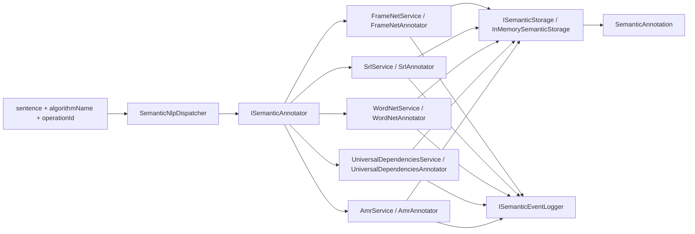

# 28.SemanticNlp

Documentation status: D28 documented - parent review passed.

## 1. Human explanation

`28.SemanticNlp` is a set of semantic NLP helpers: FrameNet, SRL, WordNet, Universal Dependencies, and AMR. The project takes a sentence as a string and returns a `SemanticAnnotation`: a list of tokens with a semantic family, role, possible predicate, and frame.

Important for Luba: this is text analysis infrastructure based on rules, dictionaries, and simple heuristics. It helps annotate English example sentences, but is not a trained language understanding model. The project has no proven `ILearningMachine` cycle, no checkpoint/manifest/locator/export/import/fresh-load/continue-training lifecycle. `28.SemanticNlp/state.json` is useful as historical project status, but by itself is not fresh runtime proof of quality.

## 2. UML / data flow



## 3. Connection simulations

| Connection | Example input | What happens | Expected result | What this does NOT prove |
|---|---|---|---|---|
| `sentence` -> `SemanticNlpDispatcher.AnnotateAsync` | `algorithmName="FrameNet"`, `operationId="op1"`, `sentence="John bought a book"` | The dispatcher looks up the annotator by name case-insensitively and writes a routing event. | The request goes to `FrameNetService`; an unknown name yields `ALGORITHM_NOT_FOUND`. | This does not prove the quality of the FrameNet annotation, only the fact of routing. |
| `FrameNetService` -> `FrameDetector` | `"The police attacked the protesters"` | Words are matched against a local FrameNet lexicon, the frame with the most votes wins. | `Attack`, trigger `attacked`, roles like `Attacker`/`Victim`. | This is not trained semantic reasoning; the dictionary is small and local. |
| `SrlAnnotator` -> `PredicateFinder` | `"John quickly sold the book to Mary"` | The first verb is found by dictionary/suffixes, then roles are assigned by position and markers. | `sold` as `V`, `John` as `A0`, `book` as `A1`, `quickly` as `AM-MNR`. | This does not prove a full SRL parser for an arbitrary language. |
| `WordNetAnnotator` -> `SynsetDatabase` | `"the dog is an animal"` | For each token the first synset from the in-memory base is taken. | `dog` gets `synset:dog.n.01`, unknown words get `null`. | The first synset is not disambiguation and not a trained understanding of meaning. |
| `UniversalDependenciesAnnotator` -> `RuleBasedParser` | `"The cat chased the mouse"` | The first found verb becomes `root`, the nearest nominal on the left is `nsubj`, on the right is `obj`. | `chased/root`, `cat/nsubj`, `mouse/obj`. | This is not a general-purpose UD parser; it is a rule-based helper. |
| `AmrAnnotator` -> `SimpleAmrBuilder` | `"boy wants girl"` | The first predicate becomes the root concept `wants-01`, ARG0/ARG1 are taken as the nearest non-verb tokens. | An AMR graph with root and edges `:ARG0`, `:ARG1`. | This is not a full AMR model and does not guarantee correct semantic generalization. |
| Service -> `InMemorySemanticStorage` | `operationId="op1"` | The annotation is saved into a dictionary by id; a repeated id can return a cached/idempotent result through the service. | `LoadAnnotationAsync("op1")` returns the saved annotation. | An in-memory write is not a persisted asset lifecycle or product-readiness evidence. |

## 4. No-code algorithms

### Fabric contracts

`ISemanticAnnotator.AnnotateAsync(string operationId, string sentence)` accepts a stable operation id and a sentence, returns `OperationResult<SemanticAnnotation>`. `AlgorithmName` is used by the dispatcher as the route key. The contract does not train a model and does not guarantee the quality of a specific algorithm.

`ISemanticStorage.SaveAnnotationAsync(string sentenceId, SemanticAnnotation annotation)` and `LoadAnnotationAsync(string sentenceId)` define the annotation storage interface. The current implementation `InMemorySemanticStorage` stores data in process memory; this is convenient for tests and demos, but is not a checkpoint or a registry.

### Core DTO and result

`SemanticToken` is a single token in the original order: `OriginalText`, `Position`, `SemanticFamily`, `RoleWithinFamily`. `SemanticAnnotation` is the whole response: the original sentence, the list of tokens, the algorithm name, an optional `PredicateText` and `FrameName`.

`OperationResult<T>` defines the common success/error style: `Ok(value)` or `Fail(message, code)`. Errors like `EMPTY_SENTENCE`, `NO_FRAME_DETECTED`, `ALGORITHM_NOT_FOUND` are branch diagnostics, not model quality metrics.

### `SemanticNlpDispatcher.AnnotateAsync(string algorithmName, string operationId, string sentence)`

Input: algorithm name, operation id, sentence. Output: `OperationResult<SemanticAnnotation>`.

Steps:
1. Looks up the annotator by `algorithmName`.
2. If the name is absent, returns `ALGORITHM_NOT_FOUND` and a list of available keys.
3. If the name is found, writes a `semantic.dispatch.requested` event.
4. Delegates the call to the specific `ISemanticAnnotator`.

Does not do: it does not select the "best" algorithm, does not merge results of several analyzers, does not train a router.

### `FrameNetService.AnnotateAsync(string operationId, string sentence)`

Input: id and an English sentence. Output: a `SemanticAnnotation` with `AlgorithmName="FrameNet"`, a possible `FrameName`, `PredicateText`, and roles.

Current logic:
1. `FrameNetAnnotator` splits the string by spaces.
2. `FrameDetector.DetectFrameAsync` counts word votes against the local `FrameNetLexicon`.
3. If no frame is found, a successful but unlabeled annotation is returned.
4. If a frame is found, `FrameElementFiller.FillRoles` assigns `Predicate` and roles before/after the trigger.
5. `FrameNetService` saves the result and writes a completion event; a repeated `operationId` short-circuits through idempotency.

Does not do: it does not use a real FrameNet corpus, does not train, does not estimate confidence.

### `SrlService.AnnotateAsync(string operationId, string sentence)`

Input: id and a sentence. Output: an SRL annotation.

Current logic:
1. `PredicateFinder.CreateDefault()` contains a small list of English verbs and suffix heuristics.
2. `SrlAnnotator` selects the first found predicate.
3. `ArgumentLabeler` assigns `V`, `A0`, `A1`, `AM-LOC`, `AM-TMP`, `AM-MNR` by position and marker words.
4. If there is no predicate, a successful unlabeled annotation is returned.

Does not do: it does not build a syntax tree, does not resolve complex semantic ambiguity.

### `WordNetService.AnnotateAsync(string operationId, string sentence)`

Input: id and a sentence. Output: token-level `synset:<id>` for known words.

Current logic:
1. `SynsetDatabase.CreateDefault()` creates a small in-memory synset hierarchy.
2. `WordNetAnnotator` cleans punctuation and looks up the first synset for each token.
3. `SynsetNavigator.GetHypernymChain` climbs up the first hypernym.
4. `ComputeSimilarityAsync(string word1, string word2)` takes the first synset of each word and computes a Wu-Palmer-like similarity.

Does not do: it does not select a sense by context and does not prove WordNet coverage for the product.

### `UniversalDependenciesService.AnnotateAsync(string operationId, string sentence)`

Input: id and a sentence. Output: a `SemanticAnnotation` where `SemanticFamily="UD"`, and `RoleWithinFamily` equals the relation (`root`, `nsubj`, `obj`, `det`, `dep`).

Current logic:
1. `RuleBasedParser.Parse(string sentence)` looks for the root as the first verb, otherwise the first token.
2. Nominals are determined by exclusion: not a verb and not a determiner.
3. The nearest nominal on the left gets `nsubj`, on the right gets `obj`.
4. `UniversalDependenciesAnnotator` transfers the tree into the common `SemanticAnnotation`.

Does not do: it is not a full CoNLL-U/UD parser for real corpora; `ConlluParser` reads blocks, but the runtime annotator uses the rule-based parser.

### `AmrService.AnnotateAsync(string operationId, string sentence)`

Input: id and a sentence. Output: a `SemanticAnnotation` where `PredicateText` can contain serialized Penman, and `FrameName` is the root concept.

Current logic:
1. `SimpleAmrBuilder.BuildFromSentence` cleans the tokens.
2. The first predicate becomes the root concept `<token>-01`.
3. The first non-verb token before the root becomes `:ARG0`, after the root becomes `:ARG1`.
4. `AmrPenmanSerializer` serializes the graph into a Penman-like string.
5. `AmrAnnotator` returns a common token annotation with concept roles.

Does not do: it does not train an AMR parser, does not derive sense numbers from data, does not guarantee AMR compatibility for complex sentences.

## 5. Short quotations from the code

`28.SemanticNlp/Fabric/Interfaces.cs:59-67`

```csharp
public interface ISemanticAnnotator
{
    // Stable name of this annotator: "FrameNet", "SRL", "WordNet", "AMR", "UD".
    string AlgorithmName { get; }

    // Run the algorithm against the given sentence and return a full annotation.
    // The same operationId returns the cached result on repeat calls.
    Task<OperationResult<SemanticAnnotation>> AnnotateAsync(string operationId, string sentence);
}
```

Why it matters: this is the common contract for all algorithms. The input is `operationId` and `sentence`, the output is `OperationResult<SemanticAnnotation>`. This proves a unified API, but does not prove the trained-ness or quality of each annotator.

`28.SemanticNlp/Core/Types.cs:29-45`

```csharp
public sealed record SemanticAnnotation
{
    // Original sentence as received on input — kept verbatim for traceability.
    public required string OriginalSentence { get; init; }

    // The list of annotated tokens; same length and order as the input tokens.
    public required IReadOnlyList<SemanticToken> Tokens { get; init; }

    // Which algorithm produced this annotation: "FrameNet", "SRL", "WordNet", etc.
    public required string AlgorithmName { get; init; }

    // The trigger predicate (main verb) when the algorithm reports one (SRL/FrameNet).
    public string? PredicateText { get; init; }

    // The activated frame name when the algorithm reports one (FrameNet only).
    public string? FrameName { get; init; }
}
```

Why it matters: this is the result shape for all helpers. The presence of `FrameName` or `PredicateText` is the annotation of the current algorithm, not proof of semantic understanding.

`28.SemanticNlp/Dispatcher/SemanticNlpDispatcher.cs:37-57`

```csharp
    public async Task<OperationResult<SemanticAnnotation>> AnnotateAsync(
        string algorithmName, string operationId, string sentence)
    {
        if (!_annotators.TryGetValue(algorithmName, out var annotator))
            return OperationResult<SemanticAnnotation>.Fail(
                $"Unknown algorithm '{algorithmName}'. Available: {string.Join(", ", _annotators.Keys)}",
                "ALGORITHM_NOT_FOUND");

        // Record the routing decision before delegating; useful for audit.
        _eventLogger.Log(new StandardEvent(
            EventType:   "semantic.dispatch.requested",
            OperationId: operationId,
            OccurredAt:  DateTimeOffset.UtcNow,
            Payload:     new Dictionary<string, object>
            {
                ["algorithm"] = algorithmName,
                ["sentence"]  = sentence,
            }));

        return await annotator.AnnotateAsync(operationId, sentence);
    }
```

Why it matters: the dispatcher only routes and logs. It does not select a model by quality and does not build an ensemble.

`28.SemanticNlp/Algorithms/FrameNet.cs:157-182`

```csharp
        if (frameVotes.Count == 0)
            return OperationResult<(string, string)>.Fail(
                "No word in the sentence belongs to any known frame", "NO_FRAME_DETECTED");

        // Pick the frame with the highest vote count; ties broken by name to be deterministic.
        string winningFrame = frameVotes
            .OrderByDescending(kv => kv.Value)
            .ThenBy(kv => kv.Key, StringComparer.Ordinal)
            .First().Key;

        // The trigger is the first token that belongs to the winning frame.
        string triggerWord = string.Empty;
        foreach (var rawToken in tokens)
        {
            string cleanToken = rawToken.Trim('.', ',', '!', '?', ';', ':').ToLowerInvariant();
            if (cleanToken.Length == 0) continue;

            var framesResult = await _lexicon.FindFramesForWordAsync(cleanToken);
            if (framesResult.IsSuccess && framesResult.Value!.Contains(winningFrame))
            {
                triggerWord = cleanToken;
                break;
            }
        }

        return OperationResult<(string, string)>.Ok((winningFrame, triggerWord));
```

Why it matters: FrameNet selects the frame by dictionary voting, not by a neural classifier.

`28.SemanticNlp/Algorithms/Srl.cs:199-205`

```csharp
    public Task<OperationResult<SemanticAnnotation>> AnnotateAsync(string sentence)
    {
        if (string.IsNullOrWhiteSpace(sentence))
            return Task.FromResult(OperationResult<SemanticAnnotation>.Fail(
                "Sentence is empty", "EMPTY_SENTENCE"));

        // Whitespace tokenization — sufficient for English example sentences.
```

Why it matters: the SRL pipeline explicitly starts with a simple guard and whitespace tokenization. This is useful for teaching examples, but is not production NLP tokenization.

`28.SemanticNlp/Algorithms/WordNet.cs:239-261`

```csharp
            string clean   = surface.Trim('.', ',', '!', '?', ';', ':').ToLowerInvariant();

            // Look up synsets for the cleaned form.
            var lookup = await _database.FindSynsetsForWordAsync(clean);
            string? synsetId = (lookup.IsSuccess && lookup.Value!.Count > 0)
                ? lookup.Value![0]
                : null;

            annotated.Add(new SemanticToken
            {
                OriginalText     = surface,
                Position         = tokenIndex,
                SemanticFamily   = synsetId is null ? null : $"synset:{synsetId}",
                RoleWithinFamily = synsetId is null ? null : "Member",
            });
        }

        return OperationResult<SemanticAnnotation>.Ok(new SemanticAnnotation
        {
            OriginalSentence = sentence,
            Tokens           = annotated,
            AlgorithmName    = "WordNet",
        });
```

Why it matters: the WordNet helper takes the first found synset. This is not context disambiguation.

`28.SemanticNlp/Algorithms/UniversalDependencies.cs:132-177`

```csharp
        // Find the root — the first verb in the sentence.
        var predicateResult = _predicateFinder.FindPredicatePositions(rawTokens);
        if (!predicateResult.IsSuccess)
            return predicateResult.MapError<DependencyTree>();

        int rootIndex = predicateResult.Value!.Count > 0 ? predicateResult.Value![0] : 0;

        // Identify nominal tokens by exclusion — anything that is not a verb and not
        // a determiner is treated as a noun for the purposes of nsubj / obj.
        var verbIndexes = predicateResult.Value!.ToHashSet();
        bool IsDeterminer(int index) => DeterminerWords.Contains(rawTokens[index]);
        bool IsNominal(int index)    => !verbIndexes.Contains(index) && !IsDeterminer(index);

        // Pick nsubj — the closest nominal token before the root.
        int nsubjIndex = -1;
        for (int tokenIndex = rootIndex - 1; tokenIndex >= 0; tokenIndex--)
            if (IsNominal(tokenIndex)) { nsubjIndex = tokenIndex; break; }

        // Pick obj — the closest nominal token after the root.
        int objIndex = -1;
        for (int tokenIndex = rootIndex + 1; tokenIndex < rawTokens.Count; tokenIndex++)
            if (IsNominal(tokenIndex)) { objIndex = tokenIndex; break; }

        // Build DependencyToken records. Token ids are 1-based per CoNLL-U.
        var tokens = new List<DependencyToken>(rawTokens.Count);
        for (int tokenIndex = 0; tokenIndex < rawTokens.Count; tokenIndex++)
        {
            string surface = rawTokens[tokenIndex];

            string upos;
            string deprel;
            int    headId;

            if (tokenIndex == rootIndex)
            {
                upos   = "VERB";
                deprel = "root";
                headId = 0;
            }
            else if (tokenIndex == nsubjIndex)
            {
                upos   = "NOUN";
                deprel = "nsubj";
                headId = rootIndex + 1;
            }
            else if (tokenIndex == objIndex)
```

Why it matters: the UD helper is explicitly rule-based and positional; it is not a trained dependency parser.

`28.SemanticNlp/Algorithms/Amr.cs:236-259`

```csharp
    public OperationResult<AmrGraph> BuildFromSentence(string sentence)
    {
        if (string.IsNullOrWhiteSpace(sentence))
            return OperationResult<AmrGraph>.Fail(
                "Sentence is empty", "EMPTY_SENTENCE");

        var tokens = sentence.Split(' ', StringSplitOptions.RemoveEmptyEntries)
            .Select(token => token.Trim('.', ',', '!', '?', ';', ':'))
            .Where(token => token.Length > 0)
            .ToList();

        if (tokens.Count == 0)
            return OperationResult<AmrGraph>.Fail("No usable tokens", "NO_TOKENS");

        var predicateResult = _predicateFinder.FindPredicatePositions(tokens);
        if (!predicateResult.IsSuccess)
            return predicateResult.MapError<AmrGraph>();

        // Pick the first predicate; use the first token if none was detected.
        int rootIndex = predicateResult.Value!.Count > 0 ? predicateResult.Value![0] : 0;

        // Build the predicate concept as "lemma-01" — sense numbers are not derivable
        // from text alone, so we always pick "01" for this learning implementation.
        string rootConcept = tokens[rootIndex].ToLowerInvariant() + "-01";
```

Why it matters: the AMR builder uses a simple rule `<token>-01`; this is not a full AMR parser.

`28.SemanticNlp/Fabric/InMemoryStorage.cs:27-45`

```csharp
public sealed class InMemorySemanticStorage : ISemanticStorage
{
    // Map of sentenceId → the annotation last written under that id.
    private readonly Dictionary<string, SemanticAnnotation> _annotations = [];

    // Save replaces any prior annotation under the same id (idempotent overwrite).
    public Task<OperationResult<bool>> SaveAnnotationAsync(string sentenceId, SemanticAnnotation annotation)
    {
        _annotations[sentenceId] = annotation;
        return Task.FromResult(OperationResult<bool>.Ok(true));
    }

    // Load returns the saved annotation; failure when nothing has been written under that id.
    public Task<OperationResult<SemanticAnnotation>> LoadAnnotationAsync(string sentenceId)
        => Task.FromResult(_annotations.TryGetValue(sentenceId, out var annotation)
            ? OperationResult<SemanticAnnotation>.Ok(annotation)
            : OperationResult<SemanticAnnotation>.Fail(
                $"Annotation '{sentenceId}' not found", "ANNOTATION_NOT_FOUND"));
}
```

Why it matters: the storage is in-memory right now. It confirms local saving within the process, but not a project asset lifecycle.

## 6. QA / test map

The tests were read and cross-referenced, but not run in this documentation subphase.

| Area | Test anchors | What they cover | What they do not prove |
|---|---|---|---|
| FrameNet | `Tests/SemanticNlpTests.cs` `FrameNet_DetectsAttackFrame`, `FrameNet_FillsAttackerAndVictimRoles`, `FrameNet_DetectsCommerceBuyFrame` | Dictionary frame detection, role filling, saving, and idempotency. | They do not prove a full FrameNet corpus or quality on a real dataset. |
| SRL | `Srl_PredicateFinder_LocatesVerbInSentence`, `Srl_LabelsAgentThemeAndManner`, `Srl_NoVerbProducesUnlabelledAnnotation` | Verb dictionary/suffixes, A0/A1/AM-* rules, graceful no-predicate branch. | They do not prove state-of-the-art SRL. |
| WordNet | `WordNet_FindsSynsetForKnownWord`, `WordNet_HypernymChainGoesUpToRoot`, `WordNet_WuPalmerSimilarity_CloseWordsScoreHigh` | In-memory synset lookup, hypernym chain, similarity range. | They do not prove WordNet coverage or context disambiguation. |
| AMR | `Amr_PenmanParser_ParsesNestedNodes`, `Amr_PenmanRoundTrip_PreservesStructure`, `Amr_SimpleBuilder_UsesFirstVerbAsRoot` | Penman parse/serialize and a simple sentence-to-AMR builder. | They do not prove full AMR annotation. |
| Universal Dependencies | `Ud_ConlluParser_ReadsTextCommentAndTokens`, `Ud_RuleBasedParser_AssignsNsubjAndObj`, `Ud_AnnotatorEmitsRelationsAsRoles` | CoNLL-U parsing helper, rule-based root/nsubj/obj, conversion to `SemanticAnnotation`. | They do not prove a UD parser for arbitrary text. |
| Dispatcher | `Dispatcher_RoutesEachAlgorithmToTheRightService`, `Dispatcher_FailsClearlyForUnknownAlgorithm`, `Dispatcher_LogsRoutingEvent` | Algorithms available by name, unknown branch, routing log. | They do not prove automatic selection of the best NLP algorithm. |

## 7. Status and limitations

| Component | Current status | Honest boundary |
|---|---|---|
| Fabric contracts | A real interface layer for text source, lexicon, storage, events, annotator. | The contract is not runtime proof and contains no trained lifecycle. |
| `InMemorySemanticStorage` | Real in-memory storage of annotations. | No file/db persistence, manifest, checkpoint, or locator. |
| `SemanticNlpDispatcher` | Real routing by algorithm name. | No learned router or quality arbitration. |
| FrameNet | A small dictionary and role-filling rules. | Not a corpus-trained FrameNet model. |
| SRL | A verb list, suffixes, positional argument labels. | Not a trained SRL model. |
| WordNet | An in-memory synset graph and first-sense annotation. | Not a semantic disambiguation model. |
| Universal Dependencies | A CoNLL-U parser helper and a rule-based parser. | Not a universal dependency parser. |
| AMR | A Penman parser/serializer and a simple builder. | Not a trained AMR parser. |
| `state.json` | Historical status/description of the project. | A JSON/status file does not replace fresh runtime tests and product evidence. |

## 8. Anti-false-done

Machine-checkable boundary: anti-false-done for D28 means that a dictionary, rule, JSON, or static report is not accepted as proof of a trained NLP runtime.

- The presence of `SemanticNlpDispatcher`, `FrameNetService`, `WordNetService`, and other classes is not proof of trained language understanding.
- JSON/status/report/static docs are not proof of runtime semantic quality.
- In-memory storage and the event log are useful for test tracing, but are not a checkpoint/manifest/locator/export/import/fresh-load/continue lifecycle.
- A rule-based/KNN-like/dictionary helper must not be hidden as a trained semantic model.
- For claims at the "ready NLP model" level, separate runtime/evaluation evidence, held-out data, persisted assets, and load/use checks are needed; in the current `28.SemanticNlp` this lifecycle is not visible.
