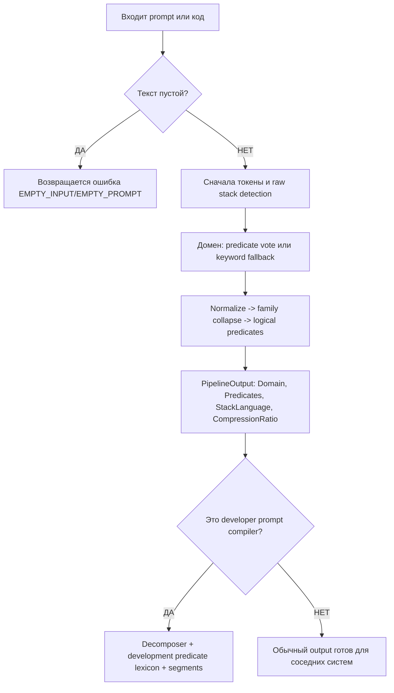

# 29.SemanticCompiler - документация реализации

## Короткая карта для Лубы

`29.SemanticCompiler` - это детерминированный набор помощников, который превращает текст разработческого запроса или фрагмент кода в более компактные признаки: домен задачи, язык/стек, логические предикаты, сегменты и порядок выполнения. Он полезен как инфраструктура для оркестрации, маршрутизации и подготовки prompt/evidence, но сам по себе не является обученной `ILearningMachine`, не хранит checkpoint/manifest обученной модели и не доказывает качество пользовательского ответа.

Главная граница честности: здесь есть правила, словари, эвристики, шаблоны и один обучаемый в памяти KNN-путь в `RouteClassifier.Train(...)`, но нет экспорт/импорт жизненного цикла обученного актива, fresh-load проверки или runtime-доказательства продукта. JSON, статический отчёт, smoke или сам факт наличия классов нельзя считать доказательством обученного семантического компилятора.

## 0. UML для draw.io

```mermaid
classDiagram
    class PipelineInput
    note for PipelineInput "ПОЛНОСТЬЮ РЕАЛИЗОВАНА\nСодержит исходный текст и необязательный путь файла"
    class PipelineOutput
    note for PipelineOutput "ПОЛНОСТЬЮ РЕАЛИЗОВАНА\nВозвращает домен, предикаты, стек и compression ratio"
    class SemanticCompilerPipeline
    note for SemanticCompilerPipeline "ПОЛНОСТЬЮ РЕАЛИЗОВАНА\nЗапускает фиксированный порядок стадий: tokenize -> stack -> route -> normalize -> collapse -> predicates"
    class AstTokenizer
    note for AstTokenizer "ПОЛНОСТЬЮ РЕАЛИЗОВАНА\nДелит код на токены и сохраняет регистр для StackDetector"
    class StackDetector
    note for StackDetector "ПОЛНОСТЬЮ РЕАЛИЗОВАНА\nОпределяет csharp/typescript/python по сырым маркерам"
    class RouteClassifier
    note for RouteClassifier "ЧАСТИЧНО\nЕсть deterministic keyword/predicate route и in-memory KNN после Train; нет persisted model lifecycle"
    class SemanticNormalizer
    note for SemanticNormalizer "ПОЛНОСТЬЮ РЕАЛИЗОВАНА\nLowercase, stop words, простой suffix stemmer"
    class FamilyCollapser
    note for FamilyCollapser "ПОЛНОСТЬЮ РЕАЛИЗОВАНА\nСводит словесные семьи к *_OP"
    class LogicExtractor
    note for LogicExtractor "ПОЛНОСТЬЮ РЕАЛИЗОВАНА\nИзвлекает 22 типа логических предикатов"
    class DevelopmentPromptCompiler
    note for DevelopmentPromptCompiler "ПОЛНОСТЬЮ РЕАЛИЗОВАНА\nКомпилирует dev prompt в домен, predicates, development predicates и сегменты"
    class Decomposer
    note for Decomposer "ПОЛНОСТЬЮ РЕАЛИЗОВАНА\nРазделяет prompt на задачи и защищает false-conjunction"
    class DependencyGraph
    note for DependencyGraph "ПОЛНОСТЬЮ РЕАЛИЗОВАНА\nСортирует домены по зависимостям Kahn BFS"
    class StopSignalDetector
    note for StopSignalDetector "ПОЛНОСТЬЮ РЕАЛИЗОВАНА\nОстанавливает дальнейшее разбиение по явным маркерам"
    class ContextualDictionary
    note for ContextualDictionary "ПОЛНОСТЬЮ РЕАЛИЗОВАНА\nВыбирает значение слова по короткому контекстному окну"
    class PatternClassifier
    note for PatternClassifier "ПОЛНОСТЬЮ РЕАЛИЗОВАНА\nКлассифицирует порядок слов SVO/SOV/VSO/IMPERATIVE"
    class PatternReorderer
    note for PatternReorderer "ПОЛНОСТЬЮ РЕАЛИЗОВАНА\nПереставляет SOV/VSO в SVO"
    class TemplateBeautifier
    note for TemplateBeautifier "ПОЛНОСТЬЮ РЕАЛИЗОВАНА\nМапит последовательность предикатов на короткий code template"

    SemanticCompilerPipeline --> PipelineInput
    SemanticCompilerPipeline --> PipelineOutput
    SemanticCompilerPipeline --> AstTokenizer
    SemanticCompilerPipeline --> StackDetector
    SemanticCompilerPipeline --> RouteClassifier
    SemanticCompilerPipeline --> SemanticNormalizer
    SemanticCompilerPipeline --> FamilyCollapser
    SemanticCompilerPipeline --> LogicExtractor
    DevelopmentPromptCompiler --> SemanticCompilerPipeline
    DevelopmentPromptCompiler --> Decomposer
    DevelopmentPromptCompiler --> SemanticNormalizer
    DevelopmentPromptCompiler --> FamilyCollapser
    PatternClassifier --> PatternReorderer
    DependencyGraph ..> Domain
    StopSignalDetector ..> Decomposer
    TemplateBeautifier ..> LogicExtractor
```



| Класс | Что делает | Статус |
|---|---|---|
| `SemanticCompilerPipeline` | Основной deterministic pipeline `PipelineInput` -> `PipelineOutput`. | ✅ Полная |
| `AstTokenizer`, `StackDetector`, `SemanticNormalizer`, `FamilyCollapser`, `LogicExtractor` | Стадии сжатия/извлечения признаков. | ✅ Полная |
| `RouteClassifier` | Predicate/keyword routing и in-memory KNN после явного `Train`. | ⚠️ Частичная: нет сохранения обученного состояния |
| `DevelopmentPromptCompiler` | Надстройка для developer prompt: сегменты и development predicates. | ✅ Полная |
| `Decomposer`, `DependencyGraph`, `StopSignalDetector` | Планирование и контроль глубины разбиения. | ✅ Полная |
| `ContextualDictionary`, `PatternClassifier`, `PatternReorderer`, `TemplateBeautifier` | Translation/beautification helpers. | ✅ Полная |

### Симуляции соединений

| Соединение | Пример входа | Что происходит | Ожидаемый результат | Что нельзя утверждать |
|---|---|---|---|---|
| `SemanticCompilerPipeline -> AstTokenizer` | `Text="if (user == null) return ..."` | Текст режется по пробелам, скобкам и операторам. | Массив токенов, где операторы не потеряны. | Это не AST Roslyn и не понимание программы. |
| `SemanticCompilerPipeline -> StackDetector` | `Promise<string>` | Сырые маркеры проверяются до lowercase. | `StackLanguage="typescript"`. | Это не runtime TypeScript host proof. |
| `SemanticCompilerPipeline -> RouteClassifier` | `["VALIDATE_OP","NULL_CHECK"]` | Голоса предикатов или keyword fallback выбирают домен. | Например `CODE_Q`/`BUG` по текущим правилам. | Это не обученная семантическая власть. |
| `SemanticCompilerPipeline -> SemanticNormalizer -> FamilyCollapser -> LogicExtractor` | `"validate the request"` | Удаляются stop words, stem, collapse, затем trigger map. | Предикаты вроде `VALIDATE_OP`. | Это не доказательство качества ответа. |
| `DevelopmentPromptCompiler -> Decomposer` | `"Fix null error and then write regression tests"` | Деление по task boundary и fallback markers. | Два сегмента. | Наличие сегментов не означает выполненные тесты. |
| `DevelopmentPromptCompiler -> SemanticCompilerPipeline` | `"Create CI pipeline..."` | Каждый сегмент компилируется в домен/стек/предикаты. | `DevelopmentPromptCompilation` с `AUTOMATION`, `TEST` и т.п. | Это не обучение capability. |
| `DependencyGraph -> Domain` | `[PLAN, ARCH, CODE_Q]` | Kahn BFS учитывает default edges. | Уровни: `PLAN`, затем `ARCH`, затем `CODE_Q`. | Это не оркестратор исполнения сам по себе. |
| `PatternClassifier -> PatternReorderer` | `["user","record","update"], "SOV"` | Глагол переносится после subject. | `["user","update","record"]`-подобный порядок. | Это не переводчик естественного языка. |
| `TemplateBeautifier -> LogicExtractor` | `["VALIDATE_OP(X) -> SUCCESS"]` | Шаблон ищется exact/prefix/substring. | `"return Validate({X});"`. | Это не применённое изменение кода. |

## 1. Человеческий поток



| Ветка | Симуляция | Ожидаемый результат |
|---|---|---|
| Пустой текст | `PipelineInput("", null)` | `Fail("EMPTY_INPUT")`; никакой inference не запускается. |
| TypeScript marker | `"export async function fetch(): Promise<string>"` | Stack определяется до нормализации как `typescript`. |
| Developer prompt | `"Fix null error and then write regression tests"` | Компиляция root + сегменты; predicates включают `IMPLEMENT`/`TEST`. |

## 2. Алгоритмы без кода

### Алгоритм A: основной pipeline

Представь сортировочную линию: сначала она аккуратно нарезает фразу, потом смотрит на упаковку до того, как её перекрасили, затем клеит ярлыки домена и коротких операций.

**Где живёт логика:** `29.SemanticCompiler/Pipeline/SemanticCompilerPipeline.cs`.

**Сигнатуры и типы данных:**

```csharp
OperationResult<PipelineOutput> Compile(PipelineInput input)
PipelineInput(Text: "if (user == null) return ...", FilePath: "UserService.cs")
PipelineOutput(Domain: Domain.CODE_Q, Predicates: ["NULL_CHECK", "RETURN_OP"], StackLanguage: "csharp", CompressionRatio: 4.0)
```

Текущий алгоритм:
1. Если `input.Text` пустой, возвращает `EMPTY_INPUT`.
2. `AstTokenizer.Tokenize(string code)` режет текст и сохраняет регистр.
3. `StackDetector.Detect(string rawText)` работает на сыром тексте, до lowercase.
4. `RouteClassifier.Classify(string[] tokens)` выбирает `Domain`.
5. `SemanticNormalizer.Normalize(string text)` удаляет шум.
6. `FamilyCollapser.Collapse(string[] tokens)` сводит слова к `*_OP`.
7. `LogicExtractor.Extract(string[] tokens)` отдаёт предикаты и fallback.
8. Считает `CompressionRatio`.

Что НЕ делает: не строит Roslyn AST, не запускает модель, не сохраняет обученный checkpoint и не доказывает качество маршрутизации на новых данных.

### Алгоритм B: токенизация и stack detection

`AstTokenizer.Tokenize(string code)` принимает строку, возвращает `OperationResult<string[]>`; пустой ввод даёт `EMPTY_INPUT`. `StackDetector.Detect(string rawText)` принимает raw text и возвращает строку `"csharp"`, `"typescript"`, `"python"` или `"unknown"`.

Важная ветка: TypeScript проверяется до нормализации, потому что `Promise<` и `Injectable` чувствительны к регистру. Для C# нужны минимум два маркера; lean EF classes покрыты структурными маркерами вроде `{ get; set; }`.

Что НЕ делает: не компилирует проект и не проверяет, что файл реально валиден в языке.

### Алгоритм C: нормализация, family collapse, predicate extraction

`SemanticNormalizer.Normalize(string text)` возвращает `string[]`: lowercase, split по не-буквам, stop words, suffix stemmer. `FamilyCollapser.Collapse(string[] tokens)` возвращает `string[]`, заменяя известные stems на `GET_OP`, `VALIDATE_OP`, `CREATE_OP` и т.д. `LogicExtractor.Extract(string[] tokens)` возвращает `string[]` из 22 predicate families и fallback `ASSIGN_OP`/`CALL_OP`.

Что НЕ делает: эти стадии не обучаются на корпусе внутри этого проекта; это словари и substring/prefix heuristics.

### Алгоритм D: route classifier

`RouteClassifier.Classify(string[] tokens)` принимает token/predicate strings и возвращает `Domain`. Сначала голосует по `PredicateDomainMap`, затем падает в `ClassifyByKeywords(string text)`. Отдельная перегрузка `Classify(int[] predicates)` работает только после `Train(IReadOnlyList<(int[] Predicates, Domain Domain)> examples)`; без training возвращает `NOT_TRAINED`.

Запрос без признаков теперь получает названный отказ, а не чужую тему (правка от 1 ноября 2026, первая малая правка пятой строки очереди адресных ремонтов). Что было: у обученной перегрузки стояла ровно одна проверка — обученность, — и запрос без признаков уходил прямо в поиск соседей. Мера несходства `JaccardDist` даёт пустому запросу **ровно единицу** до каждого урока: общих признаков ноль, объединение равно размеру урока. Все расстояния получались равными, упорядочивание устойчиво, поэтому отбор брал первые уложенные строки памяти и голосование возвращало тему **первого уложенного урока** — и возвращало её как **успех**, без признака того, что решение ни на чём не основано. На фактических семи уроках, которыми продукт засевает классификатор (`21.AgentInfrastructure/Logical/PromptDomainClassifier.cs:79-87`), это измерено: ответом была тема `BUG`, просто потому что урок про ошибку уложен первым. Отсутствующий массив вместо этого бросал исключение из построения набора, что нарушает первое правило проекта. Что стало: отказ `NO_EVIDENCE_FOR_DECISION` выдаётся **до** поиска соседей, отсутствующий массив получает тот же отказ вместо исключения, а два набора без признаков больше не объявляются расстоянием ноль — у них нет ни одного общего признака, поэтому расстояние единица. Порядок двух проверок сохранён: обученность проверяется первой, поэтому необученный классификатор по-прежнему отвечает `NOT_TRAINED` даже на пустом запросе.

Границы этой правки, названные прямо. Это починка распознавания на границе узла, а **не** улучшение работающего продукта: обученную перегрузку во всём хранилище вызывает ровно одна сторона — совместимостная оболочка `12.SemanticCompiler/Routing/RouteClassifier.cs:35`, — а до неё цепочка идёт через единицу классификации темы `23.SemanticCompilerAdapter/DomainClassifierUnit.cs:162`, у которой на строке 160 стоит собственная охрана `request.Predicates is { Length: > 0 }`. Значит пустой и отсутствующий вход в продукте до канона и так не доходили, и правка ни одного продуктового ответа не меняет. Проводка обученной перегрузки до публичного входа `Compile` — вторая половина той же пятой строки очереди и тоже остаётся открытой.

Отказ при нулевом сходстве — вторая половина той же правки, и она продуктовый ответ **меняет** (1 ноября 2026). Запрос, у которого есть признаки, но ни один из них не встречается ни в одном выученном уроке, охрану непустого профиля **проходит**, а мера несходства даёт ему единицу до каждого урока. Прежде он получал тему первого уложенного урока как уверенный успех. Теперь отказ `NO_EVIDENCE_FOR_DECISION` выдаётся, когда **лучшее**, то есть наименьшее, расстояние равно единице. Единица здесь не подобранный порог, а определение: мера равна единице ровно тогда, когда пересечение признаков пусто, и выше единицы не бывает; общий порог близости остаётся отдельной неизмеренной работой. Сравнивается именно наименьшее расстояние: при сравнении первого отказ срабатывал бы ошибочно на запросе, чей первый урок просто не пересекается, — измерено, такие запросы в семёрке продуктовых уроков есть.

Порядок трёх проверок несущий: необученность, затем пустой и отсутствующий вход, затем нулевое сходство. Нулевое сходство стоит последним ещё и потому, что только оно требует посчитать расстояния, то есть цену. Расстояния считаются один раз и используются и для проверки, и для выбора соседей; порядок строк сохранён, поэтому упорядочивание остаётся устойчивым и выбор соседей не меняется ни на один урок.

**Цена второй половины измерена, а не предположена** (проверяемая программа `Tests/ExperimentFixes/oracle-route-classifier-zero-similarity.ps1`, панель 3, с дословным переносом детерминированной цепочки потребителя). На запросах без общих признаков потребитель при отказе проваливается в объявленную цепочку, и это по случаям выглядит так:

| Запрос без общих признаков | Прежде | Теперь | Сработавшая ветвь потребителя |
|---|---|---|---|
| признак вне уроков, нейтральный текст | `BUG`, уверенность 0,90 | `BUG`, уверенность **0,20** | близость предикатов |
| тот же признак, текст с прямым вопросом | `BUG`, уверенность 0,90 | **`CODE_Q`**, уверенность 0,90 | прямой вопрос |
| тот же признак, текст о сбое | `BUG`, уверенность 0,90 | `BUG`, уверенность 0,90 | признак сбоя |
| неизвестные признаки, нейтральный текст | `BUG`, уверенность 0,90 | **`CODE_Q`**, уверенность **0,20** | ключевые слова |

То есть тема меняется в двух случаях из четырёх, а уверенность падает с 0,90 до 0,20 тоже в двух из четырёх, и довод `trained_predicate_knn` заменяется на `predicate_affinity` либо исчезает. Это настоящая цена, и она названа числом.

**Контроль, тоже числом:** на девяти запросах, где есть хотя бы один общий признак, не изменился ни один ответ — ни классификатора (9 из 9), ни потребителя (9 из 9). Но этот контроль **не** доказывает, что те ответы осмысленны: в той же панели измерено, что при пяти соседях и семи уроках голос не взвешен по расстоянию, поэтому семь запросов из девяти получают одну и ту же тему `BUG`, включая запросы, дословно равные урокам тем `PLAN`, `CODE_Q` и `REFACTOR`. Это отдельное семейство дефектов, правкой не затронутое и ею не заявляемое.

Владение памятью и целостность приёма партии: `RouteClassifier.Train` (`29.SemanticCompiler/Routing/RouteClassifier.cs:77-115`) сначала целиком проверяет и переносит всю новую партию в приватную таблицу, кладя туда собственную копию массива признаков каждого урока, и только после полного успеха одной операцией заменяет принятую память. Из этого следуют два свойства. Первое: после обучения изменение переданных массивов признаков на стороне вызывающего не меняет уже принятую память. Второе: негодная новая партия (отсутствующая ссылка, пустая партия, урок без массива признаков, обрыв чтения партии) отклоняется исключением, а прежняя принятая память остаётся целой и продолжает отвечать как раньше — вместо прежнего поведения, когда любой такой отказ оставлял маршрутизатор необученным. Форма отказа прежняя (исключение), подпись метода не менялась; обучение по-прежнему ЗАМЕНЯЕТ весь набор уроков, а не дописывает к нему. Совместимостная оболочка `12.SemanticCompiler/Routing/RouteClassifier.cs:26-33` передаёт партию канону как есть и намеренно не гасит отказ.

Что НЕ делает: KNN-профиль не сохраняется на диск, не экспортируется и не имеет fresh-load evidence, поэтому это не завершённый trainable asset. Владение массивами и целостность приёма партии — это сохранность состояния механизма, а не доказательство его обобщения и не прирост точности распознавания домена.

### Алгоритм E: development prompt compiler

`DevelopmentPromptCompiler.Compile(string prompt)` принимает developer prompt и возвращает `OperationResult<DevelopmentPromptCompilation>`. Он вызывает pipeline для root prompt, делит prompt через `Decomposer.Decompose`, при необходимости использует fallback по `"and then"`, компилирует сегменты и добавляет development predicates из lexicon и pipeline predicates.

Что НЕ делает: не исполняет work order, не обучает LoRA/DPO, не пишет файлы и не подтверждает качество будущей оркестрации.

### Алгоритм F: decomposition, dependency graph, stop signal

`Decomposer.Decompose(string prompt)` возвращает `OperationResult<string[]>`: single task, hard split или split по `and`, если обе стороны похожи на самостоятельные задачи. `DependencyGraph.Sort(Domain[] domains)` возвращает `OperationResult<Domain[][]>` уровней для параллельного/последовательного порядка. `StopSignalDetector.ShouldStop(string[] subTaskPredicates, int currentDepth)` возвращает `bool`, чтобы не дробить уже атомарную задачу.

Что НЕ делает: не запускает sub-agents и не гарантирует правильную продуктовую последовательность без внешнего orchestration layer.

### Алгоритм G: translation/beautification helpers

`ContextualDictionary.Lookup(string word, string[] context)` выбирает значение по маленькому окну контекста. `PatternClassifier.Classify(string[] tokens)` возвращает `"SVO"`, `"SOV"`, `"VSO"`, `"IMPERATIVE"` или `"UNKNOWN"`. `PatternReorderer.Reorder(string[] tokens, string fromPattern)` переставляет SOV/VSO. `TemplateBeautifier.Beautify(string[] predicates)` ищет code template exact/prefix/substring.

Что НЕ делает: не переводит произвольный язык, не применяет кодовые изменения и не заменяет ревью.

## 3. Короткие цитаты из кода

`29.SemanticCompiler/Pipeline/SemanticCompilerPipeline.cs:50-82`

```csharp
    public OperationResult<PipelineOutput> Compile(PipelineInput input)
    {
        if (string.IsNullOrWhiteSpace(input.Text))
            return OperationResult<PipelineOutput>.Fail("Input text is empty", "EMPTY_INPUT");

        // Stage 1: tokenize raw text (preserve case for E20).
        var tokenResult = _astTokenizer.Tokenize(input.Text);
        if (!tokenResult.IsSuccess) return tokenResult.MapError<PipelineOutput>();
        var rawTokens = tokenResult.Value!;

        // Stage 2: StackDetector on RAW text (E20 Rule A — must precede normalisation).
        string stack = _stackDetector.Detect(input.Text);

        // Stage 3: route to domain via predicate profile.
        string[] rawTokenStrings = rawTokens;
        var domain = _routeClassifier.Classify(rawTokenStrings);

        // Stage 4: normalize — lowercase, stem, remove stop words.
        string[] normalized = _normalizer.Normalize(input.Text);

        // Stage 5: collapse families to semantic ops.
        string[] collapsed  = _collapser.Collapse(normalized);

        // Stage 6: extract logical predicates.
        string[] predicates = _extractor.Extract(collapsed);

        // Compute compression ratio: original word count / predicate count.
        int originalCount  = input.Text.Split(' ', StringSplitOptions.RemoveEmptyEntries).Length;
        double compression = predicates.Length == 0 ? 1.0
            : (double)originalCount / predicates.Length;

        return OperationResult<PipelineOutput>.Ok(
            new PipelineOutput(domain, predicates, stack, compression));
```

> Почему важно: этот блок доказывает реальный порядок стадий. Особенно важно, что `StackDetector` вызывается до normalizer. Это доказывает pipeline wiring, но не доказывает обученное качество маршрутизации.

`29.SemanticCompiler/Compression/AstTokenizer.cs:15-31`

```csharp
    public OperationResult<string[]> Tokenize(string code)
    {
        if (string.IsNullOrWhiteSpace(code))
            return OperationResult<string[]>.Fail("Input code is empty", "EMPTY_INPUT");

        // Split on whitespace and common code delimiters, keeping non-empty tokens.
        var raw = code.Split(
            [' ', '\t', '\n', '\r', ';', ',', '(', ')', '{', '}', '[', ']'],
            StringSplitOptions.RemoveEmptyEntries);

        // Further split on operators without removing them from context.
        var tokens = raw
            .SelectMany(t => SplitOnOperators(t))
            .Where(t => t.Length > 0)
            .ToArray();

        return OperationResult<string[]>.Ok(tokens);
```

> Почему важно: показывает, что это lightweight token splitter, а не Roslyn AST. Вход `a.b(c)` даст несколько токенов, но не semantic parse дерева.

`29.SemanticCompiler/Routing/StackDetector.cs:55-76`

```csharp
    // Detect the stack label from raw (un-normalised) source text.
    // Returns "csharp" | "typescript" | "python" | "unknown".
    public string Detect(string rawText)
    {
        if (string.IsNullOrWhiteSpace(rawText)) return "unknown";

        int tsScore = CountMatches(rawText, TypeScriptMarkers);
        int pyScore = CountMatches(rawText, PythonMarkers);
        int csScore = CountMatches(rawText, CSharpKeywordMarkers)
                    + CountMatches(rawText, CSharpStructuralMarkers);

        // TypeScript check before normalisation — its markers are case-sensitive.
        if (tsScore >= MinMarkers && tsScore > csScore && tsScore > pyScore)
            return "typescript";

        if (pyScore >= MinMarkers && pyScore > csScore)
            return "python";

        if (csScore >= MinMarkers)
            return "csharp";

        return "unknown";
```

> Почему важно: ветки честно показывают heuristic scoring и `unknown`. Это не host/runtime proof; это только статический raw-text classifier.

`29.SemanticCompiler/Routing/RouteClassifier.cs:145-197` — весь метод; объяснение правки стоит над ним на строках 115-144. Ниже приведены три проверки решения: первые две на строках 147-158, расчёт расстояний на 160-167 и проверка нулевого сходства на 169-185. Выбор соседей и голосование на строках 187-196 повторяют прежний код слово в слово, изменился только источник уже посчитанного расстояния.

```csharp
    public OperationResult<Domain> Classify(int[] predicates)
    {
        // Без памяти решать нечем; прежний код отказа сохранён дословно.
        if (_train.Count == 0)
            return OperationResult<Domain>.Fail("Classifier not trained", "NOT_TRAINED");

        // Запрос без признаков — отсутствующий массив или массив нулевой длины —
        // не несёт свидетельства о теме, поэтому отказ выдаётся ДО поиска
        // соседей: до единственного места, где равные расстояния превращались в
        // метку первого урока.
        if (predicates is null || predicates.Length == 0)
            return OperationResult<Domain>.Fail(
                "Профиль признаков пуст: свидетельства для решения о теме нет.",
                "NO_EVIDENCE_FOR_DECISION");

        // ... расстояния до всех уроков считаются один раз в `scored` (165-167) ...

        if (scored.Min(row => row.Distance) >= 1.0)
            return OperationResult<Domain>.Fail(
                "Ни один выученный урок не разделяет с запросом ни одного признака: свидетельства для решения о теме нет.",
                "NO_EVIDENCE_FOR_DECISION");
```

> Почему важно: это единственный явно trainable-adjacent путь, но он in-memory. Без `Train` возвращается `NOT_TRAINED`, а после `Train` нет export/import/checkpoint. Три проверки перед поиском соседей читаются в показанном порядке, и порядок несущий: обученность первой, иначе необученный классификатор начал бы отвечать новым кодом вместо прежнего; нулевое сходство последним, потому что только оно требует посчитать расстояния. Читаемая здесь таблица `_train` принадлежит маршрутизатору: `Train` (`29.SemanticCompiler/Routing/RouteClassifier.cs:77-113`) кладёт в неё собственные копии массивов признаков и публикует новую таблицу одной операцией после полной проверки партии, поэтому ни внешняя правка переданных массивов, ни отказ на негодной партии больше не меняют и не стирают уже принятую память. Чего эта цитата не доказывает: ни один из трёх отказов не прибавляет точности распознавания домена. Отказ на пустом и отсутствующем входе из обычного продуктового пути не достигается — у единицы классификации темы проекта 23 на строке 160 стоит охрана непустого профиля; а отказ при нулевом сходстве достигается и **меняет** продуктовый ответ, и его измеренная цена расписана в разделе про алгоритм маршрутного классификатора выше.

`29.SemanticCompiler/Development/DevelopmentPromptCompiler.cs:41-69`

```csharp
    public OperationResult<DevelopmentPromptCompilation> Compile(string prompt)
    {
        if (string.IsNullOrWhiteSpace(prompt))
            return OperationResult<DevelopmentPromptCompilation>.Fail("Prompt cannot be empty.", "EMPTY_PROMPT");

        var root = CompileOne(prompt.Trim());
        if (!root.IsSuccess)
            return root.MapError<DevelopmentPromptCompilation>();

        var split = _decomposer.Decompose(prompt.Trim());
        if (!split.IsSuccess)
            return split.MapError<DevelopmentPromptCompilation>();

        var segmentTexts = split.Value!.Length <= 1
            ? SplitBoundaryFallback(prompt.Trim())
            : split.Value!;

        var segments = segmentTexts
            .Select(segment => CompileOne(segment.Trim()))
            .Where(compiled => compiled.IsSuccess)
            .Select(compiled => new DevelopmentPromptSegment(
                compiled.Value!.Text,
                compiled.Value.Domain,
                compiled.Value.PipelinePredicates,
                compiled.Value.DevelopmentPredicateIds,
                compiled.Value.CompressionRatio))
            .ToArray();

        return OperationResult<DevelopmentPromptCompilation>.Ok(root.Value! with { Segments = segments });
```

> Почему важно: root prompt и сегменты компилируются отдельно. Ошибочные сегменты фильтруются через `Where(compiled => compiled.IsSuccess)`, поэтому наличие output не означает, что все возможные части prompt были успешно поняты.

`29.SemanticCompiler/Development/DevelopmentPromptCompiler.cs:112-186`

```csharp
    private static string[] ExtractDevelopmentPredicates(string rawText, string evidenceText, Domain domain, string[] pipelinePredicates)
    {
        var raw = rawText.ToLowerInvariant();
        var normalized = evidenceText.ToLowerInvariant();
        var predicates = DevelopmentPredicateLexicon
            .Where(entry => entry.Terms.Any(term => normalized.Contains(term, StringComparison.Ordinal)))
            .Select(entry => entry.PredicateId)
            .ToHashSet(StringComparer.Ordinal);

        var hasImplementationSignal =
            raw.Contains("implement ", StringComparison.Ordinal) ||
            raw.Contains("implement the", StringComparison.Ordinal) ||
            raw.Contains("build", StringComparison.Ordinal) ||
            raw.Contains("create", StringComparison.Ordinal) ||
            raw.Contains("provider", StringComparison.Ordinal) ||
            raw.Contains("connector", StringComparison.Ordinal) ||
            raw.Contains("integration layer", StringComparison.Ordinal);

        foreach (var predicate in pipelinePredicates)
        {
            if (predicate.Contains("AUTH", StringComparison.OrdinalIgnoreCase))
            {
                predicates.Add("SECURITY");
                predicates.Add("AUTHORIZATION");
            }
            if (predicate.Contains("VALIDATE", StringComparison.OrdinalIgnoreCase) ||
                predicate.Contains("NULL", StringComparison.OrdinalIgnoreCase) ||
                predicate.Contains("THROW", StringComparison.OrdinalIgnoreCase) ||
                predicate.Contains("CATCH", StringComparison.OrdinalIgnoreCase))
            {
                predicates.Add("IMPLEMENT");
                predicates.Add("TEST");
            }
            if (predicate.Contains("CREATE", StringComparison.OrdinalIgnoreCase) ||
                predicate.Contains("UPDATE", StringComparison.OrdinalIgnoreCase) ||
                (predicate.Contains("CALL", StringComparison.OrdinalIgnoreCase) && hasImplementationSignal))
                predicates.Add("IMPLEMENT");
        }

        if (domain == Domain.ARCH)
            predicates.Add("ARCHITECTURE");
        if (domain == Domain.PLAN)
            predicates.Add("LEARNING");
        if (domain == Domain.REFACTOR)
            predicates.Add("IMPLEMENT");
        if (domain == Domain.BUG)
        {
            predicates.Add("IMPLEMENT");
            predicates.Add("TEST");
        }

        var hasSecuritySignal = predicates.Contains("SECURITY") || predicates.Contains("AUTHORIZATION");
        var hasRuntimeFailureSignal =
            raw.Contains("fix", StringComparison.Ordinal) ||
            raw.Contains("bug", StringComparison.Ordinal) ||
            raw.Contains("error", StringComparison.Ordinal) ||
            raw.Contains("failed", StringComparison.Ordinal) ||
            raw.Contains("failure", StringComparison.Ordinal) ||
            raw.Contains("null", StringComparison.Ordinal) ||
            raw.Contains("no data", StringComparison.Ordinal);
        var hasExplicitTestSignal =
            raw.Contains("test", StringComparison.Ordinal) ||
            raw.Contains("tests", StringComparison.Ordinal) ||
            raw.Contains("regression", StringComparison.Ordinal) ||
            raw.Contains("unit test", StringComparison.Ordinal);
        if (hasSecuritySignal && !hasRuntimeFailureSignal && !hasExplicitTestSignal && !hasImplementationSignal)
        {
            predicates.Remove("IMPLEMENT");
            predicates.Remove("TEST");
            predicates.Remove("QA");
            predicates.Remove("LEARNING");
        }

        return predicates.OrderBy(predicate => predicate, StringComparer.Ordinal).ToArray();
    }
```

> Почему важно: показывает, что development predicates - это lexicon + правила из pipeline predicates. Security-only ветка специально убирает лишнее implementation/test. Это сильная эвристика, но не обученный classifier.

`29.SemanticCompiler/Planning/DependencyGraph.cs:42-84`

```csharp
    public OperationResult<Domain[][]> Sort(Domain[] domains)
    {
        var present = new HashSet<Domain>(domains);
        var inDegree = present.ToDictionary(d => d, _ => 0);

        foreach (var (prereq, deps) in _edges)
        {
            if (!present.Contains(prereq)) continue;
            foreach (var dep in deps)
                if (inDegree.ContainsKey(dep))
                    inDegree[dep]++;
        }

        var queue = new Queue<Domain>(inDegree.Where(kv => kv.Value == 0).Select(kv => kv.Key));
        var levels = new List<Domain[]>();
        int processed = 0;

        while (queue.Count > 0)
        {
            int count = queue.Count;
            var level = new Domain[count];
            for (int i = 0; i < count; i++)
                level[i] = queue.Dequeue();

            levels.Add(level);
            processed += level.Length;

            foreach (var d in level)
            {
                if (!_edges.TryGetValue(d, out var deps)) continue;
                foreach (var dep in deps)
                {
                    if (!inDegree.ContainsKey(dep)) continue;
                    if (--inDegree[dep] == 0) queue.Enqueue(dep);
                }
            }
        }

        if (processed != domains.Length)
            return OperationResult<Domain[][]>.Fail(
                "Circular dependency detected", "DEPENDENCY_CYCLE");

        return OperationResult<Domain[][]>.Ok(levels.ToArray());
```

> Почему важно: это обычная топологическая сортировка с cycle error. Она доказывает порядок доменов, но не исполняет сами фазы.

`29.SemanticCompiler/Beautification/TemplateBeautifier.cs:46-69`

```csharp
    public OperationResult<string> Beautify(string[] predicates)
    {
        if (predicates.Length == 0)
            return OperationResult<string>.Fail("No predicates provided", "EMPTY_PREDICATES");

        string key = string.Join(" → ", predicates);

        // Exact match first.
        if (Templates.TryGetValue(key, out string? template))
            return OperationResult<string>.Ok(template);

        // Prefix match: find the template whose key is a prefix of the query.
        var match = Templates.FirstOrDefault(kv => key.StartsWith(kv.Key, StringComparison.Ordinal));
        if (match.Value is not null)
            return OperationResult<string>.Ok(match.Value);

        // Substring match: find any template whose key appears in the query.
        var substr = Templates.FirstOrDefault(kv => key.Contains(kv.Key, StringComparison.Ordinal));
        if (substr.Value is not null)
            return OperationResult<string>.Ok(substr.Value);

        return OperationResult<string>.Fail(
            $"No template for: {key}", "TEMPLATE_NOT_FOUND");
    }
```

> Почему важно: это template lookup с понятными failure branches, не генератор и не применитель кода.

`29.SemanticCompiler/Fabric/Interfaces.cs:6-18`

```csharp
public interface ISemanticCompiler29
{
    // Run the full pipeline: StackDetector → RouteClassifier → E15 → E16 → E17.
    // Returns predicates, domain, and compression ratio.
    OperationResult<PipelineOutput> Compile(PipelineInput input);
}

// IStackDetector29 — detects programming language from raw text.
// Must run BEFORE any normalization (E20 Critical Rule A).
public interface IStackDetector29
{
    // Returns "csharp" | "typescript" | "python" | "unknown".
    string Detect(string rawText);
```

> Почему важно: contract layer есть, но интерфейсный контракт не является runtime-доказательством качества или asset lifecycle.

## 4. QA/test mapping

Тесты были прочитаны/сопоставлены, но не запускались в этом documentation subphase.

| Тестовый файл | Что покрывает | Что не доказывает |
|---|---|---|
| `Tests/SemanticCompiler29Tests.cs` | Основные SC29 ветки: tokenization, role assigner, normalizer, family collapse, vocab size, stack detector, route keyword fallback, decomposer, dependency graph, beautifier, full pipeline. | Не доказывает runtime host integration, качество на held-out корпусе или persisted trained model. |
| `Tests/PromptRoutingInputCompilerUnitTests.cs` | Использование `DevelopmentPromptCompiler` соседним logical routing path; multi-phase predicates и сегменты для реальных legacy prompts. | Не доказывает, что D29 сам является `ILogicalUnit` или обученной системой. |
| `Tests/DependencyGraphWiringTests.cs` | `SemanticCompiler29.DependencyGraph.BuildDefault` и использование E35 evidence в adaptive ordering. | Не доказывает выполнение фаз или качество всей оркестрации. |
| `Tests/ContinuousLearningTests.cs` / `Tests/AutonomousLearningTests.cs` | Соседние проекты ожидают `ISemanticCompiler29` injection/call. | Не доказывает, что D29 тренирует модели. |
| `Tests/ExperimentFixes/RouteClassifierMemoryOwnershipAndAtomicityTests.cs` (запускался 2026-10-30) | Владение памятью и целостность приёма партии у `RouteClassifier.Train`: внешняя правка переданного массива признаков не меняет ответ; отказ на отсутствующей, пустой, безмассивной и оборванной партии сохраняет прежний ответ вместо `NOT_TRAINED`; действительная партия заменяет весь набор уроков; те же инварианты через оболочку `12.SemanticCompiler` и потребителя `23.SemanticCompilerAdapter/DomainClassifierUnit`. | Не доказывает качество обученной маршрутизации, обобщение на невиданные предикаты, persisted/export/import lifecycle или прирост точности домена. |
| `Tests/ExperimentFixes/RouteClassifierNoEvidenceRefusalTests.cs` (написан 2026-11-01, **не запускался**: сборка и прогон тестов площадки закрыты правами сессии) | Названный отказ `NO_EVIDENCE_FOR_DECISION` на пустом и на отсутствующем профиле признаков и на профиле **без единого общего признака** (три неизвестных признака отдельными случаями); сохранение прежнего кода `NOT_TRAINED` на необученном классификаторе при тех же негодных входах, то есть неизменность порядка трёх проверок; неизменность ответа на профиле с пересечением; ответ, а не отказ, на профиле, пересекающемся только с поздним уроком — это стережёт выбор наименьшего расстояния вместо первого; перенос нового кода отказа через совместимостную оболочку проекта 12. | Не доказывает ни компиляцию в составе продукта, ни прогон площадки (не запускался), ни прирост точности распознавания домена. Не покрывает случай «два набора без признаков» — после раннего отказа он из этой перегрузки недостижим и доказан только проверяемой программой `oracle-route-classifier-no-evidence.ps1`. Не измеряет цену второй половины: во что превращается отказ у потребителя, измерено в `oracle-route-classifier-zero-similarity.ps1`, панель 3. Контроль неизменности ответа на пересечении НЕ доказывает осмысленность этого ответа: в той же панели измерено, что семь из девяти контрольных запросов получают одну и ту же тему `BUG` из-за невзвешенного голоса. |
| `Tests/ExperimentFixes/oracle-route-classifier-zero-similarity.ps1` плюс его показания `-output.txt` (прогнан 2026-11-01, 15 сверок, упало 0, код выхода ноль) | Дословный перенос трёх вариантов логики классификатора и **всей детерминированной цепочки потребителя** (`23.SemanticCompilerAdapter/DomainClassifierUnit.cs:158-267`): расстояния на запросах без общих признаков; ответ классификатора до и после; измеренная цена у потребителя с названием сработавшей ветви, темой, уверенностью и доводами; контроль неизменности на девяти запросах с пересечением; контроль порядка трёх проверок; чувствительность к подмене «наименьшее расстояние» на «первое». | Не компилирует продуктовый проект и не запускает платформенные тесты. Контекстные пакеты потребителя (прежние темы и карта прежней уверенности) не моделируются: ни одна строка панелей их не передаёт. Качество маршрутизации на живом корпусе, время и память не измеряются. |

## 5. Иерархия и trainable boundary

В исходниках `29.SemanticCompiler` нет реализации `ILearningMachine`, `ILogicalOrchestrator`, `ILogicalFlow` или `ILogicalUnit`. Проект предоставляет обычные классы и fabric interfaces (`ISemanticCompiler29`, `IStackDetector29`, `IRouteClassifier29`, `ISemanticNormalizer29`, `IFamilyCollapser29`, `ILogicExtractor29`), которые могут быть использованы соседними проектами.

`RouteClassifier.Train(...)` - это trainable-adjacent in-memory method, но не Level 5 trainable asset: нет checkpoint, manifest, export/import, locator, fresh-load или continue-training evidence. Поэтому в статусе документа он отмечен как частичный.

## 6. Anti-false-done

- Нельзя принимать `SemanticCompiler.csproj`, static docs, JSON/state или smoke как доказательство обученного semantic compiler.
- Нельзя скрывать keyword/predicate/lexicon эвристику под видом обученного semantic reasoning.
- `TemplateBeautifier` возвращает строковый шаблон, но не применяет изменение к файлу и не доказывает correctness.
- `DevelopmentPromptCompilation` и `PipelineOutput` - evidence для маршрутизации; они не являются результатом выполнения work order.
- Тесты в этом subphase не запускались, поэтому QA mapping - это карта существующего покрытия, не новый runtime result.

## 7. Статус реализации

| Компонент | Файл | Статус | Что реально работает сейчас |
|---|---|---|---|
| `OperationResult<T>`, `PipelineInput`, `PipelineOutput`, `Domain` | `29.SemanticCompiler/Core/Core.cs` | ✅ Полная | DTO/result envelope и пять production domains + `UNKNOWN`. |
| `SemanticCompilerPipeline` | `29.SemanticCompiler/Pipeline/SemanticCompilerPipeline.cs` | ✅ Полная | `Compile` выполняет фиксированный порядок стадий и возвращает `PipelineOutput`. |
| `AstTokenizer` | `29.SemanticCompiler/Compression/AstTokenizer.cs` | ✅ Полная | `Tokenize` делит по delimiters/operators, сохраняет регистр, пустой ввод -> `EMPTY_INPUT`. |
| `RoleAssigner` | `29.SemanticCompiler/Compression/RoleAssigner.cs` | ✅ Полная | `AssignRoles` маркирует `SQL`/`JSON`/`NL`/`CODE` эвристически. |
| `SemanticNormalizer` | `29.SemanticCompiler/Compression/SemanticNormalizer.cs` | ✅ Полная | `Normalize` делает lowercase, regex split, stopwords, suffix stem. |
| `FamilyCollapser` | `29.SemanticCompiler/Compression/FamilyCollapser.cs` | ✅ Полная | `Collapse` заменяет known stems на canonical ops. |
| `LogicExtractor` | `29.SemanticCompiler/Compression/LogicExtractor.cs` | ✅ Полная | `Extract` ищет trigger substrings и возвращает минимум один predicate. |
| `StackDetector` | `29.SemanticCompiler/Routing/StackDetector.cs` | ✅ Полная | `Detect` считает TS/Python/C# markers и возвращает stack label/`unknown`. |
| `RouteClassifier` | `29.SemanticCompiler/Routing/RouteClassifier.cs` | ⚠️ Частичная | `Classify(string[])` deterministic; `Classify(int[])` работает только после in-memory `Train`, без persisted lifecycle. С 1 ноября 2026 негодный вход получает названный отказ `NO_EVIDENCE_FOR_DECISION` вместо темы первого уложенного урока: пустой профиль и отсутствующий массив — до поиска соседей, а профиль без единого общего признака — по наименьшему расстоянию, равному единице. Вторая половина **меняет** продуктовый ответ, её цена измерена по ветвям цепочки потребителя. |
| `DevelopmentPromptCompiler` | `29.SemanticCompiler/Development/DevelopmentPromptCompiler.cs` | ✅ Полная | `Compile` строит root compilation, segments и development predicate ids. |
| `ContextualDictionary` | `29.SemanticCompiler/Translation/ContextualDictionary.cs` | ✅ Полная | `Lookup` выбирает значение по окну контекста или default. |
| `PatternClassifier` | `29.SemanticCompiler/Translation/PatternClassifier.cs` | ✅ Полная | `Classify` определяет SVO/SOV/VSO/IMPERATIVE эвристикой POS. |
| `PatternReorderer` | `29.SemanticCompiler/Translation/PatternReorderer.cs` | ✅ Полная | `Reorder` меняет SOV/VSO на SVO, unknown/SVO оставляет как есть. |
| `TemplateBeautifier` | `29.SemanticCompiler/Beautification/TemplateBeautifier.cs` | ✅ Полная | `Beautify` ищет exact/prefix/substring template или `TEMPLATE_NOT_FOUND`. |
| `DependencyGraph`, `Decomposer`, `StopSignalDetector` | `29.SemanticCompiler/Planning/*.cs` | ✅ Полная | Сортировка доменов, разбиение prompt и stop rules реализованы как deterministic helpers. |
| Fabric interfaces/project wiring | `29.SemanticCompiler/Fabric/Interfaces.cs`, `29.SemanticCompiler/SemanticCompiler.csproj` | ✅ Полная | Контракты и assembly/root namespace `SemanticCompiler29`; это wiring, не runtime качество. |
