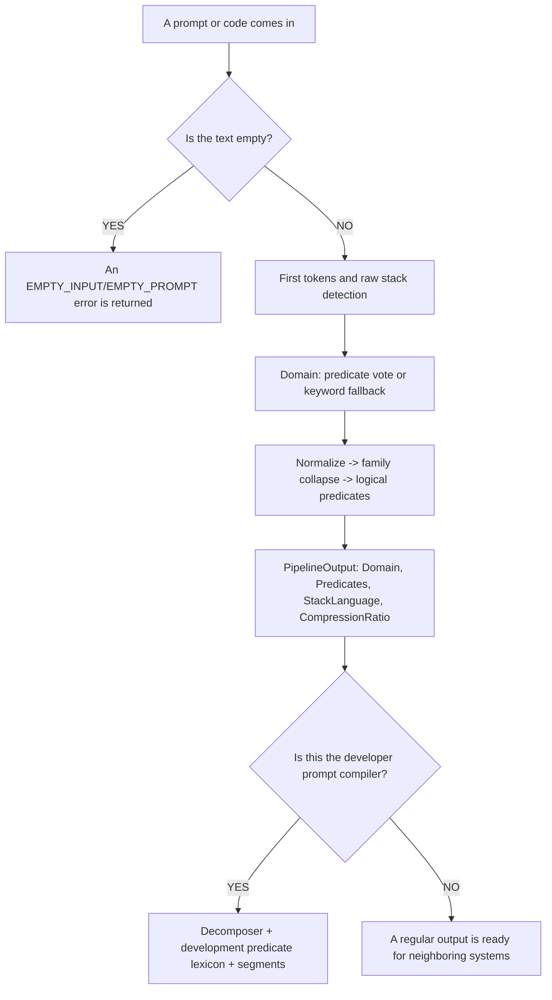

# 29.SemanticCompiler - implementation documentation

## Quick map for Luba

`29.SemanticCompiler` is a deterministic set of helpers that turns the text of a development request or a code fragment into more compact features: task domain, language/stack, logical predicates, segments, and execution order. It is useful as infrastructure for orchestration, routing, and prompt/evidence preparation, but by itself is not a trained `ILearningMachine`, does not store a trained model's checkpoint/manifest, and does not prove the quality of a user-facing answer.

The main honesty boundary: there are rules, dictionaries, heuristics, templates, and one in-memory trainable KNN path in `RouteClassifier.Train(...)`, but there is no export/import lifecycle of a trained asset, no fresh-load check, and no runtime product proof. JSON, a static report, smoke, or the mere presence of classes must not be taken as proof of a trained semantic compiler.

## 0. UML for draw.io

```mermaid
classDiagram
    class PipelineInput
    note for PipelineInput "FULLY IMPLEMENTED\nContains the source text and an optional file path"
    class PipelineOutput
    note for PipelineOutput "FULLY IMPLEMENTED\nReturns the domain, predicates, stack, and compression ratio"
    class SemanticCompilerPipeline
    note for SemanticCompilerPipeline "FULLY IMPLEMENTED\nRuns a fixed order of stages: tokenize -> stack -> route -> normalize -> collapse -> predicates"
    class AstTokenizer
    note for AstTokenizer "FULLY IMPLEMENTED\nSplits code into tokens and preserves case for StackDetector"
    class StackDetector
    note for StackDetector "FULLY IMPLEMENTED\nDetects csharp/typescript/python by raw markers"
    class RouteClassifier
    note for RouteClassifier "PARTIAL\nThere is a deterministic keyword/predicate route and an in-memory KNN after Train; no persisted model lifecycle"
    class SemanticNormalizer
    note for SemanticNormalizer "FULLY IMPLEMENTED\nLowercase, stop words, a simple suffix stemmer"
    class FamilyCollapser
    note for FamilyCollapser "FULLY IMPLEMENTED\nCollapses word families to *_OP"
    class LogicExtractor
    note for LogicExtractor "FULLY IMPLEMENTED\nExtracts 22 types of logical predicates"
    class DevelopmentPromptCompiler
    note for DevelopmentPromptCompiler "FULLY IMPLEMENTED\nCompiles a dev prompt into domain, predicates, development predicates, and segments"
    class Decomposer
    note for Decomposer "FULLY IMPLEMENTED\nSplits the prompt into tasks and guards against false conjunctions"
    class DependencyGraph
    note for DependencyGraph "FULLY IMPLEMENTED\nSorts domains by dependencies via Kahn BFS"
    class StopSignalDetector
    note for StopSignalDetector "FULLY IMPLEMENTED\nStops further splitting by explicit markers"
    class ContextualDictionary
    note for ContextualDictionary "FULLY IMPLEMENTED\nSelects a word's meaning by a short context window"
    class PatternClassifier
    note for PatternClassifier "FULLY IMPLEMENTED\nClassifies word order SVO/SOV/VSO/IMPERATIVE"
    class PatternReorderer
    note for PatternReorderer "FULLY IMPLEMENTED\nReorders SOV/VSO into SVO"
    class TemplateBeautifier
    note for TemplateBeautifier "FULLY IMPLEMENTED\nMaps a sequence of predicates to a short code template"

    SemanticCompilerPipeline --> PipelineInput
    SemanticCompilerPipeline --> PipelineOutput
    SemanticCompilerPipeline --> AstTokenizer
    SemanticCompilerPipeline --> StackDetector
    SemanticCompilerPipeline --> RouteClassifier
    SemanticCompilerPipeline --> SemanticNormalizer
    SemanticCompilerPipeline --> FamilyCollapser
    SemanticCompilerPipeline --> LogicExtractor
    DevelopmentPromptCompiler --> SemanticCompilerPipeline
    DevelopmentPromptCompiler --> Decomposer
    DevelopmentPromptCompiler --> SemanticNormalizer
    DevelopmentPromptCompiler --> FamilyCollapser
    PatternClassifier --> PatternReorderer
    DependencyGraph ..> Domain
    StopSignalDetector ..> Decomposer
    TemplateBeautifier ..> LogicExtractor
```



| Class | What it does | Status |
|---|---|---|
| `SemanticCompilerPipeline` | The main deterministic pipeline `PipelineInput` -> `PipelineOutput`. | ✅ Complete |
| `AstTokenizer`, `StackDetector`, `SemanticNormalizer`, `FamilyCollapser`, `LogicExtractor` | Compression/feature-extraction stages. | ✅ Complete |
| `RouteClassifier` | Predicate/keyword routing and an in-memory KNN after an explicit `Train`. | ⚠️ Partial: no saving of the trained state |
| `DevelopmentPromptCompiler` | An add-on for a developer prompt: segments and development predicates. | ✅ Complete |
| `Decomposer`, `DependencyGraph`, `StopSignalDetector` | Planning and control of splitting depth. | ✅ Complete |
| `ContextualDictionary`, `PatternClassifier`, `PatternReorderer`, `TemplateBeautifier` | Translation/beautification helpers. | ✅ Complete |

### Connection simulations

| Connection | Example input | What happens | Expected result | What must not be asserted |
|---|---|---|---|---|
| `SemanticCompilerPipeline -> AstTokenizer` | `Text="if (user == null) return ..."` | The text is split by spaces, brackets, and operators. | An array of tokens where operators are not lost. | This is not a Roslyn AST and not program understanding. |
| `SemanticCompilerPipeline -> StackDetector` | `Promise<string>` | Raw markers are checked before lowercasing. | `StackLanguage="typescript"`. | This is not runtime TypeScript host proof. |
| `SemanticCompilerPipeline -> RouteClassifier` | `["VALIDATE_OP","NULL_CHECK"]` | Predicate votes or a keyword fallback select the domain. | For example `CODE_Q`/`BUG` by the current rules. | This is not a trained semantic authority. |
| `SemanticCompilerPipeline -> SemanticNormalizer -> FamilyCollapser -> LogicExtractor` | `"validate the request"` | Stop words removed, stem, collapse, then trigger map. | Predicates like `VALIDATE_OP`. | This is not proof of answer quality. |
| `DevelopmentPromptCompiler -> Decomposer` | `"Fix null error and then write regression tests"` | Split by task boundary and fallback markers. | Two segments. | The presence of segments does not mean the tests were run. |
| `DevelopmentPromptCompiler -> SemanticCompilerPipeline` | `"Create CI pipeline..."` | Each segment is compiled into domain/stack/predicates. | A `DevelopmentPromptCompilation` with `AUTOMATION`, `TEST`, etc. | This is not capability training. |
| `DependencyGraph -> Domain` | `[PLAN, ARCH, CODE_Q]` | Kahn BFS accounts for default edges. | Levels: `PLAN`, then `ARCH`, then `CODE_Q`. | This is not an execution orchestrator by itself. |
| `PatternClassifier -> PatternReorderer` | `["user","record","update"], "SOV"` | The verb is moved after the subject. | An order like `["user","update","record"]`. | This is not a natural language translator. |
| `TemplateBeautifier -> LogicExtractor` | `["VALIDATE_OP(X) -> SUCCESS"]` | The template is searched exact/prefix/substring. | `"return Validate({X});"`. | This is not an applied code change. |

## 1. Human flow



| Branch | Simulation | Expected result |
|---|---|---|
| Empty text | `PipelineInput("", null)` | `Fail("EMPTY_INPUT")`; no inference is run. |
| TypeScript marker | `"export async function fetch(): Promise<string>"` | The stack is detected before normalization as `typescript`. |
| Developer prompt | `"Fix null error and then write regression tests"` | Compilation of root + segments; predicates include `IMPLEMENT`/`TEST`. |

## 2. No-code algorithms

### Algorithm A: the main pipeline

Imagine a sorting line: first it neatly slices the phrase, then it looks at the packaging before it was repainted, then it sticks labels of the domain and short operations.

**Where the logic lives:** `29.SemanticCompiler/Pipeline/SemanticCompilerPipeline.cs`.

**Signatures and data types:**

```csharp
OperationResult<PipelineOutput> Compile(PipelineInput input)
PipelineInput(Text: "if (user == null) return ...", FilePath: "UserService.cs")
PipelineOutput(Domain: Domain.CODE_Q, Predicates: ["NULL_CHECK", "RETURN_OP"], StackLanguage: "csharp", CompressionRatio: 4.0)
```

The current algorithm:
1. If `input.Text` is empty, returns `EMPTY_INPUT`.
2. `AstTokenizer.Tokenize(string code)` slices the text and preserves case.
3. `StackDetector.Detect(string rawText)` works on the raw text, before lowercase.
4. `RouteClassifier.Classify(string[] tokens)` selects the `Domain`.
5. `SemanticNormalizer.Normalize(string text)` removes noise.
6. `FamilyCollapser.Collapse(string[] tokens)` collapses words to `*_OP`.
7. `LogicExtractor.Extract(string[] tokens)` returns predicates and a fallback.
8. Computes `CompressionRatio`.

What it does NOT do: it does not build a Roslyn AST, does not run a model, does not save a trained checkpoint, and does not prove routing quality on new data.

### Algorithm B: tokenization and stack detection

`AstTokenizer.Tokenize(string code)` accepts a string, returns `OperationResult<string[]>`; empty input yields `EMPTY_INPUT`. `StackDetector.Detect(string rawText)` accepts raw text and returns the string `"csharp"`, `"typescript"`, `"python"`, or `"unknown"`.

An important branch: TypeScript is checked before normalization, because `Promise<` and `Injectable` are case-sensitive. For C#, at least two markers are needed; lean EF classes are covered by structural markers like `{ get; set; }`.

What it does NOT do: it does not compile the project and does not verify that the file is actually valid in the language.

### Algorithm C: normalization, family collapse, predicate extraction

`SemanticNormalizer.Normalize(string text)` returns `string[]`: lowercase, split by non-letters, stop words, suffix stemmer. `FamilyCollapser.Collapse(string[] tokens)` returns `string[]`, replacing known stems with `GET_OP`, `VALIDATE_OP`, `CREATE_OP`, etc. `LogicExtractor.Extract(string[] tokens)` returns `string[]` from 22 predicate families and a fallback `ASSIGN_OP`/`CALL_OP`.

What it does NOT do: these stages are not trained on a corpus inside this project; they are dictionaries and substring/prefix heuristics.

### Algorithm D: route classifier

`RouteClassifier.Classify(string[] tokens)` accepts token/predicate strings and returns a `Domain`. It first votes by `PredicateDomainMap`, then falls into `ClassifyByKeywords(string text)`. A separate overload `Classify(int[] predicates)` works only after `Train(IReadOnlyList<(int[] Predicates, Domain Domain)> examples)`; without training it returns `NOT_TRAINED`.

What it does NOT do: the KNN profile is not saved to disk, not exported, and has no fresh-load evidence, so this is not a finished trainable asset.

### Algorithm E: development prompt compiler

`DevelopmentPromptCompiler.Compile(string prompt)` accepts a developer prompt and returns `OperationResult<DevelopmentPromptCompilation>`. It calls the pipeline for the root prompt, splits the prompt via `Decomposer.Decompose`, uses a fallback on `"and then"` if needed, compiles the segments, and adds development predicates from the lexicon and pipeline predicates.

What it does NOT do: it does not execute a work order, does not train LoRA/DPO, does not write files, and does not confirm the quality of future orchestration.

### Algorithm F: decomposition, dependency graph, stop signal

`Decomposer.Decompose(string prompt)` returns `OperationResult<string[]>`: single task, hard split, or a split on `and` if both sides look like standalone tasks. `DependencyGraph.Sort(Domain[] domains)` returns `OperationResult<Domain[][]>` of levels for parallel/sequential order. `StopSignalDetector.ShouldStop(string[] subTaskPredicates, int currentDepth)` returns a `bool` to avoid splitting an already-atomic task.

What it does NOT do: it does not launch sub-agents and does not guarantee a correct product sequence without an external orchestration layer.

### Algorithm G: translation/beautification helpers

`ContextualDictionary.Lookup(string word, string[] context)` selects a meaning by a small context window. `PatternClassifier.Classify(string[] tokens)` returns `"SVO"`, `"SOV"`, `"VSO"`, `"IMPERATIVE"`, or `"UNKNOWN"`. `PatternReorderer.Reorder(string[] tokens, string fromPattern)` reorders SOV/VSO. `TemplateBeautifier.Beautify(string[] predicates)` searches for a code template exact/prefix/substring.

What it does NOT do: it does not translate an arbitrary language, does not apply code changes, and does not replace review.

## 3. Short quotations from the code

`29.SemanticCompiler/Pipeline/SemanticCompilerPipeline.cs:50-82`

```csharp
    public OperationResult<PipelineOutput> Compile(PipelineInput input)
    {
        if (string.IsNullOrWhiteSpace(input.Text))
            return OperationResult<PipelineOutput>.Fail("Input text is empty", "EMPTY_INPUT");

        // Stage 1: tokenize raw text (preserve case for E20).
        var tokenResult = _astTokenizer.Tokenize(input.Text);
        if (!tokenResult.IsSuccess) return tokenResult.MapError<PipelineOutput>();
        var rawTokens = tokenResult.Value!;

        // Stage 2: StackDetector on RAW text (E20 Rule A — must precede normalisation).
        string stack = _stackDetector.Detect(input.Text);

        // Stage 3: route to domain via predicate profile.
        string[] rawTokenStrings = rawTokens;
        var domain = _routeClassifier.Classify(rawTokenStrings);

        // Stage 4: normalize — lowercase, stem, remove stop words.
        string[] normalized = _normalizer.Normalize(input.Text);

        // Stage 5: collapse families to semantic ops.
        string[] collapsed  = _collapser.Collapse(normalized);

        // Stage 6: extract logical predicates.
        string[] predicates = _extractor.Extract(collapsed);

        // Compute compression ratio: original word count / predicate count.
        int originalCount  = input.Text.Split(' ', StringSplitOptions.RemoveEmptyEntries).Length;
        double compression = predicates.Length == 0 ? 1.0
            : (double)originalCount / predicates.Length;

        return OperationResult<PipelineOutput>.Ok(
            new PipelineOutput(domain, predicates, stack, compression));
```

> Why it matters: this block proves the real order of the stages. It is especially important that `StackDetector` is called before the normalizer. This proves the pipeline wiring, but does not prove trained routing quality.

`29.SemanticCompiler/Compression/AstTokenizer.cs:15-31`

```csharp
    public OperationResult<string[]> Tokenize(string code)
    {
        if (string.IsNullOrWhiteSpace(code))
            return OperationResult<string[]>.Fail("Input code is empty", "EMPTY_INPUT");

        // Split on whitespace and common code delimiters, keeping non-empty tokens.
        var raw = code.Split(
            [' ', '\t', '\n', '\r', ';', ',', '(', ')', '{', '}', '[', ']'],
            StringSplitOptions.RemoveEmptyEntries);

        // Further split on operators without removing them from context.
        var tokens = raw
            .SelectMany(t => SplitOnOperators(t))
            .Where(t => t.Length > 0)
            .ToArray();

        return OperationResult<string[]>.Ok(tokens);
```

> Why it matters: it shows that this is a lightweight token splitter, not a Roslyn AST. The input `a.b(c)` will yield several tokens, but not a semantic parse tree.

`29.SemanticCompiler/Routing/StackDetector.cs:55-76`

```csharp
    // Detect the stack label from raw (un-normalised) source text.
    // Returns "csharp" | "typescript" | "python" | "unknown".
    public string Detect(string rawText)
    {
        if (string.IsNullOrWhiteSpace(rawText)) return "unknown";

        int tsScore = CountMatches(rawText, TypeScriptMarkers);
        int pyScore = CountMatches(rawText, PythonMarkers);
        int csScore = CountMatches(rawText, CSharpKeywordMarkers)
                    + CountMatches(rawText, CSharpStructuralMarkers);

        // TypeScript check before normalisation — its markers are case-sensitive.
        if (tsScore >= MinMarkers && tsScore > csScore && tsScore > pyScore)
            return "typescript";

        if (pyScore >= MinMarkers && pyScore > csScore)
            return "python";

        if (csScore >= MinMarkers)
            return "csharp";

        return "unknown";
```

> Why it matters: the branches honestly show heuristic scoring and `unknown`. This is not host/runtime proof; it is only a static raw-text classifier.

`29.SemanticCompiler/Routing/RouteClassifier.cs:72-84`

```csharp
    public OperationResult<Domain> Classify(int[] predicates)
    {
        if (_train.Count == 0)
            return OperationResult<Domain>.Fail("Classifier not trained", "NOT_TRAINED");

        var best = _train
            .OrderBy(t => JaccardDist(predicates, t.Predicates))
            .Take(_k)
            .GroupBy(t => t.Domain)
            .OrderByDescending(g => g.Count())
            .First();

        return OperationResult<Domain>.Ok(best.Key);
```

> Why it matters: this is the only explicitly trainable-adjacent path, but it is in-memory. Without `Train` it returns `NOT_TRAINED`, and after `Train` there is no export/import/checkpoint.

`29.SemanticCompiler/Development/DevelopmentPromptCompiler.cs:41-69`

```csharp
    public OperationResult<DevelopmentPromptCompilation> Compile(string prompt)
    {
        if (string.IsNullOrWhiteSpace(prompt))
            return OperationResult<DevelopmentPromptCompilation>.Fail("Prompt cannot be empty.", "EMPTY_PROMPT");

        var root = CompileOne(prompt.Trim());
        if (!root.IsSuccess)
            return root.MapError<DevelopmentPromptCompilation>();

        var split = _decomposer.Decompose(prompt.Trim());
        if (!split.IsSuccess)
            return split.MapError<DevelopmentPromptCompilation>();

        var segmentTexts = split.Value!.Length <= 1
            ? SplitBoundaryFallback(prompt.Trim())
            : split.Value!;

        var segments = segmentTexts
            .Select(segment => CompileOne(segment.Trim()))
            .Where(compiled => compiled.IsSuccess)
            .Select(compiled => new DevelopmentPromptSegment(
                compiled.Value!.Text,
                compiled.Value.Domain,
                compiled.Value.PipelinePredicates,
                compiled.Value.DevelopmentPredicateIds,
                compiled.Value.CompressionRatio))
            .ToArray();

        return OperationResult<DevelopmentPromptCompilation>.Ok(root.Value! with { Segments = segments });
```

> Why it matters: the root prompt and the segments are compiled separately. Erroneous segments are filtered out via `Where(compiled => compiled.IsSuccess)`, so the presence of output does not mean that all possible parts of the prompt were successfully understood.

`29.SemanticCompiler/Development/DevelopmentPromptCompiler.cs:112-186`

```csharp
    private static string[] ExtractDevelopmentPredicates(string rawText, string evidenceText, Domain domain, string[] pipelinePredicates)
    {
        var raw = rawText.ToLowerInvariant();
        var normalized = evidenceText.ToLowerInvariant();
        var predicates = DevelopmentPredicateLexicon
            .Where(entry => entry.Terms.Any(term => normalized.Contains(term, StringComparison.Ordinal)))
            .Select(entry => entry.PredicateId)
            .ToHashSet(StringComparer.Ordinal);

        var hasImplementationSignal =
            raw.Contains("implement ", StringComparison.Ordinal) ||
            raw.Contains("implement the", StringComparison.Ordinal) ||
            raw.Contains("build", StringComparison.Ordinal) ||
            raw.Contains("create", StringComparison.Ordinal) ||
            raw.Contains("provider", StringComparison.Ordinal) ||
            raw.Contains("connector", StringComparison.Ordinal) ||
            raw.Contains("integration layer", StringComparison.Ordinal);

        foreach (var predicate in pipelinePredicates)
        {
            if (predicate.Contains("AUTH", StringComparison.OrdinalIgnoreCase))
            {
                predicates.Add("SECURITY");
                predicates.Add("AUTHORIZATION");
            }
            if (predicate.Contains("VALIDATE", StringComparison.OrdinalIgnoreCase) ||
                predicate.Contains("NULL", StringComparison.OrdinalIgnoreCase) ||
                predicate.Contains("THROW", StringComparison.OrdinalIgnoreCase) ||
                predicate.Contains("CATCH", StringComparison.OrdinalIgnoreCase))
            {
                predicates.Add("IMPLEMENT");
                predicates.Add("TEST");
            }
            if (predicate.Contains("CREATE", StringComparison.OrdinalIgnoreCase) ||
                predicate.Contains("UPDATE", StringComparison.OrdinalIgnoreCase) ||
                (predicate.Contains("CALL", StringComparison.OrdinalIgnoreCase) && hasImplementationSignal))
                predicates.Add("IMPLEMENT");
        }

        if (domain == Domain.ARCH)
            predicates.Add("ARCHITECTURE");
        if (domain == Domain.PLAN)
            predicates.Add("LEARNING");
        if (domain == Domain.REFACTOR)
            predicates.Add("IMPLEMENT");
        if (domain == Domain.BUG)
        {
            predicates.Add("IMPLEMENT");
            predicates.Add("TEST");
        }

        var hasSecuritySignal = predicates.Contains("SECURITY") || predicates.Contains("AUTHORIZATION");
        var hasRuntimeFailureSignal =
            raw.Contains("fix", StringComparison.Ordinal) ||
            raw.Contains("bug", StringComparison.Ordinal) ||
            raw.Contains("error", StringComparison.Ordinal) ||
            raw.Contains("failed", StringComparison.Ordinal) ||
            raw.Contains("failure", StringComparison.Ordinal) ||
            raw.Contains("null", StringComparison.Ordinal) ||
            raw.Contains("no data", StringComparison.Ordinal);
        var hasExplicitTestSignal =
            raw.Contains("test", StringComparison.Ordinal) ||
            raw.Contains("tests", StringComparison.Ordinal) ||
            raw.Contains("regression", StringComparison.Ordinal) ||
            raw.Contains("unit test", StringComparison.Ordinal);
        if (hasSecuritySignal && !hasRuntimeFailureSignal && !hasExplicitTestSignal && !hasImplementationSignal)
        {
            predicates.Remove("IMPLEMENT");
            predicates.Remove("TEST");
            predicates.Remove("QA");
            predicates.Remove("LEARNING");
        }

        return predicates.OrderBy(predicate => predicate, StringComparer.Ordinal).ToArray();
    }
```

> Why it matters: it shows that development predicates are a lexicon + rules from pipeline predicates. The security-only branch deliberately removes extra implementation/test. This is a strong heuristic, but not a trained classifier.

`29.SemanticCompiler/Planning/DependencyGraph.cs:42-84`

```csharp
    public OperationResult<Domain[][]> Sort(Domain[] domains)
    {
        var present = new HashSet<Domain>(domains);
        var inDegree = present.ToDictionary(d => d, _ => 0);

        foreach (var (prereq, deps) in _edges)
        {
            if (!present.Contains(prereq)) continue;
            foreach (var dep in deps)
                if (inDegree.ContainsKey(dep))
                    inDegree[dep]++;
        }

        var queue = new Queue<Domain>(inDegree.Where(kv => kv.Value == 0).Select(kv => kv.Key));
        var levels = new List<Domain[]>();
        int processed = 0;

        while (queue.Count > 0)
        {
            int count = queue.Count;
            var level = new Domain[count];
            for (int i = 0; i < count; i++)
                level[i] = queue.Dequeue();

            levels.Add(level);
            processed += level.Length;

            foreach (var d in level)
            {
                if (!_edges.TryGetValue(d, out var deps)) continue;
                foreach (var dep in deps)
                {
                    if (!inDegree.ContainsKey(dep)) continue;
                    if (--inDegree[dep] == 0) queue.Enqueue(dep);
                }
            }
        }

        if (processed != domains.Length)
            return OperationResult<Domain[][]>.Fail(
                "Circular dependency detected", "DEPENDENCY_CYCLE");

        return OperationResult<Domain[][]>.Ok(levels.ToArray());
```

> Why it matters: this is a regular topological sort with a cycle error. It proves the order of the domains, but does not execute the phases themselves.

`29.SemanticCompiler/Beautification/TemplateBeautifier.cs:46-69`

```csharp
    public OperationResult<string> Beautify(string[] predicates)
    {
        if (predicates.Length == 0)
            return OperationResult<string>.Fail("No predicates provided", "EMPTY_PREDICATES");

        string key = string.Join(" → ", predicates);

        // Exact match first.
        if (Templates.TryGetValue(key, out string? template))
            return OperationResult<string>.Ok(template);

        // Prefix match: find the template whose key is a prefix of the query.
        var match = Templates.FirstOrDefault(kv => key.StartsWith(kv.Key, StringComparison.Ordinal));
        if (match.Value is not null)
            return OperationResult<string>.Ok(match.Value);

        // Substring match: find any template whose key appears in the query.
        var substr = Templates.FirstOrDefault(kv => key.Contains(kv.Key, StringComparison.Ordinal));
        if (substr.Value is not null)
            return OperationResult<string>.Ok(substr.Value);

        return OperationResult<string>.Fail(
            $"No template for: {key}", "TEMPLATE_NOT_FOUND");
    }
```

> Why it matters: this is a template lookup with clear failure branches, not a generator and not a code applier.

`29.SemanticCompiler/Fabric/Interfaces.cs:6-18`

```csharp
public interface ISemanticCompiler29
{
    // Run the full pipeline: StackDetector → RouteClassifier → E15 → E16 → E17.
    // Returns predicates, domain, and compression ratio.
    OperationResult<PipelineOutput> Compile(PipelineInput input);
}

// IStackDetector29 — detects programming language from raw text.
// Must run BEFORE any normalization (E20 Critical Rule A).
public interface IStackDetector29
{
    // Returns "csharp" | "typescript" | "python" | "unknown".
    string Detect(string rawText);
```

> Why it matters: a contract layer exists, but the interface contract is not runtime proof of quality or an asset lifecycle.

## 4. QA/test mapping

The tests were read/cross-referenced but not run in this documentation subphase.

| Test file | What it covers | What it does not prove |
|---|---|---|
| `Tests/SemanticCompiler29Tests.cs` | The main SC29 branches: tokenization, role assigner, normalizer, family collapse, vocab size, stack detector, route keyword fallback, decomposer, dependency graph, beautifier, full pipeline. | Does not prove runtime host integration, quality on a held-out corpus, or a persisted trained model. |
| `Tests/PromptRoutingInputCompilerUnitTests.cs` | The use of `DevelopmentPromptCompiler` by a neighboring logical routing path; multi-phase predicates and segments for real legacy prompts. | Does not prove that D29 itself is an `ILogicalUnit` or a trained system. |
| `Tests/DependencyGraphWiringTests.cs` | `SemanticCompiler29.DependencyGraph.BuildDefault` and the use of E35 evidence in adaptive ordering. | Does not prove the execution of phases or the quality of the whole orchestration. |
| `Tests/ContinuousLearningTests.cs` / `Tests/AutonomousLearningTests.cs` | Neighboring projects expect `ISemanticCompiler29` injection/call. | Does not prove that D29 trains models. |

## 5. Hierarchy and trainable boundary

In the sources of `29.SemanticCompiler` there is no implementation of `ILearningMachine`, `ILogicalOrchestrator`, `ILogicalFlow`, or `ILogicalUnit`. The project provides regular classes and fabric interfaces (`ISemanticCompiler29`, `IStackDetector29`, `IRouteClassifier29`, `ISemanticNormalizer29`, `IFamilyCollapser29`, `ILogicExtractor29`) that can be used by neighboring projects.

`RouteClassifier.Train(...)` is a trainable-adjacent in-memory method, but not a Level 5 trainable asset: there is no checkpoint, manifest, export/import, locator, fresh-load, or continue-training evidence. Therefore in the document's status it is marked as partial.

## 6. Anti-false-done

- `SemanticCompiler.csproj`, static docs, JSON/state, or smoke must not be taken as proof of a trained semantic compiler.
- The keyword/predicate/lexicon heuristic must not be hidden under the guise of trained semantic reasoning.
- `TemplateBeautifier` returns a string template, but does not apply a change to a file and does not prove correctness.
- `DevelopmentPromptCompilation` and `PipelineOutput` are evidence for routing; they are not the result of executing a work order.
- The tests were not run in this subphase, so the QA mapping is a map of existing coverage, not a new runtime result.

## 7. Implementation status

| Component | File | Status | What actually works now |
|---|---|---|---|
| `OperationResult<T>`, `PipelineInput`, `PipelineOutput`, `Domain` | `29.SemanticCompiler/Core/Core.cs` | ✅ Complete | DTO/result envelope and five production domains + `UNKNOWN`. |
| `SemanticCompilerPipeline` | `29.SemanticCompiler/Pipeline/SemanticCompilerPipeline.cs` | ✅ Complete | `Compile` runs the fixed order of stages and returns a `PipelineOutput`. |
| `AstTokenizer` | `29.SemanticCompiler/Compression/AstTokenizer.cs` | ✅ Complete | `Tokenize` splits by delimiters/operators, preserves case, empty input -> `EMPTY_INPUT`. |
| `RoleAssigner` | `29.SemanticCompiler/Compression/RoleAssigner.cs` | ✅ Complete | `AssignRoles` labels `SQL`/`JSON`/`NL`/`CODE` heuristically. |
| `SemanticNormalizer` | `29.SemanticCompiler/Compression/SemanticNormalizer.cs` | ✅ Complete | `Normalize` does lowercase, regex split, stopwords, suffix stem. |
| `FamilyCollapser` | `29.SemanticCompiler/Compression/FamilyCollapser.cs` | ✅ Complete | `Collapse` replaces known stems with canonical ops. |
| `LogicExtractor` | `29.SemanticCompiler/Compression/LogicExtractor.cs` | ✅ Complete | `Extract` looks up trigger substrings and returns at least one predicate. |
| `StackDetector` | `29.SemanticCompiler/Routing/StackDetector.cs` | ✅ Complete | `Detect` counts TS/Python/C# markers and returns a stack label/`unknown`. |
| `RouteClassifier` | `29.SemanticCompiler/Routing/RouteClassifier.cs` | ⚠️ Partial | `Classify(string[])` deterministic; `Classify(int[])` works only after an in-memory `Train`, without a persisted lifecycle. |
| `DevelopmentPromptCompiler` | `29.SemanticCompiler/Development/DevelopmentPromptCompiler.cs` | ✅ Complete | `Compile` builds the root compilation, segments, and development predicate ids. |
| `ContextualDictionary` | `29.SemanticCompiler/Translation/ContextualDictionary.cs` | ✅ Complete | `Lookup` selects a meaning by a context window or default. |
| `PatternClassifier` | `29.SemanticCompiler/Translation/PatternClassifier.cs` | ✅ Complete | `Classify` determines SVO/SOV/VSO/IMPERATIVE by a POS heuristic. |
| `PatternReorderer` | `29.SemanticCompiler/Translation/PatternReorderer.cs` | ✅ Complete | `Reorder` changes SOV/VSO into SVO, leaves unknown/SVO as is. |
| `TemplateBeautifier` | `29.SemanticCompiler/Beautification/TemplateBeautifier.cs` | ✅ Complete | `Beautify` searches for an exact/prefix/substring template or `TEMPLATE_NOT_FOUND`. |
| `DependencyGraph`, `Decomposer`, `StopSignalDetector` | `29.SemanticCompiler/Planning/*.cs` | ✅ Complete | Domain sorting, prompt splitting, and stop rules implemented as deterministic helpers. |
| Fabric interfaces/project wiring | `29.SemanticCompiler/Fabric/Interfaces.cs`, `29.SemanticCompiler/SemanticCompiler.csproj` | ✅ Complete | Contracts and assembly/root namespace `SemanticCompiler29`; this is wiring, not runtime quality. |
