# 33.MatrixAlgorithms - implementation documentation

Status: D1I documented - sub-agent pass pending parent review.

`33.MatrixAlgorithms` is a library of numerical algorithms: dense matrices, LU/QR/SVD decompositions, sparse CSR operations, low-rank compression, and int8 quantization. It is needed as infrastructure for training, inference, weight analysis, and model compression. It is not a trainable semantic unit, not an `ILearningMachine`, not an `ILogicalUnit`, and not a reasoning mechanism: the algorithms here deterministically transform numbers and return a mathematical result or an `OperationResult` with an error.

The main idea for Luba: if a matrix was decomposed, multiplied, or compressed in this project, that proves the work of a numerical helper. It does not prove that a model was trained, that an answer became smart, or that trainable product behavior appeared.

## 1. Simple UML diagram for draw.io

```plantuml
@startuml
title 33.MatrixAlgorithms - numerical infrastructure

class "DenseMatrix" as DenseMatrix {
  Rows
  Columns
  this[row,column]
  MultiplyVector(vector)
}

class "NumericalUtilities" as NumericalUtilities {
  Multiply(a,b)
  Transpose(m)
  FrobeniusNorm(matrix)
  NormalizeInPlace(vector)
}

interface "IMatrixDecomposer" as IMatrixDecomposer {
  Decompose(matrix, rows, columns)
}

class "LuDecompositionService" as LuDecompositionService
class "QrDecompositionService" as QrDecompositionService
class "SingularValueDecompositionService" as SingularValueDecompositionService

class "CsrSparseMatrix" as CsrSparseMatrix {
  Values
  ColIndices
  RowPointers
  MultiplyVector(vector)
  ToDenseArray()
}

class "SparseMatrixMultiplier" as SparseMatrixMultiplier {
  Multiply(a,b)
}

class "SvdWeightCompressor" as SvdWeightCompressor {
  Compress(weightMatrix, rows, columns, targetRank)
  Decompress(compressed)
}

class "Int8Quantizer" as Int8Quantizer {
  Quantize(weights, rows, columns)
  Dequantize(quantized)
}

class "MatrixAlgorithmsDispatcher" as MatrixAlgorithmsDispatcher {
  AvailableAlgorithms
  Dispatch(algorithmName, request)
}

class "DecompositionResult" as DecompositionResult
class "CompressedWeightMatrix" as CompressedWeightMatrix
class "QuantizedWeightMatrix" as QuantizedWeightMatrix

IMatrixDecomposer <|.. LuDecompositionService
IMatrixDecomposer <|.. QrDecompositionService
IMatrixDecomposer <|.. SingularValueDecompositionService

LuDecompositionService --> DenseMatrix : copy of input matrix
QrDecompositionService --> DenseMatrix : R and Q
SingularValueDecompositionService --> DenseMatrix : work copy and vectors
SingularValueDecompositionService --> NumericalUtilities : norm/normalize/deflate
CsrSparseMatrix --> "SparseMatrixData" : ToData()
SparseMatrixMultiplier --> CsrSparseMatrix : CSR x CSR
SvdWeightCompressor --> SingularValueDecompositionService : via truncated SVD family
SvdWeightCompressor --> CompressedWeightMatrix : U/S/V factors
Int8Quantizer --> QuantizedWeightMatrix : scale/zeroPoint/int8
MatrixAlgorithmsDispatcher --> IMatrixDecomposer : route lu/qr/svd
MatrixAlgorithmsDispatcher --> SvdWeightCompressor : route compress/decompress
MatrixAlgorithmsDispatcher --> Int8Quantizer : route quantize

note right of DenseMatrix
COMPLETE: stores a dense matrix
in a flat row-major double[].
Contains no training algorithms.
end note

note right of LuDecompositionService
COMPLETE: LU with partial pivoting.
Returns L/U or an error
for non-square/singular.
end note

note right of QrDecompositionService
COMPLETE: thin QR via
Householder reflections.
end note

note right of SingularValueDecompositionService
COMPLETE/simple: full SVD via
power iteration deflation.
Suitable for small/medium matrices.
end note

note right of CsrSparseMatrix
COMPLETE: CSR storage,
vector multiply and dense export.
end note

note right of SvdWeightCompressor
COMPLETE as a utility:
low-rank approximation,
not training evidence.
end note

note right of MatrixAlgorithmsDispatcher
COMPLETE: a single route point
by algorithm name.
end note
@enduml
```



Legend:

| Node | What it does | Status | Where it lives |
|---|---|---|---|
| `DenseMatrix` | Stores a dense matrix in a single `double[]` and translates `(row, column)` into an array index. | Complete storage utility | `33.MatrixAlgorithms/Core/DenseMatrix.cs` |
| `NumericalUtilities` | Common operations: multiply, transpose, norms, dot product, normalize, deflation, identity. | Complete math utility | `33.MatrixAlgorithms/Core/NumericalUtilities.cs` |
| `IMatrixDecomposer` | A single contract for LU/QR/SVD: input matrix/rows/columns, output `DecompositionResult`. | Complete contract | `33.MatrixAlgorithms/Fabric/Interfaces.cs` |
| `LuDecompositionService` | Does LU decomposition for square matrices with partial pivoting. | Complete deterministic algorithm utility | `33.MatrixAlgorithms/Families/01-Decomposition/LuDecompositionService.cs` |
| `QrDecompositionService` | Does thin QR via Householder reflections for `rows >= columns`. | Complete deterministic algorithm utility | `33.MatrixAlgorithms/Families/01-Decomposition/QrDecompositionService.cs` |
| `SingularValueDecompositionService` | Does full singular value decomposition via power iteration deflation. | Complete but simple implementation for small/medium matrices | `33.MatrixAlgorithms/Families/01-Decomposition/SingularValueDecompositionService.cs` |
| `CsrSparseMatrix` | Stores a sparse matrix in CSR arrays and multiplies it by a dense vector. | Complete storage/operation utility | `33.MatrixAlgorithms/Families/02-Sparse/CsrSparseMatrix.cs` |
| `SparseMatrixMultiplier` | Multiplies two CSR matrices via row dictionaries. | Complete deterministic utility | `33.MatrixAlgorithms/Families/02-Sparse/SparseMatrixMultiplier.cs` |
| `SvdWeightCompressor` | Compresses a dense weight matrix via truncated SVD and reconstructs an approximation. | Complete compression utility | `33.MatrixAlgorithms/Families/03-LowRankCompression/SvdWeightCompressor.cs` |
| `Int8Quantizer` | Converts weights from `double` to signed 8-bit values and back. | Complete quantization utility | `33.MatrixAlgorithms/Families/03-LowRankCompression/Int8Quantizer.cs` |
| `MatrixAlgorithmsDispatcher` | Accepts an `algorithmName` and a request dictionary, then calls the needed service. | Complete routing boundary | `33.MatrixAlgorithms/Dispatcher/MatrixAlgorithmsDispatcher.cs` |

## 2. Simulations of connections and branches

| Connection/branch | Example input | What happens now | Expected result | What must not be taken as proof |
|---|---|---|---|---|
| `DenseMatrix` -> decomposition service | `double[] [2,1,1,4]`, `rows=2`, `columns=2` | The service creates a copy `new DenseMatrix((double[])matrix.Clone(), rows, columns)`. | The caller's original array is not changed; the algorithm works with flat row-major storage. | This is not tensor autograd and not training state. |
| `LuDecompositionService` -> `DecompositionResult` success | A square nonsingular 3x3 matrix | Checks square/input length, finds a pivot, zeros below the diagonal, extracts L/U. | `FactorOne=L`, `FactorTwo=U`, `AlgorithmName="LU with partial pivoting"`. | LU must not be treated as proof of model quality; it is only a factorization of numbers. |
| `LuDecompositionService` error branch | `rows=2`, `columns=3` | The `rows != columns` branch. | `OperationResult.Fail`, code `NOT_SQUARE`. | A shape error must not be hidden as a successful algorithm run. |
| `LuDecompositionService` singular branch | Two identical rows | Pivot less than `1e-12`. | `OperationResult.Fail`, code `SINGULAR_MATRIX`. | JSON/report without checking the error code must not be taken as algorithm evidence. |
| `QrDecompositionService` -> `DecompositionResult` | A 4x2 matrix | Via Householder vectors zeros below the diagonal and builds a thin Q. | `Q` shape 4x2, `R` upper triangular, `Q*R ~= A`. | QR does not select a semantic route and is not a learned unit. |
| `QrDecompositionService` underdetermined branch | A 2x3 matrix | The `rows < columns` check. | `OperationResult.Fail`, code `UNDERDETERMINED`. | Least-squares coverage must not be claimed for such a shape without separate solver behavior. |
| `SingularValueDecompositionService` -> `NumericalUtilities` | A 3x2 matrix | Finds singular triplets, deflates the work matrix, sorts singular values descending. | `U`, `S`, `V` in `DecompositionResult`; reconstruction possible. | SVD directions do not mean semantic understanding. |
| `CsrSparseMatrix` -> dense vector | A CSR identity 3x3 and vector `[2,3,4]` | Iterates over `RowPointers[row]..RowPointers[row+1]`, sums non-zero values. | Returns `[2,3,4]`. | Sparse storage does not prove training or graph reasoning. |
| `SparseMatrixMultiplier` -> `CsrSparseMatrix` | `diag(1,2)` x `diag(3,4)` | Accumulates the result row into dictionaries, sorts columns, drops near-zero. | Dense result `[3,0,0,8]`. | This is deterministic multiplication, not a trainable shortcut. |
| `SvdWeightCompressor` -> `CompressedWeightMatrix` | A 4x4 rank-2 matrix, `targetRank=2` | Delegates to truncated SVD, saves U/S/V and the reconstruction error. | Decompress restores the matrix approximately/exactly for the low-rank case. | Compressed weights must not be treated as a trained model asset without manifest/checkpoint/runtime evidence. |
| `Int8Quantizer` uniform branch | weights `[3.14,3.14,3.14,3.14]` | `max-min < 1e-15`, returns zeros, scale 1, max error 0. | Lossless for uniform weights. | A zero error on one case must not be passed off as quantization quality on all models. |
| `MatrixAlgorithmsDispatcher` success route | `algorithmName="LU"`, request with matrix/rows/columns | Lowercase/trim name, routes to the `"lu"` branch. | Success dictionary with key `"result"`. | A dispatcher route does not replace a test of the LU algorithm itself. |
| `MatrixAlgorithmsDispatcher` unknown route | `algorithmName="not-a-real-algorithm"` | Falls through the `_` branch. | `OperationResult.Fail`, code `UNKNOWN_ALGORITHM`. | An unknown name must not be taken as a no-op success. |

## 3. No-code algorithms in plain language

### Algorithm A: a dense matrix as flat row-major storage

Analogy: it is a table laid out on one long strip: first the whole first row, then the whole second. To find cell `(row, column)`, you need to know the row width.

Passport:

| Field | Value |
|---|---|
| Class | `DenseMatrix` |
| Methods | `DenseMatrix(int rows, int columns)`, `DenseMatrix(double[] existingData, int rows, int columns)`, indexer `this[int row, int column]`, `MultiplyVector(double[] vector)` |
| File and lines | `33.MatrixAlgorithms/Core/DenseMatrix.cs:21-59`, `33.MatrixAlgorithms/Core/DenseMatrix.cs:110-125` |
| Input | rows/columns or an existing `double[]`; for vector multiply - a `double[] vector` of length `Columns` |
| Output | A matrix with `Rows`, `Columns`, backing array; or a `double[]` of length `Rows` |
| Status | Complete storage/math utility |

Steps:
1. The constructor checks for positive dimensions or a sufficient length of the existing array.
2. The indexer translates `(row, column)` into `row * Columns + column`.
3. `AsArray()` returns the actual backing array, not a copy.
4. `MultiplyVector` checks the vector length, then for each row computes the dot product.

What it does not do: it does not store gradients, does not train, does not select an algorithm, is not a tensor engine.

### Algorithm B: LU decomposition with partial pivoting

Analogy: we solve a system of equations, but before each step we rearrange the rows so that we divide by the most stable available pivot, not by nearly zero.

Passport:

| Field | Value |
|---|---|
| Class | `LuDecompositionService` |
| Method | `Decompose(double[] matrix, int rows, int columns)` |
| File and lines | `33.MatrixAlgorithms/Families/01-Decomposition/LuDecompositionService.cs:21-151` |
| Input | `matrix` flat row-major, `rows`, `columns`; example 3x3 `[2,1,1,4,3,3,8,7,9]` |
| Output | `OperationResult<DecompositionResult>`: success with L/U or failure `NOT_SQUARE`, `BAD_INPUT`, `SINGULAR_MATRIX` |
| Status | Complete deterministic numerical algorithm |

Steps:
1. If `rows != columns`, returns `NOT_SQUARE`.
2. If the input array is shorter than `rows * columns`, returns `BAD_INPUT`.
3. Clones the matrix into a `DenseMatrix work`.
4. For each `step` finds the row with the maximum absolute pivot in the current column.
5. If the pivot is `< 1e-12`, returns `SINGULAR_MATRIX`.
6. If the found pivot row differs, swaps the rows.
7. For rows below the pivot computes a multiplier, places it in the lower triangle, and updates the remaining columns.
8. After elimination it splits the combined `work` into `lData` and `uData`.
9. Saves `"lu-last"`, writes the event `matrix.lu.completed`, returns `Ok(result)`.

What it does not do: it does not solve a semantic task, does not update model weights, does not prove training success.

### Algorithm C: QR decomposition via Householder reflections

Analogy: we take a slanted ruler of data and successively reflect it so that below the diagonal only zeros remain, and the useful shape becomes upper triangular.

Passport:

| Field | Value |
|---|---|
| Class | `QrDecompositionService` |
| Method | `Decompose(double[] matrix, int rows, int columns)` |
| File and lines | `33.MatrixAlgorithms/Families/01-Decomposition/QrDecompositionService.cs:20-108` |
| Input | Flat row-major matrix, usually `rows >= columns`; example 4x2 `[1,2,3,4,5,6,7,8]` |
| Output | `OperationResult<DecompositionResult>` with thin `Q` and `R`, or `UNDERDETERMINED`/`BAD_INPUT` |
| Status | Complete deterministic numerical algorithm |

Steps:
1. Checks `rows >= columns`; otherwise `UNDERDETERMINED`.
2. Checks the input array length.
3. Creates `r` as a copy of the input and `q` as an identity matrix.
4. For each column takes the sub-column from the diagonal down.
5. Computes the Householder vector `(v, tau)`.
6. Applies the reflection to `r` to zero the elements below the diagonal.
7. In reverse order applies reflections to accumulate `q`.
8. Takes the thin Q: `rows x columns`.
9. In `R` forces entries below the diagonal to 0.
10. Saves `"qr-last"`, logs `matrix.qr.completed`, returns the result.

What it does not do: it does not solve ML quality, is not a route selector, does not guarantee production-scale numerical stability beyond the current tests.

### Algorithm D: full SVD via power iteration deflation

Analogy: the matrix as a set of stretching directions. First we find the strongest direction, subtract it from the matrix, then look for the next.

Passport:

| Field | Value |
|---|---|
| Class | `SingularValueDecompositionService` |
| Methods | `Decompose(double[] matrix, int rows, int columns)`, internal `FindOneSingularTriplet(DenseMatrix a, Random rng)` |
| File and lines | `33.MatrixAlgorithms/Families/01-Decomposition/SingularValueDecompositionService.cs:27-122`, `33.MatrixAlgorithms/Families/01-Decomposition/SingularValueDecompositionService.cs:128-176` |
| Input | Flat row-major matrix, positive rows/columns |
| Output | `OperationResult<DecompositionResult>` with `U`, `S`, `V`, sorted singular values |
| Status | Complete simple SVD utility for small/medium matrices |

Steps:
1. Checks positive dimensions and input length.
2. Computes `rank = Math.Min(rows, columns)`.
3. Uses a fixed seed `Random(42)` for reproducibility.
4. Clones the matrix into a mutable `work`.
5. For each rank slot calls `FindOneSingularTriplet`.
6. Inside the triplet search it alternates `A*v`, normalize, `A^T*u`, normalize until convergence by tolerance.
7. Saves `sigma`, `u`, `v`.
8. Subtracts the contribution via `NumericalUtilities.DeflateInPlace`.
9. Sorts singular values descending together with the vectors.
10. Packs U/V flat row-major and returns a `DecompositionResult`.

What it does not do: it does not train embeddings, does not estimate the semantic importance of text, does not prove compression usefulness on a real model without downstream QA.

### Algorithm E: CSR sparse matrix and CSR multiplication

Analogy: instead of storing the whole table with zeros, we record only the non-zero numbers and where they lie. Multiplication goes only over these non-zero places.

Passport:

| Field | Value |
|---|---|
| Classes | `CsrSparseMatrix`, `SparseMatrixMultiplier` |
| Methods | `MultiplyVector(double[] vector)`, `ToDenseArray()`, `Multiply(CsrSparseMatrix a, CsrSparseMatrix b)` |
| File and lines | `33.MatrixAlgorithms/Families/02-Sparse/CsrSparseMatrix.cs:34-87`, `33.MatrixAlgorithms/Families/02-Sparse/SparseMatrixMultiplier.cs:13-80` |
| Input | CSR arrays: `Values`, `ColIndices`, `RowPointers`, dimensions; or two CSR matrices |
| Output | Dense vector, dense array, or `OperationResult<CsrSparseMatrix>` |
| Status | Complete sparse math utility |

CSR vector steps:
1. Checks `vector.Length == Columns`.
2. For each row takes the non-zero slice via `RowPointers`.
3. Sums `Values[ptr] * vector[ColIndices[ptr]]`.
4. Returns a dense result vector.

CSR x CSR steps:
1. Checks `a.Columns == b.Rows`; otherwise `DIMENSION_MISMATCH`.
2. For each row of A creates a dictionary of result columns.
3. For each non-zero `a_ij` iterates over row `j` of B.
4. Accumulates `result[i][k] += a_ij * b_jk`.
5. Sorts columns, skips near-zero, assembles CSR arrays.

What it does not do: the sparse path is not graph reasoning or retrieval quality; it is storing and multiplying numbers.

### Algorithm F: SVD weight compression and reconstruction

Analogy: we try to describe a large table of weights with a few main directions. This is like a brief map instead of a full photo: usually less space, but a loss of detail is possible.

Passport:

| Field | Value |
|---|---|
| Class | `SvdWeightCompressor` |
| Methods | `Compress(double[] weightMatrix, int rows, int columns, int targetRank)`, `Decompress(CompressedWeightMatrix compressed)` |
| File and lines | `33.MatrixAlgorithms/Families/03-LowRankCompression/SvdWeightCompressor.cs:21-63`, `33.MatrixAlgorithms/Families/03-LowRankCompression/SvdWeightCompressor.cs:68-103` |
| Input | Dense weight matrix, dimensions, `targetRank`; or `CompressedWeightMatrix` |
| Output | `OperationResult<CompressedWeightMatrix>` or reconstructed `double[]` |
| Status | Complete compression utility |

Steps:
1. `Compress` calls the truncated SVD service for the top rank singular triplets.
2. If the SVD failed, returns a mapped failure.
3. Packs U, singular values, and V into a `CompressedWeightMatrix`.
4. Saves `"svd-compress-last"`, logs an event, and returns the compressed result.
5. `Decompress` checks that `SingularValues.Length == rank`.
6. For each singular component adds `sigma * u[r] * v[c]` into the reconstructed matrix.

What it does not do: the compressed matrix is not a checkpoint manifest, does not prove that model quality was preserved after compression.

### Algorithm G: int8 quantization and dequantization

Analogy: instead of the exact weight with many digits, we place it on a scale of 256 divisions. Less memory, but the value becomes approximate.

Passport:

| Field | Value |
|---|---|
| Class | `Int8Quantizer` |
| Methods | `Quantize(double[] weights, int rows, int columns)`, `Dequantize(QuantizedWeightMatrix quantized)` |
| File and lines | `33.MatrixAlgorithms/Families/03-LowRankCompression/Int8Quantizer.cs:16-71`, `33.MatrixAlgorithms/Families/03-LowRankCompression/Int8Quantizer.cs:76-85` |
| Input | Dense weights and shape; or `QuantizedWeightMatrix` |
| Output | `QuantizedWeightMatrix` with `sbyte[]`, `Scale`, `ZeroPoint`, `MaxAbsoluteError`; or approximate `double[]` |
| Status | Complete quantization utility |

Steps:
1. Checks that `weights.Length >= rows * columns`.
2. Finds min/max over the used weights.
3. If all weights are nearly identical, returns zero quantized values, scale 1, max error 0.
4. Otherwise computes `scale = (max-min)/255`.
5. Computes and clamps `zeroPoint`.
6. Rounds each weight into the signed byte range `[-128,127]`.
7. Computes the max absolute reconstruction error.
8. `Dequantize` restores the approximate value `(quantized - ZeroPoint) * Scale`.

What it does not do: quantization does not prove that the compressed model remains accurate; model-level validation is needed.

### Algorithm H: a single dispatcher/fabric boundary

Analogy: it is a registration desk. The user says the name of the service `"lu"` or `"quantize"`, and the desk passes the request to the right specialist and returns a single envelope.

Passport:

| Field | Value |
|---|---|
| Class | `MatrixAlgorithmsDispatcher` |
| Method | `Dispatch(string algorithmName, Dictionary<string, object> request)` |
| File and lines | `33.MatrixAlgorithms/Dispatcher/MatrixAlgorithmsDispatcher.cs:16-80`, `33.MatrixAlgorithms/Dispatcher/MatrixAlgorithmsDispatcher.cs:179-235` |
| Input | Algorithm name plus dictionary keys like `matrix`, `rows`, `columns`, `targetRank`, `weights` |
| Output | `OperationResult<Dictionary<string, object>>` with `"result"` and sometimes `"error"`/`"maxError"` |
| Status | Complete route utility |

Steps:
1. Stores `AvailableAlgorithms`.
2. In `Dispatch` normalizes the name via lowercase/trim.
3. The switch routes to LU/QR/SVD/sparse/compression/quantization helpers.
4. An unknown name returns `UNKNOWN_ALGORITHM`.
5. Missing typed request keys return `MISSING_KEY`.
6. Service failures are mapped back into the dispatcher result.

What it does not do: the dispatcher does not intelligently select the best algorithm and is not a trainable router.

## 4. Short code quotations and explanation

`33.MatrixAlgorithms/Core/DenseMatrix.cs:51-59` shows the storage contract:

```csharp
public double this[int row, int column]
{
    get => _data[row * Columns + column];
    set => _data[row * Columns + column] = value;
}
public double[] AsArray() => _data;
```

Why it matters: it is visible that the matrix is flat row-major storage, and `AsArray` returns the actual array. This proves storage behavior, but does not prove the numerical correctness of the algorithms.

`33.MatrixAlgorithms/Families/01-Decomposition/LuDecompositionService.cs:23-35` shows the LU guards and copy:

```csharp
if (rows != columns)
    return OperationResult<DecompositionResult>.Fail(..., "NOT_SQUARE");
...
var work = new DenseMatrix((double[])matrix.Clone(), rows, columns);
```

Why it matters: LU honestly rejects non-square input and does not change the original matrix. This does not prove model training, only a safe input boundary.

`33.MatrixAlgorithms/Families/01-Decomposition/LuDecompositionService.cs:60-88` shows the pivot/singular/elimination branch:

```csharp
if (largestValue < 1e-12)
    return OperationResult<DecompositionResult>.Fail(..., "SINGULAR_MATRIX");
...
double multiplier = work[eliminationRow, step] / work[step, step];
work[eliminationRow, step] = multiplier;
```

Why it matters: `1e-12` is a practical numerical threshold for a singular pivot; the multiplier becomes an L entry. This does not prove robustness on all ill-conditioned matrices.

`33.MatrixAlgorithms/Families/01-Decomposition/QrDecompositionService.cs:42-59` shows the Householder loop:

```csharp
for (int col = 0; col < columns; col++)
{
    ...
    var (v, tau) = HouseholderReflection.Compute(subColumn);
    HouseholderReflection.ApplyFromLeft(r, v, tau, col, col);
}
```

Why it matters: QR is actually built via reflections, not via a placeholder. This does not prove least-squares behavior by itself; the solver has separate tests.

`33.MatrixAlgorithms/Families/01-Decomposition/SingularValueDecompositionService.cs:53-64` shows the SVD deflation:

```csharp
var (u, sigma, v) = FindOneSingularTriplet(work, rng);
singularValues[k] = sigma;
...
NumericalUtilities.DeflateInPlace(work, sigma, u, v);
```

Why it matters: after each found singular direction the contribution is subtracted so that the next pass finds the next direction. This does not prove production-grade SVD for huge matrices.

`33.MatrixAlgorithms/Families/02-Sparse/CsrSparseMatrix.cs:55-64` shows the CSR vector multiply:

```csharp
for (int row = 0; row < Rows; row++)
{
    double sum = 0.0;
    for (int ptr = RowPointers[row]; ptr < RowPointers[row + 1]; ptr++)
        sum += Values[ptr] * vector[ColIndices[ptr]];
    result[row] = sum;
}
```

Why it matters: the operation goes only over non-zero ranges. This proves the sparse computation path, but does not prove graph intelligence.

`33.MatrixAlgorithms/Families/02-Sparse/SparseMatrixMultiplier.cs:31-49` shows the CSR x CSR accumulation:

```csharp
for (int rowA = 0; rowA < a.Rows; rowA++)
{
    for (int ptrA = a.RowPointers[rowA]; ptrA < a.RowPointers[rowA + 1]; ptrA++)
    {
        int colA = a.ColIndices[ptrA];
        ...
        slot += valueA * valueB;
```

Why it matters: the result is built via non-zero pairs, without dense allocation. This does not prove performance on large production sparse graphs.

`33.MatrixAlgorithms/Families/03-LowRankCompression/SvdWeightCompressor.cs:25-45` shows the compression path:

```csharp
var svdResult = _tsvdService.DecomposeRank(weightMatrix, rows, columns, targetRank);
...
var compressed = new CompressedWeightMatrix(
    d.FactorOne, ... d.FactorTwo, d.FactorThree!, "TruncatedSVD",
    d.ReconstructionError);
```

Why it matters: the compressor delegates to a real truncated SVD and saves U/S/V. This does not prove that the compressed model still passes task-level QA.

`33.MatrixAlgorithms/Families/03-LowRankCompression/Int8Quantizer.cs:34-71` shows the quantization branches:

```csharp
if (maxWeight - minWeight < 1e-15)
{
    var trivial = new sbyte[count];
    return new QuantizedWeightMatrix(trivial, 1.0, 0, rows, columns, 0.0);
}
...
rawQ = Math.Clamp(rawQ, -128, 127);
```

Why it matters: the uniform weights branch is lossless, the normal branch clamps into the signed byte range. This does not prove quality preservation for a neural network.

`33.MatrixAlgorithms/Dispatcher/MatrixAlgorithmsDispatcher.cs:54-79` shows the route boundary:

```csharp
string name = algorithmName.ToLowerInvariant().Trim();
return name switch
{
    "lu" => RunDecomposition(new LuDecompositionService(_storage, _logger), request),
    ...
    _ => OperationResult<Dictionary<string, object>>.Fail(..., "UNKNOWN_ALGORITHM")
};
```

Why it matters: the dispatcher is case-insensitive and fail-fast for unknown algorithms. This is not trainable algorithm selection.

## 5. QA, tests, and honest gaps

The tests were not run in D1I due to the work order constraint. Below is a source mapping over the existing tests.

| Evidence | What it covers | Honest gap |
|---|---|---|
| `Tests/MatrixAlgorithmsTests.cs:73-190` | LU: reconstruction finite/permuted rows, L diagonal, U upper triangular, singular/non-square failures, event/storage. | Does not prove behavior on all ill-conditioned matrices. |
| `Tests/MatrixAlgorithmsTests.cs:283-348` | QR: `Q*R ~= A`, `Q^T*Q=I`, R upper triangular, event. | Does not cover very large rectangular matrices. |
| `Tests/MatrixAlgorithmsTests.cs:397-469` | SVD: singular values descending, U orthonormal, reconstruction, event. | Does not prove performance/accuracy on production-size matrices. |
| `Tests/MatrixAlgorithmsTests.cs:693-738` | CSR multiplication: identity x matrix and known diag product. | Does not cover all sparse cancellation/order edge cases. |
| `Tests/MatrixAlgorithmsTests.cs:818-853` | SVD compressor: rank-2 roundtrip, compressed structure shape. | The shape test honestly notes rank-5 identity may store 105 values vs dense 100; not a universal memory-saving proof. |
| `Tests/MatrixAlgorithmsTests.cs:857-890` | Int8 quantizer: signed byte range, approximate roundtrip, uniform zero error. | Does not prove model-level accuracy after quantization. |
| `Tests/MatrixAlgorithmsTests.cs:949-1044` | Dispatcher: routes `"lu"`, unknown name failure, missing key failure, algorithm list, case-insensitive names. | Does not prove every route's algorithm quality; only the dispatcher boundary. |

## 6. Anti-false-done checks

- `33.MatrixAlgorithms` must not be treated as a trainable unit. There is no `ILearningMachine`, `ILogicalUnit`, or train/export/import/checkpoint lifecycle here.
- A successful LU/QR/SVD must not be taken as proof that a model was trained or started to understand text.
- A deterministic helper must not be hidden as trainable semantic reasoning: the dispatcher, sparse multiply, quantizer, and decompositions are math infrastructure.
- JSON/report/smoke/static grep must not be taken as real algorithm quality evidence. For algorithm quality you need numeric assertions, reconstruction checks, error codes, and runtime tests.
- Compression success for a real model must not be claimed without downstream checkpoint/model QA, reload, metrics, and task evaluation.
- `AvailableAlgorithms` must not be treated as proof of the implementation of each algorithm; it is only a list of route names.

## 7. Implementation status table

| Component | File | Status | What actually works now |
|---|---|---|---|
| `DenseMatrix` | `33.MatrixAlgorithms/Core/DenseMatrix.cs` | Complete utility | Constructors, row-major indexer, row/column extraction, row swap, clone, vector multiply. |
| `NumericalUtilities` | `33.MatrixAlgorithms/Core/NumericalUtilities.cs` | Complete utility | Matrix multiply/transpose, norms, dot product, normalize, outer product, deflation, random matrix, identity. |
| `DecompositionResult`, `CompressedWeightMatrix`, `QuantizedWeightMatrix` | `33.MatrixAlgorithms/Core/Types.cs` | Complete DTOs | Carry factor matrices, sparse data, compressed weights, quantized weights and spectral reports. |
| `LuDecompositionService` | `33.MatrixAlgorithms/Families/01-Decomposition/LuDecompositionService.cs` | Complete algorithm utility | LU with partial pivoting, square/input guards, singular pivot failure, storage/event side effects. |
| `QrDecompositionService` | `33.MatrixAlgorithms/Families/01-Decomposition/QrDecompositionService.cs` | Complete algorithm utility | Thin QR through Householder reflections with underdetermined/input guards and event. |
| `SingularValueDecompositionService` | `33.MatrixAlgorithms/Families/01-Decomposition/SingularValueDecompositionService.cs` | Complete simple SVD utility | Power iteration deflation, fixed seed, sorted singular values, U/S/V output. |
| `CsrSparseMatrix` | `33.MatrixAlgorithms/Families/02-Sparse/CsrSparseMatrix.cs` | Complete sparse utility | CSR storage, vector multiply, dense export, `SparseMatrixData` export. |
| `SparseMatrixMultiplier` | `33.MatrixAlgorithms/Families/02-Sparse/SparseMatrixMultiplier.cs` | Complete sparse utility | CSR x CSR multiplication with dimension failure branch. |
| `SvdWeightCompressor` | `33.MatrixAlgorithms/Families/03-LowRankCompression/SvdWeightCompressor.cs` | Complete compression utility | Compress via truncated SVD, decompress U/S/V approximation, validation for bad compressed rank. |
| `Int8Quantizer` | `33.MatrixAlgorithms/Families/03-LowRankCompression/Int8Quantizer.cs` | Complete quantization utility | Quantize to signed byte range, uniform branch, dequantize with scale/zero point. |
| `MatrixAlgorithmsDispatcher` | `33.MatrixAlgorithms/Dispatcher/MatrixAlgorithmsDispatcher.cs` | Complete routing utility | Case-insensitive algorithm routing, known route list, missing-key and unknown-name failures. |

## 8. Summary for Luba

`33.MatrixAlgorithms` is a useful foundation component: it gives the project its own C# implementations for matrix decompositions, sparse storage/multiply, and compression helpers. It is correct to use it as numerical infrastructure under training/compression/model analysis. It must not be described as a trained model, a semantic router, or proof that product-level ML behavior works.

Documentation status: draft/pass for D1I sub-agent; parent review pending.
Last verified against source: 2026-06-08.
Known gaps: no fresh test run by work-order rule; no production-scale numerical benchmark evidence in this documentation slice.
