# 33.MatrixAlgorithms - документация реализации

Статус: D1I documented - sub-agent pass pending parent review.

`33.MatrixAlgorithms` - это библиотека численных алгоритмов: плотные матрицы, разложения LU/QR/SVD, sparse CSR-операции, low-rank compression и int8 quantization. Она нужна как инфраструктура для обучения, inference, анализа весов и сжатия моделей. Это не обучаемая semantic unit, не `ILearningMachine`, не `ILogicalUnit` и не механизм reasoning: алгоритмы здесь детерминированно преобразуют числа и возвращают математический результат или `OperationResult` с ошибкой.

Главная мысль для Luba: если в этом проекте матрица разложилась, умножилась или сжалась, это доказывает работу численного helper-а. Это не доказывает, что модель обучилась, что ответ стал умным, или что появился trainable product behavior.

## 1. Простая UML-схема для draw.io

```plantuml
@startuml
title 33.MatrixAlgorithms - численная инфраструктура

class "DenseMatrix" as DenseMatrix {
  Rows
  Columns
  this[row,column]
  MultiplyVector(vector)
}

class "NumericalUtilities" as NumericalUtilities {
  Multiply(a,b)
  Transpose(m)
  FrobeniusNorm(matrix)
  NormalizeInPlace(vector)
}

interface "IMatrixDecomposer" as IMatrixDecomposer {
  Decompose(matrix, rows, columns)
}

class "LuDecompositionService" as LuDecompositionService
class "QrDecompositionService" as QrDecompositionService
class "SingularValueDecompositionService" as SingularValueDecompositionService

class "CsrSparseMatrix" as CsrSparseMatrix {
  Values
  ColIndices
  RowPointers
  MultiplyVector(vector)
  ToDenseArray()
}

class "SparseMatrixMultiplier" as SparseMatrixMultiplier {
  Multiply(a,b)
}

class "SvdWeightCompressor" as SvdWeightCompressor {
  Compress(weightMatrix, rows, columns, targetRank)
  Decompress(compressed)
}

class "Int8Quantizer" as Int8Quantizer {
  Quantize(weights, rows, columns)
  Dequantize(quantized)
}

class "MatrixAlgorithmsDispatcher" as MatrixAlgorithmsDispatcher {
  AvailableAlgorithms
  Dispatch(algorithmName, request)
}

class "DecompositionResult" as DecompositionResult
class "CompressedWeightMatrix" as CompressedWeightMatrix
class "QuantizedWeightMatrix" as QuantizedWeightMatrix

IMatrixDecomposer <|.. LuDecompositionService
IMatrixDecomposer <|.. QrDecompositionService
IMatrixDecomposer <|.. SingularValueDecompositionService

LuDecompositionService --> DenseMatrix : копия input matrix
QrDecompositionService --> DenseMatrix : R и Q
SingularValueDecompositionService --> DenseMatrix : work copy и векторы
SingularValueDecompositionService --> NumericalUtilities : norm/normalize/deflate
CsrSparseMatrix --> "SparseMatrixData" : ToData()
SparseMatrixMultiplier --> CsrSparseMatrix : CSR x CSR
SvdWeightCompressor --> SingularValueDecompositionService : через truncated SVD family
SvdWeightCompressor --> CompressedWeightMatrix : U/S/V factors
Int8Quantizer --> QuantizedWeightMatrix : scale/zeroPoint/int8
MatrixAlgorithmsDispatcher --> IMatrixDecomposer : route lu/qr/svd
MatrixAlgorithmsDispatcher --> SvdWeightCompressor : route compress/decompress
MatrixAlgorithmsDispatcher --> Int8Quantizer : route quantize

note right of DenseMatrix
ПОЛНАЯ: хранит плотную матрицу
в flat row-major double[].
Алгоритмов обучения не содержит.
end note

note right of LuDecompositionService
ПОЛНАЯ: LU с partial pivoting.
Возвращает L/U или ошибку
для non-square/singular.
end note

note right of QrDecompositionService
ПОЛНАЯ: thin QR через
Householder reflections.
end note

note right of SingularValueDecompositionService
ПОЛНАЯ/простая: full SVD через
power iteration deflation.
Подходит для small/medium matrices.
end note

note right of CsrSparseMatrix
ПОЛНАЯ: CSR storage,
vector multiply и dense export.
end note

note right of SvdWeightCompressor
ПОЛНАЯ как utility:
low-rank approximation,
не training evidence.
end note

note right of MatrixAlgorithmsDispatcher
ПОЛНАЯ: единая route-точка
по имени алгоритма.
end note
@enduml
```



Легенда:

| Узел | Что делает | Статус | Где живет |
|---|---|---|---|
| `DenseMatrix` | Хранит плотную матрицу в одном `double[]` и переводит `(row, column)` в индекс массива. | Полная storage utility | `33.MatrixAlgorithms/Core/DenseMatrix.cs` |
| `NumericalUtilities` | Общие операции: multiply, transpose, нормы, dot product, normalize, deflation, identity. | Полная math utility | `33.MatrixAlgorithms/Core/NumericalUtilities.cs` |
| `IMatrixDecomposer` | Единый контракт для LU/QR/SVD: вход matrix/rows/columns, выход `DecompositionResult`. | Полный contract | `33.MatrixAlgorithms/Fabric/Interfaces.cs` |
| `LuDecompositionService` | Делает LU decomposition для квадратных матриц с partial pivoting. | Полная deterministic algorithm utility | `33.MatrixAlgorithms/Families/01-Decomposition/LuDecompositionService.cs` |
| `QrDecompositionService` | Делает thin QR через Householder reflections для `rows >= columns`. | Полная deterministic algorithm utility | `33.MatrixAlgorithms/Families/01-Decomposition/QrDecompositionService.cs` |
| `SingularValueDecompositionService` | Делает full singular value decomposition через power iteration deflation. | Полная, но простая реализация для small/medium matrices | `33.MatrixAlgorithms/Families/01-Decomposition/SingularValueDecompositionService.cs` |
| `CsrSparseMatrix` | Хранит sparse matrix в CSR arrays и умножает на dense vector. | Полная storage/operation utility | `33.MatrixAlgorithms/Families/02-Sparse/CsrSparseMatrix.cs` |
| `SparseMatrixMultiplier` | Умножает две CSR matrices через row dictionaries. | Полная deterministic utility | `33.MatrixAlgorithms/Families/02-Sparse/SparseMatrixMultiplier.cs` |
| `SvdWeightCompressor` | Сжимает dense weight matrix через truncated SVD и восстанавливает approximation. | Полная compression utility | `33.MatrixAlgorithms/Families/03-LowRankCompression/SvdWeightCompressor.cs` |
| `Int8Quantizer` | Переводит weights из `double` в signed 8-bit values и обратно. | Полная quantization utility | `33.MatrixAlgorithms/Families/03-LowRankCompression/Int8Quantizer.cs` |
| `MatrixAlgorithmsDispatcher` | Принимает `algorithmName` и request dictionary, затем вызывает нужный сервис. | Полная routing boundary | `33.MatrixAlgorithms/Dispatcher/MatrixAlgorithmsDispatcher.cs` |

## 2. Симуляции соединений и веток

| Соединение/ветка | Пример входа | Что происходит сейчас | Ожидаемый результат | Что нельзя принимать как доказательство |
|---|---|---|---|---|
| `DenseMatrix` -> decomposition service | `double[] [2,1,1,4]`, `rows=2`, `columns=2` | Service создает копию `new DenseMatrix((double[])matrix.Clone(), rows, columns)`. | Исходный массив caller не меняется; алгоритм работает с flat row-major storage. | Это не tensor autograd и не training state. |
| `LuDecompositionService` -> `DecompositionResult` success | Квадратная nonsingular matrix 3x3 | Проверяет square/input length, ищет pivot, зануляет ниже диагонали, извлекает L/U. | `FactorOne=L`, `FactorTwo=U`, `AlgorithmName="LU with partial pivoting"`. | Нельзя считать LU proof качества модели; это только факторизация чисел. |
| `LuDecompositionService` error branch | `rows=2`, `columns=3` | Ветка `rows != columns`. | `OperationResult.Fail`, code `NOT_SQUARE`. | Нельзя скрывать ошибку shape как успешный algorithm run. |
| `LuDecompositionService` singular branch | Две одинаковые строки | Pivot меньше `1e-12`. | `OperationResult.Fail`, code `SINGULAR_MATRIX`. | Нельзя принимать JSON/report без проверки error code как algorithm evidence. |
| `QrDecompositionService` -> `DecompositionResult` | Matrix 4x2 | Через Householder vectors зануляет ниже диагонали и строит thin Q. | `Q` shape 4x2, `R` upper triangular, `Q*R ~= A`. | QR не выбирает semantic route и не является learned unit. |
| `QrDecompositionService` underdetermined branch | Matrix 2x3 | Проверка `rows < columns`. | `OperationResult.Fail`, code `UNDERDETERMINED`. | Нельзя заявлять least-squares coverage для такой формы без отдельного solver behavior. |
| `SingularValueDecompositionService` -> `NumericalUtilities` | Matrix 3x2 | Ищет singular triplets, deflates work matrix, сортирует singular values descending. | `U`, `S`, `V` в `DecompositionResult`; reconstruction possible. | SVD directions не означают semantic understanding. |
| `CsrSparseMatrix` -> dense vector | CSR identity 3x3 и vector `[2,3,4]` | Идет по `RowPointers[row]..RowPointers[row+1]`, суммирует non-zero values. | Возвращает `[2,3,4]`. | Sparse storage не доказывает обучение или graph reasoning. |
| `SparseMatrixMultiplier` -> `CsrSparseMatrix` | `diag(1,2)` x `diag(3,4)` | Накапливает result row в dictionaries, сортирует columns, выкидывает near-zero. | Dense result `[3,0,0,8]`. | Это deterministic multiplication, не trainable shortcut. |
| `SvdWeightCompressor` -> `CompressedWeightMatrix` | 4x4 rank-2 matrix, `targetRank=2` | Делегирует truncated SVD, сохраняет U/S/V и reconstruction error. | Decompress восстанавливает matrix примерно/точно для low-rank case. | Нельзя считать compressed weights trained model asset без manifest/checkpoint/runtime evidence. |
| `Int8Quantizer` uniform branch | weights `[3.14,3.14,3.14,3.14]` | `max-min < 1e-15`, возвращает zeros, scale 1, max error 0. | Lossless for uniform weights. | Нельзя выдавать zero error на одном case за качество quantization на всех моделях. |
| `MatrixAlgorithmsDispatcher` success route | `algorithmName="LU"`, request with matrix/rows/columns | Lowercase/trim name, routes to `"lu"` branch. | Success dictionary with key `"result"`. | Dispatcher route не заменяет тест самого LU algorithm. |
| `MatrixAlgorithmsDispatcher` unknown route | `algorithmName="not-a-real-algorithm"` | Falls through `_` branch. | `OperationResult.Fail`, code `UNKNOWN_ALGORITHM`. | Нельзя принимать неизвестное имя как no-op success. |

## 3. Алгоритмы без кода на русском

### Алгоритм A: плотная матрица как flat row-major storage

Аналогия: это таблица, которую положили в одну длинную ленту: сначала вся первая строка, потом вся вторая. Чтобы найти ячейку `(row, column)`, нужно знать ширину строки.

Паспорт:

| Поле | Значение |
|---|---|
| Класс | `DenseMatrix` |
| Методы | `DenseMatrix(int rows, int columns)`, `DenseMatrix(double[] existingData, int rows, int columns)`, indexer `this[int row, int column]`, `MultiplyVector(double[] vector)` |
| Файл и строки | `33.MatrixAlgorithms/Core/DenseMatrix.cs:21-59`, `33.MatrixAlgorithms/Core/DenseMatrix.cs:110-125` |
| Вход | rows/columns или existing `double[]`; для vector multiply - `double[] vector` длиной `Columns` |
| Выход | Матрица с `Rows`, `Columns`, backing array; либо `double[]` длиной `Rows` |
| Статус | Полная storage/math utility |

Шаги:
1. Constructor проверяет положительные dimensions или достаточную длину existing array.
2. Indexer переводит `(row, column)` в `row * Columns + column`.
3. `AsArray()` возвращает actual backing array, не copy.
4. `MultiplyVector` проверяет длину vector, потом для каждой строки считает dot product.

Что не делает: не хранит gradients, не обучается, не выбирает алгоритм, не является tensor engine.

### Алгоритм B: LU decomposition с partial pivoting

Аналогия: решаем систему уравнений, но перед каждым шагом переставляем строки так, чтобы делить на самый устойчивый доступный pivot, а не на почти ноль.

Паспорт:

| Поле | Значение |
|---|---|
| Класс | `LuDecompositionService` |
| Метод | `Decompose(double[] matrix, int rows, int columns)` |
| Файл и строки | `33.MatrixAlgorithms/Families/01-Decomposition/LuDecompositionService.cs:21-151` |
| Вход | `matrix` flat row-major, `rows`, `columns`; пример 3x3 `[2,1,1,4,3,3,8,7,9]` |
| Выход | `OperationResult<DecompositionResult>`: success с L/U или failure `NOT_SQUARE`, `BAD_INPUT`, `SINGULAR_MATRIX` |
| Статус | Полная deterministic numerical algorithm |

Шаги:
1. Если `rows != columns`, возвращает `NOT_SQUARE`.
2. Если input array короче `rows * columns`, возвращает `BAD_INPUT`.
3. Клонирует matrix в `DenseMatrix work`.
4. Для каждого `step` ищет строку с максимальным absolute pivot в текущем column.
5. Если pivot `< 1e-12`, возвращает `SINGULAR_MATRIX`.
6. Если найденная pivot row отличается, меняет строки местами.
7. Для строк ниже pivot считает multiplier, кладет его в lower triangle и обновляет remaining columns.
8. После elimination раскладывает combined `work` на `lData` и `uData`.
9. Сохраняет `"lu-last"`, пишет event `matrix.lu.completed`, возвращает `Ok(result)`.

Что не делает: не решает semantic task, не обновляет model weights, не доказывает training success.

### Алгоритм C: QR decomposition через Householder reflections

Аналогия: берем наклонную линейку данных и последовательно отражаем ее так, чтобы ниже диагонали остались нули, а полезная форма стала верхнетреугольной.

Паспорт:

| Поле | Значение |
|---|---|
| Класс | `QrDecompositionService` |
| Метод | `Decompose(double[] matrix, int rows, int columns)` |
| Файл и строки | `33.MatrixAlgorithms/Families/01-Decomposition/QrDecompositionService.cs:20-108` |
| Вход | Flat row-major matrix, обычно `rows >= columns`; пример 4x2 `[1,2,3,4,5,6,7,8]` |
| Выход | `OperationResult<DecompositionResult>` с thin `Q` и `R`, либо `UNDERDETERMINED`/`BAD_INPUT` |
| Статус | Полная deterministic numerical algorithm |

Шаги:
1. Проверяет `rows >= columns`; иначе `UNDERDETERMINED`.
2. Проверяет длину input array.
3. Создает `r` как copy input и `q` как identity matrix.
4. Для каждого column берет sub-column от diagonal вниз.
5. Считает Householder vector `(v, tau)`.
6. Применяет reflection к `r`, чтобы занулить элементы ниже diagonal.
7. В обратном порядке применяет reflections для накопления `q`.
8. Берет thin Q: `rows x columns`.
9. В `R` принудительно ставит entries ниже diagonal в 0.
10. Сохраняет `"qr-last"`, логирует `matrix.qr.completed`, возвращает result.

Что не делает: не решает ML качество, не является route selector, не гарантирует production-scale numerical stability beyond current tests.

### Алгоритм D: full SVD через power iteration deflation

Аналогия: матрица как набор направлений растяжения. Сначала ищем самое сильное направление, вычитаем его из матрицы, потом ищем следующее.

Паспорт:

| Поле | Значение |
|---|---|
| Класс | `SingularValueDecompositionService` |
| Методы | `Decompose(double[] matrix, int rows, int columns)`, internal `FindOneSingularTriplet(DenseMatrix a, Random rng)` |
| Файл и строки | `33.MatrixAlgorithms/Families/01-Decomposition/SingularValueDecompositionService.cs:27-122`, `33.MatrixAlgorithms/Families/01-Decomposition/SingularValueDecompositionService.cs:128-176` |
| Вход | Flat row-major matrix, positive rows/columns |
| Выход | `OperationResult<DecompositionResult>` with `U`, `S`, `V`, sorted singular values |
| Статус | Полная простая SVD utility для small/medium matrices |

Шаги:
1. Проверяет positive dimensions и input length.
2. Вычисляет `rank = Math.Min(rows, columns)`.
3. Использует fixed seed `Random(42)` для reproducibility.
4. Клонирует matrix в mutable `work`.
5. Для каждого rank slot вызывает `FindOneSingularTriplet`.
6. Внутри triplet search alternates `A*v`, normalize, `A^T*u`, normalize until convergence by tolerance.
7. Сохраняет `sigma`, `u`, `v`.
8. Вычитает contribution через `NumericalUtilities.DeflateInPlace`.
9. Сортирует singular values descending вместе с vectors.
10. Упаковывает U/V flat row-major и возвращает `DecompositionResult`.

Что не делает: не обучает embeddings, не оценивает semantic importance текста, не доказывает compression usefulness на реальной модели без downstream QA.

### Алгоритм E: CSR sparse matrix и CSR multiplication

Аналогия: вместо хранения всей таблицы с нулями записываем только ненулевые числа и где они лежат. Умножение проходит только по этим ненулевым местам.

Паспорт:

| Поле | Значение |
|---|---|
| Классы | `CsrSparseMatrix`, `SparseMatrixMultiplier` |
| Методы | `MultiplyVector(double[] vector)`, `ToDenseArray()`, `Multiply(CsrSparseMatrix a, CsrSparseMatrix b)` |
| Файл и строки | `33.MatrixAlgorithms/Families/02-Sparse/CsrSparseMatrix.cs:34-87`, `33.MatrixAlgorithms/Families/02-Sparse/SparseMatrixMultiplier.cs:13-80` |
| Вход | CSR arrays: `Values`, `ColIndices`, `RowPointers`, dimensions; or two CSR matrices |
| Выход | Dense vector, dense array, or `OperationResult<CsrSparseMatrix>` |
| Статус | Полная sparse math utility |

Шаги CSR vector:
1. Проверяет `vector.Length == Columns`.
2. Для каждой строки берет non-zero slice по `RowPointers`.
3. Суммирует `Values[ptr] * vector[ColIndices[ptr]]`.
4. Возвращает dense result vector.

Шаги CSR x CSR:
1. Проверяет `a.Columns == b.Rows`; иначе `DIMENSION_MISMATCH`.
2. Для каждой строки A создает dictionary result columns.
3. Для каждого non-zero `a_ij` проходит по row `j` of B.
4. Накапливает `result[i][k] += a_ij * b_jk`.
5. Сортирует columns, пропускает near-zero, собирает CSR arrays.

Что не делает: sparse path не является graph reasoning или retrieval quality; это хранение и умножение чисел.

### Алгоритм F: SVD weight compression и восстановление

Аналогия: большую таблицу весов пытаемся описать несколькими главными направлениями. Это похоже на краткую карту вместо полной фотографии: обычно меньше места, но возможна потеря деталей.

Паспорт:

| Поле | Значение |
|---|---|
| Класс | `SvdWeightCompressor` |
| Методы | `Compress(double[] weightMatrix, int rows, int columns, int targetRank)`, `Decompress(CompressedWeightMatrix compressed)` |
| Файл и строки | `33.MatrixAlgorithms/Families/03-LowRankCompression/SvdWeightCompressor.cs:21-63`, `33.MatrixAlgorithms/Families/03-LowRankCompression/SvdWeightCompressor.cs:68-103` |
| Вход | Dense weight matrix, dimensions, `targetRank`; or `CompressedWeightMatrix` |
| Выход | `OperationResult<CompressedWeightMatrix>` или reconstructed `double[]` |
| Статус | Полная compression utility |

Шаги:
1. `Compress` вызывает truncated SVD service for top rank singular triplets.
2. Если SVD failed, возвращает mapped failure.
3. Упаковывает U, singular values и V в `CompressedWeightMatrix`.
4. Сохраняет `"svd-compress-last"`, логирует event и возвращает compressed result.
5. `Decompress` проверяет, что `SingularValues.Length == rank`.
6. Для каждого singular component добавляет `sigma * u[r] * v[c]` в reconstructed matrix.

Что не делает: compressed matrix не является checkpoint manifest, не доказывает, что model quality сохранилась после сжатия.

### Алгоритм G: int8 quantization и dequantization

Аналогия: вместо точного веса с многими знаками мы кладем его на шкалу из 256 делений. Памяти меньше, но значение становится приблизительным.

Паспорт:

| Поле | Значение |
|---|---|
| Класс | `Int8Quantizer` |
| Методы | `Quantize(double[] weights, int rows, int columns)`, `Dequantize(QuantizedWeightMatrix quantized)` |
| Файл и строки | `33.MatrixAlgorithms/Families/03-LowRankCompression/Int8Quantizer.cs:16-71`, `33.MatrixAlgorithms/Families/03-LowRankCompression/Int8Quantizer.cs:76-85` |
| Вход | Dense weights and shape; or `QuantizedWeightMatrix` |
| Выход | `QuantizedWeightMatrix` with `sbyte[]`, `Scale`, `ZeroPoint`, `MaxAbsoluteError`; or approximate `double[]` |
| Статус | Полная quantization utility |

Шаги:
1. Проверяет, что `weights.Length >= rows * columns`.
2. Находит min/max по используемым weights.
3. Если все weights почти одинаковые, возвращает zero quantized values, scale 1, max error 0.
4. Иначе считает `scale = (max-min)/255`.
5. Считает and clamps `zeroPoint`.
6. Каждый weight округляет в signed byte range `[-128,127]`.
7. Считает max absolute reconstruction error.
8. `Dequantize` восстанавливает approximate value `(quantized - ZeroPoint) * Scale`.

Что не делает: quantization не доказывает, что compressed model remains accurate; нужна model-level validation.

### Алгоритм H: единый dispatcher/fabric boundary

Аналогия: это стойка регистрации. Пользователь говорит имя услуги `"lu"` или `"quantize"`, а стойка передает запрос нужному специалисту и возвращает один envelope.

Паспорт:

| Поле | Значение |
|---|---|
| Класс | `MatrixAlgorithmsDispatcher` |
| Метод | `Dispatch(string algorithmName, Dictionary<string, object> request)` |
| Файл и строки | `33.MatrixAlgorithms/Dispatcher/MatrixAlgorithmsDispatcher.cs:16-80`, `33.MatrixAlgorithms/Dispatcher/MatrixAlgorithmsDispatcher.cs:179-235` |
| Вход | Algorithm name plus dictionary keys like `matrix`, `rows`, `columns`, `targetRank`, `weights` |
| Выход | `OperationResult<Dictionary<string, object>>` with `"result"` and sometimes `"error"`/`"maxError"` |
| Статус | Полная route utility |

Шаги:
1. Хранит `AvailableAlgorithms`.
2. В `Dispatch` normalizes name via lowercase/trim.
3. Switch routes to LU/QR/SVD/sparse/compression/quantization helpers.
4. Unknown name returns `UNKNOWN_ALGORITHM`.
5. Missing typed request keys return `MISSING_KEY`.
6. Service failures are mapped back into dispatcher result.

Что не делает: dispatcher не выбирает лучший алгоритм интеллектуально и не является trainable router.

## 4. Короткие цитаты кода и объяснение

`33.MatrixAlgorithms/Core/DenseMatrix.cs:51-59` показывает storage contract:

```csharp
public double this[int row, int column]
{
    get => _data[row * Columns + column];
    set => _data[row * Columns + column] = value;
}
public double[] AsArray() => _data;
```

Почему важно: видно, что матрица - flat row-major storage, а `AsArray` возвращает actual array. Это доказывает storage behavior, но не доказывает numerical correctness algorithms.

`33.MatrixAlgorithms/Families/01-Decomposition/LuDecompositionService.cs:23-35` показывает LU guards и copy:

```csharp
if (rows != columns)
    return OperationResult<DecompositionResult>.Fail(..., "NOT_SQUARE");
...
var work = new DenseMatrix((double[])matrix.Clone(), rows, columns);
```

Почему важно: LU честно отказывает non-square input и не меняет original matrix. Это не доказывает model training, только безопасный входной boundary.

`33.MatrixAlgorithms/Families/01-Decomposition/LuDecompositionService.cs:60-88` показывает pivot/singular/elimination branch:

```csharp
if (largestValue < 1e-12)
    return OperationResult<DecompositionResult>.Fail(..., "SINGULAR_MATRIX");
...
double multiplier = work[eliminationRow, step] / work[step, step];
work[eliminationRow, step] = multiplier;
```

Почему важно: `1e-12` - practical numerical threshold for singular pivot; multiplier becomes L entry. Это не доказывает robustness на всех ill-conditioned matrices.

`33.MatrixAlgorithms/Families/01-Decomposition/QrDecompositionService.cs:42-59` показывает Householder loop:

```csharp
for (int col = 0; col < columns; col++)
{
    ...
    var (v, tau) = HouseholderReflection.Compute(subColumn);
    HouseholderReflection.ApplyFromLeft(r, v, tau, col, col);
}
```

Почему важно: QR реально строится через reflections, а не через placeholder. Это не доказывает least-squares behavior само по себе; solver имеет отдельные tests.

`33.MatrixAlgorithms/Families/01-Decomposition/SingularValueDecompositionService.cs:53-64` показывает SVD deflation:

```csharp
var (u, sigma, v) = FindOneSingularTriplet(work, rng);
singularValues[k] = sigma;
...
NumericalUtilities.DeflateInPlace(work, sigma, u, v);
```

Почему важно: после каждого найденного singular direction contribution вычитается, чтобы следующий проход нашел следующую direction. Это не доказывает production-grade SVD for huge matrices.

`33.MatrixAlgorithms/Families/02-Sparse/CsrSparseMatrix.cs:55-64` показывает CSR vector multiply:

```csharp
for (int row = 0; row < Rows; row++)
{
    double sum = 0.0;
    for (int ptr = RowPointers[row]; ptr < RowPointers[row + 1]; ptr++)
        sum += Values[ptr] * vector[ColIndices[ptr]];
    result[row] = sum;
}
```

Почему важно: операция идет только по non-zero ranges. Это доказывает sparse computation path, но не доказывает graph intelligence.

`33.MatrixAlgorithms/Families/02-Sparse/SparseMatrixMultiplier.cs:31-49` показывает CSR x CSR accumulation:

```csharp
for (int rowA = 0; rowA < a.Rows; rowA++)
{
    for (int ptrA = a.RowPointers[rowA]; ptrA < a.RowPointers[rowA + 1]; ptrA++)
    {
        int colA = a.ColIndices[ptrA];
        ...
        slot += valueA * valueB;
```

Почему важно: result строится через non-zero pairs, без dense allocation. Это не доказывает performance on large production sparse graphs.

`33.MatrixAlgorithms/Families/03-LowRankCompression/SvdWeightCompressor.cs:25-45` показывает compression path:

```csharp
var svdResult = _tsvdService.DecomposeRank(weightMatrix, rows, columns, targetRank);
...
var compressed = new CompressedWeightMatrix(
    d.FactorOne, ... d.FactorTwo, d.FactorThree!, "TruncatedSVD",
    d.ReconstructionError);
```

Почему важно: compressor делегирует реальному truncated SVD и сохраняет U/S/V. Это не доказывает, что compressed model still passes task-level QA.

`33.MatrixAlgorithms/Families/03-LowRankCompression/Int8Quantizer.cs:34-71` показывает quantization branches:

```csharp
if (maxWeight - minWeight < 1e-15)
{
    var trivial = new sbyte[count];
    return new QuantizedWeightMatrix(trivial, 1.0, 0, rows, columns, 0.0);
}
...
rawQ = Math.Clamp(rawQ, -128, 127);
```

Почему важно: uniform weights branch is lossless, обычная branch clamps into signed byte range. Это не доказывает quality preservation for a neural network.

`33.MatrixAlgorithms/Dispatcher/MatrixAlgorithmsDispatcher.cs:54-79` показывает route boundary:

```csharp
string name = algorithmName.ToLowerInvariant().Trim();
return name switch
{
    "lu" => RunDecomposition(new LuDecompositionService(_storage, _logger), request),
    ...
    _ => OperationResult<Dictionary<string, object>>.Fail(..., "UNKNOWN_ALGORITHM")
};
```

Почему важно: dispatcher case-insensitive and fail-fast for unknown algorithms. Это не trainable algorithm selection.

## 5. QA, тесты и честные пробелы

Тесты не запускались в D1I по ограничению work order. Ниже - source mapping по существующим тестам.

| Evidence | Что покрывает | Честный gap |
|---|---|---|
| `Tests/MatrixAlgorithmsTests.cs:73-190` | LU: reconstruction finite/permuted rows, L diagonal, U upper triangular, singular/non-square failures, event/storage. | Не доказывает поведение на всех ill-conditioned matrices. |
| `Tests/MatrixAlgorithmsTests.cs:283-348` | QR: `Q*R ~= A`, `Q^T*Q=I`, R upper triangular, event. | Не покрывает very large rectangular matrices. |
| `Tests/MatrixAlgorithmsTests.cs:397-469` | SVD: singular values descending, U orthonormal, reconstruction, event. | Не доказывает performance/accuracy на production-size matrices. |
| `Tests/MatrixAlgorithmsTests.cs:693-738` | CSR multiplication: identity x matrix and known diag product. | Не покрывает all sparse cancellation/order edge cases. |
| `Tests/MatrixAlgorithmsTests.cs:818-853` | SVD compressor: rank-2 roundtrip, compressed structure shape. | Shape test honestly notes rank-5 identity may store 105 values vs dense 100; not a universal memory-saving proof. |
| `Tests/MatrixAlgorithmsTests.cs:857-890` | Int8 quantizer: signed byte range, approximate roundtrip, uniform zero error. | Не доказывает model-level accuracy after quantization. |
| `Tests/MatrixAlgorithmsTests.cs:949-1044` | Dispatcher: routes `"lu"`, unknown name failure, missing key failure, algorithm list, case-insensitive names. | Не доказывает every route's algorithm quality; only dispatcher boundary. |

## 6. Проверки против ложной готовности

- Нельзя считать `33.MatrixAlgorithms` обучаемой единицей. Здесь нет `ILearningMachine`, `ILogicalUnit`, train/export/import/checkpoint lifecycle.
- Нельзя принимать successful LU/QR/SVD как доказательство, что модель обучилась или стала понимать текст.
- Нельзя скрывать deterministic helper как trainable semantic reasoning: dispatcher, sparse multiply, quantizer and decompositions are math infrastructure.
- Нельзя принимать JSON/report/smoke/static grep как real algorithm quality evidence. Для algorithm quality нужны numeric assertions, reconstruction checks, error codes and runtime tests.
- Нельзя заявлять compression success для real model без downstream checkpoint/model QA, reload, metrics and task evaluation.
- Нельзя считать `AvailableAlgorithms` proof реализации каждого algorithm; он только список route names.

## 7. Таблица статуса реализации

| Компонент | Файл | Статус | Что реально работает сейчас |
|---|---|---|---|
| `DenseMatrix` | `33.MatrixAlgorithms/Core/DenseMatrix.cs` | Полная utility | Constructors, row-major indexer, row/column extraction, row swap, clone, vector multiply. |
| `NumericalUtilities` | `33.MatrixAlgorithms/Core/NumericalUtilities.cs` | Полная utility | Matrix multiply/transpose, norms, dot product, normalize, outer product, deflation, random matrix, identity. |
| `DecompositionResult`, `CompressedWeightMatrix`, `QuantizedWeightMatrix` | `33.MatrixAlgorithms/Core/Types.cs` | Полные DTO | Carry factor matrices, sparse data, compressed weights, quantized weights and spectral reports. |
| `LuDecompositionService` | `33.MatrixAlgorithms/Families/01-Decomposition/LuDecompositionService.cs` | Полная algorithm utility | LU with partial pivoting, square/input guards, singular pivot failure, storage/event side effects. |
| `QrDecompositionService` | `33.MatrixAlgorithms/Families/01-Decomposition/QrDecompositionService.cs` | Полная algorithm utility | Thin QR through Householder reflections with underdetermined/input guards and event. |
| `SingularValueDecompositionService` | `33.MatrixAlgorithms/Families/01-Decomposition/SingularValueDecompositionService.cs` | Полная simple SVD utility | Power iteration deflation, fixed seed, sorted singular values, U/S/V output. |
| `CsrSparseMatrix` | `33.MatrixAlgorithms/Families/02-Sparse/CsrSparseMatrix.cs` | Полная sparse utility | CSR storage, vector multiply, dense export, `SparseMatrixData` export. |
| `SparseMatrixMultiplier` | `33.MatrixAlgorithms/Families/02-Sparse/SparseMatrixMultiplier.cs` | Полная sparse utility | CSR x CSR multiplication with dimension failure branch. |
| `SvdWeightCompressor` | `33.MatrixAlgorithms/Families/03-LowRankCompression/SvdWeightCompressor.cs` | Полная compression utility | Compress via truncated SVD, decompress U/S/V approximation, validation for bad compressed rank. |
| `Int8Quantizer` | `33.MatrixAlgorithms/Families/03-LowRankCompression/Int8Quantizer.cs` | Полная quantization utility | Quantize to signed byte range, uniform branch, dequantize with scale/zero point. |
| `MatrixAlgorithmsDispatcher` | `33.MatrixAlgorithms/Dispatcher/MatrixAlgorithmsDispatcher.cs` | Полная routing utility | Case-insensitive algorithm routing, known route list, missing-key and unknown-name failures. |

## 8. Итог для Luba

`33.MatrixAlgorithms` - полезный foundation component: он дает проекту собственные C# implementations для matrix decompositions, sparse storage/multiply и compression helpers. Его правильно использовать как численную инфраструктуру под training/compression/model analysis. Его нельзя описывать как обученную модель, semantic router или proof, что product-level ML behavior работает.

Documentation status: draft/pass for D1I sub-agent; parent review pending.
Last verified against source: 2026-06-08.
Known gaps: no fresh test run by work-order rule; no production-scale numerical benchmark evidence in this documentation slice.
