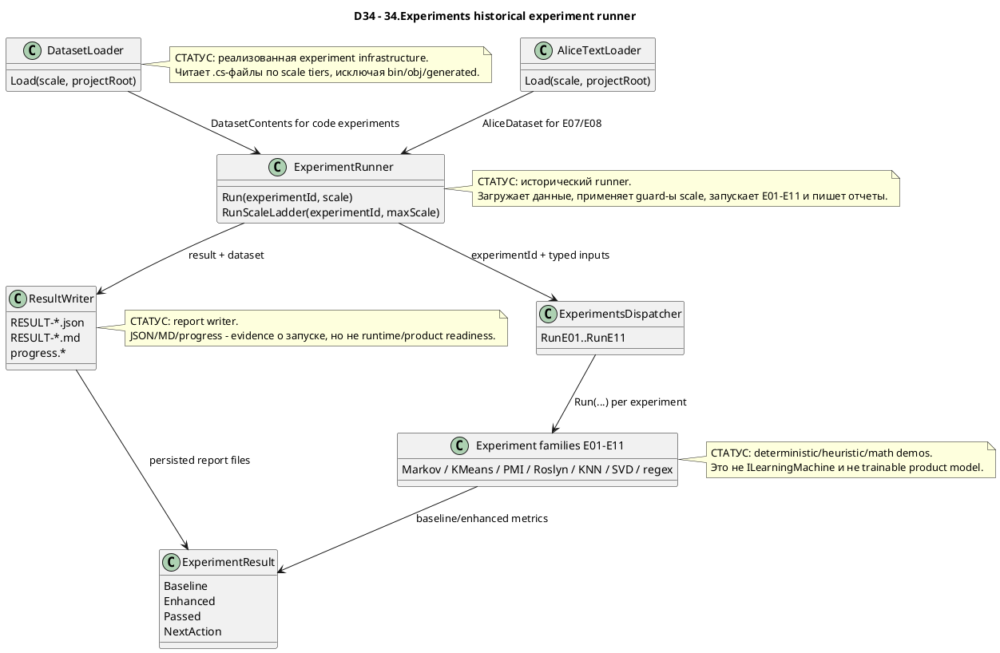

# 34.Experiments

Documentation status: D34 documented - parent review passed.

## 1. Краткая карта для Лубы

`34.Experiments` - это исторический набор micro-experiments и runner-инфраструктуры. Проект берет текст кода или набор токенов, запускает сравнение "baseline против enhanced" и пишет результат в `ExperimentResult`, JSON и Markdown отчеты.

Главная роль проекта - проверять идеи: Markov bigram/trigram, K-Means token families, Shannon entropy, PMI/PPMI, Roslyn AST, KNN по структурным векторам, SVD embedding и regex-vs-Roslyn benchmark. Это не активная продуктовая модель и не trainable unit с asset lifecycle. Даже когда результат пишет `PROMOTE_TO_NEXT_SCALE`, это означает только "экспериментальная метрика улучшилась на 5 percentage points", а не product readiness, trained-model readiness, checkpoint readiness или runtime feature readiness.

## 2. UML / поток данных



| Узел | Что делает | Статус | Где живет |
|---|---|---|---|
| `DatasetLoader` | Читает C# файлы по scale 0-5 и собирает `DatasetContents`. | Полная historical infra | `34.Experiments/Infrastructure/DatasetLoader.cs` |
| `AliceTextLoader` | Загружает/кеширует Alice in Wonderland для E07/E08. | Полная historical infra, с сетевой загрузкой при отсутствии файла | `34.Experiments/Infrastructure/AliceTextLoader.cs` |
| `ExperimentRunner` | Оркестрирует dataset -> experiment -> result writer. | Полная runner infra | `34.Experiments/Infrastructure/ExperimentRunner.cs` |
| `ExperimentsDispatcher` | Единая точка вызова E01-E11. | Полная dispatcher infra | `34.Experiments/ExperimentsDispatcher.cs` |
| `Experiment families E01-E11` | Набор экспериментальных алгоритмов baseline/enhanced. | Historical/deterministic demos | `34.Experiments/Experiments/*.cs` |
| `ExperimentResult` | Общий DTO метрик и 5%-вердикта. | Полный DTO | `34.Experiments/Core/ExperimentTypes.cs` |
| `ResultWriter` | Пишет JSON/Markdown/progress. | Полная report infra | `34.Experiments/Infrastructure/ResultWriter.cs` |

## 3. Симуляции по связям UML

| Связь | Пример входа | Симуляция ветки | Ожидаемый результат | Что запрещено принимать за результат |
|---|---|---|---|---|
| `DatasetLoader -> ExperimentRunner` | `scale=1`, `projectRoot=C:\Projects\llm_mvp_core` | Loader читает `01.Tokenizer`, исключает `bin/obj/.g.cs`, объединяет тексты. | `DatasetContents` с `Files`, `FileTexts`, `CombinedText`, `ApproxTokens`. | Не считать это обучающим датасетом product model; это временный input эксперимента. |
| `AliceTextLoader -> ExperimentRunner` | `experimentId="E07"`, `scale=0` | Runner не вызывает `DatasetLoader`; грузит Alice words/tokens. | `AliceDataset` для word bigram/unigram experiments. | Не считать Project Gutenberg download стабильным product dependency без отдельного gate. |
| `ExperimentRunner -> Dispatcher` | `experimentId="E10"`, `scale=0`, `ApproxTokens=2000` | Guard E10 проверяет минимум 10k токенов и пишет skipped sentinel. | `OperationResult.Fail`, `RESULT-E10-scale0.json/.md` со статусом skipped. | Skipped report не доказывает запуск E10 и не доказывает модельную готовность. |
| `Dispatcher -> E01-E11` | `RunE03(charTokens)` | Dispatcher вызывает конкретный `Run(...)`; алгоритм делит train/val и считает baseline/enhanced. | `ExperimentResult` с метриками. | Это не автоматический выбор лучшей архитектуры для продукта. |
| `Families -> ExperimentResult` | E03 bigram vs trigram | Baseline и enhanced получают accuracy/time/memory; `Passed` считается через delta. | `NextAction` равен `PROMOTE_TO_NEXT_SCALE` при `AccuracyDeltaPct >= 5`. | `PROMOTE_TO_NEXT_SCALE` не является production approval. |
| `ExperimentRunner -> ResultWriter` | Успешный `E03 scale=0` | Runner патчит `Scale`, вызывает writer, обновляет progress. | `RESULT-E03-scale0.json`, `.md`, `progress.json`, `progress.md`. | JSON/MD отчеты не заменяют runtime, checkpoint, manifest или fresh-load evidence. |

## 4. Алгоритмы без кода

### 4.1 `ExperimentRunner.Run(string experimentId, int scale)`

Аналогия: это лабораторный техник. Он берет образец данных, проверяет, можно ли его запускать на выбранном приборе, отправляет в нужный эксперимент и складывает протокол в папку.

| Поле | Значение |
|---|---|
| Класс | `ExperimentRunner` |
| Метод | `Run(string experimentId, int scale)` |
| Вход | `experimentId`, например `"E03"`; `scale`, например `0`; внутренний `projectRoot` |
| Выход | `OperationResult<ExperimentResult>` |
| Статус | Полная historical runner infra |

Шаги:
1. Если `experimentId` равен `E07` или `E08`, переключается на `RunNaturalLanguage` и Alice dataset.
2. Иначе вызывает `DatasetLoader.Load(scale, projectRoot)`.
3. Применяет guard-ы: `E04` требует примерно 50k tokens, `E09` требует scale >= 1, `E10` требует примерно 10k tokens.
4. Выбирает конкретный dispatcher method через `switch`.
5. Патчит `Scale` в результате, потому что сами experiments обычно hard-code `Scale=0`.
6. Пишет result/progress через `ResultWriter`.

Не делает: не тренирует product model, не сохраняет checkpoint, не публикует manifest, не доказывает fresh-load/continue-training.

### 4.2 `DatasetLoader.Load(int scale, string projectRoot)`

Аналогия: это сборщик папок для лабораторного стола. Он знает, какие директории брать для каждого масштаба, и собирает тексты `.cs` в один input.

Вход: `scale` 0-5 и корень репозитория. Выход: `OperationResult<DatasetContents>`.

Ветки:
- scale вне 0-5 -> `Fail`.
- `projectRoot` не существует -> `Fail`.
- pattern - файл -> читает файл.
- pattern - директория -> читает `.cs` рекурсивно, пропуская generated/bin/obj.
- нет файлов -> `Fail`.

Не делает: не нормализует код как production dataset, не проверяет приватность, не создает train/test split для product model.

### 4.3 `ExperimentsDispatcher.RunE01..RunE11`

Аналогия: это табло с кнопками "запустить E01", "запустить E02" и так далее. Оно не анализирует, какая кнопка лучше; оно просто вызывает выбранную.

Входы зависят от experiment: BPE tokens, char tokens, C# source, Alice dataset или `fileTexts`. Выход у всех один: `OperationResult<ExperimentResult>`.

Не делает: не выбирает winning experiment автоматически и не продвигает результат в продуктовую ветку.

### 4.4 Experiment family map E01-E11

| Exp | Класс / метод | Вход | Baseline | Enhanced | Ветки/ограничения | Статус |
|---|---|---|---|---|---|---|
| E01 | `E01SemanticFamilies.Run(IReadOnlyList<int> tokens)` | BPE token ids | raw BPE bigram | K-Means clusters + bigram | `<10` tokens fail; adaptive K fail when too few unique tokens | deterministic/math demo |
| E02 | `E02ShannonCompression.Run(IReadOnlyList<int> tokens)` | token ids | Shannon entropy raw tokens | entropy of K-Means cluster ids | `<10` tokens fail | deterministic compression metric demo |
| E03 | `E03SparseWindow.Run(IReadOnlyList<int> tokens)` | char/token ids | bigram Markov | trigram Markov with fallback | `<10` tokens fail | deterministic Markov demo |
| E04 | `E04PmiInit.Run(IReadOnlyList<int> tokens)` | BPE token ids | count argmax | PPMI argmax | runner requires larger scale for reliable PMI | deterministic PMI demo |
| E05 | `E05HierarchicalPrediction.Run(IReadOnlyList<int> tokens)` | BPE token ids | flat bigram | cluster-level + local bigrams | `<10` fail; `seenCount < 50` fail | deterministic hierarchy demo |
| E06 | `E06AstRoslyn.Run(IReadOnlyList<int> bpeTokens, string csharpSourceCode)` | char tokens + C# source | char bigram cross-entropy | Roslyn AST bigram cross-entropy per char | too few BPE/source/AST nodes fail | Roslyn/math demo |
| E07 | `E07NaturalLanguageNgram.Run(AliceDataset data, int scale)` | Alice words/tokens | most frequent word | word bigram | `<20` word tokens fail | natural-language Markov demo |
| E08 | `E08NaturalLanguageGrammar.Run(AliceDataset data, int scale)` | Alice words/tokens | word bigram | word bigram + regex/POS filter | `<20` word tokens fail; grammar filter can fallback | regex/heuristic demo |
| E09 | `E09ContextVectorKnn.Run(string csharpSource, int scale)` | C# source | AST bigram | HNSW KNN over 5D structural vectors | empty source / too few AST nodes fail; runner requires scale >= 1 | KNN infrastructure demo |
| E10 | `E10SvdPmiEmbedding.Run(IReadOnlyList<int> bpeTokens, int scale)` | BPE token ids | bigram | PPMI + truncated SVD dot-product | `<500` tokens fail; runner requires approx 10k | numerical embedding demo |
| E11 | `E11RegexDataPrep.Run(IReadOnlyDictionary<string,string> fileTexts, int scale)` | file path -> C# text | Roslyn parse structure count | 8 compiled regex patterns | no files fail; pass condition is custom time+coverage in notes | regex benchmark demo |

### 4.5 `ExperimentResult`

`ExperimentResult` хранит baseline metrics, enhanced metrics, delta and `Passed`. Важно: `Passed` - это локальное правило `AccuracyDeltaPct >= 5.0`, а не external QA gate.

Не делает: не говорит, что experiment стал production feature; не включает test-run evidence; не содержит model artifact references.

## 5. Где логика сидит в коде

| Логика | Файл | Почему важно | Что доказывает | Чего не доказывает |
|---|---|---|---|---|
| Dispatch E01-E11 | `34.Experiments/ExperimentsDispatcher.cs` | Единая публичная точка micro-experiments. | Можно вызвать каждый experiment по typed method. | Не доказывает automatic promotion в продукт. |
| Dataset scale tiers | `34.Experiments/Infrastructure/DatasetLoader.cs` | Определяет, какие реальные `.cs` файлы читает runner. | Scale 0-5 читают разные части repo. | Не доказывает качество training dataset. |
| Runner guard/dispatch/write | `34.Experiments/Infrastructure/ExperimentRunner.cs` | Показывает сквозной путь load -> guard -> run -> write. | Historical runner реально пишет отчеты. | Отчет не является runtime/model readiness. |
| Shared metrics | `34.Experiments/Core/ExperimentTypes.cs` | Определяет `Passed` и `NextAction`. | 5%-порог локальный и явный. | `PROMOTE_TO_NEXT_SCALE` не product approval. |
| Markov helpers | `34.Experiments/Core/MarkovChain.cs` | Bigram/trigram deterministic baselines. | Count-table prediction работает без обучения модели. | Не semantic model. |
| E01/E05 K-Means | `34.Experiments/Experiments/E01SemanticFamilies.cs`, `E05HierarchicalPrediction.cs` | Показывает cluster-based experiments. | KMeans используется как math helper. | Не trainable semantic authority. |
| E09 KNN | `34.Experiments/Experiments/E09ContextVectorKnn.cs` | Показывает HNSW index для AST vectors. | KNN votes по next AST kind. | Не learned model lifecycle. |
| E11 regex benchmark | `34.Experiments/Experiments/E11RegexDataPrep.cs` | Сравнивает regex patterns vs Roslyn parse time. | Regex helper fast benchmark. | Regex coverage не semantic code intelligence. |

## 6. Короткие цитаты кода

`34.Experiments/Infrastructure/ExperimentRunner.cs:72-104`

```csharp
        // Step 3: run the experiment
        OperationResult<ExperimentResult> runResult = experimentId switch
        {
            "E01" => _dispatcher.RunE01(BpeTokenize(dataset.CombinedText, vocabSize: 500)),
            "E02" => _dispatcher.RunE02(CharLevelTokenize(dataset.CombinedText)),
            "E03" => _dispatcher.RunE03(CharLevelTokenize(dataset.CombinedText)),
            "E04" => _dispatcher.RunE04(BpeTokenize(dataset.CombinedText, vocabSize: 500)),
            "E05" => _dispatcher.RunE05(BpeTokenize(dataset.CombinedText, vocabSize: 500)),
            "E06" => _dispatcher.RunE06(CharLevelTokenize(dataset.CombinedText), dataset.CombinedText),
            "E09" => _dispatcher.RunE09(dataset.CombinedText, scale),
            "E10" => _dispatcher.RunE10(BpeTokenize(dataset.CombinedText, vocabSize: 500), scale),
            "E11" => _dispatcher.RunE11(dataset.FileTexts, scale),
            _     => OperationResult<ExperimentResult>.Fail(
                         $"Unknown experiment: {experimentId}"),
        };

        if (!runResult.IsSuccess) return runResult;

        // Step 4: fix Scale (experiments hard-code Scale=0)
        var result = runResult.Value! with { Scale = scale };

        // Step 5: write results
        var writeResult = _writer.Write(result, dataset);
        if (!writeResult.IsSuccess)
            Console.Error.WriteLine($"[ResultWriter] {writeResult.ErrorMessage}");

        // Step 6: keep progress summary current after every run
        _allResults.RemoveAll(r => r.ExperimentId == result.ExperimentId && r.Scale == result.Scale);
        _allResults.Add(result);
        _writer.UpdateProgress(_allResults);

        return OperationResult<ExperimentResult>.Ok(result);
    }
```

Почему важно: это доказывает реальный runner-путь для code-based experiments. Вход - `experimentId`, `scale`, dataset; выход - `ExperimentResult` и файлы отчета. Не доказывает runtime/product readiness.

`34.Experiments/Core/ExperimentTypes.cs:66-69`

```csharp
    public bool Passed => AccuracyDeltaPct >= 5.0;

    // Human-readable verdict string.
    public string NextAction => Passed ? "PROMOTE_TO_NEXT_SCALE" : "ABANDON";
```

Почему важно: `Passed` - локальный 5%-порог. Он полезен для ladder эксперимента, но не является release gate.

`34.Experiments/Infrastructure/DatasetLoader.cs:63-90`

```csharp
        if (!Directory.Exists(projectRoot))
            return OperationResult<DatasetContents>.Fail(
                $"Project root not found: {projectRoot}");

        var entries  = new List<(string Path, string Text)>();
        var patterns = TierFolders[scale];

        foreach (string pattern in patterns)
        {
            string fullPath = Path.Combine(projectRoot, pattern);

            if (File.Exists(fullPath))
            {
                string text = File.ReadAllText(fullPath);
                if (!string.IsNullOrWhiteSpace(text))
                    entries.Add((fullPath, text));
            }
            else if (Directory.Exists(fullPath))
            {
                foreach (string csFile in Directory.EnumerateFiles(
                    fullPath, "*.cs", SearchOption.AllDirectories))
                {
                    if (IsGeneratedFile(csFile)) continue;
                    string text = File.ReadAllText(csFile);
                    if (!string.IsNullOrWhiteSpace(text))
                        entries.Add((csFile, text));
                }
            }
```

Почему важно: dataset здесь - прочитанные файлы repo, а не curated product training corpus.

`34.Experiments/Experiments/E01SemanticFamilies.cs:64-82`

```csharp
        int k = adaptiveK;

        var featureVectors = seenTokens
            .Select(t =>
            {
                double total = tokenCounts[t];
                return cooccur[t].Select(c => c / total).ToArray();
            })
            .ToList();

        var kmeans = new MachineLearning.KMeansAlgorithm();
        var fitResult = kmeans.Fit(featureVectors, k, maxIterations: 50);
        if (!fitResult.IsSuccess)
            return OperationResult<ExperimentResult>.Fail("K-Means: " + fitResult.ErrorMessage);

        int[] assignments = fitResult.Value!;
        var tokenToCluster = new Dictionary<int, int>();
        for (int i = 0; i < seenTokens.Count; i++)
            tokenToCluster[seenTokens[i]] = assignments[i];
```

Почему важно: E01 использует K-Means как deterministic/math helper на co-occurrence features. Это не semantic family model с checkpoint.

`34.Experiments/Experiments/E09ContextVectorKnn.cs:64-78`

```csharp
        {
            string nodeId = i.ToString();
            index.Add(trainVecs[i], nodeId);
            nextTokenAt[nodeId] = trainToks[i + 1];
        }

        int enhCorrect = 0, enhTotal = valToks.Count - 1;
        for (int i = 0; i < enhTotal; i++)
        {
            int predicted = PredictKnn(index, valVecs[i], nextTokenAt, bigram, valToks[i]);
            if (predicted == valToks[i + 1]) enhCorrect++;
        }
        double enhancedAcc   = enhTotal > 0 ? enhCorrect / (double)enhTotal : 0;
        double enhancedMs    = ElapsedMs(t1);
        double enhancedMemMb = (GC.GetAllocatedBytesForCurrentThread() - enhMemStart) / 1_048_576.0;
```

Почему важно: E09 - KNN по структурным векторам AST. Это retrieval/voting helper, не trained semantic authority.

`34.Experiments/Experiments/E11RegexDataPrep.cs:17-31`

```csharp
    private static readonly Regex MethodStart = new(
        @"\b(public|private|protected|internal)\s+[\w<>\[\],\s]+\s+\w+\s*\(", RegexOptions.Compiled);
    private static readonly Regex IfBlock     = new(@"\bif\s*\(",             RegexOptions.Compiled);
    private static readonly Regex ForLoop     = new(@"\bfor(?:each)?\s*\(",   RegexOptions.Compiled);
    private static readonly Regex WhileLoop   = new(@"\bwhile\s*\(",          RegexOptions.Compiled);
    private static readonly Regex ReturnStmt  = new(@"\breturn\b",            RegexOptions.Compiled);
    private static readonly Regex ClassDecl   = new(@"\bclass\s+\w+",         RegexOptions.Compiled);
    private static readonly Regex CallSite    = new(@"\b\w+\.\w+\s*\(",       RegexOptions.Compiled);
    private static readonly Regex Assignment  = new(@"\b\w+\s*=[^=]",         RegexOptions.Compiled);

    private static readonly Regex[] AllPatterns =
    [
        MethodStart, IfBlock, ForLoop, WhileLoop,
        ReturnStmt, ClassDecl, CallSite, Assignment,
    ];
```

Почему важно: E11 explicitly regex-based. Быстрый static scan не является Roslyn-equivalent semantic understanding.

`34.Experiments/Infrastructure/ResultWriter.cs:23-43`

```csharp
    // Write JSON and MD files for one experiment result.
    // Returns the two file paths on success.
    public OperationResult<(string JsonPath, string MdPath)> Write(
        ExperimentResult result,
        DatasetContents  dataset)
    {
        string baseName = $"RESULT-{result.ExperimentId}-scale{result.Scale}";
        string jsonPath = Path.Combine(_outputDir, baseName + ".json");
        string mdPath   = Path.Combine(_outputDir, baseName + ".md");

        try
        {
            File.WriteAllText(jsonPath, BuildJson(result, dataset));
            File.WriteAllText(mdPath,   BuildMarkdown(result, dataset));
            return OperationResult<(string, string)>.Ok((jsonPath, mdPath));
        }
        catch (Exception ex)
        {
            return OperationResult<(string, string)>.Fail(
                $"Write failed: {ex.Message}");
        }
```

Почему важно: writer создает evidence files, но сами файлы не являются фазой product completion.

## 7. Test/e2e/QA mapping

Тесты были прочитаны и сопоставлены, но не запускались в этой документационной подфазе.

| Поведение | Evidence | Что покрывает | Чего не доказывает |
|---|---|---|---|
| Bigram/trigram helpers | `Tests/ExperimentsTests.cs` `BigramMarkov_*`, `TrigramMarkov_*` | Count-table training, prediction, evaluation on synthetic patterns. | Не доказывает language model readiness. |
| E01-E06 | `Tests/ExperimentsTests.cs` E01-E06 sections | Success/fail guards, metric ranges, notes fields, dispatcher methods. | Не доказывает real dataset performance или active product path. |
| Result DTO threshold | `ExperimentResult_Passed_*` | `AccuracyDeltaPct >= 5` -> `PROMOTE_TO_NEXT_SCALE`; ниже -> `ABANDON`. | Не является product acceptance gate. |
| Infrastructure | `Tests/ExperimentsInfrastructureTests.cs` | `DatasetLoader`, `ResourceMonitor`, `ResultWriter`, `ExperimentRunner` file output. | Не доказывает trained asset lifecycle. |
| E09/E10-adjacent feature flags | `Tests/E09E10FeatureFlagTests.cs` | Связанные structural/regex behavior in legacy semantic compiler paths. | Это не прямой runtime test D34 runner. |
| E02/E03/E05/E11 integration-adjacent | `Tests/E02E03E05E11IntegrationTests.cs` | SemanticCompiler legacy helpers that overlap conceptually with experiment ideas. | Нельзя переносить это как доказательство D34 product readiness. |

## 8. Статус компонентов

| Компонент | Файл | Статус | Что реально работает сейчас |
|---|---|---|---|
| `ExperimentsDispatcher` | `34.Experiments/ExperimentsDispatcher.cs` | Полная historical infra | Методы `RunE01`-`RunE11` вызывают конкретные experiment classes. |
| `ExperimentRunner` | `34.Experiments/Infrastructure/ExperimentRunner.cs` | Полная runner infra | Load/guard/dispatch/write/progress для historical experiments. |
| `DatasetLoader` | `34.Experiments/Infrastructure/DatasetLoader.cs` | Полная runner infra | Scale 0-5 читают `.cs` из repo, generated files исключаются. |
| `AliceTextLoader` | `34.Experiments/Infrastructure/AliceTextLoader.cs` | Частичная внешняя зависимость | Может скачать Gutenberg text или использовать cache; сеть не проверялась в D34. |
| `ResultWriter` | `34.Experiments/Infrastructure/ResultWriter.cs` | Полная report infra | Пишет JSON/MD/progress и skipped sentinel. |
| `BigramMarkov` / `TrigramMarkov` | `34.Experiments/Core/MarkovChain.cs` | Полная deterministic helper | Count-table Markov prediction/evaluation. |
| E01-E11 classes | `34.Experiments/Experiments/*.cs` | Historical deterministic/math/parser demos | Реальные run methods с guards and metrics; не product model. |
| `Experiments.csproj` | `34.Experiments/Experiments.csproj` | Project wiring | Ссылается на `Tokenizer`, `MachineLearning`, `VectorSearch`, Roslyn package. |

## 9. Anti-false-done checks

- `34.Experiments` является historical/experiment/demo/runner code, а не активным product path, если отдельный source не доказывает обратное.
- Experiment output/report/static files не являются product readiness или trained-model readiness.
- `PROMOTE_TO_NEXT_SCALE` не является release approval; это только локальный 5%-порог в `ExperimentResult`.
- K-Means, PMI, Markov, HNSW KNN, truncated SVD, regex and Roslyn parser helpers являются deterministic/heuristic/math/parser infrastructure.
- В D34 нет `ILearningMachine` asset lifecycle: нет checkpoint, manifest, locator, export/import, fresh-load, continue-training evidence.
- Тесты/QA были read-only mapped, not run. Никакой runtime/build/test claim в этой подфазе не делается.

Documentation status: D34 documented - parent review passed.
Last verified against source: 2026-06-08.
Known gaps: no fresh test/build/runtime execution in this documentation-only subphase.
