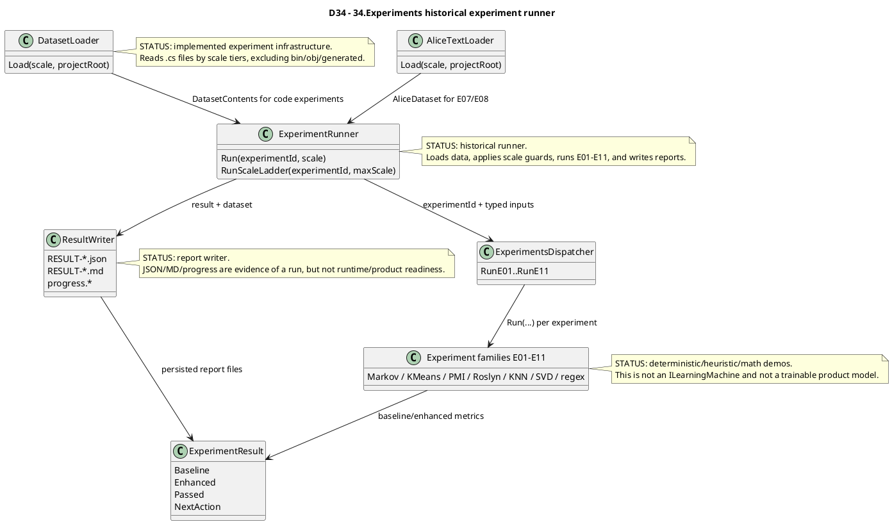

# 34.Experiments

Documentation status: D34 documented - parent review passed.

## 1. Quick map for Luba

`34.Experiments` is a historical set of micro-experiments and runner infrastructure. The project takes code text or a set of tokens, runs a "baseline vs enhanced" comparison, and writes the result into an `ExperimentResult`, JSON, and Markdown reports.

The main role of the project is to test ideas: Markov bigram/trigram, K-Means token families, Shannon entropy, PMI/PPMI, Roslyn AST, KNN over structural vectors, SVD embedding, and a regex-vs-Roslyn benchmark. This is not an active product model and not a trainable unit with an asset lifecycle. Even when the result writes `PROMOTE_TO_NEXT_SCALE`, that only means "the experimental metric improved by 5 percentage points", not product readiness, trained-model readiness, checkpoint readiness, or runtime feature readiness.

## 2. UML / data flow



| Node | What it does | Status | Where it lives |
|---|---|---|---|
| `DatasetLoader` | Reads C# files by scale 0-5 and assembles `DatasetContents`. | Complete historical infra | `34.Experiments/Infrastructure/DatasetLoader.cs` |
| `AliceTextLoader` | Loads/caches Alice in Wonderland for E07/E08. | Complete historical infra, with a network download if the file is absent | `34.Experiments/Infrastructure/AliceTextLoader.cs` |
| `ExperimentRunner` | Orchestrates dataset -> experiment -> result writer. | Complete runner infra | `34.Experiments/Infrastructure/ExperimentRunner.cs` |
| `ExperimentsDispatcher` | A single call point for E01-E11. | Complete dispatcher infra | `34.Experiments/ExperimentsDispatcher.cs` |
| `Experiment families E01-E11` | A set of experimental baseline/enhanced algorithms. | Historical/deterministic demos | `34.Experiments/Experiments/*.cs` |
| `ExperimentResult` | A common DTO of metrics and the 5% verdict. | Complete DTO | `34.Experiments/Core/ExperimentTypes.cs` |
| `ResultWriter` | Writes JSON/Markdown/progress. | Complete report infra | `34.Experiments/Infrastructure/ResultWriter.cs` |

## 3. Simulations by UML connection

| Connection | Example input | Branch simulation | Expected result | What must not be taken as the result |
|---|---|---|---|---|
| `DatasetLoader -> ExperimentRunner` | `scale=1`, `projectRoot=<repo-root>` | The loader reads `01.Tokenizer`, excludes `bin/obj/.g.cs`, joins the texts. | `DatasetContents` with `Files`, `FileTexts`, `CombinedText`, `ApproxTokens`. | Do not treat this as a training dataset for a product model; it is a temporary experiment input. |
| `AliceTextLoader -> ExperimentRunner` | `experimentId="E07"`, `scale=0` | The runner does not call `DatasetLoader`; loads Alice words/tokens. | `AliceDataset` for word bigram/unigram experiments. | Do not treat the Project Gutenberg download as a stable product dependency without a separate gate. |
| `ExperimentRunner -> Dispatcher` | `experimentId="E10"`, `scale=0`, `ApproxTokens=2000` | The E10 guard checks for at least 10k tokens and writes a skipped sentinel. | `OperationResult.Fail`, `RESULT-E10-scale0.json/.md` with status skipped. | A skipped report does not prove E10 was run and does not prove model readiness. |
| `Dispatcher -> E01-E11` | `RunE03(charTokens)` | The dispatcher calls the specific `Run(...)`; the algorithm splits train/val and computes baseline/enhanced. | `ExperimentResult` with metrics. | This is not an automatic selection of the best architecture for the product. |
| `Families -> ExperimentResult` | E03 bigram vs trigram | Baseline and enhanced get accuracy/time/memory; `Passed` is computed via the delta. | `NextAction` equals `PROMOTE_TO_NEXT_SCALE` when `AccuracyDeltaPct >= 5`. | `PROMOTE_TO_NEXT_SCALE` is not production approval. |
| `ExperimentRunner -> ResultWriter` | A successful `E03 scale=0` | The runner patches `Scale`, calls the writer, updates progress. | `RESULT-E03-scale0.json`, `.md`, `progress.json`, `progress.md`. | JSON/MD reports do not replace runtime, checkpoint, manifest, or fresh-load evidence. |

## 4. No-code algorithms

### 4.1 `ExperimentRunner.Run(string experimentId, int scale)`

Analogy: it is a lab technician. He takes a data sample, checks whether it can be run on the chosen instrument, sends it to the right experiment, and files the protocol into a folder.

| Field | Value |
|---|---|
| Class | `ExperimentRunner` |
| Method | `Run(string experimentId, int scale)` |
| Input | `experimentId`, for example `"E03"`; `scale`, for example `0`; internal `projectRoot` |
| Output | `OperationResult<ExperimentResult>` |
| Status | Complete historical runner infra |

Steps:
1. If `experimentId` equals `E07` or `E08`, switches to `RunNaturalLanguage` and the Alice dataset.
2. Otherwise calls `DatasetLoader.Load(scale, projectRoot)`.
3. Applies guards: `E04` requires about 50k tokens, `E09` requires scale >= 1, `E10` requires about 10k tokens.
4. Selects the specific dispatcher method via a `switch`.
5. Patches `Scale` in the result, because the experiments themselves usually hard-code `Scale=0`.
6. Writes result/progress via `ResultWriter`.

Does not do: it does not train a product model, does not save a checkpoint, does not publish a manifest, does not prove fresh-load/continue-training.

### 4.2 `DatasetLoader.Load(int scale, string projectRoot)`

Analogy: it is a folder collector for a lab bench. It knows which directories to take for each scale and gathers `.cs` texts into a single input.

Input: `scale` 0-5 and the repository root. Output: `OperationResult<DatasetContents>`.

Branches:
- scale outside 0-5 -> `Fail`.
- `projectRoot` does not exist -> `Fail`.
- pattern is a file -> reads the file.
- pattern is a directory -> reads `.cs` recursively, skipping generated/bin/obj.
- no files -> `Fail`.

Does not do: it does not normalize the code as a production dataset, does not check privacy, does not create a train/test split for a product model.

### 4.3 `ExperimentsDispatcher.RunE01..RunE11`

Analogy: it is a board with buttons "run E01", "run E02", and so on. It does not analyze which button is better; it just calls the selected one.

The inputs depend on the experiment: BPE tokens, char tokens, C# source, Alice dataset, or `fileTexts`. The output is the same for all: `OperationResult<ExperimentResult>`.

Does not do: it does not select a winning experiment automatically and does not promote the result into a product branch.

### 4.4 Experiment family map E01-E11

| Exp | Class / method | Input | Baseline | Enhanced | Branches/limits | Status |
|---|---|---|---|---|---|---|
| E01 | `E01SemanticFamilies.Run(IReadOnlyList<int> tokens)` | BPE token ids | raw BPE bigram | K-Means clusters + bigram | `<10` tokens fail; adaptive K fail when too few unique tokens | deterministic/math demo |
| E02 | `E02ShannonCompression.Run(IReadOnlyList<int> tokens)` | token ids | Shannon entropy raw tokens | entropy of K-Means cluster ids | `<10` tokens fail | deterministic compression metric demo |
| E03 | `E03SparseWindow.Run(IReadOnlyList<int> tokens)` | char/token ids | bigram Markov | trigram Markov with fallback | `<10` tokens fail | deterministic Markov demo |
| E04 | `E04PmiInit.Run(IReadOnlyList<int> tokens)` | BPE token ids | count argmax | PPMI argmax | runner requires larger scale for reliable PMI | deterministic PMI demo |
| E05 | `E05HierarchicalPrediction.Run(IReadOnlyList<int> tokens)` | BPE token ids | flat bigram | cluster-level + local bigrams | `<10` fail; `seenCount < 50` fail | deterministic hierarchy demo |
| E06 | `E06AstRoslyn.Run(IReadOnlyList<int> bpeTokens, string csharpSourceCode)` | char tokens + C# source | char bigram cross-entropy | Roslyn AST bigram cross-entropy per char | too few BPE/source/AST nodes fail | Roslyn/math demo |
| E07 | `E07NaturalLanguageNgram.Run(AliceDataset data, int scale)` | Alice words/tokens | most frequent word | word bigram | `<20` word tokens fail | natural-language Markov demo |
| E08 | `E08NaturalLanguageGrammar.Run(AliceDataset data, int scale)` | Alice words/tokens | word bigram | word bigram + regex/POS filter | `<20` word tokens fail; grammar filter can fallback | regex/heuristic demo |
| E09 | `E09ContextVectorKnn.Run(string csharpSource, int scale)` | C# source | AST bigram | HNSW KNN over 5D structural vectors | empty source / too few AST nodes fail; runner requires scale >= 1 | KNN infrastructure demo |
| E10 | `E10SvdPmiEmbedding.Run(IReadOnlyList<int> bpeTokens, int scale)` | BPE token ids | bigram | PPMI + truncated SVD dot-product | `<500` tokens fail; runner requires approx 10k | numerical embedding demo |
| E11 | `E11RegexDataPrep.Run(IReadOnlyDictionary<string,string> fileTexts, int scale)` | file path -> C# text | Roslyn parse structure count | 8 compiled regex patterns | no files fail; pass condition is custom time+coverage in notes | regex benchmark demo |

### 4.5 `ExperimentResult`

`ExperimentResult` stores baseline metrics, enhanced metrics, delta, and `Passed`. Important: `Passed` is the local rule `AccuracyDeltaPct >= 5.0`, not an external QA gate.

Does not do: it does not say that the experiment became a production feature; does not include test-run evidence; does not contain model artifact references.

## 5. Where the logic sits in the code

| Logic | File | Why it matters | What it proves | What it does not prove |
|---|---|---|---|---|
| Dispatch E01-E11 | `34.Experiments/ExperimentsDispatcher.cs` | A single public entry point for the micro-experiments. | Each experiment can be called by a typed method. | Does not prove automatic promotion into the product. |
| Dataset scale tiers | `34.Experiments/Infrastructure/DatasetLoader.cs` | Determines which real `.cs` files the runner reads. | Scale 0-5 read different parts of the repo. | Does not prove the quality of a training dataset. |
| Runner guard/dispatch/write | `34.Experiments/Infrastructure/ExperimentRunner.cs` | Shows the end-to-end path load -> guard -> run -> write. | The historical runner actually writes reports. | A report is not runtime/model readiness. |
| Shared metrics | `34.Experiments/Core/ExperimentTypes.cs` | Defines `Passed` and `NextAction`. | The 5% threshold is local and explicit. | `PROMOTE_TO_NEXT_SCALE` is not product approval. |
| Markov helpers | `34.Experiments/Core/MarkovChain.cs` | Bigram/trigram deterministic baselines. | Count-table prediction works without training a model. | Not a semantic model. |
| E01/E05 K-Means | `34.Experiments/Experiments/E01SemanticFamilies.cs`, `E05HierarchicalPrediction.cs` | Shows cluster-based experiments. | KMeans is used as a math helper. | Not a trainable semantic authority. |
| E09 KNN | `34.Experiments/Experiments/E09ContextVectorKnn.cs` | Shows an HNSW index for AST vectors. | KNN votes on the next AST kind. | Not a learned model lifecycle. |
| E11 regex benchmark | `34.Experiments/Experiments/E11RegexDataPrep.cs` | Compares regex patterns vs Roslyn parse time. | A fast regex helper benchmark. | Regex coverage is not semantic code intelligence. |

## 6. Short code quotations

`34.Experiments/Infrastructure/ExperimentRunner.cs:72-104`

```csharp
        // Step 3: run the experiment
        OperationResult<ExperimentResult> runResult = experimentId switch
        {
            "E01" => _dispatcher.RunE01(BpeTokenize(dataset.CombinedText, vocabSize: 500)),
            "E02" => _dispatcher.RunE02(CharLevelTokenize(dataset.CombinedText)),
            "E03" => _dispatcher.RunE03(CharLevelTokenize(dataset.CombinedText)),
            "E04" => _dispatcher.RunE04(BpeTokenize(dataset.CombinedText, vocabSize: 500)),
            "E05" => _dispatcher.RunE05(BpeTokenize(dataset.CombinedText, vocabSize: 500)),
            "E06" => _dispatcher.RunE06(CharLevelTokenize(dataset.CombinedText), dataset.CombinedText),
            "E09" => _dispatcher.RunE09(dataset.CombinedText, scale),
            "E10" => _dispatcher.RunE10(BpeTokenize(dataset.CombinedText, vocabSize: 500), scale),
            "E11" => _dispatcher.RunE11(dataset.FileTexts, scale),
            _     => OperationResult<ExperimentResult>.Fail(
                         $"Unknown experiment: {experimentId}"),
        };

        if (!runResult.IsSuccess) return runResult;

        // Step 4: fix Scale (experiments hard-code Scale=0)
        var result = runResult.Value! with { Scale = scale };

        // Step 5: write results
        var writeResult = _writer.Write(result, dataset);
        if (!writeResult.IsSuccess)
            Console.Error.WriteLine($"[ResultWriter] {writeResult.ErrorMessage}");

        // Step 6: keep progress summary current after every run
        _allResults.RemoveAll(r => r.ExperimentId == result.ExperimentId && r.Scale == result.Scale);
        _allResults.Add(result);
        _writer.UpdateProgress(_allResults);

        return OperationResult<ExperimentResult>.Ok(result);
    }
```

Why it matters: this proves the real runner path for code-based experiments. The input is `experimentId`, `scale`, dataset; the output is an `ExperimentResult` and report files. Does not prove runtime/product readiness.

`34.Experiments/Core/ExperimentTypes.cs:66-69`

```csharp
    public bool Passed => AccuracyDeltaPct >= 5.0;

    // Human-readable verdict string.
    public string NextAction => Passed ? "PROMOTE_TO_NEXT_SCALE" : "ABANDON";
```

Why it matters: `Passed` is a local 5% threshold. It is useful for the experiment ladder, but is not a release gate.

`34.Experiments/Infrastructure/DatasetLoader.cs:63-90`

```csharp
        if (!Directory.Exists(projectRoot))
            return OperationResult<DatasetContents>.Fail(
                $"Project root not found: {projectRoot}");

        var entries  = new List<(string Path, string Text)>();
        var patterns = TierFolders[scale];

        foreach (string pattern in patterns)
        {
            string fullPath = Path.Combine(projectRoot, pattern);

            if (File.Exists(fullPath))
            {
                string text = File.ReadAllText(fullPath);
                if (!string.IsNullOrWhiteSpace(text))
                    entries.Add((fullPath, text));
            }
            else if (Directory.Exists(fullPath))
            {
                foreach (string csFile in Directory.EnumerateFiles(
                    fullPath, "*.cs", SearchOption.AllDirectories))
                {
                    if (IsGeneratedFile(csFile)) continue;
                    string text = File.ReadAllText(csFile);
                    if (!string.IsNullOrWhiteSpace(text))
                        entries.Add((csFile, text));
                }
            }
```

Why it matters: the dataset here is the read files of the repo, not a curated product training corpus.

`34.Experiments/Experiments/E01SemanticFamilies.cs:64-82`

```csharp
        int k = adaptiveK;

        var featureVectors = seenTokens
            .Select(t =>
            {
                double total = tokenCounts[t];
                return cooccur[t].Select(c => c / total).ToArray();
            })
            .ToList();

        var kmeans = new MachineLearning.KMeansAlgorithm();
        var fitResult = kmeans.Fit(featureVectors, k, maxIterations: 50);
        if (!fitResult.IsSuccess)
            return OperationResult<ExperimentResult>.Fail("K-Means: " + fitResult.ErrorMessage);

        int[] assignments = fitResult.Value!;
        var tokenToCluster = new Dictionary<int, int>();
        for (int i = 0; i < seenTokens.Count; i++)
            tokenToCluster[seenTokens[i]] = assignments[i];
```

Why it matters: E01 uses K-Means as a deterministic/math helper on co-occurrence features. This is not a semantic family model with a checkpoint.

`34.Experiments/Experiments/E09ContextVectorKnn.cs:64-78`

```csharp
        {
            string nodeId = i.ToString();
            index.Add(trainVecs[i], nodeId);
            nextTokenAt[nodeId] = trainToks[i + 1];
        }

        int enhCorrect = 0, enhTotal = valToks.Count - 1;
        for (int i = 0; i < enhTotal; i++)
        {
            int predicted = PredictKnn(index, valVecs[i], nextTokenAt, bigram, valToks[i]);
            if (predicted == valToks[i + 1]) enhCorrect++;
        }
        double enhancedAcc   = enhTotal > 0 ? enhCorrect / (double)enhTotal : 0;
        double enhancedMs    = ElapsedMs(t1);
        double enhancedMemMb = (GC.GetAllocatedBytesForCurrentThread() - enhMemStart) / 1_048_576.0;
```

Why it matters: E09 is a KNN over structural AST vectors. This is a retrieval/voting helper, not a trained semantic authority.

`34.Experiments/Experiments/E11RegexDataPrep.cs:17-31`

```csharp
    private static readonly Regex MethodStart = new(
        @"\b(public|private|protected|internal)\s+[\w<>\[\],\s]+\s+\w+\s*\(", RegexOptions.Compiled);
    private static readonly Regex IfBlock     = new(@"\bif\s*\(",             RegexOptions.Compiled);
    private static readonly Regex ForLoop     = new(@"\bfor(?:each)?\s*\(",   RegexOptions.Compiled);
    private static readonly Regex WhileLoop   = new(@"\bwhile\s*\(",          RegexOptions.Compiled);
    private static readonly Regex ReturnStmt  = new(@"\breturn\b",            RegexOptions.Compiled);
    private static readonly Regex ClassDecl   = new(@"\bclass\s+\w+",         RegexOptions.Compiled);
    private static readonly Regex CallSite    = new(@"\b\w+\.\w+\s*\(",       RegexOptions.Compiled);
    private static readonly Regex Assignment  = new(@"\b\w+\s*=[^=]",         RegexOptions.Compiled);

    private static readonly Regex[] AllPatterns =
    [
        MethodStart, IfBlock, ForLoop, WhileLoop,
        ReturnStmt, ClassDecl, CallSite, Assignment,
    ];
```

Why it matters: E11 is explicitly regex-based. A fast static scan is not Roslyn-equivalent semantic understanding.

`34.Experiments/Infrastructure/ResultWriter.cs:23-43`

```csharp
    // Write JSON and MD files for one experiment result.
    // Returns the two file paths on success.
    public OperationResult<(string JsonPath, string MdPath)> Write(
        ExperimentResult result,
        DatasetContents  dataset)
    {
        string baseName = $"RESULT-{result.ExperimentId}-scale{result.Scale}";
        string jsonPath = Path.Combine(_outputDir, baseName + ".json");
        string mdPath   = Path.Combine(_outputDir, baseName + ".md");

        try
        {
            File.WriteAllText(jsonPath, BuildJson(result, dataset));
            File.WriteAllText(mdPath,   BuildMarkdown(result, dataset));
            return OperationResult<(string, string)>.Ok((jsonPath, mdPath));
        }
        catch (Exception ex)
        {
            return OperationResult<(string, string)>.Fail(
                $"Write failed: {ex.Message}");
        }
```

Why it matters: the writer creates evidence files, but the files themselves are not a phase of product completion.

## 7. Test/e2e/QA mapping

The tests were read and cross-referenced, but not run in this documentation subphase.

| Behavior | Evidence | What it covers | What it does not prove |
|---|---|---|---|
| Bigram/trigram helpers | `Tests/ExperimentsTests.cs` `BigramMarkov_*`, `TrigramMarkov_*` | Count-table training, prediction, evaluation on synthetic patterns. | Does not prove language model readiness. |
| E01-E06 | `Tests/ExperimentsTests.cs` E01-E06 sections | Success/fail guards, metric ranges, notes fields, dispatcher methods. | Does not prove real dataset performance or an active product path. |
| Result DTO threshold | `ExperimentResult_Passed_*` | `AccuracyDeltaPct >= 5` -> `PROMOTE_TO_NEXT_SCALE`; below -> `ABANDON`. | Is not a product acceptance gate. |
| Infrastructure | `Tests/ExperimentsInfrastructureTests.cs` | `DatasetLoader`, `ResourceMonitor`, `ResultWriter`, `ExperimentRunner` file output. | Does not prove a trained asset lifecycle. |
| E09/E10-adjacent feature flags | `Tests/E09E10FeatureFlagTests.cs` | Related structural/regex behavior in legacy semantic compiler paths. | This is not a direct runtime test of the D34 runner. |
| E02/E03/E05/E11 integration-adjacent | `Tests/E02E03E05E11IntegrationTests.cs` | SemanticCompiler legacy helpers that overlap conceptually with the experiment ideas. | This must not be carried over as proof of D34 product readiness. |

## 8. Component status

| Component | File | Status | What actually works now |
|---|---|---|---|
| `ExperimentsDispatcher` | `34.Experiments/ExperimentsDispatcher.cs` | Complete historical infra | The methods `RunE01`-`RunE11` call the specific experiment classes. |
| `ExperimentRunner` | `34.Experiments/Infrastructure/ExperimentRunner.cs` | Complete runner infra | Load/guard/dispatch/write/progress for the historical experiments. |
| `DatasetLoader` | `34.Experiments/Infrastructure/DatasetLoader.cs` | Complete runner infra | Scale 0-5 read `.cs` from the repo, generated files are excluded. |
| `AliceTextLoader` | `34.Experiments/Infrastructure/AliceTextLoader.cs` | Partial external dependency | Can download the Gutenberg text or use a cache; the network was not checked in D34. |
| `ResultWriter` | `34.Experiments/Infrastructure/ResultWriter.cs` | Complete report infra | Writes JSON/MD/progress and a skipped sentinel. |
| `BigramMarkov` / `TrigramMarkov` | `34.Experiments/Core/MarkovChain.cs` | Complete deterministic helper | Count-table Markov prediction/evaluation. |
| E01-E11 classes | `34.Experiments/Experiments/*.cs` | Historical deterministic/math/parser demos | Real run methods with guards and metrics; not a product model. |
| `Experiments.csproj` | `34.Experiments/Experiments.csproj` | Project wiring | References `Tokenizer`, `MachineLearning`, `VectorSearch`, Roslyn package. |

## 9. Anti-false-done checks

- `34.Experiments` is historical/experiment/demo/runner code, not an active product path, unless separate source proves otherwise.
- Experiment output/report/static files are not product readiness or trained-model readiness.
- `PROMOTE_TO_NEXT_SCALE` is not release approval; it is only a local 5% threshold in `ExperimentResult`.
- K-Means, PMI, Markov, HNSW KNN, truncated SVD, regex, and Roslyn parser helpers are deterministic/heuristic/math/parser infrastructure.
- In D34 there is no `ILearningMachine` asset lifecycle: no checkpoint, manifest, locator, export/import, fresh-load, continue-training evidence.
- Tests/QA were read-only mapped, not run. No runtime/build/test claim is made in this subphase.

Documentation status: D34 documented - parent review passed.
Last verified against source: 2026-06-08.
Known gaps: no fresh test/build/runtime execution in this documentation-only subphase.
