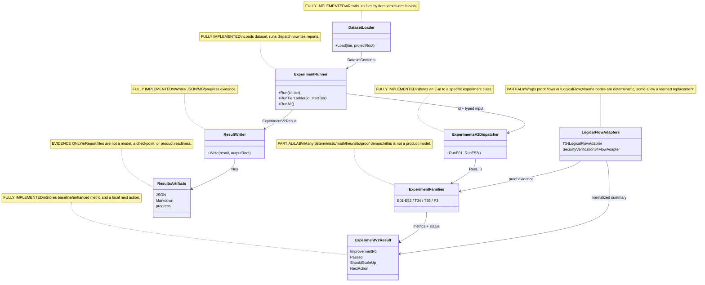

# 35.ExperimentsV2

Documentation status: D35 documented - parent review passed.

## 1. Quick map for Luba

`35.ExperimentsV2` is a large experiment lab and evidence runner. It reads the repository's code folders by tiers, runs an experiment `E01`-`E52` or specific proof scenarios `T34`/`T35`/`P3`, writes JSON/Markdown results, and shows whether it is worth trying the next tier.

The project is important as idea-testing infrastructure: AST tokenization, N-gram, BM25, PageRank, K-NN, regex/Roslyn, semantic compiler helpers, continuous-learning demos, domain graph proofs, and logical-flow proofs. It is not a product runtime, is not a finished trainable `ILearningMachine`, and the results in `35.ExperimentsV2/results/**` are evidence artifacts, not a checkpoint, manifest, locator, or fresh-load proof.

## 2. UML / data flow



| Node | What it does | Status | Where it lives |
|---|---|---|---|
| `DatasetLoader` | Collects `.cs` files for tier 1/2/3+ and returns `DatasetContents`. | Complete runner infra | `35.ExperimentsV2/Infrastructure/DatasetLoader.cs` |
| `ExperimentRunner` | Loads the dataset, calls dispatch, applies ladder logic, and writes the result. | Complete runner infra | `35.ExperimentsV2/ExperimentRunner.cs` |
| `ExperimentsV2Dispatcher` | Binds `E01`-`E52` ids to specific experiment classes. | Complete dispatcher infra | `35.ExperimentsV2/ExperimentsV2Dispatcher.cs` |
| `Experiment families` | Real experiment classes: code NLP, routing, orchestration proofs, continuous-learning demos. | Lab/partial area | `35.ExperimentsV2/Experiments/*.cs` |
| `ExperimentV2Result` | A common DTO: metric, delta, `Passed`, `ShouldScaleUp`, `NextAction`. | Complete DTO infra | `35.ExperimentsV2/Core/ResultTypes.cs` |
| `ResultWriter` | Writes `run-*.json`, `run-*.md`, `progress.json`, `progress.md`. | Complete report infra | `35.ExperimentsV2/Infrastructure/ResultWriter.cs` |
| `LogicalFlowAdapters` | Connects T34/security proof paths to `ILogicalFlow`/`ILogicalUnit`. | Partial logical-flow evidence infra | `35.ExperimentsV2/LogicalFlow/*.cs` |

### 2.1 Simulations by UML connection

| Connection | Example input | Branch simulation | Expected result | What must not be taken as the result |
|---|---|---|---|---|
| `DatasetLoader -> ExperimentRunner` | `tier=2`, repo root | The loader selects `01.Tokenizer`, `02.DatasetPipeline`, `05.Embeddings`, `07.GraphEngine`, `09.Inference`, `10.LoRA`, reads `.cs`, skips `bin/obj`. | `DatasetContents` with `Files`, `CombinedText`, `FileCount`. | This is not a curated training corpus and not dataset privacy/quality. |
| `ExperimentRunner -> ExperimentsV2Dispatcher` | `id="E09"`, `DatasetContents` | The runner calls `DispatchE09`, turns the dataset into arguments for `RunE09`. | `OperationResult<ExperimentV2Result>` or a fail with a reason. | Dispatch does not prove that E09 is a production feature. |
| `ExperimentsV2Dispatcher -> ExperimentFamilies` | `RunE24(files,tier)` | The dispatcher creates `E24AttributedRouter` and calls `Run`. | A specific experiment computes a metric. | There is no automatic product training or promotion into runtime. |
| `ExperimentFamilies -> ExperimentV2Result` | E03 on repeated token ids | The experiment compares baseline/enhanced and fills `BaselinePrimary`, `EnhancedPrimary`, `LowerIsBetter`. | `Passed` is computed from `ImprovementPct >= 5`. | `PROMOTE_TO_NEXT_TIER` is not release approval. |
| `ExperimentRunner -> ResultWriter` | A successful `E25 tier=1` | The runner passes the result to the writer. | JSON/MD in the experiment folder and a progress summary. | JSON/report is not a checkpoint, manifest, or load/use proof. |
| `LogicalFlowAdapters -> ExperimentFamilies` | `LogicalFlowRequest<string>` for `T34` | The adapter checks `FlowId`/`ScenarioId`, builds T34 evidence, and normalizes the summary. | `LogicalFlowResult` with metrics/evidence ids. | This is not a Level 5 `ILearningMachine`; the adapter does not train a model. |
| `LogicalFlowAdapters -> ExperimentV2Result` | CB4 security flow | The security adapter runs the input through deterministic logical units, and the factory can select a learned arbiter only if the registry/flags permit. | Flow summary and metrics for evidence. | The presence of a factory does not prove that a learned unit exists or passed a product gate. |

## 3. No-code algorithms

### 3.1 Running one experiment

Analogy: it is a lab dispatcher. It takes a test tube of data, sends it to the right instrument, records the protocol, and returns the result.

| Field | Value |
|---|---|
| Class | `ExperimentRunner` |
| Method | `Run(string id, int tier)` |
| Input | `id="E03"`, `tier=1`, internal `_projectRoot`, `_outputRoot` |
| Output | `OperationResult<ExperimentV2Result>` |
| Status | Complete runner infra |

Steps:
1. Prints a diagnostic line and calls `DatasetLoader.Load(tier, _projectRoot)`.
2. If the loader fails, returns `OperationResult.Fail`.
3. Passes the dataset to `Dispatch(id, ds, tier)`.
4. If the experiment fails, returns a fail without writing the result.
5. If the experiment succeeds, writes JSON/Markdown/progress via `ResultWriter.Write`.
6. Returns `Ok(result)`.

Branches:

| Branch | Example input | Why it is chosen | Expected result | QA |
|---|---|---|---|---|
| Loader fail | missing repo root | `Directory.Exists` false | Fail with the error text | `ExperimentsV2InfraTests.DatasetLoader_MissingRoot_ReturnsFail` |
| Experiment fail | `id="E04"` on a small dataset | the adapter/experiment requires more data | Fail or ladder skip | `InputAdapters_ForE04_Tier1_FailsWithNotEnoughFiles` |
| Success | `E01`, valid C# source | loader + dispatch succeed | result written | `ExperimentsV2InfraTests` writer/runner coverage |

What it does NOT do: it does not train a product model, does not create a manifest/checkpoint, does not perform fresh-load, does not prove product readiness.

### 3.2 Tier ladder

Analogy: it is a climb up a ladder of data sizes. If there is little data at a small tier, the runner does not scold the algorithm but tries the next tier.

| Field | Value |
|---|---|
| Class | `ExperimentRunner` |
| Method | `RunTierLadder(string id, int startTier = 1)` |
| Input | `id="E09"`, `startTier=2` |
| Output | The last `OperationResult<ExperimentV2Result>` |
| Status | Complete runner infra |

Steps: iterates tiers 1-3; runs `Run`; skips errors with `Tier 2`/`Tier 2+` as a data-size issue; `ShouldScaleUp=true` leads to the next tier; `Passed=true` finishes with success; otherwise it stops as failed.

What it does NOT do: it does not tune hyperparameters and does not accept a product release.

### 3.3 Dispatch E01-E52

Analogy: it is a telephone exchange: the short number `E24` connects to the right experiment.

| Field | Value |
|---|---|
| Class | `ExperimentsV2Dispatcher` |
| Methods | `RunE01(...)` ... `RunE52(...)` |
| Input | typed values: `string source`, `files`, `tokens`, `tier`, `k` |
| Output | `OperationResult<ExperimentV2Result>` or an E03 tuple summary/per-N rows |
| Status | Complete dispatcher infra |

Families:
- `E01-E12`: AST/tokenization, frequency, N-gram, BM25, syntax filter, PageRank, structural context, non-code syntax, K-NN, regex, timer, SIMD/matrix.
- `E13-E24`: method/context K-NN, semantic tokenizer, synonym collapse, logical predicates, domain/complexity/stack classifier, prompt splitter, dataset router, beautifier, attributed router.
- `E25-E31`: shallow transfer helpers, contextual dictionary, pattern reorderer, project adaptor, DPO pair value, predicate cache, continuous loop demos.
- `E32-E45`: episode decomposition/query, dependency, feedback, merger, skill retrieval, quality orchestration, trust, idle/disk/replay/dataset weighting/curriculum.
- `E46-E52`: confidence/model hub/domain bootstrap/orchestrator/domain graph/code context/dynamic flow/project comparison evidence.
- `T34/T35/P3/E53`: proof artifacts around transition, logical-unit replacement, learning from failure, high-level orchestration.

What it does NOT do: the dispatcher does not select the "best" experiment for the product and does not publish a trained unit.

### 3.4 Result DTO and the local next action

Analogy: it is a lab experiment card: two numbers, a "higher/lower is better" direction, and a local recommendation.

| Field | Value |
|---|---|
| Class | `ExperimentV2Result` |
| Properties/methods | `ImprovementPct`, `Passed`, `ShouldScaleUp`, `NextAction` |
| Input | `BaselinePrimary`, `EnhancedPrimary`, `LowerIsBetter`, `ShouldScaleUp` |
| Output | computed percentage and action string |
| Status | Complete DTO infra |

Branches: lower-is-better computes `(baseline - enhanced) / baseline`; higher-is-better computes `(enhanced - baseline) / abs(baseline)`; `Passed` true at 5%; `ShouldScaleUp` can give `SCALE_UP_DATA_TOO_SMALL`.

What it does NOT do: `NextAction` is not a release, model readiness, or D35 phase done.

### 3.5 Sparse N-gram helper

Analogy: it is a notebook "after this token, that one comes most often". An empty context returns a safe `0`.

| Field | Value |
|---|---|
| Class | `SparseNgramTable` |
| Methods | `Add(int prev, int next)`, `ArgmaxRow(int prev)` |
| Input | `prev=12`, `next=44` |
| Output | next-token id or `0` |
| Status | Complete deterministic helper |

What it does NOT do: it is not a language model with a checkpoint; it is an in-memory count table.

### 3.6 Probe neural network

Analogy: a small teaching simulator to measure the speed of a manual forward/backward, not to build a production LLM.

| Field | Value |
|---|---|
| Class | `ProbeNeuralNetwork` |
| Methods | `TrainStep(int currentToken, int nextToken)`, `Evaluate(IReadOnlyList<int> tokens)` |
| Input | a token pair `(currentToken,nextToken)` or a validation token list |
| Output | loss or accuracy |
| Status | Partial probe helper |

Steps: takes an embedding row, computes the hidden layer, ReLU, logits, softmax loss, manually updates `_w2`, `_b2`, `_w1`, `_b1`, `_embed`. No export/import/manifest/fresh-load.

### 3.7 LogicalFlow proof adapters

Analogy: it is an adapter that gives an experimental proof a standard `ILogicalFlow` socket so that the orchestration registry can call it the same way as other flows.

| Field | Value |
|---|---|
| Classes | `T34LogicalFlowAdapter`, `SecurityVerification34FlowAdapter`, `SecurityVerification34FlowFactory` |
| Methods | `ExecuteAsync(LogicalFlowRequest<string> request, CancellationToken)`, `Create(LogicalFlowFactoryRequest request)` |
| Input | `FlowId`, `ScenarioId`, `Input`, flags, metadata |
| Output | `OperationResult<LogicalFlowResult>` or a flow object |
| Status | Partial logical-flow evidence infra |

Branches: wrong flow/scenario -> fail; cancellation -> fail; valid T34 -> build deterministic evidence; security flow -> node-01, node-07, node-02, node-03, node-04, node-08, node-05, node-06, node-09; the factory can select a learned arbiter only when flags, descriptor, and trust state permit.

What it does NOT do: it does not prove the presence of a trained learned unit; the deterministic fallback remains a product-safe default.

## 4. Where the logic sits in the code

| Logic | File | Why it matters | What it proves | What it does not prove |
|---|---|---|---|---|
| Loading the dataset | `35.ExperimentsV2/Infrastructure/DatasetLoader.cs` | Determines the tier input. | `.cs` files are read and `bin/obj` are excluded. | Does not prove curated training data. |
| Runner path | `35.ExperimentsV2/ExperimentRunner.cs` | The end-to-end path load -> dispatch -> write. | Experiment evidence can actually be written. | Does not prove product/runtime readiness. |
| Dispatch map | `35.ExperimentsV2/ExperimentsV2Dispatcher.cs` | Shows the coverage of E01-E52. | An id calls a specific class. | Does not do auto-promotion. |
| Result semantics | `35.ExperimentsV2/Core/ResultTypes.cs` | Defines `Passed`, `ShouldScaleUp`, `NextAction`. | The 5% rule is local. | Not a release gate. |
| Core helpers | `SparseNgramTable`, `SimdMatMul`, `ProbeNeuralNetwork` | Low-level helpers for experiments. | Deterministic/probe algorithms. | Not a model lifecycle. |
| LogicalFlow adapters | `35.ExperimentsV2/LogicalFlow/*.cs` | The link of proof experiments to AgentInfrastructure logical contracts. | The flow interface path exists. | Not Level 5 training. |
| Results artifacts | `35.ExperimentsV2/results/**` | Save historical run evidence. | Reports of past runs exist. | Not a checkpoint/manifest/locator/fresh-load. |

## 5. Short code quotations

`35.ExperimentsV2/ExperimentRunner.cs:18-24`

```csharp
        var loadOp = DatasetLoader.Load(tier, _projectRoot);
        if (!loadOp.IsSuccess)
        {
            Console.WriteLine($"ERROR: {loadOp.ErrorMessage}");
            return OperationResult<ExperimentV2Result>.Fail(loadOp.ErrorMessage);
        }
        var ds = loadOp.Value!;
```

Why it matters: this is the first branch of the runner path: loading the dataset and an early fail if the data could not be collected. The continuation of the method calls dispatch and the writer, but this quote is deliberately shorter so as not to include source lines with a corrupted encoding in the console messages.

`35.ExperimentsV2/Core/ResultTypes.cs:48-51`

```csharp
    public double ImprovementPct =>
        LowerIsBetter
            ? (BaselinePrimary - EnhancedPrimary) / (BaselinePrimary == 0 ? 1 : BaselinePrimary) * 100.0
            : (EnhancedPrimary - BaselinePrimary) / (Math.Abs(BaselinePrimary) < 1e-12 ? 1 : Math.Abs(BaselinePrimary)) * 100.0;
```

Why it matters: this is the formula for the local improvement percentage. `PROMOTE_TO_NEXT_TIER`, `SCALE_UP_DATA_TOO_SMALL`, and other actions are described in the same DTO, but remain lab recommendations, not product approval.

`35.ExperimentsV2/Infrastructure/DatasetLoader.cs:25-35`

```csharp
        var files = new List<(string Path, string Text)>();
        foreach (var folder in folders)
        {
            if (!Directory.Exists(folder)) continue;
            foreach (var f in Directory.GetFiles(folder, "*.cs", SearchOption.AllDirectories))
            {
                if (f.Contains(Path.DirectorySeparatorChar + "obj" + Path.DirectorySeparatorChar)) continue;
                if (f.Contains(Path.DirectorySeparatorChar + "bin" + Path.DirectorySeparatorChar)) continue;
                files.Add((f, File.ReadAllText(f, Encoding.UTF8)));
            }
        }
```

Why it matters: this is the clean part of `DatasetLoader.Load`: it shows the recursive collection of `.cs` files and the explicit exclusion of `bin/obj`. The loader's error messages are described in the algorithm above but are not quoted, because in the current source these lines contain a corrupted encoding.

`35.ExperimentsV2/Core/SparseNgramTable.cs:12-17`

```csharp
    public void Add(int prev, int next)
    {
        if (!_counts.TryGetValue(prev, out var row))
            _counts[prev] = row = new Dictionary<int, int>();
        row[next] = row.GetValueOrDefault(next, 0) + 1;
    }
```

Why it matters: this is the update path of the count-table helper. `ArgmaxRow(int prev)` separately returns the most frequent next token or `0` if there is no row; the comments around it are not quoted, because in the source they are corrupted. The helper itself is not a trainable semantic authority.

`35.ExperimentsV2/Infrastructure/ResultWriter.cs:16-33`

```csharp
    public static OperationResult<string> Write(ExperimentV2Result r, string outputRoot)
    {
        try
        {
            string dir  = Path.Combine(outputRoot, FolderName(r.ExperimentId), "results");
            Directory.CreateDirectory(dir);

            string date     = DateTime.UtcNow.ToString("yyyy-MM-dd");
            int    seq      = NextSeq(dir, date);
            string baseName = $"run-{date}-{seq:D3}";
            string jsonPath = Path.Combine(dir, baseName + ".json");
            string mdPath   = Path.Combine(dir, baseName + ".md");

            File.WriteAllText(jsonPath, ToJson(r),              Encoding.UTF8);
            File.WriteAllText(mdPath,  ToMarkdown(r, baseName), Encoding.UTF8);
            WriteProgress(r, outputRoot);

            return OperationResult<string>.Ok(jsonPath);
```

Why it matters: the writer creates evidence files. The fact of writing JSON/MD is not equal to a passed runtime gate.

`35.ExperimentsV2/LogicalFlow/T34LogicalFlowAdapter.cs:18-34`

```csharp
        if (cancellationToken.IsCancellationRequested)
            return Task.FromResult(AgentInfrastructure.OperationResult<LogicalFlowResult>.Fail("Cancelled"));

        // Refuse requests for a different flow id so the adapter cannot be misbound.
        if (!string.Equals(request.FlowId, FlowId, StringComparison.Ordinal))
            return Task.FromResult(AgentInfrastructure.OperationResult<LogicalFlowResult>.Fail($"Unsupported flow id '{request.FlowId}'."));

        // Refuse requests for a different scenario id so the adapter stays scoped to the accepted T34 oracle.
        if (!string.Equals(request.ScenarioId, ScenarioId, StringComparison.Ordinal))
            return Task.FromResult(AgentInfrastructure.OperationResult<LogicalFlowResult>.Fail($"Unsupported scenario id '{request.ScenarioId}'."));

        // Build the deterministic T34 evidence through the unchanged experiment.
        var evidence = new T34PhaseTransitionProof().BuildEvidence();

        // Return T34 failures through the logical-flow envelope.
        if (!evidence.IsSuccess)
            return Task.FromResult(AgentInfrastructure.OperationResult<LogicalFlowResult>.Fail(evidence.ErrorMessage));
```

Why it matters: the adapter is strictly scoped to T34 evidence. This is not training; it is deterministic proof exposure through the flow interface.

`35.ExperimentsV2/LogicalFlow/SecurityVerification34FlowFactory.cs:25-50`

```csharp
        // Deterministic fallback remains the product-safe default when learned replacement is disabled.
        if (!request.Flags.UseLearnedUnitWhenAvailable)
            return new SecurityArbiterUnit();

        // Find the newest trusted-enough learned arbiter for the security slot.
        var learnedDescriptor = request.Units.ListDescriptors()
            .Where(descriptor =>
                descriptor.IsLearned &&
                descriptor.UnitRole == SecurityArbiterUnit.Role &&
                descriptor.DomainTag == SecurityArbiterUnit.DomainTag &&
                descriptor.InputType == typeof(SecurityArbiterInput) &&
                descriptor.OutputType == typeof(SecurityArbiterVerdict) &&
                descriptor.TrustState >= request.MinimumTrustState &&
                descriptor.TrustState != LogicalUnitTrustState.Rejected)
            .OrderByDescending(descriptor => descriptor.RegistrationOrder)
            .FirstOrDefault();

        // Fall back when no learned arbiter is trusted enough.
        if (learnedDescriptor is null)
            return new SecurityArbiterUnit();

        // Resolve the selected learned unit by exact id.
        var learnedUnit = request.Units.Resolve<SecurityArbiterInput, SecurityArbiterVerdict>(
            learnedDescriptor.UnitId,
            learnedDescriptor.UnitRole,
            learnedDescriptor.DomainTag);
```

Why it matters: the code allows a learned replacement only through flags, descriptor, trust state, and registry resolve. If these are absent, the deterministic fallback runs.

## 6. Hierarchy / logical boundaries

`35.ExperimentsV2` does not itself implement a Level 5 `ILearningMachine<TDomain>`. It uses the AgentInfrastructure levels like this:

```text
Level 4: ILogicalOrchestrator
  Class: InMemoryLogicalOrchestrator
  Accepts: LogicalOrchestratorRequest(runId, scenarioId, userRequest, flags, metadata)
  Returns: LogicalOrchestratorResult(selectedFlowId, final result, flags, flow result)
  Role: select a flow by scenario id and execute it.

Level 3: ILogicalFlow<string>
  Classes: T34LogicalFlowAdapter, SecurityVerification34FlowAdapter
  Accepts: LogicalFlowRequest<string>(flowId, scenarioId, input, flags)
  Returns: LogicalFlowResult(summary, metrics, evidenceIds)
  Role: wrap an experiment/proof into a standard flow.

Level 2: ILogicalUnit<TInput,TOutput>
  Classes: SecuritySplitterUnit, SecurityArbiterSelectorUnit, SecurityArbiterUnit, T34TransitionDomainSplitterUnit and other security units.
  Accepts: LogicalUnitRequest<TInput>
  Returns: LogicalUnitResult<TOutput>
  Role: a single deterministic/proof station; some nodes allow replacement through the registry.
```

Honest boundary: the presence of `ILogicalFlow`/`ILogicalUnit` does not mean that D35 is a trained system. For a trained claim you need a checkpoint, manifest, locator, fresh-load, continue-training, and held-out metrics; this is not claimed here.

## 7. Test/e2e/QA mapping

The tests were read and cross-referenced, but not run in this documentation subphase.

| Behavior | Current evidence | What it covers | What it does not prove |
|---|---|---|---|
| E01-E06 and dispatcher | `Tests/ExperimentsV2Tests.cs` | Synthetic tests for AST tokenizer, frequency ranking, N-gram, BM25, syntax filter, PageRank, dispatcher routing. | Not runtime/product readiness. |
| Infrastructure + E07 | `Tests/ExperimentsV2InfraTests.cs` | DatasetLoader, InputAdapters, ResultWriter, tier propagation, progress files, E07 structural context. | Not a broad `RunAll` execution in this doc phase. |
| T34 proof artifacts | `Tests/DynamicFlowT34Tests.cs` | JSON/MD/Mermaid write path, transition gates, packet identity, no block profile. | Not trained logical unit quality. |
| Logical flow adapter | `Tests/LogicalFlowAdapterTests.cs` | T34 adapter matches direct evidence, rejects unknown flow/scenario, cancellation. | Not a Level 5 `ILearningMachine`. |
| Logical flow registry/orchestrator | `Tests/LogicalFlowRegistryTests.cs`, `Tests/LogicalOrchestratorTests.cs` | Registration/selection of T34/security flows. | Not a product host runtime. |
| Dynamic proofs | `Tests/DynamicFlowE51Tests.cs`, `DynamicFlowT35Tests.cs`, `DynamicFlowP3Tests.cs`, `DynamicFlowE53Tests.cs` | Proof-family behavior for later orchestration experiments. | Not a product model lifecycle. |

QA gap: in this subphase, `dotnet test`, `RunAll`, build, runtime smoke, training, or host probes were not run.

## 8. Component status

| Component | File | Status | What actually works now |
|---|---|---|---|
| `ExperimentRunner` | `35.ExperimentsV2/ExperimentRunner.cs` | Complete | `Run`, `RunTierLadder`, `RunAll`, `RunE08Text` orchestration. |
| `DatasetLoader` | `35.ExperimentsV2/Infrastructure/DatasetLoader.cs` | Complete | Tier folders, recursive `.cs` load, `bin/obj` exclusion. |
| `ExperimentsV2Dispatcher` | `35.ExperimentsV2/ExperimentsV2Dispatcher.cs` | Complete | Dispatch methods for E01-E52 and V2 variants. |
| `ExperimentV2Result` | `35.ExperimentsV2/Core/ResultTypes.cs` | Complete | Improvement, passed, scale-up, next action. |
| `SparseNgramTable` | `35.ExperimentsV2/Core/SparseNgramTable.cs` | Complete | Add/argmax count table. |
| `SimdMatMul` | `35.ExperimentsV2/Core/SimdMatMul.cs` | Complete | SIMD and plain matrix-vector multiply. |
| `ProbeNeuralNetwork` | `35.ExperimentsV2/Core/ProbeNeuralNetwork.cs` | Partial/probe | Manual train/evaluate helper; no asset lifecycle. |
| `E01-E52` families | `35.ExperimentsV2/Experiments/*.cs` | Lab | Many deterministic/heuristic/proof experiments and metrics. |
| `LogicalFlow` adapters | `35.ExperimentsV2/LogicalFlow/*.cs` | Partial | Flow/unit wrappers and replacement-selection proof path. |
| `ResultWriter` | `35.ExperimentsV2/Infrastructure/ResultWriter.cs` | Complete | JSON/MD/progress evidence output. |
| `results/**` | `35.ExperimentsV2/results/**` | Evidence only | Historical reports. Not code, not checkpoint, not model readiness. |

## 9. Anti-false-done checks

- `35.ExperimentsV2` is experiment runner/evidence infrastructure, not a product-ready runtime.
- `35.ExperimentsV2` is not a trained `ILearningMachine` lifecycle: no project-level export/import/locator/fresh-load/continue-training claim is made.
- JSON/Markdown reports under `35.ExperimentsV2/results/**` are evidence artifacts only; they are not production code, model checkpoints, manifests, or completion proof.
- `PROMOTE_TO_NEXT_TIER`, `PASSED`, `SCALE_UP_DATA_TOO_SMALL` are local experiment signals only.
- Deterministic helpers, K-NN, BM25, PageRank, regex, Roslyn parsing, sparse N-gram, SIMD, and the probe neural network must not be hidden as a trained semantic authority.
- LogicalFlow wrappers show flow integration and replacement boundaries; they do not prove that learned replacements exist or are product-ready.
- Tests were read/mapped, not run. No build/runtime/training/smoke claim is made.

Documentation status: D35 documented - parent review passed.
Last verified against source: 2026-06-08.
Known gaps: no fresh test/build/runtime/training execution in this documentation-only subphase; results artifacts are historical evidence only.
