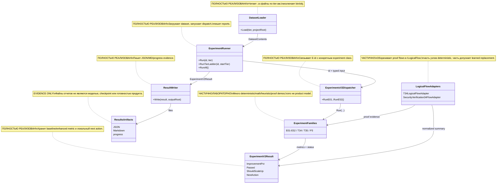

# 35.ExperimentsV2

Documentation status: D35 documented - parent review passed.

## 1. Краткая карта для Лубы

`35.ExperimentsV2` - это большая лаборатория экспериментов и evidence runner. Она читает кодовые папки репозитория по tier-ам, запускает эксперимент `E01`-`E52` или отдельные proof-сценарии `T34`/`T35`/`P3`, пишет JSON/Markdown результаты и показывает, стоит ли пробовать следующий tier.

Проект важен как инфраструктура проверки идей: AST tokenization, N-gram, BM25, PageRank, K-NN, regex/Roslyn, semantic compiler helpers, continuous-learning demos, domain graph proofs и logical-flow proofs. Он не является product runtime, не является завершённой trainable `ILearningMachine`, и результаты в `35.ExperimentsV2/results/**` являются evidence artifacts, а не checkpoint, manifest, locator или fresh-load доказательством.

## 2. UML / поток данных



| Узел | Что делает | Статус | Где живёт |
|---|---|---|---|
| `DatasetLoader` | Собирает `.cs` файлы для tier 1/2/3+ и возвращает `DatasetContents`. | Полная runner infra | `35.ExperimentsV2/Infrastructure/DatasetLoader.cs` |
| `ExperimentRunner` | Загружает dataset, вызывает dispatch, применяет ladder logic и пишет результат. | Полная runner infra | `35.ExperimentsV2/ExperimentRunner.cs` |
| `ExperimentsV2Dispatcher` | Привязывает `E01`-`E52` id к конкретным классам экспериментов. | Полная dispatcher infra | `35.ExperimentsV2/ExperimentsV2Dispatcher.cs` |
| `Experiment families` | Реальные experiment classes: code NLP, routing, orchestration proofs, continuous-learning demos. | Лабораторная/частичная область | `35.ExperimentsV2/Experiments/*.cs` |
| `ExperimentV2Result` | Общий DTO: metric, delta, `Passed`, `ShouldScaleUp`, `NextAction`. | Полная DTO infra | `35.ExperimentsV2/Core/ResultTypes.cs` |
| `ResultWriter` | Пишет `run-*.json`, `run-*.md`, `progress.json`, `progress.md`. | Полная report infra | `35.ExperimentsV2/Infrastructure/ResultWriter.cs` |
| `LogicalFlowAdapters` | Подключает T34/security proof paths к `ILogicalFlow`/`ILogicalUnit`. | Частичная logical-flow evidence infra | `35.ExperimentsV2/LogicalFlow/*.cs` |

### 2.1 Симуляции по связям UML

| Связь | Пример входа | Симуляция ветки | Ожидаемый результат | Что запрещено принимать за результат |
|---|---|---|---|---|
| `DatasetLoader -> ExperimentRunner` | `tier=2`, repo root | Loader выбирает `01.Tokenizer`, `02.DatasetPipeline`, `05.Embeddings`, `07.GraphEngine`, `09.Inference`, `10.LoRA`, читает `.cs`, пропускает `bin/obj`. | `DatasetContents` с `Files`, `CombinedText`, `FileCount`. | Это не curated training corpus и не приватность/качество датасета. |
| `ExperimentRunner -> ExperimentsV2Dispatcher` | `id="E09"`, `DatasetContents` | Runner вызывает `DispatchE09`, превращает dataset в arguments для `RunE09`. | `OperationResult<ExperimentV2Result>` или fail с причиной. | Dispatch не доказывает, что E09 production feature. |
| `ExperimentsV2Dispatcher -> ExperimentFamilies` | `RunE24(files,tier)` | Dispatcher создает `E24AttributedRouter` и вызывает `Run`. | Конкретный experiment считает metric. | Нет автоматического обучения продукта или промо в runtime. |
| `ExperimentFamilies -> ExperimentV2Result` | E03 на повторяющихся token ids | Experiment сравнивает baseline/enhanced и заполняет `BaselinePrimary`, `EnhancedPrimary`, `LowerIsBetter`. | `Passed` вычисляется из `ImprovementPct >= 5`. | `PROMOTE_TO_NEXT_TIER` не release approval. |
| `ExperimentRunner -> ResultWriter` | Успешный `E25 tier=1` | Runner передает result writer-у. | JSON/MD в папке experiment и progress summary. | JSON/report не является checkpoint, manifest, load/use proof. |
| `LogicalFlowAdapters -> ExperimentFamilies` | `LogicalFlowRequest<string>` для `T34` | Adapter проверяет `FlowId`/`ScenarioId`, строит T34 evidence и нормализует summary. | `LogicalFlowResult` с metrics/evidence ids. | Это не Level 5 `ILearningMachine`; adapter не тренирует модель. |
| `LogicalFlowAdapters -> ExperimentV2Result` | CB4 security flow | Security adapter гонит input через deterministic logical units, а factory может выбрать learned arbiter только если registry/flags позволяют. | Flow summary и metrics для evidence. | Наличие factory не доказывает, что learned unit существует или прошел product gate. |

## 3. Алгоритмы без кода

### 3.1 Запуск одного эксперимента

Аналогия: это лабораторный диспетчер. Он берет пробирку с данными, отправляет ее на нужный прибор, записывает протокол и возвращает итог.

| Поле | Значение |
|---|---|
| Класс | `ExperimentRunner` |
| Метод | `Run(string id, int tier)` |
| Вход | `id="E03"`, `tier=1`, внутренние `_projectRoot`, `_outputRoot` |
| Выход | `OperationResult<ExperimentV2Result>` |
| Статус | Полная runner infra |

Шаги:
1. Печатает diagnostic line и вызывает `DatasetLoader.Load(tier, _projectRoot)`.
2. Если loader fail, возвращает `OperationResult.Fail`.
3. Передает dataset в `Dispatch(id, ds, tier)`.
4. Если experiment fail, возвращает fail без записи результата.
5. Если experiment success, пишет JSON/Markdown/progress через `ResultWriter.Write`.
6. Возвращает `Ok(result)`.

Ветки:

| Ветка | Пример входа | Почему выбирается | Ожидаемый результат | QA |
|---|---|---|---|---|
| Loader fail | missing repo root | `Directory.Exists` false | Fail с текстом ошибки | `ExperimentsV2InfraTests.DatasetLoader_MissingRoot_ReturnsFail` |
| Experiment fail | `id="E04"` на малом dataset | adapter/experiment требует больше данных | Fail или ladder skip | `InputAdapters_ForE04_Tier1_FailsWithNotEnoughFiles` |
| Success | `E01`, valid C# source | loader + dispatch успешны | result written | `ExperimentsV2InfraTests` writer/runner coverage |

Что НЕ делает: не тренирует product model, не создает manifest/checkpoint, не выполняет fresh-load, не доказывает product readiness.

### 3.2 Tier ladder

Аналогия: это подъем по лестнице размеров данных. Если на маленьком tier данных мало, runner не ругает алгоритм, а пробует следующий tier.

| Поле | Значение |
|---|---|
| Класс | `ExperimentRunner` |
| Метод | `RunTierLadder(string id, int startTier = 1)` |
| Вход | `id="E09"`, `startTier=2` |
| Выход | Последний `OperationResult<ExperimentV2Result>` |
| Статус | Полная runner infra |

Шаги: итерирует tiers 1-3; запускает `Run`; ошибки с `Tier 2`/`Tier 2+` пропускает как data-size issue; `ShouldScaleUp=true` ведет к следующему tier; `Passed=true` завершает успехом; иначе останавливается как failed.

Что НЕ делает: не подбирает гиперпараметры и не принимает продуктовый релиз.

### 3.3 Dispatch E01-E52

Аналогия: это телефонная станция: короткий номер `E24` соединяет с нужным экспериментом.

| Поле | Значение |
|---|---|
| Класс | `ExperimentsV2Dispatcher` |
| Методы | `RunE01(...)` ... `RunE52(...)` |
| Вход | typed values: `string source`, `files`, `tokens`, `tier`, `k` |
| Выход | `OperationResult<ExperimentV2Result>` или E03 tuple summary/per-N rows |
| Статус | Полная dispatcher infra |

Семейства:
- `E01-E12`: AST/tokenization, frequency, N-gram, BM25, syntax filter, PageRank, structural context, non-code syntax, K-NN, regex, timer, SIMD/matrix.
- `E13-E24`: method/context K-NN, semantic tokenizer, synonym collapse, logical predicates, domain/complexity/stack classifier, prompt splitter, dataset router, beautifier, attributed router.
- `E25-E31`: shallow transfer helpers, contextual dictionary, pattern reorderer, project adaptor, DPO pair value, predicate cache, continuous loop demos.
- `E32-E45`: episode decomposition/query, dependency, feedback, merger, skill retrieval, quality orchestration, trust, idle/disk/replay/dataset weighting/curriculum.
- `E46-E52`: confidence/model hub/domain bootstrap/orchestrator/domain graph/code context/dynamic flow/project comparison evidence.
- `T34/T35/P3/E53`: proof artifacts around transition, logical-unit replacement, learning from failure, high-level orchestration.

Что НЕ делает: dispatcher не выбирает “лучший” experiment для продукта и не публикует обученный unit.

### 3.4 Result DTO и локальный next action

Аналогия: это карточка лабораторного опыта: две цифры, направление “лучше выше/ниже”, и локальная рекомендация.

| Поле | Значение |
|---|---|
| Класс | `ExperimentV2Result` |
| Свойства/методы | `ImprovementPct`, `Passed`, `ShouldScaleUp`, `NextAction` |
| Вход | `BaselinePrimary`, `EnhancedPrimary`, `LowerIsBetter`, `ShouldScaleUp` |
| Выход | computed percentage and action string |
| Статус | Полная DTO infra |

Ветки: lower-is-better считает `(baseline - enhanced) / baseline`; higher-is-better считает `(enhanced - baseline) / abs(baseline)`; `Passed` true при 5%; `ShouldScaleUp` может дать `SCALE_UP_DATA_TOO_SMALL`.

Что НЕ делает: `NextAction` не является release, model readiness или D35 phase done.

### 3.5 Sparse N-gram helper

Аналогия: это записная книжка “после этого токена чаще всего идет тот”. Пустой контекст возвращает безопасный `0`.

| Поле | Значение |
|---|---|
| Класс | `SparseNgramTable` |
| Методы | `Add(int prev, int next)`, `ArgmaxRow(int prev)` |
| Вход | `prev=12`, `next=44` |
| Выход | next-token id или `0` |
| Статус | Полная deterministic helper |

Что НЕ делает: не является языковой моделью с checkpoint; это in-memory count table.

### 3.6 Probe neural network

Аналогия: маленький учебный тренажер, чтобы измерить скорость ручного forward/backward, а не построить продуктовую LLM.

| Поле | Значение |
|---|---|
| Класс | `ProbeNeuralNetwork` |
| Методы | `TrainStep(int currentToken, int nextToken)`, `Evaluate(IReadOnlyList<int> tokens)` |
| Вход | token pair `(currentToken,nextToken)` или validation token list |
| Выход | loss или accuracy |
| Статус | Частичный probe helper |

Шаги: берет embedding row, считает hidden layer, ReLU, logits, softmax loss, вручную обновляет `_w2`, `_b2`, `_w1`, `_b1`, `_embed`. Нет export/import/manifest/fresh-load.

**Порядок обратного прохода (поведение изменено 30 октября 2026).** Сначала считаются ВСЕ производные — относительно одного состояния весов, того, что было до шага, — и только потом применяются обновления. Строгая последовательность: производная по выходу, затем производная по скрытому состоянию, затем производная до среза отрицательных значений, затем производная по эмбеддингу; после этого обновляются второй слой, первый слой и эмбеддинг.

Почему порядок важен, человеческим языком. Шаг обучения — это ответ на вопрос «куда и насколько сдвинуть каждый вес, чтобы потери на этом примере стали меньше». Ответ берётся из производных, а производная имеет смысл только в одной точке — в той, где сеть сейчас стоит. Если обновить второй слой и сразу после этого посчитать по уже сдвинутым весам производную по скрытому состоянию, вопрос незаметно подменяется: сеть отвечает «куда сдвигаться из точки, в которой её ещё не измеряли». В производную подмешивается посторонний член от только что сделанного обновления, и шаг идёт не туда, куда указывает функция потерь.

До 30 октября 2026 порядок был нарушен в двух местах сразу: обновление второго слоя применялось внутри того же цикла, который копил производную по скрытому состоянию, а обновление первого слоя — внутри цикла, копившего производную по эмбеддингу. Измеренное расхождение аналитического шага с прямым пересчётом конечными разностями на закреплённой сети из трёх токенов и двух скрытых нейронов: эмбеддинги 0,0203, веса первого слоя 0,0113, сдвиги первого слоя 0,0283 — при верном втором слое 1,6e-7. У трёх весов первого слоя аналитическая производная была даже противоположна истинной по знаку. После правки все семейства опустились до порядка точности чисел с плавающей точкой: эмбеддинги 3,9e-8, веса первого слоя 2,8e-7, сдвиги первого слоя 5,8e-8; второй слой остался ровно 1,566e-7, то есть правка его не задела. Величина потерь на том же примере до и после правки одна и та же — цели, способ усреднения потерь и идентичность входов не менялись; оптимизатор и скорость обучения этот ремонт намеренно не трогал.

**Следствие для прежних измерений.** Все измерения, снятые этой сетью до 30 октября 2026 года, получены на неверном обратном проходе и не сравнимы напрямую с результатами после правки. Это касается опытов, использующих `ProbeNeuralNetwork` (`E11StepTimer`, `E28ProjectAdaptorV2`, `E29DpoPairValueV2`, `E31ContinuousLoopV2`, `E44DatasetWeighterV2`, `E45CurriculumOrganizerV2`, `E48DomainBootstrapper`) и её копий в `experiments-v2`. Повторный научный прогон — отдельная работа и в этот ремонт не входит.

Постоянная проверка договора порядка: `Tests/ExperimentFixes/ProbeNeuralNetworkGradientTests.cs` — конечные разности по каждому из двадцати одного параметра против применённого обновления, делённого на скорость обучения, плюс отдельная проверка нечисловых значений с номером первого плохого шага.

### 3.7 LogicalFlow proof adapters

Аналогия: это переходник, который дает экспериментальному proof-у стандартную розетку `ILogicalFlow`, чтобы orchestration registry мог вызвать его так же, как другие flow.

| Поле | Значение |
|---|---|
| Классы | `T34LogicalFlowAdapter`, `SecurityVerification34FlowAdapter`, `SecurityVerification34FlowFactory` |
| Методы | `ExecuteAsync(LogicalFlowRequest<string> request, CancellationToken)`, `Create(LogicalFlowFactoryRequest request)` |
| Вход | `FlowId`, `ScenarioId`, `Input`, flags, metadata |
| Выход | `OperationResult<LogicalFlowResult>` или flow object |
| Статус | Частичная logical-flow evidence infra |

Ветки: wrong flow/scenario -> fail; cancellation -> fail; valid T34 -> build deterministic evidence; security flow -> node-01, node-07, node-02, node-03, node-04, node-08, node-05, node-06, node-09; factory может выбрать learned arbiter only when flags, descriptor and trust state permit.

Что НЕ делает: не доказывает наличие trained learned unit; deterministic fallback остается product-safe default.

## 4. Где логика сидит в коде

| Логика | Файл | Почему важно | Что доказывает | Чего не доказывает |
|---|---|---|---|---|
| Загрузка dataset | `35.ExperimentsV2/Infrastructure/DatasetLoader.cs` | Определяет tier input. | `.cs` files читаются и `bin/obj` исключаются. | Не доказывает curated training data. |
| Runner path | `35.ExperimentsV2/ExperimentRunner.cs` | Сквозной путь load -> dispatch -> write. | Experiment evidence реально можно писать. | Не доказывает product/runtime readiness. |
| Dispatch map | `35.ExperimentsV2/ExperimentsV2Dispatcher.cs` | Показывает coverage E01-E52. | Id вызывает конкретный class. | Не делает auto-promotion. |
| Result semantics | `35.ExperimentsV2/Core/ResultTypes.cs` | Определяет `Passed`, `ShouldScaleUp`, `NextAction`. | 5% rule local. | Не release gate. |
| Core helpers | `SparseNgramTable`, `SimdMatMul`, `ProbeNeuralNetwork` | Низкоуровневые helpers для experiments. | Deterministic/probe algorithms. | Не model lifecycle. |
| LogicalFlow adapters | `35.ExperimentsV2/LogicalFlow/*.cs` | Связь proof experiments с AgentInfrastructure logical contracts. | Flow interface path есть. | Не Level 5 training. |
| Results artifacts | `35.ExperimentsV2/results/**` | Сохраняют historical run evidence. | Есть отчеты прошлых запусков. | Не checkpoint/manifest/locator/fresh-load. |

## 5. Короткие цитаты кода

`35.ExperimentsV2/ExperimentRunner.cs:18-24`

```csharp
        var loadOp = DatasetLoader.Load(tier, _projectRoot);
        if (!loadOp.IsSuccess)
        {
            Console.WriteLine($"ERROR: {loadOp.ErrorMessage}");
            return OperationResult<ExperimentV2Result>.Fail(loadOp.ErrorMessage);
        }
        var ds = loadOp.Value!;
```

Почему важно: это первая ветка runner path: загрузка dataset и ранний fail, если данные не удалось собрать. Продолжение метода вызывает dispatch и writer, но эта цитата намеренно короче, чтобы не включать строки исходника с поврежденной кодировкой в консольных сообщениях.

`35.ExperimentsV2/Core/ResultTypes.cs:48-51`

```csharp
    public double ImprovementPct =>
        LowerIsBetter
            ? (BaselinePrimary - EnhancedPrimary) / (BaselinePrimary == 0 ? 1 : BaselinePrimary) * 100.0
            : (EnhancedPrimary - BaselinePrimary) / (Math.Abs(BaselinePrimary) < 1e-12 ? 1 : Math.Abs(BaselinePrimary)) * 100.0;
```

Почему важно: это формула локального процента улучшения. `PROMOTE_TO_NEXT_TIER`, `SCALE_UP_DATA_TOO_SMALL` и другие действия описаны в том же DTO, но остаются лабораторными рекомендациями, а не product approval.

`35.ExperimentsV2/Infrastructure/DatasetLoader.cs:25-35`

```csharp
        var files = new List<(string Path, string Text)>();
        foreach (var folder in folders)
        {
            if (!Directory.Exists(folder)) continue;
            foreach (var f in Directory.GetFiles(folder, "*.cs", SearchOption.AllDirectories))
            {
                if (f.Contains(Path.DirectorySeparatorChar + "obj" + Path.DirectorySeparatorChar)) continue;
                if (f.Contains(Path.DirectorySeparatorChar + "bin" + Path.DirectorySeparatorChar)) continue;
                files.Add((f, File.ReadAllText(f, Encoding.UTF8)));
            }
        }
```

Почему важно: это чистая часть `DatasetLoader.Load`: она показывает рекурсивный сбор `.cs` файлов и явное исключение `bin/obj`. Ошибочные сообщения loader-а описаны в алгоритме выше, но не цитируются, потому что в текущем исходнике эти строки содержат поврежденную кодировку.

`35.ExperimentsV2/Core/SparseNgramTable.cs:12-17`

```csharp
    public void Add(int prev, int next)
    {
        if (!_counts.TryGetValue(prev, out var row))
            _counts[prev] = row = new Dictionary<int, int>();
        row[next] = row.GetValueOrDefault(next, 0) + 1;
    }
```

Почему важно: это update path count-table helper-а. `ArgmaxRow(int prev)` отдельно возвращает самый частый следующий токен или `0`, если строки нет; комментарии вокруг него не цитируются, потому что в исходнике они повреждены. Сам helper не является trainable semantic authority.

`35.ExperimentsV2/Infrastructure/ResultWriter.cs:16-33`

```csharp
    public static OperationResult<string> Write(ExperimentV2Result r, string outputRoot)
    {
        try
        {
            string dir  = Path.Combine(outputRoot, FolderName(r.ExperimentId), "results");
            Directory.CreateDirectory(dir);

            string date     = DateTime.UtcNow.ToString("yyyy-MM-dd");
            int    seq      = NextSeq(dir, date);
            string baseName = $"run-{date}-{seq:D3}";
            string jsonPath = Path.Combine(dir, baseName + ".json");
            string mdPath   = Path.Combine(dir, baseName + ".md");

            File.WriteAllText(jsonPath, ToJson(r),              Encoding.UTF8);
            File.WriteAllText(mdPath,  ToMarkdown(r, baseName), Encoding.UTF8);
            WriteProgress(r, outputRoot);

            return OperationResult<string>.Ok(jsonPath);
```

Почему важно: writer создает evidence files. Факт записи JSON/MD не равен выполненному runtime gate.

`35.ExperimentsV2/LogicalFlow/T34LogicalFlowAdapter.cs:18-34`

```csharp
        if (cancellationToken.IsCancellationRequested)
            return Task.FromResult(AgentInfrastructure.OperationResult<LogicalFlowResult>.Fail("Cancelled"));

        // Refuse requests for a different flow id so the adapter cannot be misbound.
        if (!string.Equals(request.FlowId, FlowId, StringComparison.Ordinal))
            return Task.FromResult(AgentInfrastructure.OperationResult<LogicalFlowResult>.Fail($"Unsupported flow id '{request.FlowId}'."));

        // Refuse requests for a different scenario id so the adapter stays scoped to the accepted T34 oracle.
        if (!string.Equals(request.ScenarioId, ScenarioId, StringComparison.Ordinal))
            return Task.FromResult(AgentInfrastructure.OperationResult<LogicalFlowResult>.Fail($"Unsupported scenario id '{request.ScenarioId}'."));

        // Build the deterministic T34 evidence through the unchanged experiment.
        var evidence = new T34PhaseTransitionProof().BuildEvidence();

        // Return T34 failures through the logical-flow envelope.
        if (!evidence.IsSuccess)
            return Task.FromResult(AgentInfrastructure.OperationResult<LogicalFlowResult>.Fail(evidence.ErrorMessage));
```

Почему важно: adapter строго scoped to T34 evidence. Это не тренировка; это deterministic proof exposure через flow interface.

`35.ExperimentsV2/LogicalFlow/SecurityVerification34FlowFactory.cs:25-50`

```csharp
        // Deterministic fallback remains the product-safe default when learned replacement is disabled.
        if (!request.Flags.UseLearnedUnitWhenAvailable)
            return new SecurityArbiterUnit();

        // Find the newest trusted-enough learned arbiter for the security slot.
        var learnedDescriptor = request.Units.ListDescriptors()
            .Where(descriptor =>
                descriptor.IsLearned &&
                descriptor.UnitRole == SecurityArbiterUnit.Role &&
                descriptor.DomainTag == SecurityArbiterUnit.DomainTag &&
                descriptor.InputType == typeof(SecurityArbiterInput) &&
                descriptor.OutputType == typeof(SecurityArbiterVerdict) &&
                descriptor.TrustState >= request.MinimumTrustState &&
                descriptor.TrustState != LogicalUnitTrustState.Rejected)
            .OrderByDescending(descriptor => descriptor.RegistrationOrder)
            .FirstOrDefault();

        // Fall back when no learned arbiter is trusted enough.
        if (learnedDescriptor is null)
            return new SecurityArbiterUnit();

        // Resolve the selected learned unit by exact id.
        var learnedUnit = request.Units.Resolve<SecurityArbiterInput, SecurityArbiterVerdict>(
            learnedDescriptor.UnitId,
            learnedDescriptor.UnitRole,
            learnedDescriptor.DomainTag);
```

Почему важно: код допускает learned replacement только через flags, descriptor, trust state и registry resolve. Если этого нет, работает deterministic fallback.

`35.ExperimentsV2/Core/ProbeNeuralNetwork.cs:116-167`

```csharp
        // Производная потерь по скрытому состоянию: накопитель на каждый нейрон.
        var dH = new float[_hiddenSize];
        // Вклад даёт каждый выходной токен словаря.
        for (int i = 0; i < _vocabSize; i++)
            // Внутри — каждая координата скрытого состояния.
            for (int j = 0; j < _hiddenSize; j++)
                // Берётся вес второго слоя ДО шага: его обновление применяется ниже.
                dH[j] += _w2[i, j] * dLogits[i];
        // ... производная до среза отрицательных значений ...
        // Производная потерь по эмбеддингу входного токена: накопитель на координату.
        var dEmb = new float[_hiddenSize];
        // Вклад даёт каждый нейрон скрытого слоя.
        for (int i = 0; i < _hiddenSize; i++)
            // Внутри — каждая координата эмбеддинга.
            for (int j = 0; j < _hiddenSize; j++)
                // Берётся вес первого слоя ДО шага: его обновление тоже применяется ниже.
                dEmb[j] += _w1[i, j] * dHPre[i];

        // Все производные посчитаны на одном состоянии «до шага» — теперь обновления.
```

Почему важно: это ровно та граница, которая была сломана до 30 октября 2026 и исправлена в работе «исправить весь обратный проход пробной сети». Цитата показывает оба прежних места нарушения порядка уже в починенном виде: накопление производной по скрытому состоянию читает `_w2` ДО обновления, накопление производной по эмбеддингу читает `_w1` ДО обновления, и обе петли обновления стоят ниже последней производной. Средняя строка с многоточием — не код, а пропуск двух промежуточных петель, чтобы цитата осталась короткой; полный порядок описан в разделе 3.6. Если кто-то снова внесёт обновление весов внутрь этих циклов, упадут проверки `EmbeddingUpdate_MatchesTheDerivativeTakenBeforeTheStep` и `FirstLayerUpdate_MatchesTheDerivativeTakenBeforeTheStep`.

## 6. Hierarchy / logical boundaries

`35.ExperimentsV2` сам не реализует Level 5 `ILearningMachine<TDomain>`. Он использует уровни AgentInfrastructure так:

```text
Уровень 4: ILogicalOrchestrator
  Класс: InMemoryLogicalOrchestrator
  Принимает: LogicalOrchestratorRequest(runId, scenarioId, userRequest, flags, metadata)
  Возвращает: LogicalOrchestratorResult(selectedFlowId, final result, flags, flow result)
  Роль: выбрать flow по scenario id и выполнить его.

Уровень 3: ILogicalFlow<string>
  Классы: T34LogicalFlowAdapter, SecurityVerification34FlowAdapter
  Принимает: LogicalFlowRequest<string>(flowId, scenarioId, input, flags)
  Возвращает: LogicalFlowResult(summary, metrics, evidenceIds)
  Роль: обернуть experiment/proof в стандартный flow.

Уровень 2: ILogicalUnit<TInput,TOutput>
  Классы: SecuritySplitterUnit, SecurityArbiterSelectorUnit, SecurityArbiterUnit, T34TransitionDomainSplitterUnit и другие security units.
  Принимает: LogicalUnitRequest<TInput>
  Возвращает: LogicalUnitResult<TOutput>
  Роль: один deterministic/proof station; часть узлов допускает replacement через registry.
```

Честная граница: наличие `ILogicalFlow`/`ILogicalUnit` не значит, что D35 является обученной системой. Для trained claim нужны checkpoint, manifest, locator, fresh-load, continue-training и held-out metrics; здесь это не заявляется.

## 7. Test/e2e/QA mapping

Тесты были прочитаны и сопоставлены, но не запускались в этой документационной подфазе.

| Поведение | Текущий evidence | Что покрывает | Чего не доказывает |
|---|---|---|---|
| E01-E06 и dispatcher | `Tests/ExperimentsV2Tests.cs` | Synthetic tests for AST tokenizer, frequency ranking, N-gram, BM25, syntax filter, PageRank, dispatcher routing. | Не runtime/product readiness. |
| Infrastructure + E07 | `Tests/ExperimentsV2InfraTests.cs` | DatasetLoader, InputAdapters, ResultWriter, tier propagation, progress files, E07 structural context. | Не broad `RunAll` execution in this doc phase. |
| T34 proof artifacts | `Tests/DynamicFlowT34Tests.cs` | JSON/MD/Mermaid write path, transition gates, packet identity, no block profile. | Не trained logical unit quality. |
| Logical flow adapter | `Tests/LogicalFlowAdapterTests.cs` | T34 adapter matches direct evidence, rejects unknown flow/scenario, cancellation. | Не Level 5 `ILearningMachine`. |
| Logical flow registry/orchestrator | `Tests/LogicalFlowRegistryTests.cs`, `Tests/LogicalOrchestratorTests.cs` | Registration/selection of T34/security flows. | Не product host runtime. |
| Dynamic proofs | `Tests/DynamicFlowE51Tests.cs`, `DynamicFlowT35Tests.cs`, `DynamicFlowP3Tests.cs`, `DynamicFlowE53Tests.cs` | Proof-family behavior for later orchestration experiments. | Не product model lifecycle. |

QA gap: в этой subphase не запускались `dotnet test`, `RunAll`, build, runtime smoke, training или host probes.

## 8. Статус компонентов

| Компонент | Файл | Статус | Что реально работает сейчас |
|---|---|---|---|
| `ExperimentRunner` | `35.ExperimentsV2/ExperimentRunner.cs` | Полная | `Run`, `RunTierLadder`, `RunAll`, `RunE08Text` orchestration. |
| `DatasetLoader` | `35.ExperimentsV2/Infrastructure/DatasetLoader.cs` | Полная | Tier folders, recursive `.cs` load, `bin/obj` exclusion. |
| `ExperimentsV2Dispatcher` | `35.ExperimentsV2/ExperimentsV2Dispatcher.cs` | Полная | Dispatch methods for E01-E52 and V2 variants. |
| `ExperimentV2Result` | `35.ExperimentsV2/Core/ResultTypes.cs` | Полная | Improvement, passed, scale-up, next action. |
| `SparseNgramTable` | `35.ExperimentsV2/Core/SparseNgramTable.cs` | Полная | Add/argmax count table. |
| `SimdMatMul` | `35.ExperimentsV2/Core/SimdMatMul.cs` | Полная | SIMD and plain matrix-vector multiply. |
| `ProbeNeuralNetwork` | `35.ExperimentsV2/Core/ProbeNeuralNetwork.cs` | Частичная/probe; поведение изменено 30.10.2026 | Manual train/evaluate helper; no asset lifecycle. Обратный проход считает все производные на состоянии весов до шага и применяет обновления только после последней производной (раздел 3.6). Постоянная проверка договора порядка: `Tests/ExperimentFixes/ProbeNeuralNetworkGradientTests.cs`. Измерения, снятые этой сетью до 30.10.2026, получены на неверном обратном проходе и напрямую не сравнимы с более поздними. |
| `E01-E52` families | `35.ExperimentsV2/Experiments/*.cs` | Лабораторные | Many deterministic/heuristic/proof experiments and metrics. |
| `LogicalFlow` adapters | `35.ExperimentsV2/LogicalFlow/*.cs` | Частичная | Flow/unit wrappers and replacement-selection proof path. |
| `ResultWriter` | `35.ExperimentsV2/Infrastructure/ResultWriter.cs` | Полная | JSON/MD/progress evidence output. |
| `results/**` | `35.ExperimentsV2/results/**` | Evidence only | Historical reports. Not code, not checkpoint, not model readiness. |

## 9. Anti-false-done checks

- `35.ExperimentsV2` - experiment runner/evidence infrastructure, not product-ready runtime.
- `35.ExperimentsV2` is not a trained `ILearningMachine` lifecycle: no project-level export/import/locator/fresh-load/continue-training claim is made.
- JSON/Markdown reports under `35.ExperimentsV2/results/**` are evidence artifacts only; they are not production code, model checkpoints, manifests or completion proof.
- `PROMOTE_TO_NEXT_TIER`, `PASSED`, `SCALE_UP_DATA_TOO_SMALL` are local experiment signals only.
- Deterministic helpers, K-NN, BM25, PageRank, regex, Roslyn parsing, sparse N-gram, SIMD and probe neural network must not be hidden as trained semantic authority.
- LogicalFlow wrappers show flow integration and replacement boundaries; they do not prove that learned replacements exist or are product-ready.
- Tests were read/mapped, not run. No build/runtime/training/smoke claim is made.

Documentation status: D35 documented - parent review passed.
Last verified against source: 2026-06-08.
Known gaps: no fresh test/build/runtime/training execution in this documentation-only subphase; results artifacts are historical evidence only.
